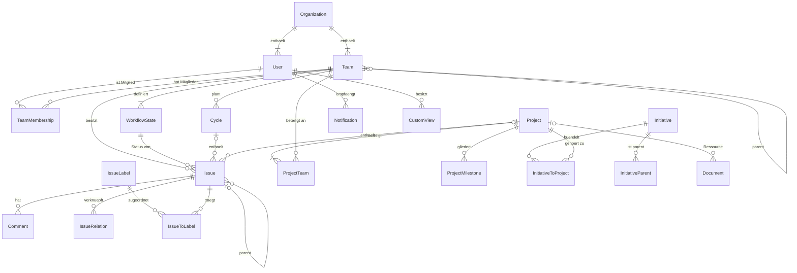
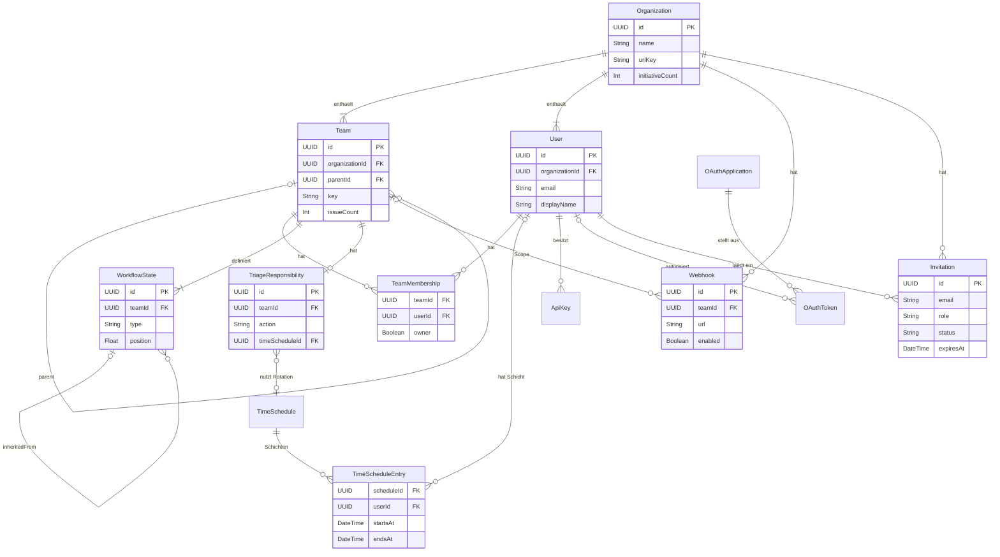
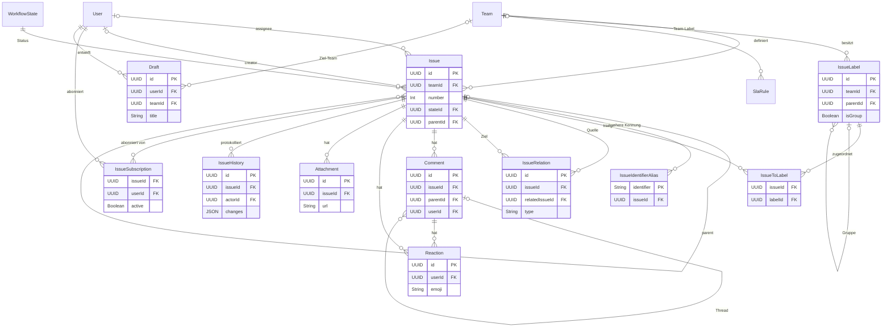
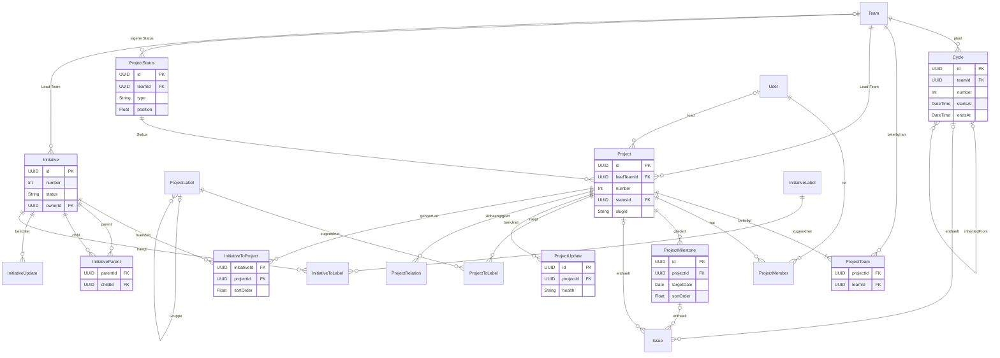
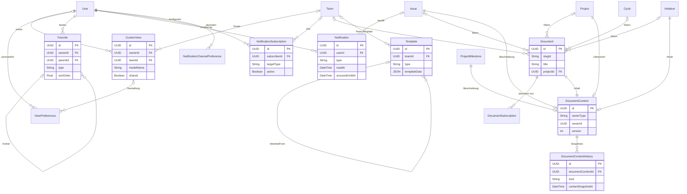

# 01 – Domänenmodell

Dieses Kapitel beschreibt alle fachlichen Entitäten von Lineal, ihre Felder, Beziehungen und Invarianten. Es ist die gemeinsame Grundlage aller weiteren Kapitel: Die Geschäftsregeln in [03-issues-workflow.md](03-issues-workflow.md) und [04-planung.md](04-planung.md), die Tools in [07-mcp-server.md](07-mcp-server.md) und die API in [09-api-events.md](09-api-events.md) beziehen sich auf die hier definierten Feldnamen. Begriffe, Enums, ID-Formate und das Fehlermodell sind in [00-konventionen.md](00-konventionen.md) festgelegt und werden hier nicht wiederholt.

Das Modell ist aus dem öffentlichen GraphQL-Schema von Linear abgeleitet, aber bewusst **auf den Scope von Lineal reduziert** (siehe [README](README.md#scope)). Wo Lineal vom Original abweicht oder etwas ergänzt, das im Schema fehlt (z. B. `Project.number`, `InitiativeParent`, `ApiKey`), ist das im Text vermerkt.

## 0. Lesehilfe

### 0.1 Spalten der Feldtabellen

| Spalte | Bedeutung |
|---|---|
| Feld | Feldname in API, MCP und (empfohlen) Persistenz, `camelCase`. Fremdschlüssel enden auf `Id`. |
| Typ | Abstrakter Typ nach [00](00-konventionen.md): `String`, `Int`, `Float`, `Boolean`, `DateTime`, `Date`, `UUID`, `JSON`, `Enum(...)`. Listen als `[Typ]`. |
| Pflicht | **ja** = in der Persistenz nie leer (NOT NULL). Ein Pflichtfeld kann trotzdem vom System befüllt werden (z. B. `sortOrder`) und muss dann beim Create nicht übergeben werden. **nein** = darf leer (`null`) sein. **abgel.** = abgeleitetes Feld, wird nicht gespeichert (oder nur als Cache), siehe [Abschnitt 6](#6-abgeleitete-felder). |
| Default | Wert beim Create, wenn der Aufrufer nichts angibt. `—` = kein Default (Pflichtfeld muss angegeben oder vom System berechnet werden). |
| Bedeutung | Fachliche Bedeutung. |
| Constraints/Index | Wertebereich, Referenzregeln, Unique-Constraints, empfohlene Indizes. „FK → X“ = Fremdschlüssel auf Entität X. |

### 0.2 Gemeinsame Felder aller Entitäten

Die folgenden Felder hat **jede** Entität; sie werden in den Einzeltabellen nicht wiederholt.

| Feld | Typ | Pflicht | Default | Bedeutung | Constraints/Index |
|---|---|---|---|---|---|
| `id` | UUID | ja | vom Server generiert (v4) | Primärschlüssel. Darf beim Create vom Client vorgegeben werden (idempotente Creates, Offline-Clients). | PK; bei Client-Vorgabe Kollision → `conflict` |
| `organizationId` | UUID | ja | Workspace des Aufrufers | Mandant. Wird nie über die API geändert. | FK → Organization; erster Teil fast jedes Index (siehe [7.2](#72-multi-tenancy)) |
| `createdAt` | DateTime | ja | Serverzeit | Anlagezeitpunkt. Bei Importen über die API setzbar. | Index für `orderBy=createdAt` |
| `updatedAt` | DateTime | ja | = `createdAt` | Letzte **inhaltliche** Änderung (nicht bei reinen Zählerupdates oder Lesezugriffen). | Index für `orderBy=updatedAt` |
| `archivedAt` | DateTime | nein | `null` | Gesetzt = archiviert (ausgeblendet, wiederherstellbar). | Teil partieller Indizes `WHERE archivedAt IS NULL` |
| `version` | Int | ja | 1 | Optimistic Locking, wird bei jedem Schreibzugriff um 1 erhöht. Nicht fachlich, aber in der API sichtbar. | siehe [7.5](#75-optimistic-locking-und-sync-sequenz) |

Ausnahme: `Organization` selbst hat kein `organizationId`. Reine Join-Tabellen (`IssueToLabel`, `ProjectTeam` usw.) tragen `organizationId`, `createdAt` und gegebenenfalls `sortOrder`, aber kein `archivedAt` und kein `version`.

### 0.3 Notation in Diagrammen

Die ER-Diagramme zeigen nur Schlüssel und wenige Kernattribute; vollständig sind ausschließlich die Tabellen. Kardinalitäten in Mermaid-Notation: `||` genau eins, `|o` null oder eins, `|{` eins oder mehr, `o{` null oder mehr.

## 1. Überblick

Lineal ist mandantenfähig: Eine **Organization** (Workspace, z. B. `acme`) enthält Teams, User und alle übrigen Objekte. **Teams** (z. B. `ENG`, Sub-Team `WEB`, `DES`) besitzen Issues, Workflow-Status, Cycles und optional Labels und Templates. **Issues** gehören genau einem Team. **Projekte** können mehreren Teams gehören und werden von **Initiativen** gebündelt. Views, Favoriten, Benachrichtigungen, Dokumente und Templates bilden die Arbeitsumgebung um diesen Kern.

Das folgende Übersichtsdiagramm zeigt nur die wichtigsten Beziehungen ohne Attribute. Die Detaildiagramme stehen am Anfang der Abschnitte 2 bis 5.



### 1.1 Entitätsliste

| Bereich | Entitäten | Abschnitt |
|---|---|---|
| Workspace, Teams, Zugang | Organization, User, Team, TeamMembership, WorkflowState, TriageResponsibility, TimeSchedule, TimeScheduleEntry, ApiKey, OAuthApplication, OAuthToken, Webhook, Invitation | [2](#2-workspace-teams-und-zugang) |
| Issues | Issue, IssueIdentifierAlias, IssueLabel, IssueToLabel, IssueRelation, Comment, Reaction, Attachment, IssueHistory, IssueSubscription, SlaRule, Draft | [3](#3-issues-und-zugehörige-objekte) |
| Planung | Cycle, Project, ProjectTeam, ProjectMember, ProjectStatus, ProjectMilestone, ProjectLabel, ProjectToLabel, ProjectUpdate, ProjectRelation, Initiative, InitiativeParent, InitiativeToProject, InitiativeUpdate, InitiativeLabel, InitiativeToLabel, EntityExternalLink | [4](#4-planung) |
| Views, Inbox, Dokumente | CustomView, ViewPreferences, Favorite, Notification, NotificationSubscription, NotificationChannelPreference, Document, DocumentSubscription, Template, DocumentContent, DocumentContentHistory | [5](#5-views-inbox-dokumente-und-templates) |

---

## 2. Workspace, Teams und Zugang

Die fachlichen Regeln zu Sub-Teams, Vererbung, Sichtbarkeit und Rollen stehen in [02-teams-rechte.md](02-teams-rechte.md); dieses Kapitel definiert die Datenstrukturen dafür.



### 2.1 Organization (Workspace)

Wurzel des Mandanten. Beim Anlegen eines Workspace wird automatisch ein erstes Team mit demselben Namen erzeugt (siehe [02](02-teams-rechte.md)). Planabhängige Grenzen des Originals werden als konfigurierbare Limits in `limits` geführt (README-Entscheidung „Pläne/Limits“).

| Feld | Typ | Pflicht | Default | Bedeutung | Constraints/Index |
|---|---|---|---|---|---|
| `name` | String | ja | — | Anzeigename, z. B. „Acme Inc.“ | 1–100 Zeichen |
| `urlKey` | String | ja | aus `name` abgeleitet | URL-Schlüssel, z. B. `acme` | global unique (über alle Workspaces), `^[a-z0-9-]{3,32}$` |
| `previousUrlKeys` | [String] | ja | `[]` | Frühere URL-Keys (max. 3), werden umgeleitet | jeder Eintrag global reserviert |
| `logoUrl` | String | nein | `null` | Logo | |
| `fiscalYearStartMonth` | Int | ja | 0 | Erster Monat des Geschäftsjahres (0 = Januar) | 0–11; wirkt auf `quarter`/`halfYear`-Auflösung |
| `initiativesEnabled` | Boolean | ja | `true` | Initiativen-Funktion aktiv | |
| `initiativeCount` | Int | ja | 0 | Zähler für `Initiative.number` (`I-4`) | atomar erhöht, nie verringert |
| `createdIssueCount` | Int | ja | 0 | Statistik: insgesamt angelegte Issues | Cache, darf leicht nachlaufen |
| `projectUpdateReminderFrequencyInWeeks` | Int | nein | 1 | Workspace-Default für Projekt-Update-Erinnerungen; `null` = aus | 1–4 |
| `projectUpdateRemindersDay` | Enum(`Monday`…`Sunday`) | ja | `Friday` | Wochentag der Erinnerung | |
| `projectUpdateRemindersHour` | Int | ja | 14 | Stunde (Ortszeit des Empfängers) | 0–23 |
| `initiativeUpdateReminderFrequencyInWeeks` | Int | nein | `null` | wie oben, für Initiativen | 1–4 |
| `initiativeUpdateRemindersDay` | Enum(`Monday`…`Sunday`) | ja | `Friday` | | |
| `initiativeUpdateRemindersHour` | Int | ja | 14 | | 0–23 |
| `allowedFileUploadContentTypes` | [String] | nein | `null` (= alle) | Erlaubte MIME-Typen für Anhänge | |
| `securitySettings` | JSON | ja | `{}` | Welche Rollen Workspace-Aktionen ausführen dürfen (Teams anlegen, einladen, API-Keys für Member, Labels verwalten). Schema in [02](02-teams-rechte.md). | |
| `limits` | JSON | ja | siehe unten | Konfigurierbare Workspace-Limits | |
| `deletionRequestedAt` | DateTime | nein | `null` | Workspace-Löschung beantragt; endgültig nach 48 h | |

Struktur und Defaults von `limits`:

| Schlüssel | Default | Bedeutung |
|---|---|---|
| `maxTeams` | `null` (unbegrenzt) | Anzahl nicht gelöschter Teams |
| `maxSubTeamDepth` | 5 | Maximale Tiefe der Team-Hierarchie (Wurzel = Ebene 1) |
| `maxInitiativeDepth` | 5 | Maximale Tiefe der Initiative-Hierarchie |
| `privateTeamsEnabled` | `true` | Ob `private`/`restricted` erlaubt ist |
| `maxOpenIssuesPerTeam` | 60000 | Nicht archivierte Issues pro Team; Überschreitung → `limit_exceeded` |
| `maxLabelsPerGroup` | 250 | Kind-Labels pro Label-Gruppe |
| `maxUnarchivedNotificationsPerUser` | 2000 | Ältere Benachrichtigungen werden automatisch archiviert |
| `trashRetentionDays` | 30 | Frist im Papierkorb bis zur endgültigen Löschung |

**Invarianten**

1. `urlKey` ist systemweit eindeutig; ein Wert aus `previousUrlKeys` irgendeines Workspace darf nicht neu vergeben werden, solange er dort eingetragen ist.
2. Ein Workspace hat zu jedem Zeitpunkt mindestens ein nicht gelöschtes Team und mindestens einen aktiven User mit Rolle `owner` oder `admin`.
3. Werte in `limits` dürfen nicht unter den aktuellen Ist-Zustand gesenkt werden (z. B. `maxSubTeamDepth` kleiner als die tiefste bestehende Hierarchie) → `invalid_request`.

### 2.2 User

Ein Benutzerkonto **innerhalb eines Workspace**. Lineal modelliert einen User pro Workspace; dieselbe E-Mail kann in mehreren Workspaces je einen eigenen User haben (ein übergreifendes Login-Konto ist ein Erweiterungspunkt, siehe [Offene Punkte](#8-offene-punkte-und-annahmen)). Apps und KI-Agenten, die als eigene Akteure auftreten, sind User mit Rolle `app`.

| Feld | Typ | Pflicht | Default | Bedeutung | Constraints/Index |
|---|---|---|---|---|---|
| `name` | String | ja | — | Vollständiger Name, z. B. „Alice Example“ | 1–255 Zeichen |
| `displayName` | String | ja | aus `name`/E-Mail abgeleitet | Kurzname für @-Erwähnungen, z. B. `alice` | unique je Workspace, case-insensitiv; `^[a-z0-9._-]{1,40}$` |
| `email` | String | ja | — | E-Mail-Adresse | unique je Workspace, case-insensitiv |
| `role` | Enum(`owner`,`admin`,`user`,`guest`,`app`) | ja | `user` | Workspace-Rolle | Index `(organizationId, role)` |
| `active` | Boolean | ja | `true` | `false` = suspendiert/deaktiviert | |
| `disableReason` | String | nein | `null` | Grund der Deaktivierung | |
| `avatarUrl` | String | nein | `null` | Profilbild | |
| `avatarBackgroundColor` | String | ja | aus `id` abgeleitet | Hintergrund des Default-Avatars | `#RRGGBB` |
| `timezone` | String | nein | `null` | IANA-Zeitzone des Users (für Erinnerungen) | gültiger IANA-Name |
| `title` | String | nein | `null` | Jobtitel | |
| `description` | String | nein | `null` | Kurzbiografie | |
| `statusEmoji` | String | nein | `null` | Persönlicher Status (Emoji) | |
| `statusLabel` | String | nein | `null` | Persönlicher Status (Text) | |
| `statusUntilAt` | DateTime | nein | `null` | Status läuft ab | |
| `lastSeen` | DateTime | nein | `null` | Zuletzt aktiv | nicht Teil von `updatedAt` |
| `createdIssueCount` | Int | ja | 0 | Statistik | Cache |
| `defaultHomeView` | String | nein | `null` | Startseite (vordefinierte View oder Favorit), siehe [05](05-views-suche-inbox.md) | |
| `emailFormat` | Enum(`digest`,`immediate`) | ja | `digest` | Zustellform der Benachrichtigungs-E-Mails ([05](05-views-suche-inbox.md) §6.9) | |
| `notificationPriorityCategories` | [String] | ja | `assignments`, `mentions`, `reminders`, `triage` | Kategorien (Werte wie `Notification.category`) für die Priority inbox | |
| `dueDateReminders` | Boolean | ja | `false` | Fälligkeitserinnerungen (`issueDue`) für eigene zugewiesene Issues | |
| `notificationSettings` | JSON | ja | `{}` | Weitere Schalter aus [05](05-views-suche-inbox.md) §6.9 (E-Mail global, nur Priority per E-Mail, Zurückhalten außerhalb der Arbeitszeit, Sofort bei Urgent/SLA, Priority inbox aktiv) | fehlende Schlüssel = Default aus 05 |
| `admin` | Boolean | abgel. | — | `role ∈ {owner, admin}` | |
| `guest` | Boolean | abgel. | — | `role = guest` | |
| `app` | Boolean | abgel. | — | `role = app` | |
| `initials` | String | abgel. | — | Initialen aus `name` | |
| `isAssignable` | Boolean | abgel. | — | `active = true` und Rolle ≠ `app` (oder App mit Zuweisungsrecht) | |
| `url` | String | abgel. | — | Profil-URL | |

**Invarianten**

1. `email` und `displayName` sind je Workspace eindeutig (case-insensitiv). `displayName` darf keinen Namen haben, der mit einem reservierten Literal kollidiert (`me`, `none`).
2. Suspendierte User (`active = false`) können nicht neu zugewiesen, erwähnt oder als Filterwert verwendet werden; bestehende Referenzen in historischen Daten bleiben erhalten.
3. User werden nie physisch gelöscht, solange sie in Issues, Kommentaren oder Historie referenziert sind; sie werden deaktiviert.
4. Ein Gast (`guest`) kann nicht `owner` einer TeamMembership sein und sieht nur Teams, in denen er Mitglied ist.

### 2.3 Team

Primäre Organisationseinheit. Besitzt Issues, Workflow-Status, Cycles, Team-Labels, Team-Templates und alle teambezogenen Einstellungen. Sub-Teams entstehen über `parentId`. Die Vererbungsregeln stehen in [02](02-teams-rechte.md); hier sind nur die Felder definiert.

**Stammdaten und Hierarchie**

| Feld | Typ | Pflicht | Default | Bedeutung | Constraints/Index |
|---|---|---|---|---|---|
| `name` | String | ja | — | Teamname, z. B. „Engineering“ | 1–80 Zeichen; unique je Workspace case-insensitiv |
| `key` | String | ja | aus `name` erzeugt (siehe [02](02-teams-rechte.md)) | Präfix der Issue-Kennung, z. B. `ENG`, `WEB`, `DES` | `^[A-Z][A-Z0-9]{0,6}$` (1–7 Zeichen, kein Bindestrich); nicht `P`/`I`; unique je Workspace case-insensitiv, auch gegen historische Keys |
| `description` | String | nein | `null` | Teambeschreibung | |
| `icon` | String | nein | `null` | Emoji oder Icon-Name | |
| `color` | String | nein | zufällig aus Palette | Teamfarbe | `#RRGGBB` |
| `parentId` | UUID | nein | `null` | Parent-Team (Sub-Team-Hierarchie) | FK → Team; Index `(organizationId, parentId)` |
| `visibility` | Enum(`public`,`private`,`restricted`) | ja | `public` (unter privatem Parent: `restricted`) | Sichtbarkeit | siehe Invarianten |
| `allMembersCanJoin` | Boolean | ja | `true` | Workspace-Mitglieder dürfen öffentlichem Team selbst beitreten | nur bei `public` wirksam |
| `timezone` | String | ja | `America/Los_Angeles` | Team-Zeitzone für Cycles, SLA-Werktage, Recurring-Logik | gültiger IANA-Name |
| `securitySettings` | JSON | ja | `{}` | Wer darf Labels, Templates, Team-Settings, Mitglieder verwalten (`all` oder `owners`) | Schema in [02](02-teams-rechte.md) |
| `retiredAt` | DateTime | nein | `null` | Team stillgelegt (read-only) | |
| `trashed` | Boolean | ja | `false` | Team gelöscht (Papierkorb, 30 Tage) | |
| `trashedAt` | DateTime | nein | `null` | Zeitpunkt des Löschens | Job-Index |

> Hinweis: Keys enthalten keinen Bindestrich. Eine Kennung wird deshalb am (einzigen) Bindestrich getrennt: `WEB-12` = Key `WEB`, Nummer 12. Sub-Teams haben eigene kurze Keys; die Hierarchie steht im `displayName` („Engineering › Web“).

**Zähler**

| Feld | Typ | Pflicht | Default | Bedeutung | Constraints/Index |
|---|---|---|---|---|---|
| `issueCount` | Int | ja | 0 | Zuletzt vergebene `Issue.number` dieses Teams (Zähler, nicht die aktuelle Anzahl) | nur atomar erhöhen (`UPDATE … SET issueCount = issueCount + 1 RETURNING`), nie verringern |
| `projectCount` | Int | ja | 0 | Zuletzt vergebene `Project.number` für Projekte mit diesem Lead-Team | wie `issueCount` |
| `cycleCount` | Int | ja | 0 | Zuletzt vergebene `Cycle.number` | wie `issueCount` |

**Workflow, Triage, Automationen**

| Feld | Typ | Pflicht | Default | Bedeutung | Constraints/Index |
|---|---|---|---|---|---|
| `defaultIssueStateId` | UUID | ja | erster `backlog`-Status | Startstatus neuer Issues von Teammitgliedern | FK → WorkflowState des Teams, `type ∈ {backlog, unstarted}` |
| `triageEnabled` | Boolean | ja | `false` | Triage aktiv | |
| `triageIssueStateId` | UUID | nein | `null`; beim Aktivieren der Triage-Status | Status für eingehende Issues von Nicht-Mitgliedern/Integrationen | FK → WorkflowState des Teams mit `type = triage`; Pflicht, wenn `triageEnabled` |
| `requirePriorityToLeaveTriage` | Boolean | ja | `false` | Priorität ≠ 0 nötig, um Triage zu verlassen | |
| `autoClosePeriod` | Int | nein | `null` (= aus) | Monate ohne Aktivität bis Auto-Close | ∈ {1, 3, 6, 9, 12} |
| `autoCloseStateId` | UUID | nein | erster `canceled`-Status | Zielstatus für Auto-Close | FK → WorkflowState des Teams, `type = canceled` |
| `autoArchivePeriod` | Int | ja | 6 | Monate in geschlossenem Zustand bis Auto-Archiv (Issues, Cycles, Projekte) | ∈ {1, 3, 6, 9, 12} |
| `autoCloseParentIssues` | Boolean | ja | `false` | Parent auf `completed`, wenn alle Sub-Issues geschlossen sind | |
| `autoCloseChildIssues` | Boolean | ja | `false` | Offene Sub-Issues schließen, wenn Parent geschlossen wird | |
| `setIssueSortOrderOnStateChange` | Enum(`top`,`bottom`,`none`) | ja | `top` | Wohin ein Issue bei Statuswechsel in der Spalte springt | |
| `groupIssueHistory` | Boolean | ja | `true` | Aufeinanderfolgende Historieneinträge zusammenfassen | |
| `inheritWorkflowStatuses` | Boolean | ja | `false` | Sub-Team übernimmt Status des Parents | nur bei `parentId ≠ null` wirksam |

**Schätzung**

| Feld | Typ | Pflicht | Default | Bedeutung | Constraints/Index |
|---|---|---|---|---|---|
| `issueEstimationType` | Enum(`notUsed`,`exponential`,`fibonacci`,`linear`,`tShirt`) | ja | `notUsed` | Schätzskala | |
| `issueEstimationExtended` | Boolean | ja | `false` | Erweiterte Skala (zusätzliche Werte) | |
| `issueEstimationAllowZero` | Boolean | ja | `false` | 0 ist erlaubter Schätzwert | |
| `defaultIssueEstimate` | Int | ja | 1 | Punkte für ungeschätzte Issues in Scope/Fortschritt | ≥ 0 |
| `inheritIssueEstimation` | Boolean | ja | `false` | Sub-Team übernimmt die vier Schätzfelder des Parents | nur bei `parentId ≠ null` |

**Cycles**

| Feld | Typ | Pflicht | Default | Bedeutung | Constraints/Index |
|---|---|---|---|---|---|
| `cyclesEnabled` | Boolean | ja | `false` | Cycles aktiv | |
| `cycleDuration` | Int | ja | 2 | Cycle-Länge in Wochen | 1–8 |
| `cycleCooldownTime` | Int | ja | 0 | Pause nach jedem Cycle in Wochen | 0–4 |
| `cycleStartDay` | Int | ja | 1 | Starttag (0 = Sonntag … 6 = Samstag) | 0–6 |
| `upcomingCycleCount` | Int | ja | 2 | Anzahl vorab erzeugter künftiger Cycles | 1–15 |
| `cycleIssueAutoAssignStarted` | Boolean | ja | `false` | Gestartete Issues ohne Cycle in aktuellen Cycle legen | |
| `cycleIssueAutoAssignCompleted` | Boolean | ja | `false` | Erledigte Issues ohne Cycle in aktuellen Cycle legen | |
| `cycleLockToActive` | Boolean | ja | `false` | Alle aktiven Issues (`unstarted`, `started`) gehören zwingend in einen Cycle | |

**Templates und Projektstatus**

| Feld | Typ | Pflicht | Default | Bedeutung | Constraints/Index |
|---|---|---|---|---|---|
| `defaultTemplateForMembersId` | UUID | nein | `null` | Standard-Issue-Template für Teammitglieder | FK → Template (`type = issue`, Team oder Workspace) |
| `defaultTemplateForNonMembersId` | UUID | nein | `null` | Standard-Issue-Template für Nicht-Mitglieder | FK → Template (`type = issue`) |
| `defaultProjectTemplateId` | UUID | nein | `null` | Standard-Projekt-Template | FK → Template (`type = project`) |
| `inheritProjectStatuses` | Boolean | ja | `true` | Projektstatus vom Parent-Team bzw. Workspace übernehmen; `false` = eigene `ProjectStatus` mit `teamId` | |

**Abgeleitete Felder**

| Feld | Typ | Pflicht | Default | Bedeutung | Constraints/Index |
|---|---|---|---|---|---|
| `displayName` | String | abgel. | — | Name inkl. Parent-Kette, z. B. „Engineering › Web“ | |
| `activeCycleId` | UUID | abgel. | — | Cycle mit `startsAt ≤ jetzt < endsAt` | |
| `openIssueCount` | Int | abgel. | — | Nicht archivierte Issues (für das Team-Limit) | Cache erlaubt |
| `url` | String | abgel. | — | `/<urlKey>/team/<key>` | |

**Invarianten**

1. `key` ist je Workspace eindeutig (case-insensitiv) und entspricht dem Muster aus der Tabelle. Ein Key darf außerdem nicht vergeben werden, wenn noch eine Issue-Kennung mit diesem Präfix als Alias existiert (`IssueIdentifierAlias`, siehe [3.2](#32-issueidentifieralias)) – sonst könnte `DES-1` auf zwei Issues zeigen.
2. Wird `key` geändert, erhalten alle Issues des Teams neue Kennungen; die alten landen in `previousIdentifiers` (README-Entscheidung „Team-Key ändern“).
3. Die Team-Hierarchie ist ein Baum: `parentId ≠ id`, und es entstehen keine Zyklen (Prüfung: der neue Parent darf nicht in der Nachfahrenmenge des Teams liegen).
4. Die Tiefe der Hierarchie (Wurzel = 1) ist ≤ `Organization.limits.maxSubTeamDepth` (Default 5). Beim Umhängen zählt die Tiefe des gesamten verschobenen Teilbaums.
5. Ein Sub-Team ist nicht offener als sein Parent: Ist der Parent `private` oder `restricted`, ist das Sub-Team `restricted` oder `private`; `restricted` ist nur mit Parent zulässig.
6. Pro Team gibt es mindestens einen WorkflowState je Kategorie `backlog`, `unstarted`, `started`, `completed`, `canceled`, genau einen der Kategorie `duplicate` und genau einen der Kategorie `triage`, wenn `triageEnabled = true` (bei `false` keinen aktiven, ein vorhandener wird archiviert).
7. `defaultIssueStateId`, `triageIssueStateId` und `autoCloseStateId` verweisen auf Status **dieses** Teams mit passender Kategorie (siehe Tabelle).
8. Bei `inheritWorkflowStatuses = true` besitzt das Sub-Team eigene WorkflowState-Zeilen mit `inheritedFromId` auf die Status des Parents; Name, Farbe, Kategorie und Position werden synchron gehalten und sind im Sub-Team nicht editierbar. Dadurch bleibt die Invariante „Issue-Status gehört zum Team des Issues“ einfach prüfbar.
9. Hat der Parent `cyclesEnabled = true`, übernimmt das Sub-Team dessen Cycle-Schedule; Cycle-Felder des Sub-Teams sind dann nicht editierbar (geerbte Cycles sind eigene Zeilen mit `Cycle.inheritedFromId`).
10. Ein Team mit `retiredAt ≠ null` akzeptiert keine neuen Issues und keine neuen Mitglieder; Änderungen an seinen Issues → `forbidden`.
11. Die Anzahl nicht archivierter Issues ist ≤ `limits.maxOpenIssuesPerTeam`; Creates darüber hinaus → `limit_exceeded`.
12. `issueCount`, `projectCount` und `cycleCount` steigen streng monoton; vergebene Nummern werden nie wiederverwendet, auch nicht nach Löschen.

### 2.4 TeamMembership

Join-Entität User ↔ Team mit Owner-Flag.

| Feld | Typ | Pflicht | Default | Bedeutung | Constraints/Index |
|---|---|---|---|---|---|
| `teamId` | UUID | ja | — | Team | FK → Team; Index |
| `userId` | UUID | ja | — | Mitglied | FK → User; Index |
| `owner` | Boolean | ja | `false` (Ersteller eines Teams: `true`) | Team-Owner mit erweiterten Rechten | |
| `sortOrder` | Float | ja | ans Ende | Reihenfolge des Teams in der Seitenleiste des Users | |

**Invarianten**

1. `(teamId, userId)` ist eindeutig (unter nicht archivierten Mitgliedschaften).
2. Wer Mitglied eines Sub-Teams ist, ist auch Mitglied aller Vorfahren-Teams. **Ausnahme:** User mit Rolle `guest` dürfen nur im Sub-Team sein.
3. Gäste können nicht `owner = true` haben.
4. Owner eines Parent-Teams gelten als Owner aller Sub-Teams (abgeleitet, nicht gespeichert); Workspace-`owner`/`admin` gelten als Owner aller Teams, auf die sie Zugriff haben.
5. Ein privates Team hat mindestens ein Mitglied.

### 2.5 WorkflowState

Status eines Issues, teamspezifisch, mit fester Kategorie (`type`). Die Kategorie-Reihenfolge ist fest (siehe [00](00-konventionen.md#4-feste-enums)); `position` ordnet nur innerhalb einer Kategorie.

| Feld | Typ | Pflicht | Default | Bedeutung | Constraints/Index |
|---|---|---|---|---|---|
| `teamId` | UUID | ja | — | Besitzendes Team | FK → Team; Index `(teamId, type, position)` |
| `name` | String | ja | — | Anzeigename, z. B. „In Review“ | unique je Team case-insensitiv (unter nicht archivierten) |
| `type` | Enum(`triage`,`backlog`,`unstarted`,`started`,`completed`,`canceled`,`duplicate`) | ja | — | Kategorie | nach Anlage nicht änderbar |
| `color` | String | ja | Kategorie-Farbe | UI-Farbe | `#RRGGBB` |
| `description` | String | nein | `null` | Beschreibung | |
| `position` | Float | ja | ans Ende der Kategorie | Reihenfolge innerhalb der Kategorie | |
| `inheritedFromId` | UUID | nein | `null` | Status des Parent-Teams, von dem geerbt wird | FK → WorkflowState |
| `systemManaged` | Boolean | abgel. | — | `type = duplicate` | |

Default-Workflow eines neuen Teams: `Backlog` (backlog), `Todo` (unstarted), `In Progress` (started), `In Review` (started), `Done` (completed), `Canceled` (canceled), `Duplicate` (duplicate); bei aktivierter Triage zusätzlich `Triage` (triage).

**Invarianten**

1. Ein Status kann nur archiviert/gelöscht werden, wenn danach Team-Invariante 6 noch gilt und kein Issue mehr auf ihn verweist (Issues müssen vorher auf einen anderen Status migriert werden; die API bietet dafür einen Zielstatus-Parameter, siehe [03](03-issues-workflow.md)).
2. Der Status der Kategorie `duplicate` ist system-verwaltet: genau einer pro Team, `name` (`Duplicate`) und `type` sind nicht änderbar, er ist nicht löschbar.
3. `type` ist unveränderlich; eine andere Kategorie erfordert einen neuen Status.
4. Ein geerbter Status (`inheritedFromId ≠ null`) gehört zu einem Sub-Team, dessen `inheritWorkflowStatuses = true` ist, und `inheritedFrom.teamId` ist der Parent dieses Teams.

### 2.6 TriageResponsibility

> **Umsetzung:** `currentUserId` ist **gespeichert** (Spalte `triage_responsibility.current_user_id`), nicht bei jeder Abfrage abgeleitet. Der periodische Job `triage_rotation` (60 s) berechnet die Schicht neu und schreibt nur bei Änderung; `assignmentIndex` bleibt für Round-Robin bei `manualUserIds`.


Legt fest, wer für die Triage eines Teams verantwortlich ist und was beim Eingang eines Issues passiert. Höchstens eine pro Team.

| Feld | Typ | Pflicht | Default | Bedeutung | Constraints/Index |
|---|---|---|---|---|---|
| `teamId` | UUID | ja | — | Team | FK → Team; unique |
| `action` | Enum(`assign`,`notify`) | ja | `notify` | Verantwortliche zuweisen oder nur benachrichtigen | |
| `manualUserIds` | [UUID] | nein | `null` | Feste Liste verantwortlicher User (manuelle Auswahl) | jedes Element FK → User, Teammitglied |
| `assignmentIndex` | Int | ja | 0 | Round-Robin-Zeiger bei `assign` mit mehreren manuellen Usern | intern |
| `timeScheduleId` | UUID | nein | `null` | Rotation (Schichtplan) | FK → TimeSchedule |
| `currentUserId` | UUID | abgel. | — | Aktuell verantwortlich: Schicht mit `startsAt ≤ jetzt < endsAt`, sonst `manualUserIds[assignmentIndex]` | |

**Invarianten**

1. Genau eine der Quellen ist gesetzt: `manualUserIds` (nicht leer) **oder** `timeScheduleId`.
2. Die Triage-Verantwortung ist nur wirksam, wenn `Team.triageEnabled = true`.

### 2.7 TimeSchedule und TimeScheduleEntry (Triage-Rotation und Schichten)

Ein Schichtplan auf Workspace-Ebene, manuell gepflegt oder über eine Schnittstelle von außen befüllt (z. B. aus einem On-Call-System).

**TimeSchedule**

| Feld | Typ | Pflicht | Default | Bedeutung | Constraints/Index |
|---|---|---|---|---|---|
| `name` | String | ja | — | Name, z. B. „ENG Triage-Rotation“ | |
| `externalId` | String | nein | `null` | ID im externen System | unique je Workspace, wenn gesetzt |
| `externalUrl` | String | nein | `null` | Link zum externen Plan | |

**TimeScheduleEntry** (Schicht)

| Feld | Typ | Pflicht | Default | Bedeutung | Constraints/Index |
|---|---|---|---|---|---|
| `scheduleId` | UUID | ja | — | Schichtplan | FK → TimeSchedule; Index `(scheduleId, startsAt)` |
| `userId` | UUID | nein | `null` | Lineal-User der Schicht | FK → User |
| `userEmail` | String | nein | `null` | Externe Referenz, wenn kein User zuordenbar | |
| `startsAt` | DateTime | ja | — | Schichtbeginn | |
| `endsAt` | DateTime | ja | — | Schichtende | `endsAt > startsAt` |
| `overriddenUserId` | UUID | nein | `null` | Ersetzter User (Vertretung) | FK → User |

**Invarianten**

1. `userId` oder `userEmail` ist gesetzt.
2. Schichten desselben Plans überlappen nicht, außer ein Eintrag ist eine Vertretung (`overriddenUserId ≠ null`); Vertretungen haben Vorrang.

### 2.8 ApiKey

Persönlicher API-Schlüssel. Im öffentlichen Linear-Schema nicht enthalten; Lineal definiert ihn minimal. Authentifizierung und Scopes: [09-api-events.md](09-api-events.md).

| Feld | Typ | Pflicht | Default | Bedeutung | Constraints/Index |
|---|---|---|---|---|---|
| `userId` | UUID | ja | — | Besitzer; der Key handelt mit dessen Rechten | FK → User |
| `label` | String | ja | — | Bezeichnung, z. B. „CI-Skript“ | |
| `keyPrefix` | String | ja | — | Erste 8 Zeichen des Klartexts zur Anzeige (`lin_api_ab12…`) | |
| `keyHash` | String | ja | — | Hash des Schlüssels (z. B. SHA-256); Klartext wird nur einmal angezeigt | unique, Index für Lookup |
| `scopes` | [String] | ja | `["read","write"]` | `read`, `write`, `admin`, `issues:create`, `comments:create` | `read` immer enthalten |
| `teamIds` | [UUID] | nein | `null` (= alle zugänglichen Teams) | Einschränkung auf Teams | |
| `expiresAt` | DateTime | nein | `null` | Ablauf | |
| `lastUsedAt` | DateTime | nein | `null` | Letzte Nutzung | |
| `revokedAt` | DateTime | nein | `null` | Widerrufen | |

**Invarianten**

1. Ein Key gewährt nie mehr als die Rechte seines Users; bei Deaktivierung des Users sind alle Keys sofort ungültig.
2. Member dürfen Keys nur anlegen, wenn `Organization.securitySettings` das erlaubt.

### 2.9 OAuthApplication und OAuthToken

OAuth-2.0-Clients (Integrationen, KI-Agenten) und die ausgestellten Tokens. Details zum Flow (PKCE, Refresh, `actor=app`) in [09](09-api-events.md).

**OAuthApplication**

| Feld | Typ | Pflicht | Default | Bedeutung | Constraints/Index |
|---|---|---|---|---|---|
| `name` | String | ja | — | Anzeigename | |
| `clientId` | String | ja | generiert | Öffentliche Client-ID | global unique |
| `clientSecretHash` | String | ja | — | Hash des Client-Secrets | |
| `redirectUris` | [String] | ja | — | Erlaubte Redirect-URIs | mind. 1 |
| `distribution` | Enum(`private`,`public`) | ja | `private` | Nur eigener Workspace oder installierbar für andere | |
| `grantTypes` | [Enum(`authorization_code`,`client_credentials`)] | ja | `["authorization_code"]` | Erlaubte Flows | `authorization_code` immer enthalten |
| `developer` | String | ja | — | Hersteller | |
| `developerUrl` | String | ja | — | Website | |
| `imageUrl` | String | nein | `null` | Icon | |
| `appUserId` | UUID | nein | `null` | User mit Rolle `app`, als der die App bei `actor=app` handelt | FK → User |
| `webhookUrl` | String | nein | `null` | Webhook-Ziel der App | |
| `webhookResourceTypes` | [String] | ja | `[]` | Abonnierte Ressourcen | Werte wie `Webhook.resourceTypes` |
| `creatorId` | UUID | ja | — | Anleger | FK → User |

**OAuthToken**

| Feld | Typ | Pflicht | Default | Bedeutung | Constraints/Index |
|---|---|---|---|---|---|
| `applicationId` | UUID | ja | — | App | FK → OAuthApplication |
| `userId` | UUID | ja | — | Autorisierender User bzw. App-User | FK → User |
| `actor` | Enum(`user`,`app`) | ja | `user` | In wessen Namen geschrieben wird | |
| `scopes` | [String] | ja | `["read"]` | `read`, `write`, `issues:create`, `comments:create`, `timeSchedule:write`, `admin` | |
| `accessTokenHash` | String | ja | — | Hash des Access-Tokens | unique |
| `accessExpiresAt` | DateTime | ja | jetzt + 24 h | Ablauf Access-Token | |
| `refreshTokenHash` | String | nein | `null` | Hash des Refresh-Tokens | unique |
| `previousRefreshTokenHash` | String | nein | `null` | Vorheriger Refresh-Token (Rotation, 30 Minuten Kulanz) | |
| `revokedAt` | DateTime | nein | `null` | Widerrufen | |

### 2.10 Webhook

HTTP-Callback bei Änderungen. Zustellung, Signatur und Retries: [09-api-events.md](09-api-events.md).

| Feld | Typ | Pflicht | Default | Bedeutung | Constraints/Index |
|---|---|---|---|---|---|
| `label` | String | nein | `null` | Anzeigename | |
| `url` | String | ja | — | Ziel-URL (HTTPS) | `https://` |
| `secret` | String | ja | generiert | Signing-Secret für HMAC-SHA256 | verschlüsselt gespeichert |
| `enabled` | Boolean | ja | `true` | Aktiv; wird nach erschöpften Retries auf `false` gesetzt | |
| `teamId` | UUID | nein | `null` | Einzelnes Team | FK → Team |
| `allPublicTeams` | Boolean | ja | `false` | Ereignisse aller öffentlichen Teams | |
| `resourceTypes` | [String] | ja | — | `Issue`, `Comment`, `Attachment`, `IssueLabel`, `Reaction`, `Project`, `ProjectUpdate`, `Cycle`, `Document`, `Initiative`, `InitiativeUpdate`, `User`, `IssueSLA` | mind. 1 |
| `creatorId` | UUID | ja | — | Anleger | FK → User |
| `failureCount` | Int | ja | 0 | Fehlgeschlagene Zustellungen in Folge | |

**Invarianten**

1. Genau eines gilt: `teamId ≠ null` **oder** `allPublicTeams = true`.
2. Webhooks für private Teams dürfen nur Team-Owner und Admins anlegen; `allPublicTeams` liefert nie Ereignisse privater Teams.

### 2.11 Invitation

Einladung einer E-Mail-Adresse in den Workspace (Abläufe: [08](08-userflows.md) F1 und F16; Rechte: [02](02-teams-rechte.md) §6, `invitationsRole`). Erst die Annahme erzeugt den `User`.

| Feld | Typ | Pflicht | Default | Bedeutung | Constraints/Index |
|---|---|---|---|---|---|
| `email` | String | ja | — | Eingeladene Adresse | Index `(organizationId, email)` case-insensitiv |
| `role` | Enum(`admin`,`user`,`guest`) | ja | `user` | Rolle des künftigen Users | nicht höher als die Rolle des Einladenden |
| `teamIds` | [UUID] | ja | `[]` | Teams, denen der User bei Annahme beitritt (zusätzlich zu Teams mit `joinByDefault`, außer bei Gästen) | Vorbelegung, wird erst bei Annahme gegen bestehende Teams geprüft; daher bewusst Werte-Liste statt Join-Tabelle (Ausnahme zu [7.1](#71-tabellen-und-schlüssel)) |
| `inviterId` | UUID | ja | aufrufender User | Einladender | FK → User |
| `tokenHash` | String | ja | generiert | SHA-256 des Einladungs-Tokens aus dem Link `/invite/{token}` | unique |
| `status` | Enum(`pending`,`accepted`,`revoked`,`expired`) | ja | `pending` | Zustand | |
| `expiresAt` | DateTime | ja | `createdAt` + 7 Tage | Ablauf; „Resend“ erzeugt ein neues Token und verlängert | |
| `lastSentAt` | DateTime | ja | = `createdAt` | Letzter Versand (Resend) | |
| `acceptedAt` | DateTime | nein | `null` | Annahmezeitpunkt | |
| `acceptedUserId` | UUID | nein | `null` | Bei Annahme erzeugter User | FK → User |

**Invarianten**

1. Je Workspace und E-Mail (case-insensitiv) höchstens eine Einladung mit `status = pending`; ist die E-Mail bereits aktiver User, wird keine Einladung angelegt (`invalid_request`, `details.reason = "already_member"`).
2. `role = guest` nur, wenn Gäste im Workspace erlaubt sind, und nur mit mindestens einem Eintrag in `teamIds`.
3. Annahme nur bei `status = pending` und `expiresAt > now`; das Token ist einmalig verwendbar. Unbekanntes, abgelaufenes oder widerrufenes Token → `not_found`.
4. Die Annahme legt in einer Transaktion `User` (Rolle `role`), die `TeamMembership`-Zeilen und `status = accepted` an.

---

## 3. Issues und zugehörige Objekte

Die Abläufe (Statuswechsel, Triage, SLA-Berechnung, Automationen, Teamwechsel) stehen in [03-issues-workflow.md](03-issues-workflow.md). Hier sind Struktur und statische Regeln definiert.



### 3.1 Issue

Zentrales Arbeitsobjekt. Gehört genau einem Team, hat genau einen Status.

**Kern und Zuordnung**

| Feld | Typ | Pflicht | Default | Bedeutung | Constraints/Index |
|---|---|---|---|---|---|
| `teamId` | UUID | ja | — | Besitzendes Team | FK → Team; Index `(teamId, stateId)` |
| `number` | Int | ja | `Team.issueCount + 1` (atomar) | Laufende Nummer im Team | unique `(teamId, number)`; nie wiederverwendet |
| `title` | String | ja | — (bei Template: Template-Titel) | Titel | 1–255 Zeichen, getrimmt |
| `description` | String | nein | `null` | Beschreibung in Markdown; kanonischer Inhalt, Versionen und Kollaborationszustand liegen in [DocumentContent](#510-documentcontent-und-documentcontenthistory) (`ownerType = issue`) | max. 500 000 Zeichen ([03](03-issues-workflow.md)) |
| `stateId` | UUID | ja | `Team.defaultIssueStateId` bzw. `triageIssueStateId` (siehe [03](03-issues-workflow.md)) | Workflow-Status | FK → WorkflowState |
| `stateEnteredAt` | DateTime | ja | = `createdAt` | Zeitpunkt des letzten Statuswechsels (Filter/Sortierung „Time in current status“, [05](05-views-suche-inbox.md)) | vom System bei jedem Wechsel von `stateId` gesetzt |
| `priority` | Int | ja | 0 | 0 = No priority, 1 = Urgent … 4 = Low | 0–4 |
| `estimate` | Int | nein | `null` | Schätzwert gemäß Team-Skala; `null` = ungeschätzt | Wert aus der Skala des Teams; 0 nur bei `issueEstimationAllowZero` |
| `assigneeId` | UUID | nein | `null` | Zuständiger User (höchstens einer) | FK → User; Index `(organizationId, assigneeId)` partiell |
| `delegateId` | UUID | nein | `null` | Delegierter Agent (Erweiterungspunkt, nur gespeichert) | FK → User mit Rolle `app` |
| `creatorId` | UUID | nein | aufrufender User | Ersteller; `null` bei gelöschter Integration | FK → User; Index |
| `parentId` | UUID | nein | `null` | Parent-Issue | FK → Issue; Index |
| `projectId` | UUID | nein | `null` (Sub-Issue: Projekt des Parents) | Projekt (höchstens eins) | FK → Project; Index |
| `projectMilestoneId` | UUID | nein | `null` | Meilenstein im Projekt | FK → ProjectMilestone |
| `cycleId` | UUID | nein | `null` | Cycle (höchstens einer) | FK → Cycle; Index |
| `dueDate` | Date | nein | `null` | Fälligkeit | |
| `lastAppliedTemplateId` | UUID | nein | `null` | Zuletzt angewandtes Template | FK → Template |
| `sourceCommentId` | UUID | nein | `null` | Kommentar, aus dem das Issue erzeugt wurde | FK → Comment |

**Sortierung**

| Feld | Typ | Pflicht | Default | Bedeutung | Constraints/Index |
|---|---|---|---|---|---|
| `sortOrder` | Float | ja | Anfang der Liste (kleinster Wert im Team − 1) | Manuelle, workspaceweit geteilte Position in Listen/Boards | Index `(teamId, sortOrder)` |
| `prioritySortOrder` | Float | ja | = `sortOrder` | Position innerhalb einer Prioritätsgruppe | |
| `subIssueSortOrder` | Float | nein | ans Ende der Sub-Issues des Parents; `null` ohne Parent | Position in der Sub-Issue-Liste | |

**Kennungen**

| Feld | Typ | Pflicht | Default | Bedeutung | Constraints/Index |
|---|---|---|---|---|---|
| `identifier` | String | abgel. | — | `Team.key + "-" + number`, z. B. `ENG-123` | über `(teamId, number)` auflösbar |
| `previousIdentifiers` | [String] | ja | `[]` | Frühere Kennungen nach Team- oder Key-Wechsel, älteste zuerst | physisch in `IssueIdentifierAlias` |
| `url` | String | abgel. | — | `/<urlKey>/issue/<identifier>/<titel-slug>` | |
| `branchName` | String | abgel. | — | Vorschlag für Git-Branch, z. B. `alice/eng-123-login-fehler` | Erweiterungspunkt Git |
| `priorityLabel` | String | abgel. | — | `No priority`/`Urgent`/`High`/`Medium`/`Low` | |

**Zeitstempel des Lebenszyklus** (alle vom System gesetzt, über die API nur bei Importen schreibbar)

| Feld | Typ | Pflicht | Default | Bedeutung | Constraints/Index |
|---|---|---|---|---|---|
| `startedAt` | DateTime | nein | `null` | Erster Eintritt in Kategorie `started` | |
| `completedAt` | DateTime | nein | `null` | Eintritt in `completed`; wird beim Verlassen wieder `null` | Index (Filter, Sortierung) |
| `canceledAt` | DateTime | nein | `null` | Eintritt in `canceled` oder `duplicate`; beim Verlassen `null` | |
| `startedTriageAt` | DateTime | nein | `null` | Eintritt in `triage` | |
| `triagedAt` | DateTime | nein | `null` | Verlassen von `triage` | |
| `addedToTeamAt` | DateTime | ja | = `createdAt` | Zeitpunkt der Zuordnung zum aktuellen Team | |
| `addedToCycleAt` | DateTime | nein | `null` | Zeitpunkt der Zuordnung zum aktuellen Cycle | |
| `addedToProjectAt` | DateTime | nein | `null` | Zeitpunkt der Zuordnung zum aktuellen Projekt | |
| `autoClosedAt` | DateTime | nein | `null` | Durch Auto-Close geschlossen | |
| `autoArchivedAt` | DateTime | nein | `null` | Durch Auto-Archiv archiviert | |

**Triage-Snooze, SLA, Papierkorb**

| Feld | Typ | Pflicht | Default | Bedeutung | Constraints/Index |
|---|---|---|---|---|---|
| `snoozedUntilAt` | DateTime | nein | `null` | In der Triage ausgeblendet bis | nur bei Status `triage` |
| `snoozedById` | UUID | nein | `null` | Wer gesnoozt hat | FK → User; gesetzt ⇔ `snoozedUntilAt` gesetzt |
| `slaType` | Enum(`all`,`onlyBusinessDays`) | nein | `null` | Zählweise der SLA-Frist | |
| `slaStartedAt` | DateTime | nein | `null` | Beginn der SLA-Frist | |
| `slaMediumRiskAt` | DateTime | nein | `null` | Ab hier „Medium risk“ (Breach < 1 Woche) | |
| `slaHighRiskAt` | DateTime | nein | `null` | Ab hier „High risk“ (Breach < 1 Tag) | Job-Index |
| `slaBreachesAt` | DateTime | nein | `null` | Frist; danach „Breached“ | Job-Index partiell `WHERE slaBreachesAt IS NOT NULL AND completedAt IS NULL` |
| `trashed` | Boolean | ja | `false` | Im Papierkorb | |
| `trashedAt` | DateTime | nein | `null` | Zeitpunkt des Löschens (Basis der 30-Tage-Frist) | Job-Index |
| `reactionData` | JSON | abgel. | — | Aggregat `[{emoji, count, userIds}]` über Reaktionen auf die Beschreibung | Cache erlaubt |

**Erweiterungspunkte (nicht im Scope, Felder optional vorsehbar):** `inheritsSharedAccess` (Issue-Sharing), `recurringIssueTemplateId` (wiederkehrende Issues), `integrationSourceType`/`externalUserCreatorId` (Integrationen), `releaseIds`, Customer Needs.

Beispiel (gekürzt, API-Sicht):

```json
{
  "id": "6f1d0c9e-3b7a-4c1e-9a55-0d2b8f7e1a10",
  "identifier": "ENG-123",
  "number": 123,
  "title": "Login-Fehler bei SSO-Weiterleitung",
  "team": { "id": "…", "key": "ENG", "name": "Engineering" },
  "state": { "id": "…", "name": "In Progress", "type": "started" },
  "priority": { "value": 2, "name": "High" },
  "estimate": 3,
  "assignee": { "id": "…", "displayName": "alice" },
  "project": { "id": "…", "identifier": "P-ENG-7", "name": "Checkout-Relaunch" },
  "cycle": { "id": "…", "number": 42 },
  "previousIdentifiers": ["WEB-17"],
  "startedAt": "2026-10-08T09:12:00.000Z",
  "completedAt": null,
  "dueDate": "2026-10-20",
  "url": "https://lineal.example/acme/issue/ENG-123/login-fehler-bei-sso-weiterleitung"
}
```

**Invarianten**

1. `state.teamId = teamId`. Weil geerbte Status eigene Zeilen des Sub-Teams sind (`inheritedFromId`), gilt das auch für Sub-Teams ohne Sonderfall.
2. `cycle.teamId = teamId` (gilt aus demselben Grund auch für geerbte Cycles). Zuordnen ist erlaubt zu aktiven und künftigen Cycles sowie – nur während der Cooldown-Phase bzw. bis zum Start des nächsten Cycles – zum unmittelbar vorherigen Cycle für Issues, die in dieser Zeit `completed` wurden. Ältere abgeschlossene Cycles sind kein gültiges Ziel. Eine Cooldown-Phase ist kein Cycle-Objekt und kann daher nie zugeordnet werden.
3. Ist `projectId` gesetzt, ist das Team des Issues am Projekt beteiligt: `(projectId, teamId) ∈ ProjectTeam`.
4. `projectMilestoneId` darf nur gesetzt sein, wenn `projectId` gesetzt ist, und `projectMilestone.projectId = projectId`. Wird `projectId` geändert oder geleert, wird `projectMilestoneId` geleert.
5. Parent und Sub-Issue **dürfen in verschiedenen Teams liegen**. `parentId ≠ id`, und die Parent-Kette ist zyklenfrei (der neue Parent darf kein Nachfahre des Issues sein). Eine feste Tiefengrenze gibt es nicht; Implementierungen sollen aber eine Schutzgrenze (Empfehlung 10 Ebenen) durchsetzen → `limit_exceeded`.
6. `dueDate` und `slaBreachesAt` schließen sich aus: Wird ein SLA gesetzt, wird `dueDate` geleert; wird `dueDate` gesetzt, werden die `sla*`-Felder geleert.
7. `estimate` ist `null` oder ein Wert der Skala des Teams (siehe [6.4](#64-schätzskalen)). Bei `issueEstimationType = notUsed` ist `estimate` immer `null`.
8. `assigneeId` verweist auf einen aktiven User, der das Team sehen darf (bei privaten Teams: Mitglied). Gäste nur, wenn sie Mitglied des Teams sind.
9. Labels: siehe Invarianten von [IssueToLabel](#34-issuetolabel).
10. `state.type = duplicate` ⇔ es gibt genau eine ausgehende `IssueRelation` mit `type = duplicate` (das kanonische Issue).
11. `snoozedUntilAt ≠ null` nur, solange `state.type = triage`; beim Verlassen der Triage werden `snoozedUntilAt` und `snoozedById` geleert.
12. Die Lebenszyklus-Zeitstempel sind konsistent mit dem Status: `completedAt ≠ null` ⇔ `state.type = completed`; `canceledAt ≠ null` ⇔ `state.type ∈ {canceled, duplicate}`.
13. `previousIdentifiers` enthält nie die aktuelle `identifier`, und jede Kennung ist workspaceweit höchstens einem Issue zugeordnet.
14. Ein Issue im Papierkorb (`trashed = true`) oder archiviert ist read-only, bis es wiederhergestellt wird.

### 3.2 IssueIdentifierAlias

Physische Tabelle hinter `Issue.previousIdentifiers`. Sie dient der schnellen, exakten Auflösung alter Kennungen (Redirect, Suche, MCP-Referenzen). Die API liefert weiterhin das Array `previousIdentifiers`. Dieselbe Tabelle speichert auch alte Projektkennungen (`P-DES-2` nach Wechsel des Lead-Teams); dann ist `entityType = project`.

| Feld | Typ | Pflicht | Default | Bedeutung | Constraints/Index |
|---|---|---|---|---|---|
| `identifier` | String | ja | — | Frühere Kennung in Großbuchstaben, z. B. `WEB-17` | unique `(organizationId, identifier)` |
| `entityType` | Enum(`issue`,`project`) | ja | `issue` | Art des Ziels | |
| `issueId` | UUID | nein | `null` | Issue, auf das die Kennung jetzt zeigt | FK → Issue; Index; gesetzt ⇔ `entityType = issue` |
| `projectId` | UUID | nein | `null` | Projekt, auf das die Kennung jetzt zeigt | FK → Project; gesetzt ⇔ `entityType = project` |
| `teamKey` | String | ja | — | Key-Anteil der Kennung (für Invariante 1 von Team) | Index `(organizationId, teamKey)` |

**Invarianten**

1. Eine Kennung kommt workspaceweit höchstens einmal vor – weder doppelt als Alias noch gleichzeitig als aktuelle Kennung eines Issues.
2. Wird ein Issue endgültig gelöscht, werden seine Aliasse mitgelöscht; der Key bleibt danach wieder vergebbar.

### 3.3 IssueLabel

Label für Issues: workspaceweit (`teamId = null`) oder teamspezifisch. Labels lassen sich in **Gruppen** (eine Ebene) ordnen.

| Feld | Typ | Pflicht | Default | Bedeutung | Constraints/Index |
|---|---|---|---|---|---|
| `name` | String | ja | — | Name, z. B. `Bug` | 1–80 Zeichen; reservierte Namen verboten: `assignee`, `cycle`, `effort`, `estimate`, `hours`, `priority`, `project`, `state`, `status` |
| `color` | String | ja | Farbe aus Palette | Farbe | `#RRGGBB` |
| `description` | String | nein | `null` | Beschreibung | |
| `teamId` | UUID | nein | `null` (= Workspace-Label) | Team-Label | FK → Team; nach Anlage nicht änderbar (Umscopen = eigene Operation, siehe [03](03-issues-workflow.md)) |
| `parentId` | UUID | nein | `null` | Gruppe, zu der das Label gehört | FK → IssueLabel |
| `isGroup` | Boolean | ja | `false` | Ist eine Gruppe (nicht direkt zuweisbar) | |
| `groupType` | Enum(`singleSelect`,`multiSelect`) | nein | `singleSelect` bei Gruppen, sonst `null` | Auswahlmodus der Gruppe | nur bei `isGroup = true` |
| `inheritedFromId` | UUID | nein | `null` | Ursprungs-Label (nach Un-Nesting kopiert) | FK → IssueLabel |
| `creatorId` | UUID | nein | aufrufender User | Ersteller | FK → User |
| `retiredAt` | DateTime | nein | `null` | Stillgelegt: bleibt auf Issues, nicht mehr neu vergebbar | |
| `retiredById` | UUID | nein | `null` | Wer stillgelegt hat | FK → User |
| `lastAppliedAt` | DateTime | nein | `null` | Zuletzt einem Issue zugewiesen | |

**Invarianten**

1. Name eindeutig (case-insensitiv) innerhalb desselben Scopes und derselben Gruppe: `(organizationId, teamId, parentId, lower(name))`. Ein Team-Label darf außerdem nicht denselben Namen wie ein Workspace-Label derselben Gruppenebene haben; diese Regel deckt der Unique-Constraint aus [7.3](#73-unique-constraints) nicht ab und wird im Domain-Core geprüft.
2. Gruppen sind genau eine Ebene tief: Hat ein Label einen Parent, dann ist `parent.isGroup = true` und `parent.parentId = null`; eine Gruppe selbst hat keinen Parent.
3. Ein Kind hat denselben Scope wie seine Gruppe (`child.teamId = group.teamId`).
4. Eine Gruppe hat höchstens `limits.maxLabelsPerGroup` (Default 250) nicht archivierte Kinder.
5. `groupType = null` wird als `singleSelect` interpretiert.
6. Retire einer Gruppe legt alle Kinder still; Restore einer Gruppe stellt alle Kinder wieder her.
7. Löschen eines Labels ist endgültig und entfernt alle `IssueToLabel`-Zeilen; das Löschen einer Gruppe mit Kindern ist nur zusammen mit den Kindern oder nach deren Umhängen erlaubt.

### 3.4 IssueToLabel

Join-Tabelle Issue ↔ IssueLabel. Die API liefert zusätzlich `Issue.labelIds: [UUID]`.

| Feld | Typ | Pflicht | Default | Bedeutung | Constraints/Index |
|---|---|---|---|---|---|
| `issueId` | UUID | ja | — | Issue | FK → Issue; PK-Teil |
| `labelId` | UUID | ja | — | Label | FK → IssueLabel; PK-Teil; Index `(labelId)` |
| `singleSelectGroupId` | UUID | nein | `parentId` des Labels, wenn die Gruppe `singleSelect` ist | Denormalisiert für den Unique-Constraint | unique `(issueId, singleSelectGroupId)` wenn nicht `null` |

**Invarianten**

1. `(issueId, labelId)` ist eindeutig.
2. Das Label ist zuweisbar: `isGroup = false`, `retiredAt = null` (bereits zugewiesene stillgelegte Labels bleiben erhalten).
3. Das Label ist für das Team des Issues sichtbar: `label.teamId = null` **oder** `label.teamId` ist das Team des Issues **oder** einer seiner Vorfahren.
4. Pro Gruppe mit `groupType = singleSelect` trägt ein Issue **höchstens ein** Label; wird ein zweites gesetzt, ersetzt es das erste (Upsert-Semantik) bzw. bei Ersetzen der ganzen Menge → `invalid_request`.
5. Beim Teamwechsel werden Team-Labels entfernt, die im Zielteam nicht sichtbar sind (siehe [03](03-issues-workflow.md)).

### 3.5 IssueRelation

Gerichtete Beziehung zwischen zwei Issues. `blocks` von A nach B heißt „A blockiert B“; „B is blocked by A“ ist die Inverse und wird nicht separat gespeichert.

| Feld | Typ | Pflicht | Default | Bedeutung | Constraints/Index |
|---|---|---|---|---|---|
| `issueId` | UUID | ja | — | Quell-Issue | FK → Issue; Index |
| `relatedIssueId` | UUID | ja | — | Ziel-Issue | FK → Issue; Index |
| `type` | Enum(`blocks`,`related`,`duplicate`,`similar`) | ja | — | Art der Beziehung | |
| `creatorId` | UUID | nein | aufrufender User | Ersteller (`null` bei automatisch angelegten `related` aus Erwähnungen) | FK → User |

**Invarianten**

1. `issueId ≠ relatedIssueId`.
2. Eindeutigkeit je Paar und Typ. Für die symmetrischen Typen `related` und `similar` gilt das Paar ungeordnet (es wird nur eine Zeile gespeichert, z. B. mit kleinerer UUID als `issueId`).
3. `blocks` darf nicht gleichzeitig in beiden Richtungen bestehen (A blockiert B und B blockiert A). Längere Blockade-Zyklen werden nicht geprüft.
4. `duplicate`: Ein Issue hat höchstens eine ausgehende Duplikat-Relation; das Ziel ist selbst kein Duplikat (Ketten werden beim Anlegen auf das kanonische Issue aufgelöst). Anlage setzt das Quell-Issue in den `duplicate`-Status seines Teams.
5. Relationen dürfen teamübergreifend sein; sie bleiben beim Teamwechsel erhalten.

### 3.6 Comment

Kommentar mit polymorphem Elternobjekt. Threads haben genau eine Ebene: Top-Level-Kommentar plus Antworten.

| Feld | Typ | Pflicht | Default | Bedeutung | Constraints/Index |
|---|---|---|---|---|---|
| `body` | String | ja | — | Inhalt in Markdown | 1–100 000 Zeichen ([03](03-issues-workflow.md)) |
| `bodyData` | JSON | nein | `null` | Interne strukturierte Fassung | intern |
| `userId` | UUID | nein | aufrufender User | Autor (`null` bei Integration) | FK → User |
| `issueId` | UUID | nein | `null` | Eltern: Issue | FK → Issue; Index `(issueId, createdAt)` |
| `projectId` | UUID | nein | `null` | Eltern: Projekt (Übersicht) | FK → Project |
| `projectMilestoneId` | UUID | nein | `null` | Eltern: Meilenstein | FK → ProjectMilestone |
| `projectUpdateId` | UUID | nein | `null` | Eltern: Projekt-Statusbericht | FK → ProjectUpdate |
| `initiativeId` | UUID | nein | `null` | Eltern: Initiative | FK → Initiative |
| `initiativeUpdateId` | UUID | nein | `null` | Eltern: Initiative-Statusbericht | FK → InitiativeUpdate |
| `documentId` | UUID | nein | `null` | Eltern: Dokument | FK → Document |
| `parentId` | UUID | nein | `null` | Top-Level-Kommentar, auf den geantwortet wird | FK → Comment; Index |
| `quotedText` | String | nein | `null` | Markierter Text bei Inline-Kommentaren (nur Top-Level) | |
| `editedAt` | DateTime | nein | `null` | Letzte Bearbeitung durch den Autor | |
| `resolvedAt` | DateTime | nein | `null` | Thread aufgelöst | nur Top-Level |
| `resolvingCommentId` | UUID | nein | `null` | Antwort, die als Lösung markiert wurde | FK → Comment (Kind dieses Threads) |
| `resolvingUserId` | UUID | nein | `null` | Wer aufgelöst hat | FK → User |
| `reactionData` | JSON | abgel. | — | Aggregat der Reaktionen | |
| `url` | String | abgel. | — | URL des Elternobjekts + `#comment-<id-kurz>` | |

**Invarianten**

1. Genau eines der Elternfelder (`issueId`, `projectId`, `projectMilestoneId`, `projectUpdateId`, `initiativeId`, `initiativeUpdateId`, `documentId`) ist gesetzt (Check-Constraint).
2. Bei Antworten (`parentId ≠ null`) gilt `parent.parentId = null` (nur eine Ebene) und das Elternobjekt ist identisch mit dem des Parents.
3. `quotedText`, `resolvedAt`, `resolvingCommentId` nur bei Top-Level-Kommentaren; `resolvingComment.parentId = id`.
4. An einem Statusbericht (`projectUpdateId`/`initiativeUpdateId`) gibt es genau einen Thread; Kommentare dort sind flach.
5. Nur der Autor darf `body` ändern. Der Top-Level-Kommentar eines Inline-Threads ist nicht löschbar, solange Antworten existieren.

### 3.7 Reaction

Emoji-Reaktion eines Users auf ein Issue (Beschreibung), einen Kommentar oder einen Statusbericht.

| Feld | Typ | Pflicht | Default | Bedeutung | Constraints/Index |
|---|---|---|---|---|---|
| `emoji` | String | ja | — | Emoji-Kurzname (`thumbsup`) oder Custom-Emoji-Name | |
| `userId` | UUID | ja | aufrufender User | Reagierender User | FK → User |
| `issueId` | UUID | nein | `null` | Ziel: Issue | FK → Issue |
| `commentId` | UUID | nein | `null` | Ziel: Kommentar | FK → Comment; Index |
| `projectUpdateId` | UUID | nein | `null` | Ziel: Projekt-Statusbericht | FK → ProjectUpdate |
| `initiativeUpdateId` | UUID | nein | `null` | Ziel: Initiative-Statusbericht | FK → InitiativeUpdate |

**Invarianten**

1. Genau ein Ziel ist gesetzt.
2. Eindeutig je `(Ziel, userId, emoji)`; erneutes Reagieren ist idempotent.

### 3.8 Attachment

Anhang eines Issues: hochgeladene Datei oder verknüpfte externe Ressource (Link). Der Upload-Ablauf (signierte URL, 60 s) steht in [07](07-mcp-server.md) und [09](09-api-events.md).

| Feld | Typ | Pflicht | Default | Bedeutung | Constraints/Index |
|---|---|---|---|---|---|
| `issueId` | UUID | ja | — | Issue | FK → Issue |
| `url` | String | ja | — | Externe URL oder `assetUrl` der hochgeladenen Datei | unique `(issueId, url)` |
| `title` | String | ja | Dateiname bzw. URL | Titel im Widget | |
| `subtitle` | String | nein | `null` | Untertitel | |
| `sourceType` | String | nein | `upload` oder `link` | Herkunft (`upload`, `link`; Integrationen als Erweiterungspunkt) | |
| `contentType` | String | nein | `null` | MIME-Typ (nur Upload) | gegen `allowedFileUploadContentTypes` geprüft |
| `size` | Int | nein | `null` | Dateigröße in Byte (nur Upload) | < 2 GB |
| `storageKey` | String | nein | `null` | Schlüssel im Objektspeicher | intern |
| `metadata` | JSON | ja | `{}` | Quellspezifische Metadaten | |
| `groupBySource` | Boolean | ja | `false` | Anhänge gleicher Quelle gruppieren | |
| `creatorId` | UUID | nein | aufrufender User | Ersteller | FK → User |
| `originalIssueId` | UUID | nein | `null` | Ursprüngliches Issue, falls verschoben (z. B. beim Markieren als Duplikat) | FK → Issue |

**Invarianten**

1. `url` ist pro Issue eindeutig; ein erneutes Anlegen mit gleicher URL aktualisiert den bestehenden Anhang (Upsert).
2. Beim Markieren als Duplikat in der Triage werden Anhänge auf das kanonische Issue verschoben, `originalIssueId` hält die Herkunft.

### 3.9 IssueHistory

Änderungsprotokoll. Ein Eintrag bündelt die Änderungen **eines Akteurs** innerhalb eines kurzen Zeitfensters (bei `Team.groupIssueHistory = true`); Änderungen innerhalb der ersten 3 Minuten nach dem Erstellen erzeugen keine eigenen Einträge.

| Feld | Typ | Pflicht | Default | Bedeutung | Constraints/Index |
|---|---|---|---|---|---|
| `issueId` | UUID | ja | — | Betroffenes Issue | FK → Issue; Index `(issueId, createdAt)` |
| `actorId` | UUID | nein | aufrufender User | Akteur; `null` bei Automationen | FK → User |
| `source` | Enum(`user`,`automation`,`api`,`mcp`,`import`) | ja | — | Herkunft der Änderung | |
| `changes` | JSON | ja | `{}` | Map Feldname → `{ "from": …, "to": … }` für skalare und Referenzfelder | siehe unten |
| `addedLabelIds` | [UUID] | nein | `null` | Hinzugefügte Labels | |
| `removedLabelIds` | [UUID] | nein | `null` | Entfernte Labels | |
| `relationChanges` | JSON | nein | `null` | Liste `{ type, relatedIssueId, change: "add" \| "remove" }` | |
| `attachmentId` | UUID | nein | `null` | Hinzugefügter/entfernter Anhang | |
| `flags` | [String] | ja | `[]` | Ereignisse ohne Vorher/Nachher: `archived`, `unarchived`, `trashed`, `restored`, `autoClosed`, `autoArchived`, `updatedDescription`, `triageResponsibilityAutoAssigned` | |
| `notifiedUserIds` | [UUID] | nein | `null` | Durch Triage-Verantwortung benachrichtigte User | |

Protokollierte Felder in `changes`: `title`, `stateId`, `assigneeId`, `delegateId`, `priority`, `estimate`, `dueDate`, `parentId`, `projectId`, `projectMilestoneId`, `cycleId`, `teamId`, `slaType`, `slaStartedAt`, `slaBreachesAt`, `slaBreached`. Referenzen werden als UUID gespeichert; beim Teamwechsel zusätzlich `identifier` (`{"from":"WEB-17","to":"ENG-123"}`).

Beispiel eines Eintrags:

```json
{
  "issueId": "6f1d0c9e-3b7a-4c1e-9a55-0d2b8f7e1a10",
  "actorId": "…bob…",
  "source": "user",
  "createdAt": "2026-10-09T14:03:12.000Z",
  "changes": {
    "stateId": { "from": "…todo…", "to": "…in-progress…" },
    "assigneeId": { "from": null, "to": "…alice…" }
  },
  "addedLabelIds": ["…bug…"]
}
```

**Invarianten**

1. Einträge sind unveränderlich (append-only); Korrekturen erzeugen neue Einträge.
2. Ein Eintrag enthält mindestens eine Änderung (`changes`, Label-, Relations-, Anhangs- oder `flags`-Angabe).

### 3.10 IssueSubscription

Abonnement eines Users auf ein Issue (oder nur auf einen Thread darin). Auslöser für Benachrichtigungen, siehe [05](05-views-suche-inbox.md).

| Feld | Typ | Pflicht | Default | Bedeutung | Constraints/Index |
|---|---|---|---|---|---|
| `issueId` | UUID | ja | — | Issue | FK → Issue |
| `userId` | UUID | ja | — | Abonnent | FK → User; Index `(userId)` |
| `threadCommentId` | UUID | nein | `null` | Nur dieser Thread (Erwähnung in einer Antwort) | FK → Comment (Top-Level) |
| `active` | Boolean | ja | `true` | `false` = explizit abbestellt; verhindert automatisches Wieder-Abonnieren durch dieselbe Quelle | |
| `reason` | Enum(`creator`,`assignee`,`mention`,`comment`,`manual`,`addedByOther`) | ja | — | Anlass (`comment` = eigener Kommentar, [05](05-views-suche-inbox.md) §6.3) | |

**Invarianten**

1. Eindeutig je `(issueId, userId, threadCommentId)`.
2. Der Abonnent muss das Issue sehen dürfen. Wird ein Team privat, werden Abos von Nicht-Mitgliedern entfernt.
3. Ein explizites Abbestellen (`active = false`) wird nur durch eine erneute ausdrückliche Aktion (manuell, Zuweisung, Erwähnung) wieder aktiviert.

### 3.11 SlaRule

SLA-Regel eines Teams oder Workspace. Regeln werden beim Anlegen und Ändern eines Issues ausgewertet (nicht rückwirkend); nur die erste passende greift. Der Ablauf steht in [03](03-issues-workflow.md).

| Feld | Typ | Pflicht | Default | Bedeutung | Constraints/Index |
|---|---|---|---|---|---|
| `teamId` | UUID | nein | `null` (= alle Teams) | Geltungsbereich | FK → Team |
| `position` | Float | ja | ans Ende | Auswertungsreihenfolge | Index `(organizationId, teamId, position)` |
| `filter` | JSON | ja | — | Bedingung im IssueFilter-Format (siehe [05](05-views-suche-inbox.md)) | |
| `action` | Enum(`set`,`remove`) | ja | `set` | SLA setzen oder entfernen | |
| `duration` | String | nein | `null` | ISO-8601-Dauer, z. B. `PT24H`, `P1W` | Pflicht bei `set` |
| `slaType` | Enum(`all`,`onlyBusinessDays`) | ja | `all` | Zählweise | |
| `enabled` | Boolean | ja | `true` | Aktiv | |

Bei Aktivierung der SLA-Funktion werden Default-Regeln angelegt: Priorität Urgent → `PT24H`, High → `P1W`, Medium/Low/No priority → `remove`.

### 3.12 Draft

Persönlicher Issue-Entwurf: entsteht, wenn das Create-Modal mit Inhalt geschlossen wird ([08](08-userflows.md) F3). Ein Draft hat **keine** Nummer und keine Kennung; erst „Create issue“ legt über den normalen Create-Ablauf ([03](03-issues-workflow.md)) ein Issue an und vergibt die Nummer.

| Feld | Typ | Pflicht | Default | Bedeutung | Constraints/Index |
|---|---|---|---|---|---|
| `userId` | UUID | ja | aufrufender User | Besitzer | FK → User; Index `(userId, updatedAt)` |
| `teamId` | UUID | nein | `null` | Gewähltes Team | FK → Team |
| `title` | String | nein | `null` | Titel-Entwurf | max. 255 Zeichen |
| `description` | String | nein | `null` | Beschreibungs-Entwurf (Markdown) | |
| `templateId` | UUID | nein | `null` | Gewähltes Template | FK → Template |
| `properties` | JSON | ja | `{}` | Weitere Chips des Modals (`stateId`, `priority`, `assigneeId`, `labelIds`, `projectId`, `projectMilestoneId`, `cycleId`, `estimate`, `dueDate`, `parentId`) | Referenzen werden erst beim Anlegen des Issues validiert |

**Invarianten**

1. Ein Draft ist ausschließlich für `userId` sichtbar; er erzeugt keine History, keine Notifications und keine Webhooks (nur Sync an den Besitzer).
2. `title` oder `description` ist nicht leer (leere Entwürfe werden nicht gespeichert).
3. Beim erfolgreichen Anlegen des Issues wird der Draft gelöscht. Hat der Besitzer keinen Zugriff mehr auf `teamId`, bleibt der Draft erhalten, das Team muss neu gewählt werden.
4. Drafts, die 6 Monate nicht geändert wurden, löscht ein Job ([10](10-architektur-umsetzung.md) §3).

---

## 4. Planung

Cycles, Projekte, Meilensteine, Initiativen und Statusberichte. Abläufe (Cycle-Erzeugung, Rollover, Status-Übergänge, Erinnerungen) stehen in [04-planung.md](04-planung.md).



### 4.1 Cycle

Zeitbox eines Teams. Cycles werden vom Job-Runner gemäß den Team-Einstellungen erzeugt (siehe [04](04-planung.md)); manuelles Anlegen ist nur für künftige Zeiträume erlaubt.

| Feld | Typ | Pflicht | Default | Bedeutung | Constraints/Index |
|---|---|---|---|---|---|
| `teamId` | UUID | ja | — | Team | FK → Team; Index `(teamId, startsAt)` |
| `number` | Int | ja | `Team.cycleCount + 1` (atomar) | Laufende Nummer im Team | unique `(teamId, number)` |
| `name` | String | nein | `null` (Anzeige „Cycle 42“) | Optionaler Name | |
| `description` | String | nein | `null` | Beschreibung | |
| `startsAt` | DateTime | ja | — | Start (Mitternacht in `Team.timezone`, als UTC) | |
| `endsAt` | DateTime | ja | — | Ende (exklusiv); bei vorzeitigem Abschluss angepasst | `endsAt > startsAt` |
| `completedAt` | DateTime | nein | `null` | Abgeschlossen (Rollover erfolgt) | |
| `inheritedFromId` | UUID | nein | `null` | Cycle des Parent-Teams (Sub-Teams erben den Schedule) | FK → Cycle |
| `autoArchivedAt` | DateTime | nein | `null` | Automatisch archiviert | |
| `uncompletedIssueIdsUponClose` | [UUID] | nein | `null` | Beim Abschluss offene Issues (die in den nächsten Cycle gerollt wurden) | |
| `scopeHistory` | [Float] | ja | `[]` | Tageswerte: Gesamtpunkte (Snapshot je Tag) | |
| `completedScopeHistory` | [Float] | ja | `[]` | Tageswerte: erledigte Punkte | |
| `inProgressScopeHistory` | [Float] | ja | `[]` | Tageswerte: Punkte in `started` | |
| `issueCountHistory` | [Float] | ja | `[]` | Tageswerte: Anzahl Issues | |
| `completedIssueCountHistory` | [Float] | ja | `[]` | Tageswerte: Anzahl erledigter Issues | |
| `progress` | Float | abgel. | — | 0..1, siehe [6.3](#63-scope-und-fortschritt) | eingefroren ab `completedAt` |
| `isActive`, `isFuture`, `isNext`, `isPast`, `isPrevious`, `isInCooldown` | Boolean | abgel. | — | Lage relativ zu „jetzt“, siehe [6.5](#65-cycle-flags) | |

**Invarianten**

1. Cycles eines Teams überlappen sich nicht: Für zwei Cycles A ≠ B desselben Teams gilt `A.endsAt ≤ B.startsAt` oder `B.endsAt ≤ A.startsAt`.
2. Zwischen zwei aufeinanderfolgenden Cycles liegt genau die Cooldown-Zeit oder eine bewusst entstandene Lücke („Cycles paused“).
3. Vergangene Cycles (`endsAt ≤ jetzt`) sind in `startsAt`/`endsAt` nicht änderbar.
4. Sub-Team-Cycles mit `inheritedFromId` haben dieselben `startsAt`/`endsAt` wie ihr Ursprung.
5. Höchstens ein Cycle pro Team ist aktiv; die Zahl künftiger Cycles entspricht nach jedem Job-Lauf `Team.upcomingCycleCount`.

### 4.2 Project

Zeitlich begrenztes Vorhaben, das Issues aus einem oder mehreren Teams bündelt. Ein Team ist **Lead-Team**: Es liefert Key und Zähler der Kennung (`P-ENG-7`) und den verfügbaren Statussatz. Im Linear-Schema fehlt `number`; Lineal ergänzt es (Entscheidung in [00](00-konventionen.md#2-identifikatoren)).

| Feld | Typ | Pflicht | Default | Bedeutung | Constraints/Index |
|---|---|---|---|---|---|
| `name` | String | ja | — | Name, z. B. „Checkout-Relaunch“ | 1–255 Zeichen |
| `leadTeamId` | UUID | ja | erstes angegebenes Team | Lead-Team | FK → Team; muss in ProjectTeam enthalten sein |
| `number` | Int | ja | `leadTeam.projectCount + 1` (atomar) | Laufende Nummer beim Lead-Team | unique `(leadTeamId, number)` |
| `slugId` | String | ja | generiert | 12 Hex-Zeichen für URLs | unique je Workspace |
| `description` | String | nein | `null` | Kurzbeschreibung (MCP: `summary`) | max. 255 Zeichen |
| `content` | String | nein | `null` | Projektübersicht in Markdown (MCP: `description`); kanonisch in [DocumentContent](#510-documentcontent-und-documentcontenthistory) (`ownerType = project`) | |
| `color` | String | ja | Farbe aus Palette | Farbe | `#RRGGBB` |
| `icon` | String | nein | `null` | Emoji oder Icon | |
| `statusId` | UUID | ja | erster Status der Kategorie `backlog` im Statussatz des Lead-Teams | Projektstatus | FK → ProjectStatus; Index |
| `priority` | Int | ja | 0 | 0–4 wie bei Issues | 0–4 |
| `prioritySortOrder` | Float | ja | = `sortOrder` | Position in Prioritätsgruppe | |
| `sortOrder` | Float | ja | ans Ende | Manuelle Position | |
| `leadId` | UUID | nein | `null` | Projektleitung (Lead) | FK → User |
| `creatorId` | UUID | nein | aufrufender User | Ersteller | FK → User |
| `startDate` | Date | nein | `null` | Geplanter Start | |
| `startDateResolution` | Enum(`month`,`quarter`,`halfYear`,`year`) | nein | `null` (= exakter Tag) | Genauigkeit von `startDate` | |
| `targetDate` | Date | nein | `null` | Zieldatum | `targetDate ≥ startDate` |
| `targetDateResolution` | Enum(`month`,`quarter`,`halfYear`,`year`) | nein | `null` | Genauigkeit von `targetDate` | |
| `startedAt` | DateTime | nein | `null` | Erster Wechsel in Kategorie `started` | |
| `completedAt` | DateTime | nein | `null` | Wechsel in `completed`; beim Verlassen `null` | |
| `canceledAt` | DateTime | nein | `null` | Wechsel in `canceled`; beim Verlassen `null` | |
| `health` | Enum(`onTrack`,`atRisk`,`offTrack`) | nein | `null` | Health aus dem letzten Statusbericht (denormalisiert) | |
| `healthUpdatedAt` | DateTime | nein | `null` | Zeitpunkt des letzten Statusberichts | |
| `lastUpdateId` | UUID | nein | `null` | Letzter Statusbericht | FK → ProjectUpdate |
| `updateReminderFrequencyInWeeks` | Int | nein | `null` (= Workspace-Default) | Eigene Erinnerungsfrequenz; `0` = nie | 0–4 |
| `updateRemindersDay` | Enum(`Monday`…`Sunday`) | nein | `null` | Eigener Wochentag | |
| `updateRemindersHour` | Int | nein | `null` | Eigene Stunde | 0–23 |
| `updateRemindersPausedUntilAt` | DateTime | nein | `null` | Erinnerungen pausiert bis | |
| `convertedFromIssueId` | UUID | nein | `null` | Issue, aus dem das Projekt entstand | FK → Issue |
| `lastAppliedTemplateId` | UUID | nein | `null` | Angewandtes Projekt-Template | FK → Template |
| `autoArchivedAt` | DateTime | nein | `null` | Automatisch archiviert | |
| `trashed` | Boolean | ja | `false` | Im Papierkorb | |
| `trashedAt` | DateTime | nein | `null` | Zeitpunkt des Löschens | |
| `scopeHistory`, `completedScopeHistory`, `inProgressScopeHistory`, `issueCountHistory`, `completedIssueCountHistory` | [Float] | ja | `[]` | Wochenwerte (Snapshot je Woche) | |
| `identifier` | String | abgel. | — | `P-<leadTeam.key>-<number>`, z. B. `P-ENG-7` | |
| `url` | String | abgel. | — | `/<urlKey>/project/<name-slug>-<slugId>` | |
| `progress`, `scope` | Float | abgel. | — | siehe [6.3](#63-scope-und-fortschritt) | |
| `priorityLabel` | String | abgel. | — | Name der Priorität | |

**Invarianten**

1. Ein Projekt hat mindestens ein Team (`ProjectTeam`); `leadTeamId` ist eines davon.
2. `statusId` gehört zum **effektiven Statussatz des Lead-Teams** (eigene Status des Teams, sonst geerbte des Parents, sonst die des Workspace). Bei Wechsel des Lead-Teams wird der Status gemappt: gleicher Status falls verfügbar, sonst gleicher Name und gleiche Kategorie, sonst erster Status derselben Kategorie.
3. `number` wird nur beim Anlegen vergeben. Ändert sich das Lead-Team, erhält das Projekt eine neue Nummer beim neuen Lead-Team; die alte Kennung bleibt als Alias auflösbar (Tabelle [IssueIdentifierAlias](#32-issueidentifieralias) mit `entityType = project`).
4. Jedes Issue mit `projectId` gehört zu einem beteiligten Team. Wird ein Team aus dem Projekt entfernt, verlieren dessen Issues die Projektzuordnung (und den Meilenstein), und dessen Team-Projektlabels werden vom Projekt entfernt.
5. `startDate ≤ targetDate`, wenn beide gesetzt sind.
6. `completedAt ≠ null` ⇔ Status-Kategorie `completed`; `canceledAt ≠ null` ⇔ Kategorie `canceled`.
7. Ein Projekt, dessen Teams alle stillgelegt (`retiredAt`) sind, ist read-only.

### 4.3 ProjectTeam

Join Project ↔ Team.

| Feld | Typ | Pflicht | Default | Bedeutung | Constraints/Index |
|---|---|---|---|---|---|
| `projectId` | UUID | ja | — | Projekt | FK → Project; PK-Teil |
| `teamId` | UUID | ja | — | Beteiligtes Team | FK → Team; PK-Teil; Index `(teamId)` |
| `sortOrder` | Float | ja | ans Ende | Reihenfolge der Team-Tabs im Projekt | |

**Invarianten**

1. `(projectId, teamId)` eindeutig.
2. Die Zeile des Lead-Teams kann nicht entfernt werden, solange es Lead-Team ist.

### 4.4 ProjectMember

Join Project ↔ User (Projektmitglieder; nicht gleichbedeutend mit Benachrichtigungs-Abos).

| Feld | Typ | Pflicht | Default | Bedeutung | Constraints/Index |
|---|---|---|---|---|---|
| `projectId` | UUID | ja | — | Projekt | FK → Project; PK-Teil |
| `userId` | UUID | ja | — | Mitglied | FK → User; PK-Teil; Index `(userId)` |

**Invarianten**

1. `(projectId, userId)` eindeutig. Der Lead muss nicht Mitglied sein, wird aber in der Ausgabe von `members` immer mitgeführt.
2. Mitglieder müssen das Projekt sehen dürfen (Zugriff auf mindestens ein beteiligtes Team).

### 4.5 ProjectStatus

Konfigurierbarer Projektstatus innerhalb fester Kategorien. Workspace-Status haben `teamId = null`; Teams mit `inheritProjectStatuses = false` besitzen eigene.

| Feld | Typ | Pflicht | Default | Bedeutung | Constraints/Index |
|---|---|---|---|---|---|
| `name` | String | ja | — | Name, z. B. „In Progress“ | unique je Scope case-insensitiv |
| `type` | Enum(`backlog`,`planned`,`started`,`paused`,`completed`,`canceled`) | ja | — | Kategorie | unveränderlich |
| `color` | String | ja | Kategorie-Farbe | Farbe | `#RRGGBB` |
| `description` | String | nein | `null` | Beschreibung | |
| `position` | Float | ja | ans Ende der Kategorie | Reihenfolge innerhalb der Kategorie | |
| `indefinite` | Boolean | ja | `true` für `backlog`, `paused`, `completed`, `canceled`; sonst `false` | Projekt darf unbegrenzt in diesem Status bleiben (keine Erinnerungen) | |
| `teamId` | UUID | nein | `null` | Team-Scope | FK → Team |
| `inheritedFromId` | UUID | nein | `null` | Geerbter Ursprungsstatus | FK → ProjectStatus |

Default-Statussatz eines neuen Workspace: `Backlog` (backlog), `Planned` (planned), `In Progress` (started), `Paused` (paused), `Completed` (completed), `Canceled` (canceled).

**Invarianten**

1. Jeder Statussatz (Workspace bzw. Team mit eigenen Status) enthält mindestens einen Status je Kategorie.
2. Ein Status mit zugeordneten Projekten kann nur archiviert werden, wenn ein Zielstatus für die Migration angegeben wird.

### 4.6 ProjectMilestone

Etappe innerhalb genau eines Projekts.

| Feld | Typ | Pflicht | Default | Bedeutung | Constraints/Index |
|---|---|---|---|---|---|
| `projectId` | UUID | ja | — | Projekt | FK → Project; Index `(projectId, sortOrder)` |
| `name` | String | ja | — | Name, z. B. „Beta für Bestandskunden“ | unique je Projekt case-insensitiv |
| `description` | String | nein | `null` | Beschreibung (Markdown); kanonisch in [DocumentContent](#510-documentcontent-und-documentcontenthistory) (`ownerType = projectMilestone`) | |
| `targetDate` | Date | nein | `null` | Zieldatum | |
| `sortOrder` | Float | ja | ans Ende bzw. nach `targetDate` einsortiert | Reihenfolge im Projekt | |
| `status` | Enum(`unstarted`,`next`,`overdue`,`done`) | abgel. | — | siehe [6.6](#66-meilenstein-status) | |
| `progress` | Float | abgel. | — | Fortschritt der Issues des Meilensteins (Formel wie Projekt) | |

**Invarianten**

1. Ein Meilenstein gehört genau einem Projekt und kann nicht in ein anderes verschoben werden (nur Umwandlung in ein eigenes Projekt).
2. Wird ein Meilenstein gelöscht, verlieren seine Issues `projectMilestoneId`, behalten aber `projectId`.

### 4.7 ProjectLabel und ProjectToLabel

Labels für Projekte, analog zu IssueLabel, aber mit **exklusiven** Gruppen (immer genau ein Label je Gruppe; kein `groupType`).

**ProjectLabel**

| Feld | Typ | Pflicht | Default | Bedeutung | Constraints/Index |
|---|---|---|---|---|---|
| `name` | String | ja | — | Name, z. B. `Plattform` | unique je `(teamId, parentId)` case-insensitiv; derselbe Name darf in verschiedenen Teams vorkommen |
| `color` | String | ja | Palette | Farbe | `#RRGGBB` |
| `description` | String | nein | `null` | Beschreibung | |
| `teamId` | UUID | nein | `null` (= Workspace) | Team-Scope | FK → Team |
| `parentId` | UUID | nein | `null` | Gruppe | FK → ProjectLabel |
| `isGroup` | Boolean | ja | `false` | Ist Gruppe | |
| `inheritedFromId` | UUID | nein | `null` | Ursprung | FK → ProjectLabel |
| `creatorId` | UUID | nein | aufrufender User | Ersteller | FK → User |
| `retiredAt` | DateTime | nein | `null` | Stillgelegt | |
| `retiredById` | UUID | nein | `null` | Wer stillgelegt hat | FK → User |
| `lastAppliedAt` | DateTime | nein | `null` | Zuletzt verwendet | |

**ProjectToLabel**

| Feld | Typ | Pflicht | Default | Bedeutung | Constraints/Index |
|---|---|---|---|---|---|
| `projectId` | UUID | ja | — | Projekt | FK → Project; PK-Teil |
| `labelId` | UUID | ja | — | Label | FK → ProjectLabel; PK-Teil; Index `(labelId)` |
| `groupId` | UUID | nein | `parentId` des Labels | Denormalisierte Gruppe | unique `(projectId, groupId)` wenn nicht `null` |

**Invarianten**

1. Gruppen eine Ebene tief, Gruppen nicht zuweisbar (wie IssueLabel 2).
2. Höchstens ein Label je Gruppe und Projekt.
3. Ein Projekt verwendet nur Workspace-Labels und Labels seiner beteiligten Teams (inkl. deren Vorfahren).

### 4.8 ProjectUpdate

Statusbericht zu einem Projekt mit Health. Setzt `Project.health`, `healthUpdatedAt`, `lastUpdateId`.

| Feld | Typ | Pflicht | Default | Bedeutung | Constraints/Index |
|---|---|---|---|---|---|
| `projectId` | UUID | ja | — | Projekt | FK → Project; Index `(projectId, createdAt)` |
| `userId` | UUID | ja | aufrufender User | Autor | FK → User |
| `body` | String | ja | — | Inhalt (Markdown) | |
| `health` | Enum(`onTrack`,`atRisk`,`offTrack`) | ja | Health des vorherigen Berichts, sonst `onTrack` | Einschätzung | |
| `slugId` | String | ja | generiert | URL-Slug | unique je Workspace |
| `editedAt` | DateTime | nein | `null` | Bearbeitet | |
| `progressSnapshot` | JSON | ja | aktueller Stand | `{progress, scope, completedScope, targetDate, statusId}` zum Zeitpunkt des Berichts; Basis für „Änderungen seit dem letzten Bericht“ (> 2 % Fortschritt) | |
| `isStale` | Boolean | abgel. | — | Bericht veraltet (siehe [04](04-planung.md)) | |
| `commentCount` | Int | abgel. | — | Anzahl Kommentare | |
| `reactionData` | JSON | abgel. | — | Reaktionen | |
| `url` | String | abgel. | — | `/<urlKey>/project/<slug>-<slugId>/updates#<update.slugId>` | |

**Invarianten**

1. Nur der Autor darf `body` und `health` ändern. Löschen archiviert den Bericht; ist es der letzte, werden `Project.health`/`lastUpdateId` auf den vorherigen Bericht zurückgesetzt.
2. `Project.health` entspricht immer der `health` des jüngsten nicht archivierten Berichts.

### 4.9 ProjectRelation

Abhängigkeit zwischen Projekten (nur „Ende → Start“). Optional im Kernumfang; benötigt für Timeline-Darstellung.

| Feld | Typ | Pflicht | Default | Bedeutung | Constraints/Index |
|---|---|---|---|---|---|
| `projectId` | UUID | ja | — | Blockierendes Projekt | FK → Project |
| `relatedProjectId` | UUID | ja | — | Blockiertes Projekt | FK → Project |
| `type` | Enum(`blocks`) | ja | `blocks` | Art | |
| `projectMilestoneId` | UUID | nein | `null` | Anker-Meilenstein auf Quellseite | FK → ProjectMilestone des Quellprojekts |
| `relatedProjectMilestoneId` | UUID | nein | `null` | Anker-Meilenstein auf Zielseite | FK |
| `userId` | UUID | nein | aufrufender User | Ersteller | FK → User |

**Invarianten**

1. `projectId ≠ relatedProjectId`; eindeutig je Paar; keine Zyklen.

### 4.10 Initiative

Bündelt Projekte; hierarchisch mit **mehreren möglichen Eltern** (README-Entscheidung „Initiative-Hierarchie“). Das Feld `parentInitiative` des Linear-Schemas ist dadurch ersetzt durch die Join-Tabelle `InitiativeParent`.

| Feld | Typ | Pflicht | Default | Bedeutung | Constraints/Index |
|---|---|---|---|---|---|
| `number` | Int | ja | `Organization.initiativeCount + 1` (atomar) | Laufende Nummer im Workspace | unique je Workspace |
| `name` | String | ja | — | Name, z. B. „Self-Service 2027“ | unique je Workspace case-insensitiv |
| `slugId` | String | ja | generiert | URL-Slug (12 Hex) | unique je Workspace |
| `description` | String | nein | `null` | Kurzbeschreibung (MCP: `summary`) | max. 255 Zeichen |
| `content` | String | nein | `null` | Inhalt in Markdown (MCP: `description`); kanonisch in [DocumentContent](#510-documentcontent-und-documentcontenthistory) (`ownerType = initiative`) | |
| `color` | String | nein | Palette | Farbe | `#RRGGBB` |
| `icon` | String | nein | `null` | Icon | |
| `status` | Enum(`Proposed`,`Planned`,`Active`,`Completed`,`Canceled`) | ja | `Planned` | Fester Status (nicht konfigurierbar) | Index |
| `ownerId` | UUID | nein | aufrufender User | Verantwortliche Person | FK → User |
| `creatorId` | UUID | nein | aufrufender User | Ersteller | FK → User |
| `leadTeamId` | UUID | nein | `null` | Führendes Team; bestimmt die Sichtbarkeit | FK → Team |
| `priority` | Int | ja | 0 | 0–4 | |
| `prioritySortOrder` | Float | ja | = `sortOrder` | | |
| `sortOrder` | Float | ja | ans Ende | Manuelle Position | |
| `targetDate` | Date | nein | `null` | Zieldatum | |
| `targetDateResolution` | Enum(`month`,`quarter`,`halfYear`,`year`) | nein | `null` | Genauigkeit | |
| `startedAt` | DateTime | nein | `null` | Erster Wechsel nach `Active` | |
| `completedAt` | DateTime | nein | `null` | Wechsel nach `Completed`; beim Verlassen `null` | |
| `health` | Enum(`onTrack`,`atRisk`,`offTrack`) | nein | `null` | Aus letztem InitiativeUpdate | |
| `healthUpdatedAt` | DateTime | nein | `null` | | |
| `lastUpdateId` | UUID | nein | `null` | Letzter Statusbericht | FK → InitiativeUpdate |
| `updateReminderFrequencyInWeeks` | Int | nein | `null` | Eigene Erinnerungsfrequenz | 0–4 |
| `updateRemindersDay` | Enum(`Monday`…`Sunday`) | nein | `null` | | |
| `updateRemindersHour` | Int | nein | `null` | | 0–23 |
| `includeSubInitiativeProjects` | Boolean | ja | `true` | Projekte der Sub-Initiativen rekursiv einbeziehen (Anzeige, Filter) | |
| `trashed` | Boolean | ja | `false` | Im Papierkorb | |
| `trashedAt` | DateTime | nein | `null` | | |
| `identifier` | String | abgel. | — | `I-<number>`, z. B. `I-4` | |
| `visibility` | Enum(`public`,`private`,`restricted`) | abgel. | — | `leadTeam.visibility`, ohne Lead-Team `public` | |
| `url` | String | abgel. | — | `/<urlKey>/initiative/<name-slug>-<slugId>` | |

**Invarianten**

1. Die Eltern-Beziehung (`InitiativeParent`) bildet einen gerichteten azyklischen Graphen: Eine Initiative ist nie ihr eigener Vorfahre.
2. Die längste Kette von einer Wurzel bis zu einer Initiative hat höchstens `limits.maxInitiativeDepth` (Default 5) Ebenen.
3. `startedAt ≠ null`, sobald der Status einmal `Active` war; `completedAt ≠ null` ⇔ `status = Completed`.
4. Gäste haben keinen Zugriff auf Initiativen.

### 4.11 InitiativeParent

Join-Tabelle der Initiative-Hierarchie (DAG). Im Linear-Schema nicht vorhanden; ersetzt `Initiative.parentInitiative`.

| Feld | Typ | Pflicht | Default | Bedeutung | Constraints/Index |
|---|---|---|---|---|---|
| `parentId` | UUID | ja | — | Übergeordnete Initiative | FK → Initiative; PK-Teil |
| `childId` | UUID | ja | — | Untergeordnete Initiative | FK → Initiative; PK-Teil; Index `(childId)` |
| `sortOrder` | Float | ja | ans Ende | Reihenfolge unter dem Parent | |

**Invarianten**

1. `parentId ≠ childId`; `(parentId, childId)` eindeutig.
2. Beim Einfügen darf `parentId` nicht in der Nachfahrenmenge von `childId` liegen (Zyklusprüfung per Graph-Traversierung; bei ≤ 5 Ebenen günstig).
3. Tiefenregel siehe Initiative-Invariante 2; beim Einfügen wird die maximale Tiefe aller betroffenen Pfade geprüft.

### 4.12 InitiativeToProject

Join Initiative ↔ Project (manuell kuratiert).

| Feld | Typ | Pflicht | Default | Bedeutung | Constraints/Index |
|---|---|---|---|---|---|
| `initiativeId` | UUID | ja | — | Initiative | FK → Initiative; PK-Teil |
| `projectId` | UUID | ja | — | Projekt | FK → Project; PK-Teil; Index `(projectId)` |
| `sortOrder` | Float | ja | ans Ende | Reihenfolge des Projekts in der Initiative (das Original nutzt einen String-Index; Lineal verwendet `Float` gemäß [00](00-konventionen.md#3-datums--und-zahlenformate)) | |

**Invarianten**

1. `(initiativeId, projectId)` eindeutig. Ein Projekt kann mehreren Initiativen angehören.
2. Projekte privater Teams bleiben in der Initiative für Nicht-Mitglieder unsichtbar; die Zeile existiert trotzdem.

### 4.13 InitiativeUpdate

Statusbericht zu einer Initiative. Setzt `Initiative.health`, `healthUpdatedAt`, `lastUpdateId`. Felder `userId`, `body`, `health`, `slugId`, `editedAt`, `isStale`, `commentCount`, `reactionData` und alle Invarianten wie bei [ProjectUpdate](#48-projectupdate); abweichend sind:

| Feld | Typ | Pflicht | Default | Bedeutung | Constraints/Index |
|---|---|---|---|---|---|
| `initiativeId` | UUID | ja | — | Initiative (statt `projectId`) | FK → Initiative; Index `(initiativeId, createdAt)` |
| `progressSnapshot` | JSON | ja | aktueller Stand | `{status, targetDate, ownerId, projectHealthCounts: {onTrack, atRisk, offTrack, none}}`; Änderungen von Owner, Zieldatum und Status seit dem letzten Bericht werden im Bericht automatisch angezeigt | |
| `url` | String | abgel. | — | `/<urlKey>/initiative/<slug>-<slugId>/updates#<update.slugId>` | |

### 4.14 InitiativeLabel und InitiativeToLabel

Workspaceweite Labels für Initiativen (kein Team-Scope). **InitiativeLabel** hat die Felder von ProjectLabel ohne `teamId` und dieselben Invarianten (Gruppen eine Ebene, exklusiv).

**InitiativeToLabel**

| Feld | Typ | Pflicht | Default | Bedeutung | Constraints/Index |
|---|---|---|---|---|---|
| `initiativeId` | UUID | ja | — | Initiative | FK → Initiative; PK-Teil |
| `labelId` | UUID | ja | — | Label | FK → InitiativeLabel; PK-Teil |
| `groupId` | UUID | nein | `parentId` des Labels | Denormalisierte Gruppe | unique `(initiativeId, groupId)` wenn nicht `null` |

### 4.15 EntityExternalLink

Externer Link als Ressource eines Projekts oder einer Initiative (MCP-Feld `links`). Erscheint gemeinsam mit Dokumenten in der Ressourcenliste.

| Feld | Typ | Pflicht | Default | Bedeutung | Constraints/Index |
|---|---|---|---|---|---|
| `url` | String | ja | — | Ziel-URL | unique je Elternobjekt |
| `label` | String | ja | URL | Anzeigename | |
| `projectId` | UUID | nein | `null` | Eltern: Projekt | FK → Project |
| `initiativeId` | UUID | nein | `null` | Eltern: Initiative | FK → Initiative |
| `sortOrder` | Float | ja | ans Ende | Position in der Ressourcenliste (gemeinsame Skala mit `Document.sortOrder`) | |
| `creatorId` | UUID | nein | aufrufender User | Ersteller | FK → User |

**Invarianten**

1. Genau eines von `projectId`, `initiativeId` ist gesetzt.

---

## 5. Views, Inbox, Dokumente und Templates

Filtermodell und Anzeigeoptionen: [05-views-suche-inbox.md](05-views-suche-inbox.md). Dokument- und Template-Abläufe: [06-dokumente-templates.md](06-dokumente-templates.md).



### 5.1 CustomView

Gespeicherte Ansicht: Filter plus Anzeigeoptionen. Persönlich oder geteilt, mit Workspace- oder Team-Scope, optional an ein Projekt oder eine Initiative gebunden (als Tab).

| Feld | Typ | Pflicht | Default | Bedeutung | Constraints/Index |
|---|---|---|---|---|---|
| `name` | String | ja | — | Name, z. B. „Offene Bugs Web“ | 1–80 Zeichen |
| `description` | String | nein | `null` | Beschreibung | |
| `icon` | String | nein | `null` | Icon | |
| `color` | String | nein | `null` | Farbe | `#RRGGBB` |
| `slugId` | String | ja | generiert | URL-Slug | unique je Workspace |
| `modelName` | Enum(`Issue`,`Project`,`Initiative`) | ja | aus gesetztem Filter abgeleitet | Typ der angezeigten Objekte | |
| `filterData` | JSON | nein | `null` | IssueFilter (bei `modelName = Issue`) | Schema in [05](05-views-suche-inbox.md) |
| `projectFilterData` | JSON | nein | `null` | ProjectFilter (bei `Project`) | |
| `initiativeFilterData` | JSON | nein | `null` | InitiativeFilter (bei `Initiative`) | |
| `ownerId` | UUID | ja | aufrufender User | Besitzer | FK → User; Index |
| `creatorId` | UUID | ja | aufrufender User | Ursprünglicher Ersteller | FK → User |
| `updatedById` | UUID | nein | `null` | Letzter Bearbeiter | FK → User |
| `shared` | Boolean | ja | `false` | Für andere sichtbar (Workspace bzw. Team) | |
| `teamId` | UUID | nein | `null` | Team-Scope | FK → Team |
| `projectId` | UUID | nein | `null` | Als Tab an Projekt gebunden | FK → Project |
| `initiativeId` | UUID | nein | `null` | Als Tab an Initiative gebunden | FK → Initiative |
| `sortOrder` | Float | ja | ans Ende | Reihenfolge (z. B. der Tabs) | |
| `url` | String | abgel. | — | `/<urlKey>/view/<name-slug>-<slugId>` | |

**Invarianten**

1. Genau eines von `filterData`, `projectFilterData`, `initiativeFilterData` ist gesetzt und passt zu `modelName`.
2. Höchstens eines von `teamId`, `projectId`, `initiativeId` ist gesetzt.
3. Nicht geteilte Views (`shared = false`) sind nur für `ownerId` sichtbar. Workspace-geteilte Views sind für Gäste unsichtbar; Team-Views nur für Team-Mitglieder.
4. Filter-Referenzen (Team, User, Label …) werden beim Speichern validiert; unauflösbare → `not_found`.

### 5.2 ViewPreferences

Anzeigeoptionen (Layout, Gruppierung, Sortierung, sichtbare Eigenschaften) für eine View. Es gibt einen Workspace-Default (`type = organization`) und persönliche Overrides (`type = user`). Die effektive Darstellung ist System-Default ⊕ Organisations-Default ⊕ User-Override (später gewinnt).

| Feld | Typ | Pflicht | Default | Bedeutung | Constraints/Index |
|---|---|---|---|---|---|
| `type` | Enum(`organization`,`user`) | ja | `user` | Ebene | |
| `userId` | UUID | nein | aufrufender User bei `user` | Besitzer bei `type = user` | FK → User |
| `customViewId` | UUID | nein | `null` | Gespeicherte View | FK → CustomView |
| `viewType` | String | nein | `null` | Vordefinierte Ansicht, z. B. `teamActive`, `teamBacklog`, `myIssuesAssigned`, `projectIssues` | |
| `viewTargetId` | UUID | nein | `null` | Ziel der vordefinierten Ansicht (Team, Projekt …) | |
| `preferences` | JSON | ja | `{}` | `{layout, grouping, subGrouping, ordering, orderDirection, showSubIssues, showEmptyGroups, showTriageIssues, displayProperties, hiddenGroups}`; Schema in [05](05-views-suche-inbox.md) | |

**Invarianten**

1. Genau eines: `customViewId` **oder** (`viewType` und ggf. `viewTargetId`).
2. Eindeutig je `(type, userId, customViewId | viewType+viewTargetId)`.

### 5.3 Favorite

Persönlicher Eintrag in der Seitenleiste; polymorph über `type`. Ordner gruppieren Favoriten (eine Ebene).

| Feld | Typ | Pflicht | Default | Bedeutung | Constraints/Index |
|---|---|---|---|---|---|
| `ownerId` | UUID | ja | aufrufender User | Besitzer | FK → User; Index `(ownerId, parentId, sortOrder)` |
| `type` | Enum(`folder`,`issue`,`project`,`cycle`,`customView`,`predefinedView`,`document`,`initiative`,`label`,`projectLabel`,`team`,`user`) | ja | — | Art des Ziels | |
| `parentId` | UUID | nein | `null` | Ordner | FK → Favorite mit `type = folder` |
| `folderName` | String | nein | `null` | Ordnername | Pflicht bei `folder` |
| `sortOrder` | Float | ja | ans Ende | Position | |
| `issueId`, `projectId`, `cycleId`, `customViewId`, `documentId`, `initiativeId`, `labelId`, `projectLabelId`, `teamId`, `userId` | UUID | nein | `null` | Ziel (genau eines passend zu `type`) | jeweils FK |
| `predefinedViewType` | String | nein | `null` | Vordefinierte View, z. B. `allIssues`, `activeIssues`, `backlog`, `activeCycle`, `upcomingCycle`, `triage` | bei `predefinedView` |
| `predefinedViewTeamId` | UUID | nein | `null` | Team der vordefinierten View | FK → Team |
| `url` | String | abgel. | — | URL des Ziels; `null` bei Ordnern | |

**Invarianten**

1. Genau das zu `type` passende Zielfeld ist gesetzt (bei `folder`: keines, dafür `folderName`).
2. Ordner sind eine Ebene tief: `parent.type = folder` und `parent.parentId = null`; Ordner selbst haben keinen Parent.
3. Je Besitzer und Ziel höchstens ein Favorit.
4. Favoriten auf Objekte, die der Besitzer nicht mehr sehen darf, werden ausgeblendet (nicht gelöscht).

### 5.4 Notification

Eintrag im Posteingang eines Users. Lineal verwendet **eine** Tabelle mit nullable Zielfeldern statt der Subtypen des Originals (`IssueNotification`, `ProjectNotification` …); die API kann die Subtypen über `targetType` wieder darstellen.

| Feld | Typ | Pflicht | Default | Bedeutung | Constraints/Index |
|---|---|---|---|---|---|
| `userId` | UUID | ja | — | Empfänger | FK → User; Index `(userId, archivedAt, createdAt)` |
| `type` | String | ja | — | Ereignistyp, z. B. `issueAssignedToYou`, `issueNewComment`, `projectUpdateCreated` (vollständige Liste in [05](05-views-suche-inbox.md)) | |
| `category` | Enum(`assignments`,`mentions`,`commentsAndReplies`,`reactions`,`statusChanges`,`subscriptions`,`triage`,`reminders`,`documentChanges`,`postsAndUpdates`,`system`) | ja | aus `type` abgeleitet | Kategorie für Kanaleinstellungen | |
| `targetType` | Enum(`issue`,`project`,`initiative`,`document`,`system`) | ja | aus gesetzten Feldern | Art des Ziels | |
| `actorId` | UUID | nein | `null` | Auslösender User (`null` bei System/Automation) | FK → User |
| `issueId` | UUID | nein | `null` | Betroffenes Issue | FK → Issue |
| `teamId` | UUID | nein | `null` | Team des Issues (für Gruppierung/Filter) | FK → Team |
| `projectId` | UUID | nein | `null` | Betroffenes Projekt | FK → Project |
| `projectUpdateId` | UUID | nein | `null` | Betroffener Projekt-Statusbericht | FK |
| `projectMilestoneId` | UUID | nein | `null` | Betroffener Meilenstein | FK |
| `initiativeId` | UUID | nein | `null` | Betroffene Initiative | FK |
| `initiativeUpdateId` | UUID | nein | `null` | Betroffener Initiative-Statusbericht | FK |
| `documentId` | UUID | nein | `null` | Betroffenes Dokument | FK |
| `commentId` | UUID | nein | `null` | Betroffener Kommentar | FK → Comment |
| `parentCommentId` | UUID | nein | `null` | Thread-Wurzel bei Antworten | FK → Comment |
| `reactionEmoji` | String | nein | `null` | Emoji bei Reaktions-Benachrichtigungen | |
| `readAt` | DateTime | nein | `null` | Gelesen; `null` = ungelesen | partieller Index `WHERE readAt IS NULL` |
| `snoozedUntilAt` | DateTime | nein | `null` | Ausgeblendet bis | Job-Index |
| `unsnoozedAt` | DateTime | nein | `null` | Snooze aufgehoben (wieder sichtbar) | |
| `emailedAt` | DateTime | nein | `null` | E-Mail-Digest versendet | |
| `isPriority` | Boolean | ja | beim Erzeugen berechnet | Priority inbox: Kategorie in `User.notificationPriorityCategories` oder Typ `issuePriorityUrgent`/`issueSlaBreached`/`issueSlaHighRisk` ([05](05-views-suche-inbox.md) §6.7) | |

Archivieren („Delete“ in der Inbox) nutzt das gemeinsame Feld `archivedAt` (0.2); Index `(userId, archivedAt, createdAt)` siehe oben.

**Invarianten**

1. Das zu `targetType` gehörende Hauptfeld ist gesetzt (`issue` → `issueId`, `project` → `projectId` usw.).
2. `actorId ≠ userId`: Eigene Aktionen erzeugen keine Benachrichtigung.
3. Je User höchstens `limits.maxUnarchivedNotificationsPerUser` (Default 2000) nicht archivierte Benachrichtigungen; beim Überschreiten werden die ältesten archiviert.
4. E-Mail wird nur versendet, solange `readAt = null`.
5. Der Empfänger muss das Ziel sehen dürfen; verliert er den Zugriff, wird die Benachrichtigung ausgeblendet.

### 5.5 NotificationSubscription

Abonnement eines Users auf ein Team, ein Projekt, eine Initiative, einen Cycle, eine View, ein Label oder die Issues eines anderen Users. Issue- und Dokument-Abos laufen über [IssueSubscription](#310-issuesubscription) bzw. [DocumentSubscription](#58-documentsubscription).

| Feld | Typ | Pflicht | Default | Bedeutung | Constraints/Index |
|---|---|---|---|---|---|
| `subscriberId` | UUID | ja | aufrufender User | Abonnent | FK → User; Index |
| `targetType` | Enum(`team`,`project`,`initiative`,`cycle`,`customView`,`label`,`user`) | ja | — | Art des Ziels | |
| `teamId`, `projectId`, `initiativeId`, `cycleId`, `customViewId`, `labelId`, `userId` | UUID | nein | `null` | Ziel (genau eines passend zu `targetType`) | jeweils FK |
| `contextViewType` | Enum(`activeCycle`,`activeIssues`,`backlog`,`triage`,`upcomingCycle`) | nein | `null` | Kontext innerhalb eines Teams (z. B. „alles, was in Triage kommt“) | nur bei `team` |
| `userContextViewType` | Enum(`assigned`) | nein | `null` | Kontext bei User-Ziel | nur bei `user` |
| `notificationSubscriptionTypes` | [String] | ja | je Ziel ein Default (z. B. Projekt: `projectUpdateCreated`) | Welche Ereignisse zugestellt werden, z. B. `issueAddedToView`, `issueStatusChangedAll`, `issueSlaHighRisk` | |
| `includeSubInitiativeUpdates` | Boolean | ja | `false` | Auch Berichte von Sub-Initiativen | nur bei `initiative` |
| `active` | Boolean | ja | `true` | `false` = pausiert | |

**Invarianten**

1. Genau das zu `targetType` passende Zielfeld ist gesetzt.
2. Eindeutig je `(subscriberId, targetType, Ziel, contextViewType, userContextViewType)`.

### 5.6 NotificationChannelPreference

Zusätzliche Zustellkanäle je Kategorie (die Inbox selbst ist nicht abwählbar).

| Feld | Typ | Pflicht | Default | Bedeutung | Constraints/Index |
|---|---|---|---|---|---|
| `userId` | UUID | ja | — | User | FK → User |
| `category` | Enum (wie `Notification.category`) | ja | — | Kategorie | |
| `channel` | Enum(`desktop`,`mobile`,`email`,`slack`) | ja | — | Kanal (`slack` = Erweiterungspunkt) | |
| `enabled` | Boolean | ja | `true` für `desktop`/`mobile`, `email` nur für `assignments` und `mentions` | Kanal aktiv | |

Invariante: eindeutig je `(userId, category, channel)`; fehlende Zeilen bedeuten den Default.

### 5.7 Document

Markdown-Dokument mit **genau einem** Elternobjekt aus Project, Issue, Initiative, Cycle, Team (README-Entscheidung „Eltern von Dokumenten“; das Linear-Schema kennt Team und Cycle nicht als Felder).

| Feld | Typ | Pflicht | Default | Bedeutung | Constraints/Index |
|---|---|---|---|---|---|
| `title` | String | ja | — (`""` = „Untitled“ erlaubt) | Titel | max. 255 Zeichen |
| `content` | String | nein | `null` | Inhalt in Markdown; kanonisch in [DocumentContent](#510-documentcontent-und-documentcontenthistory) (`ownerType = document`) | |
| `slugId` | String | ja | generiert | 12 Hex-Zeichen | unique je Workspace |
| `icon` | String | nein | `null` | Icon | |
| `color` | String | nein | `null` | Farbe | `#RRGGBB` |
| `projectId` | UUID | nein | `null` | Eltern: Projekt | FK → Project; Index |
| `issueId` | UUID | nein | `null` | Eltern: Issue | FK → Issue; Index |
| `initiativeId` | UUID | nein | `null` | Eltern: Initiative | FK → Initiative; Index |
| `cycleId` | UUID | nein | `null` | Eltern: Cycle | FK → Cycle |
| `teamId` | UUID | nein | `null` | Eltern: Team (Team-Seite); bei Cycle-Dokumenten automatisch = Team des Cycles (Zugriffsspalte) | FK → Team; Index |
| `creatorId` | UUID | nein | aufrufender User | Ersteller | FK → User |
| `updatedById` | UUID | nein | `null` | Letzter Bearbeiter | FK → User |
| `sortOrder` | Float | ja | ans Ende | Position in der Ressourcenliste des Elternobjekts | |
| `hiddenAt` | DateTime | nein | `null` | Aus der Ressourcenliste ausgeblendet | |
| `lastAppliedTemplateId` | UUID | nein | `null` | Angewandtes Dokument-Template | FK → Template |
| `trashed` | Boolean | ja | `false` | Im Papierkorb | |
| `trashedAt` | DateTime | nein | `null` | | |
| `url` | String | abgel. | — | `/<urlKey>/document/<titel-slug>-<slugId>` | |

**Invarianten**

1. Das Elternobjekt ist genau eines aus {Project, Issue, Initiative, Cycle, Team}. Als Check-Constraint: genau eines von `projectId`, `issueId`, `initiativeId`, `cycleId` ist gesetzt **oder** keines davon und `teamId ≠ null` (Team-Dokument). Zusätzlich gilt `cycleId ≠ null ⇒ teamId = cycle.teamId`; `teamId` ist dann keine zweite Elternangabe, sondern Zugriffsspalte. Bei Project-, Issue- und Initiative-Dokumenten ist `teamId = null`.
2. Ein Dokument ist sichtbar, wenn sein Elternobjekt sichtbar ist.
3. Ein Update mit neuem Elternobjekt verschiebt das Dokument (Reparent); die Invariante 1 gilt danach erneut.

### 5.8 DocumentSubscription

Abonnement eines Users auf ein Dokument; Struktur wie IssueSubscription.

| Feld | Typ | Pflicht | Default | Bedeutung | Constraints/Index |
|---|---|---|---|---|---|
| `documentId` | UUID | ja | — | Dokument | FK → Document |
| `userId` | UUID | ja | — | Abonnent | FK → User |
| `active` | Boolean | ja | `true` | `false` = explizit abbestellt | |
| `reason` | Enum(`creator`,`mention`,`manual`,`addedByOther`) | ja | — | Anlass | |

Invariante: eindeutig je `(documentId, userId)`; der Ersteller wird beim Anlegen automatisch Abonnent.

### 5.9 Template

Vorlage für Issues, Projekte oder Dokumente; workspaceweit (`teamId = null`) oder je Team. Der Aufbau von `templateData` je Typ steht in [06-dokumente-templates.md](06-dokumente-templates.md).

| Feld | Typ | Pflicht | Default | Bedeutung | Constraints/Index |
|---|---|---|---|---|---|
| `type` | Enum(`issue`,`project`,`document`) | ja | — | Zieltyp | Index `(organizationId, teamId, type)` |
| `name` | String | ja | — | Name, z. B. „Bug-Report“ | unique je `(teamId, type)` case-insensitiv |
| `description` | String | nein | `null` | Verwendungszweck | |
| `icon` | String | nein | `null` | Icon | |
| `color` | String | nein | `null` | Farbe | |
| `teamId` | UUID | nein | `null` (= Workspace) | Team-Scope | FK → Team |
| `templateData` | JSON | ja | `{}` | Vorbelegte Felder, Sub-Issues, Formularfelder, Markdown-Inhalt | Schema in [06](06-dokumente-templates.md) |
| `sortOrder` | Float | ja | ans Ende | Reihenfolge | |
| `inheritedFromId` | UUID | nein | `null` | Geerbt von Parent-Team-Template | FK → Template |
| `creatorId` | UUID | nein | aufrufender User | Ersteller | FK → User |
| `lastUpdatedById` | UUID | nein | `null` | Letzter Bearbeiter | FK → User |
| `lastAppliedAt` | DateTime | nein | `null` | Zuletzt verwendet | |

**Invarianten**

1. Workspace-Templates (`teamId = null`) dürfen keine teamspezifischen Werte vorbelegen (Team-Labels, Status, Cycle).
2. Team-Templates referenzieren nur Objekte ihres Teams, seiner Vorfahren oder des Workspace.
3. Ein Issue-Template, das selbst Sub-Issues enthält, ist beim Anlegen eines Sub-Issues nicht wählbar.
4. Form-Templates (Formularfelder in `templateData`) sind nur als `defaultTemplateForNonMembersId` zulässig, nicht als Mitglieder-Default.

### 5.10 DocumentContent und DocumentContentHistory

Gemeinsamer Träger **aller** langen Rich-Text-Inhalte: Document (`content`), Issue (`description`), Project (`content`), Initiative (`content`), ProjectMilestone (`description`). Maßgeblich für Felder, Kollaboration, Snapshot-Bündelung und Wiederherstellung ist [06](06-dokumente-templates.md) §1.3 und §1.9; hier nur die Struktur.

| Feld | Typ | Pflicht | Default | Bedeutung | Constraints/Index |
|---|---|---|---|---|---|
| `ownerType` | Enum(`document`,`issue`,`project`,`initiative`,`projectMilestone`) | ja | — | Art des Besitzers | |
| `ownerId` | UUID | ja | — | Besitzer (1:1) | unique `(ownerType, ownerId)`; polymorph, siehe [7.7](#77-polymorphe-referenzen) |
| `markdown` | String | ja | `""` | Aktueller Inhalt als Markdown | |
| `contentState` | String | nein | `null` | Interner Zustand des Kollaborationsverfahrens (z. B. CRDT, base64) | intern |
| `restoredAt` | DateTime | nein | `null` | Letzte Wiederherstellung aus der Historie | |

`DocumentContentHistory` (Snapshots, append-only): `documentContentId` (FK), `markdown`, `title` (nur Dokumente), `actorIds` ([UUID]), `contentSnapshotAt`, `kind` (Enum `created`, `edited`, `restored`), `restoredFromId`.

**Invarianten**

1. Das Markdown-Feld am Besitzer (`description` bzw. `content`) ist eine in derselben Transaktion gepflegte Kopie von `markdown` (für Listen, Suche, API); bei Abweichung ist `DocumentContent` führend.
2. `DocumentContent.version` ist die Basis für Patch-Konflikte und optimistische Sperre des Inhalts ([00 §6](00-konventionen.md#6-schreibsemantik)).
3. Kurztexte (`Project.description`, `Initiative.description`), Kommentare (`Comment.body`) und Statusberichte bleiben einfache Markdown-Felder ohne `DocumentContent`.

---

## 6. Abgeleitete Felder

Abgeleitete Felder werden nicht als Quelle der Wahrheit gespeichert. Ein Cache (Spalte, Materialized View, Suchindex) ist erlaubt, muss aber in derselben Transaktion oder durch einen idempotenten Job aktualisiert werden.

### 6.1 Kennungen und ihre Auflösung

| Feld | Vorschrift | Beispiel |
|---|---|---|
| `Issue.identifier` | `team.key + "-" + number` | `ENG-123`, `WEB-12` |
| `Project.identifier` | `"P-" + leadTeam.key + "-" + number` | `P-ENG-7` |
| `Initiative.identifier` | `"I-" + number` | `I-4` |
| `Issue.priorityLabel`, `Project.priorityLabel` | Tabelle in [00](00-konventionen.md#4-feste-enums) | `High` |
| `Team.displayName` | Namen der Vorfahren und des Teams, verbunden mit ` › ` | `Engineering › Web` |

Zerlegung einer Kennung (Pseudocode):

```text
function parseIdentifier(s):
  s = uppercase(trim(s))
  if s starts with "I-" and rest is digits:      return Initiative(number = rest)
  pos = lastIndexOf(s, "-")
  if pos < 1 or s[pos+1..] is not digits:        return NONE
  prefix = s[0..pos-1]; n = int(s[pos+1..])
  if prefix starts with "P-":                     return Project(leadTeamKey = prefix[2..], number = n)
  return Issue(teamKey = prefix, number = n)

function resolveIssue(org, s):
  r = parseIdentifier(s)
  issue = Issue where team.key == r.teamKey and number == r.number and organizationId == org
  if issue: return issue
  alias = IssueIdentifierAlias where identifier == s and organizationId == org
  if alias: return alias.issue          // alte Kennung → Redirect
  fail not_found
```

Die Regeln für Team-Keys (kein Bindestrich, nicht `P` oder `I`) garantieren, dass diese Zerlegung eindeutig ist; `lastIndexOf` ist nur wegen der Projektkennung `P-ENG-7` nötig.

### 6.2 URLs

Alle URLs sind relativ zur Basis-URL der Installation, z. B. `https://lineal.example`. Slugs aus Titeln: Kleinbuchstaben, Umlaute transliteriert (`ä` → `ae`), alles außer `a–z0–9` durch `-` ersetzt, Mehrfach-Bindestriche zusammengefasst, max. 60 Zeichen. Der Slug-Teil ist nur kosmetisch; aufgelöst wird über Kennung bzw. `slugId`.

| Entität | Muster | Beispiel |
|---|---|---|
| Issue | `/<urlKey>/issue/<identifier>/<titel-slug>` | `/acme/issue/ENG-123/login-fehler-bei-sso-weiterleitung` |
| Comment | URL des Elternobjekts + `#comment-<erste 8 Zeichen der id>` | `/acme/issue/ENG-123/…#comment-3f9a1c2b` |
| Team | `/<urlKey>/team/<key>` | `/acme/team/DES` |
| Cycle | `/<urlKey>/team/<key>/cycle/<number>` | `/acme/team/ENG/cycle/42` |
| Project | `/<urlKey>/project/<name-slug>-<slugId>` | `/acme/project/checkout-relaunch-8c41e0a9b2d3` |
| ProjectUpdate | Projekt-URL + `/updates#<update.slugId>` | |
| Initiative | `/<urlKey>/initiative/<name-slug>-<slugId>` | `/acme/initiative/self-service-2027-1b2c3d4e5f60` |
| Document | `/<urlKey>/document/<titel-slug>-<slugId>` | `/acme/document/api-richtlinien-0a1b2c3d4e5f` |
| CustomView | `/<urlKey>/view/<name-slug>-<slugId>` | `/acme/view/offene-bugs-web-77aa00bb11cc` |
| User | `/<urlKey>/profiles/<displayName>` | `/acme/profiles/carol` |

### 6.3 Scope und Fortschritt

Für Cycles, Projekte und Meilensteine gilt dieselbe Rechenvorschrift. Die Menge der Issues ist: Issues des Cycles (`cycleId`), des Projekts (`projectId`) bzw. des Meilensteins (`projectMilestoneId`); nicht im Papierkorb; archivierte Issues zählen mit.

```text
function points(issue):
  t = effectiveEstimationSettings(issue.team)      // berücksichtigt inheritIssueEstimation
  if t.issueEstimationType == notUsed: return 1
  if issue.estimate != null:          return issue.estimate
  return t.defaultIssueEstimate

function stats(issues):
  relevant  = [i in issues where i.state.type not in {canceled, duplicate}]
  scope     = sum(points(i) for i in relevant)
  completed = sum(points(i) for i in relevant where i.state.type == completed)
  started   = sum(points(i) for i in relevant where i.state.type == started)
  progress  = scope == 0 ? 0 : (completed + 0.25 * started) / scope
  return { scope, completed, started, progress }
```

Wichtig: Die Punkte werden **je Issue nach den Einstellungen seines eigenen Teams** berechnet, weil Teams desselben Projekts unterschiedliche Skalen haben dürfen.

Beispiel 1 (Cycle 42 von `ENG`, Schätzung deaktiviert): 10 Issues, davon 5 `completed`, 4 `started`, 1 `unstarted` → `scope = 10`, `progress = (5 + 0,25 × 4) / 10 = 0,60`.

Beispiel 2 (Projekt `P-ENG-7`, Teams `ENG` mit `fibonacci` und `defaultIssueEstimate = 1`, `DES` mit `notUsed`):

| Issue | Status-Kategorie | estimate | Punkte |
|---|---|---|---|
| ENG-120 | completed | 3 | 3 |
| ENG-121 | started | 5 | 5 |
| ENG-122 | unstarted | `null` | 1 (Default) |
| DES-14 | completed | `null` | 1 (Team schätzt nicht) |
| DES-15 | canceled | — | ausgeschlossen |

`scope = 10`, `completed = 4`, `started = 5` → `progress = (4 + 1,25) / 10 = 0,525`.

Die Historien-Arrays (`scopeHistory` usw.) speichern einmal pro Tag (Cycle, in Team-Zeitzone) bzw. pro Woche (Projekt) den Wert von `stats` als Snapshot. Nach `Cycle.completedAt` werden `progress` und die Arrays eingefroren; spätere Änderungen an Issues wirken nicht mehr auf den abgeschlossenen Cycle.

### 6.4 Schätzskalen

| `issueEstimationType` | Werte (Basis) | zusätzlich bei `issueEstimationExtended` | Anzeige |
|---|---|---|---|
| `notUsed` | – (`estimate` immer `null`) | – | – |
| `exponential` | 1, 2, 4, 8, 16 | 32, 64 | Zahl |
| `fibonacci` | 1, 2, 3, 5, 8 | 13, 21 | Zahl |
| `linear` | 1, 2, 3, 4, 5 | 6, 7 | Zahl |
| `tShirt` | 1, 2, 3, 5, 8 | 13, 21 | XS, S, M, L, XL, XXL, XXXL |

Bei `issueEstimationAllowZero = true` ist zusätzlich 0 erlaubt (anders als „ungeschätzt“). Gespeichert wird immer die Zahl.

### 6.5 Cycle-Flags

Für ein Team und den Zeitpunkt `now`:

| Flag | Vorschrift |
|---|---|
| `isActive` | `startsAt ≤ now < endsAt` und `completedAt = null` |
| `isFuture` | `startsAt > now` |
| `isPast` | `endsAt ≤ now` |
| `isNext` | der künftige Cycle mit kleinstem `startsAt` |
| `isPrevious` | der vergangene Cycle mit größtem `endsAt` |
| `isInCooldown` (Team-Ebene) | kein Cycle aktiv und `now` liegt zwischen `previous.endsAt` und `next.startsAt` |
| `Team.activeCycleId` | `id` des Cycles mit `isActive`, sonst `null` |

### 6.6 Meilenstein-Status

Ausgewertet je Projekt in Reihenfolge `sortOrder` (`today` = Datum in der Zeitzone des Lead-Teams):

1. `done`: Der Meilenstein hat mindestens ein relevantes Issue und alle relevanten Issues sind `completed` (Fortschritt = 1).
2. `overdue`: nicht `done` und `targetDate < today`.
3. `next`: der erste Meilenstein (nach `sortOrder`), der weder `done` noch `overdue` ist.
4. `unstarted`: alle übrigen.

### 6.7 Lebenszyklus-Zeitstempel

Beim Statuswechsel eines Issues von Kategorie `alt` zu `neu` (gleiche Kategorie: keine Änderung):

| Bedingung | Wirkung |
|---|---|
| `neu = started` und `startedAt = null` | `startedAt = now` (bleibt bei späteren Wechseln erhalten) |
| `neu = completed` | `completedAt = now` |
| `alt = completed` | `completedAt = null` |
| `neu ∈ {canceled, duplicate}` | `canceledAt = now` |
| `alt ∈ {canceled, duplicate}` und `neu ∉ {canceled, duplicate}` | `canceledAt = null` |
| `neu = triage` | `startedTriageAt = now`, `triagedAt = null` |
| `alt = triage` | `triagedAt = now`, Snooze-Felder leeren |

Analog für Projekte über `ProjectStatus.type` (`startedAt`, `completedAt`, `canceledAt`) und Initiativen über `status` (`startedAt` bei `Active`, `completedAt` bei `Completed`). `addedToCycleAt`/`addedToProjectAt`/`addedToTeamAt` werden bei jeder Neuzuordnung auf `now` gesetzt bzw. beim Entfernen geleert (`addedToTeamAt` nie leer).

### 6.8 Weitere abgeleitete Felder

| Feld | Vorschrift |
|---|---|
| `Project.health`, `Initiative.health` | `health` des jüngsten nicht archivierten Statusberichts, sonst `null` (denormalisiert gespeichert) |
| `ProjectUpdate.isStale` | letzter Bericht `onTrack` und seit dem fälligen Erinnerungstermin + 3 Tage kein neuer Bericht (Details [04](04-planung.md)) |
| `Initiative.visibility` | `leadTeam.visibility`; ohne Lead-Team `public` |
| `CustomView.modelName` | `Issue`, wenn `filterData` gesetzt; `Project` bei `projectFilterData`; `Initiative` bei `initiativeFilterData` |
| `reactionData` (Issue, Comment, Updates) | Gruppierung der Reaktionen nach `emoji`: `[{ "emoji": "thumbsup", "count": 2, "userIds": ["…","…"] }]`, sortiert nach erster Reaktion |
| `TriageResponsibility.currentUserId` | siehe [2.6](#26-triageresponsibility) |
| `Issue.slaStatus` (Filter) | `Breached` wenn `now ≥ slaBreachesAt` und offen; `HighRisk` wenn `now ≥ slaHighRiskAt`; `MediumRisk` wenn `now ≥ slaMediumRiskAt`; sonst `LowRisk`; geschlossen: `Completed` (vor Frist) oder `Failed` (nach Frist) |
| `Team.openIssueCount` | Anzahl Issues des Teams mit `archivedAt = null` und `trashed = false` |

---

## 7. Hinweise zum physischen Modell

Empfohlen ist eine relationale Datenbank mit Transaktionen, partiellen Indizes und Check-Constraints. Die Architektur (Persistenzschicht, Suchindex, Sync) beschreibt [10-architektur-umsetzung.md](10-architektur-umsetzung.md).

### 7.1 Tabellen und Schlüssel

- Je Entität eine Tabelle; Join-Entitäten (`IssueToLabel`, `ProjectTeam`, `ProjectMember`, `ProjectToLabel`, `InitiativeToProject`, `InitiativeParent`, `InitiativeToLabel`) mit zusammengesetztem Primärschlüssel.
- Listenfelder von UUIDs, die Beziehungen ausdrücken (`labelIds`, `members`), werden **immer** über Join-Tabellen gespeichert; echte Werte-Listen (`scopes`, `flags`, History-Arrays) dürfen als Array- oder JSON-Spalte gespeichert werden.
- Zirkuläre Pflichtreferenzen (Team ↔ WorkflowState über `defaultIssueStateId`, Project ↔ ProjectTeam über `leadTeamId`): In derselben Transaktion zuerst das Team bzw. Projekt mit vorläufig leerer Referenz anlegen, dann Status bzw. ProjectTeam-Zeilen, dann die Referenz setzen; der Constraint wird als „deferred“ (am Transaktionsende) geprüft oder im Core erzwungen.
- Rich-Text: Markdown-Feld (`description`, `content`, `body`) als Austauschformat. Lange Inhalte (Document, Issue, Project, Initiative, ProjectMilestone) haben zusätzlich genau einen [DocumentContent](#510-documentcontent-und-documentcontenthistory) mit Versionen und Kollaborationszustand; dieser ist führend, das Markdown-Feld am Besitzer wird daraus gepflegt.

### 7.2 Multi-Tenancy

- **Jede Tabelle** außer `Organization` hat `organizationId` (NOT NULL). Fremdschlüssel werden als **zusammengesetzte** Schlüssel `(organizationId, xId)` angelegt, damit eine Referenz nie auf ein Objekt eines anderen Workspace zeigen kann.
- Jeder Index auf Fachspalten beginnt mit `organizationId`.
- Jede Abfrage des Domain-Core filtert auf `organizationId` des Aufrufers; empfohlen ist eine zusätzliche Absicherung auf DB-Ebene (Row-Level-Security oder ein Pflicht-Filter in der Repository-Schicht).
- Workspace-Löschung entfernt alle Zeilen mit diesem `organizationId` (Hintergrundjob nach 48 h).

### 7.3 Unique-Constraints

| Tabelle | Constraint | Bemerkung |
|---|---|---|
| Organization | `urlKey` | global |
| User | `(organizationId, lower(email))`, `(organizationId, lower(displayName))` | |
| Team | `(organizationId, upper(key))`, `(organizationId, lower(name))` | partiell `WHERE trashed = false` |
| TeamMembership | `(teamId, userId)` | partiell `WHERE archivedAt IS NULL` |
| WorkflowState | `(teamId, lower(name))`; `(teamId) WHERE type = 'duplicate'`; `(teamId) WHERE type = 'triage' AND archivedAt IS NULL` | |
| Issue | `(teamId, number)` | auch über Papierkorb und Archiv hinweg |
| IssueIdentifierAlias | `(organizationId, identifier)` | |
| IssueLabel | `(organizationId, coalesce(teamId, 0), coalesce(parentId, 0), lower(name))` | partiell nicht archiviert |
| IssueToLabel | `(issueId, labelId)`; `(issueId, singleSelectGroupId) WHERE singleSelectGroupId IS NOT NULL` | erzwingt Single-Select |
| IssueRelation | `(issueId, relatedIssueId, type)`; `(issueId) WHERE type = 'duplicate'` | |
| Reaction | `(userId, emoji, issueId, commentId, projectUpdateId, initiativeUpdateId)` mit NULL-sicherem Vergleich | |
| Attachment | `(issueId, url)` | |
| IssueSubscription | `(issueId, userId, coalesce(threadCommentId, 0))` | |
| Cycle | `(teamId, number)` | plus Nicht-Überlappung (Exclusion-Constraint auf `[startsAt, endsAt)` oder Prüfung im Core) |
| Project | `(leadTeamId, number)`, `(organizationId, slugId)` | |
| Initiative | `(organizationId, number)`, `(organizationId, slugId)` | |
| TriageResponsibility | `(teamId)` | |
| ApiKey / OAuthToken | `keyHash` / `accessTokenHash`, `refreshTokenHash` | global |

### 7.4 Empfohlene Indizes

Die heißen Pfade sind Issue-Listen. Partielle Indizes mit `WHERE archivedAt IS NULL AND trashed = false` halten sie klein.

| Tabelle | Index | Zweck |
|---|---|---|
| Issue | `(organizationId, teamId, stateId)` partiell | Team-Listen, Board-Spalten |
| Issue | `(organizationId, assigneeId, updatedAt DESC)` partiell | My Issues |
| Issue | `(organizationId, creatorId, createdAt DESC)` | My Issues › Created |
| Issue | `(organizationId, cycleId)`, `(organizationId, projectId)`, `(organizationId, projectMilestoneId)` partiell | Cycle-/Projektansichten, Fortschritt |
| Issue | `(organizationId, parentId, subIssueSortOrder)` | Sub-Issue-Liste |
| Issue | `(organizationId, updatedAt DESC, id)` und `(organizationId, createdAt DESC, id)` | Cursor-Paginierung |
| Issue | `(organizationId, slaBreachesAt) WHERE slaBreachesAt IS NOT NULL AND completedAt IS NULL AND canceledAt IS NULL` | SLA-Job |
| Issue | `(organizationId, teamId, updatedAt) WHERE stateType IN (completed, canceled, duplicate)` (denormalisierte Spalte, siehe unten) | Auto-Archiv, Auto-Close |
| Comment | `(issueId, createdAt)`, analog für andere Eltern | Kommentarlisten |
| IssueHistory | `(issueId, createdAt)` | Aktivität |
| Notification | `(userId, archivedAt, createdAt DESC)`, `(userId) WHERE readAt IS NULL`, `(snoozedUntilAt) WHERE snoozedUntilAt IS NOT NULL` | Inbox, Badge, Snooze-Job |
| IssueToLabel | `(labelId)` | Label-Filter |
| ProjectTeam | `(teamId)` | Projekte eines Teams |
| TimeScheduleEntry | `(scheduleId, startsAt)` | aktuelle Schicht |

Es wird empfohlen, `Issue.stateType` (Kategorie des Status) **denormalisiert** zu speichern und bei jedem Statuswechsel mitzuschreiben; fast alle Filter („offen“, „geschlossen“, Triage ausblenden) hängen daran.

### 7.5 Optimistic Locking und Sync-Sequenz

- **`version`** (Int, je Zeile): Schreibende Operationen können die erwartete Version mitsenden (`If-Match` bzw. Feld `expectedVersion`). Bei Abweichung → Fehler `conflict` (HTTP 409) mit `details.currentVersion`. Ohne mitgesendete Version gilt „last write wins“ auf Feldebene (wie im Original; die meisten UI-Updates ändern einzelne Felder).
- **`lastSyncId`** (global monoton steigende Sequenz je Workspace): Jede Transaktion, die Daten ändert, erhält eine neue `syncId`; alle in ihr geschriebenen Zeilen und das zugehörige Änderungsereignis tragen sie. Clients synchronisieren inkrementell ab ihrer letzten bekannten `syncId`. API-Antworten auf Mutationen enthalten `lastSyncId`. Details in [09-api-events.md](09-api-events.md).
- Zähler (`issueCount`, `projectCount`, `cycleCount`, `initiativeCount`) werden mit einer atomaren Erhöhung **in derselben Transaktion** wie das Anlegen vergeben (siehe [00](00-konventionen.md#2-identifikatoren)). Ein Rollback verbraucht keine Nummer, wenn Erhöhung und Insert in derselben Transaktion liegen.

### 7.6 Archiv, Papierkorb und endgültiges Löschen

| Zustand | Felder | Sichtbarkeit | Übergang |
|---|---|---|---|
| aktiv | `archivedAt = null`, `trashed = false` | normal | |
| archiviert | `archivedAt ≠ null` | nur mit `includeArchived=true`, read-only | Auto-Archiv-Job oder API; Unarchive jederzeit |
| Papierkorb | `trashed = true`, `trashedAt` | nur im Bereich „Recently deleted“ | Restore bis `trashedAt + limits.trashRetentionDays` |
| gelöscht | Zeile entfernt | – | Purge-Job nach Ablauf der Frist; Admin kann sofort endgültig löschen |

Kaskaden beim endgültigen Löschen bzw. beim Verschieben in den Papierkorb:

| Objekt | Wirkung auf abhängige Objekte |
|---|---|
| Team (Papierkorb) | alle Issues, Cycles, Team-Labels, Team-Templates, Team-Dokumente wandern mit in den Papierkorb; Projekte verlieren das Team (ist es Lead-Team und gibt es weitere Teams, wird das erste verbleibende Lead-Team) |
| Issue (endgültig) | Kommentare, Reaktionen, Anhänge (inkl. Objektspeicher), Historie, Abos, Relationen, Aliasse, Issue-Dokumente, Benachrichtigungen werden gelöscht; Sub-Issues verlieren `parentId` |
| Project (Papierkorb) | Issues behalten `projectId`, das Projekt wird in Listen ausgeblendet; bei endgültigem Löschen werden `projectId` und `projectMilestoneId` der Issues geleert, Meilensteine, Updates, Projekt-Dokumente gelöscht |
| Initiative (endgültig) | `InitiativeParent`- und `InitiativeToProject`-Zeilen, Updates und Dokumente werden gelöscht; Projekte bleiben |
| User | nie physisch gelöscht, nur deaktiviert (siehe User-Invariante 3) |
| IssueLabel (Löschen) | sofort endgültig; `IssueToLabel`-Zeilen werden entfernt |

### 7.7 Polymorphe Referenzen

Comment, Reaction, Document, Favorite, Notification, NotificationSubscription und EntityExternalLink verwenden **mehrere nullable FK-Spalten** plus Check-Constraint „genau eine gesetzt“ (bzw. die in der jeweiligen Invariante genannte Variante). Gegenüber einem generischen Paar `(parentType, parentId)` hat das den Vorteil echter Fremdschlüssel, Lösch-Kaskaden und einfacher Indizes. Beispiel für Comment:

```text
CHECK ( (CASE WHEN issueId            IS NOT NULL THEN 1 ELSE 0 END)
      + (CASE WHEN projectId          IS NOT NULL THEN 1 ELSE 0 END)
      + (CASE WHEN projectMilestoneId IS NOT NULL THEN 1 ELSE 0 END)
      + (CASE WHEN projectUpdateId    IS NOT NULL THEN 1 ELSE 0 END)
      + (CASE WHEN initiativeId       IS NOT NULL THEN 1 ELSE 0 END)
      + (CASE WHEN initiativeUpdateId IS NOT NULL THEN 1 ELSE 0 END)
      + (CASE WHEN documentId         IS NOT NULL THEN 1 ELSE 0 END) = 1 )
```

### 7.8 Hierarchien

Für die drei Hierarchien (Team, Issue-Parent, Initiative-DAG) werden Zyklus- und Tiefenprüfungen im Domain-Core vor dem Schreiben durchgeführt, innerhalb der Transaktion und mit Sperre auf die betroffenen Knoten (sonst können zwei gleichzeitige Umhängungen gemeinsam einen Zyklus erzeugen).

| Hierarchie | Empfohlene Speicherung | Abfrage |
|---|---|---|
| Team | `parentId` + optional materialisierter Pfad `ancestorIds: [UUID]` | Teams sind wenige; rekursive Abfrage oder Pfad |
| Issue-Parent | `parentId` | rekursive Abfrage mit Tiefenschutz |
| Initiative | Join `InitiativeParent` | rekursive Abfrage über die Join-Tabelle; Tiefe ≤ 5 |

### 7.9 Suchindex

Volltextsuche (Titel, Beschreibung, Kommentare; Projekte und Dokumente) läuft über einen separaten Index, der aus den Änderungsereignissen gespeist wird. Indiziert werden auch `identifier` und alle Aliasse. Der Index trägt `organizationId`, `teamId` und Sichtbarkeit, damit Zugriffsregeln beim Suchen angewendet werden können. Details in [05](05-views-suche-inbox.md).

---

## 8. Offene Punkte und Annahmen

Die folgenden Punkte sind in den Quellen nicht belegt oder widersprüchlich; Lineal legt sie wie beschrieben fest. Abweichungen sind möglich, müssen dann aber in allen Kapiteln konsistent geändert werden.

1. **Team-Key-Format:** Zeichensatz und Länge sind im Original undokumentiert. Annahme: `^[A-Z][A-Z0-9]{0,6}$`, kein Bindestrich, nicht `P`/`I`; Zerlegung von Kennungen am Bindestrich.
2. **Defaults für Automationen und Cycles** (undokumentiert): `autoArchivePeriod = 6`, `autoClosePeriod = null`, `cycleDuration = 2`, `cycleCooldownTime = 0`, `cycleStartDay = 1`, `upcomingCycleCount = 2`, `autoCloseParentIssues = autoCloseChildIssues = false`, `inheritWorkflowStatuses = inheritIssueEstimation = false`, `setIssueSortOrderOnStateChange = top`.
3. **Fortschritt:** `canceled`- und `duplicate`-Issues werden aus Scope und Fortschritt ausgeschlossen; Triage-Issues zählen wie offene Issues. Die Quellen nennen nur die Formel, nicht die Menge.
4. **Projektnummer bei Wechsel des Lead-Teams:** neue Nummer beim neuen Lead-Team, alte Kennung als Alias. Im Original unbestätigt.
5. **Initiative-Default-Status** `Planned` und Default-Namen des Projektstatus-Satzes sind angenommen.
6. **Meilenstein-Status** (`done`/`next`/`overdue`/`unstarted`): Die genaue Vorschrift des Originals ist unbekannt; [6.6](#66-meilenstein-status) ist eine plausible Festlegung.
7. **IssueRelation:** Verbot gegenseitiger `blocks`-Relationen und Auflösung von Duplikat-Ketten sind Lineal-Regeln; das Original prüft hier vermutlich weniger.
8. **Issue-Parent-Tiefe:** Das Original nennt keine Grenze; Lineal empfiehlt eine Schutzgrenze von 10 Ebenen.
9. **Kommentar-Threads:** Nur eine Ebene wird unterstützt (Doku beschreibt nichts Tieferes); Kommentare an Meilensteinen (`projectMilestoneId`) sind aus MCP-Parametern und Benachrichtigungstypen abgeleitet.
10. **User je Workspace:** Ein User gehört genau einem Workspace. Ein übergreifendes Konto (eine E-Mail, mehrere Workspaces, ein Login) ist ein Erweiterungspunkt.
11. **ApiKey, OAuthToken, SlaRule, NotificationChannelPreference, ViewPreferences.preferences** sind im öffentlichen Schema nicht (oder nur indirekt) sichtbar und hier minimal entworfen.
12. **Versionshistorie von Beschreibungen und Dokumenten** (Restore): **erledigt** – geregelt über `DocumentContent`/`DocumentContentHistory` ([5.10](#510-documentcontent-und-documentcontenthistory), Details [06](06-dokumente-templates.md) §1.3); der frühere Vorschlag `ContentRevision` und die Felder `descriptionData`/`contentData` entfallen.
13. **`version` in der API:** Das Versionsfeld für Optimistic Locking ist neu gegenüber [00](00-konventionen.md#8-audit-felder-alle-entitäten) und dem Original; [09](09-api-events.md) muss es (inkl. `expectedVersion`) übernehmen oder es bleibt rein intern.
14. **Erweiterungspunkte ohne Modellierung:** Issue-Sharing (`inheritsSharedAccess`), wiederkehrende Issues, Triage-Regeln, Git-/Slack-Integrationen (`gitAutomationStates`, `branchName`), Releases, Customer Needs, Agent-Sessions; `delegateId` ist nur als Feld vorgesehen.
15. **Invitation und Draft** ([2.11](#211-invitation), [3.12](#312-draft)) sind aus den Abläufen in [08](08-userflows.md) abgeleitete Lineal-Entwürfe; Gültigkeit einer Einladung (7 Tage) und Aufbewahrung von Drafts (6 Monate) sind Festlegungen.
16. **Benachrichtigungsfelder aus [05](05-views-suche-inbox.md)** (`Issue.stateEnteredAt`, `Notification.isPriority`, `IssueSubscription.reason = comment`, User-Einstellungen `emailFormat`, `notificationPriorityCategories`, `dueDateReminders`, `defaultHomeView`, `notificationSettings`) sind Lineal-Ergänzungen ohne Entsprechung im öffentlichen Schema.
