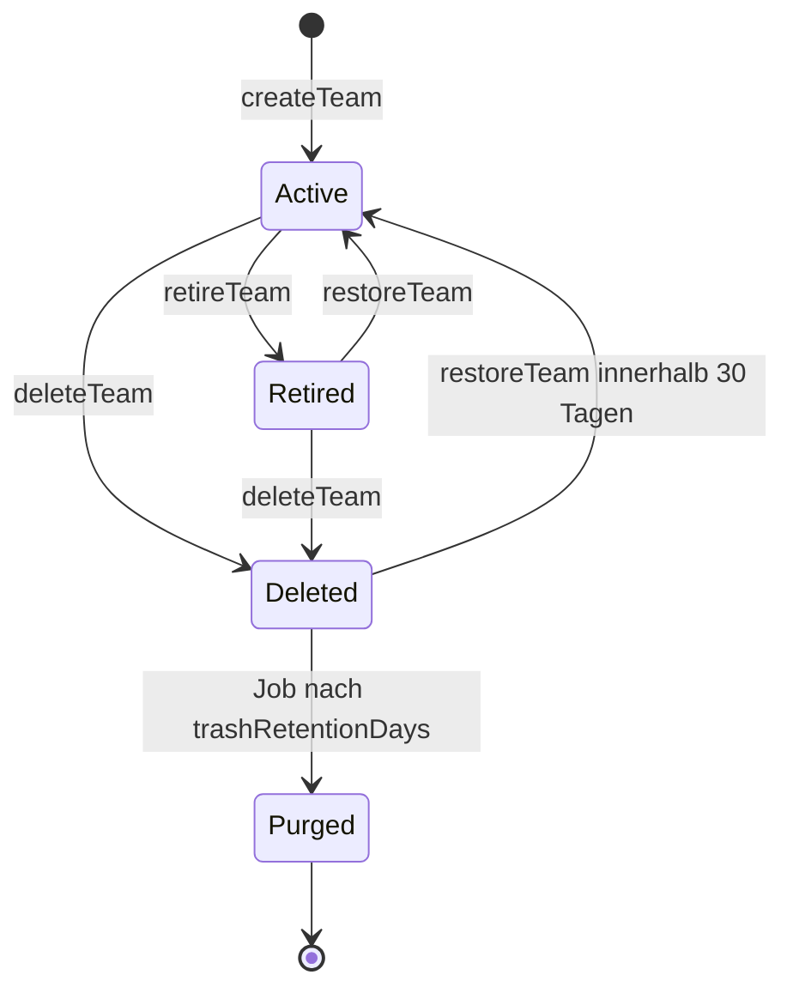
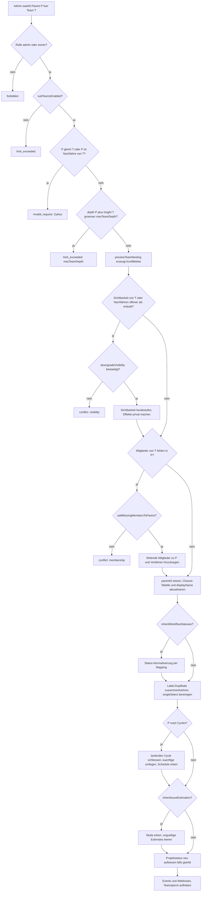
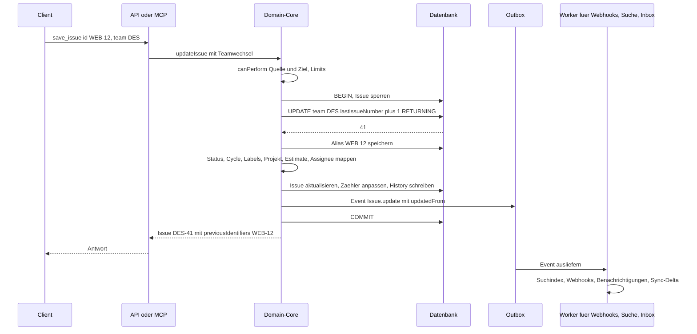

# 02 – Workspace, Teams, Sub-Teams und Rechte

Dieses Kapitel ist das Herzstück des Multi-Team-Modells von Lineal. Es legt fest, wie ein Workspace und seine Teams entstehen, wie Teams zu Hierarchien (Sub-Teams) verschachtelt werden, welche Konfiguration dabei vererbt wird, wer welche Teams sehen und bearbeiten darf und was genau passiert, wenn ein Issue das Team wechselt. Die Entitäten und Felder selbst sind in [01-domaenenmodell.md](01-domaenenmodell.md) vollständig beschrieben; hier stehen die **Regeln** und **Algorithmen**.

Verbindliche Grundlagen sind [00-konventionen.md](00-konventionen.md) (IDs, Enums, Fehlermodell) und die „Getroffenen Entscheidungen“ in [README.md](README.md). Stellen, an denen Lineal etwas festlegt, das in den Quellen (öffentliche Linear-Doku, GraphQL-Schema, MCP-Verhalten) nicht belegt ist, sind mit **Festlegung Lineal** markiert. Alle Beispieldaten (Workspace `acme`, Teams `ENG`, `WEB`, `DES`, Personen Alice, Bob, Carol) sind erfunden.

Durchgängiges Beispiel:

| Objekt | Werte |
|---|---|
| Workspace | `acme` (Name „Acme“) |
| Team `ENG` | „Engineering“, `public`, Root-Team |
| Team `WEB` | „Web“, Sub-Team von `ENG`, `public` |
| Team `DES` | „Design“, `private`, Root-Team |
| Alice | Rolle `owner` (Ersteller des Workspace, 1.1), Mitglied und Owner in `ENG` |
| Bob | Rolle `user` (Member), Mitglied in `ENG`, `WEB` und `DES`; Owner in `WEB` und `DES` (hat beide angelegt) |
| Carol | Rolle `guest`, nur Mitglied in `WEB` |

---

## 1. Workspace

Der Workspace (Schema-Name `Organization`) ist der Mandant. Alle Daten gehören genau einem Workspace, jede Anfrage läuft im Kontext genau eines Workspace (Login und Token sind workspace-gebunden). Eine E-Mail-Adresse kann in mehreren Workspaces einen eigenen `User` besitzen; diese User sind unabhängig voneinander.

### 1.1 Workspace anlegen

Beim Anlegen entsteht nicht nur der Workspace, sondern sofort ein arbeitsfähiges Grundgerüst. Der folgende Ablauf läuft in **einer** Transaktion:

1. Eingaben validieren: `name` (1–80 Zeichen, nicht leer nach Trim) und `urlKey` (Festlegung Lineal: `^[a-z0-9][a-z0-9-]{1,30}[a-z0-9]$`, global eindeutig über alle Workspaces und alle `previousUrlKeys`). Fehlt `urlKey`, wird er aus dem Namen erzeugt (Kleinbuchstaben, Umlaute transliteriert, Nicht-Alphanumerisches zu `-`, bei Kollision Suffix `-2`, `-3`, …).
2. `Organization` anlegen mit Default-Settings (Tabelle 1.2) und Default-Limits (Tabelle 1.3).
3. Den anlegenden User im Workspace erzeugen, Rolle `owner` (Festlegung Lineal: im Original ist der Ersteller Admin; Lineal vergibt `owner`, damit es immer mindestens einen Owner gibt).
4. Workspace-Projektstatus anlegen (Default-Set siehe [04-planung.md](04-planung.md)).
5. Workspace-Labels anlegen: `Bug`, `Feature`, `Improvement` (Festlegung Lineal, siehe Abschnitt 2.4).
6. **Default-Team anlegen**: Name = Workspace-Name, Key aus dem Namen generiert (Abschnitt 2.2), Ersteller wird Mitglied und Team-Owner. Für das Team gilt der vollständige Team-Anlage-Ablauf aus Abschnitt 2.3.
7. Events `Organization.create`, `Team.create`, `TeamMembership.create` in die Outbox schreiben (siehe [09-api-events.md](09-api-events.md)).

Beispiel: Alice legt „Acme“ an. Es entstehen Workspace `acme`, Team „Acme“ mit Key `ACM` und Alice als Owner. Das Team kann später umbenannt werden (z. B. in „Engineering“ mit Key `ENG`).

### 1.2 Workspace-Settings

| Feld | Typ | Default | Regel |
|---|---|---|---|
| `name` | String | Eingabe | 1–80 Zeichen |
| `urlKey` | String | aus Name | Änderbar durch Admin/Owner. Der alte Wert wandert nach `previousUrlKeys` (die letzten 3 bleiben, alte URLs leiten um). |
| `previousUrlKeys` | [String] | `[]` | read-only |
| `logoUrl` | String? | `null` | Objektspeicher-URL |
| `fiscalYearStartMonth` | Int | `0` (Januar) | 0–11; wirkt auf Datumsauflösung `quarter`/`halfYear` in [04](04-planung.md) |
| `initiativesEnabled` | Boolean | `true` | Festlegung Lineal: Initiativen sind standardmäßig aktiv |
| `securitySettings` | JSON | siehe 6.3 | workspaceweite Mindestrollen für Aktionen |
| `limits` | JSON | siehe 1.3 | konfigurierbare Workspace-Limits |
| `projectUpdateReminder*` | diverse | siehe [04](04-planung.md) | Erinnerungen für Statusberichte |
| `deletionRequestedAt` | DateTime? | `null` | gesetzt = Löschung geplant |

### 1.3 Konfigurierbare Workspace-Limits

Laut README werden alle planabhängigen Grenzen **nicht hart codiert**, sondern als Workspace-Limits im Feld `Organization.limits` gespeichert. Ein Limit mit Wert `null` bedeutet „unbegrenzt“. Verletzungen führen zu `limit_exceeded` (422) mit `details.limit` = Name des Limits. Ein nachträglich gesenktes Limit wirkt nur auf **neue** Operationen; bestehende Daten werden nicht zurückgebaut.

| Limit-Schlüssel | Default Lineal | Bezug im Original | Geprüft bei |
|---|---|---|---|
| `maxTeams` | `null` | Free 2, Basic 5, Business ∞ | Team anlegen, Team wiederherstellen |
| `subTeamsEnabled` | `true` | Business+ | Parent setzen |
| `maxTeamDepth` | `5` | „bis zu 5 Ebenen“ (Enterprise) | Parent setzen, Sub-Team anlegen. Root-Team hat Tiefe 1. |
| `privateTeamsEnabled` | `true` | Business+ | Team privat anlegen/machen |
| `guestsEnabled` | `true` | Business+ | Gast einladen |
| `teamOwnersEnabled` | `true` | Business+ | `owner`-Flag setzen; bei `false` sind nur Admins/Owner „Team-Owner“ |
| `issueSharingEnabled` | `false` | Enterprise, Beta | Issue teilen (siehe [03](03-issues-workflow.md)) |
| `maxActiveIssuesPerTeam` | `60000` | 60 000 nicht archivierte Issues | Issue anlegen, Issue ins Team verschieben |
| `maxLabelsPerGroup` | `250` | 250 | Label anlegen/verschieben |
| `maxUpcomingCycles` | `15` | 15 | `upcomingCycleCount` |
| `maxUnarchivedNotificationsPerUser` | `2000` | 2 000 | Notification-Fan-out |
| `trashRetentionDays` | `30` | 30 Tage | Papierkorb-Job, Team-Löschung |
| `workspaceDeletionDelayHours` | `48` | 48 h | Workspace löschen |
| `maxTeamMembershipsPerUser` | `null` | (Schema erwähnt ein solches Limit) | Team beitreten |

Limits ändern darf nur die Rolle `owner` (Festlegung Lineal; in einem Hosting-Szenario kann ein Betreiber diese Felder zusätzlich sperren).

### 1.4 Workspace löschen

Ein `owner` fordert die Löschung an (Bestätigungscode per E-Mail). `deletionRequestedAt` wird gesetzt, ab dann ist der Workspace für alle außer Owner/Admin gesperrt (Festlegung Lineal). Innerhalb von `workspaceDeletionDelayHours` kann jeder Admin oder Owner abbrechen; danach löscht ein Hintergrundjob alle Daten endgültig ([10-architektur-umsetzung.md](10-architektur-umsetzung.md)).

---

## 2. Teams

Ein Team ist die Einheit, die Issues besitzt. **Jedes Issue gehört genau einem Team**; Workflow-Status, Cycles, Team-Labels, Team-Templates und fast alle Automationen sind Team-Eigenschaften. Projekte können mehreren Teams gehören (Abschnitt 8).

### 2.1 Team-Felder im Überblick

Die vollständige Feldliste steht in [01](01-domaenenmodell.md). Für dieses Kapitel relevant:

| Gruppe | Felder |
|---|---|
| Identität | `id`, `name`, `key`, `displayName` (Name inkl. Vorfahren, z. B. „Engineering › Web“), `description`, `icon`, `color`, `timezone` |
| Hierarchie | `parentId`, abgeleitet: `ancestors`, `children` |
| Zugriff | `visibility` (`public`/`private`/`restricted`), `allMembersCanJoin`, `joinByDefault`, `securitySettings`, `issueSharingEnabled` |
| Lebenszyklus | `retiredAt`, `archivedAt` (= gelöscht, im Papierkorb), `deletionScheduledAt` (Festlegung Lineal) |
| Zähler (intern) | `lastIssueNumber`, `lastProjectNumber`, `activeIssueCount` (Abschnitt 9) |
| Vererbung | `inheritWorkflowStatuses`, `inheritIssueEstimation`, `inheritProjectStatuses` |
| Konfiguration | siehe Abschnitt 2.5 |

Hinweis zur Benennung: Das Schemafeld `Team.issueCount` ist eine **Anzahl** (optional inkl. archivierter Issues), kein Nummernzähler. Lineal trennt deshalb den Vergabezähler `lastIssueNumber` sauber davon. Das SQL-Beispiel in [00](00-konventionen.md#2-identifikatoren) ist sinngemäß mit `lastIssueNumber` zu lesen.

### 2.2 Team-Key: Generierung, Validierung, Historie

Der Key ist das Präfix aller Issue-Kennungen (`ENG-123`) und der Projektkennungen des Teams als Lead-Team (`P-ENG-7`).

**Validierung (Festlegung Lineal).** Das Original dokumentiert keine Zeichensatz- oder Längenregel. Lineal legt fest (kompatibel zu den im Original beobachteten Keys):

| Regel | Wert |
|---|---|
| Zeichensatz | Großbuchstaben `A–Z`, Ziffern `0–9`, **kein Bindestrich** |
| Muster | `^[A-Z][A-Z0-9]{0,6}$` – beginnt mit einem Buchstaben |
| Länge | 1–7 Zeichen |
| Normalisierung | Eingabe wird getrimmt und in Großbuchstaben umgewandelt |
| Reserviert | `P`, `I` sowie alles, was mit `P-` oder `I-` beginnt (sonst Kollision mit `P-ENG-7` und `I-4`) |
| Eindeutigkeit | case-insensitiv eindeutig im Workspace, und zwar gegen **aktive und historische** Keys aller anderen Teams |

Weil der Key keinen Bindestrich enthält, ist eine Kennung immer eindeutig zerlegbar: alles vor dem Bindestrich ist der Key, die Zahl danach die Nummer (`WEB-12` → Key `WEB`, Nummer `12`). Sub-Teams bekommen einen eigenen, kurzen Key; die Hierarchie zeigt sich im `displayName` (z. B. „Engineering › Web“), nicht im Key.

**Generierung aus dem Namen** (wenn `key` beim Anlegen fehlt; Schema: „generated based on the name of the team“):

```
function generateTeamKey(name, parentTeam):
  words = splitIntoWords(transliterate(upper(name)))   // Ä->AE, Ö->OE, Ü->UE, ß->SS
  words = [w with all chars not in A-Z0-9 removed for w in words]
  words = [w for w in words if w != "" ]
  if words is empty: base = "TEAM"
  else if len(words) == 1: base = firstChars(words[0], 3)
  else: base = join(firstChar(w) for w in words[0..3])   // Initialen, max. 4
  if base[0] is a digit: base = "T" + base
  candidate = base; i = 2
  while isReserved(candidate) or keyInUse(candidate):      // aktiv oder historisch
      candidate = truncate(base, 7 - len(str(i))) + str(i); i = i + 1
  return candidate
```

Beispiele: „Engineering“ → `ENG`; „Design“ → `DES`; „Web“ (auch als Sub-Team von `ENG`) → `WEB`; „Customer Success Ops“ → `CSO`.

**Key-Historie.** Jeder jemals verwendete Key eines Teams wird als Eintrag `TeamKey { id, teamId, key, createdAt, active: Boolean }` gespeichert (das Original kennt dazu die Mutation `teamKeyDelete`, „deletes a previously used team key“). Genau ein Eintrag pro Team ist `active`. Alte Keys bleiben reserviert und auflösbar, bis ein Admin sie ausdrücklich freigibt.

### 2.3 Team anlegen

Recht: Workspace-Rolle mindestens `securitySettings.teamCreationRole` (Default `user`); Gäste nie (Abschnitt 6).

1. Prüfen: `maxTeams` nicht erreicht; bei `parentId` zusätzlich `subTeamsEnabled`, `maxTeamDepth`, Rechte für Nesting (Abschnitt 3.3); bei `visibility != public` zusätzlich `privateTeamsEnabled` und die Sichtbarkeitsregel aus Abschnitt 5.
2. `name` validieren (1–80 Zeichen; Festlegung Lineal: Namen müssen innerhalb desselben Parents case-insensitiv eindeutig sein). `key` validieren oder generieren (2.2).
3. Team-Datensatz mit den Defaults aus 2.5 anlegen; `lastIssueNumber = 0`, `lastProjectNumber = 0`.
4. Wurde `copySettingsFromTeamId` übergeben: Konfiguration gemäß Tabelle 2.4 aus dem Quellteam kopieren (Zugriffsrecht auf das Quellteam erforderlich, sonst `not_found`).
5. Sonst Default-Workflow-Status anlegen (Tabelle unten). Bei `parentId` und `inheritWorkflowStatuses = true` stattdessen die geerbten Status anlegen (Abschnitt 3.2).
6. `defaultIssueStateId` = erster `backlog`-Status, `autoCloseStateId` = erster `canceled`-Status, `triageIssueStateId` = Triage-Status falls angelegt.
7. `TeamKey`-Eintrag mit `active = true`.
8. Ersteller als Mitglied anlegen; `owner = true` (Schema: „The user who creates the team will automatically be added as a member and owner“). Bei Sub-Teams wird der Ersteller, falls nötig, auch in alle Vorfahren aufgenommen (Abschnitt 4.2).
9. Bei `parentId`: Closure-Tabelle ergänzen (Abschnitt 3.6), `displayName` berechnen.
10. Events `Team.create`, `WorkflowState.create` (je Status), `TeamMembership.create`.

**Default-Workflow-Status eines neuen Teams** (Positionen aufsteigend innerhalb der Kategorie; Farben Festlegung Lineal):

| `name` | `type` | `color` | `position` | Bemerkung |
|---|---|---|---|---|
| Triage | `triage` | `#FC7840` | 0 | nur wenn `triageEnabled = true` beim Anlegen; sonst beim ersten Aktivieren von Triage |
| Backlog | `backlog` | `#BEC2C8` | 0 | `defaultIssueState` |
| Todo | `unstarted` | `#E2E2E2` | 0 | |
| In Progress | `started` | `#F2C94C` | 0 | |
| Done | `completed` | `#5E6AD2` | 0 | |
| Canceled | `canceled` | `#95A2B3` | 0 | `autoCloseState` |
| Duplicate | `duplicate` | `#95A2B3` | 0 | system-verwaltet, nicht umbenennbar, nicht löschbar (README) |

**Invariante:** Für jede der Kategorien `backlog`, `unstarted`, `started`, `completed`, `canceled` existiert immer mindestens ein Status, für `duplicate` genau einer, für `triage` genau einer, solange `triageEnabled = true`. Das Löschen des letzten Status einer Kategorie wird mit `invalid_request` abgelehnt. Auf dieser Invariante beruht, dass das Status-Mapping beim Teamwechsel (Abschnitt 7) immer ein Ziel findet. Details zu Status siehe [03-issues-workflow.md](03-issues-workflow.md).

### 2.4 „Copy settings from team“ und Default-Labels

`copySettingsFromTeamId` kopiert Konfiguration, **keine** Inhalte:

| Wird kopiert | Wird nicht kopiert |
|---|---|
| Workflow-Status (Name, Farbe, Beschreibung, Kategorie, Position) inkl. Default-/Triage-/Auto-Close-Status-Zuordnung | Issues, Kommentare, Dokumente |
| Team-Labels inkl. Gruppen (als neue, eigenständige Labels) | Mitglieder und Owner (nur der Ersteller wird Mitglied) |
| Team-Templates (Issue/Projekt/Dokument) als Kopien; Referenzen auf Status/Labels werden auf die Kopien umgebogen | Cycles (Instanzen); nur die Cycle-**Einstellungen** werden kopiert |
| Cycle-, Triage-, Estimate-, Auto-Close/Archive- und Parent/Sub-Automation-Einstellungen | Custom Views, Favoriten |
| `securitySettings`, `allMembersCanJoin` | Webhooks, Integrationen, Triage-Verantwortung (Personen) |
| Projektstatus des Teams (falls team-eigen) | `key`, `name`, `parentId`, `visibility` (kommen aus der Eingabe) |

Ein inherited Status des Quellteams (`inheritedFrom != null`) wird als eigenständiger Status kopiert, sofern das neue Team nicht unter demselben Parent mit `inheritWorkflowStatuses = true` angelegt wird.

**Default-Labels (Festlegung Lineal).** Das Schema erwähnt, dass beim Anlegen eines Teams „labels“ mit entstehen. Um Duplikate zu vermeiden, legt Lineal die Standard-Labels `Bug`, `Feature`, `Improvement` **einmal als Workspace-Labels** beim Anlegen des Workspace an. Ein neues Team erhält keine eigenen Labels, außer über `copySettingsFromTeamId`.

### 2.5 Team-Einstellungen (vollständig)

Spalte „Recht“ verweist auf die team-konfigurierbaren Rechte aus Abschnitt 6.3 (`teamManagement`, `labelManagement`, `templateManagement`, `memberManagement`). „Owner“ heißt: nur effektive Team-Owner (Abschnitt 6.2).

**General**

| Feld | Typ | Default | Validierung / Wirkung | Recht |
|---|---|---|---|---|
| `name` | String | Eingabe | 1–80 Zeichen | `teamManagement` |
| `key` | String | generiert | siehe 2.2 und 2.6 | Owner |
| `description` | String? | `null` | max. 2 000 Zeichen | `teamManagement` |
| `icon`, `color` | String? | `null` | Icon-Name bzw. `#RRGGBB` | `teamManagement` |
| `timezone` | String | `America/Los_Angeles` | IANA-Zeitzone; bestimmt Cycle-Grenzen | `teamManagement` |
| `groupIssueHistory` | Boolean | `true` | aufeinanderfolgende History-Einträge bündeln | `teamManagement` |
| `setIssueSortOrderOnStateChange` | Enum `top`/`bottom`/`none` | `bottom` | Einsortierung bei Statuswechsel | `teamManagement` |
| `initiativesEnabled` | Boolean | `false` | Initiativen in der Team-Sidebar | `teamManagement` |
| `parentId` | UUID? | `null` | Abschnitt 3 | Workspace-`admin`/`owner` |

**Members / Access**

| Feld | Typ | Default | Wirkung | Recht |
|---|---|---|---|---|
| `visibility` | `TeamVisibility` | `public` | Abschnitt 5 | Owner, Workspace-`admin`/`owner` |
| `allMembersCanJoin` | Boolean | `true` | nur `public`: Self-Join erlaubt | Owner |
| `joinByDefault` | Boolean | `false` | neue Workspace-User (nicht Gäste) werden automatisch Mitglied; nur `public` | Workspace-`admin`/`owner` |
| `securitySettings` | JSON (`TeamRoleType` je Recht) | siehe 6.3 | team-konfigurierbare Rechte | Owner |
| `issueSharingEnabled` | Boolean | `false` | nur wenn Workspace-Limit `issueSharingEnabled` | Owner |
| `scimManaged` | Boolean | `false` | nur Anzeige; SCIM ist außerhalb des Scopes | – |

**Workflow (Issue statuses & automations)**

| Feld | Typ | Default | Wirkung | Recht |
|---|---|---|---|---|
| Status-Liste | WorkflowState[] | Tabelle 2.3 | anlegen, umbenennen, umfärben, sortieren, löschen (Invariante beachten) | `teamManagement` |
| `defaultIssueStateId` | UUID | erster `backlog` | muss `backlog` oder `unstarted` sein | `teamManagement` |
| `inheritWorkflowStatuses` | Boolean | `false` (Root), `true` (neues Sub-Team) | Abschnitt 3 | `teamManagement` |

**Cycles**

| Feld | Typ | Default | Validierung | Recht |
|---|---|---|---|---|
| `cyclesEnabled` | Boolean | `false` | Deaktivieren schließt aktuellen Cycle, löscht künftige | `teamManagement` |
| `cycleDuration` | Int (Wochen) | `2` | 1–8 | `teamManagement` |
| `cycleCooldownTime` | Int (Wochen) | `0` | 0–8 | `teamManagement` |
| `cycleStartDay` | Int | `1` (Montag) | 0 = Sonntag … 6 = Samstag | `teamManagement` |
| `upcomingCycleCount` | Int | `2` | 1–`maxUpcomingCycles` | `teamManagement` |
| `cycleIssueAutoAssignStarted` | Boolean | `false` | | `teamManagement` |
| `cycleIssueAutoAssignCompleted` | Boolean | `false` | | `teamManagement` |
| `cycleLockToActive` | Boolean | `false` | | `teamManagement` |

Bei Sub-Teams eines Parents mit Cycles sind alle Cycle-Felder **read-only** und spiegeln den Parent (Abschnitt 3.2). Semantik der Cycles: [04-planung.md](04-planung.md).

**Triage**

| Feld | Typ | Default | Wirkung | Recht |
|---|---|---|---|---|
| `triageEnabled` | Boolean | `false` | Aktivieren legt bei Bedarf den Triage-Status an. Deaktivieren (Festlegung Lineal) verschiebt alle Issues in Triage nach `defaultIssueState`. | `teamManagement` |
| `requirePriorityToLeaveTriage` | Boolean | `false` | | `teamManagement` |
| Triage-Regeln, Triage-Verantwortung | – | – | siehe [03](03-issues-workflow.md) | `teamManagement` |

**Estimates**

| Feld | Typ | Default | Wirkung | Recht |
|---|---|---|---|---|
| `issueEstimationType` | Enum | `notUsed` | `notUsed`, `exponential`, `fibonacci`, `linear`, `tShirt` | `teamManagement` |
| `issueEstimationExtended` | Boolean | `false` | erweiterte Skala | `teamManagement` |
| `issueEstimationAllowZero` | Boolean | `false` | 0 erlaubt | `teamManagement` |
| `defaultIssueEstimate` | Float | `1` | Wert für ungeschätzte Issues in Statistiken | `teamManagement` |
| `inheritIssueEstimation` | Boolean | `false` (Root), `true` (neues Sub-Team) | Abschnitt 3 | `teamManagement` |

Ein Wechsel der Skala ändert gespeicherte Estimates nicht automatisch; Werte, die in der neuen Skala ungültig sind, werden in Listen weiter angezeigt, aber beim nächsten Bearbeiten des Felds validiert (Festlegung Lineal).

**Labels, Templates, Projekt-Status**

| Bereich | Inhalt | Recht |
|---|---|---|
| Issue-Labels | Team-Labels und -Gruppen verwalten, Labels zwischen Team und Workspace umziehen | `labelManagement` (Workspace-Labels: `securitySettings.labelManagementRole`) |
| Projekt-Labels | Team-Projekt-Labels | `labelManagement` |
| Templates | Team-Templates; `defaultTemplateForMembersId`, `defaultTemplateForNonMembersId`, `defaultProjectTemplateId` | `templateManagement` |
| Projekt-Status | team-eigene Projektstatus oder `inheritProjectStatuses` | `teamManagement` |

**Auto-close / Auto-archive**

| Feld | Typ | Default | Wirkung | Recht |
|---|---|---|---|---|
| `autoClosePeriod` | Int? (Monate) | `null` (aus) | erlaubte Werte 1, 3, 6, 9, 12 (Festlegung Lineal) | `teamManagement` |
| `autoCloseStateId` | UUID | erster `canceled` | muss Kategorie `canceled` sein | `teamManagement` |
| `autoArchivePeriod` | Int (Monate) | `6` | erlaubte Werte 1, 3, 6, 9, 12 (Festlegung Lineal, nicht abschaltbar; wie [03](03-issues-workflow.md) §9.2) | `teamManagement` |

**Parent/Sub-Issue-Automationen**

| Feld | Typ | Default | Wirkung | Recht |
|---|---|---|---|---|
| `autoCloseParentIssues` | Boolean | `false` | Parent wird `completed`, wenn alle Sub-Issues geschlossen sind | `teamManagement` |
| `autoCloseChildIssues` | Boolean | `false` | offene Sub-Issues werden `completed`, wenn der Parent `completed` wird | `teamManagement` |

Die Ausführungslogik dieser Automationen steht in [03-issues-workflow.md](03-issues-workflow.md) und die Hintergrundjobs in [10-architektur-umsetzung.md](10-architektur-umsetzung.md).

### 2.6 Team-Key ändern

Gemäß README ist das Ändern erlaubt, alle Kennungen des Teams wechseln auf den neuen Key, die alten bleiben auflösbar. Damit beim Umbenennen nicht bis zu 60 000 Issue-Zeilen umgeschrieben werden müssen, wird die Kennung **nicht gespeichert, sondern berechnet** (`identifier = activeKey(team) + "-" + number`); die Historie steckt in `TeamKey`.

1. Recht: effektiver Team-Owner oder Workspace-`admin`/`owner`. Team darf nicht retired oder gelöscht sein.
2. Neuen Key normalisieren und validieren (2.2). Ist er ein **eigener** historischer Key des Teams, wird dieser Eintrag reaktiviert; gehört er (aktiv oder historisch) einem anderen Team → `conflict`.
3. In einer Transaktion: alten `TeamKey` auf `active = false`, neuen anlegen bzw. aktivieren.
4. Projektkennungen, bei denen das Team Lead-Team ist, ändern sich ebenso (`P-ENG-7` → `P-CORE-7`), da sie ebenfalls berechnet werden.
5. Suchindex: Hintergrundjob indexiert die Issues des Teams mit neuer Kennung neu; alte Kennungen bleiben als Suchbegriff erhalten.
6. Event `Team.update` mit `updatedFrom.key`. Kein Event pro Issue (Festlegung Lineal; Clients berechnen die Kennung neu).

**Ausgabe von `previousIdentifiers`.** Ein Issue hat intern eine Alias-Tabelle `IssueNumberAlias { issueId, teamId, number }` (eindeutig über `teamId, number`), die bei jedem Teamwechsel die alte Kombination aufnimmt (Abschnitt 7). Nach außen gilt:

```
function previousIdentifiers(issue):
  result = []
  for (teamId, number) in [(issue.teamId, issue.number)] + aliases(issue):
    for k in teamKeys(teamId):                       // aktive und historische Keys
      candidate = k.key + "-" + number
      if candidate != currentIdentifier(issue): result.append(candidate)
  return distinct(result)
```

**Auflösung einer Kennung** (Schritt 2 der flexiblen Referenzauflösung aus [00](00-konventionen.md#2-identifikatoren)):

```
function resolveIssueIdentifier(text, user):
  (key, number) = splitAtLastHyphen(upper(text))     // number muss Ganzzahl sein
  teamKey = findTeamKey(key)                          // aktiv oder historisch
  if teamKey == null: return NOT_FOUND
  issue = findIssue(teamId = teamKey.teamId, number = number)
       ?? findIssueByAlias(teamId = teamKey.teamId, number = number)
  if issue == null or not canAccessTeam(user, issue.team): return NOT_FOUND
  return issue
```

Beispiel: `ENG` wird in `CORE` umbenannt. `ENG-42` wird weiterhin zu `CORE-42` aufgelöst, und `CORE-42.previousIdentifiers` enthält `ENG-42`.

**Team-Referenzen.** Auch das Team selbst bleibt unter alten Keys erreichbar: Schritt 4 der flexiblen Referenzauflösung ([00](00-konventionen.md#2-identifikatoren)) sucht in **allen** `TeamKey`-Einträgen (aktiv zuerst), sodass `get_team "ENG"` nach der Umbenennung das Team `CORE` liefert. Team-URLs mit altem Key leiten auf den aktiven Key um.

### 2.7 Lebenszyklus: retire, restore, löschen



**Retire (stilllegen).** Recht: effektiver Team-Owner oder Workspace-`admin`/`owner`.

| Parameter | Werte | Pflicht |
|---|---|---|
| `handleSubTeamsOnRetirement` | `retire` (Sub-Teams mit stilllegen) oder `unnest` (Sub-Teams werden Root-Teams, Abschnitt 3.5) | ja, wenn aktive Sub-Teams existieren |
| `openIssuesOnRetirement` (Festlegung Lineal) | `keep` (Default), `cancel` (alle offenen Issues in `autoCloseState`), `moveToTeam` + `targetTeamId` (Bulk-Move nach Abschnitt 7) | nein |

Wirkung: `retiredAt = now`. Team, Einstellungen und Issues werden **read-only**: jede schreibende Aktion auf das Team oder seine Issues liefert `forbidden` mit `details.reason = "team_retired"` (Ausnahme: `restoreTeam`, `deleteTeam`). Keine neuen Issues, keine neuen Mitglieder (`teamMembershipCreate` lehnt ab), das Team ist kein Ziel für Teamwechsel. Das Team verschwindet aus Sidebar und Team-Pickern, bleibt aber über Suche, Links und `includeArchived`-ähnliche Filter (`retiredAt`-Filter) lesbar. Cycle-Job und Auto-Close überspringen das Team; Auto-Archive läuft weiter (Festlegung Lineal). Projekte, deren **sämtliche** Teams retired sind, werden read-only.

**Restore.** `retiredAt = null`; alles wird wieder schreibbar. Bei einem Sub-Team muss der Parent aktiv sein, sonst `invalid_request`.

**Löschen.** Recht wie Retire. Das Team bekommt `archivedAt = now` und `deletionScheduledAt = now + trashRetentionDays`. Es ist für alle Nicht-Admins sofort unsichtbar (`not_found`), seine Issues verschwinden aus allen Listen, der Suche und den Inboxen. Aktive Sub-Teams müssen vorher behandelt werden: Parameter `handleSubTeams = unnest | delete` (Festlegung Lineal), sonst `invalid_request`. Projekte, an denen nur dieses Team beteiligt ist, wandern mit in den Papierkorb; bei Multi-Team-Projekten wird das Team entfernt (Abschnitt 8.3), wobei ein neues Lead-Team gewählt wird (das beteiligte Team mit den meisten Issues im Projekt, bei Gleichstand das älteste). Während der Frist kann ein Workspace-`admin`/`owner` das Team in „Recently deleted teams“ wiederherstellen (`teamUnarchive`); Projekte aus dem Papierkorb kommen mit zurück, entfernte Multi-Team-Zuordnungen nicht. Nach Ablauf löscht ein Job Team, Issues, Status, Labels, Cycles, Templates und Mitgliedschaften endgültig. Die Keys des Teams werden erst dann frei.

---

## 3. Sub-Teams

### 3.1 Hierarchie

Ein Team kann über `parentId` genau ein Parent-Team haben. Daraus entsteht ein Wald (mehrere Bäume). Regeln:

| Regel | Festlegung |
|---|---|
| Zyklen | verboten: der neue Parent darf weder das Team selbst noch einer seiner Nachfahren sein |
| Tiefe | `depth(root) = 1`; `depth(parent) + height(teilbaum)` darf `maxTeamDepth` (Default 5) nicht überschreiten |
| Parent-Zustand | Parent darf nicht retired oder gelöscht sein |
| Recht | nur Workspace-`admin` oder `owner` (Original: „admin rights“) |
| Feature | `subTeamsEnabled = true` |
| Anzeige | `displayName` = Namen aller Vorfahren und des Teams, getrennt durch ` › ` („Engineering › Web“) |

Beispiel: `ENG` (Tiefe 1) → `WEB` (Tiefe 2). Ein Team `PERF` unter `WEB` hätte Tiefe 3.

### 3.2 Vererbungsmatrix

Legende „Art“: **erzwungen** = gilt zwingend für alle Sub-Teams; **optional** = Sub-Team entscheidet über ein `inherit*`-Flag; **zugänglich** = Objekte des Parents sind im Sub-Team nutzbar, werden aber nicht kopiert; **unabhängig** = keine Vererbung.

| Aspekt | Art | Schemafeld | Verhalten beim Nesting | Verhalten beim Un-Nesting |
|---|---|---|---|---|
| Membership | erzwungen | `TeamMembership` (keine eigene Spalte) | Jedes Nicht-Gast-Mitglied des Sub-Teams muss Mitglied aller Vorfahren sein. Fehlende werden auf Bestätigung zum Parent hinzugefügt, sonst Abbruch. Gäste dürfen nur im Sub-Team sein. | Mitgliedschaften bleiben bestehen, die Kopplung entfällt. Niemand wird entfernt. |
| Cycles | erzwungen, wenn der Parent Cycles nutzt; sonst unabhängig | `Cycle.inheritedFrom`, Cycle-Felder des Teams | Sub-Team übernimmt den Schedule. Vergangene Cycles bleiben, der laufende Cycle des Sub-Teams wird geschlossen (Rollover), kommende werden auf die zeitlich nächstliegenden Parent-Cycles umgelegt. Neue Sub-Team-Cycles mit `inheritedFrom` = Parent-Cycle. | Geerbte Cycles werden eigene (`inheritedFrom = null`), Schedule-Einstellungen werden kopiert, `cyclesEnabled` bleibt `true`. |
| Workflow-Status | optional | `Team.inheritWorkflowStatuses`, `WorkflowState.inheritedFrom` | Bei `true`: Status-Normalisierung (3.3, Schritt 5). Sub-Team erhält je Parent-Status eine verknüpfte Zeile mit `inheritedFrom`. Triage-Status bleibt team-eigen. | Geerbte Status, die von Issues, Templates oder Team-Einstellungen benutzt werden, werden eigenständige Kopien (`inheritedFrom = null`); unbenutzte werden gelöscht. |
| Estimates | optional | `Team.inheritIssueEstimation` | Bei `true`: Skala, `extended`, `allowZero`, `defaultIssueEstimate` vom Parent; nicht mehr gültige Werte werden geleert (mit History). | Einstellungen werden als eigene Werte kopiert, Flag `false`. |
| Project statuses | optional | `Team.inheritProjectStatuses` | Bei `true`: Projekte mit diesem Lead-Team lösen ihren Status gegen die Parent-Status neu auf (gleicher Name und Kategorie, sonst erster Status der Kategorie). | Flag bleibt, Quelle ist jetzt der Workspace; Projekte werden genauso neu aufgelöst. |
| Labels | zugänglich | `IssueLabel.teamId` | Labels aller Vorfahren und des Workspace sind im Sub-Team nutzbar. Gleichnamige Team-Labels werden zusammengeführt (3.3, Schritt 6). Geerbte Labels ändert man im Parent. | Benutzte geerbte Labels werden als Team-Labels des Sub-Teams kopiert und auf den Issues ersetzt; unbenutzte entfallen einfach. |
| Templates | zugänglich | `Template.teamId`, `Template.inheritedFrom` | Parent-Templates erscheinen in der Template-Auswahl des Sub-Teams. Keine Konflikte. | Templates, die als Default-Template des Sub-Teams gesetzt sind, werden kopiert; sonst entfällt der Zugriff. |
| Views | zugänglich | `CustomView.teamId`, Abfrage `includeSubTeams` | Team-Views des Parents können Issues der zugänglichen Sub-Teams enthalten (`includeSubTeams`). | Sub-Team fällt aus `includeSubTeams`-Ergebnissen des alten Parents heraus. |
| Permissions | unabhängig | `Team.securitySettings`, `Team.visibility` | Nicht geerbt. Nur die Sichtbarkeit muss Regel 5.2 erfüllen (ggf. Herabstufung). | Unverändert; `restricted` wird zu `private` (Root-Teams können nicht `restricted` sein). |
| Owner | erzwungen (abgeleitet) | `TeamMembership.owner` | Effektive Team-Owner des Parents sind sofort effektive Owner des Sub-Teams (nicht gespeichert, berechnet, 6.2). | Abgeleitete Ownership entfällt; gespeicherte `owner`-Flags bleiben. |
| Slack/Git-Automationen | unabhängig | `gitAutomationStates`, Integrations-Settings | keine Änderung | keine Änderung |

### 3.3 Nesting-Wizard: Konfliktauflösung

Das Original führt nach dem Setzen des Parents durch einen Wizard (Status normalisieren, Label-Duplikate). Lineal trennt das in eine **Vorschau** und eine **Ausführung**:

- `previewTeamNesting(teamId, parentId)` liefert eine Liste `conflicts[]` mit `kind` ∈ `membership`, `visibility`, `workflowState`, `label`, `cycle`, `estimate`, `projectStatus`, jeweils mit Vorschlag.
- `nestTeam(teamId, parentId, options)` führt aus. `options`: `addMissingMembersToParent` (Default `true`), `downgradeVisibility` (Default `false`), `inheritWorkflowStatuses` (Default `true`), `inheritIssueEstimation` (Default `true`), `stateMapping` (Liste `{fromStateId, toStateId}`, überschreibt das automatische Mapping; entspricht `mapping: InheritanceEntityMapping` im Schema), `labelMapping` (analog).

Die Ausführung ist ein Hintergrundjob, weil viele Issues betroffen sein können. Während des Jobs ist das Team gesperrt (Schreibzugriffe → `conflict` mit `details.reason = "team_migration_in_progress"`).

**Algorithmus `nestTeam(T, P, options)`**:

1. **Recht und Grundprüfungen:** Aufrufer ist `admin`/`owner`; `subTeamsEnabled`; `P != T`; `P` ist kein Nachfahre von `T`; `P` und `T` sind nicht retired/gelöscht; `depth(P) + height(T) <= maxTeamDepth`. Sonst `invalid_request` bzw. `limit_exceeded`.
2. **Sichtbarkeit:** Für `T` und jeden Nachfahren prüfen, ob Regel 5.2 unter dem neuen Parent erfüllt ist. Wenn nicht und `downgradeVisibility = false` → `conflict` mit Liste der Teams. Sonst herabstufen (`public` → `restricted` unter privatem/restricted Parent) und die Effekte aus 4.5 anwenden.
3. **Mitglieder:** `missing` = Nicht-Gast-Mitglieder von `T` und seinen Nachfahren, die nicht Mitglied von `P` und dessen Vorfahren sind. Wenn `missing` nicht leer und `addMissingMembersToParent = false` → `conflict`. Sonst Mitgliedschaften in `P` und allen Vorfahren anlegen (ohne `owner`).
4. **Parent setzen:** `T.parentId = P`; Closure-Tabelle und `displayName` des gesamten Teilbaums aktualisieren.
5. **Status-Normalisierung** (nur wenn `inheritWorkflowStatuses = true`):
   ```
   targetStates = states(P) without type "triage"
   for s in states(T) where s.type != "triage":
     m = stateMapping[s.id]
         ?? first(t in targetStates where t.type == s.type and lower(t.name) == lower(s.name))
         ?? first(t in targetStates where t.type == s.type order by position)
     mapping[s.id] = m          // existiert immer wegen der Status-Invariante
   for t in targetStates:
     create WorkflowState(team = T, name = t.name, type = t.type, color = t.color,
                          position = t.position, inheritedFrom = t.id) as inh[t.id]
   for s in states(T) where s.type != "triage":
     reassign issues of s to inh[mapping[s.id]]          // ohne History-Eintrag pro Issue
     rewrite references: T.defaultIssueStateId, T.autoCloseStateId,
                         templates of T, view filters of T, triage rules of T
     delete s
   ```
   Ein `stateMapping`-Eintrag mit abweichender Kategorie ist erlaubt (z. B. „In Review“ (`started`) → „In Progress“), Ziel muss aber ein Status von `P` sein. Issues, deren Kategorie sich dadurch ändert, bekommen einen History-Eintrag und ggf. `startedAt`/`completedAt`/`canceledAt` neu gesetzt.
6. **Label-Duplikate:**
   ```
   available = labels(workspace) + labels(P) + labels(ancestors(P))
   for L in labels(T) order by (isGroup desc):            // Gruppen zuerst
     key = lower(groupName(L)) + "/" + lower(L.name)      // groupName = "" bei ungruppiert
     A = labelMapping[L.id] ?? first(a in available where keyOf(a) == key and a.isGroup == L.isGroup)
     if A == null: continue                               // L bleibt Team-Label von T
     for issue in issuesWithLabel(L): replace L by A on issue (falls A noch nicht gesetzt)
     move children of L to A, falls L Gruppe ist und Kinder keinen Treffer haben
     delete L
   for each issue changed above:
     for each group G with groupType singleSelect:
       if issue has > 1 label of G: keep the most recently applied, remove others (History-Eintrag)
   ```
   Label-Merges erzeugen keinen History-Eintrag pro Issue, sondern einen Audit-Eintrag am Team (Festlegung Lineal). Das Limit `maxLabelsPerGroup` wird nach dem Merge geprüft; bei Überschreitung bricht der Job vor Schritt 4 mit `limit_exceeded` ab (die Prüfung wird deshalb in der Vorschau vorgezogen).
7. **Cycles:** Hat `P` Cycles (`cyclesEnabled`): laufenden Cycle von `T` sofort schließen (Rollover-Regeln aus [04](04-planung.md)); für jeden künftigen Cycle `c` von `T` die Issues auf den abgeleiteten Cycle verschieben, dessen Zeitraum mit `c.startsAt` überlappt (sonst den nächstfolgenden); künftige `T`-Cycles löschen; für aktuellen und kommende Cycles von `P` abgeleitete Cycles in `T` mit `inheritedFrom` anlegen. `T.cyclesEnabled = true`, Cycle-Felder werden zum Spiegel von `P`. Vergangene Cycles von `T` bleiben unverändert und behalten ihre Nummern. Hat `P` keine Cycles, bleibt `T` unverändert.
8. **Estimates** (nur wenn `inheritIssueEstimation = true`): Einstellungen von `P` übernehmen; für jedes Issue von `T` mit Estimate, das in der neuen Skala ungültig ist: `estimate = null` mit History-Eintrag (Akteur: System, Grund `team_nesting`).
9. **Projektstatus:** wenn `T.inheritProjectStatuses = true`, Projekte mit Lead-Team `T` neu auflösen (Abschnitt 8.2).
10. **Templates:** keine Konflikte; Referenzen auf gelöschte Status/Labels wurden in 5 und 6 umgeschrieben.
11. Events `Team.update` (mit `updatedFrom.parentId`), `WorkflowState.create/remove`, `IssueLabel.remove`, `Issue.update` (gebündelt), Webhooks gemäß [09](09-api-events.md).

### 3.4 Flowchart „Team unter Parent hängen“



### 3.5 Un-Nesting

`nestTeam(T, null)` („No parent team“) oder implizit durch `handleSubTeamsOnRetirement = unnest` bzw. `handleSubTeams = unnest`:

1. Recht wie beim Nesting.
2. **Status:** für jeden geerbten Status `s` von `T`: wenn benutzt (Issues, Default-/Auto-Close-Status, Templates, Views, Triage-Regeln) → `s.inheritedFrom = null` (wird eigenständig, Name/Farbe bleiben); sonst löschen. Danach Status-Invariante prüfen; fehlt eine Kategorie, wird der entsprechende Default-Status aus 2.3 angelegt. `inheritWorkflowStatuses = false`.
3. **Labels:** für jedes Label `A` eines Vorfahren, das auf Issues von `T` verwendet wird: Kopie als Team-Label von `T` (gleiche Gruppe als Kopie, falls nötig) anlegen und auf diesen Issues ersetzen. Workspace-Labels bleiben unverändert.
4. **Templates:** Vorfahren-Templates, die als Default-Template von `T` gesetzt sind, werden als Team-Templates von `T` kopiert und die Defaults umgebogen.
5. **Cycles:** geerbte Cycles werden eigenständig (`inheritedFrom = null`), Schedule-Felder werden als eigene Werte gespeichert.
6. **Estimates:** Werte kopieren, `inheritIssueEstimation = false`.
7. **Sichtbarkeit:** `restricted` → `private` (Root-Teams kennen kein `restricted`).
8. `parentId = null`, Closure-Tabelle und `displayName` des Teilbaums aktualisieren. Mitgliedschaften bleiben.
9. Events wie beim Nesting.

### 3.6 Abfragen über Hierarchien

Lineal pflegt eine **Closure-Tabelle** `TeamClosure { ancestorId, descendantId, depth }` (inkl. Zeile `depth = 0` für das Team selbst). Damit sind alle Hierarchieabfragen einfache Joins.

| Abfrage | Parameter | Semantik | Default |
|---|---|---|---|
| `list_teams` (MCP) | `parentTeam` | nur **direkte** Kinder des Teams | – |
| `list_teams` (MCP) | `ancestorTeam` | **alle** Nachfahren (beliebige Tiefe), ohne das Team selbst | – |
| API `teams(filter)` | `parent: { id: { eq } }`, `ancestors: { some: { id: { eq } } }` | wie oben | – |
| `list_issues`, Team-Issues, Team-Views | `includeSubTeams` | Issues des Teams **und** aller zugänglichen Nachfahren | `false` |
| `list_projects`, Team-Projekt-Views | `includeSubTeams` | Projekte, an denen das Team oder ein Nachfahre beteiligt ist | `true` |

```
function teamScope(user, team, includeSubTeams):
  ids = includeSubTeams ? descendantsOrSelf(team.id) : [team.id]   // via TeamClosure
  return [id for id in ids if canAccessTeam(user, teamById(id))]
```

Nicht zugängliche Nachfahren werden stillschweigend weggelassen (sie dürfen nicht verraten werden, Abschnitt 6.5). Die Antwort von `list_teams` enthält je Team `id`, `key`, `name`, `displayName`, `parentId`, `icon`, `visibility`, `createdAt`, `updatedAt` (siehe [07-mcp-server.md](07-mcp-server.md)).

---

## 4. Mitgliedschaft

### 4.1 Datenmodell

`TeamMembership { id, teamId, userId, owner: Boolean, sortOrder: Float, createdAt, updatedAt, archivedAt }`. Eindeutig pro `(teamId, userId)`. `sortOrder` bestimmt die Reihenfolge des Teams in der persönlichen Sidebar.

### 4.2 Beitreten, hinzufügen, verlassen, entfernen

**Darf ein User selbst beitreten?** Die Bedingungen entsprechen dem Schemafeld `viewerCanJoin`:

```
function canJoin(user, team):
  if isMember(user, team): return false
  if team.archivedAt != null or team.retiredAt != null: return false
  if team.scimManaged: return false
  if user.role == "guest": return false                  // Gäste werden nur hinzugefügt
  if limitReached(maxTeamMembershipsPerUser, user): return false
  switch team.visibility:
    case "public":     return team.allMembersCanJoin or isWorkspaceAdmin(user)
    case "restricted": return isMember(user, team.parent)
    case "private":    return isWorkspaceAdmin(user)    // mit Warnhinweis, siehe 4.4
```

`isWorkspaceAdmin(user)` = Rolle `admin` oder `owner`.

**Beitreten zu einem Sub-Team** nimmt den User automatisch in alle Vorfahren auf, in denen er noch nicht Mitglied ist (Festlegung Lineal; erfüllt die erzwungene Membership-Regel). Ist er für einen Vorfahren nicht beitrittsberechtigt (z. B. privater Parent), wird der Beitritt mit `forbidden` abgelehnt bzw. für den Nicht-Berechtigten mit `not_found`.

**Hinzufügen durch andere** (`addTeamMember`): Aufrufer braucht das Team-Recht `memberManagement` (Members oder nur Owner). **Gäste hinzufügen dürfen immer nur effektive Team-Owner**. Bei privaten Teams ist Hinzufügen der einzige Weg hinein („Einladung“). Für Sub-Teams gilt dieselbe Automatik zu den Vorfahren; der Aufrufer braucht dann auch dort `memberManagement`. Gäste werden **nicht** in Vorfahren aufgenommen.

**Verlassen** (`leaveTeam`): jeder darf seine eigene Mitgliedschaft beenden. Parameter `alsoLeaveParentTeams` (Schema) verlässt zusätzlich alle Vorfahren. Wer einen Parent verlässt, verlässt automatisch alle Sub-Teams (Nicht-Gäste), da die Membership-Regel sonst verletzt wäre. Ein privates Team kann man nach dem Verlassen nur durch erneute Einladung wieder betreten.

**Entfernen** (`removeTeamMember`): effektive Team-Owner und Workspace-`admin`/`owner`. Kaskade auf Sub-Teams wie beim Verlassen.

**Letzter Owner (Festlegung Lineal):** Es gibt keine Pflicht für einen Owner (Original). Lineal verhindert also nicht, dass der letzte gespeicherte Owner geht; Workspace-Admins bleiben über die Ableitung in 6.2 Owner.

**Effekte des Austritts:**

| Team-Sichtbarkeit | Zugewiesene offene Issues des Users im Team | Abonnements des Users auf Issues des Teams |
|---|---|---|
| `public` | bleiben (Nicht-Mitglieder dürfen in öffentlichen Teams zugewiesen sein) | bleiben |
| `restricted`, `private` | `assignee = null`, History-Eintrag (Festlegung Lineal, analog zu 4.5) | werden entfernt |

**Auto-Join:** `joinByDefault = true` fügt neue Workspace-Mitglieder (nicht Gäste) beim Anlegen des Users dem Team hinzu. Nur für `public`-Teams erlaubt.

### 4.3 Team-Owner

Ein Owner ist ein Mitglied mit `owner = true` oder ein abgeleiteter Owner (6.2). Owner ernennen oder entziehen dürfen effektive Team-Owner und Workspace-`admin`/`owner`. **Gäste und Apps können nie Owner sein** (`invalid_request`). Wer ein Team anlegt, privat anlegt oder privat macht, wird Owner. Ist `teamOwnersEnabled = false`, wird das `owner`-Flag ignoriert.

### 4.4 Gäste und private Teams

- Ein Gast sieht ausschließlich Teams, in denen er Mitglied ist, und deren Issues, Projekte und Dokumente. Dort hat er die Rechte eines Members, kann aber kein Owner sein und keine Workspace-Funktionen nutzen (Workspace-Views, Initiativen, Settings außer dem eigenen Account).
- Ein Gast darf Mitglied eines Sub-Teams sein, ohne Mitglied des Parents zu sein (Ausnahme der Membership-Regel). Im Beispiel ist Carol nur in `WEB`.
- Private Teams: Beitritt nur per Hinzufügen durch Berechtigte. Workspace-`admin`/`owner` sehen private Teams in der Verwaltung (Name, Key, Mitgliederzahl, Einstellungen), aber **keine Issues**, bis sie selbst beitreten. Beim Selbst-Beitritt eines Admins zu einem privaten Team zeigt der Client einen Warnhinweis; die API verlangt `confirmPrivateJoin = true` (Festlegung Lineal).
- In Issues privater Teams sind nur Team-Mitglieder als Assignee, Delegate und für @-Mentions wählbar. Ein Mention auf einen Nicht-Mitglied wird als reiner Text gespeichert, ohne Benachrichtigung.

### 4.5 Effekte beim Privat-Machen eines Teams

Recht: Workspace-`admin`/`owner` oder effektiver Team-Owner; Limit `privateTeamsEnabled`.

1. `visibility = private` (bzw. `restricted` bei Sub-Teams, auf Wunsch).
2. Der ausführende User wird Mitglied (falls noch nicht) und Owner.
3. Für alle **offenen** Issues des Teams (Kategorien `triage`, `backlog`, `unstarted`, `started`), deren Assignee kein Mitglied ist: `assignee = null`, History-Eintrag (Akteur = ausführender User, Grund `team_visibility_changed`). Analog für `delegate`.
4. Alle Abonnements von Nicht-Mitgliedern auf Issues des Teams werden entfernt.
5. Benachrichtigungen von Nicht-Mitgliedern zu Issues des Teams werden beim Lesen ausgefiltert (nicht gelöscht, damit ein späterer Beitritt sie wieder sichtbar macht; Festlegung Lineal).
6. Sub-Teams, die nun offener wären als erlaubt, werden kaskadierend auf `restricted` herabgestuft; für sie gelten die Schritte 3–5 mit der jeweils neuen Sichtbarkeitsmenge.
7. Multi-Team-Projekte: siehe 5.3.
8. Custom Views anderer User, die das Team filtern, liefern für Nicht-Mitglieder ab sofort keine Issues dieses Teams mehr (kein Fehler).
9. Event `Team.update` mit `updatedFrom.visibility`.

Der umgekehrte Weg (privat → öffentlich) hat keine Nebenwirkungen auf Daten.

---

## 5. Sichtbarkeit

### 5.1 Die drei Stufen

| `visibility` | Wer sieht das Team und seine Inhalte? | Wer darf beitreten? | Erlaubt für |
|---|---|---|---|
| `public` | alle aktiven Nicht-Gast-User des Workspace, plus Gast-Mitglieder | jeder Member (wenn `allMembersCanJoin`), sonst nur Hinzufügen | Root- und Sub-Teams |
| `restricted` | Mitglieder des Teams und **Mitglieder des direkten Parents** (Schema-Filter `restrictedBy` = Parent) | Mitglieder des Parents | nur Sub-Teams |
| `private` | nur Mitglieder des Teams | nur durch Hinzufügen | Root- und Sub-Teams |

Workspace-Admins und -Owner sehen private und restricted Teams als **Metadaten** in der Verwaltung, aber nicht deren Inhalte.

### 5.2 Regel „Sub-Team nicht offener als Parent“

Gemäß README darf ein Sub-Team nicht offener sein als sein Parent. Formal: Die Menge der Nicht-Mitglieder, die das Sub-Team sehen, muss eine Teilmenge der Menge sein, die den Parent sieht.

| Parent ↓ / Sub-Team → | `public` | `restricted` | `private` |
|---|---|---|---|
| `public` | erlaubt | erlaubt | erlaubt |
| `restricted` | verboten | erlaubt | erlaubt |
| `private` | verboten | erlaubt (**Default** beim Anlegen) | erlaubt |

Die Prüfung erfolgt beim Anlegen, beim Ändern der Sichtbarkeit (Kind und Parent) und beim Nesting. Wird ein Parent restriktiver, werden betroffene Sub-Teams kaskadierend herabgestuft (4.5, Schritt 6). Die Doku-Aussage „private parent teams can only have private sub-teams“ widerspricht der Restricted-Option derselben Seite; Lineal folgt der README-Entscheidung.

### 5.3 Multi-Team-Projekte mit privaten Teams („Projekt-Hülle“)

Ein Projekt ist für einen User sichtbar, wenn **mindestens eines** seiner Teams für ihn zugänglich ist. Was er dann sieht, wird gefiltert:

```
function projectView(user, project):
  visibleTeams = [t for t in project.teams if canAccessTeam(user, t)]
  if visibleTeams is empty: return NOT_FOUND
  return {
    project fields (Name, Status, Lead, Daten, Beschreibung, Meilensteine, Updates),
    teams:  visibleTeams,                                  // private Teams verschwinden
    leadTeam: canAccessTeam(user, project.leadTeam) ? project.leadTeam : null,
    issues: [i for i in project.issues if canAccessTeam(user, i.team)],
    progress: computed over ALL issues                     // Festlegung Lineal, siehe unten
  }
```

| Situation | Ergebnis |
|---|---|
| Projekt eines öffentlichen Teams wird zusätzlich mit privatem Team `DES` geteilt | Nur `DES`-Mitglieder sehen, dass `DES` beteiligt ist, und nur sie sehen die `DES`-Issues des Projekts. |
| Alle öffentlichen Teams werden entfernt | Projekt ist nur noch für Mitglieder der verbleibenden privaten Teams sichtbar. |
| Projekt eines privaten Teams bekommt ein öffentliches Team | Projekt wird für alle sichtbar; Name und Issues des privaten Teams bleiben verborgen. |
| Gast ist Mitglied eines der Teams | Gast sieht die Projekt-Hülle und nur die Issues seiner Teams. |
| Lead-Team ist privat und für den User nicht zugänglich | `leadTeam = null` in der Antwort; Projektkennung wird trotzdem angezeigt (Festlegung Lineal: der Key gilt nicht als geheim, siehe Offene Punkte). |

Fortschritt und Zähler (Progress, Scope) werden über **alle** Issues berechnet, damit alle Betrachter dieselben Zahlen sehen (Festlegung Lineal; die Gesamtzahl verrät nur die Existenz, nicht Inhalte). Initiativen mit privatem Lead-Team sind nur für User mit Zugriff auf dieses Team sichtbar (siehe [04](04-planung.md)).

---

## 6. Rollen und Berechtigungen

### 6.1 Workspace-Rollen

| Rolle (`UserRoleType`) | Beschreibung |
|---|---|
| `owner` | Vollzugriff inkl. Limits, Rollenvergabe, Workspace-Löschung. Bestimmt die Mindestrollen in `securitySettings`. |
| `admin` | Routine-Administration: Mitglieder, Teams, Workspace-Settings, Webhooks, OAuth-Apps. |
| `user` (Member) | alle Standardfunktionen, keine Admin-Seiten |
| `guest` | nur Teams, in denen er Mitglied ist; keine Workspace-Funktionen |
| `app` | technischer User (OAuth-App/Integration/Agent). Handelt mit den Rechten eines Members, eingeschränkt durch OAuth-Scopes ([09](09-api-events.md)); nie Owner; Zugriff auf private Teams nur bei expliziter Mitgliedschaft. |

Suspendierte User (`active = false`) haben keinerlei Zugriff, bleiben aber als Referenz sichtbar; man kann ihnen nichts zuweisen.

Rollen sind geordnet: `owner > admin > user > guest`. `app` wird für Mindestrollen-Vergleiche wie `user` behandelt.

### 6.2 Abgeleiteter Team-Owner

Team-Ownership wird **berechnet**, nicht nur gespeichert:

```
function isTeamOwner(user, team):
  if not user.active or user.role in ["guest", "app"]: return false
  if user.role in ["owner", "admin"] and canSeeTeamMetadata(user, team): return true
  // Inhalte bleiben trotzdem durch canAccessTeam in canPerform geschützt
  if not limits.teamOwnersEnabled: return false
  for t in ancestorsOrSelf(team):                      // Team selbst und alle Vorfahren
    m = membership(user, t)
    if m != null and m.owner: return true
  return false
```

Beispiel: Alice ist Owner von `ENG` und damit automatisch Owner von `WEB` (ohne dort Mitglied zu sein). Bob ist Owner von `WEB` und `DES`, in `ENG` nur Mitglied.

### 6.3 Konfigurierbare Rechte

Es gibt zwei Ebenen. Werte sind **Mindestrollen**.

**Workspace (`Organization.securitySettings`, Typ `UserRoleType`)**

| Schlüssel | Default Lineal | Steuert |
|---|---|---|
| `teamCreationRole` | `user` | Teams anlegen |
| `invitationsRole` | `user` | User in den Workspace einladen |
| `adminManagementRole` | `admin` | Admin-Rolle vergeben/entziehen |
| `labelManagementRole` | `user` | Workspace-Labels verwalten |
| `templateManagementRole` | `user` | Workspace-Templates verwalten |
| `personalApiKeysRole` | `user` | persönliche API-Keys erstellen |
| `apiSettingsRole` | `admin` | Webhooks, OAuth-Apps, API-Einstellungen |
| `workspaceInitiativesRole` | `user` | Initiativen ohne Lead-Team anlegen |
| `pinnedViewManagementRole` | `admin` | Views an Workspace-Seiten anheften |
| `importRole` | `admin` | Importe (außerhalb Scope, nur als Schalter) |

**Team (`Team.securitySettings`, Typ `TeamRoleType` = `member` | `owner`)**

| Schlüssel | Default Lineal | Steuert |
|---|---|---|
| `teamManagement` | `member` | Team-Einstellungen (General, Workflow, Cycles, Triage, Estimates, Automationen, Projektstatus) |
| `labelManagement` | `member` | Team-Labels und Team-Projekt-Labels |
| `templateManagement` | `member` | Team-Templates und Default-Templates |
| `memberManagement` | `member` | Nicht-Gast-Mitglieder hinzufügen |
| `issueSharing` | `owner` | Issues mit Nicht-Mitgliedern teilen |
| `pinnedViewManagement` | `member` | Views an Team-Seiten anheften |

`member` bedeutet: jedes **Mitglied** des Teams (nicht jeder Workspace-User). Gäste hinzufügen, Owner ernennen, Sichtbarkeit und Key ändern, retire/löschen sind **nicht** konfigurierbar und immer Owner-Rechte. `agentSkillsManagement` und `automationManagement` existieren im Schema, sind aber außerhalb des Scopes.

**Umsetzungshinweis (WP22).** `securitySettings` ist per GraphQL les- und änderbar: `workspaceSecuritySettings` (alle Mitglieder außer Gästen/Apps; die Werte sind nicht geheim und das Web braucht sie für den Einladungs-Dialog) und `workspaceSecuritySettingsUpdate(input)` (nur Admin/Owner, Scope `write`+`admin`; `adminManagementRole` nur Owner, damit Admins sich keine Rechte zuschieben). Rollenwerte sind Strings `user|admin|owner` (`adminManagementRole`: `admin|owner`, weil `user` jedem Mitglied die Admin-Vergabe erlaubte); Owner erfüllen jede Mindestrolle und können sich nie aussperren. Neu: `allowedInviteDomains` (Liste kleingeschriebener Domains, max. 50, leer = alle). Sie gilt für `inviteUsers`, `resend`, `createUser` (`invalid_request`, `details.field`) und bei der **Annahme** (neutrales `not_found`, auch für früher erstellte Einladungen); Subdomains müssen einzeln eingetragen werden. Änderungen erzeugen `OrganizationUpdated` und einen Log-Eintrag (ein eigenes Audit-Log existiert nicht). `importRole` und `pinnedViewManagementRole` werden gespeichert, die Prüfung von `ManageImport` bleibt Admin-only. Mitglieder-Admin: `workspaceMembers(includeSuspended, first≤250)` (nur Admin/Owner mit Scope `admin`; einzige Sicht mit E-Mail), `userRoleUpdate`, `userSuspend`, `userUnsuspend`; niemand ändert die eigene Rolle, der letzte Owner bleibt Owner und ist nicht sperrbar, Owner-Rolle/-Sperre nur durch Owner, Admin-Rolle über `adminManagementRole`. Beim Sperren werden Sessions, API-Keys, OAuth-Tokens, offene OAuth-Codes und offene Einladungslinks des Users widerrufen (eine Entsperrung belebt nichts wieder); die Token-Auflösung und OAuth-Code-/Refresh-Austausch verlangen `active`.

### 6.4 Berechtigungsmatrix

Legende: **ja** = immer erlaubt; **nein** = nie; **Mitgl.** = nur wenn Mitglied des Teams; **Zugriff** = wenn `canAccessTeam` wahr ist; **W:x** = Mindestrolle aus Workspace-`securitySettings.x`; **T:x** = Team-Recht `securitySettings.x` (`member` → jedes Mitglied, `owner` → nur Team-Owner). Die Spalte „Team-Owner“ beschreibt, was ein Member **zusätzlich** darf, wenn er effektiver Owner des betroffenen Teams ist. Admins und Owner sind für zugängliche Teams immer effektive Team-Owner.

| Aktion | Workspace-Owner | Admin | Member | Guest | Team-Owner (Member) | App |
|---|---|---|---|---|---|---|
| Workspace-Settings ändern | ja | ja | nein | nein | – | nein |
| Workspace-Limits ändern | ja | nein | nein | nein | – | nein |
| Workspace löschen / Löschung abbrechen | ja / ja | nein / ja | nein | nein | – | nein |
| Rollen vergeben (admin) | ja | W:adminManagementRole | nein | nein | – | nein |
| User einladen | ja | ja | W:invitationsRole | nein | – | nein |
| User suspendieren | ja | ja | nein | nein | – | nein |
| Team anlegen (public) | ja | ja | W:teamCreationRole | nein | – | W:teamCreationRole |
| Team privat anlegen | ja | ja | W:teamCreationRole + Limit | nein | – | nein |
| Workspace-Labels verwalten | ja | ja | W:labelManagementRole | nein | – | W:labelManagementRole |
| Workspace-Templates verwalten | ja | ja | W:templateManagementRole | nein | – | nein |
| Workspace-Projektstatus verwalten | ja | ja | nein | nein | – | nein |
| Webhooks/OAuth-Apps (Workspace) | ja | W:apiSettingsRole | nein | nein | – | nein |
| Persönlichen API-Key erstellen | ja | ja | W:personalApiKeysRole | nein | – | – |
| Initiativen sehen | ja | ja | ja | nein | – | ja |
| Öffentliches Team sehen | ja | ja | ja | Mitgl. | – | ja |
| Restricted Team sehen | Mitgl. oder Parent-Mitgl. | Mitgl. oder Parent-Mitgl. | Mitgl. oder Parent-Mitgl. | Mitgl. | – | Mitgl. oder Parent-Mitgl. |
| Privates Team: Metadaten in Verwaltung | ja | ja | nein | nein | – | nein |
| Privates Team: Inhalte | Mitgl. | Mitgl. | Mitgl. | Mitgl. | – | Mitgl. |
| Team selbst beitreten | `canJoin` | `canJoin` | `canJoin` | nein | – | nein |
| Team verlassen | ja | ja | ja | ja | – | ja |
| Nicht-Gast-Mitglied hinzufügen | ja | ja | T:memberManagement | nein | ja | nein |
| Gast hinzufügen | ja | ja | nein | nein | ja | nein |
| Mitglied entfernen | ja | ja | nur sich selbst | nur sich selbst | ja | nur sich selbst |
| Owner ernennen/entziehen | ja | ja | nein | nein | ja | nein |
| Team-Einstellungen ändern | ja | ja | T:teamManagement | T:teamManagement (wenn Mitgl.) | ja | T:teamManagement |
| Team-Labels verwalten | ja | ja | T:labelManagement | T:labelManagement | ja | T:labelManagement |
| Team-Templates verwalten | ja | ja | T:templateManagement | T:templateManagement | ja | T:templateManagement |
| Team-Key ändern | ja | ja | nein | nein | ja | nein |
| Sichtbarkeit ändern | ja | ja | nein | nein | ja | nein |
| Parent setzen / entfernen | ja | ja | nein | nein | nein | nein |
| Team retire/restore | ja | ja | nein | nein | ja | nein |
| Team löschen | ja | ja | nein | nein | ja | nein |
| Gelöschtes Team wiederherstellen | ja | ja | nein | nein | nein | nein |
| Team-Webhook anlegen | ja | ja | nein (bei `public`: W:apiSettingsRole) | nein | ja | nein |
| Issue anlegen | Zugriff | Zugriff | Zugriff (Nicht-Mitglied → Triage) | Mitgl. | – | Zugriff (→ Triage, wenn aktiv) |
| Issue bearbeiten, kommentieren | Zugriff | Zugriff | Zugriff | Mitgl. | – | Zugriff |
| Issue löschen (Papierkorb) | Zugriff | Zugriff | Zugriff | Mitgl. | – | Zugriff |
| Issue in anderes Team verschieben | Zugriff auf Quelle und Ziel | wie links | wie links | Mitgl. in beiden | – | wie links |
| Issue teilen (Issue-Sharing) | Mitgl. + T:issueSharing | wie links | wie links | nein | ja (wenn Mitgl.) | nein |
| Projekt anlegen/bearbeiten | Zugriff auf alle gewählten Teams | wie links | wie links | Mitgl. in allen gewählten Teams | – | wie links |

Für Workspace-Owner und Admins gilt bei Team-Rechten: Sie sind für Verwaltungsaktionen effektive Owner aller Teams (auch privater), für Inhalte aber nur in Teams, auf die sie Zugriff haben. In einem privaten Team, dem sie nicht angehören, dürfen sie ausschließlich Metadaten-Aktionen der Verwaltung ausführen (Einstellungen ansehen und ändern, Mitglieder verwalten, sich selbst hinzufügen, retire/löschen), aber keine Issues lesen.

### 6.5 Pseudocode

```
function accessibleTeamIds(user):                       // pro Request gecacht
  if not user.active: return {}
  ids = { m.teamId for m in memberships(user) }
  if user.role != "guest":
    ids += { t.id for t in teams where t.visibility == "public" }
    ids += { t.id for t in teams where t.visibility == "restricted"
                                   and isMember(user, t.parentId) }
  return { id for id in ids if team(id).archivedAt == null }

function canAccessTeam(user, team):
  return team.id in accessibleTeamIds(user)

function canSeeTeamMetadata(user, team):                 // Verwaltung, Settings
  return canAccessTeam(user, team) or user.role in ["owner", "admin"]

function canPerform(user, action, resource):
  // 1. Workspace-Aktionen
  if action.scope == "workspace":
    if action.fixedRoles != null: return user.role in action.fixedRoles ? OK : FORBIDDEN
    return roleRank(user.role) >= roleRank(org.securitySettings[action.settingKey]) ? OK : FORBIDDEN

  // 2. Team bestimmen
  team = resource is Team ? resource : resource.team          // Issue, Label, Template, Cycle …
  if action.metadataOnly:                                     // Admin-Verwaltung
    if not canSeeTeamMetadata(user, team): return NOT_FOUND
  else:
    if not canAccessTeam(user, team): return NOT_FOUND        // Existenz nicht verraten
  if user.role == "guest" and not isMember(user, team): return NOT_FOUND

  // 3. Lebenszyklus
  if team.retiredAt != null and action.isWrite and action not in ["restoreTeam", "deleteTeam"]:
    return FORBIDDEN("team_retired")

  // 4. Rechte
  switch action.rule:
    case "anyAccess":   return OK
    case "member":      return isMember(user, team) ? OK : FORBIDDEN
    case "owner":       return isTeamOwner(user, team) ? OK : FORBIDDEN
    case "admin":       return user.role in ["owner", "admin"] ? OK : FORBIDDEN
    case "teamSetting":                                        // z. B. labelManagement
      if isTeamOwner(user, team): return OK
      required = team.securitySettings[action.settingKey]     // "member" | "owner"
      return (required == "member" and isMember(user, team)) ? OK : FORBIDDEN
```

Für Aktionen mit mehreren Teams (Teamwechsel, Projekt mit mehreren Teams) wird `canPerform` für jedes beteiligte Team ausgewertet; das erste Nicht-OK-Ergebnis gewinnt, wobei `NOT_FOUND` Vorrang vor `FORBIDDEN` hat.

### 6.6 Sichtbarkeitsfilter für Listen, Suche und Referenzen

| Ort | Regel |
|---|---|
| Listen (`list_issues`, `list_projects`, `list_teams`, `list_users` mit Team-Filter, Views) | Ergebnis immer mit `teamId IN accessibleTeamIds(user)` einschränken (Projekte: mindestens ein Team zugänglich). Kein Fehler, kein Hinweis auf ausgeblendete Treffer. |
| Filter mit Team-Referenz (`team: "DES"`) | Ist das Team nicht zugänglich → `not_found`, exakt wie bei einem nicht existierenden Team (fail loud, [00](00-konventionen.md#7-fehlermodell)). |
| Einzelabruf (`get_issue "DES-41"`) | nicht zugänglich → `not_found`, **nie** `forbidden`. |
| Schreibzugriff auf sichtbares Objekt ohne Recht | `forbidden` (Existenz ist dem User ohnehin bekannt). |
| Flexible Referenzauflösung (Name, Key) | Kandidaten **vor** der Mehrdeutigkeitsprüfung auf zugängliche Teams filtern. Sonst würde `ambiguous_reference` mit Kandidatenliste die Namen privater Teams verraten. |
| Volltextsuche | Suchindex speichert `teamId` je Dokument; die Abfrage enthält den Filter `teamId IN accessibleTeamIds`. Treffer über alte Kennungen (`previousIdentifiers`) unterliegen demselben Filter. |
| Benachrichtigungen | beim Lesen filtern: Notification zu einem Issue aus nicht (mehr) zugänglichem Team wird nicht ausgeliefert. |
| Relationen, Sub-Issues, Erwähnungen | Verweis auf ein unzugängliches Issue wird als Platzhalter `{ "id": "<uuid>", "accessible": false }` ausgegeben, ohne Titel und Kennung (Festlegung Lineal). |
| Webhooks | Ereignisse privater Teams nur an Webhooks, die für dieses Team angelegt wurden, oder an Workspace-Webhooks, deren Ersteller Zugriff hat (Details [09](09-api-events.md)). |

`accessibleTeamIds` wird pro Request berechnet und für die Dauer einer Sitzung gecacht; Änderungen an Mitgliedschaften, Sichtbarkeit, Parent oder Rolle invalidieren den Cache aller betroffenen User (Event-getrieben).

---

## 7. Issue zwischen Teams verschieben

Ein Teamwechsel ist der komplexeste Einzelvorgang des Multi-Team-Modells. Er wird ausgelöst durch `save_issue` mit neuem `team` (MCP), die API (`issueUpdate` mit `teamId`) oder die Bulk-Aktion (Tastenkürzel Cmd/Ctrl+Shift+M, siehe [08-userflows.md](08-userflows.md)).

### 7.1 Eingabe und Validierung

- Ein Update mit Teamwechsel darf zusätzlich andere Felder setzen (`state`, `cycle`, `project`, `assignee`, `labels`). Diese werden **gegen das Zielteam** aufgelöst und haben Vorrang vor dem automatischen Mapping.
- **`addLabels`/`removeLabels` sind nicht mit einem Teamwechsel kombinierbar** → `invalid_request` (wie im Original-MCP). Die ersetzende Variante `labels` ist erlaubt.
- Ziel = aktuelles Team → kein Teamwechsel, normales Update.
- API-Option `moveSubIssues: Boolean` (Default `false`, Festlegung Lineal; im MCP-`save_issue` nicht vorhanden, da die Eingabeschemas identisch zum Original bleiben).

### 7.2 Algorithmus

Alle Schritte laufen in **einer** Datenbanktransaktion. Es bezeichnet `I` das Issue, `S` das Quellteam, `Z` das Zielteam, `U` den ausführenden User.

1. **Rechte:** `canPerform(U, "updateIssue", I)` im Team `S` und `canPerform(U, "createIssue", Z)` im Team `Z`. `Z` darf nicht retired oder gelöscht sein; `S` darf nicht retired sein. Unzugängliches Ziel → `not_found`.
2. **Sperren:** Issue-Zeile sperren (oder Versionsprüfung, `conflict` bei paralleler Änderung). Bei Bulk-Moves Issues in aufsteigender `id`-Reihenfolge sperren, um Deadlocks zu vermeiden.
3. **Limit:** `Z.activeIssueCount + 1 <= maxActiveIssuesPerTeam` (nur wenn `I` nicht archiviert ist), sonst `limit_exceeded`.
4. **Neue Nummer:** Existiert ein Alias `(Z.id, n)` für genau dieses Issue (es war früher schon einmal in `Z`), wird diese Nummer wiederverwendet und der Alias-Eintrag `(Z.id, n)` gelöscht (Festlegung Lineal; damit führt Undo zur alten Kennung zurück, und die Eindeutigkeit von `(teamId, number)` über Issue- und Alias-Tabelle bleibt gewahrt). Sonst `n = allocateIssueNumbers(tx, Z.id, 1)` (Abschnitt 9).
5. **Alte Kennung sichern:** Alias `(S.id, I.number)` in `IssueNumberAlias` eintragen. Nach außen erscheint die alte Kennung (mit allen historischen Keys von `S`) in `previousIdentifiers` (2.6). Damit sind alte URLs (Redirect auf die neue Kennung, HTTP 301 bzw. Client-Redirect) und die Suche nach der alten Kennung abgedeckt. Inline-Referenzen in Texten werden **nicht** umgeschrieben, sie lösen beim Öffnen über den Alias auf.
6. **`teamId = Z.id`, `number = n`.** Zähler `S.activeIssueCount - 1`, `Z.activeIssueCount + 1`. Der Vergabezähler von `S` bleibt unverändert, die alte Nummer wird nie neu vergeben.
7. **Status mappen** (wenn nicht explizit gesetzt):
   ```
   function mapState(src, Z, U):
     if src.type == "duplicate": return duplicateState(Z)
     if Z.triageEnabled and not isMember(U, Z) and src.type in OPEN_TYPES:
        return Z.triageIssueState                               // Triage-Sonderfall
     if src.type == "triage" and not Z.triageEnabled: return Z.defaultIssueState
     root = src.inheritedFrom ?? src.id
     t = first(s in states(Z) where s.id == root or s.inheritedFrom == root)
     if t != null: return t                                     // gemeinsamer geerbter Status
     t = first(s in states(Z) where s.type == src.type and lower(s.name) == lower(src.name))
     if t != null: return t
     return first(s in states(Z) where s.type == src.type order by position)
   ```
   `OPEN_TYPES` = `triage`, `backlog`, `unstarted`, `started`. Geschlossene Issues bleiben dadurch geschlossen. Wechselt das Issue nach Triage, wird `startedTriageAt = now` gesetzt. Ändert sich die Kategorie, werden `startedAt`/`completedAt`/`canceledAt` wie bei einem normalen Statuswechsel gepflegt ([03](03-issues-workflow.md)). Die Status-Invariante (2.3) garantiert, dass immer ein Ziel existiert.
8. **Cycle:** Hat `I` einen Cycle `c` und ist kein Cycle explizit gesetzt: `root = c.inheritedFrom ?? c.id`; existiert in `Z` ein Cycle mit `id == root` oder `inheritedFrom == root` (gemeinsamer Parent-Schedule), wird dieser gesetzt. Sonst `cycle = null`. Ein explizit gesetzter Cycle muss zu `Z` gehören und darf nicht abgeschlossen sein.
9. **Labels:** Ist `labels` explizit gesetzt, wird gegen `Z` validiert. Sonst bleiben genau die Labels, für die gilt: `label.teamId == null` (Workspace-Label) oder `label.teamId in ancestorsOrSelf(Z)` (Label des Zielteams oder eines seiner Vorfahren). Alle anderen werden entfernt und in `removedLabels` der History vermerkt. Danach singleSelect-Gruppen prüfen (sollte nicht verletzt werden, da nur entfernt wird).
10. **Projekt und Meilenstein:** Ist `Z` nicht unter `project.teams`, werden `project = null` und `projectMilestone = null` gesetzt. Ein explizit gesetztes Projekt muss `Z` enthalten (sonst `invalid_request`).
11. **Estimate:**
    ```
    function mapEstimate(value, Z):
      if value == null: return null
      if Z.issueEstimationType == "notUsed": return null
      if value == 0: return Z.issueEstimationAllowZero ? 0 : null
      return value in allowedValues(Z) ? value : null
    ```
    `allowedValues` liefert die numerischen Werte der Skala inkl. `extended` (Exponential 1, 2, 4, 8, 16 [32, 64]; Fibonacci 1, 2, 3, 5, 8 [13, 21]; Linear 1–5 [6, 7]; T-Shirt numerisch wie Fibonacci). Daher sind `tShirt` und `fibonacci` verlustfrei austauschbar. Eine Rundung auf den nächstliegenden Wert findet nicht statt (Festlegung Lineal).
12. **Assignee, Delegate, Abonnenten:** Ist `Z` nicht `public`: Assignee bzw. Delegate, die nicht Mitglied von `Z` sind, werden entfernt; Abonnenten ohne Zugriff auf `Z` werden entfernt. Bei `public` bleibt alles. Suspendierte Assignees werden in jedem Fall entfernt.
13. **Unverändert bleiben:** Titel, Beschreibung, Priorität, Due-Date, SLA-Felder, Relationen (`blocks`, `related`, `duplicate`, `similar`), Kommentare, Reaktionen, Anhänge, History, Ersteller, Template-Bezug, `sortOrder`, Parent-Beziehung (Sub-Issues dürfen in anderen Teams liegen als ihr Parent).
14. **Sub-Issues:** bleiben standardmäßig **im alten Team**; die Parent-Beziehung bleibt bestehen (teamübergreifend erlaubt). Mit `moveSubIssues = true` werden alle Nachfahren rekursiv mit demselben Algorithmus (gleiches `Z`, gleiche Transaktion) verschoben; die Nummern werden als Block reserviert (7.4).
15. **History:** genau ein `IssueHistory`-Eintrag mit `fromTeam/toTeam`, `fromState/toState`, `fromCycle/toCycle`, `fromProject/toProject`, `fromProjectMilestone/toProjectMilestone`, `fromEstimate/toEstimate`, `fromAssignee/toAssignee`, `removedLabels` (jeweils nur, wenn sich etwas geändert hat); Akteur `U`. Die alte Kennung ist aus `fromTeam` plus Alias rekonstruierbar.
16. **Outbox:** Event `Issue.update` mit `updatedFrom` = `{ teamId, number, identifier, stateId, cycleId, projectId, labelIds, estimate, assigneeId }` (alte Werte). Daraus entstehen Webhook-Zustellung, Sync-Delta, Suchindex-Update (neue Kennung, `teamId`) und Benachrichtigungen an Abonnenten (Typ und Regeln in [05-views-suche-inbox.md](05-views-suche-inbox.md)). Entfernte Abonnenten erhalten keine Benachrichtigung.
17. **Antwort:** das aktualisierte Issue mit neuer Kennung, `previousIdentifiers` und `url`.

**Undo** (Client-Funktion) ist ein erneuter Teamwechsel zurück nach `S` mit den alten Werten. Dank Schritt 4 erhält das Issue seine alte Nummer zurück. Entfernte Labels, Abonnenten, Estimates und zugriffsbedingt entfernte Assignees stellt der Client aus dem `updatedFrom` des Events wieder her, soweit sie in `S` gültig sind; das Original garantiert das ebenfalls nicht vollständig.

### 7.3 Sequenzdiagramm

Beispiel: Bob verschiebt `WEB-12` (Status „In Review“, `started`, Label „Frontend“ von `WEB`, Projekt nur mit `ENG`) in das private Team `DES`, in dem er Mitglied ist.



Ergebnis im Beispiel: Kennung `DES-41`; `previousIdentifiers = ["WEB-12"]`; Status „In Progress“ (erster `started`-Status von `DES`, da kein gleichnamiger existiert); Label „Frontend“ entfernt (Team-Label von `WEB`, kein Vorfahre von `DES`); Projekt entfernt (`DES` nicht beteiligt); Cycle entfernt (`DES` hat keinen gemeinsamen Schedule); Carol (Gast, nicht in `DES`) verliert ihr Abonnement.

### 7.4 Bulk-Move

- Bis zu 250 Issues pro Aufruf (entspricht dem Listenmaximum), alle mit demselben Zielteam.
- **Atomar:** Entweder werden alle verschoben oder keins. Bei einem Fehler liefert die Antwort `invalid_request` bzw. den ersten fachlichen Fehler mit `details.failures = [{ issueId, error }]` (Festlegung Lineal).
- Nummern werden mit **einem** Zähler-Update als Block reserviert (`lastIssueNumber + N`), nicht N-mal einzeln. Issues, die per Alias eine alte Nummer in `Z` zurückbekommen, zählen nicht zu `N`. Die Vergabe innerhalb des Blocks folgt der Reihenfolge der Eingabe.
- Limitprüfung einmal für die Gesamtzahl.
- Für jedes Issue entsteht ein eigener History-Eintrag und ein eigenes Event; Benachrichtigungen werden pro Empfänger gebündelt ([05](05-views-suche-inbox.md)).
- Die Rechteprüfung auf die Quellteams erfolgt pro Issue; ist ein Quell-Issue nicht zugänglich, schlägt der ganze Aufruf mit `not_found` fehl.

---

## 8. Multi-Team-Projekte

### 8.1 Grundregeln

| Regel | Festlegung |
|---|---|
| `Project.teams` | mindestens ein Team; Duplikate verboten |
| `Project.leadTeam` | Pflicht, muss in `teams` enthalten sein; Default beim Anlegen = erstes Team der Eingabe |
| Issue ↔ Projekt | Ein Issue darf nur in ein Projekt, wenn sein Team in `project.teams` enthalten ist (Sub-Teams eines beteiligten Teams zählen **nicht** automatisch; Festlegung Lineal) |
| Kennung | `P-` + aktiver Key des Lead-Teams + `-` + `number` |
| Projektzähler | `number` kommt aus `leadTeam.lastProjectNumber` (atomar wie Issue-Nummern, Abschnitt 9) |
| Status | wird gegen die Projektstatus des Lead-Teams aufgelöst (team-eigen, geerbt vom Parent oder Workspace) |
| Rechte | anlegen/bearbeiten erfordert Zugriff auf alle gewählten bzw. hinzugefügten Teams |

### 8.2 Lead-Team ändern

1. Neues Lead-Team muss bereits beteiligt sein (oder im selben Aufruf hinzugefügt werden).
2. **Status neu auflösen:** bleibt verfügbar, wenn der aktuelle Status auch im Status-Set des neuen Lead-Teams existiert (gleiche `id`); sonst ein Status mit gleichem Namen und gleicher Kategorie; sonst der erste Status derselben Kategorie (gleiche Regel wie im Original).
3. **Kennung (Festlegung Lineal):** Das Projekt erhält eine neue Nummer aus dem Zähler des neuen Lead-Teams (`P-DES-3` statt `P-ENG-7`). Die alte Kennung wird in `Project.previousIdentifiers` aufgenommen und bleibt auflösbar, analog zu Issues.
4. History/Event `Project.update` mit `updatedFrom.leadTeamId`.

### 8.3 Teams hinzufügen und entfernen

| Operation | Wirkung auf Issues und Projekt |
|---|---|
| Team hinzufügen (`addTeams`) | Keine Wirkung auf bestehende Issues. Issues des neuen Teams dürfen ab jetzt ins Projekt. Team-Projekt-Labels des Teams werden verfügbar. Sichtbarkeit nach 5.3. |
| Team entfernen (`removeTeams`) | Alle Issues dieses Teams im Projekt bekommen `project = null` und `projectMilestone = null` (je ein History-Eintrag, Akteur = ausführender User). Team-Projekt-Labels dieses Teams werden vom Projekt entfernt. |
| Lead-Team entfernen | nur zusammen mit neuem `leadTeam`, sonst `invalid_request` |
| Letztes Team entfernen | `invalid_request` |
| Ersetzen (`setTeams`) | entspricht Entfernen der fehlenden und Hinzufügen der neuen Teams |

Das Entfernen eines Teams mit vielen Issues läuft als Hintergrundjob; das Projekt-Update selbst ist sofort sichtbar, die Issue-Updates folgen (Festlegung Lineal). Details zu Projekten siehe [04-planung.md](04-planung.md).

---

## 9. Team-Zähler

Jedes Team führt drei interne Zähler:

| Zähler | Zweck | Eigenschaften |
|---|---|---|
| `lastIssueNumber` | letzte vergebene Issue-Nummer | streng monoton, lückenlos, nie zurückgesetzt |
| `lastProjectNumber` | letzte vergebene Projekt-Nummer (als Lead-Team) | wie oben |
| `activeIssueCount` | Anzahl nicht archivierter Issues | für `maxActiveIssuesPerTeam`; wird beim Anlegen, Archivieren, Wiederherstellen, Löschen und Teamwechsel gepflegt |

**Transaktionsmuster.** Lückenlosigkeit verlangt, dass die Nummernvergabe Teil der fachlichen Transaktion ist: Bricht das Anlegen ab, wird auch die Erhöhung zurückgerollt. Datenbank-Sequenzen sind deshalb **ungeeignet** (sie sind nicht transaktional und erzeugen Lücken).

```
function allocateIssueNumbers(tx, teamId, count):
  // Zeilensperre auf genau einer Team-Zeile; parallele Creates im selben Team serialisieren hier
  row = tx.execute(
    "UPDATE team SET lastIssueNumber = lastIssueNumber + :count
     WHERE id = :teamId AND archivedAt IS NULL AND retiredAt IS NULL
     RETURNING lastIssueNumber", { count, teamId })
  if row == null: raise NOT_FOUND_OR_RETIRED
  last = row.lastIssueNumber
  return [last - count + 1 .. last]

function createIssue(input, user):
  tx = begin()
  team = tx.selectForUpdate("team", input.teamId)        // alternativ: das UPDATE oben sperrt
  checkPermissions(user, team)
  if team.activeIssueCount + 1 > limits.maxActiveIssuesPerTeam:
     tx.rollback(); raise LIMIT_EXCEEDED("maxActiveIssuesPerTeam")
  [number] = allocateIssueNumbers(tx, team.id, 1)
  tx.execute("UPDATE team SET activeIssueCount = activeIssueCount + 1 WHERE id = :id")
  issue = tx.insert("issue", { teamId: team.id, number: number, … })
  tx.insert("outbox", event("Issue.create", issue))
  tx.commit()
  return issue
```

Hinweise für die Umsetzung:

- Die Sperre betrifft nur die Team-Zeile; Teams blockieren sich nicht gegenseitig. Die Sperrdauer ist kurz zu halten (Validierung und teure Arbeiten vor dem `UPDATE`, Suchindex und Webhooks nach dem Commit über die Outbox).
- Eine eindeutige Datenbank-Bedingung auf `(teamId, number)` in Issue **und** Alias-Tabelle sichert zusätzlich gegen Programmierfehler ab.
- Bei Bulk-Operationen (Bulk-Create, Bulk-Move, Import) wird mit `count = N` ein Block reserviert.
- Client-seitig vergebene Issue-`id`s (UUID beim Create erlaubt) ändern nichts: die Nummer vergibt immer der Server.
- Offline-Clients ([09](09-api-events.md)) zeigen bis zur Bestätigung eine vorläufige Kennung an; die endgültige Nummer kommt vom Server.

---

## 10. Offene Punkte und Annahmen

| Nr | Thema | Annahme / Festlegung Lineal | Begründung bzw. offene Frage |
|---|---|---|---|
| 1 | Key-Format | `^[A-Z][A-Z0-9]{0,6}$`, kein Bindestrich | Original undokumentiert; beobachtete Keys sind kurz und alphanumerisch. Ohne Bindestrich bleibt `KEY-123` eindeutig zerlegbar. |
| 2 | Key-Generierung für Sub-Teams | wie bei normalen Teams aus dem eigenen Namen, kein Parent-Präfix | Hierarchie steht im `displayName`; im Original nicht belegt |
| 3 | Key-Änderung | Kennungen werden berechnet, Historie in `TeamKey`; Ausgabe von `previousIdentifiers` aus Alias und Key-Historie | README verlangt Auflösbarkeit; Mechanik ist Lineal-eigen |
| 4 | Restricted unter privatem Parent | erlaubt und Default | README-Entscheidung; die Doku widerspricht sich auf derselben Seite |
| 5 | Restricted unter öffentlichem Parent | erlaubt | Original nennt `restricted` nur bei privaten Parents; unter öffentlichem Parent ist es „weniger offen“ und damit regelkonform |
| 6 | Sub-Issues beim Teamwechsel | bleiben im alten Team; API-Option `moveSubIssues` | Doku schweigt; teamübergreifende Sub-Issues sind erlaubt |
| 7 | Rücksprung-Nummer | Rückverschieben reaktiviert die alte Nummer | Original unbekannt; macht Undo verlustfrei |
| 8 | Estimate-Mapping | übernehmen, wenn gültig, sonst leeren; keine Rundung | Doku spricht nur von „eventuell bestehenden“ Änderungen |
| 9 | Default-Labels | `Bug`, `Feature`, `Improvement` als Workspace-Labels | Schema sagt nur „labels … are created alongside the team“ |
| 10 | Defaults Auto-close/Auto-archive | Auto-close aus, Auto-archive 6 Monate; Auswahlwerte 1/3/6/9/12 | Original-Optionen und Defaults unbestätigt |
| 11 | Projektkennung bei Lead-Wechsel | neue Nummer vom neuen Lead-Team, alte als `previousIdentifiers` | Schema deutet auf berechnete Kennung; Verhalten beim Wechsel unbelegt |
| 12 | Sichtbarkeit des Lead-Team-Keys | `P-DES-3` wird auch Nicht-Mitgliedern von `DES` angezeigt | verrät den Key eines privaten Teams; Alternative: Kennung für diese User ausblenden |
| 13 | Retire: offene Issues | Optionen `keep`/`cancel`/`moveToTeam` | Original fragt nach, Optionen nicht dokumentiert |
| 14 | Team löschen mit Sub-Teams | `handleSubTeams` (`unnest` oder `delete`) Pflicht | Original nur für Retire belegt (`handleSubTeamsOnRetirement`) |
| 15 | Auto-Aufnahme in Vorfahren | beim Beitritt zu einem Sub-Team automatisch | Original erzwingt die Regel, beschreibt aber nicht den Ablauf |
| 16 | Austritt aus privatem Team | Assignments und Abos des Austretenden im Team werden entfernt | analog zum Privat-Machen; im Original unbelegt |
| 17 | Projekt-Fortschritt bei verborgenen Issues | über alle Issues berechnet | Konsistenz für alle Betrachter; verrät nur Mengen |
| 18 | Triage-Status beim Nesting | bleibt team-eigen, wird nicht geerbt | Triage ist ein Team-Schalter; Original unklar |
| 19 | Workspace-Ersteller | erhält Rolle `owner` | garantiert mindestens einen Owner; im Original Admin |
| 20 | Limits | Defaults entsprechen „Enterprise ohne Billing“ | README: konfigurierbare Workspace-Limits statt Plänen |
