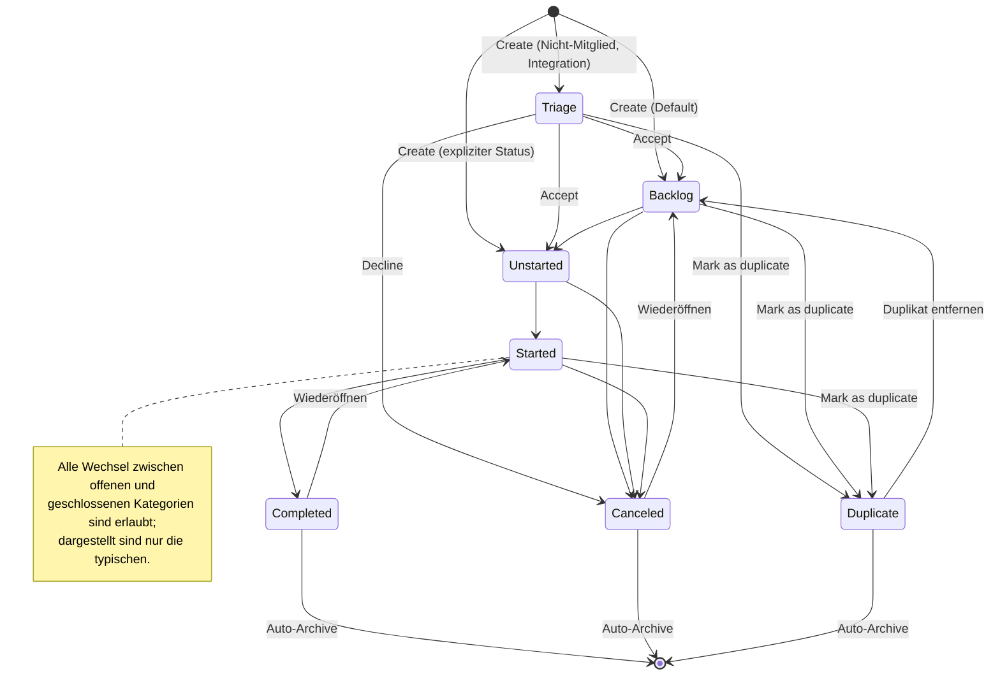
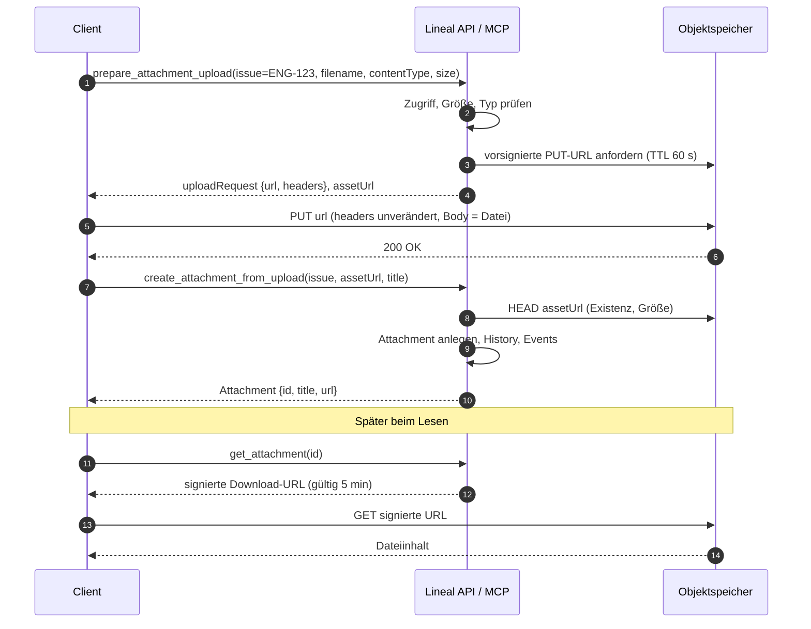
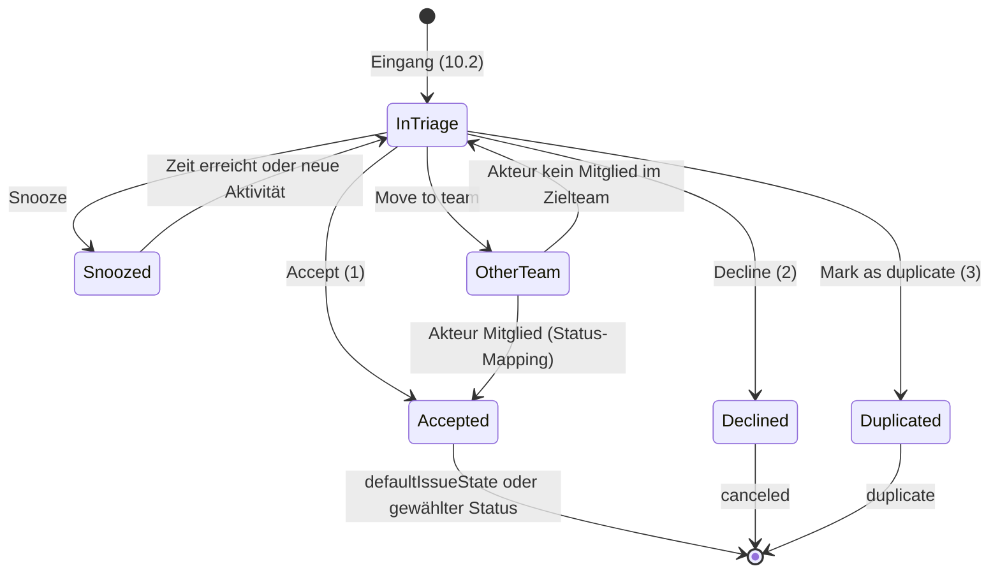
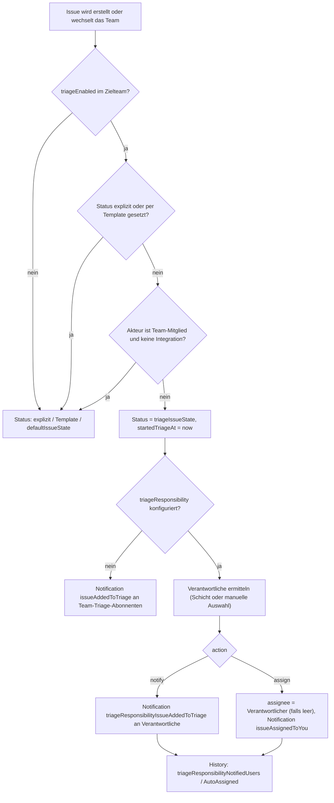

# 03 – Issues, Workflow, Triage

Dieses Kapitel beschreibt das Verhalten rund um das Kernobjekt **Issue**: Workflow-Status, Lebenszyklus und Feldregeln, Sub-Issues, Relationen, Labels, Kommentare, Anhänge, Aktivitätsverlauf, Löschen/Archivieren, Triage, SLA, manuelle Sortierung und wiederkehrende Issues. Es setzt die Regeln aus [00-konventionen.md](00-konventionen.md) (IDs, Enums, Tri-State-Updates, Fehlermodell) und die „Getroffenen Entscheidungen“ aus [README.md](README.md) voraus.

Die Felder der Entitäten (`Issue`, `WorkflowState`, `IssueLabel`, `IssueRelation`, `Comment`, `Reaction`, `Attachment`, `IssueHistory`, `TriageResponsibility`) sind vollständig in [01-domaenenmodell.md](01-domaenenmodell.md) definiert; hier geht es um **Regeln und Abläufe**. Team-Hierarchie, Sichtbarkeit und Teamwechsel eines Issues stehen in [02-teams-rechte.md](02-teams-rechte.md), Cycles und Projekte in [04-planung.md](04-planung.md), die Zustellung von Benachrichtigungen in [05-views-suche-inbox.md](05-views-suche-inbox.md), Templates in [06-dokumente-templates.md](06-dokumente-templates.md), die MCP-Tools (`save_issue`, `save_comment`, `prepare_attachment_upload` …) in [07-mcp-server.md](07-mcp-server.md), Webhooks in [09-api-events.md](09-api-events.md) und die Hintergrundjobs in [10-architektur-umsetzung.md](10-architektur-umsetzung.md).

Mit **Festlegung** gekennzeichnete Regeln sind Entscheidungen für Lineal, wo das Original undokumentiert ist. Sie sind am Ende unter „Offene Punkte/Annahmen“ gesammelt.

Alle Beispiele verwenden den erfundenen Workspace `acme` mit den Teams `ENG`, `WEB` (Sub-Team von `ENG`) und `DES` sowie den Personen Alice, Bob und Carol.

---

## 1. Workflow-States

### 1.1 Kategorien und Reihenfolge

Jedes Team besitzt einen eigenen Satz von `WorkflowState`-Datensätzen. Jeder Status gehört genau einer **Kategorie** (`type`) an. Die Kategorien sind fest vorgegeben und stehen in fester Reihenfolge; Teams können sie weder umbenennen noch umsortieren noch neue Kategorien anlegen.

| Pos. | `type` | Bedeutung | Offen/geschlossen | Pflicht im Team |
|---|---|---|---|---|
| 1 | `triage` | Eingangskorb für zu prüfende Issues | offen | nur wenn `Team.triageEnabled = true` (dann genau einer) |
| 2 | `backlog` | Erfasst, aber nicht eingeplant | offen | ja, ≥ 1 |
| 3 | `unstarted` | Eingeplant, noch nicht begonnen („Todo“) | offen | ja, ≥ 1 |
| 4 | `started` | In Arbeit | offen | ja, ≥ 1 |
| 5 | `completed` | Erledigt | geschlossen | ja, ≥ 1 |
| 6 | `canceled` | Abgebrochen / nicht umgesetzt | geschlossen | ja, ≥ 1 |
| 7 | `duplicate` | Als Duplikat markiert (system-verwaltet) | geschlossen | ja, genau 1 |

Innerhalb einer Kategorie bestimmt `position: Float` (aufsteigend) die Reihenfolge der Status. Die globale Sortierung aller Status eines Teams ist daher `(kategorieIndex, position)`. Diese Sortierung wird überall verwendet, wo Status aufgelistet werden (Board-Spalten, Status-Picker, Auflösung „Kategoriename → erster Status dieser Kategorie“ gemäß [00-konventionen.md](00-konventionen.md#2-identifikatoren)).

### 1.2 Default-Workflow eines neuen Teams

Beim Anlegen eines Teams werden folgende Status erzeugt (Farben sind Vorschläge, `position` mit Abstand 1000, damit spätere Einfügungen ohne Neunummerierung möglich sind):

| `name` | `type` | `position` | `color` | Hinweis |
|---|---|---|---|---|
| Triage | `triage` | 1000 | `#FC7840` | nur angelegt, wenn Triage aktiviert wird (auch nachträglich) |
| Backlog | `backlog` | 1000 | `#BEC2C8` | `defaultIssueState` |
| Todo | `unstarted` | 1000 | `#E2E2E2` | |
| In Progress | `started` | 1000 | `#F2C94C` | |
| Done | `completed` | 1000 | `#5E6AD2` | |
| Canceled | `canceled` | 1000 | `#95A2B3` | `autoCloseStateId` (falls Auto-Close aktiviert wird) |
| Duplicate | `duplicate` | 1000 | `#95A2B3` | system-verwaltet, nicht umbenennbar, nicht löschbar |

Ein Sub-Team mit `inheritWorkflowStatuses = true` (z. B. `WEB`) besitzt keine eigenen Status, sondern Kopien mit `inheritedFrom` → Status des Parent-Teams; Änderungen am Parent-Workflow werden propagiert. Details zur Vererbung in [02-teams-rechte.md](02-teams-rechte.md).

Ein realistischer angepasster Workflow von `ENG` könnte so aussehen: `backlog`: Icebox, Backlog · `unstarted`: Todo · `started`: In Progress, In Review · `completed`: Done · `canceled`: Canceled, Won't Fix · `duplicate`: Duplicate.

### 1.3 Anpassung (CRUD)

Status-Verwaltung ist ein Team-Setting (Berechtigung: Team-Owner oder Admin, ggf. jedes Team-Mitglied, je nach Team-Sicherheitseinstellung, siehe [02-teams-rechte.md](02-teams-rechte.md)).

| Operation | Regeln |
|---|---|
| **Anlegen** | Pflicht: `name`, `type`, `color`. `type` darf nicht `duplicate` sein (der Duplicate-State existiert genau einmal und wird vom System angelegt). `type = triage` nur, wenn das Team noch keinen Triage-Status hat. `name` muss im Team eindeutig sein (case-insensitiv) → sonst `invalid_request`. `position` optional; Default = ans Ende der Kategorie (`max(position) + 1000`). |
| **Ändern** | `name`, `color`, `description`, `position` änderbar. `type` ist **nicht** änderbar (stattdessen neuen Status anlegen und alten löschen). Beim Duplicate-State ist nichts änderbar außer `color` (**Festlegung**; Original: gar nicht anpassbar); Umbenennen oder andere Änderungen → `invalid_request` (Systeminvariante, keine Rechtefrage). |
| **Umsortieren** | Nur innerhalb der Kategorie: neue `position = (a + b) / 2` zwischen den Nachbarn. |
| **Löschen** | Siehe 1.4. Der Duplicate-State und der aktuell als `defaultIssueState` gesetzte Status können nicht gelöscht werden (zuerst einen anderen Default wählen) → `invalid_request`. |

**Invariante:** Nach jeder Operation muss jede Pflicht-Kategorie aus der Tabelle in 1.1 mindestens einen nicht archivierten Status besitzen. Eine Operation, die diese Invariante verletzen würde, wird mit `invalid_request` und `details.reason = "last_state_of_type"` abgelehnt.

### 1.4 Löschen eines Status mit Issues (Migration)

Status werden nicht physisch gelöscht, sondern archiviert (`archivedAt`), damit `IssueHistory` und `stateHistory` gültig bleiben. Hängen Issues (inkl. archivierter und im Papierkorb liegender) an dem Status, muss der Aufrufer ein **Migrationsziel** angeben.

```text
function deleteWorkflowState(stateId, targetStateId?):
    state = load(stateId)
    if state.type == "duplicate" or state.id == team.defaultIssueState.id:
        fail invalid_request
    if countActiveStatesOfType(team, state.type) == 1 and state.type != "triage":
        fail invalid_request(reason = "last_state_of_type")
    affected = issues where stateId == state.id (inkl. archived, trashed)
    if affected not empty:
        if targetStateId missing: fail invalid_request(reason = "migration_target_required", details.issueCount = |affected|)
        target = load(targetStateId)
        require target.team == state.team and target.archivedAt == null and target.id != state.id
        // Empfehlung in der UI: Ziel derselben Kategorie vorschlagen; andere Kategorien sind erlaubt.
        in one transaction:
            for issue in affected:
                applyStateChange(issue, target, actor = caller, source = "stateDeletion")   // siehe 1.6
    if state.type == "triage": team.triageEnabled = false; team.triageIssueState = null
    if team.autoCloseStateId == state.id: team.autoCloseStateId = firstStateOfType(team, "canceled").id
    state.archivedAt = now()
    emit WorkflowState.archived
```

Die Statuswechsel durch Migration erzeugen History-Einträge (Akteur = ausführender User), aber **keine** Benachrichtigungen (Massenoperation; **Festlegung**).

### 1.5 Default-State für neue Issues

| Team-Feld | Bedeutung | Erlaubte Kategorien | Default |
|---|---|---|---|
| `defaultIssueState` | Status für neue Issues, die ein **Team-Mitglied** erstellt (und für Accept in Triage, siehe 10) | `backlog`, `unstarted` | erster `backlog`-Status |
| `triageIssueState` | Status für Issues, die in Triage landen (siehe 10.2) | `triage` | der Triage-Status des Teams, sonst `null` |

Auswahlregel beim Create (in dieser Priorität):

1. Explizit übergebener `state` (Name, UUID oder Kategoriename) – darf jeder Status des Teams außer `duplicate` sein. Ein explizit gesetzter Status hat Vorrang vor Triage.
2. Status aus einem angewandten Template (siehe [06-dokumente-templates.md](06-dokumente-templates.md)).
3. Wenn `triageEnabled` und eine Triage-Bedingung aus 10.2 zutrifft → `triageIssueState`.
4. Sonst `defaultIssueState`.

Wird ein Issue in einen aktiven Cycle gelegt, während es in `backlog` steht, wechselt es auf den ersten `unstarted`-Status (Details in [04-planung.md](04-planung.md)).

### 1.6 Kategorie-Übergänge und Zeitstempel

Lineal erlaubt – wie Linear – **freie Wechsel** zwischen allen Status eines Teams, auch rückwärts (z. B. `completed` → `started`). Einzige Einschränkungen:

- In den Status der Kategorie `duplicate` gelangt ein Issue **nur** über „Als Duplikat markieren“ (siehe 4.3), nicht über ein direktes `state`-Update → `invalid_request`.
- In `triage` gelangt ein Issue nur durch die Triage-Regeln (Create, Teamwechsel) oder explizit per `state`-Update durch ein Team-Mitglied (Zurücklegen in Triage).
- Ist `requirePriorityToLeaveTriage = true`, darf ein Issue `triage` nur verlassen, wenn `priority != 0` → sonst `invalid_request` (`reason = "priority_required"`).



Bei jedem Statuswechsel führt der Domain-Core `applyStateChange` aus. Die Zeitstempel beziehen sich auf **Kategorien**, nicht auf einzelne Status (ein Wechsel „In Progress“ → „In Review“ ändert keinen Zeitstempel). Die feingranulare Verweildauer pro Status wird zusätzlich als `IssueStateSpan` (`stateHistory`: `state`, `startedAt`, `endedAt`) protokolliert.

| Zeitstempel | Wird gesetzt, wenn … | Wird zurückgesetzt (`null`), wenn … |
|---|---|---|
| `startedTriageAt` | das Issue in `triage` eintritt (Create oder Wechsel) | nie (bleibt als Historie); bei erneutem Eintritt überschrieben |
| `triagedAt` | das Issue `triage` verlässt (beliebiges Ziel) | bei erneutem Eintritt in `triage` |
| `startedAt` | das Issue erstmals oder erneut in `started` eintritt **und** `startedAt` leer ist; ebenso beim direkten Sprung in `completed`, wenn `startedAt` leer ist (**Festlegung**, damit Durchlaufzeiten berechenbar bleiben) | beim Wechsel zurück nach `triage`, `backlog` oder `unstarted` (**Festlegung**) |
| `completedAt` | das Issue in `completed` eintritt | beim Verlassen von `completed` |
| `canceledAt` | das Issue in `canceled` **oder** `duplicate` eintritt | beim Verlassen von `canceled`/`duplicate` |
| `autoClosedAt` | Auto-Close-Job schließt das Issue (zusätzlich zu `canceledAt`) | beim Wiederöffnen |

```text
function applyStateChange(issue, newState, actor, source):
    old = issue.state
    if old.id == newState.id: return
    if newState.team != issue.team: fail invalid_request
    if newState.type == "duplicate" and source != "markDuplicate": fail invalid_request
    if old.type == "triage" and newState.type != "triage":
        if team.requirePriorityToLeaveTriage and issue.priority == 0: fail invalid_request(reason="priority_required")
        issue.triagedAt = now(); issue.snoozedUntilAt = null; issue.snoozedBy = null
    if newState.type == "triage": issue.startedTriageAt = now(); issue.triagedAt = null
    if newState.type in [triage, backlog, unstarted]: issue.startedAt = null
    if newState.type == "started" and issue.startedAt == null: issue.startedAt = now()
    if newState.type == "completed":
        issue.completedAt = now()
        if issue.startedAt == null: issue.startedAt = issue.completedAt
    else: issue.completedAt = null
    if newState.type in [canceled, duplicate]: issue.canceledAt = now()
    else: issue.canceledAt = null; issue.autoClosedAt = null
    closeSpan(issue, old); openSpan(issue, newState)
    issue.state = newState
    applySortOrderOnStateChange(issue, source)          // Abschnitt 12
    evaluateParentChildAutomation(issue, old, newState)  // Abschnitt 3.4
    evaluateSla(issue)                                   // Abschnitt 11 (Abschluss/Wiederöffnen)
    recordHistory(issue, actor, fromState = old, toState = newState)
    notify: issueStatusChanged an Subscriber (außer actor);
            issueReopened, wenn old geschlossen und newState offen ist
```

---

## 2. Issue-Lebenszyklus

### 2.1 Create

| Feld | Pflicht | Default / Regel |
|---|---|---|
| `team` | ja | Referenz (UUID, Key, Name). Team darf nicht stillgelegt sein (`retiredAt`), sonst `invalid_request`. Aufrufer braucht Zugriff (öffentliches Team oder Mitglied). |
| `title` | ja (außer bei `template`) | 1–255 Zeichen nach Trimmen (**Festlegung** der Obergrenze); keine Zeilenumbrüche. |
| `description` | nein | Markdown; Mentions werden ausgewertet (2.9). |
| `state` | nein | siehe 1.5 |
| `priority` | nein | `0` (No priority); bei Sub-Issue vom Parent übernommen (3.2) |
| `assignee` | nein | `null`; Ausnahme: User-Präferenz „Issues mir selbst zuweisen“, Triage-Verantwortung `assign` (10.6), Vererbung vom Parent (3.2) |
| `estimate` | nein | `null` |
| `labels` | nein | leer; Validierung siehe 5.5 |
| `dueDate`, `cycle`, `project`, `milestone`, `parentId` | nein | `null` |
| `creator` | automatisch | aufrufender User; bei Integrationen `null` + `botActor`/`integrationSourceType` |
| `number` / `identifier` | automatisch | atomarer Team-Zähler (siehe [00-konventionen.md](00-konventionen.md#2-identifikatoren)) |
| `sortOrder` | automatisch | oben in der Default-Spalte: `min(sortOrder im Ziel-Status) − 1` (12) |
| `prioritySortOrder`, `subIssueSortOrder` | automatisch | analog oben bzw. ans Ende der Sub-Issue-Liste |
| `subscribers` | automatisch | Creator (falls Mensch), Assignee, alle in `description` erwähnten User |

Ablauf in **einer Transaktion**:

```text
function createIssue(input, actor):
    team = resolveTeam(input.team); checkAccess(actor, team)
    if countOpenIssues(team) >= workspace.limits.openIssuesPerTeam (Default 60000): fail limit_exceeded
    template = input.template ? resolveTemplate(input.template) : team.defaultTemplateFor(actor)
    data = merge(template.values, input)          // explizite Eingaben gewinnen; Labels werden vereinigt
    validateFields(data, team)                    // Feldregeln 2.3
    issue.number = nextTeamCounter(team)          // atomar
    issue.state = chooseInitialState(data, team, actor)   // 1.5 / 10.2
    setInitialTimestamps(issue)                   // startedTriageAt/startedAt/completedAt je nach Kategorie
    issue.sortOrder = topOf(team, issue.state)
    if data.slaBreachesAt == null: evaluateSlaRules(issue, trigger = "create")   // 11
    subscribe(creator, assignee, mentionedUsers(description))
    createRelationsFromMentions(issue)            // 4.1
    insert issue; insert IssueHistory(kind = "created")
    if issue.state.type == "triage": runTriageResponsibility(issue)   // 10.6
    notify (nach Commit): issueAssignedToYou, issueMention, issueAddedToTriage, issuePriorityUrgent, issueCreated (Team-Abos)
    emit Issue.create (Webhook, Sync)
```

**Erstellungsfenster:** Änderungen durch den Creator innerhalb von **3 Minuten** nach `createdAt` gelten als Teil der Erstellung. Sie aktualisieren den Datensatz, erzeugen aber keine eigenen History-Einträge (der `created`-Eintrag wird stattdessen ergänzt) und keine erneuten Benachrichtigungen an bereits benachrichtigte Empfänger. Änderungen **anderer** Akteure in diesem Fenster werden normal protokolliert.

### 2.2 Update

Updates folgen der Tri-State-Semantik aus [00-konventionen.md](00-konventionen.md#6-schreibsemantik): weggelassen = unverändert, `null` = leeren, Wert = setzen. `labels` (ersetzen) und `addLabels`/`removeLabels` (inkrementell) schließen sich gegenseitig aus → `invalid_request`. Ein Update ist atomar: schlägt die Validierung eines Feldes fehl, wird nichts geändert. Gleichzeitige Updates verschiedener Felder werden feldweise zusammengeführt (last-writer-wins pro Feld); für `description` gilt der Patch-Mechanismus mit `conflict` bei nicht eindeutigem Anker.

Ein Update ohne tatsächliche Änderung (alle Werte identisch) erzeugt weder `updatedAt`-Änderung noch History noch Events.

Ein Teamwechsel (`team`) wird in [02-teams-rechte.md](02-teams-rechte.md) beschrieben: neue Kennung, alte in `previousIdentifiers`, Status-Mapping über die Kategorie (gleichnamiger Status, sonst erster Status derselben Kategorie), Team-Labels, die im Zielteam nicht verfügbar sind, werden entfernt, Cycle wird geleert. `labels`/`addLabels` sind mit einem Teamwechsel im selben Aufruf nicht kombinierbar (`invalid_request`).

### 2.3 Feldregeln

| Feld | Validierung | Seiteneffekte | History-Eintrag | Notification |
|---|---|---|---|---|
| `title` | nicht leer, ≤ 255 Zeichen | Suchindex aktualisieren | `fromTitle`/`toTitle` | – |
| `description` | Markdown ≤ 500 000 Zeichen (**Festlegung**); Patch-Anker eindeutig | neue Mentions → Subscribe + `related`-Relationen (4.1); Versionsstand und Snapshot in `DocumentContent`/`DocumentContentHistory` ([06-dokumente-templates.md](06-dokumente-templates.md) §1.3) | `updatedDescription = true`, `descriptionUpdatedBy` | `issueMention` an neu erwähnte User |
| `state` | Status des eigenen Teams, nicht archiviert; nicht `duplicate` direkt (1.6) | `applyStateChange` (Zeitstempel, Sortierung, Parent/Child-Automation, SLA-Abschluss) | `fromState`/`toState` | `issueStatusChanged` an Subscriber; `issueReopened` bei geschlossen → offen; Ersteller bei `completed` |
| `priority` | Ganzzahl 0–4 | SLA-Regeln neu auswerten (11.2); `prioritySortOrder` beibehalten | `fromPriority`/`toPriority` | `issuePriorityUrgent` an Assignee, wenn neuer Wert `1` |
| `estimate` | Wert der Team-Skala (2.5) oder `null`; `0` nur bei `issueEstimationAllowZero` | Cycle-/Projekt-Fortschritt neu berechnen | `fromEstimate`/`toEstimate` | – |
| `assignee` | aktiver User mit Zugriff auf das Team (2.7) oder `null` | neuer Assignee wird Subscriber; SLA-Regeln neu auswerten | `fromAssignee`/`toAssignee` | `issueAssignedToYou` an neuen, `issueUnassignedFromYou` an alten Assignee (jeweils nicht, wenn Akteur = Empfänger) |
| `delegate` | nur User mit Rolle `app` (optional, außerhalb Kernscope) | – | `fromDelegate`/`toDelegate` | – |
| `dueDate` | `Date` (`YYYY-MM-DD`) oder `null` | entfernt ein aktives SLA (2.6) | `fromDueDate`/`toDueDate` (+ SLA-Felder) | `issueDue` am Fälligkeitstag (Job) an Assignee/Subscriber |
| `slaBreachesAt` / `slaType` | `DateTime` in der Zukunft bzw. `all`/`onlyBusinessDays` | manuelles SLA: setzt `slaStartedAt = now`, berechnet Risikostufen, leert `dueDate` | `fromSlaBreachesAt`/`toSlaBreachesAt`, `fromSlaType`/`toSlaType` | – (Risiko-/Breach-Benachrichtigungen durch Job, 11.4) |
| `labels` | jedes Label im Team verfügbar, nicht retired, keine Gruppe, Single-Select-Regel (5.5) | `IssueLabel.lastAppliedAt`; SLA-Regeln neu auswerten | `addedLabelIds`/`removedLabelIds` | – |
| `parentId` | kein Zyklus, nicht sich selbst, Zugriff auf Parent (3.1) | `subIssueSortOrder` ans Ende; Parent-Automation prüfen | `fromParent`/`toParent` | – |
| `cycle` | Cycle des eigenen Teams, nicht abgeschlossen | ggf. Statuswechsel `backlog` → `unstarted`; `addedToCycleAt` | `fromCycle`/`toCycle` | – |
| `project` / `milestone` | Projekt enthält das Team des Issues; Milestone gehört zum Projekt | `addedToProjectAt`; Milestone wird bei Projektwechsel geleert | `fromProject`/`toProject`, `fromProjectMilestone`/`toProjectMilestone` | – |
| `team` | Zielteam zugänglich, nicht stillgelegt | siehe 2.2 und [02-teams-rechte.md](02-teams-rechte.md); ggf. Triage (10.2) | `fromTeam`/`toTeam` | `issueAddedToTriage` falls Triage |
| `subscribers` | aktive User mit Zugriff | – | – (keine History) | `issueSubscribed`/`issueUnsubscribed` an betroffenen User, wenn durch Dritte |
| `blocks`/`blockedBy`/`relatedTo`/`duplicateOf` | siehe 4 | siehe 4 | `relationChanges` | `issueBlocking` an Subscriber des blockierten Issues; `issueUnblocked` beim Entfernen bzw. Abschluss des Blockers |
| `sortOrder`, `prioritySortOrder`, `subIssueSortOrder` | `Float` | – | – (keine History) | – |

Benachrichtigungen werden nie an den Akteur selbst geschickt. Kanäle, Bündelung und Abo-Einstellungen: [05-views-suche-inbox.md](05-views-suche-inbox.md).

### 2.4 Priorität

Werte und Namen gemäß [00-konventionen.md](00-konventionen.md#4-feste-enums) (`0` No priority, `1` Urgent … `4` Low); Ausgabe immer als `{ "value": 1, "name": "Urgent" }`. Es gibt keine benutzerdefinierten Prioritäten. Bei Sortierung nach Priorität steht `0` immer **zuletzt** (unabhängig von der Richtung). Achtung für Filter: Ein numerischer Vergleich `lte: 2` würde `0` einschließen; der Filter-Layer behandelt `priority` deshalb über explizite Wertemengen (`in: [1, 2]`), siehe [05-views-suche-inbox.md](05-views-suche-inbox.md).

`prioritySortOrder` ist die **workspace-weite** manuelle Reihenfolge innerhalb einer Prioritätsgruppe. Zieht ein User ein Issue in eine andere Prioritätsgruppe, übernimmt es deren Priorität.

### 2.5 Schätzungen

Die Skala ist eine Team-Einstellung (`issueEstimationType`), Sub-Teams können sie erben (`inheritIssueEstimation`). Gespeichert wird immer eine **Zahl** in `estimate`.

| `issueEstimationType` | Basiswerte | zusätzlich bei `issueEstimationExtended = true` |
|---|---|---|
| `notUsed` | – (`estimate` muss `null` sein) | – |
| `exponential` | 1, 2, 4, 8, 16 | 32, 64 |
| `fibonacci` | 1, 2, 3, 5, 8 | 13, 21 |
| `linear` | 1, 2, 3, 4, 5 | 6, 7 |
| `tShirt` | XS, S, M, L, XL | XXL, XXXL |

**T-Shirt-Mapping** (gespeicherter Wert, wie Fibonacci): XS = 1, S = 2, M = 3, L = 5, XL = 8, XXL = 13, XXXL = 21. API und MCP akzeptieren beim Schreiben sowohl die Zahl als auch das Kürzel; die Ausgabe enthält die Zahl und bei `tShirt` zusätzlich das Kürzel (`{ "value": 3, "name": "M" }`).

Weitere Regeln:

- **Zero-Estimates:** `0` ist nur erlaubt, wenn `issueEstimationAllowZero = true`. Ein explizites `0` ist etwas anderes als „nicht geschätzt“ (`null`).
- **Nicht geschätzte Issues** zählen in Fortschritts- und Scope-Berechnungen mit `Team.defaultIssueEstimate` (Default `1`). Ist die Skala `notUsed`, zählt jedes Issue als 1 Punkt.
- Wechselt das Team die Skala, bleiben bestehende Werte unverändert gespeichert; Werte außerhalb der neuen Skala werden angezeigt, aber beim nächsten Setzen muss ein gültiger Wert gewählt werden (**Festlegung**).
- Ungültiger Wert → `invalid_request` mit `details.allowed` (Liste erlaubter Werte).

### 2.6 Fälligkeitsdatum vs. SLA

`dueDate` ist ein Kalenderdatum ohne Uhrzeit. Darstellung: rot, wenn heute fällig oder überfällig; orange bei Fälligkeit innerhalb von 7 Tagen; sonst grau (Vergleich in der Zeitzone des betrachtenden Users).

Ein Issue hat **entweder** ein `dueDate` **oder** ein SLA, nie beides:

- Wird ein SLA gesetzt (Regel oder manuell), wird `dueDate` auf `null` gesetzt (dokumentiertes Verhalten).
- Wird ein `dueDate` gesetzt, während ein SLA aktiv ist, werden alle SLA-Felder geleert (**Festlegung**; die Gegenrichtung ist im Original nicht dokumentiert). Eine SLA-Regel kann das SLA bei einem späteren Update erneut setzen; dabei wird das `dueDate` wieder entfernt.
- Beide gleichzeitig in einem Request → `invalid_request`.

### 2.7 Assignee

- Höchstens ein Assignee. Zusätzlich optional ein `delegate` (Agent-User), der Mensch bleibt verantwortlich.
- Zuweisbar sind aktive (nicht suspendierte) User, die das Issue sehen dürfen: bei öffentlichen Teams jedes Workspace-Mitglied (Gäste nur, wenn sie Mitglied des Teams sind), bei privaten Teams nur Team-Mitglieder, außerdem User, mit denen das Issue geteilt ist. Sonst `invalid_request` (`reason = "assignee_has_no_access"`).
- Es gibt keinen Default-Assignee pro Team. Automatische Zuweisung entsteht nur durch die User-Präferenz „mir selbst zuweisen“, Vererbung vom Parent (3.2), Templates oder die Triage-Verantwortung (10.6).
- Der neue Assignee wird automatisch Subscriber. Der alte bleibt Subscriber, bis er sich abmeldet.
- Wird ein User deaktiviert, bleiben seine Zuweisungen erhalten (Anzeige als deaktiviert); neue Zuweisungen sind nicht möglich.

### 2.8 Subscriber

Subscriber erhalten Benachrichtigungen über Änderungen am Issue. Automatisch abonniert werden: der Creator, jeder neue Assignee, in `description` oder in einem Top-Level-Kommentar erwähnte User, Kommentar-Autoren. Ein `@mention` **in einer Antwort** (Reply) abonniert nur den **Thread**, nicht das ganze Issue (Thread-Abos werden als `CommentSubscription` geführt, siehe [01-domaenenmodell.md](01-domaenenmodell.md)).

Manuelles Abonnieren/Abbestellen: für sich selbst jederzeit; für andere User nur mit Zugriff des Ziel-Users. Ein abbestellter User wird durch erneutes Erwähnen oder Zuweisen wieder abonniert. Die Abo-Menge wird in API/MCP über `subscribers` (ersetzen) bzw. die Subscribe/Unsubscribe-Operationen geändert.

### 2.9 Mentions

Erwähnungen werden beim Speichern von `description` und Kommentaren aus dem Markdown extrahiert:

| Syntax | Ziel | Wirkung |
|---|---|---|
| `@displayName` (z. B. `@alice`) | User | Subscribe (Issue bzw. Thread), Notification `issueMention` bzw. `issueCommentMention` |
| `ENG-123` bzw. Issue-URL | Issue | Link; legt eine `related`-Relation an (4.1), falls noch keine Relation zwischen beiden besteht |
| Projekt-, Dokument-URL | Projekt/Dokument | nur Link |

Notifications entstehen nur für **neu hinzugekommene** Mentions (Differenz alte/neue Mention-Menge), nicht bei jedem Speichern. User ohne Zugriff auf das Issue werden verlinkt, aber nicht benachrichtigt.

---

## 3. Sub-Issues

### 3.1 Struktur

- Jedes Issue hat höchstens einen `parent` und beliebig viele `children`.
- Parent und Child dürfen in **verschiedenen Teams** liegen (z. B. Parent `ENG-120`, Child `DES-41`).
- **Tiefe:** Linear begrenzt die Verschachtelung nicht dokumentiert. Lineal erlaubt eine Tiefe von bis zu **10 Ebenen** (konfigurierbares Workspace-Limit, **Festlegung**); Überschreitung → `limit_exceeded`.
- **Zyklen sind verboten:** Ein Issue darf nicht Nachfahre von sich selbst werden. Prüfung beim Setzen von `parentId` durch Hochlaufen der Vorfahrenkette → `invalid_request` (`reason = "parent_cycle"`).
- Der Aufrufer muss beide Issues sehen dürfen. Ein Child in einem privaten Team erscheint für Nutzer ohne Zugriff nur als Zähler, nicht mit Inhalt.

### 3.2 Vererbung beim Erstellen eines Sub-Issues

| Eigenschaft | Übernahme vom Parent |
|---|---|
| `team` | ja (überschreibbar) |
| `priority` | ja |
| `project` | ja (wenn das Team des Child am Projekt beteiligt ist) |
| `cycle` | nur wenn das Child in einem `unstarted`/`started`-Status erstellt wird und im selben Team liegt |
| `assignee` | nur wenn der Ersteller selbst Assignee des Parents ist **oder** alle bestehenden Children den Assignee des Parents haben |
| `labels` | **nein** |

### 3.3 Sortierung

`subIssueSortOrder: Float` bestimmt die Reihenfolge in der Sub-Issue-Liste des Parents und ist für alle User gleich. Neue Children werden ans Ende gehängt (`max + 1`). Eine persönliche „Order by“-Einstellung in der Sub-Issue-Liste ist reine Anzeigeoption und ändert `subIssueSortOrder` nicht.

### 3.4 Parent-/Child-Automationen

Zwei optionale Team-Einstellungen, beide standardmäßig **aus** (**Festlegung**). Maßgeblich ist jeweils die Einstellung des Teams, dem das **automatisch geänderte** Issue gehört (beim Parent-Close das Team des Parents, beim Child-Close das Team des jeweiligen Child), **Festlegung**.

| Einstellung | Auslöser | Wirkung |
|---|---|---|
| `autoCloseParentIssues` | Letztes offenes Child wird geschlossen (`completed`, `canceled` oder `duplicate`) | Parent wechselt auf den ersten `completed`-Status seines Teams, sofern mindestens ein Child `completed` ist; sind alle Children `canceled`/`duplicate`, wird der Parent nicht geändert (**Festlegung**) |
| `autoCloseChildIssues` | Parent wird `completed` oder `canceled` | Alle offenen Children wechseln in die gleiche Kategorie (erster Status dieser Kategorie in ihrem Team); `autoClosedByParentClosing = true` |

```text
function evaluateParentChildAutomation(issue, oldState, newState):
    if isClosed(newState) and not isClosed(oldState):
        p = issue.parent
        if p != null and p.team.autoCloseParentIssues and isOpen(p.state):
            if all(isClosed(c.state) for c in p.children) and any(c.state.type == "completed" for c in p.children):
                applyStateChange(p, firstStateOfType(p.team, "completed"), actor = system, source = "parentAutomation")
        if newState.type in [completed, canceled]:
            for c in issue.children where isOpen(c.state) and c.team.autoCloseChildIssues:
                c.autoClosedByParentClosing = true
                applyStateChange(c, firstStateOfType(c.team, newState.type), actor = system, source = "childAutomation")
```

Rekursion ist erlaubt (Kaskade über mehrere Ebenen), jedes Issue wird pro auslösender Transaktion höchstens einmal geändert. Automatische Wechsel haben `actor = null` und einen Hinweis `source` in der History.

### 3.5 Fortschritt am Parent

Der Parent zeigt `completedChildren / relevantChildren` an:

- `relevantChildren` = alle nicht archivierten, nicht im Papierkorb liegenden Children außer `canceled` und `duplicate`.
- `completedChildren` = Children mit Kategorie `completed`.
- Zusätzlich wird ein punktbasierter Fortschritt geliefert: `Σ estimate(completed) / Σ estimate(relevant)`, mit `defaultIssueEstimate` für ungeschätzte Children. Bei 0 relevanten Children ist der Fortschritt `0`. (**Festlegung**; das Original zeigt nur „x/y“.)

Nur direkte Children zählen; Enkel fließen nicht ein.

---

## 4. Relationen

### 4.1 Typen und Sichten

| `type` | Bedeutung | Gerichtet? | Sicht aus `issue` | Sicht aus `relatedIssue` |
|---|---|---|---|---|
| `blocks` | `issue` blockiert `relatedIssue` | ja | `blocks` | `blockedBy` |
| `related` | thematisch verwandt | nein (symmetrisch) | `relatedTo` | `relatedTo` |
| `duplicate` | `issue` ist Duplikat von `relatedIssue` (kanonisch) | ja | `duplicateOf` | `duplicates` |
| `similar` | vom System vorgeschlagene Ähnlichkeit (optional, Erweiterungspunkt für Triage Intelligence) | nein | `similar` | `similar` |

**Speicherung:** Eine Relation ist **eine Zeile** `IssueRelation(id, issueId, relatedIssueId, type, createdAt, creatorId)`. Beide Sichten werden beim Lesen abgeleitet (`relations` = Zeilen mit `issueId = X`, `inverseRelations` = Zeilen mit `relatedIssueId = X`). Für symmetrische Typen (`related`, `similar`) wird die Zeile **kanonisch** gespeichert: `issueId` ist die lexikografisch kleinere UUID. Eindeutigkeit: `UNIQUE(issueId, relatedIssueId, type)`; zusätzlich darf zwischen zwei Issues nicht gleichzeitig `blocks` in beide Richtungen bestehen.

Weitere Regeln:

- Keine Relation eines Issues mit sich selbst → `invalid_request`.
- Relationen sind team-übergreifend erlaubt; der Aufrufer muss beide Issues sehen dürfen.
- Doppeltes Anlegen ist idempotent (keine Fehlermeldung, kein History-Eintrag).
- Eine `blocks`-Relation, deren Blocker geschlossen ist, bleibt gespeichert; die UI zeigt sie dann unter „Related“ an, und die Subscriber des blockierten Issues erhalten `issueUnblocked`.
- Wird ein Issue in `description` oder einem Kommentar erwähnt, wird automatisch eine `related`-Relation angelegt, sofern noch keine Relation zwischen beiden besteht. Entfernen der Erwähnung entfernt die Relation **nicht**.
- Append-Semantik in API/MCP: `blocks`, `blockedBy`, `relatedTo` fügen nur hinzu; entfernt wird über `removeBlocks`, `removeBlockedBy`, `removeRelatedTo` (siehe [07-mcp-server.md](07-mcp-server.md)).

### 4.2 History und Benachrichtigungen

Jede Änderung erzeugt auf **beiden** Issues einen History-Eintrag mit `relationChanges: [{ type, identifier, action: "added" | "removed" }]`. Neue `blocks`-Relation → `issueBlocking` an die Subscriber des blockierten Issues.

### 4.3 Als Duplikat markieren

Markiert wird immer **vom Duplikat aus** („`ENG-130` ist Duplikat von `ENG-123`“). Ein Issue kann höchstens ein `duplicateOf` haben; das kanonische Issue darf selbst kein Duplikat sein (Ketten werden auf das kanonische Ende aufgelöst, **Festlegung**).

```text
function markAsDuplicate(dup, canonical, actor, fromTriage = false):
    require dup.id != canonical.id
    canonical = followDuplicateChain(canonical)            // A→B→C wird zu A→C
    require canonical.id != dup.id
    in one transaction:
        delete relation where issueId = dup and type = "duplicate"     // altes duplicateOf ersetzen
        insert IssueRelation(dup, canonical, "duplicate")
        applyStateChange(dup, duplicateStateOf(dup.team), actor, source = "markDuplicate")
        for s in dup.subscribers: subscribe(canonical, s)        // Subscriber wandern mit (zusätzlich)
        if fromTriage:
            for a in dup.attachments:
                a.originalIssue = dup; a.issue = canonical        // Anhänge wandern; dedupe per URL
        // Children, Kommentare und Labels bleiben beim Duplikat
        recordHistory(dup, relationChanges + state); recordHistory(canonical, relationChanges)
    notify: issueStatusChanged an Subscriber des Duplikats
```

Festlegungen für Lineal:

- **Subscriber** des Duplikats werden zusätzlich Subscriber des kanonischen Issues (sie behalten das Abo am Duplikat).
- **Anhänge** wandern nur beim Markieren aus der Triage (dokumentiertes Verhalten); verschobene Anhänge behalten `originalIssue` und sind am Duplikat über `formerAttachments` sichtbar. Kollidiert die URL mit einem Anhang des kanonischen Issues, bleibt der vorhandene erhalten und der verschobene wird verworfen.
- **Kommentare, Labels, Children** werden nicht übertragen.
- Das Duplikat zeigt ein Banner mit Link auf das kanonische Issue.

**Entfernen:** `duplicateOf: null` löscht die Relation. Steht das Issue noch im Duplicate-State, wechselt es auf `defaultIssueState` seines Teams (**Festlegung**), damit es nicht in einem geschlossenen Status ohne Grund verbleibt. Wechselt ein Duplikat per `state`-Update aus dem Duplicate-State heraus, bleibt die Relation bestehen, bis sie explizit entfernt wird.

### 4.4 Entfernen allgemein

Entfernen löscht die eine Zeile physisch (keine Soft-Delete-Spur außer der History auf beiden Issues). Wird ein Issue gelöscht (Papierkorb), bleiben seine Relationen gespeichert, sind aber für andere Issues unsichtbar, bis es wiederhergestellt oder endgültig gelöscht wird (dann werden sie mitgelöscht).

---

## 5. Labels

### 5.1 Geltungsbereiche

| Art | `team` | Verfügbar für |
|---|---|---|
| Workspace-Label | `null` | Issues aller Teams |
| Team-Label | Team X | Issues von Team X **und aller Nachfahren-Teams** von X |
| Vererbtes Label (Sicht) | – | Ein Sub-Team sieht die Labels seiner Vorfahren-Teams als vererbt (`inheritedFrom`); es entstehen keine Kopien, sofern die Implementierung die Verfügbarkeit über die Vorfahrenkette berechnet |

Beispiel: Das Team-Label `Frontend` von `ENG` ist auf Issues von `ENG` und `WEB` anwendbar, nicht aber auf Issues von `DES`. Das Workspace-Label `Bug` ist überall anwendbar.

```text
function availableLabels(team):
    return labels where archivedAt == null and (team == null or team in [team] + ancestors(team))
```

Das Team eines Labels ist nach dem Anlegen nicht änderbar (`save_issue_label` lehnt `teamId`-Änderungen ab). Das Umziehen zwischen Team und Workspace erfolgt über die Operation „Label in Workspace-Label umwandeln“ bzw. Merge (5.4).

### 5.2 Gruppen

- Eine Label-Gruppe ist ein `IssueLabel` mit `isGroup = true`. Gruppen sind **nicht** direkt auf Issues anwendbar.
- Genau **eine Ebene**: Ein Label mit `parent` darf selbst keine Kinder haben; eine Gruppe darf keinen `parent` haben.
- Maximal **250 Labels pro Gruppe** → sonst `limit_exceeded`.
- Kinder einer Gruppe haben denselben Geltungsbereich wie die Gruppe (Workspace-Gruppe → Workspace-Kinder; Team-Gruppe → Kinder dieses Teams; ein Sub-Team darf einer geerbten Gruppe eigene Kinder hinzufügen, **Festlegung**).
- `groupType`: `singleSelect` (Default; höchstens ein Kind-Label der Gruppe pro Issue) oder `multiSelect` (beliebig viele).
- Inline-Anlage mit `Gruppe/Label` oder `Gruppe:Label` legt fehlende Gruppe und Label an.

### 5.3 Namensregeln und Kollisionen

- Namen sind case-insensitiv eindeutig **innerhalb desselben Sichtbarkeitsraums**: Ein Team-Label darf nicht so heißen wie ein Workspace-Label oder ein Label eines Vorfahren-Teams; innerhalb einer Gruppe eindeutig. Gleichnamige Labels in **unverwandten** Teams (z. B. `Frontend` in `ENG` und in `DES`) sind erlaubt.
- Reservierte Namen (case-insensitiv): `assignee`, `cycle`, `effort`, `estimate`, `hours`, `priority`, `project`, `state`, `status` → `invalid_request`.
- Wird ein Workspace-Label angelegt, dessen Name in einem oder mehreren Teams existiert, wird `conflict` mit `details.conflictingLabels` geliefert; der Client kann die **Konvertierung** anfordern (`convertTeamLabels = true`): Team-Labels werden in das neue Workspace-Label gemergt (5.4).
- In Multi-Team-Filtern der UI verhalten sich gleichnamige Team-Labels wie ein Label (Name-Matching); in API-Filtern nach `id` zählen IDs, nach `name` der Name (siehe [05-views-suche-inbox.md](05-views-suche-inbox.md)).

### 5.4 Lebenszyklus: Retire, Restore, Delete, Merge

| Operation | Wirkung |
|---|---|
| **Retire** (`retire_issue_label`) | setzt `retiredAt`/`retiredBy`. Das Label bleibt auf bestehenden Issues sichtbar und filterbar, kann aber nicht mehr neu angewendet werden. Bei einer Gruppe **kaskadiert** Retire auf alle Kinder. |
| **Restore** (`restore_issue_label`) | leert `retiredAt`. Bei einer Gruppe werden **alle Kinder** mit wiederhergestellt. Ein Kind kann nur wiederhergestellt werden, wenn seine Gruppe nicht retired ist. |
| **Delete** | irreversibel: entfernt das Label von allen Issues (History-Einträge mit `removedLabelIds`, Akteur = löschender User, keine Notifications) und löscht es. Bei Gruppe: Kinder werden mitgelöscht. Nur Admins oder Team-Owner. |
| **Merge** | Quell-Labels → Ziel-Label: auf allen Issues wird Quelle durch Ziel ersetzt (Duplikate entfallen), danach werden die Quellen gelöscht. Ziel muss in allen betroffenen Teams verfügbar sein (typisch Workspace-Label). |

> Umsetzung: Delete und Merge (Merge löscht die Quelle) verlangen zusätzlich zum Verwaltungsrecht des Labels die Rolle Admin/Owner bzw. Team-Owner des Label-Teams; Mitglieder, die Labels verwalten dürfen, können nur anlegen, ändern und zurückziehen. Merge ist auf einzelne Quell-Labels beschränkt (Gruppen nicht) und lehnt Ziele in `singleSelect`-Gruppen ab. Die gemeldete Zahl betroffener Issues zählt nur Issues in für den Aufrufer sichtbaren Teams. Siehe docs/15 §2.1.

### 5.5 Anwendungsregeln

Beim Setzen von Labels auf ein Issue (`labels`, `addLabels`) wird pro Label geprüft:

```text
function validateLabels(issue, newLabelSet):
    for l in newLabelSet:
        if l not in availableLabels(issue.team): fail invalid_request(reason="label_not_available_in_team", label=l)
        if l.isGroup: fail invalid_request(reason="label_is_group")
        if l.retiredAt != null and l not in issue.labels: fail invalid_request(reason="label_retired")
    for g in groupsOf(newLabelSet) where g.groupType == "singleSelect":
        if count(newLabelSet ∩ children(g)) > 1:
            if call used addLabels: replace previously set sibling with the newly added one   // UI-Verhalten
            else: fail invalid_request(reason="single_select_violation", group=g)
```

Bereits gesetzte retired Labels bleiben bei einem ersetzenden `labels`-Update erhalten, wenn sie in der neuen Menge enthalten sind. Ein Teamwechsel entfernt Labels, die im Zielteam nicht verfügbar sind (History-Eintrag).

---

## 6. Kommentare

### 6.1 Threads und Antworten

- Ein Kommentar hängt an genau einem Parent-Objekt (hier: Issue; ebenso Project, ProjectUpdate, Initiative, InitiativeUpdate, Document).
- **Eine Thread-Ebene:** Ein Top-Level-Kommentar (`parent = null`) eröffnet einen Thread; Antworten setzen `parent` auf den **Wurzelkommentar**. Antwortet ein Client auf eine Antwort, wird `parent` auf deren Wurzel normalisiert (**Festlegung**).
- Antworten erben den Thread-Typ (normal oder inline) und gehören zum selben Parent-Objekt.
- Reihenfolge: Threads und Antworten chronologisch nach `createdAt`.
- Body: Markdown, nicht leer, ≤ 100 000 Zeichen (**Festlegung**).

### 6.2 Inline-Kommentare

Ein Inline-Kommentar referenziert eine markierte Textstelle der Issue-Beschreibung über `quotedText` (der zitierte Text) und einen Anker im strukturierten Inhalt der Beschreibung (gemeinsamer `DocumentContent`, [06-dokumente-templates.md](06-dokumente-templates.md) §1.3; Inline-Kommentare wie in 06 §1.8). Wird die Textstelle später gelöscht, bleibt der Kommentar mit `quotedText` erhalten und wird als „Textstelle entfernt“ dargestellt. Der **Wurzelkommentar eines Inline-Threads ist nicht löschbar** (nur bearbeitbar bzw. der Thread auflösbar); Antworten sind löschbar.

### 6.3 Bearbeiten und Löschen

> **Umsetzung (WP17-Abgleich 03 ↔ 07):** Ein Top-Level-Kommentar mit Antworten wird nicht entfernt, sondern behält seine Zeile mit `deleted_at` und einem Platzhalter-Body; die Antworten bleiben. Die Wurzel eines Inline-Threads ist nicht löschbar: `invalid_request` mit `details.reason = "inline_root"`. Gilt auch für das MCP-Tool `delete_comment` ([07](07-mcp-server.md)).


| Aktion | Wer | Wirkung |
|---|---|---|
| Bearbeiten | nur der Autor | setzt `editedAt` (Anzeige „bearbeitet“); neue Mentions → Notifications nur für neu hinzugekommene User |
| Löschen (Antwort oder Top-Level ohne Antworten) | Autor, Admin | Kommentar wird entfernt (soft, `archivedAt`), Reaktionen mit |
| Löschen (Top-Level mit Antworten) | Autor, Admin | Body wird durch Platzhalter „Kommentar gelöscht“ ersetzt, Antworten bleiben sichtbar (**Festlegung**) |
| Löschen (Inline-Wurzel) | – | nicht erlaubt → `invalid_request` |

Bearbeiten und Löschen erzeugen keine Issue-History-Einträge, aber Events (`Comment.update`/`Comment.remove`). Die Issue-Beschreibung darf dagegen **jedes** Workspace-Mitglied mit Zugriff bearbeiten (mit Versionshistorie).

### 6.4 Reaktionen

- `Reaction(emoji, user, issue | comment | projectUpdate | initiativeUpdate)`; erlaubt sind Unicode-Emojis (gespeichert als Shortcode-Name, z. B. `thumbsup`) und Custom-Emojis des Workspace.
- Eindeutig pro `(user, Ziel, emoji)`: zweites Hinzufügen ist idempotent, Entfernen nur durch den reagierenden User.
- Ausgabe aggregiert als `reactionData: [{ emoji, count, userIds }]`.
- Notifications: `issueEmojiReaction` (Reaktion auf die Beschreibung, an den Creator) bzw. `issueCommentReaction` (an den Kommentar-Autor).

### 6.5 Threads auflösen

- Jeder Teilnehmer mit Schreibzugriff kann einen Thread auflösen: `resolvedAt`, `resolvingUser` werden am Wurzelkommentar gesetzt; optional `resolvingComment` = eine Antwort, die als Lösung hervorgehoben wird.
- Aufgelöste Threads werden eingeklappt dargestellt; eine neue Antwort öffnet den Thread **nicht** automatisch (**Festlegung**); „Unresolve“ leert die Felder.
- Notification `issueThreadResolved` an Thread-Teilnehmer.

### 6.6 Benachrichtigungen aus Kommentaren

| Ereignis | Empfänger | Typ |
|---|---|---|
| Neuer Top-Level-Kommentar | Issue-Subscriber | `issueNewComment` |
| Neue Antwort | Thread-Teilnehmer und Thread-Abonnenten (Issue-Subscriber nur, wenn ihre Abo-Einstellung „alle Kommentare“ ist) | `issueNewComment` |
| `@mention` im Kommentar | erwähnter User (mit Zugriff) | `issueCommentMention` |

Der Autor wird automatisch Subscriber des Issues (Top-Level) bzw. des Threads (Antwort), außer der Aufruf setzt `doNotSubscribeToIssue = true` (Integrationen).

---

## 7. Anhänge

### 7.1 Link-Anhänge

Ein `Attachment` verknüpft ein Issue mit einer externen Ressource: Pflicht `url` und `title`, optional `subtitle`, `metadata` (JSON), `sourceType` (`url`, `upload`, später Integrationen).

- `url` ist **pro Issue eindeutig** und dient als Schlüssel. Wird dieselbe URL erneut angehängt, wird **kein Fehler** erzeugt, sondern der bestehende Anhang aktualisiert (`title`/`subtitle`/`metadata`) und zurückgegeben (Upsert).
- URL-Normalisierung vor dem Vergleich: Schema und Host klein, Fragment `#…` entfernt, abschließender `/` entfernt (**Festlegung**).
- Anhänge sind über `links: [{url, title}]` bei `save_issue` (append) oder über eigene Operationen anlegbar; Entfernen über `delete_attachment`.
- History: `attachment` gesetzt bei Hinzufügen/Entfernen; keine Notification.

### 7.2 Datei-Upload

Dateien werden nicht durch den API-Server geschleust, sondern direkt in den Objektspeicher geladen:

1. **prepare** (`prepare_attachment_upload(issue, filename, contentType, size, title?, subtitle?)`): Server prüft Zugriff, Größe und Content-Type, erzeugt einen Objektschlüssel `<workspaceId>/<uuid>/<uuid>` und eine **vorsignierte PUT-URL**, gültig **60 Sekunden**, mit festen Headern (`Content-Type`, `Content-Length`, ggf. Signatur-Header). Antwort: `{ uploadRequest: { url, headers }, assetUrl }`.
2. **PUT**: Der Client lädt die Bytes innerhalb von 60 s direkt hoch und muss die Header **unverändert** mitsenden.
3. **finalize** (`create_attachment_from_upload(issue, assetUrl, title?, subtitle?)`): Server prüft, dass das Objekt existiert und die Größe zur Ankündigung passt, und legt den `Attachment` mit `url = assetUrl`, `sourceType = "upload"` an.

**Größenlimit:** konfigurierbares Workspace-Limit, Default **2 GB** (Obergrenze des Original-MCP) → bei Überschreitung `limit_exceeded`. Nicht finalisierte Objekte werden nach 24 h vom Aufräumjob gelöscht.

> **Umsetzung (WP17-Abgleich 03 ↔ 07):** Das Limit ist fest 2 GiB und **exklusiv** (`size >= 2 GiB`); die Überschreitung meldet schon `prepare` als `limit_exceeded` (`details.limit = "maxUploadBytes"`) – nicht `invalid_request`, wie 07 es für `prepare_attachment_upload` nennt. `finalize` meldet `invalid_request` mit `details.reason` `upload_missing` bzw. `upload_size_mismatch`. Reservierungen gelten 1 h; nie finalisierte Objekte räumt der Job `purge` 1 Tag nach Ablauf der Reservierung samt Blob ab.


**Download:** `assetUrl` ist nicht öffentlich. Beim Lesen (Kommentare, `get_attachment`, Bilder in Markdown) liefert der Server **signierte Download-URLs mit 5 Minuten Gültigkeit**; die Signatur wird erst nach Zugriffsprüfung auf das Issue erzeugt.



Fehlerfälle: PUT nach Ablauf → Speicher antwortet 403, Client muss `prepare` wiederholen; `finalize` ohne hochgeladenes Objekt → `invalid_request` (`reason = "upload_missing"`); abweichende Größe → `invalid_request` (`reason = "upload_size_mismatch"`).

---

## 8. Aktivitätsverlauf (IssueHistory)

### 8.1 Was protokolliert wird

| Änderung | Struktur im Eintrag |
|---|---|
| Erstellung | `kind = "created"` (+ Quelle: Template, Integration, aus Kommentar `sourceComment`) |
| Titel | `fromTitle`, `toTitle` |
| Beschreibung | `updatedDescription = true`, `descriptionUpdatedBy: [UserId]` (Inhalt in der Description-Versionshistorie) |
| Status | `fromStateId`, `toStateId` |
| Priorität, Schätzung | `fromPriority`/`toPriority`, `fromEstimate`/`toEstimate` |
| Assignee, Delegate | `fromAssigneeId`/`toAssigneeId`, `fromDelegateId`/`toDelegateId` |
| Team | `fromTeamId`/`toTeamId` (+ alte/neue Kennung) |
| Parent | `fromParentId`/`toParentId` |
| Cycle, Projekt, Meilenstein | `fromCycleId`/`toCycleId`, `fromProjectId`/`toProjectId`, `fromProjectMilestoneId`/`toProjectMilestoneId` |
| Fälligkeit | `fromDueDate`/`toDueDate` |
| SLA | `fromSlaStartedAt`/`toSlaStartedAt`, `fromSlaBreachesAt`/`toSlaBreachesAt`, `fromSlaType`/`toSlaType`, `fromSlaBreached`/`toSlaBreached` |
| Labels | `addedLabelIds`, `removedLabelIds` |
| Relationen | `relationChanges: [{type, identifier, action}]` |
| Anhänge | `attachmentId` (+ `action`) |
| Archiv, Papierkorb, Automationen | `archived`, `autoArchived`, `autoClosed`, `trashed` (Boolean; `false` = rückgängig) |
| Triage-Verantwortung | `triageResponsibilityAutoAssigned`, `triageResponsibilityNotifiedUserIds`, `triageResponsibilityTeamId` |

Nicht protokolliert werden: Sortierfelder, Subscriber, Kommentare und Reaktionen (die erscheinen als eigene Objekte im Aktivitäts-Feed, der History und Kommentare chronologisch mischt).

Jeder Eintrag hat `id`, `issueId`, `createdAt`, `actorId` (null bei System/Automation), optional `botActor` (Integration, Automation-Name) und speichert neben den IDs die **Anzeigewerte zum Zeitpunkt der Änderung** nicht – Namen werden beim Lesen aufgelöst; gelöschte Referenzen werden als „gelöscht“ dargestellt (**Festlegung**).

### 8.2 Zusammenfassen (Coalescing)

Zwei Mechanismen, die nicht verwechselt werden dürfen:

1. **Speicher-Coalescing (Festlegung):** Ändert **derselbe Akteur** dasselbe Issue innerhalb von **60 Sekunden** nach dem letzten Eintrag erneut, wird der letzte Eintrag fortgeschrieben statt ein neuer angelegt: Für jedes Feld bleibt das ursprüngliche `fromX`, das `toX` wird überschrieben; Label-Mengen werden verrechnet (`added` ∖ `removed`). Ist danach `fromX == toX`, entfällt das Feld; ist der Eintrag leer, wird er gelöscht. Automationen (Akteur `null`) werden nie mit User-Einträgen zusammengefasst.
2. **Erstellungsfenster:** Änderungen des Creators in den ersten **3 Minuten** werden in den `created`-Eintrag eingerechnet (2.1).

Zusätzlich gibt es die Anzeigeeinstellung `Team.groupIssueHistory`: Ist sie aktiv, gruppiert die UI aufeinanderfolgende Einträge (z. B. „Alice hat 3 Eigenschaften geändert“). Das ist reine Darstellung und ändert die gespeicherten Einträge nicht.

```text
function recordHistory(issue, actor, changes):
    last = latest history entry of issue
    if last != null and last.actorId == actor and actor != null
       and now() - last.updatedAt <= 60s and last.kind != "created":
        merge(last, changes); last.updatedAt = now(); drop empty fields; delete if empty
    else if actor == issue.creator and now() - issue.createdAt <= 3min:
        merge into created entry (no separate entry)
    else:
        insert new entry
```

---

## 9. Löschen, Archivieren, Papierkorb

### 9.1 Begriffe

| Zustand | Felder | Sichtbarkeit | Änderbar | Rückgängig |
|---|---|---|---|---|
| aktiv | – | überall | ja | – |
| archiviert | `archivedAt` (+ `autoArchivedAt` bei Automatik) | nur mit `includeArchived`, im Team-Archiv, Suche, Direktlink | nein (read-only) | Unarchive |
| Papierkorb | `trashed = true`, `archivedAt` | nur im Team-Bereich „Recently deleted“ | nein | Restore innerhalb 30 Tagen |
| endgültig gelöscht | – | nirgends; Kennung bleibt verbraucht | – | nein |

- **Manuelles Löschen** (Issue-Delete) legt das Issue in den Papierkorb. Berechtigt: Creator, Team-Mitglieder mit Schreibrecht, Admins (Details [02-teams-rechte.md](02-teams-rechte.md)). Children werden **nicht** mitgelöscht, sondern verlieren den Parent nicht – sie zeigen den Parent als gelöscht an und werden beim Restore wieder vollständig verbunden.
- **Endgültiges Löschen:** Job nach 30 Tagen; sofortiges endgültiges Löschen (`permanentlyDelete`) nur für Admins. Mit dem Issue werden Kommentare, Reaktionen, History, Relationen, Anhänge (inkl. Objekte im Speicher) und Notifications gelöscht.
- **Manuelles Archivieren** gibt es für Issues nicht; Archivierung erfolgt ausschließlich automatisch (9.2). Unarchive ist manuell möglich.
- Archivierte Issues zählen nicht gegen das 60 000-Limit offener Issues pro Team.

### 9.2 Auto-Archive

Team-Einstellung `autoArchivePeriod` in **Monaten** (erlaubt: 1, 3, 6, 9, 12; Default **6**, **Festlegung**). Betrifft Issues in `completed`, `canceled` oder `duplicate` (inkl. auto-geschlossener); dieselbe Einstellung steuert das Archivieren von Cycles und Projekten des Teams ([04-planung.md](04-planung.md)).

```text
job autoArchive (täglich, pro Team):
    period = team.autoArchivePeriod months
    for issue in team.issues where isClosed(issue.state) and issue.archivedAt == null and not issue.trashed:
        closedSince = issue.completedAt ?? issue.canceledAt
        if closedSince > now - period: continue
        if issue.updatedAt > now - period: continue                    // kürzliche Aktivität
        if issue.parent != null and isOpen(issue.parent.state): continue
        if any(isOpen(c.state) for c in issue.children): continue
        if issue.cycle != null and not (issue.cycle.completedAt != null and issue.cycle.completedAt <= now - period): continue
        if issue.project != null and not projectArchivable(issue.project, period): continue
        archive(issue, auto = true)            // archivedAt = autoArchivedAt = now; History autoArchived
        notify creator (Notification, nicht Inbox-prioritär)
```

Änderungen an der Einstellung greifen beim nächsten Lauf (innerhalb von 24 h).

> **Umsetzung (WP34):** Der Ersteller erhält eine Benachrichtigung `issueAutoArchived` (Kategorie `system`, nicht priorisiert). Zusätzlich gibt es 7 Tage vorher eine Vorwarnung `issueAutoArchiveWarning` (je Issue und Änderungsstand einmal). Der Job läuft alle 5 Minuten (idempotent), nicht täglich. Cycles und Projekte archiviert derselbe Job (docs/04).

### 9.3 Auto-Close

Team-Einstellung `autoClosePeriod` in **Monaten** (erlaubt: `null` = aus, 1, 3, 6, 9, 12; Default `null`, **Festlegung**), Zielstatus `autoCloseStateId` (Status der Kategorie `canceled`, Default = erster `canceled`-Status). Betrifft offene Issues in `backlog`, `unstarted` und `triage`, die die Periode lang **nicht aktualisiert** wurden. Issues in `started` werden **nicht** auto-geschlossen (**Festlegung**; im Original nicht eindeutig).

```text
job autoClose (täglich, pro Team mit autoClosePeriod != null):
    cutoff = now - team.autoClosePeriod months
    target = team.autoCloseStateId ?? firstStateOfType(team, "canceled")
    for issue in team.issues where issue.state.type in [triage, backlog, unstarted]
                              and issue.archivedAt == null and not issue.trashed
                              and issue.updatedAt < cutoff:
        // harte Ausnahmen: nie schließen
        if issue.cycle != null and issue.cycle.isActive: continue
        if issue.project != null and issue.project.status.type not in [completed, canceled]: continue
        // Verzögerungen: jetzt nicht schließen, beim nächsten Lauf erneut prüfen
        if issue.dueDate != null and issue.dueDate >= today(team.timezone): continue
        if issue.slaBreachesAt != null and issue.slaBreachesAt > now: continue
        if any(isOpen(c.state) and not autoClosable(c, cutoff) for c in issue.children): continue
        applyStateChange(issue, target, actor = null, source = "autoClose")
        issue.autoClosedAt = now
        recordHistory(issue, actor = null, autoClosed = true)
        notify subscribers: issueStatusChanged (Text "automatisch geschlossen")
```

`autoClosable(c, cutoff)` wendet dieselben Kriterien rekursiv auf ein Child an. Wiederöffnen eines auto-geschlossenen Issues leert `autoClosedAt`.

### 9.4 Wiederherstellen

| Aktion | Regeln |
|---|---|
| Restore aus Papierkorb | innerhalb 30 Tagen; `trashed = false`, `archivedAt = null`; Status, Relationen, Parent/Children, Labels bleiben wie vor dem Löschen. Ist ein referenzierter Status inzwischen archiviert, wird auf den ersten Status derselben Kategorie gemappt. History `trashed = false`. |
| Unarchive | `archivedAt = null`, `autoArchivedAt = null`; History `archived = false`. Wird ein Issue nach Unarchive nicht geändert, kann es beim nächsten Lauf erneut archiviert werden, frühestens nach einer weiteren Periode (Unarchive zählt als Aktivität, setzt `updatedAt`). |
| Undo | Clients dürfen die letzte Löschung direkt rückgängig machen (= Restore). |

---

## 10. Triage

### 10.1 Aktivierung

Triage ist pro Team opt-in (`triageEnabled`). Beim Aktivieren wird – falls nicht vorhanden – ein Status der Kategorie `triage` angelegt und als `triageIssueState` gesetzt. Beim Deaktivieren müssen alle Issues in Triage auf einen anderen Status migriert werden (Ablauf wie 1.4, Default-Ziel `defaultIssueState`); danach wird der Triage-Status archiviert.

Zugehörige Team-Einstellungen: `triageIssueState`, `requirePriorityToLeaveTriage` (Default `false`), `triageResponsibility` (10.6), `defaultTemplateForNonMembers`.

Triage-Issues sind **standardmäßig aus allen Issue-Views ausgeschlossen** (auch aus „All issues“ und Projekt-Views) und erscheinen nur in der Triage-Ansicht des Teams oder wenn ein Filter explizit `state.type = triage` einschließt ([05-views-suche-inbox.md](05-views-suche-inbox.md)).

### 10.2 Wann landet ein Issue in Triage?

Nur wenn `triageEnabled = true` und **kein** Status explizit oder per Template vorgegeben ist:

| Situation | Triage? |
|---|---|
| Create durch ein Workspace-Mitglied, das **nicht** Mitglied des Teams ist | ja |
| Create durch Integration, E-Mail-Intake, Formular, API-Client ohne User-Kontext (`creator = null`) | ja |
| Create innerhalb der Triage-Ansicht (Client übergibt `state = triage`) | ja |
| Teamwechsel eines **offenen** Issues durch einen Akteur, der nicht Mitglied des Zielteams ist | ja (statt Status-Mapping) |
| Create oder Teamwechsel durch Team-Mitglied | nein → `defaultIssueState` bzw. Status-Mapping |
| Default-Template für Nicht-Mitglieder gibt einen Status vor | nein, Template gewinnt |
| Sub-Issue, das ein Nicht-Mitglied unter einem Parent dieses Teams anlegt | ja (keine Sonderregel) |

Mitgliedschaft im Parent-Team zählt für ein Sub-Team nicht automatisch als Mitgliedschaft (**Festlegung**; Mitgliedschaftsregeln siehe [02-teams-rechte.md](02-teams-rechte.md)).

### 10.3 Aktionen

| Aktion | Voraussetzung | Wirkung |
|---|---|---|
| **Accept** | Team-Mitglied; ggf. `priority != 0` | optionaler Kommentar wird angelegt; Wechsel auf `defaultIssueState` oder einen vom User gewählten Status (`backlog`, `unstarted`, `started`); `triagedAt` gesetzt |
| **Decline** | Team-Mitglied | optionaler Kommentar mit Begründung; Wechsel auf ersten `canceled`-Status (oder gewählten `canceled`-Status); `triagedAt` gesetzt |
| **Mark as duplicate** | kanonisches Issue gewählt | `markAsDuplicate(…, fromTriage = true)` (4.3): Duplicate-State, Relation `duplicate`, Anhänge wandern zum kanonischen Issue |
| **Snooze** | bis Zeitpunkt `snoozedUntilAt` | `snoozedUntilAt`, `snoozedBy` gesetzt; Issue für **alle** User aus der Triage-Liste ausgeblendet |
| **Move to team** | Zugriff auf Zielteam | Teamwechsel; im Zielteam gilt 10.2 erneut (bei Nicht-Mitgliedschaft wieder Triage, sonst Status-Mapping) |
| **Assign / Labels / Priority setzen** | – | normale Feldänderungen, Issue bleibt in Triage |

Die Ziffern (1), (2), (3) im folgenden Diagramm sind die Tastenkürzel der Triage-Ansicht (Snooze: `H`); UI-Abläufe und Kürzel siehe [08-userflows.md](08-userflows.md).

**Snooze-Ende:** Das Issue taucht wieder auf, sobald `snoozedUntilAt` erreicht ist **oder** neue Aktivität eintritt (neuer Kommentar, Feldänderung durch jemand anderen als `snoozedBy`), je nachdem, was zuerst passiert. Dann werden `snoozedUntilAt` und `snoozedBy` geleert.

> **Umsetzung (WP34):** „Neue Aktivität“ sind ein neuer Kommentar und jede Feldänderung (`update_issue`) eines anderen Users als `snoozedBy`; beides leert `snoozedUntilAt`/`snoozedBy` in derselben Transaktion (History `snoozedUntilAt`, Event `IssueUpdated`). Aktivität des Snoozenden selbst beendet das Snooze nicht.



### 10.4 Ablauf bei Eingang



### 10.5 Triage-Regeln (optional)

Optional können Teams geordnete Regeln definieren (`TriageRule(order, conditions: IssueFilter, actions: [{field, value}])`), die beim Eingang von oben nach unten laufen und Team, Status, Assignee, Labels, Projekt oder Priorität setzen. Leitet eine Regel das Issue in ein anderes Team mit Triage weiter, laufen dort dessen Regeln (Schutz gegen Schleifen: maximal 5 Weiterleitungen pro Eingang, **Festlegung**). Dieses Feature ist für die erste Ausbaustufe optional ([10-architektur-umsetzung.md](10-architektur-umsetzung.md)).

### 10.6 Triage-Verantwortung und Rotation

`TriageResponsibility` (höchstens eine pro Team):

| Feld | Bedeutung |
|---|---|
| `action` | `notify` (Verantwortliche benachrichtigen) oder `assign` (Issue zuweisen) |
| `manualSelection.userIds` | feste Menge Verantwortlicher (Alternative zu `timeSchedule`) |
| `manualSelection.assignmentIndex` | interner Round-Robin-Zeiger bei `assign` mit mehreren Usern |
| `timeSchedule` | Schichtplan: `entries: [{ startsAt, endsAt, userId \| userEmail }]`, gepflegt manuell oder per Schedule-API (Import aus On-Call-Tools ist außerhalb des Scopes) |
| `currentUser` | abgeleitet: der User der Schicht, die `now` enthält; sonst `null` |

```text
function runTriageResponsibility(issue):
    tr = issue.team.triageResponsibility
    if tr == null: notify team triage subscribers (issueAddedToTriage); return
    if tr.timeSchedule != null:
        users = [e.user for e in tr.timeSchedule.entries where e.startsAt <= now < e.endsAt and e.user resolvable]
    else:
        users = tr.manualSelection.userIds
    users = [u for u in users if u.active and hasAccess(u, issue.team)]
    if users empty: notify team triage subscribers; return            // Fallback
    if tr.action == "notify":
        for u in users: notify u (triageResponsibilityIssueAddedToTriage)
        history.triageResponsibilityNotifiedUsers = users
    else:   // assign
        if issue.assignee == null:
            u = users[tr.manualSelection.assignmentIndex mod |users|] (bei Schicht: users[0])
            tr.manualSelection.assignmentIndex += 1
            setAssignee(issue, u, actor = null)                       // Subscribe + issueAssignedToYou
            history.triageResponsibilityAutoAssigned = true
    history.triageResponsibilityTeam = issue.team
```

Der MCP-Server liefert diese Information über `get_triage_responsibility(team, user?, limit)`: aktueller Verantwortlicher, `action` und die nächsten Schichten (siehe [07-mcp-server.md](07-mcp-server.md)). Bei deaktivierter Triage: `{ team, triageEnabled: false, currentUser: null }`.

---

## 11. SLA

### 11.1 Felder am Issue

| Feld | Typ | Bedeutung |
|---|---|---|
| `slaStartedAt` | DateTime? | Beginn der SLA-Uhr |
| `slaBreachesAt` | DateTime? | Fälligkeitszeitpunkt (Breach) |
| `slaMediumRiskAt` | DateTime? | ab hier Risiko „mittel“ = `slaBreachesAt − 7 Tage` (nicht vor `slaStartedAt`) |
| `slaHighRiskAt` | DateTime? | ab hier Risiko „hoch“ = `slaBreachesAt − 24 h` (nicht vor `slaStartedAt`) |
| `slaType` | Enum? | `all` (Kalenderzeit) oder `onlyBusinessDays` |
| abgeleitet `slaStatus` | Enum | `LowRisk`, `MediumRisk`, `HighRisk`, `Breached`, `Completed`, `Failed`; `null` = kein SLA |

Bei `onlyBusinessDays` werden die Risikoschwellen ebenfalls in Arbeitstagen zurückgerechnet (Medium = 5 Arbeitstage, High = 1 Arbeitstag vor Breach; **Festlegung**).

### 11.2 SLA-Regeln (Team-Konfiguration)

SLAs sind ein Team-Feature (pro Team aktivierbar). Ein Team hat eine **geordnete** Liste von Regeln nach dem Modell `SlaConfiguration`:

| Feld | Bedeutung |
|---|---|
| `id`, `name`, `order` | Identität und Reihenfolge |
| `conditions` | Filter im IssueFilter-Format ([05-views-suche-inbox.md](05-views-suche-inbox.md)); erlaubt sind Bedingungen auf Team, Status, Assignee, Creator, Priority, Labels, Project, Project Status, Initiative |
| `removesSla` | `true` = Regel entfernt ein SLA statt es zu setzen |
| `sla` | Dauer: Millisekunden bei `slaType = all`, **Anzahl Arbeitstage** bei `onlyBusinessDays` |
| `slaType` | `all` oder `onlyBusinessDays` |
| `startMode` | `issueCreation` (Uhr startet bei `createdAt`) oder `ruleMatch` (Uhr startet beim Zutreffen der Regel) |

Default-Regeln beim Aktivieren: `priority = 1` → 24 h; `priority = 2` → 1 Woche; `priority in [0, 3, 4]` → `removesSla`. Wählbare Dauern in der UI: 12 h, 24 h, 48 h, 1 Woche, 2 Wochen, 4 Wochen oder benutzerdefiniert (Stunden, Tage, Arbeitstage, Wochen). Arbeitswoche: Montag–Freitag (Default) oder Sonntag–Donnerstag, gerechnet in `Team.timezone`.

**Auswertung:**

```text
function evaluateSlaRules(issue, trigger):           // trigger: create | update relevanter Felder
    if not issue.team.slaEnabled: return
    if isClosed(issue.state): return                  // geschlossene Issues: siehe 11.3
    if trigger == update and issue.slaSetManually and no removal rule matches: return
    for rule in issue.team.slaRules ordered by order:
        if matches(rule.conditions, issue):
            if rule.removesSla: clearSla(issue)
            else if not sameRule(issue.slaRuleId, rule):       // bestehendes SLA derselben Regel bleibt
                start = rule.startMode == "issueCreation" ? issue.createdAt : now
                issue.slaStartedAt = start
                issue.slaType = rule.slaType
                issue.slaBreachesAt = rule.slaType == "all" ? start + rule.sla
                                                            : addBusinessDays(start, rule.sla, team)
                computeRiskThresholds(issue)
                issue.dueDate = null                          // exklusiv (2.6)
                issue.slaRuleId = rule.id
            return                                            // nur die erste passende Regel greift
```

- Regeln werden bei **Create** und bei **Updates** ausgewertet, die eine in Regeln verwendbare Eigenschaft ändern (Priorität, Labels, Status, Assignee, Projekt, Team).
- Neue oder geänderte Regeln wirken **nicht rückwirkend** auf bestehende Issues, sondern erst beim nächsten passenden Update.
- **Manuelles SLA** (`slaBreachesAt`, optional `slaType` per API/MCP): setzt `slaStartedAt = now`, leert `dueDate`, markiert `slaSetManually`. Eine Removal-Regel kann es beim nächsten Update entfernen; Setz-Regeln überschreiben es nicht (**Festlegung**).
- `slaRuleId` und `slaSetManually` sind interne Felder von Lineal (im Original nicht öffentlich).

> **Umsetzung (WP30):** Die Regelverwaltung steht in den Team-Settings („SLA“, docs/15 §4.9). Der Editor bildet Bedingungen auf Priorität und Labels ab; weitere Filterfelder der Regel (Status, Assignee, Creator, Team, Projekt) setzt nur die API und bleiben beim Bearbeiten unverändert. Gespeichert wird die Dauer als ISO-8601 (`PT24H`, `P1W`; bei `onlyBusinessDays` Tage = Arbeitstage), nicht als Millisekunden.

### 11.3 Arbeitstage berechnen

```text
function addBusinessDays(start, n, team):
    tz = team.timezone; workdays = team.slaWorkWeek   // [Mon..Fri] oder [Sun..Thu]
    t = toLocal(start, tz); added = 0
    while added < n:
        t = t + 1 day
        if weekday(t) in workdays: added += 1
    // Startet die Uhr an einem Nicht-Arbeitstag, beginnt die Zählung am nächsten Arbeitstag 00:00
    return toUtc(t, tz)                                 // gleiche Uhrzeit wie Start
```

Feiertage werden nicht berücksichtigt (**Festlegung**, Erweiterungspunkt).

### 11.4 Risikostufen und Abschluss

| Bedingung (offenes Issue) | `slaStatus` |
|---|---|
| `now < slaMediumRiskAt` | `LowRisk` (> 1 Woche bis Breach) |
| `slaMediumRiskAt ≤ now < slaHighRiskAt` | `MediumRisk` (< 1 Woche) |
| `slaHighRiskAt ≤ now < slaBreachesAt` | `HighRisk` (< 24 h) |
| `now ≥ slaBreachesAt` | `Breached` |
| geschlossen vor `slaBreachesAt` | `Completed` (Anzeige „Achieved“) |
| geschlossen nach `slaBreachesAt` | `Failed` |

Beim Schließen bleiben die SLA-Felder erhalten (Anzeige mit Abschlusszeit). Beim Wiederöffnen gilt wieder die Tabelle für offene Issues; die Regeln werden neu ausgewertet (**Festlegung**).

Ein Job (Intervall 1 Minute) bzw. Timer pro Issue erzeugt:

| Zeitpunkt | Notification an Subscriber | Webhook `IssueSLA` | History |
|---|---|---|---|
| SLA gesetzt | – | `set` | SLA-Felder |
| `slaHighRiskAt` erreicht (24 h vor Breach) | `issueSlaHighRisk` | `highRisk` | – |
| `slaBreachesAt` erreicht | `issueSlaBreached` | `breached` | `toSlaBreached = true` |

---

## 12. Manuelle Sortierung

- `sortOrder: Float` ist die **workspace-weite** manuelle Reihenfolge. Wer in einer manuell sortierten Ansicht (Board-Spalte, Liste ohne Gruppierung) ein Issue verschiebt, ändert die Reihenfolge **für alle** User und alle Views.
- Einfügen zwischen Nachbarn a und b: `(a + b) / 2`; ganz oben `min − 1`, ganz unten `max + 1`. Unterschreitet der Abstand zweier Nachbarn `1e-6`, werden die betroffenen Issues des Teams im Hintergrund mit Abstand 1 neu nummeriert (**Festlegung**; die neue Reihenfolge wird per Sync verteilt, es entstehen keine History-Einträge).
- Board-Views sind per Default manuell sortiert; Listen per Default nach Priorität (dort gilt `prioritySortOrder`, siehe 2.4).

**Verhalten bei Statuswechsel** (`Team.setIssueSortOrderOnStateChange`):

| Wert | Wirkung bei Statuswechsel per Tastatur, Kommandomenü, API, MCP oder Automation |
|---|---|
| `top` (Default) | `sortOrder = min(sortOrder der Issues im Zielstatus) − 1` |
| `bottom` | `sortOrder = max(...) + 1` |
| `none` | `sortOrder` unverändert |

Wird der Status per Drag & Drop auf dem Board geändert, übergibt der Client die Ablageposition als `sortOrder` im selben Update; dieser explizite Wert hat Vorrang vor der Team-Einstellung.

```text
function applySortOrderOnStateChange(issue, source, explicitSortOrder?):
    if explicitSortOrder != null: issue.sortOrder = explicitSortOrder; return
    switch issue.team.setIssueSortOrderOnStateChange:
        "top":    issue.sortOrder = minSortOrder(issue.team, issue.state) - 1
        "bottom": issue.sortOrder = maxSortOrder(issue.team, issue.state) + 1
        "none":   pass
```

---

## 13. Wiederkehrende Issues (optional)

Wiederkehrende Issues sind ein optionales Feature (Ausbaustufe nach dem Kern). Modell: ein Issue-Template mit Wiederholungsregel (`recurrence: { frequency: daily | weekly | monthly | yearly, interval, byWeekday?, dayOfMonth? }`, Team, Startdatum). Erzeugte Issues verweisen über `recurringIssueTemplate` auf die Vorlage und erhalten ein `dueDate` gemäß Regel.

- Die **nächste Instanz** entsteht, wenn das `dueDate` der aktuellen Instanz verstrichen ist: um **00:01 am Folgetag** in `Team.timezone` – unabhängig davon, ob die aktuelle Instanz erledigt ist.
- Spätere Änderungen an der Vorlage wirken nur auf **künftige** Instanzen, nicht auf bereits erzeugte Issues.
- Erzeugung durch den Job-Runner mit Akteur `null` (`botActor = "recurring"`); die Statuswahl folgt 1.5 (Template-Status oder `defaultIssueState`, keine Triage).
- Pausieren/Beenden der Wiederholung: Feld `recurrence = null` an der Vorlage.

> **Umsetzung (WP30):** Die Wiederholung ist eine eigene Regel (`recurring_issue`) mit Verweis auf ein Issue-Template des Teams; Rhythmus `daily | weekly | monthly` (kein `yearly`), `interval`, ISO-Wochentag, `dayOfMonth` (kürzere Monate: letzter Tag), lokale Uhrzeit und Startdatum in `Team.timezone`. Der **nächste Lauf** wird aus dem Rhythmus berechnet (nicht aus dem `dueDate` der letzten Instanz) und läuft zur eingestellten Uhrzeit; das `dueDate` der Instanz kommt aus `dueIn` des Templates. Der Job `recurring_issues` läuft minütlich, erzeugt je Regel höchstens ein Issue je Lauf (verpasste Läufe werden nicht nachgeholt) und ist über `(Regel, Zeitpunkt)` idempotent. Pausieren = Feld `paused`. Ersteller der erzeugten Issues ist `null` (Akteur `system`, Historienquelle `automation`). Siehe docs/15 §4.9.

---

## Offene Punkte / Annahmen

| Nr | Thema | Annahme in Lineal | Grund |
|---|---|---|---|
| 1 | `startedAt` beim Zurücksetzen | Wird beim Wechsel nach `triage`/`backlog`/`unstarted` geleert; beim direkten Sprung nach `completed` auf `completedAt` gesetzt | Im Original nur für `completedAt` dokumentiert |
| 2 | Linear-Schätzskala extended | 6 und 7 als Zusatzwerte | Doku nennt 6/7; eine Schema-Ableitung nannte „bis 10“ – nicht belegt |
| 3 | dueDate setzen bei aktivem SLA | Leert das SLA | Nur die Gegenrichtung (SLA leert dueDate) ist dokumentiert |
| 4 | Duplikat: Ziel bei Entfernen von `duplicateOf` | `defaultIssueState` | undokumentiert |
| 5 | Duplikat: Subscriber/Anhänge | Subscriber werden kopiert; Anhänge wandern nur bei Markierung aus Triage | Doku nennt Anhänge nur für Triage |
| 6 | Widerspruch Triage-Duplikat → `canceled` | Lineal nutzt immer den Duplicate-State | README-Entscheidung; Triage-Doku vermutlich veraltet |
| 7 | Sub-Issue-Tiefe | max. 10 Ebenen, konfigurierbar | Original nicht dokumentiert |
| 8 | Parent-Fortschritt | `completed / (alle außer canceled/duplicate)`, plus Punkte-Variante | Original zeigt nur „x/y“ ohne Definition |
| 9 | Auto-Close/-Archive Optionen und Defaults | Archive 1/3/6/9/12 Monate, Default 6; Close aus/1/3/6/9/12, Default aus; Close nicht für `started` | Optionen im Original unbestätigt |
| 10 | History-Coalescing | 60 s pro Akteur und Issue (Speicher), getrennt von `groupIssueHistory` (Anzeige) | Nur das 3-min-Erstellungsfenster ist dokumentiert |
| 11 | Kommentar-Verschachtelung | genau eine Ebene; Antworten auf Antworten werden auf die Wurzel normalisiert | Schema erlaubt technisch mehr |
| 12 | Löschen eines Top-Level-Kommentars mit Antworten | Platzhalter, Antworten bleiben | undokumentiert |
| 13 | Upload-Limit | konfigurierbar, Default 2 GB | MCP-Grenze 2 GB, E-Mail-Intake 25 MB |
| 14 | URL-Normalisierung bei Link-Anhängen | Schema/Host klein, Fragment und Schluss-`/` entfernt | Original-Algorithmus unbekannt |
| 15 | SLA-Risikoschwellen bei Arbeitstagen | 5 Arbeitstage / 1 Arbeitstag | Original nennt nur „1 Woche / 1 Tag“ |
| 16 | Feiertage im SLA-Kalender | nicht berücksichtigt | Erweiterungspunkt |
| 17 | Manuelles SLA vs. Setz-Regeln | Setz-Regeln überschreiben manuelles SLA nicht, Removal-Regeln schon | Original nennt nur Removal-Regeln |
| 18 | Triage für Sub-Team-Mitglieder | Mitgliedschaft im Parent-Team zählt nicht als Mitgliedschaft im Sub-Team | abgeleitet; mit [02-teams-rechte.md](02-teams-rechte.md) abzustimmen |
| 19 | Neunummerierung `sortOrder` | bei Abstand < 1e-6, ohne History | Algorithmus des Originals unbekannt |
| 20 | Status-Löschung: Notifications | Migrationen erzeugen History, aber keine Notifications | Massenoperation |
| 21 | Titel-/Body-Längen | Titel ≤ 255, Beschreibung ≤ 500 000, Kommentar ≤ 100 000 Zeichen | Original-Limits nicht dokumentiert |
| 22 | `similar`-Relation | nur als Erweiterungspunkt (Triage Intelligence außerhalb des Scopes) | taucht nur im Schema auf |
| 23 | Parent/Child-Automation über Teamgrenzen | Es zählt die Einstellung des Teams, dem das automatisch geänderte Issue gehört | undokumentiert; Alternative wäre das Team des auslösenden Issues |
