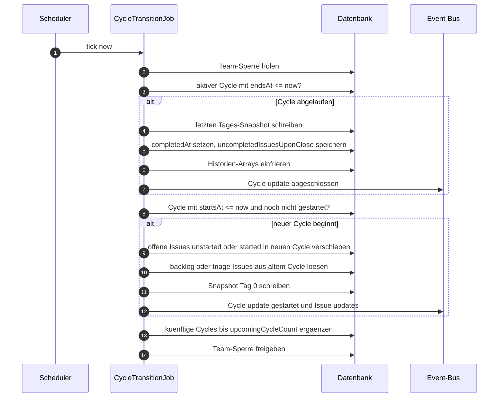
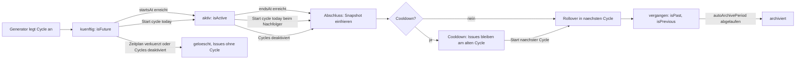
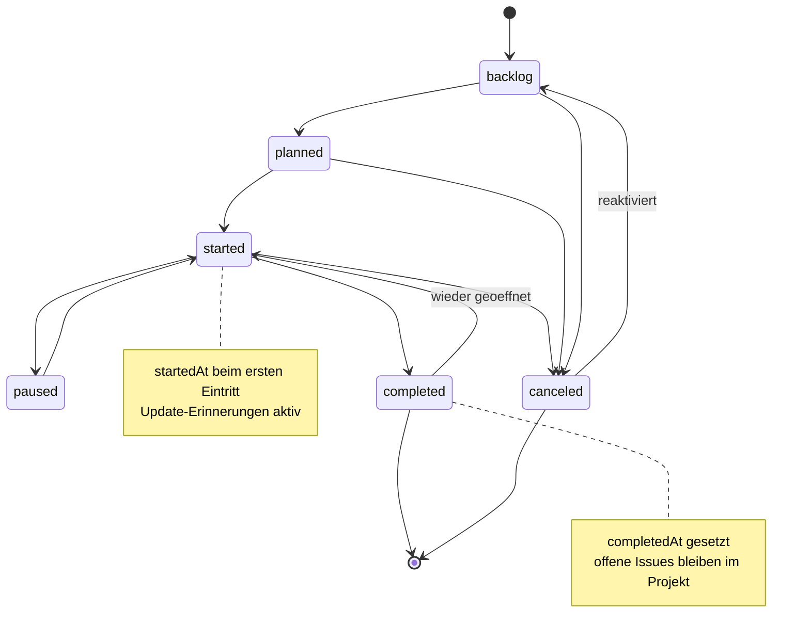
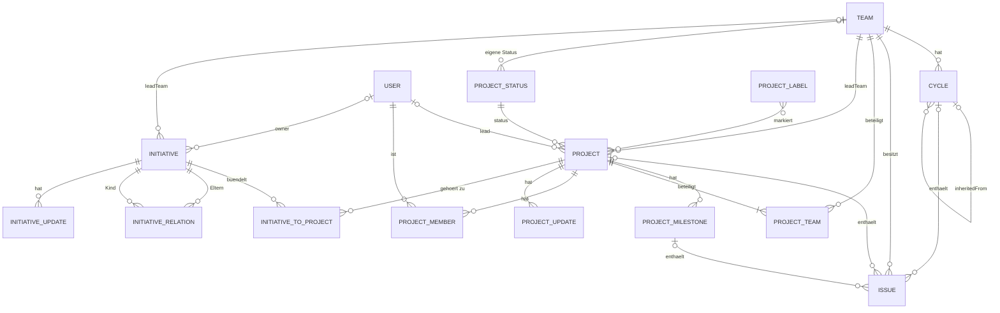
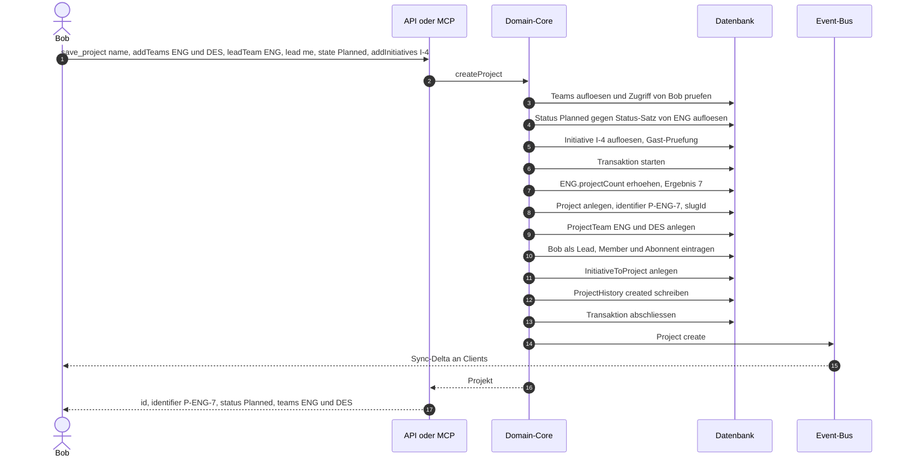

# 04 – Planung: Cycles, Projekte, Meilensteine, Initiativen, Statusberichte

Dieses Kapitel beschreibt alle Planungsobjekte oberhalb des einzelnen Issues. Es setzt die Konventionen aus [00-konventionen.md](00-konventionen.md) voraus (IDs, Datumsformate, Fehlermodell, Enums) und verwendet die Entitäten aus [01-domaenenmodell.md](01-domaenenmodell.md). Team-Hierarchie, Sichtbarkeit und Rollen sind in [02-teams-rechte.md](02-teams-rechte.md) beschrieben, Issue-Status und Workflow in [03-issues-workflow.md](03-issues-workflow.md). Wie die hier beschriebenen Objekte gefiltert, angezeigt und benachrichtigt werden, steht in [05-views-suche-inbox.md](05-views-suche-inbox.md); die zugehörigen MCP-Tools sind in [07-mcp-server.md](07-mcp-server.md) vollständig spezifiziert, Events und Webhooks in [09-api-events.md](09-api-events.md), die Hintergrundjobs als Komponenten in [10-architektur-umsetzung.md](10-architektur-umsetzung.md).

Alle Beispiele verwenden den erfundenen Workspace `acme` mit den Teams `ENG`, `WEB` (Sub-Team von `ENG`) und `DES` sowie den Personen Alice, Bob und Carol.

**Überblick über die Planungsebenen:**

| Ebene | Gehört zu | Zeitbezug | Zweck |
|---|---|---|---|
| Cycle | genau einem Team | feste, wiederkehrende Zeitbox | Rhythmus des Teams („Was schaffen wir in zwei Wochen?“) |
| Project | einem oder mehreren Teams (eines davon Lead-Team) | Start- und Zieldatum, optional unscharf | Vorhaben mit klarem Ergebnis |
| ProjectMilestone | genau einem Projekt | optionales Zieldatum | Etappe innerhalb eines Projekts |
| Initiative | Workspace (optional Lead-Team) | optionales Zieldatum | Bündelt Projekte zu strategischen Zielen, hierarchisch |
| ProjectUpdate / InitiativeUpdate | Projekt bzw. Initiative | Zeitpunkt der Veröffentlichung | Statusbericht mit `health` |

Ein Issue kann gleichzeitig in **höchstens einem Cycle**, **höchstens einem Projekt** und **höchstens einem Meilenstein** sein. Cycle und Projekt sind voneinander unabhängig: Ein Issue des Projekts `P-ENG-7` kann im Cycle 12 von `ENG` liegen, ein anderes Issue desselben Projekts im Cycle 30 von `DES`.

---

## 1. Cycles

### 1.1 Grundidee und Aktivierung

Ein Cycle ist eine zeitlich begrenzte Iteration eines einzelnen Teams, vergleichbar mit einem Sprint. Cycles sind **pro Team opt-in** (`Team.cyclesEnabled`). Sie werden nicht einzeln angelegt, sondern aus einem **wiederkehrenden Zeitplan** erzeugt: Das Team legt Dauer, Starttag und optional eine Pause (Cooldown) fest, und das System erzeugt daraus automatisch die kommenden Cycles. Eine manuelle Create-Operation für Cycles gibt es in der öffentlichen API deshalb nicht (im Original ist `cycleCreate` als deprecated markiert); Cycles entstehen ausschließlich durch den Generator in Abschnitt 1.4.

Cycles mehrerer Teams lassen sich nicht zu einem gemeinsamen Cycle zusammenlegen. Die einzige Form der Synchronisierung ist die Vererbung an Sub-Teams (Abschnitt 1.7).

### 1.2 Team-Einstellungen

Die Cycle-Einstellungen sind Felder der Entität `Team`:

| Feld | Typ | Default | Wertebereich / Regel |
|---|---|---|---|
| `cyclesEnabled` | Boolean | `false` | Schaltet das Feature ein oder aus. |
| `cycleDuration` | Int (Wochen) | `2` | 1 bis 8. Schema-Typ im Original `Float`; Lineal erlaubt nur ganze Wochen. |
| `cycleCooldownTime` | Int (Wochen) | `0` | 0 bis 8 (Annahme, siehe Offene Punkte). 0 = kein Cooldown. |
| `cycleStartDay` | Int | `1` (Montag) | 0 = Sonntag … 6 = Samstag. |
| `upcomingCycleCount` | Int | `2` | 1 bis 15. Anzahl der vorab angelegten künftigen Cycles (ohne den aktiven). |
| `cycleIssueAutoAssignStarted` | Boolean | `false` | Issues ohne Cycle, die in einen `started`-Status wechseln, kommen automatisch in einen Cycle. |
| `cycleIssueAutoAssignCompleted` | Boolean | `false` | Issues ohne Cycle, die in einen `completed`-Status wechseln, kommen automatisch in einen Cycle. |
| `cycleLockToActive` | Boolean | `false` | „Active issues“: Jedes Issue in einem Status der Kategorien `unstarted` oder `started` muss in einem Cycle sein. |
| `timezone` | String (IANA) | `America/Los_Angeles` | Grundlage aller Cycle-Grenzen. |
| `defaultIssueEstimate` | Float | `1` | Gewicht ungeschätzter Issues im Scope (siehe 1.9). |

Validierung beim Speichern: Liegt ein Wert außerhalb des Bereichs, antwortet das System mit `invalid_request` und `details.field`. Sub-Teams mit Cycle-Vererbung (Abschnitt 1.7) dürfen die Zeitplanfelder (`cycleDuration`, `cycleCooldownTime`, `cycleStartDay`, `upcomingCycleCount`) nicht selbst setzen; ein Versuch ergibt `invalid_request` mit dem Hinweis, dass der Zeitplan vom Parent-Team stammt. Die Automatisierungs-Schalter (`cycleIssueAutoAssign*`, `cycleLockToActive`) bleiben pro Sub-Team einstellbar.

**Aktivieren.** Beim Einschalten wählt der Admin das Startdatum des ersten Cycles (Kalenderdatum in Team-Zeitzone; Default ist der nächste Tag, der auf `cycleStartDay` fällt, oder „heute“). Liegt das Startdatum in der Vergangenheit oder ist es heute, wird der erste Cycle sofort aktiv. Danach erzeugt der Generator die künftigen Cycles. Ein Startdatum, das nicht auf `cycleStartDay` fällt, ist für den ersten Cycle erlaubt (Einstieg mitten im Sprint); ab dem zweiten Cycle gilt der reguläre Rhythmus, d. h. der erste Cycle endet am nächsten passenden Starttag, der mindestens eine Woche entfernt ist (Annahme).

**Aktivieren der Option „Active issues“** (`cycleLockToActive` von `false` auf `true`): Die Operation verlangt einen Parameter `existingActiveIssues` mit den Werten `moveToBacklog` (Status auf den Default-Status der Kategorie `backlog` setzen) oder `addToCycle` (in den aktiven Cycle legen; im Cooldown in den nächsten Cycle). Ohne Parameter: `invalid_request`.

**Deaktivieren.** Der aktive Cycle wird sofort abgeschlossen (wie in Abschnitt 1.5, inklusive Snapshot), alle künftigen Cycles werden gelöscht, und Issues in künftigen Cycles verlieren ihre Cycle-Zuordnung (`cycle = null`). Unfertige Issues des gerade abgeschlossenen Cycles verlieren ebenfalls ihre Zuordnung, da es keinen nächsten Cycle gibt. Abgeschlossene Cycles und ihre Historie bleiben erhalten. Ein späteres Reaktivieren setzt die Nummerierung fort.

### 1.3 Nummerierung und Namen

| Feld | Typ | Regel |
|---|---|---|
| `number` | Int | Fortlaufend **pro Team**, beginnt bei 1. Wird bei der Erzeugung vergeben, nie wiederverwendet. |
| `name` | String? | Optional. Ohne Namen zeigt die Oberfläche „Cycle `number`“. |
| `description` | String? | Optionaler Fokus-Text (Markdown). |

**Fortsetzung der Nummerierung aus dem Namen.** Endet der Name eines Cycles auf eine Zahl (Beispiel: `Sprint 40`), setzt der **nächste noch nicht gestartete** Cycle seine Nummerierung von dort fort. Dazu speichert das Team einen Zähler `Team.cycleNumberBase`, den der Generator verwendet:

```
function onCycleRenamed(cycle, newName):
    cycle.name = newName
    m = regexMatch(newName, "([0-9]+)\\s*$")
    if m == null: return
    base = toInt(m.group(1))
    # Alle Cycles nach diesem (künftige) werden neu nummeriert
    future = cyclesOfTeam(cycle.team) where startsAt > cycle.startsAt order by startsAt
    n = base
    for f in future:
        n = n + 1
        f.number = n
        if f.name matches "^Cycle [0-9]+$" or f.name == null:
            f.name = null          # Anzeige folgt der neuen Nummer
    cycle.team.nextCycleNumber = n + 1
```

`number` muss pro Team eindeutig bleiben. Würde die Umnummerierung mit einer bestehenden (vergangenen) Nummer kollidieren, lehnt das System die Umbenennung mit `conflict` ab. Vergangene Cycles werden nie umnummeriert.

### 1.4 Zeitberechnung und Generierung des Cycle-Kalenders

Alle Cycle-Grenzen werden als **Kalenderdatum in der Team-Zeitzone** berechnet und erst am Ende in einen UTC-Zeitpunkt umgerechnet. Ein Cycle beginnt um **00:00 lokaler Zeit** am Starttag und endet um 00:00 lokaler Zeit am Tag nach seinem letzten Tag. Damit gilt bei fehlendem Cooldown immer `endsAt(n) = startsAt(n+1)`. (Die Original-Doku spricht von „12:01 AM“; die tatsächlich gespeicherten Werte liegen auf Mitternacht. Für die Implementierung ist Mitternacht maßgeblich.)

Durch die Rechnung in lokalen Kalenderdaten verschiebt sich der UTC-Wert bei Sommer-/Winterzeitwechseln korrekt, und die Dauer eines Cycles in Stunden kann um ±1 Stunde schwanken. Das ist gewollt.

**Beispiel** Team `ENG`, `timezone = Europe/Berlin`, `cycleDuration = 2`, `cycleCooldownTime = 0`, `cycleStartDay = 1` (Montag):

| Cycle | Lokale Tage | `startsAt` (UTC) | `endsAt` (UTC) | Bemerkung |
|---|---|---|---|---|
| 12 | Mo 2026-10-05 bis So 2026-10-18 | `2026-10-04T22:00:00.000Z` | `2026-10-18T22:00:00.000Z` | Sommerzeit (UTC+2) |
| 13 | Mo 2026-10-19 bis So 2026-11-01 | `2026-10-18T22:00:00.000Z` | `2026-11-01T23:00:00.000Z` | Umstellung am 2026-10-25 |
| 14 | Mo 2026-11-02 bis So 2026-11-15 | `2026-11-01T23:00:00.000Z` | `2026-11-15T23:00:00.000Z` | Winterzeit (UTC+1) |

Mit `cycleCooldownTime = 1` läge zwischen Cycle 12 und 13 eine Woche Cooldown: Cycle 13 begänne erst am Mo 2026-10-26.

**Generator (Pseudocode).** Der Generator wird bei Aktivierung, bei jeder Änderung der Zeitplan-Einstellungen, nach jedem Cycle-Wechsel und einmal täglich als Reparaturlauf aufgerufen. Er ist idempotent.

```
function localMidnightToUtc(localDate, tz):
    # Liefert den UTC-Zeitpunkt von localDate 00:00 in Zeitzone tz.
    # Existiert 00:00 wegen Zeitumstellung nicht, nimm die erste gültige Minute danach.
    return toUtc(localDateTime(localDate, 00:00), tz)

function utcToLocalDate(instant, tz):
    return localDateOf(instant, tz)

function ensureUpcomingCycles(team, now):
    if not team.cyclesEnabled: return
    if team.parent != null and team.inheritsCycles:
        return syncInheritedCycles(team)            # siehe 1.7
    tz = team.timezone
    lastCycle = latestCycleByStartsAt(team)        # inkl. aktivem und künftigen
    futureCount = count(cyclesOfTeam(team) where startsAt > now)
    while futureCount < team.upcomingCycleCount:
        if lastCycle == null:
            startLocal = team.firstCycleStartDate      # bei Aktivierung gewählt
        else:
            lastEndLocal = utcToLocalDate(lastCycle.endsAt, tz)
            startLocal = lastEndLocal + team.cycleCooldownTime * 7 days
            startLocal = nextWeekdayOnOrAfter(startLocal, team.cycleStartDay)
        if lastCycle == null and weekday(startLocal) != team.cycleStartDay:
            # erster Cycle mit abweichendem Start: bis zum übernächsten regulären Starttag
            endLocal = nextWeekdayOnOrAfter(startLocal + 7 days, team.cycleStartDay)
        else:
            endLocal = startLocal + team.cycleDuration * 7 days
        c = new Cycle(
            team      = team,
            number    = allocateCycleNumber(team),     # atomar, wie Issue-Zähler
            startsAt  = localMidnightToUtc(startLocal, tz),
            endsAt    = localMidnightToUtc(endLocal, tz),
            scopeHistory = [], completedScopeHistory = [], inProgressScopeHistory = [],
            issueCountHistory = [], completedIssueCountHistory = [])
        insert c
        propagateToInheritingSubTeams(team, c)       # siehe 1.7
        lastCycle = c
        if c.startsAt > now: futureCount = futureCount + 1
```

**Änderung des Zeitplans.** Ändert ein Admin `cycleDuration`, `cycleCooldownTime`, `cycleStartDay` oder `timezone`, bleiben vergangene und der aktive Cycle unverändert. Alle künftigen Cycles werden neu berechnet: Die vorhandenen Cycle-Objekte werden in Reihenfolge wiederverwendet (gleiche `id`, gleiche `number`, gleiche Issue-Zuordnungen) und erhalten neue Grenzen; überzählige werden gelöscht (ihre Issues wandern in den letzten verbleibenden künftigen Cycle), fehlende werden erzeugt. Wird `upcomingCycleCount` verkleinert, werden die überzähligen Cycles am Ende gelöscht, und ihre Issues erhalten `cycle = null` (Annahme).

**Einzelne Cycles verschieben.** Start und Ende eines **künftigen** Cycles sowie das Ende des **aktiven** Cycles dürfen geändert werden, niemals in die Vergangenheit und nie für abgeschlossene Cycles (`invalid_request`).
- Wird das Ende verkürzt, entsteht eine Lücke bis zum Start des folgenden Cycles. Die Oberfläche zeigt sie als „Cycles paused“ (ohne Cooldown-Einstellung) bzw. als Cooldown mit der tatsächlichen Länge.
- Wird das Ende verlängert, rückt der Start des folgenden Cycles nach hinten; dessen Ende bleibt gleich, er wird also kürzer. Ein Cycle darf dadurch nicht auf weniger als einen Tag schrumpfen (`invalid_request`).
- `cycleShiftAll(id, daysToShift)` verschiebt den angegebenen künftigen Cycle und alle späteren um dieselbe Anzahl Tage.

**„Start cycle today“** (`cycleStartUpcomingCycleToday(id)`): Nur für den nächsten, noch nicht gestarteten Cycle erlaubt. Sein `startsAt` wird auf heute 00:00 in Team-Zeitzone gesetzt. Läuft gerade ein Cycle, wird er sofort abgeschlossen (`endsAt` = neuer Start) und seine unfertigen Issues werden in den gestarteten Cycle übernommen. Läuft kein Cycle (Cooldown), endet der Cooldown. Die Operation ist irreversibel; das Ende des neuen Cycles bleibt unverändert.

### 1.5 Job „Cycle-Wechsel“

Der Wechsel besteht aus **zwei Phasen**, weil ein Cooldown zwischen Abschluss und Neustart liegen kann:

1. **Abschluss** zum Zeitpunkt `endsAt` des aktiven Cycles: Cycle als abgeschlossen markieren, letzten Snapshot schreiben, Historien-Arrays einfrieren, Liste der unfertigen Issues festhalten.
2. **Start und Rollover** zum Zeitpunkt `startsAt` des nächsten Cycles: unfertige Issues des abgeschlossenen Cycles übernehmen, fehlende künftige Cycles anlegen.

Ohne Cooldown fallen beide Zeitpunkte zusammen und laufen in einer Transaktion. Mit Cooldown bleiben die unfertigen Issues bis zum Start des nächsten Cycles am alten Cycle hängen. Das ist die Voraussetzung für die Ausnahmeregel des Originals: Issues, die während des Cooldowns nach `backlog`, `triage`, `canceled` oder `completed` verschoben werden, werden **nicht** in den nächsten Cycle übernommen.

Der Job läuft minütlich als Scheduler, sucht fällige Teams und verarbeitet Parent-Teams vor ihren Sub-Teams, jeweils pro Team unter einer Team-Sperre (damit der Job auf mehreren Instanzen laufen kann). Er ist idempotent: Ein bereits abgeschlossener Cycle wird nicht erneut abgeschlossen.

```
job cycleTransition(now):
    for team in teamsWithCyclesEnabled():
        withTeamLock(team):
            # Phase 1: Abschluss
            active = cycle where team == team and completedAt == null
                                and startsAt <= now and endsAt <= now
            if active != null:
                closeCycle(active, active.endsAt)
            # Phase 2: Start und Rollover
            starting = cycle where team == team and startsAt <= now and endsAt > now
                                  and startedProcessedAt == null
            if starting != null:
                startCycle(starting)
            ensureUpcomingCycles(team, now)

function closeCycle(cycle, closeTime):
    transaction:
        writeDailySnapshot(cycle, closeTime)            # letzter Tageswert, siehe 1.9
        cycle.completedAt = closeTime
        cycle.endsAt = min(cycle.endsAt, closeTime)     # bei vorzeitigem Abschluss
        open = issues where cycle == cycle and state.type in (triage, backlog, unstarted, started)
        cycle.uncompletedIssuesUponClose = ids(open)    # eingefrorene Liste
        cycle.progress = computeProgress(cycle)         # wird ab jetzt nicht mehr neu berechnet
        cycle.historyFrozen = true
        emitEvent("Cycle", "update", cycle)             # siehe 09
        for subTeamCycle in cyclesInheritedFrom(cycle):
            closeCycle(subTeamCycle, closeTime)

function startCycle(next):
    transaction:
        prev = latest cycle of next.team where completedAt != null
        if prev != null:
            for issue in issues where cycle == prev
                               and id in prev.uncompletedIssuesUponClose:
                if issue.state.type in (unstarted, started):
                    issue.cycle = next
                    issue.addedToCycleAt = now
                    writeIssueHistory(issue, "cycle", prev, next, actor = system)
                else if issue.state.type in (backlog, triage):
                    issue.cycle = null                  # unfertige Issues bleiben nie im alten Cycle
                    writeIssueHistory(issue, "cycle", prev, null, actor = system)
                # completed/canceled/duplicate: bleibt im alten Cycle (wird ihm zugerechnet)
        next.startedProcessedAt = now
        writeDailySnapshot(next, next.startsAt)         # Tag 0
        emitEvent("Cycle", "update", next)
        for subTeamCycle in cyclesInheritedFrom(next):
            startCycle(subTeamCycle)
```

`startedProcessedAt` ist ein internes Feld, das nicht über die API ausgegeben wird. Die Historie des Issues erhält für jede Übernahme einen Eintrag mit Akteur „System“; es werden keine Benachrichtigungen an Abonnenten verschickt (Annahme, um Massenbenachrichtigungen bei jedem Cycle-Wechsel zu vermeiden).



### 1.6 Regeln zwischen Issue und Cycle

| Regel | Verhalten |
|---|---|
| Team-Bindung | `issue.cycle.team` muss gleich `issue.team` sein. Sonst `invalid_request`. |
| Zulässige Ziel-Cycles | Aktiver Cycle und künftige Cycles. Ein abgeschlossener Cycle ist nur erlaubt, wenn er der zuletzt abgeschlossene ist (`isPrevious`) **und** das Issue in `completed` oder `canceled` ist (nachträgliche Zurechnung „vergessener“ Erledigungen). Sonst `invalid_request`. |
| Cooldown | Einem Cooldown kann man nichts zuordnen; der Cooldown ist kein Objekt. |
| Backlog-Issue in Cycle | Wird ein Issue in `backlog` (oder `triage`) einem Cycle zugeordnet, wechselt es automatisch in den Default-Status der Kategorie `unstarted` des Teams (erster `unstarted`-Status nach `position`). |
| Umkehrung (optional) | Team-Einstellung `cycleRemoveMovesToBacklog` (Boolean, Default `false`, Lineal-Name): Wird ein Issue in `unstarted` aus einem Cycle entfernt (`cycle = null`), wechselt es in den Default-Backlog-Status. `started`-Issues bleiben unverändert. |
| Auto-add `started` | Ist `cycleIssueAutoAssignStarted = true` und wechselt ein Issue ohne Cycle in `started`, wird es dem aktiven Cycle zugeordnet; im Cooldown dem nächsten Cycle. |
| Auto-add `completed` | Ist `cycleIssueAutoAssignCompleted = true` und wechselt ein Issue ohne Cycle in `completed`, wird es dem aktiven Cycle zugeordnet; im Cooldown dem **vorherigen** (zuletzt abgeschlossenen) Cycle. |
| „Active issues“ | Ist `cycleLockToActive = true`, wird jedes Issue ohne Cycle, das in `unstarted` oder `started` wechselt oder in diesem Status angelegt wird, dem aktiven (im Cooldown dem nächsten) Cycle zugeordnet. |
| Teamwechsel | Wechselt ein Issue das Team, wird `cycle` geleert (siehe [02-teams-rechte.md](02-teams-rechte.md)). |
| Zeitstempel | Bei jeder Zuordnung wird `issue.addedToCycleAt = now` gesetzt. Der Filter „Added to cycle“ unterscheidet „planned“ (vor dem Start oder bis 24 h danach hinzugefügt) und „after cycle start“ (später als 24 h nach Start). |
| Auto-Close | Issues im aktiven Cycle werden vom Auto-Close-Job nicht geschlossen (siehe [03-issues-workflow.md](03-issues-workflow.md)). |

Die automatischen Zuordnungen werden im selben Use-Case wie der Statuswechsel ausgeführt (nicht asynchron), damit API-Antworten bereits den neuen Cycle enthalten. Derselbe Hook läuft auch beim Anlegen eines Issues (mit `oldType = null`).

```
function onIssueStateChanged(issue, oldType, newType, team, now):
    if not team.cyclesEnabled or issue.cycle != null: return
    active = activeCycle(team, now)               # null im Cooldown
    next   = nextCycle(team, now)
    prev   = previousCycle(team, now)
    if newType == started and (team.cycleIssueAutoAssignStarted or team.cycleLockToActive):
        issue.cycle = active ?? next
    else if newType == unstarted and team.cycleLockToActive:
        issue.cycle = active ?? next
    else if newType == completed and team.cycleIssueAutoAssignCompleted:
        issue.cycle = active ?? prev
    if issue.cycle != null: issue.addedToCycleAt = now
```

### 1.7 Vererbung an Sub-Teams

Hat ein Team ein Parent-Team mit aktivierten Cycles, übernimmt es dessen Zeitplan (`Team.inheritsCycles`, Default `true` für Sub-Teams, deren Parent Cycles nutzt). Das Sub-Team besitzt trotzdem **eigene Cycle-Objekte**, damit seine Issues auf Cycles des eigenen Teams zeigen. Jeder Sub-Team-Cycle verweist über `inheritedFrom` auf den Parent-Cycle und hat identische `startsAt`, `endsAt` und `completedAt`.

| Aspekt | Regel |
|---|---|
| Erzeugung | Wird beim Parent ein Cycle erzeugt, entsteht in jedem erbenden Sub-Team (rekursiv über alle Ebenen) ein Cycle mit `inheritedFrom = parentCycle`. |
| Datumsänderung | Änderungen an `startsAt`/`endsAt` des Parent-Cycles werden auf alle erbenden Cycles übertragen. Am Sub-Team-Cycle selbst sind Daten nicht änderbar (`invalid_request`). |
| Nummer | Das Sub-Team hat einen eigenen Zähler; ein neu vererbter Cycle erhält die nächste Nummer des Sub-Teams. Name und Beschreibung werden vom Parent-Cycle übernommen, solange das Sub-Team sie nicht überschreibt (Annahme). |
| Abschluss und Rollover | Erfolgen im selben Job-Lauf wie beim Parent (siehe `closeCycle`/`startCycle`). |
| Team wird Sub-Team | Vergangene Cycles des Teams bleiben unverändert. Der aktive Cycle läuft bis zum nächsten Parent-Wechsel weiter (Annahme). Künftige Cycles werden gelöscht und durch vererbte ersetzt; Issues in gelöschten Cycles kommen in den vererbten Cycle mit der größten zeitlichen Überschneidung. |
| Sub-Team wird eigenständig | `inheritedFrom` künftiger Cycles wird auf `null` gesetzt; das Team behält die aktuellen Zeitplan-Werte des Parents als eigene Einstellungen. |

```
function syncInheritedCycles(subTeam):
    for pc in cyclesOfTeam(subTeam.parent) where endsAt > now order by startsAt:
        sc = cycle where team == subTeam and inheritedFrom == pc
        if sc == null:
            sc = new Cycle(team = subTeam, number = allocateCycleNumber(subTeam),
                           inheritedFrom = pc)
            insert sc
        sc.startsAt = pc.startsAt
        sc.endsAt = pc.endsAt
    for sc in cyclesOfTeam(subTeam) where startsAt > now and (inheritedFrom == null or inheritedFrom deleted):
        moveIssuesToBestOverlap(sc, cyclesOfTeam(subTeam) where inheritedFrom != null)
        delete sc
```

### 1.8 Felder eines Cycles

| Feld | Typ | Bedeutung |
|---|---|---|
| `id` | UUID | Primärschlüssel |
| `team` | → Team | Besitzendes Team |
| `number` | Int | Fortlaufende Nummer im Team |
| `name`, `description` | String? | Optional |
| `startsAt`, `endsAt` | DateTime | Grenzen in UTC (berechnet aus lokalen Mitternächten) |
| `completedAt` | DateTime? | Gesetzt beim Abschluss |
| `inheritedFrom` | → Cycle? | Parent-Cycle bei Sub-Teams |
| `progress` | Float 0..1 | Siehe 1.9; nach Abschluss eingefroren |
| `scopeHistory`, `completedScopeHistory`, `inProgressScopeHistory` | [Float] | Tageswerte Punkte |
| `issueCountHistory`, `completedIssueCountHistory` | [Float] | Tageswerte Anzahl |
| `uncompletedIssuesUponClose` | → [Issue] | Beim Abschluss offene Issues |
| `autoArchivedAt`, `archivedAt` | DateTime? | Archivierung abgeschlossener Cycles gemäß `Team.autoArchivePeriod` |
| `isActive`, `isFuture`, `isNext`, `isPast`, `isPrevious` | Boolean | Berechnet (Abschnitt 1.10), nicht gespeichert |

Archivieren eines Cycles (`cycleArchive`) löst alle noch zugeordneten Issues vorher vom Cycle (`cycle = null`). Der Auto-Archiv-Job archiviert nur abgeschlossene Cycles, deren `completedAt` länger als `Team.autoArchivePeriod` Monate zurückliegt.

### 1.9 Fortschritt und Scope-Historie

**Gewicht eines Issues.** Nutzt das Team Schätzungen (`issueEstimationType != notUsed`), zählt `issue.estimate`, für ungeschätzte Issues `team.defaultIssueEstimate`. Nutzt das Team keine Schätzungen, zählt jedes Issue mit 1. Issues in `canceled` und `duplicate` zählen nicht zum Scope.

**Fortschritt.**

```
function computeProgress(issues, team):
    relevant = issues where state.type not in (canceled, duplicate)
    scope = sum(weight(i, team) for i in relevant)
    if scope == 0: return 0
    done = sum(weight(i, team) for i in relevant where state.type == completed)
    inProgress = sum(weight(i, team) for i in relevant where state.type == started)
    return (done + 0.25 * inProgress) / scope
```

Beispiel: 10 gleich gewichtete Issues, davon 5 erledigt und 4 in Arbeit, ergeben (5 + 0,25 × 4) / 10 = 0,6, also 60 %.

**Tägliche Snapshots.** Ein Job schreibt für jeden aktiven Cycle **einmal pro lokalem Tag** (Team-Zeitzone, kurz nach Mitternacht) einen Wert in jedes Historien-Array. Index 0 entspricht dem Starttag; ein Cycle von 14 Tagen hat am Ende höchstens 14 Werte. Der Index wird aus dem Datum berechnet, nicht durch Anhängen, damit ein verspäteter oder doppelter Lauf denselben Index überschreibt statt einen weiteren Wert zu erzeugen. Fehlt ein Tag (Ausfall), wird er mit dem Wert des Vortags aufgefüllt.

| Array | Wert pro Tag |
|---|---|
| `scopeHistory` | Summe der Gewichte aller relevanten Issues im Cycle |
| `completedScopeHistory` | Summe der Gewichte der `completed`-Issues |
| `inProgressScopeHistory` | Summe der Gewichte der `started`-Issues |
| `issueCountHistory` | Anzahl relevanter Issues |
| `completedIssueCountHistory` | Anzahl `completed`-Issues |

```
function writeDailySnapshot(cycle, at):
    if cycle.historyFrozen: return
    tz = cycle.team.timezone
    idx = daysBetween(utcToLocalDate(cycle.startsAt, tz), utcToLocalDate(at, tz))
    if at == cycle.endsAt: idx = idx - 1      # Schluss-Snapshot gehört zum letzten Tag
    issues = issues where cycle == cycle
    s = computeScope(issues)                    # Werte wie in der Tabelle
    for each array A in cycle.histories:
        padWithLastValue(A, idx)                # Lücken auffüllen
        A[idx] = s[A]
```

Für die Grafik erzeugt der Client zusätzlich die Ziel-Linie: Sie verteilt den Scope gleichmäßig über die Arbeitstage und verläuft an Samstagen und Sonntagen flach. Nach dem Abschluss sind Grafik und Kennzahlen **eingefrorene Snapshots**; die Issue-Liste des Cycles kann später davon abweichen (z. B. weil ein Issue wieder geöffnet wurde).

**Kapazität.** Für künftige Cycles berechnet das System eine Kapazitätsschätzung aus dem Mittel von `completedScopeHistory[last]` der drei zuletzt abgeschlossenen Cycles. Ohne Historie gilt `Anzahl Teammitglieder × defaultIssueEstimate × cycleDuration` als grobe Schätzung (Annahme für die Formel).

### 1.10 Cycle-Ansichten: current, previous, next

Die berechneten Flags beziehen sich auf den Zeitpunkt `now`:

| Flag / Typ | Definition |
|---|---|
| `isActive` (`current`) | `startsAt <= now < endsAt` und `completedAt == null`. Im Cooldown gibt es keinen aktiven Cycle. |
| `isPast` | `completedAt != null` |
| `isPrevious` (`previous`) | Der vergangene Cycle mit dem größten `endsAt` |
| `isFuture` | `startsAt > now` |
| `isNext` (`next`) | Der künftige Cycle mit dem kleinsten `startsAt` |

`Team.activeCycle` liefert den aktiven Cycle oder `null`. Die Team-Navigation bietet „Current“ und „Upcoming“ als Unterseiten der Cycles-Ansicht (siehe [08-userflows.md](08-userflows.md)).



---

## 2. Projekte

### 2.1 Felder

Pflichtfelder beim Anlegen sind `name`, mindestens ein Team und ein Status (fehlt der Status, wird der erste Status der Kategorie `backlog` des Lead-Teams gesetzt).

| Feld | Typ | Pflicht | Bedeutung / Regel |
|---|---|---|---|
| `id` | UUID | ja | Primärschlüssel |
| `identifier` | String | ja | `P-<Key des Lead-Teams>-<number>`, siehe 2.8 |
| `number` | Int | ja | Projektzähler des Lead-Teams bei Anlage |
| `slugId` | String (12 Hex) | ja | Für URLs `/<workspace>/project/<name-slug>-<slugId>` |
| `name` | String | ja | 1–255 Zeichen |
| `description` | String? | nein | Kurzbeschreibung, max. 255 Zeichen (im MCP `summary`) |
| `content` | Markdown? | nein | Projektübersicht (im MCP `description`); Speicherung über `DocumentContent` ([06](06-dokumente-templates.md) §1.3) |
| `icon`, `color` | String? | nein | Emoji/Icon-Name, Hex-Farbe |
| `status` | → ProjectStatus | ja | Siehe 2.3 |
| `teams` | → [Team] | ja (≥ 1) | Beteiligte Teams (Join `ProjectTeam`) |
| `leadTeam` | → Team | ja | Eines der `teams`; bestimmt die verfügbaren Status |
| `lead` | → User? | nein | Genau eine verantwortliche Person |
| `members` | → [User] | nein | Mitarbeitende (Join `ProjectMember`) |
| `creator` | → User | ja | Ersteller |
| `priority` | Int 0–4 | ja | Wie bei Issues, Default 0 |
| `sortOrder`, `prioritySortOrder` | Float | ja | Manuelle Sortierung, Sortierung innerhalb der Prioritätsgruppe |
| `startDate`, `startDateResolution` | Date?, Enum? | nein | Siehe 2.5 |
| `targetDate`, `targetDateResolution` | Date?, Enum? | nein | Siehe 2.5 |
| `startedAt`, `completedAt`, `canceledAt` | DateTime? | – | Statuszeitstempel, siehe 2.4 |
| `labels` | → [ProjectLabel] | nein | Siehe 2.6 |
| `initiatives` | → [Initiative] | nein | n:m über `InitiativeToProject` |
| `health`, `healthUpdatedAt` | Enum?, DateTime? | – | Aus dem letzten nicht archivierten Update (Abschnitt 5) |
| `lastUpdate` | → ProjectUpdate? | – | Letztes Update |
| `progress`, `scope` | Float | – | Berechnet, siehe 2.9 |
| `scopeHistory`, `completedScopeHistory`, `inProgressScopeHistory`, `issueCountHistory`, `completedIssueCountHistory` | [Float] | – | **Wochenwerte**, Snapshot einmal pro Woche (Montag 00:00 in Zeitzone des Lead-Teams) |
| Update-Erinnerungen | siehe 5.4 | nein | `updateReminderFrequencyInWeeks`, `updateReminderFrequency`, `frequencyResolution`, `updateRemindersDay`, `updateRemindersHour`, `projectUpdateRemindersPausedUntilAt` |
| `convertedFromIssue` | → Issue? | nein | Falls aus einem Issue umgewandelt |
| `lastAppliedTemplate` | → Template? | nein | Siehe [06-dokumente-templates.md](06-dokumente-templates.md) |
| `trashed`, `archivedAt`, `autoArchivedAt` | Boolean?, DateTime? | – | Siehe 2.12 |

Die öffentliche Abhängigkeits-Relation zwischen Projekten (`ProjectRelation`, „blocks“ mit Ende→Start-Semantik) ist im Domänenmodell beschrieben; sie beeinflusst nur die Timeline-Darstellung und wird hier nicht weiter vertieft.

### 2.2 Teams, Lead-Team, Lead und Mitglieder

Ein Projekt kann mehreren Teams gehören. Eines davon ist das **Lead-Team**: Es klärt die Zuständigkeit, liefert die verfügbaren Projektstatus und den Key im Identifier. Die übrigen Teams sind „contributing“. Die Projektansicht zeigt bei mehreren Teams Tabs („All“ und je Team).

| Operation | Regel |
|---|---|
| Anlegen | Mindestens ein Team (`addTeams`/`setTeams`). Ohne `leadTeam` wird das erste angegebene Team Lead-Team. |
| `leadTeam` setzen | Muss in `teams` enthalten sein; ist es das nicht, wird es automatisch hinzugefügt. Danach Status-Neuzuordnung (2.3). Der Identifier bleibt unverändert (2.8). |
| Team hinzufügen | Der Aufrufer muss Zugriff auf das Team haben (bei privaten Teams Mitgliedschaft). |
| Team entfernen | Nicht für das Lead-Team, solange kein anderes Lead-Team gesetzt ist (`invalid_request`). Das letzte Team kann nicht entfernt werden. Alle Issues des entfernten Teams verlieren `project` und `projectMilestone` (History-Eintrag je Issue). Team-Labels des entfernten Teams (inkl. seiner Parent-Teams, sofern kein verbleibendes Team sie ebenfalls erbt) werden vom Projekt entfernt. |
| Lead | Höchstens eine Person. Der Lead wird automatisch Mitglied und Abonnent des Projekts. |
| Mitglieder | Beliebig viele Workspace-Mitglieder; Gäste nur, wenn sie Zugriff auf mindestens ein Projekt-Team haben. Mitglieder erhalten **keine** automatischen Benachrichtigungen, sie müssen das Projekt abonnieren (Opt-in). |

Wer ein Projekt bearbeiten darf, ist in [02-teams-rechte.md](02-teams-rechte.md) festgelegt (Grundregel: jedes Workspace-Mitglied mit Zugriff auf mindestens ein Projekt-Team). Ein Projekt, dessen Teams alle privat sind, ist nur für Mitglieder dieser Teams sichtbar.

### 2.3 Projektstatus

Projektstatus sind konfigurierbare Objekte (`ProjectStatus`), die in **sechs festen Kategorien** (`ProjectStatusType`) liegen: `backlog`, `planned`, `started`, `paused`, `completed`, `canceled`.

| Feld | Typ | Bedeutung |
|---|---|---|
| `id` | UUID | |
| `name` | String | Anzeigename, frei wählbar |
| `type` | Enum `ProjectStatusType` | Kategorie, unveränderlich nach Anlage |
| `color` | String | Hex |
| `description` | String? | |
| `position` | Float | Reihenfolge innerhalb der Kategorie |
| `indefinite` | Boolean | `true`: Projekt darf beliebig lange in diesem Status bleiben (keine Erinnerungen, keine Staleness) |
| `team` | → Team? | `null` = Workspace-Status, sonst team-eigener Status |
| `inheritedFrom` | → ProjectStatus? | Ursprung bei geerbten Status |

**Default-Satz eines neuen Workspace:**

| Name | `type` | `indefinite` |
|---|---|---|
| Backlog | `backlog` | `true` |
| Planned | `planned` | `true` |
| In Progress | `started` | `false` |
| Paused | `paused` | `true` |
| Completed | `completed` | `true` |
| Canceled | `canceled` | `true` |

Pro Kategorie muss es im jeweiligen Satz **mindestens einen** Status geben. Admins pflegen den Workspace-Satz; Team-Owner bzw. Admins dürfen für ein Team einen eigenen Satz pflegen. `Team.inheritProjectStatuses` (Boolean, Default `true`) steuert die Vererbung:

```
function effectiveStatusSet(team):
    if team == null: return workspaceStatuses()
    if team.inheritProjectStatuses:
        if team.parent != null: return effectiveStatusSet(team.parent)
        return workspaceStatuses()
    return statuses where status.team == team and archivedAt == null
```

Ein Projekt verwendet **immer** den Satz seines Lead-Teams, auch wenn andere Teams beitragen. Beim Setzen eines Status über die API (`state` im MCP `save_project`) wird die Referenz gegen `effectiveStatusSet(project.leadTeam)` aufgelöst: zuerst UUID, dann Name (case-insensitiv), dann Kategoriename (`started` → erster Status dieser Kategorie nach `position`). Unbekannte Werte ergeben `not_found`.

**Neuzuordnung**, wenn sich der verfügbare Satz ändert (Lead-Team wechselt, Team stellt Vererbung um, Status wird archiviert/gelöscht):

```
function remapStatus(project, newSet, explicitTarget = null):
    if explicitTarget != null: return explicitTarget        # projectReassignStatus
    s = project.status
    if s in newSet: return s
    sameNameAndType = first(newSet where name ~= s.name and type == s.type order by position)
    if sameNameAndType != null: return sameNameAndType
    return first(newSet where type == s.type order by position)  # existiert immer
```

Beim Archivieren eines Status kann der Admin einen Zielstatus angeben (`projectReassignStatus(original, new)`); sonst greift `remapStatus`. Die Neuzuordnung erzeugt einen Eintrag in der Projekt-Historie, setzt aber keine Statuszeitstempel neu, solange die Kategorie gleich bleibt.

### 2.4 Statuswechsel und ihre Effekte

Jeder Status darf in jeden anderen wechseln; es gibt keine erzwungene Reihenfolge. Die Effekte hängen nur von der Kategorie ab:

| Übergang in Kategorie | Effekte |
|---|---|
| `started` | `startedAt` setzen, falls noch `null` (erster Start bleibt erhalten). `completedAt` und `canceledAt` leeren. Update-Erinnerungen aktiv (falls Status nicht `indefinite`). |
| `completed` | `completedAt = now`, `canceledAt = null`. Update-Erinnerungen stoppen, Staleness „No update expected“. |
| `canceled` | `canceledAt = now`, `completedAt = null`. Erinnerungen stoppen. |
| `backlog`, `planned`, `paused` | `completedAt` und `canceledAt` leeren; `startedAt` bleibt. Erinnerungen ruhen. |

**Offene Issues beim Abschließen oder Abbrechen.** Die Original-Dokumentation beschreibt keine automatische Änderung offener Issues. Lineal legt fest:
- Offene Issues (`triage`, `backlog`, `unstarted`, `started`) bleiben **unverändert** im Projekt.
- Die Antwort der Statusänderung enthält eine Warnung `details.openIssueCount` (Anzahl offener Issues). Die Web-Oberfläche zeigt vor dem Speichern einen Dialog mit drei Optionen: „Behalten“, „Alle offenen Issues abbrechen“ (setzt sie in den Default-`canceled`-Status ihres jeweiligen Teams) und „Aus Projekt entfernen“. Die beiden letzten Optionen sind normale Massenoperationen auf Issues und erzeugen pro Issue Historie und Benachrichtigungen wie in [03-issues-workflow.md](03-issues-workflow.md).
- Nach dem Abschluss gilt für diese Issues nicht mehr die Auto-Close-Ausnahme „unfertiges Projekt“; sie können vom Auto-Close-Job erfasst werden.

Jeder Statuswechsel erzeugt einen Eintrag in der Projekt-Historie (`ProjectHistory`) und ein Event `Project update` (siehe [09-api-events.md](09-api-events.md)). Abonnenten erhalten eine Benachrichtigung (siehe [05-views-suche-inbox.md](05-views-suche-inbox.md)).



Das Diagramm zeigt die typischen Übergänge; technisch ist jeder Wechsel zwischen beliebigen Status erlaubt.

### 2.5 Start- und Zieldatum mit Auflösung

`startDate` und `targetDate` sind Kalenderdaten (`YYYY-MM-DD`). Die zugehörige Auflösung (`startDateResolution`, `targetDateResolution`) ist `null` (exakter Tag) oder einer der Werte `month`, `quarter`, `halfYear`, `year`. Gespeichert wird immer ein konkretes Datum, und zwar **normalisiert**:

| Auflösung | `startDate` wird zu | `targetDate` wird zu | Anzeige (Beispiel 2026-11-14) |
|---|---|---|---|
| `null` | Tag selbst | Tag selbst | „Nov 14, 2026“ |
| `month` | erster Tag des Monats | letzter Tag des Monats | „Nov 2026“ |
| `quarter` | erster Tag des Quartals | letzter Tag des Quartals | „Q4 2026“ |
| `halfYear` | 1. Januar bzw. 1. Juli | 30. Juni bzw. 31. Dezember | „H2 2026“ |
| `year` | 1. Januar | 31. Dezember | „2026“ |

Validierung: Sind beide gesetzt, muss `startDate <= targetDate` gelten (nach Normalisierung), sonst `invalid_request`. Filter und Sortierung arbeiten auf dem normalisierten Datum. Wird ein Datum auf `null` gesetzt, wird auch die Auflösung geleert.

### 2.6 Priorität und Labels

Die **Priorität** folgt dem Enum aus [00-konventionen.md](00-konventionen.md) (0–4, Ausgabe als `{ "value", "name" }`). Wird ein Projekt in einer nach Priorität gruppierten Ansicht in eine andere Gruppe gezogen, ändert sich `priority`; innerhalb der Gruppe ändert sich nur `prioritySortOrder`.

**Projekt-Labels** (`ProjectLabel`) sind eigene Objekte, getrennt von Issue-Labels:

| Aspekt | Regel |
|---|---|
| Geltungsbereich | `team = null` → Workspace-Label; sonst Team-Label. |
| Verfügbar für ein Projekt | Workspace-Labels plus Team-Labels aller Projekt-Teams und ihrer Parent-Teams (rekursiv). |
| Gruppen | Ein Label mit `isGroup = true` ist eine Gruppe; aus einer Gruppe darf ein Projekt **höchstens ein** Label tragen. Verstoß: `invalid_request`. |
| Namensgleichheit | Gleichnamige, ungruppierte Team-Labels verschiedener Teams werden in Auswahllisten und Filtern als **ein** Label dargestellt; ein Filter auf den Namen trifft alle. Pro Team sind Namen eindeutig. |
| Sichtbarkeit | Team-Labels folgen der Sichtbarkeit ihres Teams. |
| Team entfernt | Labels, die nur über dieses Team verfügbar waren, werden vom Projekt entfernt. |
| Stilllegen | `retire` blendet das Label für neue Zuordnungen aus, bestehende Zuordnungen bleiben; `restore` macht das rückgängig. Bei einer Gruppe kaskadiert beides auf die Kinder. |

### 2.7 Ressourcen

Ein Projekt hat einen Bereich „Resources“ mit zwei Arten von Einträgen:
- **Dokumente** mit `document.project = project` (genau ein Elternobjekt, siehe [06-dokumente-templates.md](06-dokumente-templates.md)).
- **Externe Links** (`EntityExternalLink`: `url`, `label?`, `sortOrder`). Ohne `label` zeigt die Oberfläche den Host der URL. Über das MCP-Feld `links` werden Links nur **hinzugefügt** (append-only); Entfernen erfolgt über eine eigene Operation.

`resourceCount` ist die Summe aus Dokumenten, Links und Anhängen.

### 2.8 Projekt-Identifier

Der Identifier lautet `P-<Key des Lead-Teams>-<n>`, z. B. `P-ENG-7`. `n` stammt aus einem **pro Team** geführten Zähler `Team.projectCount`, der beim Anlegen atomar erhöht wird (gleiches Verfahren wie bei `Issue.number`). Lineal legt fest:
- Ein **Wechsel des Lead-Teams** ändert den Identifier nicht; er bleibt bei Key und Nummer des Teams, das bei der Anlage Lead-Team war. (Begründung: Projekte werden in Texten und Links über die Kennung referenziert; Stabilität ist wichtiger als Konsistenz mit dem aktuellen Lead-Team.)
- Eine **Änderung des Team-Keys** wird dagegen wie bei Issues nachgezogen (README-Entscheidung „Team-Key ändern“): Aus `P-ENG-7` wird z. B. `P-CORE-7`, die alte Kennung wird in `Project.previousIdentifiers` aufgenommen und bleibt auflösbar.
- Auflösung über Identifier, `slugId`, vollständigen Slug (`<name-slug>-<slugId>`) und exakten Namen (siehe Referenzauflösung in [00-konventionen.md](00-konventionen.md)).
- Wird ein Projekt-Identifier an ein Issue-Tool übergeben, antwortet das System mit `invalid_request` und dem Hinweis, das Projekt-Tool zu verwenden.

### 2.9 Fortschritt

Der Projektfortschritt verwendet dieselbe Formel wie Cycles (Abschnitt 1.9), angewendet auf alle Issues mit `issue.project = project` über alle Teams hinweg. Das Gewicht eines Issues richtet sich nach **seinem eigenen Team** (Schätzung bzw. `defaultIssueEstimate`, oder 1 bei Teams ohne Schätzungen). Sub-Issues zählen als eigenständige Issues, sofern sie selbst im Projekt sind. Archivierte Issues zählen weiter mit, getrashte nicht.

`progress` wird bei jeder relevanten Issue-Änderung (Status, Schätzung, Projektzuordnung) neu berechnet; die Wochen-Historie schreibt ein wöchentlicher Snapshot-Job analog zu 1.9.

### 2.10 Regel Issue ↔ Projekt

| Regel | Verhalten |
|---|---|
| Höchstens ein Projekt | `issue.project` ist ein einzelner Verweis. |
| Team muss beteiligt sein | `issue.team` muss **direkt** in `project.teams` enthalten sein. Ein Sub-Team gilt nicht automatisch als beteiligt, wenn nur sein Parent-Team im Projekt ist. Verstoß: `invalid_request` mit `details.reason = "team_not_in_project"`; der Client muss das Team zuerst mit `addTeams` hinzufügen. |
| Projekt im Papierkorb oder archiviert | Neue Zuordnungen sind nicht möglich (`invalid_request`). |
| Teamwechsel des Issues | Ist das neue Team nicht am Projekt beteiligt, werden `project` und `projectMilestone` geleert (siehe [02-teams-rechte.md](02-teams-rechte.md)). |
| Projekt wechselt | `projectMilestone` wird geleert, wenn der Meilenstein nicht zum neuen Projekt gehört. |
| Zeitstempel | `issue.addedToProjectAt = now` bei jeder Zuordnung. |
| Auto-Close | Issues in Projekten, deren Status nicht `completed` oder `canceled` ist, werden nicht automatisch geschlossen. |

### 2.11 Projekt-Templates

Projekte können aus einem Template (`type = project`) angelegt werden; das Template kann Felder, Inhalt, Meilensteine und vorbereitete Issues enthalten. `Team.defaultProjectTemplate` legt eine Vorauswahl pro Team fest. Die Anwendung erfolgt nur beim Anlegen (`template` im MCP `save_project`). Details, Merge-Regeln und Formularfelder: [06-dokumente-templates.md](06-dokumente-templates.md).

### 2.12 Archivieren und Papierkorb

| Aktion | Verhalten |
|---|---|
| Löschen | `trashed = true`. Das Projekt verschwindet aus allen Listen und erscheint 30 Tage unter „Recently deleted projects“ des Lead-Teams. Issues behalten ihren Verweis, er wird aber in Ausgaben unterdrückt. Wiederherstellen stellt den vorherigen Zustand her. |
| Endgültiges Löschen | Nach 30 Tagen durch den Purge-Job: Meilensteine, Updates, Dokumente des Projekts werden gelöscht; Issues erhalten `project = null`, `projectMilestone = null`. |
| Manuell archivieren | Erlaubt für Admins und Lead (`projectArchive`). Das Projekt wird schreibgeschützt; Wiederherstellung mit `projectUnarchive`. |
| Auto-Archiv | Nur wenn: Status in Kategorie `completed` oder `canceled`; keine Änderung am Projekt seit `autoArchivePeriod` des Lead-Teams; alle Issues des Projekts sind selbst archivierbar. Setzt `autoArchivedAt` und `archivedAt`. |

---

## 3. Meilensteine

### 3.1 Felder

| Feld | Typ | Regel |
|---|---|---|
| `id` | UUID | |
| `project` | → Project | Pflicht, unveränderlich (Verschieben siehe 3.4) |
| `name` | String | Pflicht, eindeutig innerhalb des Projekts (Annahme) |
| `description` | Markdown? | |
| `targetDate` | Date? | Optional, jederzeit setzbar |
| `sortOrder` | Float | Reihenfolge im Projekt |
| `progress` | Float 0..1 | Berechnet wie Projektfortschritt, nur über Issues dieses Meilensteins |
| `status` | Enum `ProjectMilestoneStatus` | Berechnet: `unstarted`, `next`, `overdue`, `done` |

**Sortierung.** Neue Meilensteine werden ans Ende gehängt (`sortOrder = max + 1`). Wird ein Zieldatum gesetzt, sortiert die Oberfläche nicht automatisch um; die Reihenfolge ist rein manuell. Einfügen zwischen zwei Meilensteinen: `(a + b) / 2`.

**Fortschritt.** Ein Issue zählt ab Kategorie `started` (mit 0,25) und voll ab `completed`. `progress` ist in allen Lineal-Ausgaben eine Zahl zwischen 0 und 1. Das Original liefert teils Prozentzahlen, teils Strings wie „100%“; das wird bewusst vereinheitlicht (siehe Abweichungstabelle in [07-mcp-server.md](07-mcp-server.md)).

**Berechneter Status:**

```
function milestoneStatuses(project, today):
    ms = milestones of project order by sortOrder
    nextAssigned = false
    for m in ms:
        relevant = issues of m where state.type not in (canceled, duplicate)
        if relevant not empty and all(i.state.type == completed for i in relevant):
            m.status = done
        else if m.targetDate != null and m.targetDate < today:
            m.status = overdue
        else if not nextAssigned:
            m.status = next
            nextAssigned = true
        else:
            m.status = unstarted
        # ein Meilenstein ohne Issues ist nie done
```

`today` ist das Kalenderdatum in der Zeitzone des Lead-Teams. Der `next`-Meilenstein wird in der Oberfläche gelb hervorgehoben; das ist nicht abschaltbar.

### 3.2 Issue → Meilenstein

- Ein Issue hat höchstens einen Meilenstein (`issue.projectMilestone`).
- Bedingung: `issue.project == milestone.project`. Wird über die API ein Meilenstein ohne Projekt gesetzt, übernimmt das Issue das Projekt des Meilensteins, sofern das Issue-Team am Projekt beteiligt ist; sonst `invalid_request` (Lineal-Regel für Komfort bei Agenten).
- Die Meilenstein-Referenz im MCP (`milestone`) wird innerhalb des Projekts des Issues aufgelöst (UUID oder Name).

### 3.3 Löschen eines Meilensteins

Beim Löschen verlieren alle Issues des Meilensteins sofort ihre Zuordnung (`projectMilestone = null`), bleiben aber im Projekt. Jedes betroffene Issue erhält einen History-Eintrag. Der Meilenstein selbst wird mit `archivedAt` markiert und nach 30 Tagen endgültig gelöscht; ein Wiederherstellen stellt die Issue-Zuordnungen **nicht** wieder her (Annahme).

### 3.4 Umwandeln und Verschieben

- **In Projekt umwandeln:** Erzeugt ein neues Projekt mit Name und Beschreibung des Meilensteins, gleichen Teams und gleicher Priorität wie das Ursprungsprojekt. Die Issues des Meilensteins wechseln in das neue Projekt; der Meilenstein wird gelöscht.
- **In anderes Projekt verschieben** (intern): Sind Issue-Teams nicht am Zielprojekt beteiligt, muss der Aufrufer entweder `addIssueTeamToProject = true` oder ein `newIssueTeamId` angeben; ohne eines davon `invalid_request`.

---

## 4. Initiativen

### 4.1 Felder

Initiativen sind workspace-weit und müssen in den Workspace-Einstellungen aktiviert werden (`Organization.initiativesEnabled`).

| Feld | Typ | Regel |
|---|---|---|
| `id` | UUID | |
| `identifier` | String | `I-<n>`, workspaceweiter Zähler |
| `slugId` | String (12 Hex) | URL `/<workspace>/initiative/<name-slug>-<slugId>` |
| `name` | String | Pflicht |
| `description` | String? | Kurzbeschreibung, max. 255 Zeichen (MCP `summary`) |
| `content` | Markdown? | Beschreibung (MCP `description`) |
| `icon`, `color` | String? | |
| `status` | Enum | `Proposed`, `Planned`, `Active`, `Completed`, `Canceled` (fix, nicht anpassbar); Default `Planned` |
| `startedAt` | DateTime? | Erster Wechsel nach `Active` |
| `completedAt` | DateTime? | Wechsel nach `Completed`; wird beim Verlassen von `Completed` geleert |
| `owner` | → User? | Genau eine verantwortliche Person |
| `leadTeam` | → Team? | Optional; bestimmt die Sichtbarkeit |
| `visibility` | Enum | Berechnet aus `leadTeam`: `public` (kein Lead-Team oder öffentliches Team), `restricted`, `private` |
| `priority`, `prioritySortOrder`, `sortOrder` | Int, Float, Float | |
| `targetDate`, `targetDateResolution` | Date?, Enum? | Wie bei Projekten (2.5) |
| `labels` | → [InitiativeLabel] | Nur Workspace-Labels |
| `projects` | → [Project] | n:m über `InitiativeToProject` |
| Eltern/Kinder | über `InitiativeRelation` | Siehe 4.3 |
| `health`, `healthUpdatedAt`, `lastUpdate` | | Aus dem letzten Initiative-Update |
| Update-Erinnerungen | | Wie Projekt (5.4) |
| `trashed`, `archivedAt` | | Löschen = Papierkorb 30 Tage; Archivieren manuell |

### 4.2 Status und Owner

Statuswechsel sind zwischen allen Werten erlaubt. Effekte: Wechsel nach `Active` setzt `startedAt`, falls `null`; Wechsel nach `Completed` setzt `completedAt`; Wechsel nach `Canceled` stoppt Erinnerungen. Ein Statuswechsel der Initiative ändert **nicht** den Status ihrer Projekte.

Ein Wechsel des Owners, des Zieldatums oder des Status wird im nächsten Initiative-Update automatisch im Diff aufgeführt (Abschnitt 5.3).

### 4.3 Hierarchie als gerichteter azyklischer Graph

Gemäß der README-Entscheidung darf eine Initiative **mehrere Eltern** haben. Die Beziehung wird als Join-Entität `InitiativeRelation` gespeichert:

| Feld | Typ | Bedeutung |
|---|---|---|
| `id` | UUID | |
| `initiative` | → Initiative | **Eltern**-Initiative |
| `relatedInitiative` | → Initiative | **Kind**-Initiative (Sub-Initiative) |
| `sortOrder` | Float | Reihenfolge des Kinds unter diesem Elternteil |

Eindeutig ist das Paar (`initiative`, `relatedInitiative`). Das MCP-Feld `parentInitiatives` in `save_initiative` **fügt** Eltern hinzu (append-only); Entfernen erfolgt über eine eigene Operation (siehe [07-mcp-server.md](07-mcp-server.md)).

**Regeln:**
- Keine Zyklen, auch keine Selbstreferenz.
- Maximale Tiefe: konfigurierbares Workspace-Limit `maxInitiativeDepth`, Default **5** Ebenen (eine Wurzel-Initiative ist Ebene 1). Die Tiefe ist die Länge des **längsten** Pfads von einer Wurzel bis zum tiefsten Nachfahren.
- Verstoß gegen eine der Regeln: `invalid_request` mit `details.reason = "cycle"` (zusätzlich `details.cycle` = gefundener Pfad, z. B. `["I-1", "I-2", "I-3", "I-1"]`) bzw. `"max_depth"`.

```
function addParent(child, parent, limit):
    if child == parent: fail invalid_request("cycle")
    # Zyklus: child darf kein Vorfahre von parent sein
    if reachable(from = child, to = parent, via = children):
        fail invalid_request("cycle")
    depthAbove = longestPathToRoot(parent) + 1      # Ebene von parent (Wurzel = 1)
    depthBelow = longestPathToLeaf(child)           # 1, wenn child keine Kinder hat
    if depthAbove + depthBelow > limit:
        fail invalid_request("max_depth")
    insert InitiativeRelation(initiative = parent, relatedInitiative = child,
                              sortOrder = maxSortOrderUnder(parent) + 1)

function reachable(from, to, via):
    stack = [from]; seen = {}
    while stack not empty:
        n = pop(stack)
        if n == to: return true
        if n in seen: continue
        seen.add(n)
        for c in via(n): push(stack, c)
    return false

function longestPathToRoot(n):
    parents = parentsOf(n)
    if parents empty: return 1
    return 1 + max(longestPathToRoot(p) for p in parents)

function longestPathToLeaf(n):
    kids = childrenOf(n)
    if kids empty: return 1
    return 1 + max(longestPathToLeaf(k) for k in kids)
```

Die Prüfung läuft in derselben Transaktion wie das Einfügen und sperrt die beteiligten Initiativen, damit zwei parallele Operationen keinen Zyklus erzeugen.

### 4.4 Projekte zuordnen

Projekte werden **manuell** zugeordnet (n:m über `InitiativeToProject` mit `sortOrder`); die Liste ändert sich nicht automatisch durch Filter. Ein Projekt kann in beliebig vielen Initiativen sein. MCP: `addInitiatives`/`removeInitiatives`/`setInitiatives` an `save_project`.

**Rekursive Projektmenge.** Eine Initiative „enthält“ standardmäßig ihre direkten Projekte **und** alle Projekte ihrer Sub-Initiativen (rekursiv, Duplikate entfernt). Die Anzeige lässt sich auf „nur direkte“ umschalten (Parameter `includeSubInitiatives` bzw. Anzeigeoption). Filter auf einer Eltern-Initiative wirken auf die rekursive Menge.

```
function projectsOf(initiative, recursive = true):
    result = set(directProjects(initiative))
    if recursive:
        for d in allDescendants(initiative):        # DAG-Durchlauf mit seen-Menge
            result = result union directProjects(d)
    return result
```

Projekte aus privaten Teams bleiben für Nicht-Mitglieder unsichtbar, auch wenn die Initiative selbst sichtbar ist; Zähler („3 Projekte“) zählen nur sichtbare Projekte.

### 4.5 Health-Aggregation

Eine Initiative hat zwei unterschiedliche Health-Angaben:

1. **Eigene Health** (`Initiative.health`): aus dem letzten nicht archivierten Initiative-Update, genau wie bei Projekten.
2. **Projekt-Rollup** („Initiative Health“ / „Active projects“ in Listen): berechnet aus den Projekten.

Die Original-Doku nennt für den Rollup nur Farben (grün, gelb, rot, grau). Lineal definiert:

```
function healthRollup(initiative, now):
    projects = projectsOf(initiative, recursive = true)
               where status.type == started and visibleTo(viewer)
    counts = { onTrack: 0, atRisk: 0, offTrack: 0, none: 0 }
    for p in projects:
        if p.lastUpdate == null or isStale(p, now):
            counts.none += 1
        else:
            counts[p.health] += 1
    if counts.offTrack > 0: color = offTrack
    else if counts.atRisk > 0: color = atRisk
    else if counts.onTrack > 0: color = onTrack
    else: color = none                       # grau
    return { color, counts }
```

Die Liste zeigt die Farbe und die Zähler („2 on track, 1 at risk“). `isStale` folgt Abschnitt 5.5.

### 4.6 Sichtbarkeit

- Initiativen sind für **alle Workspace-Mitglieder außer Gästen** sichtbar.
- Gäste: Listen- und Detailzugriffe auf Initiativen ergeben `forbidden`; in Projektausgaben ist das Feld `initiatives` für Gäste eine leere Liste.
- Hat die Initiative ein privates Lead-Team (`visibility = private`), sehen sie nur Mitglieder dieses Teams; für alle anderen verhält sie sich wie nicht existent (`not_found`, analog zu privaten Teams in [02-teams-rechte.md](02-teams-rechte.md)).
- Bei `restricted` gelten die Sichtbarkeitsregeln für `restricted`-Teams aus [02-teams-rechte.md](02-teams-rechte.md).

---

## 5. Statusberichte (Project Updates / Initiative Updates)

### 5.1 Felder

`ProjectUpdate` und `InitiativeUpdate` sind strukturgleich; sie unterscheiden sich nur im Elternobjekt. Im MCP werden beide über `save_status_update` mit `type = project | initiative` bedient.

| Feld | Typ | Regel |
|---|---|---|
| `id` | UUID | |
| `slugId` | String | URL-Anker `<Projekt- bzw. Initiative-URL>/updates#project-update-<erste 8 Hex der id>` (Pfad frei wählbar) |
| `project` bzw. `initiative` | Verweis | Genau eines, Pflicht |
| `user` | → User | Autor |
| `body` | Markdown | Pflicht, nicht leer |
| `health` | Enum | `onTrack`, `atRisk`, `offTrack`; Pflicht. Default bei fehlender Angabe: Health des vorherigen Updates, sonst `onTrack`. |
| `diff` | JSON? | Strukturierte Änderungen seit dem vorherigen Update (5.3) |
| `diffMarkdown` | String? | Dieselben Änderungen als Markdown |
| `isDiffHidden` | Boolean | Autor hat „Hide details“ gewählt |
| `editedAt` | DateTime? | Letzte Bearbeitung |
| `isStale` | Boolean | Berechnet, siehe 5.5 |
| `reactionData` | JSON | Aggregierte Reaktionen |
| `commentCount` | Int | Anzahl Kommentare im Thread |
| `archivedAt` | DateTime? | Gesetzt beim Löschen |

### 5.2 Anlegen, Bearbeiten, Löschen

| Operation | Regel |
|---|---|
| Erstes Update | Darf nur der Lead (Projekt) bzw. Owner (Initiative) veröffentlichen. Hat das Objekt keinen Lead/Owner, darf jedes Mitglied mit Schreibrecht. |
| Weitere Updates | Jedes Workspace-Mitglied mit Zugriff auf das Objekt (keine Gäste bei Initiativen). |
| Bearbeiten | Nur der Autor. Setzt `editedAt`. Der Diff wird nicht neu berechnet. |
| Löschen | Autor oder Admin. **Löschen = Archivieren** (`archivedAt = now`); MCP `delete_status_update`. Danach werden `lastUpdate`, `health` und `healthUpdatedAt` des Elternobjekts aus dem jüngsten verbleibenden Update neu gesetzt (bzw. geleert). |
| Wirkung | Beim Anlegen: `parent.lastUpdate = update`, `parent.health = update.health`, `parent.healthUpdatedAt = now`. |

**Kommentare.** Jedes Update hat **genau einen** Kommentar-Thread. Kommentare werden als `Comment` mit Elternobjekt „Status-Update“ gespeichert (MCP `list_comments` mit `statusUpdateId` und `statusUpdateType`). Der Autor des Updates und alle Thread-Teilnehmer erhalten Benachrichtigungen zu neuen Kommentaren. Reaktionen (Emoji) sind auf Updates und Kommentaren möglich.

### 5.3 Diff zum vorherigen Update

Beim Anlegen eines Updates speichert das System einen internen Snapshot des Elternobjekts (`snapshot`: Status, Zieldatum, Lead/Owner, Fortschritt, Meilensteine mit Fortschritt) und vergleicht ihn mit dem Snapshot des vorherigen nicht archivierten Updates.

| Änderung | Aufnahme in den Diff |
|---|---|
| Status | immer, wenn geändert |
| `targetDate` (inkl. Auflösung) | immer, wenn geändert |
| Lead (Projekt) / Owner (Initiative) | immer, wenn geändert |
| Gesamtfortschritt | nur wenn die Änderung **mehr als 2 Prozentpunkte** beträgt (nur Projekte) |
| Meilensteine | neue, abgeschlossene und solche mit geändertem Fortschritt (nur Projekte) |

Beispiel für `diff` und `diffMarkdown` (Projekt `P-ENG-7`):

```json
{
  "status": { "from": "Planned", "to": "In Progress" },
  "targetDate": { "from": "2026-12-31", "to": "2027-01-31", "fromResolution": "quarter", "toResolution": "month" },
  "progress": { "from": 0.18, "to": 0.42 },
  "milestones": [
    { "id": "6f1c2e0a-4b7d-4c9e-9a51-2d8f3b7e1c40", "name": "Beta", "progress": { "from": 0.5, "to": 1.0 }, "completed": true }
  ]
}
```

```markdown
- Status changed from **Planned** to **In Progress**
- Target date moved from **Q4 2026** to **Jan 2027**
- Progress 18% → 42%
- Milestone **Beta** completed
```

Hat der Autor `isDiffHidden = true` gewählt, wird der Diff gespeichert, aber nicht angezeigt.

### 5.4 Erinnerungen und Kadenz

Erinnerungen sind auf Workspace-Ebene konfiguriert und pro Projekt bzw. Initiative überschreibbar. Lineal fasst die Einzelfelder des Originals zu einem einheitlichen Konfigurationsobjekt zusammen:

| Ebene | Felder | Werte |
|---|---|---|
| Workspace | `projectUpdatesReminderFrequency`, `projectUpdateRemindersDay`, `projectUpdateRemindersHour` (analog `initiativeUpdate*`) | Frequenz `week`, `twoWeeks`, `month`, `never`; Tag `Monday` … `Sunday`; Stunde 0–23 |
| Projekt / Initiative | `updateReminderMode` | `followWorkspace` (alle Felder `null`), `custom`, `never` |
| | `updateReminderFrequencyInWeeks` bzw. `updateReminderFrequency` + `frequencyResolution` | z. B. 1 Woche; `frequencyResolution` `daily` oder `weekly` erlaubt tägliche Kadenzen |
| | `updateRemindersDay`, `updateRemindersHour` | wie oben |
| | `projectUpdateRemindersPausedUntilAt` | Erinnerungen pausiert bis Zeitpunkt |

Die Uhrzeit bezieht sich auf die **lokale Zeitzone des Empfängers** (`User.timezone`).

**Wer bekommt Erinnerungen?**
- Projekte: nur der **Lead**, nur bei Status der Kategorie `started` mit `indefinite = false`.
- Initiativen: nur der **Owner** (keine Erinnerung ohne Owner), nur bei Status `Active`.
- Keine Erinnerung, wenn in den letzten 24 Stunden bereits ein Update veröffentlicht wurde.
- Folgt nach der ersten Erinnerung kein Update, gibt es Nachfass-Erinnerungen nach **1** und nach weiteren **2 Arbeitstagen**.

```
job updateReminders(now):                       # läuft stündlich
    for target in activeProjectsAndInitiatives():
        cfg = effectiveReminderConfig(target)  # Override oder Workspace
        if cfg.mode == never or target.remindersPausedUntil > now: continue
        recipient = target.lead ?? target.owner
        if recipient == null: continue
        due = nextDueSlot(cfg, lastUpdateOrStart(target), recipient.timezone)
        if now < due: continue
        if target.lastUpdate != null and target.lastUpdate.createdAt > now - 24h: continue
        stage = reminderStage(target, due)      # 0 = erste, 1 = +1 Arbeitstag, 2 = +2 weitere
        if stage <= 2 and not alreadySent(target, due, stage)
              and now >= due + workingDays([0, 1, 3][stage]):
            createNotification(recipient, type = "projectUpdatePrompt", target)
            markSent(target, due, stage)
```

### 5.5 Staleness

Ein Projekt gilt als **„Update missing“**, wenn beide Bedingungen zutreffen:
1. Das letzte Update hatte `health = onTrack`.
2. Das nächste Update ist seit **einem Erinnerungszyklus plus 3 Tagen** überfällig.

Bleibt ein Projekt länger überfällig (Lineal: zwei Zyklen plus 3 Tage), wird das Health-Icon grau. Kurz vor der Grenze zeigt die Oberfläche einen gestrichelten Rand. „No update expected“ gilt für Projekte in `completed`/`canceled` und bei Erinnerungsmodus `never`. `ProjectUpdate.isStale` ist `true` für das letzte Update eines Projekts im Zustand „Update missing“ oder grau.

### 5.6 Benachrichtigungen

| Ereignis | Empfänger |
|---|---|
| Neues Project Update | Abonnenten des Projekts (Lead automatisch, Mitglieder nur per Opt-in), Nutzer mit entsprechender persönlicher Einstellung |
| Neues Initiative Update | Abonnenten der Initiative, Owner |
| Kommentar auf Update | Autor des Updates, alle Thread-Teilnehmer, erwähnte Nutzer |
| Erwähnung im Update-Text | Erwähnte Nutzer (`@displayName`) |
| Erinnerung | Lead bzw. Owner (5.4) |

Der Benachrichtigungstyp, die Zusammenfassung in der Inbox und Abo-Regeln sind in [05-views-suche-inbox.md](05-views-suche-inbox.md) spezifiziert; Webhook-Events (`ProjectUpdate`, `InitiativeUpdate`) in [09-api-events.md](09-api-events.md). Die Slack-Synchronisierung des Originals ist außerhalb des Scopes.

---

## 6. Diagramme

### 6.1 ER-Ausschnitt Planung

Vollständige Attributlisten stehen in [01-domaenenmodell.md](01-domaenenmodell.md); hier nur die Beziehungen.



### 6.2 Sequenz: Projekt mit zwei Teams anlegen

Bob legt das Projekt „Checkout Relaunch“ für `ENG` (Lead-Team) und `DES` an, setzt sich selbst als Lead und ordnet es der Initiative `I-4` zu. (Bob ist Mitglied von `ENG` und des privaten Teams `DES`; Projektanlage verlangt Zugriff auf **alle** gewählten Teams, [02 §6.4](02-teams-rechte.md#64-berechtigungsmatrix). Alice hätte keinen Zugriff auf `DES`.)



Fehlerfälle: Team ohne Zugriff → `not_found` (privat) bzw. `forbidden`; Status nicht im Satz des Lead-Teams → `not_found`; `leadTeam` nicht in den Teams → wird hinzugefügt (2.2); Initiative-Zuordnung durch einen Gast → `forbidden`.

---

## 7. Abfragen

Alle Listen folgen dem Paginierungs- und Fehlermodell aus [00-konventionen.md](00-konventionen.md). Die vollständigen Tool-Schemas stehen in [07-mcp-server.md](07-mcp-server.md); hier die fachliche Semantik.

### 7.1 `list_cycles`

| Parameter | Regel |
|---|---|
| `teamId` | Pflicht. Lineal akzeptiert eine **flexible Team-Referenz** (UUID, Key, Name). Das Original akzeptiert nur UUIDs; die Erweiterung ist abwärtskompatibel. |
| `type` | Optional: `current`, `previous`, `next`. Ohne `type`: alle nicht archivierten Cycles des Teams, absteigend nach `startsAt`. |

Antwortform (normalisiert, statt des nackten Arrays im Original):

```json
{
  "cycles": [
    {
      "id": "3d7a9c1e-5b2f-4e8a-8c6d-1f0b2a4e9d73",
      "number": 12,
      "name": null,
      "startsAt": "2026-10-04T22:00:00.000Z",
      "endsAt": "2026-10-18T22:00:00.000Z",
      "completedAt": null,
      "progress": 35.0,
      "isCurrent": true,
      "scopeHistory": [20, 24, 26, 26, 27, 27],
      "completedScopeHistory": [0, 2, 5, 7, 9, 10],
      "inProgressScopeHistory": [4, 6, 6, 8, 7, 6],
      "issueCountHistory": [12, 14, 15, 15, 16, 16],
      "completedIssueCountHistory": [0, 1, 3, 4, 5, 6]
    }
  ],
  "hasNextPage": false
}
```

Im Domänenmodell heißt das Flag `isActive` (siehe 1.10); die MCP-Antwort gibt es aus Kompatibilitätsgründen wie das Original unter dem Namen `isCurrent` aus (gleiche Bedeutung, siehe [07-mcp-server.md](07-mcp-server.md)). Der Fortschritt `progress` ist im Domänenmodell 0..1; die MCP-Antwort serialisiert ihn als 0..100 (siehe 07). `type = current` liefert im Cooldown eine leere Liste. `previous` liefert den Cycle mit `isPrevious`, `next` den mit `isNext`. Ist das Team ohne aktivierte Cycles, ist die Antwort eine leere Liste `{ "cycles": [], "hasNextPage": false }` (kein Fehler, da die Team-Referenz gültig ist).

### 7.2 Projekt-Filter (`list_projects`)

| Parameter | Semantik |
|---|---|
| `team` | Projekte, an denen das Team beteiligt ist (beliebige Rolle, nicht nur Lead-Team). |
| `includeSubTeams` | Mit `true` zusätzlich Projekte aller Nachfahren-Teams des angegebenen Teams. |
| `initiative` | Projekte der Initiative **rekursiv** inklusive Sub-Initiativen (4.4). |
| `member` | Projekte, bei denen der User Lead **oder** Mitglied ist (`"me"` erlaubt). |
| `state` | Status-Referenz: UUID, Name oder Kategorie (`started` → alle Status dieser Kategorie). |
| `label` | Projekt-Label per Name oder UUID; Name trifft gleichnamige Labels mehrerer Teams (2.6). |
| `query` | Teilstring in Name oder Summary (case-insensitiv). |
| `customView` | Wendet den gespeicherten Filter einer Projekt-View an (siehe [05-views-suche-inbox.md](05-views-suche-inbox.md)); nicht mit `query` kombinierbar. |
| `includeMembers`, `includeMilestones` | Steuern, ob `members` bzw. `milestones` in der Ausgabe enthalten sind. |
| `limit` | Default 50, Maximum 50. |

```
function listProjects(viewer, p):
    q = projects where trashed != true and visibleTo(viewer)
    if not p.includeArchived: q = q where archivedAt == null
    if p.team != null:
        teams = { resolveTeam(p.team) }
        if p.includeSubTeams: teams = teams union allDescendants(teams)
        q = q where exists ProjectTeam(project, team in teams)
    if p.initiative != null:
        q = q where id in ids(projectsOf(resolveInitiative(p.initiative), recursive = true))
    if p.member != null:
        u = resolveUser(p.member)
        q = q where lead == u or exists ProjectMember(project, u)
    if p.state != null:
        q = q where status in resolveProjectStatusRef(p.state)   # über alle Status-Sätze
    if p.label != null:
        q = q where labels intersect resolveProjectLabels(p.label)
    if p.query != null:
        q = q where name icontains p.query or description icontains p.query   # Kurzbeschreibung (MCP: summary)
    return paginate(q, p.orderBy ?? updatedAt, p.limit max 50, p.cursor)
```

Alle Filter werden mit UND verknüpft. Unauflösbare Referenzen ergeben `not_found`.

### 7.3 Initiative-Filter (`list_initiatives`)

| Parameter | Semantik |
|---|---|
| `status` | Einer der fünf Statuswerte. |
| `owner` | User-Referenz (inkl. `"me"`). |
| `leadTeam` | Team-Referenz. |
| `parentInitiative` | Direkte Kinder der angegebenen Initiative. |
| `label` | Initiative-Label (Name oder UUID). |
| `query` | Teilstring im Namen. |
| `includeProjects`, `includeSubInitiatives` | Erweitern die Ausgabe um `projects` (direkte) bzw. `subInitiatives` (direkte Kinder). |
| `customView` | Initiative-View anwenden. |

Gäste erhalten `forbidden`. Initiativen mit privatem Lead-Team erscheinen nur für dessen Mitglieder.

---

## 8. Offene Punkte und Annahmen

| Nr | Thema | Festlegung in Lineal | Quelle / Begründung |
|---|---|---|---|
| A1 | Cycle-Startzeit | 00:00 lokal, nicht 00:01 | Beobachtete Werte liegen auf Mitternacht; [00](00-konventionen.md) schreibt Mitternacht vor. |
| A2 | Cooldown-Bereich | 0 bis 8 Wochen, ganze Wochen | Original-Typ `Float`, Bereich nicht dokumentiert. |
| A3 | Erster Cycle bei abweichendem Starttag | Endet am übernächsten regulären Starttag (mind. 1 Woche) | Original empfiehlt manuelles Anpassen; Algorithmus nicht dokumentiert. |
| A4 | Rollover mit Cooldown | Zwei Phasen; `backlog`/`triage`-Issues verlieren beim Start des nächsten Cycles ihre Cycle-Zuordnung | Doku: „no way to keep unfinished issues in a closed cycle“. |
| A5 | Keine Benachrichtigungen beim Rollover | Nur History-Einträge | Vermeidet Massenbenachrichtigungen; Original unklar. |
| A6 | Umkehrregel Cycle → Backlog | Team-Schalter `cycleRemoveMovesToBacklog` (Lineal-Name) | Original-Feldname nicht im Schema gefunden. |
| A7 | Sub-Team-Cycle-Nummern | Eigener Zähler des Sub-Teams; Name vom Parent übernommen | Vermeidet Nummernkollisionen bei nachträglicher Zuordnung zum Parent. |
| A8 | Kapazitätsformel ohne Historie | `Mitglieder × defaultIssueEstimate × cycleDuration` | Doku: „roughly estimated from the number of members“. |
| A9 | Offene Issues bei Projektabschluss | Bleiben unverändert; Warnung `openIssueCount`; UI-Dialog mit Massenaktion | Keine Regel in der Original-Doku gefunden. |
| A10 | Projekt-Identifier bei Lead-Team-Wechsel bzw. Key-Änderung | Lead-Team-Wechsel: unverändert; Key-Änderung: neuer Key, alte Kennung in `previousIdentifiers` | Original undokumentiert; stabile Links, konsistent mit README-Entscheidung zu Issue-Kennungen. |
| A11 | Issue-Team muss direkt am Projekt beteiligt sein | Kein implizites Erben über Parent-Teams, kein automatisches Hinzufügen | Interne Original-Mutation verlangt explizite Auflösung von Team-Konflikten. |
| A12 | Team aus Projekt entfernen | Issues dieses Teams verlieren `project` und `projectMilestone` | Doku nennt nur das Entfernen der Labels. |
| A13 | Gewicht bei gemischten Teams | Pro Issue nach Einstellung des eigenen Teams | Original undokumentiert. |
| A14 | Meilenstein-`progress` | Einheitlich Float 0..1 | Original liefert teils `100`, teils `"100%"`. |
| A15 | Meilenstein-Namen | Eindeutig pro Projekt; Wiederherstellen stellt Issue-Zuordnungen nicht wieder her | Undokumentiert. |
| A16 | Initiative-Hierarchie | DAG mit `InitiativeRelation`, Tiefe als Workspace-Limit (Default 5) | README-Entscheidung; Schema kennt `InitiativeRelation`. |
| A17 | Health-Rollup der Initiative | Schlechtester Wert aktiver, nicht veralteter Projekte; grau ohne aktuelle Updates | Doku nennt nur Farben. |
| A18 | Gäste und Initiativen | `forbidden`; Feld `initiatives` in Projekten leer | Doku: „visible to all except guests“. |
| A19 | Grauer Staleness-Zustand | Ab zwei Erinnerungszyklen plus 3 Tagen überfällig | Doku: „overdue for an extended period“, ohne Zahl. |
| A20 | Erinnerungs-Konfiguration | Zusammengefasst als `updateReminderMode` + Felder des Originals | Original verteilt die Logik auf mehrere teils redundante Felder. |
| A21 | Default-Health eines Updates | Health des vorherigen Updates, sonst `onTrack` | MCP erlaubt Weglassen von `health`; Default undokumentiert. |
| A22 | `list_cycles` | Antwort `{ "cycles": [...] }`, flexible Team-Referenz, Fehler bei deaktivierten Cycles | Normalisierung gemäß README-Entscheidung „Antwortformen normalisiert“. |
| A23 | Feldnamen `description`/`content` | Domänenmodell und API wie [01](01-domaenenmodell.md): `description` = Kurztext (≤ 255, MCP `summary`), `content` = Markdown (MCP `description`) | **Erledigt:** 04 verwendet die Namen aus 01; die MCP-Abbildung steht in [07](07-mcp-server.md). |
| A24 | Default-Projektstatus | Namen Backlog, Planned, In Progress, Paused, Completed, Canceled und die `indefinite`-Werte | Namen nur teilweise bestätigt („In Progress“), `indefinite`-Defaults abgeleitet. |
| A25 | Meilenstein ohne Projekt am Issue | Issue übernimmt das Projekt des Meilensteins (Lineal-Komfortregel); Auflösung per Name nur, wenn das Issue schon ein Projekt hat, sonst nur UUID | Nicht im Original dokumentiert. |
