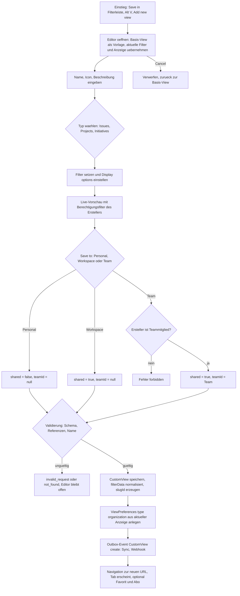
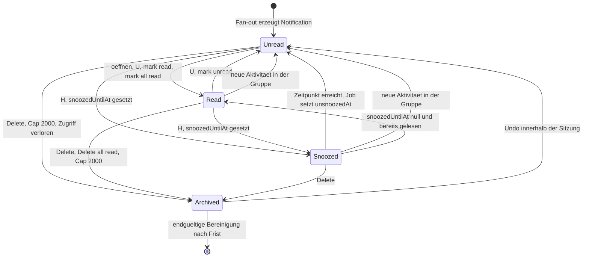
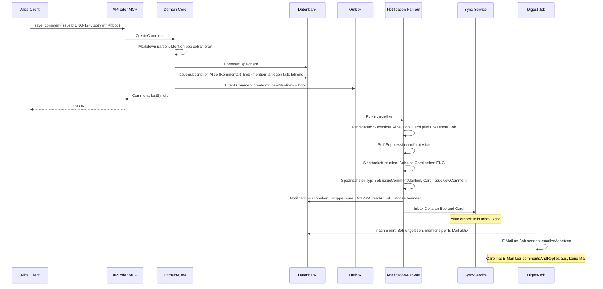

# 05 – Views, Suche, Inbox

Dieses Kapitel beschreibt, wie Benutzer in Lineal Objekte **finden und betrachten** und wie sie über Änderungen **benachrichtigt** werden: das Filtermodell (Grammatik, UI-Operatoren, Auswertung), die Anzeigeoptionen (Layout, Gruppierung, Sortierung), die Standard-Ansichten, Custom Views und Favoriten, die Volltextsuche sowie Inbox und Benachrichtigungen.

Es setzt [00-konventionen.md](00-konventionen.md) (Formate, Enums, Paginierung, Fehlermodell) voraus. Die Felder der beteiligten Entitäten (`CustomView`, `ViewPreferences`, `Favorite`, `Notification`, `NotificationSubscription`, `NotificationChannelPreference`, `IssueSubscription`, `DocumentSubscription`) sind in [01-domaenenmodell.md](01-domaenenmodell.md) definiert; hier stehen Regeln, Formate und Abläufe. Sichtbarkeit und Sub-Team-Scope stammen aus [02-teams-rechte.md](02-teams-rechte.md), Statuskategorien, Triage und manuelle Sortierung aus [03-issues-workflow.md](03-issues-workflow.md), Cycles, Projekte und Initiativen aus [04-planung.md](04-planung.md). Die technische Umsetzung von Suchindex und Notification-Fan-out steht in [10-architektur-umsetzung.md](10-architektur-umsetzung.md) §4 und §5 und wird hier nicht wiederholt. Die zugehörigen MCP-Tools (`list_issues`, `list_custom_views`, `get_notifications`, `mark_notification`) sind in [07-mcp-server.md](07-mcp-server.md) spezifiziert.

Alle Beispiele verwenden den Workspace `acme` mit den Teams `ENG`, `WEB` (Sub-Team von `ENG`) und `DES` sowie die Personen Alice, Bob und Carol. Alle Daten sind erfunden.

---

## 1. Filtermodell

### 1.1 Grundprinzip

Ein Filter ist ein **JSON-Baum**, der eine Bedingung über einer Entität beschreibt. Es gibt je Entität einen Filtertyp (`IssueFilter`, `ProjectFilter`, `InitiativeFilter`, sowie Hilfsfilter wie `UserFilter`, `TeamFilter`, `WorkflowStateFilter`, `CycleFilter`, `IssueLabelFilter`). Dieselbe Struktur wird verwendet

- als Parameter `filter` der öffentlichen API ([09-api-events.md](09-api-events.md) §1.5),
- gespeichert in `CustomView.filterData` (bzw. `projectFilterData`, `initiativeFilterData`),
- in der URL einer Liste (`?filter=…`, siehe 1.9),
- als Bedingung in SLA-Regeln (`SlaRule.filter`) und Triage-Regeln ([03-issues-workflow.md](03-issues-workflow.md)),
- intern vom MCP-Server, der seine flachen Parameter (`team`, `assignee`, `state` …) in einen `IssueFilter` übersetzt ([07-mcp-server.md](07-mcp-server.md), Core `SearchIssues`).

Regeln des Baums:

1. Ein Filterobjekt enthält **Feldbedingungen** und optional die Logikschlüssel `and` und `or`.
2. Mehrere Schlüssel auf derselben Ebene sind **implizit UND-verknüpft**. Ein leeres Objekt `{}` ist immer wahr.
3. `and: [F1, F2, …]` ist wahr, wenn alle Teilfilter wahr sind; `or: [F1, F2, …]` ist wahr, wenn mindestens einer wahr ist. Ein leeres `and: []` ist wahr, ein leeres `or: []` wird **ignoriert** (gilt als wahr), damit eine frisch angelegte, noch leere Gruppe aus dem Advanced-Filter-Editor nichts ausblendet.
4. Es gibt **kein** `not`. Negation entsteht über `neq`, `nin`, `notContains`, `null: false`, `every` mit negiertem Comparator usw.
5. Skalare Felder werden mit einem **Comparator** geprüft (`{"priority": {"in": [1, 2]}}`).
6. To-One-Relationen werden mit einem **verschachtelten Filter** des Zieltyps geprüft (`{"assignee": {"email": {"eq": "bob@acme.example"}}}`); zusätzlich gibt es dort `null: true|false` (Relation fehlt bzw. existiert).
7. To-Many-Relationen (`labels`, `children`, `subscribers`, `comments` …) haben einen **Collection-Filter** mit `some`, `every`, `length`, `null`, `and`, `or`. Feldbedingungen direkt im Collection-Filter wirken wie `some`.
8. Maximale Verschachtelungstiefe 10, maximal 200 Bedingungen pro Filter, maximal 8 KB serialisiert (**Festlegung**; Überschreitung → `invalid_request`).

### 1.2 Grammatik (JSON Schema)

Das folgende Schema ist normativ für `IssueFilter` und die Comparators. `ProjectFilter` und `InitiativeFilter` folgen demselben Bauplan (Felder in 1.11).

```json
{
  "$schema": "https://json-schema.org/draft/2020-12/schema",
  "$id": "https://lineal.example/schema/issue-filter.json",
  "$ref": "#/$defs/IssueFilter",
  "$defs": {

    "Duration": {
      "description": "ISO-8601-Dauer relativ zu jetzt bzw. heute. Vorzeichen ist bedeutungstragend: '-P1W' = vor einer Woche, 'P1W' = in einer Woche, 'P0D' = heute/jetzt.",
      "type": "string",
      "pattern": "^-?P(?!$)(\\d+Y)?(\\d+M)?(\\d+W)?(\\d+D)?(T(?=\\d)(\\d+H)?(\\d+M)?(\\d+S)?)?$"
    },
    "DateTimeOrDuration": {
      "anyOf": [ { "type": "string", "format": "date-time" }, { "type": "string", "format": "date" }, { "$ref": "#/$defs/Duration" } ]
    },
    "TimelessDateOrDuration": {
      "anyOf": [ { "type": "string", "format": "date" }, { "$ref": "#/$defs/Duration" } ]
    },

    "IDComparator": {
      "type": "object", "additionalProperties": false, "minProperties": 1,
      "properties": {
        "eq":  { "type": "string" },
        "neq": { "type": "string" },
        "in":  { "type": "array", "items": { "type": "string" }, "maxItems": 250 },
        "nin": { "type": "array", "items": { "type": "string" }, "maxItems": 250 }
      }
    },
    "BooleanComparator": {
      "type": "object", "additionalProperties": false, "minProperties": 1,
      "properties": { "eq": { "type": "boolean" }, "neq": { "type": "boolean" } }
    },
    "NumberOps": {
      "type": "object",
      "properties": {
        "eq": { "type": "number" }, "neq": { "type": "number" },
        "in": { "type": "array", "items": { "type": "number" } },
        "nin": { "type": "array", "items": { "type": "number" } },
        "lt": { "type": "number" }, "lte": { "type": "number" },
        "gt": { "type": "number" }, "gte": { "type": "number" }
      }
    },
    "NumberComparator": { "$ref": "#/$defs/NumberOps", "unevaluatedProperties": false, "minProperties": 1 },
    "NullableNumberComparator": {
      "$ref": "#/$defs/NumberOps",
      "properties": { "null": { "type": "boolean" } },
      "unevaluatedProperties": false, "minProperties": 1
    },
    "EstimateComparator": {
      "description": "Wie NullableNumberComparator, zusätzlich and/or über Teil-Comparators (z. B. 'zwischen 2 und 5 oder leer').",
      "type": "object",
      "properties": {
        "eq": { "type": "number" }, "neq": { "type": "number" },
        "in": { "type": "array", "items": { "type": "number" } },
        "nin": { "type": "array", "items": { "type": "number" } },
        "lt": { "type": "number" }, "lte": { "type": "number" },
        "gt": { "type": "number" }, "gte": { "type": "number" },
        "null": { "type": "boolean" },
        "and": { "type": "array", "items": { "$ref": "#/$defs/NullableNumberComparator" } },
        "or":  { "type": "array", "items": { "$ref": "#/$defs/NullableNumberComparator" } }
      },
      "additionalProperties": false, "minProperties": 1
    },
    "StringOps": {
      "type": "object",
      "properties": {
        "eq": { "type": "string" }, "neq": { "type": "string" },
        "in": { "type": "array", "items": { "type": "string" } },
        "nin": { "type": "array", "items": { "type": "string" } },
        "eqIgnoreCase": { "type": "string" }, "neqIgnoreCase": { "type": "string" },
        "contains": { "type": "string" }, "notContains": { "type": "string" },
        "containsIgnoreCase": { "type": "string" }, "notContainsIgnoreCase": { "type": "string" },
        "containsIgnoreCaseAndAccent": { "type": "string" },
        "startsWith": { "type": "string" }, "startsWithIgnoreCase": { "type": "string" }, "notStartsWith": { "type": "string" },
        "endsWith": { "type": "string" }, "notEndsWith": { "type": "string" }
      }
    },
    "StringComparator": { "$ref": "#/$defs/StringOps", "unevaluatedProperties": false, "minProperties": 1 },
    "NullableStringComparator": {
      "$ref": "#/$defs/StringOps",
      "properties": { "null": { "type": "boolean" } },
      "unevaluatedProperties": false, "minProperties": 1
    },
    "ContentComparator": {
      "description": "Volltext über Titel und Beschreibung (Suchindex, siehe Abschnitt 5).",
      "type": "object", "additionalProperties": false, "minProperties": 1,
      "properties": { "contains": { "type": "string", "minLength": 1 }, "notContains": { "type": "string", "minLength": 1 } }
    },
    "DateOps": {
      "type": "object",
      "properties": {
        "eq": { "$ref": "#/$defs/DateTimeOrDuration" }, "neq": { "$ref": "#/$defs/DateTimeOrDuration" },
        "in": { "type": "array", "items": { "$ref": "#/$defs/DateTimeOrDuration" } },
        "nin": { "type": "array", "items": { "$ref": "#/$defs/DateTimeOrDuration" } },
        "lt": { "$ref": "#/$defs/DateTimeOrDuration" }, "lte": { "$ref": "#/$defs/DateTimeOrDuration" },
        "gt": { "$ref": "#/$defs/DateTimeOrDuration" }, "gte": { "$ref": "#/$defs/DateTimeOrDuration" }
      }
    },
    "DateComparator": { "$ref": "#/$defs/DateOps", "unevaluatedProperties": false, "minProperties": 1 },
    "NullableDateComparator": {
      "$ref": "#/$defs/DateOps",
      "properties": { "null": { "type": "boolean" } },
      "unevaluatedProperties": false, "minProperties": 1
    },
    "NullableTimelessDateComparator": {
      "type": "object", "additionalProperties": false, "minProperties": 1,
      "properties": {
        "eq": { "$ref": "#/$defs/TimelessDateOrDuration" }, "neq": { "$ref": "#/$defs/TimelessDateOrDuration" },
        "in": { "type": "array", "items": { "$ref": "#/$defs/TimelessDateOrDuration" } },
        "nin": { "type": "array", "items": { "$ref": "#/$defs/TimelessDateOrDuration" } },
        "lt": { "$ref": "#/$defs/TimelessDateOrDuration" }, "lte": { "$ref": "#/$defs/TimelessDateOrDuration" },
        "gt": { "$ref": "#/$defs/TimelessDateOrDuration" }, "gte": { "$ref": "#/$defs/TimelessDateOrDuration" },
        "null": { "type": "boolean" }
      }
    },
    "EnumComparator": {
      "description": "Für Enum-Felder (state.type, slaStatus, team.visibility, addedToCyclePeriod …). Werte werden gegen das jeweilige Enum validiert.",
      "type": "object", "additionalProperties": false, "minProperties": 1,
      "properties": {
        "eq": { "type": "string" }, "neq": { "type": "string" },
        "in": { "type": "array", "items": { "type": "string" } },
        "nin": { "type": "array", "items": { "type": "string" } },
        "null": { "type": "boolean" }
      }
    },

    "UserOps": {
      "type": "object",
      "properties": {
        "id": { "$ref": "#/$defs/IDComparator" },
        "name": { "$ref": "#/$defs/StringComparator" },
        "displayName": { "$ref": "#/$defs/StringComparator" },
        "email": { "$ref": "#/$defs/StringComparator" },
        "isMe": { "$ref": "#/$defs/BooleanComparator" },
        "active": { "$ref": "#/$defs/BooleanComparator" },
        "admin": { "$ref": "#/$defs/BooleanComparator" },
        "app": { "$ref": "#/$defs/BooleanComparator" },
        "and": { "type": "array", "items": { "$ref": "#/$defs/NullableUserFilter" } },
        "or":  { "type": "array", "items": { "$ref": "#/$defs/NullableUserFilter" } }
      }
    },
    "UserFilter": { "$ref": "#/$defs/UserOps", "unevaluatedProperties": false },
    "NullableUserFilter": {
      "$ref": "#/$defs/UserOps",
      "properties": { "null": { "type": "boolean" } },
      "unevaluatedProperties": false
    },

    "TeamFilter": {
      "type": "object", "additionalProperties": false,
      "properties": {
        "id": { "$ref": "#/$defs/IDComparator" },
        "key": { "$ref": "#/$defs/StringComparator" },
        "name": { "$ref": "#/$defs/StringComparator" },
        "visibility": { "$ref": "#/$defs/EnumComparator" },
        "parent": { "$ref": "#/$defs/TeamFilter" },
        "ancestors": { "type": "object", "properties": { "some": { "$ref": "#/$defs/TeamFilter" } }, "additionalProperties": false },
        "and": { "type": "array", "items": { "$ref": "#/$defs/TeamFilter" } },
        "or":  { "type": "array", "items": { "$ref": "#/$defs/TeamFilter" } }
      }
    },
    "WorkflowStateFilter": {
      "type": "object", "additionalProperties": false,
      "properties": {
        "id": { "$ref": "#/$defs/IDComparator" },
        "name": { "$ref": "#/$defs/StringComparator" },
        "type": { "$ref": "#/$defs/EnumComparator" },
        "position": { "$ref": "#/$defs/NumberComparator" },
        "team": { "$ref": "#/$defs/TeamFilter" },
        "and": { "type": "array", "items": { "$ref": "#/$defs/WorkflowStateFilter" } },
        "or":  { "type": "array", "items": { "$ref": "#/$defs/WorkflowStateFilter" } }
      }
    },
    "IssueLabelFilter": {
      "type": "object", "additionalProperties": false,
      "properties": {
        "id": { "$ref": "#/$defs/IDComparator" },
        "name": { "$ref": "#/$defs/StringComparator" },
        "isGroup": { "$ref": "#/$defs/BooleanComparator" },
        "parent": { "$ref": "#/$defs/IssueLabelFilter" },
        "team": { "$ref": "#/$defs/TeamFilter" },
        "and": { "type": "array", "items": { "$ref": "#/$defs/IssueLabelFilter" } },
        "or":  { "type": "array", "items": { "$ref": "#/$defs/IssueLabelFilter" } }
      }
    },
    "NullableCycleFilter": {
      "type": "object", "additionalProperties": false,
      "properties": {
        "id": { "$ref": "#/$defs/IDComparator" },
        "number": { "$ref": "#/$defs/NumberComparator" },
        "name": { "$ref": "#/$defs/StringComparator" },
        "startsAt": { "$ref": "#/$defs/DateComparator" },
        "endsAt": { "$ref": "#/$defs/DateComparator" },
        "isActive": { "$ref": "#/$defs/BooleanComparator" },
        "isNext": { "$ref": "#/$defs/BooleanComparator" },
        "isPrevious": { "$ref": "#/$defs/BooleanComparator" },
        "isPast": { "$ref": "#/$defs/BooleanComparator" },
        "isFuture": { "$ref": "#/$defs/BooleanComparator" },
        "isInCooldown": { "$ref": "#/$defs/BooleanComparator" },
        "null": { "type": "boolean" },
        "and": { "type": "array", "items": { "$ref": "#/$defs/NullableCycleFilter" } },
        "or":  { "type": "array", "items": { "$ref": "#/$defs/NullableCycleFilter" } }
      }
    },
    "NullableProjectFilter": {
      "description": "Teilmenge von ProjectFilter (1.11) plus null.",
      "type": "object",
      "properties": { "null": { "type": "boolean" } },
      "$comment": "alle Felder von ProjectFilter zulässig"
    },
    "NullableProjectMilestoneFilter": {
      "type": "object", "additionalProperties": false,
      "properties": {
        "id": { "$ref": "#/$defs/IDComparator" },
        "name": { "$ref": "#/$defs/StringComparator" },
        "targetDate": { "$ref": "#/$defs/NullableTimelessDateComparator" },
        "null": { "type": "boolean" }
      }
    },

    "CollectionOf": {
      "description": "Generischer To-Many-Filter. 'items' steht für den Filtertyp des Elements (UserFilter, IssueLabelFilter, IssueFilter, CommentFilter).",
      "type": "object",
      "properties": {
        "some":   { "$comment": "Elementfilter: mindestens ein Element erfüllt ihn" },
        "every":  { "$comment": "Elementfilter: alle Elemente erfüllen ihn (leere Menge: wahr)" },
        "length": { "$ref": "#/$defs/NumberComparator" },
        "null":   { "type": "boolean", "description": "true = Menge leer, false = Menge nicht leer" },
        "and":    { "type": "array" },
        "or":     { "type": "array" }
      }
    },

    "IssueFilter": {
      "type": "object", "additionalProperties": false,
      "properties": {
        "id":                  { "$ref": "#/$defs/IDComparator" },
        "number":              { "$ref": "#/$defs/NumberComparator" },
        "title":               { "$ref": "#/$defs/StringComparator" },
        "description":         { "$ref": "#/$defs/NullableStringComparator" },
        "searchableContent":   { "$ref": "#/$defs/ContentComparator" },
        "priority":            { "$ref": "#/$defs/NullableNumberComparator" },
        "estimate":            { "$ref": "#/$defs/EstimateComparator" },
        "createdAt":           { "$ref": "#/$defs/DateComparator" },
        "updatedAt":           { "$ref": "#/$defs/DateComparator" },
        "archivedAt":          { "$ref": "#/$defs/NullableDateComparator" },
        "startedAt":           { "$ref": "#/$defs/NullableDateComparator" },
        "completedAt":         { "$ref": "#/$defs/NullableDateComparator" },
        "canceledAt":          { "$ref": "#/$defs/NullableDateComparator" },
        "triagedAt":           { "$ref": "#/$defs/NullableDateComparator" },
        "autoClosedAt":        { "$ref": "#/$defs/NullableDateComparator" },
        "autoArchivedAt":      { "$ref": "#/$defs/NullableDateComparator" },
        "addedToCycleAt":      { "$ref": "#/$defs/NullableDateComparator" },
        "snoozedUntilAt":      { "$ref": "#/$defs/NullableDateComparator" },
        "slaBreachesAt":       { "$ref": "#/$defs/NullableDateComparator" },
        "stateEnteredAt":      { "$ref": "#/$defs/DateComparator" },
        "dueDate":             { "$ref": "#/$defs/NullableTimelessDateComparator" },
        "slaStatus":           { "$ref": "#/$defs/EnumComparator" },
        "addedToCyclePeriod":  { "$ref": "#/$defs/EnumComparator" },
        "state":               { "$ref": "#/$defs/WorkflowStateFilter" },
        "team":                { "$ref": "#/$defs/TeamFilter" },
        "assignee":            { "$ref": "#/$defs/NullableUserFilter" },
        "creator":             { "$ref": "#/$defs/NullableUserFilter" },
        "delegate":            { "$ref": "#/$defs/NullableUserFilter" },
        "snoozedBy":           { "$ref": "#/$defs/NullableUserFilter" },
        "subscribers":         { "$ref": "#/$defs/CollectionOf", "$comment": "items = UserFilter" },
        "labels":              { "$ref": "#/$defs/CollectionOf", "$comment": "items = IssueLabelFilter" },
        "cycle":               { "$ref": "#/$defs/NullableCycleFilter" },
        "project":             { "$ref": "#/$defs/NullableProjectFilter" },
        "projectMilestone":    { "$ref": "#/$defs/NullableProjectMilestoneFilter" },
        "parent":              { "$ref": "#/$defs/IssueFilter", "$comment": "To-One; null: Boolean erlaubt" },
        "children":            { "$ref": "#/$defs/CollectionOf", "$comment": "items = IssueFilter" },
        "comments":            { "$ref": "#/$defs/CollectionOf", "$comment": "items = CommentFilter {body, user, createdAt}" },
        "attachments":         { "$ref": "#/$defs/CollectionOf", "$comment": "items = AttachmentFilter {url, title, sourceType}" },
        "hasBlockedByRelations": { "$ref": "#/$defs/BooleanComparator" },
        "hasBlockingRelations":  { "$ref": "#/$defs/BooleanComparator" },
        "hasDuplicateRelations": { "$ref": "#/$defs/BooleanComparator" },
        "hasRelatedRelations":   { "$ref": "#/$defs/BooleanComparator" },
        "lastAppliedTemplate": { "type": "object", "properties": { "id": { "$ref": "#/$defs/IDComparator" }, "null": { "type": "boolean" } }, "additionalProperties": false },
        "null": { "type": "boolean", "description": "nur gültig, wo IssueFilter als To-One-Relation steht (parent); auf oberster Ebene → invalid_request" },
        "and": { "type": "array", "items": { "$ref": "#/$defs/IssueFilter" } },
        "or":  { "type": "array", "items": { "$ref": "#/$defs/IssueFilter" } }
      }
    }
  }
}
```

Hinweise zum Schema:

- `searchableContent` ist der Lineal-Name des UI-Filters **Content** („Filter by content…“) und läuft über den Suchindex (Abschnitt 5), nicht über `LIKE` auf der Datenbank.
- `stateEnteredAt` (Zeitpunkt des letzten Statuswechsels) ist eine Lineal-Ergänzung für den UI-Filter **Time in current status**; sie wird bei jedem Statuswechsel am Issue gesetzt und ist aus der Issue-Historie rekonstruierbar ([03-issues-workflow.md](03-issues-workflow.md) §8; neues Feld, siehe Offene Punkte).
- `slaStatus` hat die Werte `breached`, `highRisk`, `mediumRisk`, `lowRisk`, `completed`, `failed` (aus `slaBreachesAt`, `slaHighRiskAt`, `slaMediumRiskAt` abgeleitet, [03-issues-workflow.md](03-issues-workflow.md) §11).
- `addedToCyclePeriod` hat die Werte `before`, `during`, `after` (Issue wurde vor, während oder nach dem Start des Cycles hinzugefügt; UI-Filter **Added to cycle**).
- Felder des Originals außerhalb des Scopes (`customerCount`, `needs`, `releases`, `sourceMetadata`, `recurringIssueTemplate`, `sharedWith`) werden mit `invalid_request` abgelehnt, nicht ignoriert.

### 1.3 Semantik der Comparators

| Comparator | Typen | Bedeutung | Verhalten bei `null` im Feld |
|---|---|---|---|
| `eq` | alle | gleich | falsch |
| `neq` | alle | ungleich | **wahr** (Festlegung: `null` ist von jedem Wert verschieden, SQL `IS DISTINCT FROM`) |
| `in` | alle | Wert ist in Liste (leere Liste → falsch) | falsch |
| `nin` | alle | Wert ist nicht in Liste (leere Liste → wahr) | **wahr** |
| `null` | Nullable-Typen, Relationen, Collections | `true` = Feld leer/Relation fehlt/Menge leer; `false` = gesetzt | – |
| `lt`, `lte`, `gt`, `gte` | Zahl, Datum | Ordnungsvergleich | falsch |
| `eqIgnoreCase`, `neqIgnoreCase` | String | Vergleich nach Unicode-Casefolding | wie `eq`/`neq` |
| `contains`, `notContains` | String | Teilstring (case-sensitiv) | `contains` falsch, `notContains` wahr |
| `containsIgnoreCase`, `notContainsIgnoreCase` | String | Teilstring, case-insensitiv | wie oben |
| `containsIgnoreCaseAndAccent` | String | zusätzlich ohne diakritische Zeichen (`ä` = `a`) | wie oben |
| `startsWith`, `startsWithIgnoreCase`, `notStartsWith` | String | Präfix | Positivform falsch, Negativform wahr |
| `endsWith`, `notEndsWith` | String | Suffix | Positivform falsch, Negativform wahr |
| `some` | Collection | mindestens ein Element erfüllt den Teilfilter | leere Menge → falsch |
| `every` | Collection | alle Elemente erfüllen den Teilfilter | leere Menge → **wahr** |
| `length` | Collection | `NumberComparator` auf die Anzahl der Elemente | leere Menge = 0 |

Mehrere Operatoren in **einem** Comparator-Objekt sind UND-verknüpft: `{"estimate": {"gte": 2, "lte": 5}}` heißt „zwischen 2 und 5“.

**Priorität ist ordinal, nicht numerisch.** Weil `0` („No priority“) in jeder Sortierung zuletzt steht ([00-konventionen.md](00-konventionen.md#4-feste-enums), [03-issues-workflow.md](03-issues-workflow.md)), erzeugt die UI für Prioritäten **immer Wertemengen** (`in`/`nin`). Die API akzeptiert zwar `lt`/`gt` auf `priority`, sie vergleichen aber die nackte Zahl: `{"priority": {"lte": 2}}` schließt `0` ein. Empfohlene Form für „High oder dringender“: `{"priority": {"in": [1, 2]}}`.

### 1.4 Relative Datumsangaben

Alle Datums-Comparators akzeptieren neben absoluten Werten eine ISO-8601-Dauer, die **zum Auswertungszeitpunkt** aufgelöst wird. Damit bleibt eine gespeicherte View „aktuell“.

| Feldart | Absoluter Wert | Relativer Wert | Auflösung |
|---|---|---|---|
| `DateTime` (`createdAt`, `completedAt` …) | `2026-10-01T00:00:00.000Z` oder `2026-10-01` (= 00:00 in Referenzzeitzone) | `-P2W`, `-PT12H`, `P0D` | `jetzt + Dauer` |
| `Date` (`dueDate`, `targetDate`) | `2026-11-30` | `P0D`, `P7D`, `-P1M` | `heute + Dauer` (Kalendertage) |

**Festlegungen:**

1. **Das Vorzeichen ist bedeutungstragend.** `-P1W` liegt in der Vergangenheit, `P1W` in der Zukunft, `P0D` ist heute bzw. jetzt. Der tolerante Parser aus [07-mcp-server.md](07-mcp-server.md) §2.7 (`P1D` ohne Minus wird als Vergangenheit gelesen) gilt **nur** für die flachen MCP-Komfortparameter `createdAt`, `updatedAt`, `triagedAt`, nicht für Filter-JSON.
2. **Referenzzeitzone** für „heute“ und für Datumsangaben ohne Uhrzeit ist im Filter-JSON `User.timezone` des Auswertenden, ersatzweise UTC. (Die flachen MCP-Parameter lesen `2026-10-01` dagegen als 00:00 UTC, [07-mcp-server.md](07-mcp-server.md) §2.7; beide Regeln gelten nebeneinander.) Eine geteilte View kann daher am Tagesrand für Alice in Berlin und Bob in Kalifornien unterschiedlich viele Issues zeigen; das ist gewollt.
3. Monats- und Jahresdauern werden kalendarisch addiert (`2026-01-31 + P1M = 2026-02-28`).
4. Die UI bietet zusätzlich **Zeiträume** (Monat, Quartal, Halbjahr, Jahr, z. B. „Q4 2026“). Ein Zeitraum ist kein eigener Datentyp, sondern wird beim Speichern in ein Intervall übersetzt: `is Q4 2026` → `{"gte": "2026-10-01", "lte": "2026-12-31"}`. Quartale richten sich nach dem ersten Fiskalmonat des Workspaces (`Organization.fiscalYearStartMonth`, Default Januar).

Vordefinierte Werte des UI-Filters **Due date** und ihre Übersetzung:

| UI-Wert | Filter-JSON |
|---|---|
| Overdue | `{"dueDate": {"lt": "P0D"}}` (zusätzlich implizit nur offene Issues, siehe 1.7) |
| Due today | `{"dueDate": {"eq": "P0D"}}` |
| 1 day from now | `{"dueDate": {"gte": "P0D", "lte": "P1D"}}` |
| 3 days / 1 week / 1 month / 3 months from now | wie oben mit `P3D` / `P1W` / `P1M` / `P3M` |
| No due date | `{"dueDate": {"null": true}}` |
| Custom date or timeframe… | absolutes Intervall gemäß Punkt 4 |

Für **Created/Updated/Started/Completed/Triaged/Auto-closed date** bietet die UI analog „Past day/week/month/3 months/year“ (`{"createdAt": {"gte": "-P1D"}}` usw.) sowie `before`/`after` mit absolutem oder relativem Wert (`before` → `lt`, `after` → `gt`). **Time in current status** übersetzt „länger als 2 Wochen“ in `{"stateEnteredAt": {"lt": "-P2W"}}`.

### 1.5 Filterbare Issue-Felder

Die Tabelle listet jeden Filter aus dem Filtermenü („Add filter“, Taste `F`), das zugehörige Feld im `IssueFilter`, die angebotenen UI-Operatoren und die Comparator-Abbildung. Die exakte JSON-Form je Operator steht in 1.6.

| UI-Filter | Feld(er) | UI-Operatoren | Abbildung |
|---|---|---|---|
| Status | `state.id` | is, is not, is any of, is none of | `eq`/`neq`/`in`/`nin` auf `state.id` |
| Status type | `state.type` | is, is not, is any of, is none of | `EnumComparator` auf `state.type` |
| Team | `team.id` | is, is not, is any of, is none of | auf `team.id`; Sub-Team-Einschluss siehe 1.7 |
| Assignee | `assignee` | is, is not, is any of, is none of | `assignee.id.eq/in`, `assignee.null`, `assignee.isMe` |
| Creator | `creator` | is, is not, is any of, is none of | wie Assignee |
| Delegate (Erweiterungspunkt) | `delegate` | is, is not, is any of | wie Assignee |
| Priority | `priority` | is, is not, is any of, is none of | `in`/`nin` (immer Mengen, 1.3) |
| Estimate | `estimate` | is, is not, less than, greater than, between, is empty | `eq`/`neq`/`lt`/`gt`/`gte+lte`/`null` |
| Labels | `labels` | include, do not include, include all of, include any of, exclude if any of, exclude if all | Collection-Filter, 1.6 |
| Cycle | `cycle` | is, is not, is any of, is none of | `cycle.id`, `cycle.isActive`, `cycle.isNext`, `cycle.isPrevious`, `cycle.null` |
| Added to cycle | `addedToCyclePeriod`, `addedToCycleAt` | is (before start, during, after start) | `EnumComparator` |
| Project | `project` | is, is not, is any of, is none of | `project.id`, `project.null` |
| Project status | `project.status.type` / `project.status.id` | is, is not, is any of | verschachtelt über `project` |
| Project priority | `project.priority` | is any of, is none of | `in`/`nin` |
| Project labels | `project.labels` | include any of, include all of, exclude if any of | Collection-Filter auf `project.labels` |
| Project lead | `project.lead` | is, is not, is any of | `NullableUserFilter` |
| Milestone | `projectMilestone` | is, is not, is any of | `projectMilestone.id`, `projectMilestone.null`; nur zusammen mit einem Projektfilter angeboten |
| Initiative | `project.initiatives` | is any of, is none of | `project.initiatives.some.id.in` (rekursiv über Sub-Initiativen, siehe 1.7) |
| Parent issue | `parent` | is, is not, is empty | `parent.id`, `parent.null` |
| Relations | `children`, `parent`, `has…Relations` | is (Parent issues, Sub-issues, Blocked issues, Blocking issues, Issues with relations, Duplicates) | siehe 1.7 |
| Subscribers | `subscribers` | include, do not include, include any of | `subscribers.some.id.in`, `every.id.nin` |
| Due date | `dueDate` | is, is not, before, after | 1.4 |
| Created / Updated / Started / Completed / Canceled date | `createdAt` … `canceledAt` | before, after, is (Zeitraum) | `lt`/`gt`/`gte+lte` |
| Triaged date | `triagedAt` | before, after | `lt`/`gt` |
| Auto-closed | `autoClosedAt` | is (Toggle) | `{"autoClosedAt": {"null": false}}` |
| Time in current status | `stateEnteredAt` | more than, less than | `lt`/`gt` mit negativer Dauer |
| SLA status | `slaStatus` | is, is any of | `EnumComparator` |
| Content | `searchableContent` | contains, does not contain | `ContentComparator` |
| Title | `title` | contains, does not contain, starts with | `containsIgnoreCaseAndAccent`, `notContainsIgnoreCase`, `startsWithIgnoreCase` |
| Links | `attachments` | include, do not include, is empty | `attachments.some.url.containsIgnoreCase`, `attachments.length.eq 0` |
| Template | `lastAppliedTemplate` | is, is not, is any of | `lastAppliedTemplate.id`, `lastAppliedTemplate.null` |
| Archived | `archivedAt` | – (nur über `includeArchived`) | siehe 1.10 |

Operatorwahl der UI: Bei **einem** gewählten Wert bietet die UI `is` / `is not` (bzw. `include` / `do not include` bei Mengenfeldern), bei **mehreren** Werten `is any of` / `is none of` (bzw. die vier Label-Operatoren). Der Wechsel zwischen Ein- und Mehrfachauswahl passt den Operator automatisch an (`is` → `is any of`, `is not` → `is none of`); der gespeicherte JSON-Filter ist in beiden Fällen dieselbe Mengenform (`in` bzw. `nin`), `eq`/`neq` sind nur API-Komfort.

### 1.6 UI-Operatoren → Filter-JSON

Für **skalare und To-One-Felder** (Beispiel Assignee mit Bob = `u-bob`, Carol = `u-carol`):

| UI | JSON |
|---|---|
| is Bob | `{"assignee": {"id": {"in": ["u-bob"]}}}` |
| is not Bob | `{"assignee": {"id": {"nin": ["u-bob"]}}}` (schließt nicht zugewiesene Issues **ein**, 1.3) |
| is any of Bob, Carol | `{"assignee": {"id": {"in": ["u-bob", "u-carol"]}}}` |
| is none of Bob, Carol | `{"assignee": {"id": {"nin": ["u-bob", "u-carol"]}}}` |
| is No assignee | `{"assignee": {"null": true}}` |
| is any of No assignee, Bob | `{"assignee": {"or": [{"null": true}, {"id": {"in": ["u-bob"]}}]}}` |
| is not No assignee | `{"assignee": {"null": false}}` |

**Festlegung zur Negation über To-One-Relationen:** `{"assignee": {"id": {"nin": [...]}}}` ist für ein Issue ohne Assignee **wahr** (die Relation wird wie ein Feld mit Wert `null` behandelt). Damit bedeutet „is not Bob“ in der UI „alle außer Bob“, wie Benutzer es erwarten.

Für **Labels** (Collection; Beispiel `Bug` = `l-bug`, `Frontend` = `l-fe`):

| UI-Operator | Bedeutung | JSON |
|---|---|---|
| include (1 Wert) | hat das Label | `{"labels": {"some": {"id": {"in": ["l-bug"]}}}}` |
| do not include (1 Wert) | hat das Label nicht (auch: Issue ohne Labels) | `{"labels": {"every": {"id": {"nin": ["l-bug"]}}}}` |
| include all of | hat alle gewählten | `{"and": [{"labels": {"some": {"id": {"in": ["l-bug"]}}}}, {"labels": {"some": {"id": {"in": ["l-fe"]}}}}]}` |
| include any of | hat mindestens eines | `{"labels": {"some": {"id": {"in": ["l-bug", "l-fe"]}}}}` |
| exclude if any of | hat keines der gewählten | `{"labels": {"every": {"id": {"nin": ["l-bug", "l-fe"]}}}}` |
| exclude if all | hat nicht alle gleichzeitig | `{"or": [{"labels": {"every": {"id": {"neq": "l-bug"}}}}, {"labels": {"every": {"id": {"neq": "l-fe"}}}}]}` |
| (Sonderwert) No labels | hat gar kein Label | `{"labels": {"length": {"eq": 0}}}` – **Lineal-Ergänzung**; im Original nur über „exclude if any of“ mit allen Labels erreichbar |

**Label-Gruppen und Namensgleichheit.** Wählt der User in der UI eine **Label-Gruppe** (z. B. `Platform` mit Kindern `iOS`, `Android`), trifft der Filter jedes Kind der Gruppe: `{"labels": {"some": {"or": [{"id": {"in": ["l-platform"]}}, {"parent": {"id": {"in": ["l-platform"]}}}]}}}`. In Views, die **mehrere Teams** umfassen, verhalten sich gleichnamige Team-Labels wie ein Label ([03-issues-workflow.md](03-issues-workflow.md) §5): Die UI speichert dann eine Namensbedingung `{"name": {"eqIgnoreCase": "Bug"}}` statt der ID, ebenfalls mit `parent`-Alternative. In Ein-Team-Views speichert die UI IDs.

Dieselben sechs Operatoren gelten für alle anderen Mengenfelder (`subscribers`, `project.labels`, `project.initiatives`).

Für **Datumsfelder**:

| UI | JSON |
|---|---|
| Due date is Overdue | `{"dueDate": {"lt": "P0D"}}` |
| Due date is not Overdue | `{"or": [{"dueDate": {"gte": "P0D"}}, {"dueDate": {"null": true}}]}` |
| Created before 2026-09-01 | `{"createdAt": {"lt": "2026-09-01"}}` |
| Created after 1 week ago | `{"createdAt": {"gt": "-P1W"}}` |
| Completed is Q3 2026 | `{"completedAt": {"gte": "2026-07-01", "lte": "2026-09-30"}}` (Obergrenze als Ende des Tages, 1.10) |

Die Negation eines Datumsintervalls erzeugt die UI als `or` aus „davor“, „danach“ und `null: true`.

### 1.7 Besondere Filterwerte

| Sonderwert (UI) | Gespeichertes JSON | Auflösung |
|---|---|---|
| **Current user** / `"me"` | `{"assignee": {"isMe": {"eq": true}}}` | `isMe` wird **zur Auswertungszeit** gegen den aufrufenden Principal aufgelöst (**Festlegung**). Eine geteilte View „Meine offenen Bugs“ zeigt jedem Betrachter seine eigenen Issues. Gilt für alle `NullableUserFilter` (`creator`, `subscribers.some` …). |
| **No assignee** | `{"assignee": {"null": true}}` | – |
| **Suspended user** | `{"assignee": {"active": {"eq": false}}}` | nur im Wertepicker angeboten, wenn es solche User gibt |
| **Application** | `{"creator": {"app": {"eq": true}}}` | Issues, die von API-/OAuth-Apps angelegt wurden |
| **Current cycle** | `{"cycle": {"isActive": {"eq": true}}}` | relativ zum Team des jeweiligen Issues ([04-planung.md](04-planung.md) §1.10). Im Cooldown hat ein Team keinen aktiven Cycle, der Filter trifft dann für dieses Team nichts. |
| **Upcoming cycle** | `{"cycle": {"isNext": {"eq": true}}}` | nächster künftiger Cycle je Team |
| **Previous cycle** | `{"cycle": {"isPrevious": {"eq": true}}}` | zuletzt abgeschlossener Cycle je Team |
| **No cycle** | `{"cycle": {"null": true}}` | – |
| **No project** / **No milestone** | `{"project": {"null": true}}` / `{"projectMilestone": {"null": true}}` | – |
| **Overdue** | `{"dueDate": {"lt": "P0D"}, "state": {"type": {"nin": ["completed", "canceled", "duplicate"]}}}` | die UI ergänzt die Statusbedingung, weil erledigte Issues nicht „überfällig“ sind |
| **Parent issues** (Relations) | `{"children": {"length": {"gt": 0}}}` | – |
| **Sub-issues** (Relations) | `{"parent": {"null": false}}` | – |
| **Blocked issues** / **Blocking issues** | `{"hasBlockedByRelations": {"eq": true}}` / `{"hasBlockingRelations": {"eq": true}}` | nur Relationen zu **offenen** blockierenden Issues zählen (**Festlegung**, analog Badge „blocked by n“) |
| **Issues with relations** | `{"or": [{"hasBlockedByRelations": {"eq": true}}, {"hasBlockingRelations": {"eq": true}}, {"hasRelatedRelations": {"eq": true}}, {"hasDuplicateRelations": {"eq": true}}]}` | – |
| **Duplicates** | `{"state": {"type": {"eq": "duplicate"}}}` | – |
| **Triage** | `{"state": {"type": {"eq": "triage"}}}` | hebt die implizite Triage-Ausblendung auf (1.10) |
| **Initiative X** | `{"project": {"initiatives": {"some": {"id": {"in": ["i-x"]}}}}}` | **Festlegung:** rekursiv, d. h. die Initiative-ID wird beim Auswerten zu „X und alle Sub-Initiativen“ expandiert ([04-planung.md](04-planung.md) §4) |

**Sub-Team-Einschluss.** Ein Teamfilter trifft per Default nur das genannte Team. Sub-Teams werden einbezogen, wenn

- in Filter-JSON der Teamfilter über `ancestors` formuliert ist: `{"team": {"or": [{"id": {"eq": "t-eng"}}, {"ancestors": {"some": {"id": {"eq": "t-eng"}}}}]}}` – so speichert die UI den Wert „ENG inklusive Sub-Teams“;
- ein Abfrageparameter `includeSubTeams: true` gesetzt ist (MCP `list_issues`, Team-Seiten), siehe [02-teams-rechte.md](02-teams-rechte.md) §3.6. Default für Issues `false`, für Projekte `true`.

Nicht zugängliche Nachfahren (privates Sub-Team, in dem der Betrachter kein Mitglied ist) werden durch den Berechtigungsfilter (1.10) still entfernt.

### 1.8 Validierung und Normalisierung

Beim **Speichern** eines Filters (Custom View, SLA-Regel, Triage-Regel) und beim **Auswerten** eines URL- oder API-Filters gilt:

1. Schemaprüfung gegen 1.2 → bei Verstoß `invalid_request` mit `details.path` (JSON-Pointer, z. B. `/and/1/labels/some/id`).
2. Alle Referenzen (`id`-Werte von Team, User, State, Label, Cycle, Project, Milestone, Template) müssen im Workspace existieren und für den Speichernden sichtbar sein; sonst `not_found` mit `details.reference` ([00-konventionen.md](00-konventionen.md#7-fehlermodell), fail loud).
3. Enum-Werte (`state.type`, `slaStatus`, `addedToCyclePeriod`, `team.visibility`) werden gegen ihre Enums geprüft.
4. **Normalisierung** vor dem Speichern: leere `or`-Gruppen entfernen, `eq` → `in` mit einem Element und `neq` → `nin` (kanonische Form), Schlüssel alphabetisch sortieren. Dadurch sind gleichwertige Filter byte-gleich und Views vergleichbar.
5. Referenzen werden immer als **UUID** gespeichert, nicht als Name oder Kennung (Ausnahme: Label-Namensbedingungen in Multi-Team-Views, 1.6). Wird ein referenziertes Objekt später gelöscht oder archiviert, bleibt die Bedingung erhalten und trifft einfach nichts mehr; die UI zeigt den Chip als „Unknown“ an und bietet „Remove filter“ an.

### 1.9 Serialisierung

**In der URL.** Der aktuelle (ungespeicherte) Filter einer Liste steht im Query-Parameter `filter`:

```text
/acme/team/ENG/all?filter=<base64url(UTF-8(JSON))>
```

- Kodierung: kanonisch normalisiertes JSON (1.8), UTF-8, Base64 mit URL-sicherem Alphabet ohne Padding. Der Server akzeptiert auch Standard-Base64 mit Padding.
- Inhalt ist **nur der Hauptfilter**. Anzeigeoptionen, „Find in view“ und der Suchbegriff gehören nicht in `filter` (Anzeigeoptionen werden separat persistiert, Abschnitt 2).
- Die oberste Ebene ist immer ein `and`-Array, dessen Elemente den Chips der Filterleiste entsprechen. Ein „Advanced filter“ ist ein Element mit `or` (oder einem verschachtelten `and`).
- Ein geteilter Link gewährt **keinen** Zugriff: Der Empfänger sieht nur, was er ohnehin sehen darf.
- Bei einer URL mit `filter` auf einer gespeicherten View gilt: View-Filter UND URL-Filter (die URL verengt, 4.3).

Beispiel: Die Filterleiste zeigt „Priority is any of Urgent, High“ und „Labels include Bug“:

```json
{ "and": [
    { "priority": { "in": [1, 2] } },
    { "labels": { "some": { "id": { "in": ["l-bug"] } } } }
] }
```

→ `?filter=eyJhbmQiOlt7InByaW9yaXR5Ijp7ImluIjpbMSwyXX19LHsibGFiZWxzIjp7InNvbWUiOnsiaWQiOnsiaW4iOlsibC1idWciXX19fX1dfQ`

**Gemerkte Filter auf Standard-Views.** Setzt ein User auf einer Standard-View (z. B. „All issues“ von `ENG`) einen Filter, ohne ihn als View zu speichern, merkt sich der Client diesen Filter pro User und View und stellt ihn beim nächsten Öffnen wieder her, bis „Clear“ gedrückt wird. **Festlegung:** Diese Erinnerung ist **client-lokal** (Browser-Speicher); serverseitige Persistenz ist optional und, falls umgesetzt, ein Feld `lastFilter` in der user-eigenen `ViewPreferences`-Zeile.

**In `CustomView.filterData`.** Gespeichert wird exakt der normalisierte JSON-Baum (kein Base64). `projectFilterData` und `initiativeFilterData` analog. Beispiel der View „Offene Bugs ENG“ (`slugId` `5e4d3c2b1a09`):

```json
{
  "and": [
    { "team": { "id": { "in": ["5d0a…-eng"] } } },
    { "state": { "type": { "in": ["backlog", "unstarted", "started"] } } },
    { "labels": { "some": { "or": [ { "id": { "in": ["l-bug"] } }, { "parent": { "id": { "in": ["l-bug"] } } } ] } } }
  ]
}
```

### 1.10 Auswertung: Übersetzung in eine Datenbankabfrage

Die Auswertung ist eine rekursive Übersetzung des Filterbaums in ein Prädikat der Abfragesprache (hier SQL-artig notiert). Der Übersetzer ist **eine** Komponente im Domain-Core; API, MCP, Views, SLA- und Triage-Regeln verwenden sie gemeinsam.

```text
function searchIssues(principal, userFilter, scope, page):
    # scope: { teamIds?, includeSubTeams, customViewId?, includeArchived, ordering }
    ctx = { principal, now: now(), today: todayIn(principal.timezone ?? "UTC"),
            params: [] }

    validate(userFilter)                                  # 1.8, wirft invalid_request/not_found
    filters = [userFilter]
    if scope.customViewId != null:
        view = loadVisibleView(principal, scope.customViewId)     # sonst not_found
        filters.prepend(view.filterData)
        scope = mergeScope(scope, view)                   # Team-/Projekt-Scope der View
    if scope.teamIds != null:
        ids = union(teamScope(principal, t, scope.includeSubTeams) for t in scope.teamIds)  # 02 §3.6
        filters.append({ team: { id: { in: ids } } })

    where = and(
        "issue.organizationId = :org",                    # Mandant, 10 §2.2
        "issue.trashed = false",                          # Papierkorb nie
        scope.includeArchived ? TRUE : "issue.archivedAt IS NULL",
        "issue.teamId IN (:visibleTeamIds)",              # Berechtigungsfilter, IMMER, 10 §2.3
        mentionsTriage(filters) ? TRUE : "state.type <> 'triage'",   # 03 §10
        # mentionsTriage: irgendwo im Baum state.type mit Wert 'triage' (eq/in)
        #                 ODER state.id (eq/in) referenziert einen Status der Kategorie triage
        compile(and(filters), "issue", ctx)
    )
    return paginate("SELECT issue.* FROM issue JOIN workflow_state state ... WHERE " + where,
                    orderBy(scope.ordering), page)        # 00 §5
```

```text
function compile(f, alias, ctx) -> Predicate:
    parts = []
    for (key, value) in f:
        switch key:
            "and": parts.add( AND(compile(x, alias, ctx) for x in value) )
            "or":  if value is empty: continue
                   parts.add( OR(compile(x, alias, ctx) for x in value) )
            scalar field (title, priority, dueDate, createdAt, …):
                parts.add( compileComparator(alias + "." + column(key), value, typeOf(key), ctx) )
            to-one relation (assignee, creator, cycle, project, state, team, parent, projectMilestone):
                parts.add( compileToOne(alias, key, value, ctx) )
            to-many relation (labels, subscribers, children, comments, attachments):
                parts.add( compileCollection(alias, key, value, ctx) )
            virtual field:
                parts.add( compileVirtual(alias, key, value, ctx) )   # isMe, isActive, hasBlockedByRelations, searchableContent …
    return AND(parts)                                    # leere Liste = TRUE

function compileComparator(col, cmp, type, ctx):
    p = []
    for (op, v) in cmp:
        v = resolveRelative(v, type, ctx)                # Dauer → absoluter Wert (1.4)
        switch op:
            "eq":  p.add(col = v)
            "neq": p.add(col IS DISTINCT FROM v)          # null zählt als ungleich
            "in":  p.add(v is empty ? FALSE : col IN v)
            "nin": p.add(v is empty ? TRUE : (col IS NULL OR col NOT IN v))
            "null": p.add(v ? col IS NULL : col IS NOT NULL)
            "lt","lte","gt","gte": p.add(col <op> v)
            "containsIgnoreCase": p.add(lower(col) LIKE '%' + escape(lower(v)) + '%')
            "notContainsIgnoreCase": p.add(col IS NULL OR lower(col) NOT LIKE …)
            … (übrige String-Operatoren analog)
    return AND(p)

function resolveRelative(v, type, ctx):
    if not isDuration(v): return (type == Date or isDateOnly(v)) ? parseDate(v) : parseDateTime(v)
    if type == Date: return addCalendar(ctx.today, v)    # Kalendertage in Referenzzeitzone
    return addDuration(ctx.now, v)

# Obergrenzen bei Datumsangaben ohne Uhrzeit auf DateTime-Feldern:
#   "lte": "2026-09-30"  →  col < 2026-10-01T00:00 (Referenzzeitzone)
#   "eq":  "2026-09-30"  →  col >= 2026-09-30T00:00 AND col < 2026-10-01T00:00

function compileToOne(alias, rel, f, ctx):
    p = []
    if "null" in f: p.add( f.null ? alias.rel_id IS NULL : alias.rel_id IS NOT NULL )
    rest = f without "null"
    if rest not empty:
        inner = compile(rest, rel, ctx)
        if containsOnlyNegations(rest):                  # nin, neq, notContains …
            p.add( alias.rel_id IS NULL OR EXISTS(SELECT 1 FROM rel WHERE rel.id = alias.rel_id AND inner) )
        else:
            p.add( EXISTS(SELECT 1 FROM rel WHERE rel.id = alias.rel_id AND inner) )
    return AND(p)

function compileCollection(alias, rel, f, ctx):
    p = []
    if "some"  in f: p.add( EXISTS(SELECT 1 FROM join(rel) e WHERE owner = alias.id AND compile(f.some, e, ctx)) )
    if "every" in f: p.add( NOT EXISTS(SELECT 1 FROM join(rel) e WHERE owner = alias.id AND NOT compile(f.every, e, ctx)) )
    if "length" in f: p.add( compileComparator("(SELECT count(*) FROM join(rel) e WHERE owner = alias.id)", f.length, Number, ctx) )
    if "null" in f:  p.add( f.null ? NOT EXISTS(…) : EXISTS(…) )
    if "and" in f:   p.add( AND(compileCollection(alias, rel, x, ctx) for x in f.and) )
    if "or" in f:    p.add( OR(compileCollection(alias, rel, x, ctx) for x in f.or) )
    direct = f without {some, every, length, null, and, or}
    if direct not empty: p.add( compileCollection(alias, rel, { some: direct }, ctx) )
    return AND(p)

function compileVirtual(alias, key, v, ctx):
    switch key:
        "isMe":       return compileComparator("u.id = :principalUserId", v, Boolean, ctx)
        "isActive":   return compileComparator("(c.startsAt <= :now AND :now < c.endsAt AND c.completedAt IS NULL)", v, Boolean, ctx)
        "isNext":     return compileComparator("c.id = nextCycleOf(c.teamId, :now)", v, Boolean, ctx)
        "hasBlockedByRelations":
                      return compileComparator("EXISTS(blocks-Relation mit Ziel = alias und offenem Quell-Issue)", v, Boolean, ctx)
        "searchableContent":
                      ids = searchIndex.matchIds(ctx.principal, v.contains ?? v.notContains, max = 10000)
                      return v.contains ? alias.id IN ids : alias.id NOT IN ids
        "stateEnteredAt": …
```

**Regeln der Auswertung:**

1. **Berechtigungsfilter immer zusätzlich (AND).** Kein Benutzerfilter kann ihn aufheben, auch kein `or` auf oberster Ebene, weil er außerhalb des kompilierten Benutzerbaums steht. Die Menge `visibleTeamIds` und ihre Cache-Invalidierung sind in [10-architektur-umsetzung.md](10-architektur-umsetzung.md) §2.3 beschrieben. Für Gäste ist sie auf ihre Teams beschränkt; Issues, die einem Gast einzeln freigegeben wurden, sind ein Erweiterungspunkt.
2. **Verschachtelte Relationen respektieren ebenfalls Sichtbarkeit**: `{"parent": {"title": {"contains": "Login"}}}` prüft nur sichtbare Parents; ein Filter auf `children` zählt nur sichtbare Kinder. So kann niemand über `children.length` die Existenz unsichtbarer Sub-Issues erschließen.
3. **Triage-Ausblendung:** Issues mit `state.type = triage` sind aus allen Views ausgeschlossen, solange der Filter Triage nicht ausdrücklich einschließt (`mentionsTriage`): entweder über `state.type` mit dem Wert `triage` oder über `state.id` mit einem Status der Kategorie `triage` (UI-Filter „Status is Triage“). Projekt-Issue-Views haben zusätzlich die Anzeigeoption `showTriageIssues` (2.1), die die Ausblendung aufhebt.
4. **Archivierte** Issues nur mit `includeArchived = true`; **getrashte** nie (Papierkorb-Ansicht ist eine eigene Abfrage, [03-issues-workflow.md](03-issues-workflow.md) §9).
5. Unauflösbare Referenzen → `not_found` (1.8). Ein Teamfilter auf ein privates Team, in dem der Aufrufer nicht Mitglied ist, ergibt ebenfalls `not_found`, nicht eine leere Liste ([09-api-events.md](09-api-events.md) §1.5).
6. **Indizes:** Für die häufigen Prädikate braucht die Issue-Tabelle zusammengesetzte Indizes mit `organizationId` vorne, mindestens `(organizationId, teamId, stateId)`, `(organizationId, assigneeId)`, `(organizationId, projectId)`, `(organizationId, cycleId)`, `(organizationId, dueDate)`, `(organizationId, updatedAt)` sowie die Join-Tabelle `IssueLabel(issueId, labelId)` mit Index auf `labelId`.

### 1.11 Projekt- und Initiative-Filter

`ProjectFilter` und `InitiativeFilter` folgen derselben Grammatik. Filterbare Felder (Auszug, Comparator-Typen wie in 1.2):

| Entität | Feld | Typ / Filter | UI-Filter |
|---|---|---|---|
| Project | `id`, `name`, `summary` | ID / String | Specific project, Title & summary |
| Project | `status` (`id`, `type`, `name`) | ProjectStatusFilter | Status (Backlog, Planned, In Progress, Paused, Completed, Canceled) |
| Project | `priority` | NullableNumber (Mengen) | Priority |
| Project | `health` | Enum `onTrack`, `atRisk`, `offTrack` + `null` | Health (zusätzlich „Update missing“ = Update überfällig, „No update expected“ = Status nicht `started`) |
| Project | `lead`, `creator` | NullableUserFilter | Lead, Creator |
| Project | `members` | Collection(UserFilter) | Members |
| Project | `teams`, `leadTeam` | Collection(TeamFilter) / TeamFilter | Teams, Lead team |
| Project | `labels` | Collection(ProjectLabelFilter) | Labels |
| Project | `initiatives` | Collection(InitiativeFilter) | Initiatives |
| Project | `projectMilestones` | Collection(MilestoneFilter) | Milestones |
| Project | `startDate`, `targetDate` | NullableTimelessDate | Dates |
| Project | `createdAt`, `updatedAt`, `startedAt`, `completedAt`, `canceledAt`, `healthUpdatedAt` | Date | Dates |
| Project | `hasBlockedByRelations`, `hasBlockingRelations` | Boolean | Relations |
| Project | `lastAppliedTemplate` | wie bei Issues | Template |
| Initiative | `id`, `name`, `status` (Enum `Proposed` … `Canceled`), `priority`, `health`, `owner`, `creator`, `leadTeam`, `labels`, `targetDate`, `parentInitiatives`, `subInitiatives`, `projects` | analog | analog |

Berechtigungsfilter: Projekte sind sichtbar, wenn mindestens ein beteiligtes Team sichtbar ist; Initiativen gemäß [04-planung.md](04-planung.md) §7.3 (Gäste: keine). Der Projekt-Übersetzer hängt `id IN visibleProjectIds(principal)` an ([10-architektur-umsetzung.md](10-architektur-umsetzung.md) §2.3).

---

## 2. Anzeigeoptionen (Display options)

Anzeigeoptionen bestimmen, **wie** die Treffermenge einer Liste dargestellt wird. Sie verändern die Treffermenge nicht – mit einer Ausnahme: „Show sub-issues“ und „Completed issues“ blenden Treffer aus der Darstellung aus (2.6, 2.7). Die Liste zeigt dann in der Fußzeile „n issues hidden by display options“ mit einem Link „Show options“.

### 2.1 Optionen

| Option (UI) | Schlüssel in `preferences` | Werte | Default (System) | Gilt für |
|---|---|---|---|---|
| Layout | `layout` | `list`, `board`, `timeline` | Issues: `list`; Board-Spalten-Views (Team „Active“, Cycle): `board` | `timeline` nur für Projekt- und Initiative-Listen |
| Grouping (List) / Columns (Board) | `grouping` | Issues: `none`, `status`, `assignee`, `project`, `priority`, `cycle`, `label`, `labelGroup:<labelGroupId>`, `parentIssue`, `team`, `milestone`, `slaStatus`, `focus`; Projekte: `none`, `status`, `initiative`, `lead`, `member`, `priority`, `label`, `leadTeam`, `team`, `health`, `startDate`, `targetDate` | `status` (Issues), `none` (Projekte) | `milestone` nur in Projekt-Issue-Views, `team` nur in teamübergreifenden Views, `focus` nur in My Issues |
| Group ordering | `groupOrdering` | `default`, `reverse` | `default` | wie Grouping |
| Sub-grouping (Rows) | `subGrouping` | wie `grouping` ohne `focus`; muss sich von `grouping` unterscheiden | `none` | List und Board |
| Ordering | `ordering` | Issues: `manual`, `title`, `status`, `priority`, `assignee`, `estimate`, `updatedAt`, `createdAt`, `dueDate`, `linkCount`, `timeInStatus`, `importance`; Projekte: `manual`, `name`, `status`, `priority`, `updatedAt`, `createdAt`, `healthUpdatedAt`, `startDate`, `targetDate` | Board: `manual`; List: `priority`; My Issues: `importance` | `importance` nur My Issues |
| Direction | `orderDirection` | `asc`, `desc` | je Feld: `priority`/`status` aufsteigend nach Wichtigkeit, Datumsfelder `desc`, `title` `asc` | nicht bei `manual` |
| Order completed by recency | `orderCompletedByRecency` | Boolean | `false` | erledigte Issues innerhalb ihrer Gruppe nach `completedAt` absteigend |
| Completed issues | `showCompletedIssues` | `all`, `pastDay`, `pastWeek`, `pastMonth`, `currentCycle`, `none` | „All issues“: `all`; My Issues: `pastDay`; Cycle-Views: `all` | nur Views, deren Filter erledigte Issues zulässt |
| Show sub-issues | `showSubIssues` | Boolean | `true` | Issue-Listen |
| Nested sub-issues | `nestedSubIssues` | `showAll`, `showMatching`, `hide` | `hide` | Projekt-Issue-Views |
| Show empty groups (List) / Show empty columns, Show empty rows (Board) | `showEmptyGroups`, `showEmptySubGroups` | Boolean | `false` | List, Board |
| Show triage issues | `showTriageIssues` | Boolean | `false` | Projekt-Issue-Views |
| Closed projects | `showClosedProjects` | `all`, `pastWeek`, `pastMonth`, `pastYear`, `none` | `all` | Projekt-Listen |
| Group count | `groupCountMode` | `count`, `estimateSum` | `count` | Gruppenköpfe |
| Hidden groups / columns | `hiddenGroups` | Liste von Gruppenschlüsseln | `[]` | Board: versteckte Spalten am Ende, bleiben Drop-Ziele |
| Display properties | `displayProperties` | Teilmenge von `id`, `status`, `assignee`, `priority`, `project`, `dueDate`, `milestone`, `cycle`, `labels`, `links`, `timeInStatus`, `createdAt`, `updatedAt`, `estimate`, `creator`, `slaStatus` (Projekte: `id`, `milestones`, `summary`, `priority`, `status`, `health`, `teams`, `initiatives`, `lead`, `members`, `dependencies`, `startDate`, `targetDate`, `issues`, `createdAt`, `updatedAt`, `completedAt`, `labels`) | Issues: `id`, `status`, `assignee`, `priority`, `project`, `dueDate`, `labels`, `createdAt`; Projekte: `health`, `priority`, `lead`, `targetDate`, `issues`, `status` | rein visuell |
| Timeline zoom | `timelineZoom` | `week`, `month`, `quarter`, `year` | `quarter` | nur `timeline` |

Einschränkungen: **Triage** und **Inbox** erlauben nur Ordering (kein Grouping, kein Board). **My Issues** erlaubt kein Board; dort ist Ordering fest `importance`, solange Grouping `focus` ist. **Board und List derselben View teilen sich das Ordering**; Grouping und Sub-Grouping werden pro Layout gespeichert (Board-Spalten sind fast immer Status, die Liste ist oft anders gruppiert).

`preferences` ist ein JSON-Objekt, das nur abweichende Schlüssel enthalten muss:

```json
{
  "$schema": "https://json-schema.org/draft/2020-12/schema",
  "$id": "https://lineal.example/schema/view-preferences.json",
  "type": "object",
  "additionalProperties": false,
  "properties": {
    "layout": { "enum": ["list", "board", "timeline"] },
    "grouping": { "type": "string" },
    "groupOrdering": { "enum": ["default", "reverse"] },
    "subGrouping": { "type": "string" },
    "boardGrouping": { "type": "string", "description": "Grouping, wenn layout = board" },
    "boardSubGrouping": { "type": "string" },
    "ordering": { "type": "string" },
    "orderDirection": { "enum": ["asc", "desc"] },
    "orderCompletedByRecency": { "type": "boolean" },
    "showCompletedIssues": { "enum": ["all", "pastDay", "pastWeek", "pastMonth", "currentCycle", "none"] },
    "showSubIssues": { "type": "boolean" },
    "nestedSubIssues": { "enum": ["showAll", "showMatching", "hide"] },
    "showEmptyGroups": { "type": "boolean" },
    "showEmptySubGroups": { "type": "boolean" },
    "showTriageIssues": { "type": "boolean" },
    "showClosedProjects": { "enum": ["all", "pastWeek", "pastMonth", "pastYear", "none"] },
    "groupCountMode": { "enum": ["count", "estimateSum"] },
    "hiddenGroups": { "type": "array", "items": { "type": "string" } },
    "displayProperties": { "type": "array", "items": { "type": "string" }, "uniqueItems": true },
    "timelineZoom": { "enum": ["week", "month", "quarter", "year"] },
    "lastFilter": { "type": "object", "description": "optional, nur bei type = user (1.9)" }
  }
}
```

Die Schlüssel `layout`, `grouping`, `subGrouping`, `ordering`, `orderDirection`, `showSubIssues`, `showEmptyGroups`, `showTriageIssues`, `displayProperties`, `hiddenGroups` sind die in [01-domaenenmodell.md](01-domaenenmodell.md) §5.2 genannten; die übrigen ergänzt dieses Kapitel. Unbekannte Schlüssel → `invalid_request`; Werte, die für den View-Typ nicht zulässig sind (z. B. `timeline` bei einer Issue-View), → `invalid_request`.

### 2.2 Persistenz und Default-Regeln

Anzeigeoptionen hängen an einer **Ansicht**. Eine Ansicht ist entweder eine Custom View (`ViewPreferences.customViewId`) oder eine vordefinierte Ansicht (`viewType` plus optional `viewTargetId`, siehe 3.5). Pro Ansicht gibt es bis zu zwei gespeicherte Ebenen:

| Ebene | `ViewPreferences.type` | Wer schreibt | Wirkung |
|---|---|---|---|
| System-Default | – (Code) | – | Tabelle 2.1, abhängig vom View-Typ |
| Workspace-/Team-Default | `organization` | „Set default for everyone“ | gilt für alle User, die nichts Eigenes gesetzt haben |
| Persönlich | `user` | jede Änderung im Popover | gilt nur für diesen User |

Effektive Optionen (`viewPreferencesValues`):

```text
function effectivePreferences(user, viewKey):
    sys  = systemDefaults(viewKey.kind)                       # 2.1
    org  = load(ViewPreferences where type = organization and key = viewKey)?.preferences ?? {}
    mine = load(ViewPreferences where type = user and userId = user.id and key = viewKey)?.preferences ?? {}
    result = shallowMerge(sys, org, mine)                     # später gewinnt, Schlüssel für Schlüssel
    return sanitize(result, viewKey.kind)                     # unzulässige Kombinationen auf Default zurücksetzen
```

Regeln:

1. **Jede Änderung im Popover ist persönlich** und wird sofort gespeichert (Upsert der `user`-Zeile, nur geänderte Schlüssel). Es gibt keinen Speichern-Button.
2. **„Set default for everyone“** schreibt die aktuell effektiven Optionen in die `organization`-Zeile und **löscht** die persönliche Zeile des Ausführenden. Andere User behalten ihre persönlichen Overrides. Berechtigt: bei Team-Ansichten Team-Owner und Workspace-Admins, bei Custom Views der View-Owner und Admins, bei Workspace-Ansichten Admins (**Festlegung**; sonst `forbidden`).
3. **„Reset“** („Reset to team default“ bzw. „Reset to view default“) löscht die persönliche Zeile.
4. Eine Custom View speichert beim Anlegen die zum Zeitpunkt des Anlegens effektiven Optionen als `organization`-Zeile der View; der Ersteller hat danach keine persönliche Zeile.
5. **Manuelle Sortierung ist nicht persönlich**: Das Verschieben in einer `manual`-sortierten Ansicht ändert `Issue.sortOrder` workspaceweit (2.5).
6. Löschen einer Custom View löscht alle zugehörigen `ViewPreferences`-Zeilen.

### 2.3 Gruppierungs-Algorithmus

Gruppiert wird **nach** dem Filtern und **vor** dem Paginieren innerhalb der Gruppe. Jede Gruppe hat einen stabilen Schlüssel (für `hiddenGroups`, eingeklappte Gruppen und Drag & Drop), eine Anzeige, eine Rangposition und die Liste der Issues.

```text
function groupIssues(issues, prefs, ctx):
    g = prefs.grouping
    if g == "none": return [ Group(key = "all", issues = sortIssues(issues, prefs)) ]

    groups = map<key, Group>()
    for issue in issues:
        for key in groupKeys(issue, g):                # Label-Gruppierung kann mehrere Schlüssel liefern
            groups[key].issues.add(issue)

    if prefs.showEmptyGroups:
        for key in possibleGroupKeys(g, ctx):          # Wertebereich, siehe Tabelle unten
            groups.getOrCreate(key)

    ordered = sortBy(groups.values, k => groupRank(k, g, ctx))
    if prefs.groupOrdering == "reverse": ordered = reverse(ordered) except "none"-Gruppe bleibt am Ende
    for grp in ordered:
        grp.issues = sortIssues(grp.issues, prefs)
        if prefs.subGrouping != "none": grp.subGroups = groupIssues(grp.issues, prefs with grouping = prefs.subGrouping, ctx)
    hidden = [grp for grp in ordered if grp.key in prefs.hiddenGroups]
    return (ordered minus hidden) + collapsedSection(hidden)   # Board: versteckte Spalten rechts
```

| Grouping | Gruppenschlüssel | Wertebereich bei „Show empty groups“ | Reihenfolge der Gruppen |
|---|---|---|---|
| `status` | `stateId` | alle Status der Teams im Scope (ohne `triage`, außer der Filter nennt Triage) | Statuskategorie in fester Reihenfolge `triage` → `backlog` → `unstarted` → `started` → `completed` → `canceled` → `duplicate`, innerhalb nach `position` |
| `status` über mehrere Teams | Statusname + Kategorie | Vereinigung | wie oben; gleichnamige Status gleicher Kategorie werden zusammengefasst (**Festlegung**) |
| `assignee` | `userId` oder `none` | Mitglieder der Teams im Scope | „No assignee“ zuerst, dann der Betrachter, dann alphabetisch nach `displayName` |
| `priority` | `0`–`4` | alle fünf | `1` Urgent, `2` High, `3` Medium, `4` Low, `0` No priority |
| `project` | `projectId` oder `none` | Projekte der Teams im Scope mit Status `planned`/`started` | nach Projekt-`sortOrder`, „No project“ zuletzt |
| `milestone` | `projectMilestoneId` oder `none` | Meilensteine des Projekts | nach `targetDate` (leere zuletzt), dann `sortOrder`; „No milestone“ zuletzt |
| `cycle` | `cycleId` oder `none` | aktiver, nächster und künftige Cycles | aktiver Cycle, dann künftige aufsteigend, dann vergangene absteigend, „No cycle“ zuletzt |
| `label` | `labelId` oder `none` | alle nicht archivierten Labels im Scope | alphabetisch, „No label“ zuletzt; ein Issue mit zwei Labels erscheint in **beiden** Gruppen |
| `labelGroup:<id>` | Kind-Label der Gruppe oder `none` | Kinder der Gruppe | nach Label-Reihenfolge; da Gruppen meist `singleSelect` sind, ist jedes Issue in genau einer Gruppe |
| `parentIssue` | `parentId` oder `none` | – (nur nicht leere) | nach Parent-`sortOrder`, „No parent“ zuletzt |
| `team` | `teamId` | Teams im Scope | nach Team-Reihenfolge des Betrachters (`TeamMembership.sortOrder`), dann Name |
| `slaStatus` | `breached`, `highRisk`, `mediumRisk`, `lowRisk`, `none` | alle | in dieser Reihenfolge |
| `focus` | siehe 3.2 | – | siehe 3.2 |

**Festlegung zur Status-Reihenfolge:** Lineal verwendet in **List und Board** dieselbe Workflow-Reihenfolge. (Das Original sortiert Status-Gruppen in Listen „am nächsten an done zuerst“; diese Abweichung vereinfacht die Implementierung und ist über `groupOrdering = reverse` nachbildbar.)

**Gruppenzähler:** Jede Gruppe zeigt die Anzahl der Issues bzw. bei `groupCountMode = estimateSum` die Summe der Schätzungen. Bei aktivem Filter zeigt der Board-Spaltenkopf „gefiltert / gesamt“, wobei „gesamt“ die Anzahl ohne Benutzerfilter, aber mit Scope und Berechtigung ist.

**Drag & Drop zwischen Gruppen** übernimmt die Eigenschaft der Zielgruppe: Ziehen in die Spalte „In Progress“ setzt den Status, in die Gruppe „Bob“ den Assignee, in „No project“ entfernt das Projekt. Bei `label`-Gruppierung ersetzt das Ziehen das Quell-Label durch das Ziel-Label (die anderen Labels bleiben). Das „+“ im Gruppenkopf öffnet „Create issue“ mit dem Gruppenwert vorbelegt (bei Sub-Grouping beide Werte).

### 2.4 Paginierung bei Gruppierung

Damit große Gruppen die Seite nicht blockieren, lädt der Client zuerst die **Gruppenköpfe mit Zählern** (eine Aggregatabfrage `GROUP BY groupKey`) und dann pro aufgeklappter Gruppe die erste Seite der Issues (Default 50). Weitere Seiten werden pro Gruppe mit dem Cursor nachgeladen. Bei `label`-Gruppierung zählt ein Issue in jeder seiner Gruppen.

### 2.5 Sortierung

| Ordering | Sortierschlüssel (vor dem Tie-Breaker) | Hinweise |
|---|---|---|
| `manual` | `sortOrder` asc | workspaceweit; bei Gruppierung nach Priorität `prioritySortOrder` ([03-issues-workflow.md](03-issues-workflow.md) §12). Nicht umkehrbar. |
| `priority` | Rang `1,2,3,4,0`, dann `prioritySortOrder` | `0` immer zuletzt, unabhängig von der Richtung |
| `status` | (Kategorie-Index, `position`) | |
| `title` | `title` case-insensitiv, natürliche Zahlensortierung | |
| `assignee` | `displayName`, nicht zugewiesen zuletzt | |
| `estimate` | `estimate`, leer zuletzt | |
| `createdAt`, `updatedAt` | Zeitpunkt | Default `desc` |
| `dueDate` | Datum, leer zuletzt | Default `asc` |
| `linkCount` | Anzahl Anhänge/Links | |
| `timeInStatus` | `stateEnteredAt` asc (am längsten im Status zuerst) | |
| `importance` | Focus-Rang (3.2), dann `priority`, dann `started` vor anderen Kategorien, dann `updatedAt desc` | nur My Issues |

Tie-Breaker für alle Sortierungen: `createdAt desc`, dann `id`. Leere Werte stehen in beiden Richtungen zuletzt. Bei `orderCompletedByRecency = true` werden erledigte Issues (Kategorie `completed`, `canceled`, `duplicate`) innerhalb ihrer Gruppe ans Ende gestellt und nach `completedAt`/`canceledAt` absteigend sortiert.

Manuelles Umsortieren per Drag & Drop oder Tastatur (`Alt ↑`/`Alt ↓`, `Alt ⇧ ↑`/`Alt ⇧ ↓`) ist nur möglich, wenn `ordering = manual` und innerhalb der Gruppe; das Einfügeverfahren (Mittelwert der Nachbarn, Neunummerierung) steht in [03-issues-workflow.md](03-issues-workflow.md) §12. In anderen Sortierungen lehnt der Client das Ablegen innerhalb derselben Gruppe ab.

### 2.6 Erledigte Issues

`showCompletedIssues` wirkt als zusätzliches Darstellungsprädikat auf Issues der Kategorien `completed`, `canceled` und `duplicate`:

| Wert | Bedingung für geschlossene Issues |
|---|---|
| `all` | alle |
| `pastDay` / `pastWeek` / `pastMonth` | `coalesce(completedAt, canceledAt) >= now − P1D / P1W / P1M` |
| `currentCycle` | Issue ist im aktiven Cycle seines Teams |
| `none` | keine |

Offene Issues sind nie betroffen. Die Bedingung wird serverseitig zusätzlich zum Filter angewendet. Für die API ist dafür ein optionaler Listen-Parameter `completedIssues` mit denselben Werten vorgesehen (ohne Parameter `all`; [09-api-events.md](09-api-events.md) §1.4).

### 2.7 Sub-Issues in Listen

- `showSubIssues = false` blendet Issues mit `parentId ≠ null` aus, sofern ihr Parent ebenfalls in der Treffermenge liegt (**Festlegung**; Sub-Issues, deren Parent nicht passt, bleiben sichtbar, damit nichts verloren geht).
- In Projekt-Issue-Views steuert `nestedSubIssues` die Darstellung unter dem Parent: `showAll` (alle Kinder eingerückt, auch nicht passende), `showMatching` (nur passende Kinder eingerückt), `hide` (flache Liste).
- Die Sub-Issue-Liste auf der Issue-Seite hat eigene Anzeigeoptionen (`viewType = issueSubIssues`); ihre Sortierung ändert `subIssueSortOrder` nicht ([03-issues-workflow.md](03-issues-workflow.md) §3).

---

## 3. Standard-Views

Standard-Views sind **vordefinierte Ansichten** ohne `CustomView`-Datensatz. Sie bestehen aus einem fest definierten Basisfilter, einem Scope und System-Default-Anzeigeoptionen; Benutzerfilter (URL) werden mit UND angehängt.

### 3.1 Team-Seiten

URL-Schema `/<workspace>/team/<KEY>/<view>`. Alle Team-Views haben den Scope „Issues des Teams“ (mit `includeSubTeams` gemäß Team-Einstellung des Betrachters, Default `false`; ein Toggle „Include sub-team issues“ steht in den Anzeigeoptionen).

| View | `viewType` | Basisfilter | Default-Anzeige |
|---|---|---|---|
| Triage | `teamTriage` | `{"state": {"type": {"eq": "triage"}}}`, ohne gesnoozte Issues (`snoozedUntilAt` leer oder vergangen), außer „Show snoozed“ ist aktiv | List, nur Ordering (Default `createdAt desc`); nur wenn `Team.triageEnabled` |
| Active | `teamActive` | `{"state": {"type": {"in": ["unstarted", "started"]}}}` | Board nach Status, `manual` |
| Backlog | `teamBacklog` | `{"state": {"type": {"eq": "backlog"}}}` | List, `manual`, keine Gruppierung |
| All issues | `teamAll` | `{}` (alle außer Triage, 1.10) | List nach Status, `priority`, `showCompletedIssues = all` |
| Current cycle | `teamCurrentCycle` | `{"cycle": {"isActive": {"eq": true}}}` | Board nach Status; nur wenn Cycles aktiv. Im Cooldown leere Seite mit Hinweis auf den nächsten Cycle |
| Upcoming cycle | `teamUpcomingCycle` | `{"cycle": {"isNext": {"eq": true}}}` | List nach Status |
| Cycle n | `cycle` (`viewTargetId` = Cycle) | `{"cycle": {"id": {"eq": "<cycleId>"}}}` | List nach Status |
| Projects | `teamProjects` | `ProjectFilter {"teams": {"some": {"id": {"in": [<team>]}}}}`, `includeSubTeams` Default `true` | List |
| Views | – | Liste der Team-Custom-Views | – |
| Label-View | `label` (`viewTargetId` = Label) | `{"labels": {"some": {"id": {"in": ["<labelId>"]}}}}`; Team-Label → Team-Scope, Workspace-Label → alle sichtbaren Teams | List nach Status |

Die Tabs **Active**, **Backlog**, **All issues** stehen links in der Tab-Leiste der Team-Issue-Seite; rechts daneben die angehefteten Custom Views des Teams (4.1, „contextual views“) und „Add new view“. Die zuletzt gewählte Ansicht merkt sich der Client pro Team.

### 3.2 My Issues

URL `/<workspace>/my-issues/<tab>`. My Issues ist **teamübergreifend** über alle sichtbaren Teams.

| Tab | `viewType` | Basisfilter | Defaults |
|---|---|---|---|
| Assigned | `myIssuesAssigned` | `{"assignee": {"isMe": {"eq": true}}}` | Grouping `focus`, Ordering `importance`, `showCompletedIssues = pastDay` |
| Created | `myIssuesCreated` | `{"creator": {"isMe": {"eq": true}}}` (inkl. per Integration/API in seinem Namen erstellter Issues) | Grouping `status`, Ordering `createdAt desc` |
| Subscribed | `myIssuesSubscribed` | `{"subscribers": {"some": {"isMe": {"eq": true}}}}` (nur aktive `IssueSubscription`, Thread-Abos zählen nicht) | Grouping `status`, Ordering `updatedAt desc` |
| Activity | `myIssuesActivity` | Issues, an denen der User zuletzt etwas geändert oder kommentiert hat (aus `IssueHistory` und `Comment`, `actorId = me`) | chronologische Timeline der eigenen Aktionen, keine Gruppierung |

Board-Layout ist in My Issues deaktiviert. Grouping-Optionen: `none`, `focus`, `status`, `project`, `priority`, `cycle`, `label`, `team`.

**Focus-Gruppierung** (Assigned). Die Gruppen werden als geordnete Prädikate ausgewertet; jedes Issue landet in der **ersten** passenden Gruppe:

| Rang | Gruppe | Prädikat |
|---|---|---|
| 1 | Urgent | offen und `priority = 1` |
| 2 | SLA | offen und `slaStatus in [breached, highRisk, mediumRisk]` |
| 3 | Blocking | offen und `hasBlockingRelations` (blockiert andere offene Issues) |
| 4 | Due soon | offen und `dueDate <= today + P7D` (inkl. überfällig) |
| 5 | Current cycle | offen und im aktiven Cycle seines Teams |
| 6 | Other active | `state.type = started`, dann `unstarted` |
| 7 | Triage | `state.type = triage` (nur wenn sichtbar) |
| 8 | Backlog | `state.type = backlog` |
| 9 | Completed | geschlossen (nach `showCompletedIssues`) |

Innerhalb einer Gruppe: `priority` (Rang 1,2,3,4,0), dann `started` vor `unstarted`, dann `updatedAt desc`. Leere Focus-Gruppen werden nie angezeigt. (**Festlegung**; das Original beschreibt die Gruppen nur qualitativ.)

### 3.3 Projekt- und Initiativen-Listen

| Ansicht | URL | `viewType` | Basisfilter | Default-Anzeige |
|---|---|---|---|---|
| All projects (Workspace) | `/<ws>/projects/all` | `projectsAll` | sichtbare Projekte | List (Tabelle), Ordering `manual`, `showClosedProjects = all` |
| Team-Projekte | `/<ws>/team/<KEY>/projects/all` | `teamProjects` | siehe 3.1 | wie oben |
| Projekt-Issues | `/<ws>/project/<slug>/issues` | `projectIssues` (`viewTargetId` = Projekt) | `{"project": {"id": {"eq": "<projectId>"}}}` | List nach `milestone`, `nestedSubIssues = hide`, `showTriageIssues = false` |
| Initiativen Active | `/<ws>/initiatives/active` | `initiativesActive` | `status = Active` | List, Ordering `manual` |
| Initiativen Planned | `/<ws>/initiatives/planned` | `initiativesPlanned` | `status = Planned` | List |
| All initiatives | `/<ws>/initiatives` | `initiativesAll` | alle sichtbaren | List, Grouping `none` |
| Projekte einer Initiative | `/<ws>/initiative/<slug>/projects` | `initiativeProjects` | Projekte der Initiative inkl. Sub-Initiativen | List nach Projektstatus |

Projekt-Listen sind Tabellen mit sortierbaren Spaltenköpfen (Klick setzt `ordering` auf die Spalte). Spaltenwerte und Health-Anzeige stehen in [04-planung.md](04-planung.md). Layout `timeline` zeigt nur Projekte bzw. Initiativen, keine Issues; Overlays für Meilensteine, Abhängigkeiten und Cycles sind Darstellungsdetails ([08-userflows.md](08-userflows.md)).

### 3.4 Ad-hoc-Listen

`/<workspace>/issues/ENG-124,ENG-130,WEB-7` öffnet eine temporäre Liste genau dieser Issues (Basisfilter `{"id": {"in": [...]}}` nach Auflösung der Kennungen, unsichtbare werden still weggelassen). Sie ist nicht speicherbar, kann aber mit „Save“ in eine Custom View umgewandelt werden.

### 3.5 Kanonische Ansichtsschlüssel

`ViewPreferences.viewType`, `Favorite.predefinedViewType` und `NotificationSubscription.contextViewType` benennen dieselben vordefinierten Ansichten unterschiedlich (aus dem Original übernommen). Lineal verwendet intern die `viewType`-Werte aus 3.1–3.3 als kanonischen Schlüssel und bildet ab:

| `viewType` (kanonisch) | `Favorite.predefinedViewType` | `contextViewType` |
|---|---|---|
| `teamTriage` | `triage` | `triage` |
| `teamActive` | `activeIssues` | `activeIssues` |
| `teamBacklog` | `backlog` | `backlog` |
| `teamAll` | `allIssues` | – |
| `teamCurrentCycle` | `activeCycle` | `activeCycle` |
| `teamUpcomingCycle` | `upcomingCycle` | `upcomingCycle` |
| `myIssuesAssigned` | `myIssues` | – (`userContextViewType = assigned`) |
| `projectsAll`, `teamProjects`, `initiativesActive`, `initiativesPlanned`, `initiativesAll` | gleichnamig | – |

---

## 4. Custom Views

### 4.1 Felder

Eine Custom View speichert Filter plus Anzeigeoptionen unter einem Namen. Die vollständige Feldliste steht in [01-domaenenmodell.md](01-domaenenmodell.md) §5.1; fachlich relevant:

| Feld | Bedeutung und Regeln |
|---|---|
| `name` | Pflicht, 1–80 Zeichen; Platzhalter in der UI ist der Name der Basis-Ansicht („All issues“). Nicht eindeutig. |
| `description` | optional, einzeilig angezeigt |
| `icon`, `color` | optional; Icon aus dem Icon-Satz oder Emoji, Farbe `#RRGGBB` |
| `modelName` | `Issue`, `Project` oder `Initiative`; ergibt sich aus dem gesetzten Filter und ist nach dem Anlegen unveränderlich |
| `filterData` / `projectFilterData` / `initiativeFilterData` | genau einer gesetzt, Format nach Abschnitt 1, normalisiert gespeichert |
| `ownerId` | Besitzer, Default Ersteller, übertragbar |
| `teamId` | Team-Scope (Team-View). `null` = Workspace-Ebene bzw. persönlich |
| `projectId`, `initiativeId` | View als Tab eines Projekts bzw. einer Initiative |
| `shared` | `false` = persönlich, `true` = geteilt mit Workspace bzw. Team |
| `sortOrder` | Reihenfolge der Tabs (Team-Seite, Projekt-Tabs) |
| ViewPreferences | `organization`-Zeile = Anzeige-Default der View, `user`-Zeilen = persönliche Overrides (2.2) |

**Scope einer Team-View.** Eine View mit `teamId` wendet implizit den Team-Scope an: `filterData` UND `team.id = teamId` (mit Sub-Team-Einschluss, wenn in `filterData` über `ancestors` formuliert). Damit bleibt eine Team-View auf ihr Team begrenzt, auch wenn ihr Filter kein Teamkriterium enthält. Gleiches gilt für `projectId` (`project.id = projectId`).

### 4.2 Sichtbarkeit und Bearbeitungsrechte

| Art | Felder | Sichtbar für | Erscheint in | Bearbeiten / Löschen (**Festlegung**) |
|---|---|---|---|---|
| Persönlich | `shared = false`, `teamId = null` | nur Owner | „Views“ (Tab „Personal“), Favoriten | nur Owner |
| Persönlich im Team | `shared = false`, `teamId ≠ null` | nur Owner (solange Team sichtbar) | Team-Tab-Leiste des Owners | nur Owner |
| Team | `shared = true`, `teamId ≠ null` | Mitglieder des Teams (bei öffentlichen Teams alle Mitglieder des Workspace außer Gästen, die nicht im Team sind) | Team-Tab-Leiste, „Views“ des Teams | Owner, Team-Owner, Workspace-Admins |
| Workspace | `shared = true`, `teamId = null` | alle Mitglieder außer Gästen | „Views“ (Workspace) | Owner, Workspace-Admins |
| Projekt-/Initiative-Tab | `projectId` bzw. `initiativeId` gesetzt | wer das Projekt/die Initiative sieht | Tabs des Projekts bzw. der Initiative | Owner, Projekt-Lead bzw. Initiative-Owner, Admins |

Weitere Regeln:

1. Wer eine View **sehen** darf, darf sie auch anwenden, favorisieren, abonnieren und **duplizieren** (Kopie gehört dem Duplizierenden, `shared = false`).
2. Die Treffer einer geteilten View werden immer mit den Rechten des **Betrachters** berechnet, nie mit denen des Owners (1.10).
3. Verlässt der Owner das Team oder wird er deaktiviert, geht die Ownership einer geteilten View an den ersten Team-Owner bzw. an einen Workspace-Admin über; persönliche Views eines deaktivierten Users werden archiviert.
4. Wird das Team einer Team-View gelöscht oder in den Papierkorb gelegt, wird die View mitarchiviert.
5. Unsichtbare Views werden in jeder Abfrage (UI, API, MCP `list_custom_views`, Parameter `customView`) behandelt, als existierten sie nicht → `not_found`.
6. Ändern von `filterData` einer geteilten View wirkt sofort für alle; es entsteht ein Sync-Delta und ein Webhook-Event (`CustomView` update, [09-api-events.md](09-api-events.md)).

### 4.3 Anwendung über den Parameter `customView`

`list_issues`, `list_projects` und `list_initiatives` (MCP) bzw. die API-Listen akzeptieren eine View-Referenz (UUID, `slugId` oder exakter Name). Regeln ([07-mcp-server.md](07-mcp-server.md)):

```text
function applyCustomView(principal, viewRef, extraFilter, params):
    view = resolveView(principal, viewRef)                 # not_found, ambiguous_reference
    require view.modelName == expectedModelFor(endpoint)   # sonst invalid_request
    if params.query != null: raise invalid_request("query cannot be combined with customView")
    filter = { and: [ view.filterData, scopeFilter(view), extraFilter ] }   # extra verengt nur
    ordering = params.orderBy ?? "updatedAt"               # API/MCP: Sortierung NICHT aus der View
    return searchIssues(principal, filter, scope = {...}, page = params)
```

- Filter der View **UND** zusätzliche Parameter/Filter: zusätzliche Bedingungen können die Treffermenge nur verkleinern.
- Die Anzeigeoptionen der View (Gruppierung, Ordering, `showSubIssues`, `showCompletedIssues`) gelten nur in der UI, **nicht** in API und MCP. Dort gelten `orderBy` und Paginierung aus [00-konventionen.md](00-konventionen.md#5-listen-und-paginierung), und die Antwort ist die reine Filtermenge; wer das Erledigt-Zeitfenster will, setzt den API-Parameter `completedIssues` (2.6) ausdrücklich.
- `list_custom_views` liefert nur Metadaten (keine Treffer und keinen Filter), lässt archivierte sowie an Projekte/Initiativen gebundene Views weg.

### 4.4 Lebenszyklus

> **Umsetzung:** Workspace-Views (`shared = true`, `teamId = null`) verlangt die Aktion `ManageWorkspaceViews` (Admin/Owner); Team-geteilte Views `ManageTeamSharedViews` und Mitgliedschaft im Team. Gäste dürfen nur persönliche Views anlegen. Bearbeiten/Löschen: Owner der View, bei geteilten Views Workspace-Admins bzw. Team-Owner.


| Aktion | Wer | Wirkung |
|---|---|---|
| Erstellen | jeder Nicht-Gast; Gäste nur persönliche Views in ihren Teams | Validierung 1.8, `slugId` erzeugen, `organization`-Preferences aus aktueller Anzeige |
| Umbenennen, Filter ändern, Icon/Farbe | siehe 4.2 | `updatedById`, `version` (Optimistic Locking) |
| Teilen / Scope ändern („Save to“: Personal, Workspace, Team) | Owner; Team-Ziel nur, wenn Owner Mitglied ist | `shared`/`teamId` setzen; beim Entziehen der Sichtbarkeit verlieren andere ihre Favoriten (ausgeblendet, 4.6) und View-Abos (deaktiviert) |
| Owner ändern | Owner, Admin | neuer Owner muss die View sehen dürfen |
| Duplizieren | jeder mit Sichtrecht | neue View, `shared = false`, Name „<Name> (copy)“ |
| Archivieren / Löschen | siehe 4.2 | Archiv: aus Listen entfernt, wiederherstellbar; Löschen entfernt Preferences, Favoriten und Abos |

### 4.5 Ablauf „View erstellen“

Einstiege: „Save“ in der Filterleiste einer beliebigen Issue-Liste („Create new view…“), Tastenkürzel `Alt V`, Kommandomenü „Create view…“, „Add new view“ in der Team-Tab-Leiste oder „New view“ auf der Seite „Views“.



### 4.6 Favoriten

Favoriten sind **persönliche** Einträge in der Seitenleiste oberhalb von „Your teams“ (Entität `Favorite`, [01-domaenenmodell.md](01-domaenenmodell.md) §5.3).

- **Favorisierbar:** Issues, Projekte, Custom Views, vordefinierte Views (`predefinedViewType` + `predefinedViewTeamId`, z. B. „Active“ von `ENG`), Cycles, Dokumente, Initiativen, Issue-Labels, Projekt-Labels, Teams, User.
- **Aktionen:** Stern-Schalter „Add to favorites“ im Kopf jeder Ansicht bzw. `Alt F` auf einem Objekt; „Remove favorite“ beim Hover in der Sidebar.
- **Reihenfolge:** `sortOrder` (Float, Mittelwert-Einfügen wie in [00-konventionen.md](00-konventionen.md#3-datums--und-zahlenformate)). Neue Favoriten kommen ans Ende der obersten Ebene.
- **Ordner:** „Create new folder for favorites“ legt einen Eintrag `type = folder` mit `folderName` an; Ordner sind eine Ebene tief, per Drag & Drop werden Favoriten hinein- und herausbewegt (setzt `parentId` und `sortOrder`). Löschen eines Ordners verschiebt seine Kinder auf die oberste Ebene (**Festlegung**).
- **Anzeige:** Name des Ziels (live, nicht kopiert); bei Team-Views mit Teamname als Suffix; bei Issues mit Kennung und Status-Icon.
- **Sichtbarkeitsverlust:** Favoriten auf nicht mehr sichtbare oder gelöschte Ziele werden ausgeblendet; gelöschte Ziele entfernen den Favoriten endgültig, archivierte Ziele lassen ihn bestehen (Klick öffnet das Archivobjekt).
- Ein Favorit (insbesondere eine View) kann als **Startseite** (`User.defaultHomeView`) gesetzt werden.

> **Umsetzung (WP31):** Die Reihenfolge ändert `favoriteUpdate(id, sortOrder, parentId)`; die Sidebar sortiert per Drag & Drop (Maus oder Tastatur am Griff): auf einen Ordner ablegen = ans Ende des Ordners, auf den eigenen Ordner = zurück auf die oberste Ebene hinter den Ordner, sonst Mittelwert-Einfügen zwischen den Nachbarn. Ordner wandern nie in Ordner. Ordner anlegen/umbenennen gibt es nur per API.

### 4.7 View-Abonnements

Über die Glocke im Kopf einer View („Setup … notifications“) legt ein User eine `NotificationSubscription` mit `targetType = customView` (bzw. `team` + `contextViewType` für Standard-Views) an. Wählbare Ereignisse:

| Ereignis | `notificationSubscriptionTypes` | Auslöser |
|---|---|---|
| Neues Issue in der View | `issueAddedToView` | Ein Issue erfüllt den View-Filter nach einer Änderung, vorher nicht (oder wurde neu angelegt) |
| Issue erledigt/abgebrochen | `issueStatusChanged` | ein Issue der View wechselt in `completed` oder `canceled` |
| Jede Statusänderung | `issueStatusChangedAll` | jeder Statuswechsel eines Issues der View |

Default bei Anlage: `["issueAddedToView"]`. Die Prüfung „erfüllt den Filter jetzt, vorher nicht“ erfolgt im Fan-out anhand der Vorher-/Nachher-Werte des Events (`updatedFrom`) gegen den View-Filter, ausgewertet mit den Rechten des Abonnenten. Eigene Aktionen lösen keine View-Benachrichtigung aus.

> **Umsetzung (WP31):** Das Abo ist eine `notification_subscription`-Zeile (`target_type = customView`) und wird über `viewSubscriptionUpdate` gesetzt (Glocke im Kopf der View; nur Issue-Views). Typen: `issueAddedToView`, `issueStatusChanged`, `issueStatusChangedAll`. Verliert eine geteilte View ihre Sichtbarkeit (`shared` → `false`), werden die Abos aller außer dem Owner deaktiviert. Das Auslösen der Benachrichtigung im Fan-out ist Sache von WP32 (Schnittstelle: docs/dev/schnittstellen.md). Gespeicherte Issue-Views werden im Web in Filter-Chips zurückgewandelt und sind dort bearbeitbar (Chip anklicken, entfernen, ergänzen, „Save changes“ schreibt `filterData`); Bedingungen, die die Leiste nicht darstellen kann (oberste `or`-Zweige, unbekannte Felder oder Operatoren), erscheinen als Chip „Advanced filter“ und bleiben beim Anwenden und Speichern unverändert erhalten. Der Eigentümerwechsel einer geteilten View steht im Kopf der View (Owner und Admins).
> **Umsetzung:** Der Fan-out kennt keine View-Filter, sondern fragt eine `ViewSubscriptionSource` (`usecases::notification::views`, Details in `docs/dev/schnittstellen.md`) nach Abonnent und Typ je Issue-Ereignis (mit `is_new`, `changed` und `previous`) und übernimmt Self-Suppression, Sichtbarkeit, Bündelung und Idempotenz. Die Quelle liefert WP31 (Datenmodell der View-Abos).

---

## 5. Suche

Dieser Abschnitt beschreibt das **fachliche** Suchverhalten. Indexaufbau, indexierte Felder, Gewichte, Identifier-Normalisierung, Berechtigungsfilter im Index und Ranking-Formel stehen in [10-architektur-umsetzung.md](10-architektur-umsetzung.md) §5 und werden hier nur referenziert.

### 5.1 Einstiege

| Einstieg | Taste | Umfang | Verhalten |
|---|---|---|---|
| Globale Suche | `/` oder Lupe „Search workspace“ | Issues, Projekte, Initiativen, Dokumente | Seite `/<ws>/search?q=<begriff>`, Enter führt aus, Ergebnisliste mit Typ-Tabs |
| Quick search „Open issue…“ | `O` `I` | Issues: nur Kennung und Titel | Teilwort-Präfixsuche während der Eingabe; ohne Eingabe die zuletzt geöffneten Issues |
| Kommandomenü | `Ctrl/Cmd K` | Befehle **und** Objekte | zeigt passende Befehle (auch verschachtelt als Pfad) und darunter „Quick results“ (Issue-Treffer) |
| Find in view | `Ctrl/Cmd F` | aktuelle Liste, Board oder Inbox | temporärer clientseitiger Titel-/Kennungsfilter, nicht in der URL, nicht gespeichert |
| Filter „Content“ | im Filtermenü | Issues der aktuellen Ansicht | `searchableContent`-Bedingung (1.2), kombinierbar mit allen Filtern |
| API/MCP `query` | – | Issues (`list_issues`), Projekte, Dokumente | siehe 5.5 |

### 5.2 Was durchsucht wird

| Objekt | Felder | Bemerkung |
|---|---|---|
| Issue | Kennung (`ENG-124`, Kurzform `eng124`), `previousIdentifiers`, `title`, `description`, Kommentartexte | Kennungen alter Teams bleiben nach Teamwechsel oder Key-Änderung auffindbar ([02-teams-rechte.md](02-teams-rechte.md)) |
| Project | `name`, `description` (Kurzbeschreibung, MCP `summary`), `content`, Kennung `P-ENG-7` | |
| Initiative | `name`, `description` (Kurzbeschreibung, MCP `summary`), `content`, Kennung `I-4` | Gäste: keine Initiativen |
| Document | `title`, `content` | sichtbar, wenn das Elternobjekt sichtbar ist ([06-dokumente-templates.md](06-dokumente-templates.md)) |

Der Typ-Tab („All“, „Issues“, „Projects“, „Initiatives“, „Documents“) schränkt den Scope ein; „All“ mischt die Typen nach Relevanz. Archivierte Objekte sind in der globalen Suche **enthalten** (mit Ranking-Abschlag und Archiv-Kennzeichnung); getrashte nie.

### 5.3 Abfragesyntax

1. **Begriffe ohne Anführungszeichen** werden tokenisiert, auf Wortstämme reduziert (englisches Stemming) und mit UND verknüpft; ähnliche Wortformen treffen ebenfalls („fail“ findet „failing“).
2. **Englische Stoppwörter** werden außerhalb von Anführungszeichen ignoriert: a, an, and, are, as, at, be, but, by, for, if, in, into, is, it, no, not, of, on, or, such, that, the, their, then, there, these, they, this, to, was, will, with.
3. **`"exakte Phrase"`** in Anführungszeichen sucht die Wortfolge exakt, ohne Stemming und ohne Stoppwort-Entfernung.
4. **Kennungen** (`ENG-124`, `eng-124`, `eng124`, `P-ENG-7`, `I-4`) werden vor der Volltextsuche erkannt und als exakter Treffer an die erste Stelle gesetzt; die Volltextsuche läuft zusätzlich (ein Issue, dessen Text „ENG-124“ erwähnt, erscheint darunter).
5. **@-Filter** im Suchfeld: Tippt der User `@`, schlägt die UI Teams, User, Status, Labels und Projekte vor. Gewählte @-Werte werden als Filter-Chip in die Filterleiste übernommen (nicht als Suchtext), z. B. `@ENG` → `{"team": {"id": {"in": ["5d0a…-eng"]}}}`, `@Bob` → Assignee-Filter (bei Projekten: Lead).
6. Leere Eingabe oder nur Stoppwörter → keine Volltextsuche, leere Ergebnisliste mit Empty State.

> **Umsetzung (WP34):** Die Volltextkonfiguration ist je Workspace wählbar: `simple` (Default, kein Stemming, Teilwort-Präfixe), `german` oder `english` (Wortstämme). Setzen per GraphQL `workspaceFulltextConfigUpdate(config)` (Admin/Owner, Audit), lesen per `workspaceFulltextConfig`. Die `search_vector`-Spalten von Issues, Projekten, Initiativen, Dokumenten und Kommentaren sind Trigger-gepflegt (Migration 3100, vorher generierte Spalten); der Wechsel baut alle Vektoren des Workspace in einer Transaktion neu auf (keine Web-Auswahl, große Workspaces: lange Transaktion). Die Aussage „englisches Stemming“ oben gilt damit nur bei `english`.

### 5.4 Kombination mit Filtern, Sortierung, Limit

- Auf der Suchseite stehen eigene Filter zur Verfügung: Advanced filter, Team, Status type, Assignee/Lead, Creator, Created date, Updated date. Sie werden mit dem Suchbegriff **UND**-verknüpft und für Issues als `IssueFilter` (Abschnitt 1) ausgewertet, für Projekte als `ProjectFilter`.
- Technisch werden Filter und Berechtigungsfilter **im Index** angewendet, nicht nachträglich auf die Ergebnisliste ([10-architektur-umsetzung.md](10-architektur-umsetzung.md) §5.3).
- **Ranking** (Default „Relevance“) nach [10-architektur-umsetzung.md](10-architektur-umsetzung.md) §5.4: exakte Kennung, Phrase, Textrelevanz mit Feldgewichten, dann Status-Boost (`unstarted`/`started` vor `backlog`/`triage` vor `completed` vor `canceled` vor archiviert), dann `updatedAt`.
- Alternativ sortierbar nach **Last updated** oder **Last created** (Anzeigeoptionen der Suchseite).
- **Maximal 500 Treffer** pro Suche; darüber hinaus zeigt die UI „Refine your search“. Paginierung nach [00-konventionen.md](00-konventionen.md#5-listen-und-paginierung).
- Trefferhervorhebung: Die Suche liefert pro Treffer optional `highlights` (Feld, Ausschnitt mit markierten Fundstellen; [09-api-events.md](09-api-events.md) §1.4); die Liste zeigt Typ, Icon, Titel mit hervorgehobenen Treffern, Team und relative Aktualisierungszeit.

### 5.5 Suche über API und MCP

| Schnittstelle | Parameter | Semantik |
|---|---|---|
| MCP `list_issues` | `query` | Volltext in Titel und Beschreibung über den Index; eine Kennung als `query` trifft genau dieses Issue (auch über `previousIdentifiers`). Nicht mit `customView` kombinierbar → `invalid_request`. Ergebnis sortiert nach `orderBy` (nicht nach Relevanz), Maximum 500 Treffer insgesamt. |
| MCP `list_projects`, `list_initiatives` | `query` | Teilstring in Name/Summary (case-insensitiv), Datenbankprädikat, kein Index ([04-planung.md](04-planung.md) §7) |
| MCP `list_documents` | `query` | Volltext in Titel und Inhalt über den Index |
| API | `searchIssues(term, filter, teamId, includeComments, includeArchived)`, `searchProjects`, `searchDocuments` | Relevanzsortierung, Limit 500 ([09-api-events.md](09-api-events.md) §1.4). Kommentare werden in der API nur mit `includeComments = true` durchsucht (Default `false`); die globale Suche der UI setzt es immer. Trefferausschnitte über `highlights` am Suchtreffer |

### 5.6 Kommandomenü

Das Kommandomenü (`Ctrl/Cmd K`) durchsucht Befehle und Objekte in einem Feld. Präfixe fokussieren die Suche: `i ` Issues, `p ` Projekte, `u ` User, `t ` Teams, `l ` Labels, `f ` Favoriten, `d ` Dokumente. Ohne Präfix werden zuerst passende Befehle (Fuzzy-Match auf Befehlsnamen, kontextabhängig: auf einer Issue-Seite zuerst Issue-Aktionen) und darunter bis zu 5 „Quick results“ aus der Issue-Schnellsuche angezeigt. Untermenü-Befehle („Open project…“) wechseln im selben Overlay in eine Auswahlliste, `Backspace`/`Esc` führt zurück.

### 5.7 Berechtigungen

Die Suche liefert ausschließlich Objekte, die der Suchende auch per Direktaufruf sehen dürfte: Issues nur aus `visibleTeamIds`, Projekte nach abgeleiteter Projektsichtbarkeit, Dokumente nach Sichtbarkeit des Elternobjekts, Initiativen nicht für Gäste. Die Umsetzung (Filter zur Abfragezeit im Index, zweite Prüfung beim Laden, Reindex bei Sichtbarkeitswechsel) steht in [10-architektur-umsetzung.md](10-architektur-umsetzung.md) §5.3. Insbesondere dürfen weder Trefferzahlen noch Hervorhebungen Inhalte unsichtbarer Objekte verraten.

---

## 6. Inbox und Benachrichtigungen

### 6.1 Grundsätze

1. **Jede Benachrichtigung landet in der Inbox** des Empfängers. Die Inbox ist nicht abwählbar; konfigurierbar sind nur zusätzliche Kanäle (6.9).
2. **Eigene Aktionen erzeugen keine Benachrichtigung** (`actorId ≠ userId`, Self-Suppression), auch nicht über View-, Team- oder Projekt-Abos. Aktionen des Systems (Jobs, Automationen) haben keinen menschlichen Akteur und werden nicht unterdrückt.
3. Ein Empfänger muss das Bezugsobjekt **sehen dürfen**, sonst wird er verworfen; verliert er später den Zugriff, wird die Benachrichtigung ausgeblendet ([01-domaenenmodell.md](01-domaenenmodell.md) §5.4).
4. Pro Ereignis und Empfänger entsteht **höchstens eine** Benachrichtigung mit dem spezifischsten Typ (Rangfolge: Mention vor Zuweisung vor Kommentar vor Statuswechsel vor Abo-Ereignis).
5. Benachrichtigungen werden in der Inbox **pro Bezugsobjekt gruppiert** (6.6).
6. Pro User höchstens `limits.maxUnarchivedNotificationsPerUser` (Default **2000**) nicht archivierte Benachrichtigungen; ältere werden automatisch archiviert (6.8).

Die Berechnung der Empfänger (Fan-out aus dem Outbox-Event, Deduplizierung, Idempotenz) ist in [10-architektur-umsetzung.md](10-architektur-umsetzung.md) §4 beschrieben; dieses Kapitel legt fest, **welche** Typen es gibt und **wer** sie erhält.

### 6.2 Notification-Typen

`Notification.type` ist ein String aus der folgenden Liste; `Notification.category` ist aus dem Typ abgeleitet und nimmt nur die elf Werte aus [01-domaenenmodell.md](01-domaenenmodell.md) §5.4 an. Spalte „Gruppe“ ist der Gruppenschlüssel in der Inbox (6.6). „Subscriber“ meint aktive `IssueSubscription`s des Issues (ohne reine Thread-Abos), „Thread-Subscriber“ die Abos mit `threadCommentId`.

**Issue-Benachrichtigungen** (`targetType = issue`, Gruppe `issue:<issueId>`):

| Typ | Kategorie | Auslöser | Empfänger |
|---|---|---|---|
| `issueAssignedToYou` | `assignments` | Assignee wird gesetzt oder geändert (auch beim Anlegen) | neuer Assignee |
| `issueUnassignedFromYou` | `assignments` | Assignee wird entfernt oder geändert | bisheriger Assignee |
| `issueMention` | `mentions` | neue `@`-Erwähnung in der Beschreibung (nur neu hinzugekommene Erwähnungen) | Erwähnte |
| `issueCommentMention` | `mentions` | `@`-Erwähnung in einem neuen oder bearbeiteten Kommentar (nur neue Erwähnungen) | Erwähnte |
| `issueNewComment` | `commentsAndReplies` | neuer Kommentar oder neue Antwort | Top-Level-Kommentar: Subscriber. Antwort: Subscriber **und** Thread-Subscriber **und** alle bisherigen Teilnehmer des Threads |
| `issueThreadResolved` | `commentsAndReplies` | Thread wird aufgelöst | Teilnehmer und Thread-Subscriber des Threads |
| `issueCommentReaction` | `reactions` | Reaktion auf einen Kommentar | Autor des Kommentars |
| `issueEmojiReaction` | `reactions` | Reaktion auf das Issue selbst | Ersteller des Issues |
| `issueStatusChanged` | `statusChanges` | Wechsel in eine Kategorie `completed`, `canceled` oder `duplicate` | Subscriber; Objekt-Abonnenten (View, Team, Cycle, Projekt) mit diesem Typ |
| `issueReopened` | `statusChanges` | Wechsel aus einer geschlossenen in eine offene Kategorie | Subscriber |
| `issuePriorityUrgent` | `statusChanges` | Priorität wird auf `1` (Urgent) gesetzt | Assignee |
| `issueBlocking` | `statusChanges` | eine `blocks`-Relation entsteht, die dieses Issue blockiert | Assignee und Subscriber des **blockierten** Issues |
| `issueUnblocked` | `statusChanges` | das letzte offene blockierende Issue wird geschlossen oder die Relation entfernt | Assignee und Subscriber des zuvor blockierten Issues |
| `issueDue` | `reminders` | Fälligkeit morgen bzw. überschritten (Job, 6.10) | Assignee, wenn er Fälligkeitserinnerungen aktiviert hat (**Festlegung**) |
| `issueSlaHighRisk` | `reminders` | SLA erreicht hohe Risikostufe (24 h vor Breach) | Assignee; Subscriber; Team-Abonnenten mit Typ `issueSlaHighRisk` |
| `issueSlaBreached` | `reminders` | SLA überschritten | wie oben |
| `issueReminder` | `reminders` | „Remind me“-Zeitpunkt erreicht | der User, der die Erinnerung gesetzt hat (auch eigene Aktion – Ausnahme von der Self-Suppression) |
| `issueAddedToTriage` | `triage` | Issue gelangt in den Triage-Status eines Teams | Team-Abonnenten mit `contextViewType = triage` |
| `triageResponsibilityIssueAddedToTriage` | `triage` | wie oben, Team hat eine Triage-Verantwortung mit Aktion `notify` | aktuell Verantwortliche ([03-issues-workflow.md](03-issues-workflow.md) §10) |
| `issueCreated` | `subscriptions` | Issue wird angelegt | Team-Abonnenten mit Typ `issueCreated` (z. B. `contextViewType = activeIssues`), Label-Abonnenten, Projekt-Abonnenten mit diesem Typ |
| `issueAddedToView` | `subscriptions` | Issue erfüllt einen abonnierten View-Filter neu (4.7) | View-Abonnenten |
| `issueStatusChangedAll` | `subscriptions` | jeder Statuswechsel | Abonnenten von Views/Teams/Cycles mit diesem Typ |
| `issueSubscribed` | `subscriptions` | jemand anderes fügt den User als Subscriber hinzu (`reason = addedByOther`) | hinzugefügter User |
| `issueUnsubscribed` | `subscriptions` | jemand anderes entfernt den User als Subscriber | entfernter User |

**Projekt-, Meilenstein- und Initiative-Benachrichtigungen** (Gruppe `project:<projectId>` bzw. `initiative:<initiativeId>`; Meilenstein-Typen gruppieren unter ihrem Projekt):

| Typ | Kategorie | Auslöser | Empfänger |
|---|---|---|---|
| `projectAddedAsLead` | `assignments` | User wird Lead | neuer Lead |
| `projectAddedAsMember` | `assignments` | User wird Mitglied | neues Mitglied |
| `projectMention`, `projectCommentMention` | `mentions` | Erwähnung in Projektbeschreibung bzw. Projektkommentar | Erwähnte |
| `projectNewComment` | `commentsAndReplies` | Kommentar am Projekt | Projekt-Abonnenten, Thread-Teilnehmer |
| `projectCommentReaction` | `reactions` | Reaktion auf Projektkommentar | Kommentarautor |
| `projectThreadResolved` | `commentsAndReplies` | Thread aufgelöst | Thread-Teilnehmer |
| `projectDescriptionContentChange` | `documentChanges` | wesentliche Änderung der Projektbeschreibung (höchstens eine pro Snapshot-Fenster, [06-dokumente-templates.md](06-dokumente-templates.md)) | Projekt-Abonnenten mit diesem Typ |
| `projectUpdateCreated` | `postsAndUpdates` | neuer Statusbericht ([04-planung.md](04-planung.md) §5) | Projekt-Abonnenten (Default-Typ jedes Projekt-Abos), Abonnenten der Initiativen des Projekts mit `includeSubInitiativeUpdates` bzw. direkter Zuordnung |
| `projectUpdatePrompt` | `reminders` | Erinnerung, einen Statusbericht zu schreiben (Job) | Lead |
| `projectUpdateMention`, `projectUpdateCommentMention` | `mentions` | Erwähnung im Statusbericht bzw. dessen Kommentar | Erwähnte |
| `projectUpdateNewComment` | `commentsAndReplies` | Kommentar zu einem Statusbericht | Autor des Berichts, Thread-Teilnehmer |
| `projectUpdateReaction`, `projectUpdateCommentReaction` | `reactions` | Reaktion auf Bericht bzw. Kommentar | Autor |
| `projectReminder` | `reminders` | „Remind me“ am Projekt | setzender User |
| `projectMilestoneMention`, `projectMilestoneCommentMention`, `projectMilestoneNewComment`, `projectMilestoneCommentReaction`, `projectMilestoneDescriptionContentChange`, `projectMilestoneThreadResolved` | wie die Projekt-Entsprechung | analog am Meilenstein | analog |
| `initiativeAddedAsOwner` | `assignments` | User wird Owner | neuer Owner |
| `initiativeMention`, `initiativeCommentMention` | `mentions` | Erwähnung | Erwähnte |
| `initiativeNewComment`, `initiativeThreadResolved` | `commentsAndReplies` | Kommentar bzw. aufgelöster Thread | Initiative-Abonnenten bzw. Thread-Teilnehmer |
| `initiativeCommentReaction` | `reactions` | Reaktion | Kommentarautor |
| `initiativeDescriptionContentChange` | `documentChanges` | wesentliche Beschreibungsänderung | Abonnenten mit diesem Typ |
| `initiativeUpdateCreated` | `postsAndUpdates` | neuer Initiative-Statusbericht | Initiative-Abonnenten (bei `includeSubInitiativeUpdates` auch für Sub-Initiativen) |
| `initiativeUpdatePrompt` | `reminders` | Erinnerung an Statusbericht | Owner |
| `initiativeUpdateMention`, `initiativeUpdateCommentMention`, `initiativeUpdateNewComment`, `initiativeUpdateReaction`, `initiativeUpdateCommentReaction` | wie Projekt-Entsprechung | analog | analog |
| `initiativeReminder` | `reminders` | „Remind me“ an Initiative | setzender User |

**Dokument-Benachrichtigungen** (Gruppe `document:<documentId>`, Regeln in [06-dokumente-templates.md](06-dokumente-templates.md)):

| Typ | Kategorie | Auslöser | Empfänger |
|---|---|---|---|
| `documentMention`, `documentCommentMention` | `mentions` | Erwähnung im Inhalt bzw. Kommentar | Erwähnte |
| `documentNewComment`, `documentThreadResolved` | `commentsAndReplies` | Kommentar bzw. aufgelöster Thread | Dokument-Abonnenten bzw. Thread-Teilnehmer |
| `documentCommentReaction` | `reactions` | Reaktion | Kommentarautor |
| `documentContentChange` | `documentChanges` | wesentliche Inhaltsänderung (höchstens eine pro Snapshot-Fenster) | Dokument-Abonnenten |
| `documentMoved`, `documentDeleted`, `documentRestored` | `documentChanges` | Reparent, Papierkorb, Wiederherstellung | Dokument-Abonnenten |
| `documentAddedAsOwner`, `documentRemovedAsOwner` | `assignments` | Ownership-Wechsel | betroffener User |
| `documentSubscribed`, `documentUnsubscribed` | `subscriptions` | Abo durch andere hinzugefügt/entfernt | betroffener User |
| `documentReminder` | `reminders` | „Remind me“ am Dokument | setzender User |

**System** (`targetType = system`, keine Gruppierung): `system` (Kategorie `system`) für Workspace-Ankündigungen, Einladung angenommen, deaktivierte Webhooks (an Admins) u. Ä.

Typen des Originals außerhalb des Scopes (`pullRequest*`, `customer*`, `teamUpdate*`, `feedSummaryGenerated`, `agentConversationMention`, `oauthClientApprovalCreated`) werden nicht erzeugt; Clients müssen unbekannte Typen trotzdem tolerieren (Anzeige generisch über `title`/`subtitle`).

### 6.3 Abo-Regeln

**Issue-Abos** (`IssueSubscription`, [01-domaenenmodell.md](01-domaenenmodell.md) §3.10):

| Anlass | `reason` | Regel |
|---|---|---|
| Issue angelegt | `creator` | Ersteller wird Subscriber (bei Erstellung über API/Integration der Principal, für den das Issue angelegt wurde) |
| Zuweisung | `assignee` | neuer Assignee wird Subscriber; der alte bleibt Subscriber |
| Erwähnung in der Beschreibung oder in einem Top-Level-Kommentar | `mention` | Erwähnter wird Subscriber des Issues |
| Erwähnung in einer **Antwort** (Thread) | `mention` | Erwähnter wird nur **Thread-Subscriber** (`threadCommentId` = Thread-Wurzel) |
| Eigener Kommentar | `comment` | Kommentierender wird Subscriber, sofern noch kein Abo-Datensatz existiert; ein bestehendes `active = false` wird **nicht** überschrieben |
| Manuell abonnieren | `manual` | „Subscribe“ (`⇧ S`) |
| Durch andere hinzugefügt | `addedByOther` | „Change subscribers“ (`Ctrl ⇧ S`); erzeugt `issueSubscribed` beim Hinzugefügten |
| Abbestellen | – | „Unsubscribe“ setzt `active = false`. Nur Zuweisung, erneute Erwähnung oder manuelles Abonnieren reaktivieren das Abo; Kommentieren nicht |

Sub-Issues erben keine Abos des Parents. Beim Teamwechsel eines Issues in ein Team, das ein Subscriber nicht sehen darf, wird dessen Abo entfernt ([02-teams-rechte.md](02-teams-rechte.md)).

**Dokument-Abos** (`DocumentSubscription`): Ersteller automatisch, Erwähnte, manuell; sonst wie Issue-Abos.

**Objekt-Abos** (`NotificationSubscription`, [01-domaenenmodell.md](01-domaenenmodell.md) §5.5) entstehen nur durch ausdrückliches Abonnieren (Glocke „Setup … notifications“ auf Team-, Projekt-, Initiative-, Cycle- und View-Seiten). Projektmitglieder und -Leads werden **nicht** automatisch Projekt-Abonnenten (**Annahme** nach Original; Ausnahme: `projectUpdatePrompt` geht rollenbasiert an den Lead). Default-Ereignisse bei Anlage:

| `targetType` | Kontext | Default `notificationSubscriptionTypes` | Wählbar zusätzlich |
|---|---|---|---|
| `project` | – | `["projectUpdateCreated"]` | `issueCreated`, `issueStatusChanged`, `projectDescriptionContentChange`, `projectNewComment` |
| `initiative` | – | `["initiativeUpdateCreated"]` | `projectUpdateCreated` (Projekte der Initiative), `initiativeDescriptionContentChange`; Schalter `includeSubInitiativeUpdates` |
| `team` | `triage` | `["issueAddedToTriage"]` | – |
| `team` | `activeIssues`, `backlog` | `["issueCreated"]` | `issueStatusChanged`, `issueStatusChangedAll` |
| `team` | `activeCycle`, `upcomingCycle` | `["issueAddedToView"]` | `issueStatusChanged` |
| `team` | – (ganzes Team) | `["issueSlaHighRisk", "issueSlaBreached"]` | `issueCreated` |
| `cycle` | – | `["issueAddedToView"]` | `issueStatusChanged`, `issueStatusChangedAll` |
| `customView` | – | `["issueAddedToView"]` | `issueStatusChanged`, `issueStatusChangedAll` |
| `label` | – | `["issueCreated"]` | `issueAddedToView` (Label nachträglich gesetzt) |
| `user` | `assigned` | `["issueAddedToView"]` (ein Issue taucht neu in der Assigned-Ansicht des beobachteten Users auf) | `issueStatusChanged` |

Ein Abo mit `active = false` ist pausiert. Für den Abonnenten gilt wie überall: eigene Aktionen lösen nichts aus, und das Objekt muss sichtbar sein.

### 6.4 Zustände einer Benachrichtigung

| Zustand | Bedingung | In der Inbox sichtbar |
|---|---|---|
| Ungelesen | `readAt = null`, nicht gesnoozt, nicht archiviert | ja, fett mit blauem Punkt |
| Gelesen | `readAt ≠ null` | ja, grau |
| Gesnoozt | `snoozedUntilAt > now` und `unsnoozedAt = null` | nur mit „Show snoozed“ |
| Wieder vorgelegt | `unsnoozedAt ≠ null` (Zeitpunkt erreicht oder neue Aktivität) | ja, als ungelesen, oben einsortiert |
| Archiviert | `archivedAt ≠ null` | nein (UI-Aktion „Delete“, Cap, Zugriffsverlust) |



Regeln zu den Übergängen:

1. **Öffnen** einer Notification in der Inbox setzt `readAt = now` für **alle** Notifications ihrer Gruppe.
2. **Snooze** (`H`, Menü „Snooze“ mit „An hour from now“, „In 3 hours“, „This evening“ (18:00), „Tomorrow“ (09:00), „Next week“ (Montag 09:00), „A month from now“, „Next cycle“ (Start des nächsten Cycles des Issue-Teams), „Custom…“; Zeiten in `User.timezone`) setzt `snoozedUntilAt` für alle Notifications der Gruppe und `unsnoozedAt = null`. `snoozedUntilAt` muss in der Zukunft liegen, sonst `invalid_request` ([07-mcp-server.md](07-mcp-server.md) `mark_notification`).
3. **Wiedervorlage:** Der Job „Snooze-Wiedervorlage“ ([10-architektur-umsetzung.md](10-architektur-umsetzung.md) §3) setzt `unsnoozedAt = now` und `readAt = null`, sobald `snoozedUntilAt ≤ now`. Eine **neue Benachrichtigung in derselben Gruppe** beendet das Snooze sofort (Ende „bis Zeitpunkt oder neue Aktivität“).
4. **Neue Aktivität** in einer gelesenen Gruppe macht die Gruppe wieder ungelesen (die neue Notification hat `readAt = null`, die Gruppe übernimmt deren Zustand).
5. **Delete** (UI) archiviert (`archivedAt = now`); es gibt kein hartes Löschen durch den User. Archivierte Notifications werden nach 90 Tagen endgültig entfernt (**Festlegung**). „Undo“ (Toast) hebt die Archivierung auf.

### 6.5 Inbox-Abfrage

```text
function inbox(user, opts):     # opts: unreadOnly, showSnoozed, ordering, filters, page
    base = notifications where userId = user.id and archivedAt is null
                           and canSee(user, target)            # Zugriffsverlust blendet aus
    if not opts.showSnoozed:
        base = base where (snoozedUntilAt is null or snoozedUntilAt <= now or unsnoozedAt is not null)
    base = applyInboxFilters(base, opts.filters)                # 6.7
    groups = base group by groupKey(n)                          # 6.6
    rows = for each group:
        latest   = max_by(group, createdAt)
        unread   = any(n.readAt is null for n in group)
        snoozed  = all(n.snoozedUntilAt > now and n.unsnoozedAt is null for n in group)
        yield { groupKey, latest, count = |group|, unread, snoozed, isPriority = any(isPriority(n)) }
    if opts.unreadOnly: rows = rows where unread
    order rows by opts.ordering                                 # newest (Default) | oldest | priority
    if opts.showUnreadFirst: stable-sort rows by unread desc
    return paginate(rows, page)
```

MCP `get_notifications` liefert dagegen **einzelne** Notifications (neueste zuerst, gesnoozte erst nach Ablauf, archivierte nie, [07-mcp-server.md](07-mcp-server.md)); die Gruppierung ist eine Darstellungsfrage der Inbox.

### 6.6 Gruppierung pro Entität

| Gruppenschlüssel | Gilt für | Anzeige der Gruppe |
|---|---|---|
| `issue:<issueId>` | alle Issue-Typen | Kennung und Titel des Issues, aktueller Status und Priorität (live), Text der neuesten Notification („Bob commented: …“, „Marked as completed by Carol“), Avatar des Akteurs mit Typ-Badge, relative Zeit |
| `project:<projectId>` | Projekt-, Projekt-Update- und Meilenstein-Typen | Projektname und Health |
| `initiative:<initiativeId>` | Initiative-Typen | Initiativname |
| `document:<documentId>` | Dokument-Typen | Dokumenttitel |
| `notification:<id>` | `system` | einzeln |

Mehrere Ereignisse desselben Akteurs am selben Objekt innerhalb von **1 Minute** werden zusätzlich zu **einer** Notification zusammengefasst (der Typ der spezifischsten bleibt, die Detailzeile listet die Änderungen; [09-api-events.md](09-api-events.md)). Der Link der Gruppe zeigt auf das Objekt, bei Kommentar-Typen mit Anker `#comment-<id>`.

> **Umsetzung:** Die Zusammenfassung geschieht beim Erzeugen: Ereignisse desselben Akteurs im selben Gruppenschlüssel innerhalb von 60 s gehen in die jüngste Notification des Empfängers ein (spezifischster Typ bleibt in `type`, bei Gleichstand der bestehende). `Notification.bundledTypes` listet alle Typen der zusammengefassten Ereignisse (leer = nicht gebündelt, höchstens 20 Einträge); die Notification wird wieder ungelesen und beendet ein Snooze der Gruppe. Ohne menschlichen Akteur (Jobs, Automationen, Erinnerungen) wird nicht gebündelt.

### 6.7 Inbox-Anzeige und Filter

| Element | Werte |
|---|---|
| Filter „Notification type“ | Assignments, Comments and replies, Mentions, Reactions, Reminders and deadlines, Status changes, Subscriptions, Triage, Updates, Document changes, System (= die Kategorien) |
| Filter „From“ | Akteur |
| Filter „Team“, „Project“, „Initiative“ | Bezugsobjekt |
| Filter „Issue priority“, „Issue status type“ | aktueller Zustand des Issues |
| Filter „Subscription“ | über welches Objekt-Abo die Notification entstand |
| Toggle „Show unreads only“ | `unreadOnly` |
| Display options | „Ordering“ (Newest, Oldest, Priority), „Show snoozed“, „Show unread first“, „Enable priority inbox“ |

**Priority inbox.** Ist sie aktiviert, zeigt die Inbox zwei Tabs („Priority“, „Other“). `isPriority` einer Notification ist wahr, wenn ihre Kategorie in `User.notificationPriorityCategories` liegt (**Festlegung**, Default: `assignments`, `mentions`, `reminders`, `triage`) **oder** sie `issuePriorityUrgent`, `issueSlaBreached` bzw. `issueSlaHighRisk` ist. Das Feld wird beim Erzeugen berechnet und von MCP `get_notifications` als `isPriority` ausgegeben.

Die Seitenleiste zeigt am Eintrag „Inbox“ die Anzahl **ungelesener Gruppen** (nicht gesnoozt, nicht archiviert).

### 6.8 Aktionen

| Aktion | UI / Taste | Wirkung | API / MCP |
|---|---|---|---|
| Als gelesen / ungelesen markieren | `U`, Kontextmenü | `readAt = now` bzw. `null` für die Gruppe | `mark_notification(id, read)` (einzeln) |
| Alle als gelesen | `Alt U`, Menü „Mark all as read“ | alle nicht archivierten der Inbox (bzw. des aktuellen Filters) | `notificationMarkReadAll` ([09-api-events.md](09-api-events.md)) |
| Snooze / Unsnooze | `H` | 6.4 Regel 2 | `mark_notification(id, snoozedUntilAt)`; `null` beendet |
| Löschen | `Delete` / `Backspace` | archiviert die Gruppe | `notificationArchive` |
| Alle gelesenen löschen | `⇧ Backspace` | archiviert alle Gruppen ohne ungelesene | `notificationArchiveAll(filter: read)` |
| Alle löschen / alle erledigten löschen | Menü „Delete all“, „Delete all completed“ | archiviert alle bzw. die, deren Issue geschlossen ist | `notificationArchiveAll(filter)` |
| Unsubscribe | Kontextmenü | beendet das auslösende Abo: Issue-Abo `active = false`, bei Objekt-Abo `NotificationSubscription.active = false` | `issueUnsubscribe` (Gegenstück zu `issueSubscribe`), `notificationSubscriptionUpdate` |
| Favorite, Copy | Kontextmenü | Bezugsobjekt favorisieren bzw. Link/Kennung kopieren | – |
| Navigieren | `J` / `K` | nächste/vorige Gruppe; öffnet rechts die Detailansicht und markiert gelesen | – |

Alle Aktionen wirken nur auf **eigene** Notifications; fremde IDs ergeben `not_found`.

**Cap 2000.** Übersteigt die Zahl nicht archivierter Notifications eines Users den Grenzwert, archiviert der Job „Notification-Cap“ ([10-architektur-umsetzung.md](10-architektur-umsetzung.md) §3) die **ältesten** (nach `createdAt`) über dem Limit, unabhängig von gelesen/ungelesen; gesnoozte werden zuletzt archiviert (**Festlegung**).

### 6.9 Benachrichtigungseinstellungen und Kanäle

Einstellungen gelten **pro User, Kategorie und Kanal** (`NotificationChannelPreference`, [01-domaenenmodell.md](01-domaenenmodell.md) §5.6). Die Inbox ist immer aktiv.

| Kanal | Im Scope | Default | Verhalten |
|---|---|---|---|
| Inbox | ja | immer an, nicht abschaltbar | Echtzeit über Sync |
| E-Mail | ja | an für `assignments` und `mentions`, sonst aus | Digest oder sofort, nur solange ungelesen (s. u.) |
| Desktop, Mobile (Push) | Erweiterung | an | Echtzeit, gleiche Kategorie-Schalter |
| Slack | Erweiterung | – | Port vorsehen, nicht implementieren |

Weitere User-Einstellungen (Seite Settings → Notifications):

| Einstellung | Default | Wirkung |
|---|---|---|
| E-Mail aktiv (global) | an | Hauptschalter |
| `emailFormat` | `digest` | `digest` oder `immediate` |
| Nur Priority-Notifications per E-Mail | aus | erfordert Priority inbox |
| Niedrige Dringlichkeit außerhalb der Arbeitszeit zurückhalten | an | E-Mails niedriger Dringlichkeit, die zwischen 18:00 und 08:00 bzw. am Wochenende (User-Zeitzone) fällig würden, gehen am nächsten Werktag um 08:00 raus |
| Sofort benachrichtigen bei Urgent oder SLA-Bruch eines zugewiesenen Issues | an | überspringt die Verzögerung |
| Fälligkeitserinnerungen (`issueDue`) | aus | aktiviert `issueDue` für eigene zugewiesene Issues |
| Priority-Kategorien | 6.7 | für Priority inbox |

**E-Mail-Verzögerung im Digest-Modus** (**Festlegung**; der Job läuft alle 5 Minuten, [10-architektur-umsetzung.md](10-architektur-umsetzung.md) §3):

| Dringlichkeit | Typen | Verzögerung |
|---|---|---|
| hoch | `issuePriorityUrgent`, `issueSlaBreached`, `issueSlaHighRisk`, `issueAssignedToYou` bei Urgent-Issues | sofort (nächster Joblauf) |
| mittel | Kategorien `assignments`, `mentions`, `triage` | 5 Minuten |
| niedrig | alle übrigen | 30 Minuten |

Versandregel: Eine Notification wird nur gemailt, wenn ihre Kategorie für E-Mail aktiv ist, `readAt = null` **und** `emailedAt = null` und sie nicht gesnoozt ist. Mehrere fällige Notifications eines Users werden in einer E-Mail zusammengefasst, pro Gruppe ein Block. Nach Versand `emailedAt = now`.

### 6.10 Zeitgesteuerte Benachrichtigungen

| Typ | Erzeugt durch | Regel |
|---|---|---|
| `issueReminder`, `projectReminder`, `initiativeReminder`, `documentReminder` | Job „Reminder“ | „Remind me“ (`⇧ H`) mit denselben Zeitvorgaben wie Snooze; versteckt das Objekt nicht |
| `issueDue` | Job „Fälligkeits-Erinnerungen“ ([10-architektur-umsetzung.md](10-architektur-umsetzung.md) §3) | täglich 09:00 User-Zeitzone: offene Issues mit `dueDate = morgen` und mit `dueDate < heute` (einmalig je Issue und Fälligkeitsdatum) |
| `issueSlaHighRisk`, `issueSlaBreached` | Job „SLA-Risiko-Updates“ | [03-issues-workflow.md](03-issues-workflow.md) §11 |
| `projectUpdatePrompt`, `initiativeUpdatePrompt` | Jobs „Update-Erinnerungen“ | [04-planung.md](04-planung.md) §5 |

### 6.11 Ablauf „Kommentar mit Erwähnung → Inbox“

Alice kommentiert `ENG-124` („@bob kannst du dir die Logs ansehen?“). Bob und Carol sind Subscriber des Issues, Bob hat E-Mail für `mentions` aktiviert.



Liest Bob die Notification vor Ablauf der 5 Minuten (Inbox, `U` oder Öffnen des Issues), entfällt die E-Mail.

---

## 7. Offene Punkte und Annahmen

1. **Kommentar-Abo und `reason`:** [07-mcp-server.md](07-mcp-server.md) (`save_comment`) legt fest, dass Kommentieren den Autor abonniert. Das Enum `IssueSubscription.reason` in [01-domaenenmodell.md](01-domaenenmodell.md) §3.10 kennt keinen Wert dafür. **Erledigt:** 01 kennt jetzt `reason = comment`; ein bestehendes `active = false` bleibt unverändert (6.3).
2. **Tabellennamen der Abos:** [10-architektur-umsetzung.md](10-architektur-umsetzung.md) §4.1 nannte `IssueSubscriber`, `CommentThreadSubscriber`, `DocumentSubscriber`; maßgeblich sind die Entitäten aus 01 (`IssueSubscription` mit `threadCommentId`, `DocumentSubscription`, `NotificationSubscription`). **Erledigt:** 10 §4.1 ist angeglichen.
3. **Job für Fälligkeits-Benachrichtigungen:** Die Jobtabelle in [10-architektur-umsetzung.md](10-architektur-umsetzung.md) §3 enthält keinen Job für `issueDue`; er muss ergänzt werden (täglich je User-Zeitzone, idempotent über `(issueId, dueDate, stufe)`). Empfänger ist der Assignee (Annahme A4 in 10, hier festgelegt). **Erledigt:** Job „Fälligkeits-Erinnerungen“ in 10 §3.
4. **Neue Felder, die 01 noch nicht kennt:** `Issue.stateEnteredAt` (Filter „Time in current status“), `User.notificationPriorityCategories`, `User.emailFormat` und weitere E-Mail-Schalter (6.9), `User.dueDateReminders`, `User.defaultHomeView`, `Notification.isPriority` und `Notification.archivedAt` (Audit-Feld, aber nicht in der Feldtabelle von 01 §5.4 hervorgehoben). **Erledigt:** in 01 §2.2, §3.1, §5.4 ergänzt (weitere E-Mail-Schalter als `User.notificationSettings`).
5. **Uneinheitliche Ansichtsschlüssel** (`viewType`, `predefinedViewType`, `contextViewType`): Lineal verwendet die kanonischen `viewType`-Werte aus 3.5; die beiden anderen Felder behalten ihre Original-Werte zur Kompatibilität.
6. **Negation über To-One-Relationen** (`assignee.id.nin` trifft auch nicht zugewiesene Issues) und `neq`/`nin` auf `null` sind Lineal-Festlegungen. Das Original verhält sich in der UI so, in der API ist es nicht dokumentiert.
7. **Status-Gruppenreihenfolge** in Listen weicht vom Original ab (2.3).
8. **„No labels“** als `labels.length.eq 0` ist eine Lineal-Ergänzung.
9. **Relative Datumsangaben:** Vorzeichen-Semantik und Referenzzeitzone (User statt Team) sind Festlegungen; in [07-mcp-server.md](07-mcp-server.md) §2.7 gilt für die flachen Parameter weiterhin der tolerante Parser.
10. **Focus-Gruppen** in My Issues, **E-Mail-Verzögerungen**, **Priority-Kategorien**, Aufbewahrung archivierter Notifications (90 Tage) und die Reihenfolge beim Cap sind ohne Quelle festgelegt.
11. **Gemerkte Filter** auf Standard-Views sind client-lokal; serverseitige Speicherung (`ViewPreferences.preferences.lastFilter`) ist optional.
12. **Bearbeitungsrechte an Views** (Team-Owner, Admins) und Ownership-Übergang bei Austritt des Owners sind im Original nicht dokumentiert.
13. **Team-View-Sichtbarkeit bei öffentlichen Teams:** Annahme, dass geteilte Team-Views öffentlicher Teams für alle Nicht-Gast-Mitglieder des Workspace sichtbar sind (wie das Team selbst), nicht nur für Team-Mitglieder; [01-domaenenmodell.md](01-domaenenmodell.md) §5.1 Invariante 3 formuliert enger („nur Team-Mitglieder“) und sollte präzisiert werden.
14. **Suche:** Umfang „Kommentare durchsuchbar“ gilt für die globale Suche; `list_issues.query` (MCP) durchsucht laut Tool-Beschreibung nur Titel und Beschreibung. Ob Kommentartreffer dort ebenfalls zählen sollen, ist offen (Annahme: nein, für Kompatibilität).
15. **Erledigt – in [09-api-events.md](09-api-events.md) §1.4/§1.6 ergänzt:** Suchtreffer-`highlights`, Listen-Parameter `completedIssues` (2.6), Bulk-Mutation `notificationArchiveAll(filter)` sowie `issueSubscribe`/`issueUnsubscribe` (vorher war nur `issueSubscribe` als Beispiel genannt).
16. **AI filter** (natürlichsprachliche Filter) ist außerhalb des Scopes; der Filter-Editor sieht dafür nur einen Erweiterungspunkt vor, der einen `IssueFilter` erzeugt.
