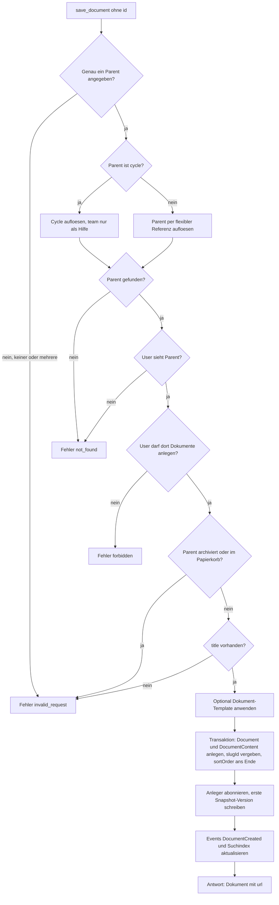
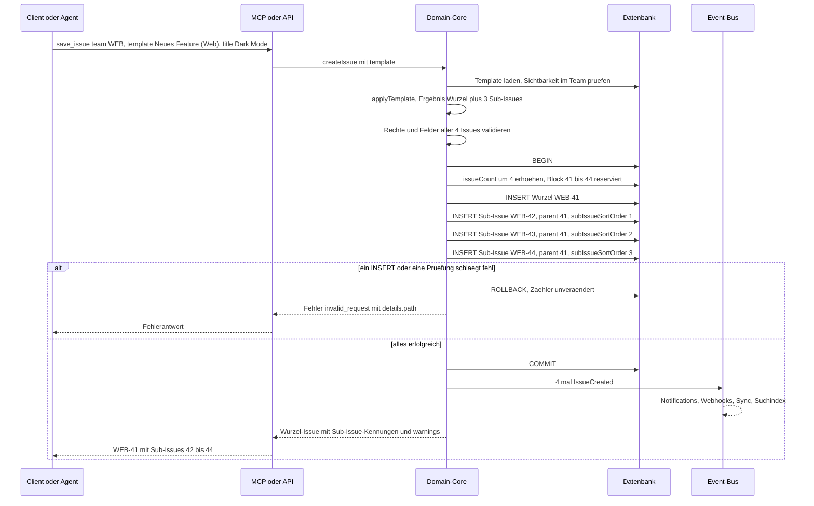

# 06 – Dokumente und Templates

Dieses Kapitel spezifiziert zwei eng verwandte Funktionsbereiche von Lineal: **Dokumente** (frei formulierte Markdown-Seiten, die an genau ein übergeordnetes Objekt gehängt werden) und **Templates** (Vorlagen, mit denen Issues, Projekte und Dokumente vorbelegt angelegt werden). Beide teilen sich die Rich-Text-Infrastruktur (Markdown als Austauschformat, Patch-Operationen, Versionshistorie), die hier einmal zentral beschrieben und von [03-issues-workflow.md](03-issues-workflow.md) und [04-planung.md](04-planung.md) für Issue-, Projekt- und Initiative-Beschreibungen mitbenutzt wird.

Alle Begriffe, ID-Formate, Enums, die Schreibsemantik (Upsert, Tri-State, Patch) und das Fehlermodell stammen aus [00-konventionen.md](00-konventionen.md) und werden hier nicht wiederholt. Die vollständigen Ein- und Ausgabeschemas der MCP-Tools stehen in [07-mcp-server.md](07-mcp-server.md); dieses Kapitel beschreibt die fachlichen Regeln, die diese Tools umsetzen.

Alle Beispieldaten sind erfunden (Workspace `acme`, Teams `ENG`, `WEB`, `DES`, Personen Alice, Bob, Carol).

---

## 1. Dokumente

### 1.1 Zweck und Einordnung

Ein Dokument (`Document`) ist eine eigenständige, kollaborativ bearbeitbare Markdown-Seite, beispielsweise eine Spezifikation, ein Testplan, ein Meeting-Protokoll oder eine Team-Richtlinie. Dokumente erscheinen in der **Ressourcenliste** ihres Elternobjekts (bei Projekten gemeinsam mit externen Links, sortiert nach `sortOrder`) und sind über eine eigene URL direkt erreichbar. Sie lassen sich in anderen Rich-Text-Feldern per Erwähnung verlinken, haben Abonnenten, Inline-Kommentare und eine Versionshistorie.

### 1.2 Felder

Neben den Audit-Feldern aus [00 §8](00-konventionen.md) (`id`, `createdAt`, `updatedAt`, `archivedAt`) hat ein Dokument folgende Felder:

| Feld | Typ | Pflicht | Beschreibung |
|---|---|---|---|
| `title` | String | ja (darf `""` sein) | Titel. Ein leerer String bedeutet „unbenannt“; die UI zeigt dann „Untitled“. Max. 255 Zeichen. |
| `content` | String (Markdown) | nein | Inhalt als Markdown. Abgeleitete Darstellung des kanonischen Inhalts in `DocumentContent` (siehe 1.3). Leer = `""`. |
| `icon` | String? | nein | Emoji (z. B. `📐`) oder Name eines dekorativen Icons aus dem Icon-Katalog. |
| `color` | String? | nein | Farbe des Icons, Hex `#RRGGBB`. |
| `slugId` | String | ja, systemvergeben | 12 Hex-Zeichen, workspaceweit eindeutig, unveränderlich. Basis der URL. |
| `sortOrder` | Float | ja | Position in der Ressourcenliste des Elternobjekts. Neue Dokumente werden ans Ende gesetzt (`max(sortOrder) + 1`); Einfügen zwischen zwei Einträgen nach der Regel aus [00 §3](00-konventionen.md). |
| `creator` | User? | systemvergeben | Anleger. `null` nur, wenn der User endgültig entfernt wurde. |
| `updatedBy` | User? | systemvergeben | User, der die letzte inhaltliche Änderung gespeichert hat. |
| `project` / `issue` / `initiative` / `cycle` / `team` | FK, nullable | genau eines | Elternobjekt (siehe 1.4). |
| `documentContentId` | UUID | systemvergeben | Verweis auf den kanonischen Inhalt (siehe 1.3). |
| `lastAppliedTemplate` | Template? | nein | Zuletzt angewandtes Dokument-Template (nur informativ, für Filter). |
| `trashed` | Boolean | ja, Default `false` | Liegt im Papierkorb (siehe 1.10). |
| `trashedAt` | DateTime? | nein | Zeitpunkt des Löschens; Basis der 30-Tage-Frist. |
| `subscribers` | [User] | – | Abonnenten. Der Anleger wird automatisch abonniert. |
| `url` | String | abgeleitet | Kanonische App-URL (siehe 1.6). Wird nicht gespeichert, sondern bei Ausgabe berechnet. |

Abgeleitete Ausgabefelder (nur lesend): `url`, `creator`/`updatedBy` als User-Kurzobjekt, das jeweils gesetzte Elternobjekt als Kurzobjekt (`{ "id", "name" | "identifier" }`).

### 1.3 Inhaltsspeicherung: `DocumentContent`

**Lineal-Festlegung:** Der eigentliche Rich-Text-Inhalt wird in einer eigenen Entität `DocumentContent` gehalten. Dieselbe Entität dient auch als Träger der Beschreibungen von Issue, Project, Initiative und ProjectMilestone. Dadurch funktionieren Patch-Operationen, Inline-Kommentare, Versionshistorie und gleichzeitiges Bearbeiten für alle Rich-Text-Felder identisch; Kapitel 03 und 04 verweisen für diese Mechanik hierher.

| Feld | Typ | Beschreibung |
|---|---|---|
| `id` | UUID | Primärschlüssel |
| `ownerType` | Enum `document`, `issue`, `project`, `initiative`, `projectMilestone` | Art des Besitzers |
| `ownerId` | UUID | Besitzer (genau einer, 1:1) |
| `markdown` | String | Aktueller Inhalt als Markdown (immer vorhanden, Austauschformat) |
| `contentState` | Binary/String? | Optional: interner Zustand des Kollaborationsverfahrens (z. B. CRDT-Zustand, base64-kodiert), siehe 1.9 |
| `version` | Int | Monoton steigende Revisionsnummer, wird bei jeder gespeicherten Änderung um 1 erhöht (Basis für optimistische Sperre) |
| `restoredAt` | DateTime? | Zeitpunkt der letzten Wiederherstellung aus der Historie |
| `updatedAt` | DateTime | Letzte inhaltliche Änderung |

Nach außen (API, MCP, Webhooks) wird immer nur Markdown geliefert ([00 §6](00-konventionen.md)). Ein internes strukturiertes Format (z. B. ein Baum aus Absätzen, Listen, Code-Blöcken) ist zulässig, muss aber verlustfrei nach Markdown serialisierbar sein.

### 1.4 Elternobjekt (genau eines)

> **Umsetzung:** Es gilt die empfohlene Variante mit fünf Fremdschlüsseln. Ein Cycle-Dokument trägt zusätzlich `teamId` (= Team des Cycles); Project-, Issue- und Initiative-Dokumente haben `teamId = null`. Die Check-Bedingung der Migration erzwingt genau ein Elternobjekt.


Ein Dokument hat **genau ein** Elternobjekt aus der Menge Project, Issue, Initiative, Cycle oder Team (siehe „Getroffene Entscheidungen“ in [README.md](README.md)). Ein Dokument ohne Elternobjekt existiert nicht.

**Persistenz:** fünf nullable Fremdschlüssel (`projectId`, `issueId`, `initiativeId`, `cycleId`, `teamId`) mit einer Check-Bedingung „genau einer ist nicht null“. Alternativ ist ein Paar `(parentType, parentId)` zulässig; dann muss die referentielle Integrität in der Anwendung sichergestellt werden. Die erste Variante wird empfohlen, weil die Datenbank Integrität und Kaskaden direkt erzwingen kann.

| Elternobjekt | Typische Verwendung | Anzeigeort | Team-Bezug für Rechte |
|---|---|---|---|
| Project | Spezifikation, Testplan, Projekt-Brief | Ressourcenliste des Projekts | alle Teams des Projekts |
| Issue | Ausführliche technische Notiz zu einem Issue | Abschnitt „Documents“ am Issue | Team des Issues |
| Initiative | Strategiepapier, Zielbild | Ressourcenliste der Initiative | Lead-Team der Initiative (falls gesetzt) |
| Cycle | Sprint-Planung, Retro-Protokoll | Cycle-Ansicht | Team des Cycles |
| Team | Team-Richtlinien, Onboarding, Arbeitsvereinbarungen | Team-Seite („Team Home“) | das Team selbst |

**Auflösung beim Anlegen.** Die Referenzen werden nach der flexiblen Referenzauflösung aus [00 §2](00-konventionen.md) aufgelöst. Weil Cycle-Namen und Cycle-Nummern nur innerhalb eines Teams eindeutig sind, darf beim Parent `cycle` zusätzlich `team` angegeben werden. In diesem Fall ist `team` **nur Auflösungshilfe** für den Cycle und kein zweites Elternobjekt; gespeichert wird ausschließlich `cycleId`. Wird `cycle` als UUID übergeben, ist `team` überflüssig, aber erlaubt, sofern es zum Cycle passt (sonst `invalid_request`).

**Validierungsregeln beim Anlegen:**

1. Es muss genau ein Elternparameter gesetzt sein (`team` als Auflösungshilfe zu `cycle` zählt nicht mit). Keiner oder mehrere → `invalid_request` mit `details.parameters`.
2. Das Elternobjekt muss auflösbar sein → sonst `not_found`.
3. Der aufrufende User muss das Elternobjekt sehen dürfen → sonst `not_found` (nicht `forbidden`, damit private Teams nicht verraten werden).
4. Der User muss im Elternobjekt Dokumente anlegen dürfen (siehe Abschnitt 3) → sonst `forbidden`.
5. Das Elternobjekt darf nicht im Papierkorb liegen und nicht archiviert sein → sonst `invalid_request` („parent is archived or trashed“).
6. `title` ist beim Anlegen Pflicht (leerer String ist erlaubt und bedeutet „unbenannt“).



### 1.5 Reparent (Verschieben)

Wird bei einem Update (`save_document` mit `id`) ein Elternparameter angegeben, wird das Dokument **verschoben** („Reparent“). Es gelten dieselben Regeln 1–5 wie beim Anlegen, zusätzlich:

- Es darf wieder nur genau ein Elternparameter angegeben werden; alle anderen Parent-FKs werden auf `null` gesetzt.
- Der User braucht Bearbeitungsrecht am **alten** Dokument und Anlegerecht im **neuen** Elternobjekt.
- `slugId` und damit die URL bleiben unverändert. Da die URL das Elternobjekt nicht enthält, brechen keine Links.
- `sortOrder` wird im neuen Elternobjekt ans Ende gesetzt, sofern nicht explizit angegeben.
- Inline-Kommentare, Historie und Abonnenten wandern mit.
- Verschiebt man ein Dokument aus einem öffentlichen in ein privates Team, verlieren Nicht-Mitglieder den Zugriff sofort. Ihre Benachrichtigungen zu diesem Dokument werden beim Lesen gefiltert (sie sehen sie nicht mehr), nicht gelöscht.
- Es wird ein Aktivitätseintrag und eine Benachrichtigung `documentMoved` an die Abonnenten erzeugt (siehe [05-views-suche-inbox.md](05-views-suche-inbox.md)).

### 1.6 URL-Schema

```
/<workspace-urlKey>/document/<titel-slug>-<slugId>
```

Beispiel: `https://lineal.example/acme/document/api-rate-limits-a1b2c3d4e5f6`

- `titel-slug` wird bei jeder Ausgabe aus dem aktuellen Titel berechnet: Kleinbuchstaben, Umlaute transliteriert (`ä` → `ae`), alle Nicht-Alphanumerika zu `-`, mehrfache `-` zusammengefasst, an den Rändern entfernt, auf 60 Zeichen gekürzt. Leerer Titel ergibt `untitled`.
- Maßgeblich für die Auflösung ist **nur** die `slugId` am Ende (die letzten 12 Hex-Zeichen nach dem letzten `-`). Ein veralteter Titel-Slug in einem alten Link führt per Redirect auf die aktuelle URL.
- `get_document` akzeptiert die UUID, die `slugId` oder die komplette URL.

### 1.7 Sichtbarkeit (erbt vom Elternobjekt)

Dokumente haben **keine eigenen Zugriffsrechte**. Wer das Elternobjekt sehen darf, sieht das Dokument; wer es nicht sehen darf, bekommt `not_found`. Die Sichtbarkeit wird bei jedem Zugriff zur Laufzeit abgeleitet (nicht denormalisiert gespeichert), damit Teamwechsel, Reparent und Mitgliedschaftsänderungen sofort wirken. Die Regeln für Team-Sichtbarkeit stehen in [02-teams-rechte.md](02-teams-rechte.md).

| Elternobjekt | Dokument ist sichtbar, wenn der User … |
|---|---|
| Team | das Team sehen darf (öffentlich: alle Members/Admins; `private`: nur Mitglieder; `restricted`: Mitglieder des Parent-Teams und des Teams; Gäste nur bei Mitgliedschaft). |
| Issue | das Issue sehen darf (also dessen Team sehen darf **oder** das Issue explizit mit ihm geteilt wurde, siehe [03-issues-workflow.md](03-issues-workflow.md)). |
| Cycle | das Team des Cycles sehen darf. |
| Project | mindestens **eines** der Teams des Projekts sehen darf. |
| Initiative | die Initiative sehen darf (alle außer Gästen; bei privatem Lead-Team nur mit Zugriff auf dieses Team). |

**Beispiel.** Bob ist nur Mitglied von `DES`. Ein Dokument „Rollout-Checkliste“ hängt am Issue `ENG-42` im öffentlichen Team `ENG` → Bob sieht es. Wird `ENG-42` in ein privates Team verschoben, in dem Bob nicht Mitglied ist, liefert `get_document` für Bob ab sofort `not_found`, und das Dokument verschwindet aus seinen Suchergebnissen.

**Listen und Suche** filtern immer auf sichtbare Elternobjekte. Der Suchindex speichert dazu pro Dokument die Menge der relevanten Team-IDs (bei Projekten alle Projekt-Teams), die bei Reparent, Teamwechsel des Issues oder Änderung der Projekt-Teams neu berechnet wird.

### 1.8 Inline-Kommentare

Neben normalen Kommentar-Threads unterstützt ein Dokument **Inline-Kommentare**, die an eine markierte Textstelle gebunden sind. Kommentare allgemein (Felder, Threads, Reaktionen, Auflösen) sind in [03-issues-workflow.md](03-issues-workflow.md) beschrieben; hier nur die dokumentspezifischen Regeln.

| Feld am Comment | Bedeutung |
|---|---|
| `documentContentId` | Elternobjekt des Kommentars (der Inhalt, nicht das Document selbst). Gilt gleichermaßen für Inline-Kommentare in Issue- oder Projektbeschreibungen. |
| `quotedText` | Der beim Anlegen markierte Text (Klartext, ohne Markdown-Syntax). Gesetzt = Inline-Kommentar, `null` = normaler Kommentar. |
| `anchorStart`, `anchorEnd` | Optional (Lineal-Erweiterung): Positionen im internen Format. Bei CRDT-Speicherung als relative Positionen (Element-IDs), die Einfügungen und Löschungen überstehen. |
| `anchorState` | Enum `attached`, `detached` (abgeleitet, Lineal-Festlegung) |
| `resolvedAt`, `resolvingUser` | Thread aufgelöst. Aufgelöste Threads werden standardmäßig ausgeblendet und lassen sich einblenden. |

**Anker-Regeln (Lineal-Festlegung):**

1. **Anlegen:** `quotedText` muss im aktuellen Klartext des Inhalts vorkommen. Kommt er mehrfach vor und werden keine Positionsangaben mitgeliefert (typisch bei API/MCP), wird das **erste** Vorkommen verankert. Das weicht bewusst von der Patch-Regel „genau einmal“ ([00 §6](00-konventionen.md)) ab: Ein falsch platzierter Kommentar-Anker ist harmlos, eine falsch angewandte Textänderung nicht. Kommt er nicht vor → `invalid_request`.
2. **Text wird bearbeitet:** Mit Positionsankern (empfohlen, siehe 1.9) wandert der Anker mit. Wird innerhalb des markierten Bereichs Text verändert, bleibt der Anker am verbleibenden Bereich; `quotedText` wird **nicht** nachgeführt, er dokumentiert, worauf sich der Kommentar ursprünglich bezog.
3. **Ankertext wird vollständig gelöscht:** Der Kommentar wird **nicht** gelöscht. `anchorState` wird `detached`; der Thread bleibt in der Kommentarliste (mit `quotedText` als durchgestrichenes Zitat dargestellt) und kann weiter beantwortet und aufgelöst werden. Ohne Positionsanker gilt: Ein Anker ist `detached`, sobald `quotedText` im aktuellen Klartext nicht mehr vorkommt.
4. **Wiederherstellung einer alten Version** (1.9): Kommt der Text wieder vor, wird der Anker neu gesetzt und `anchorState` wieder `attached`.
5. Der **Wurzelkommentar** eines Inline-Threads kann nicht gelöscht werden (nur bearbeitet oder der Thread aufgelöst), damit Antworten nicht verwaisen. Antworten sind löschbar.
6. `list_comments` mit `documentId` liefert normale und Inline-Kommentare; Inline-Kommentare erkennt man an `quotedText != null`.

### 1.9 Versionierung, Historie und gleichzeitiges Bearbeiten

#### Snapshot-Versionen (Festlegung)

Die Historie wird als Folge von **vollständigen Snapshots** gespeichert, nicht als Diff-Kette. Das hält Wiederherstellung trivial und macht die Historie unabhängig vom gewählten Kollaborationsverfahren.

`DocumentContentHistory`:

| Feld | Typ | Beschreibung |
|---|---|---|
| `id` | UUID | |
| `documentContentId` | UUID | Zugehöriger Inhalt |
| `markdown` | String | Vollständiger Inhalt zum Snapshot-Zeitpunkt |
| `title` | String? | Titel zum Snapshot-Zeitpunkt (nur bei Dokumenten) |
| `actorIds` | [UUID] | Alle User, deren Änderungen in diesen Snapshot eingeflossen sind |
| `contentSnapshotAt` | DateTime | Zeitpunkt des erfassten Zustands |
| `createdAt` | DateTime | Anlage des Historieneintrags |
| `kind` | Enum `created`, `edited`, `restored` | Art des Eintrags |
| `restoredFromId` | UUID? | Bei `restored`: Quelle |

**Regeln:**

- Beim Anlegen entsteht ein Snapshot `created`.
- Bei Bearbeitung wird **gebündelt**: Ein neuer Snapshot entsteht erst, wenn seit der letzten Änderung 10 Minuten Ruhe herrschte, wenn seit dem letzten Snapshot 60 Minuten vergangen sind, oder bei einem expliziten Speichern über API/MCP (jeder `save_document`/`save_issue`-Aufruf, der den Inhalt ändert, erzeugt einen Snapshot). Alle in diesem Fenster aktiven User landen in `actorIds`. Die Fenster sind Workspace-Konfiguration.

> **Umsetzung (WP34):** Gebündelt wird nur beim automatischen Speichern des Editors (`documentUpdate(input: {autosave: true})`, `App::save_document_autosave`): in den letzten `edited`-Snapshot, wenn die vorige Änderung weniger als 10 Minuten und der Snapshot weniger als 60 Minuten zurückliegt (Akteure werden vereinigt, der Beginn des Fensters bleibt). Jedes ausdrückliche Speichern (`save_document`, MCP, `documentUpdate` ohne Flag) erzeugt einen Snapshot. Die Fenster sind Konstanten (`SNAPSHOT_QUIET_MINUTES`, `SNAPSHOT_MAX_MINUTES`), keine Workspace-Konfiguration. Stufe 2 (CRDT, Echtzeit) ist seit WP36 gebaut (siehe unten); Stufe 1 bleibt Fallback und Schreibweg für API/MCP.
- **Wiederherstellen** überschreibt keine Historie: Der Inhalt des gewählten Snapshots wird als neue aktuelle Version gespeichert, es entsteht ein Snapshot `restored`, `DocumentContent.restoredAt` wird gesetzt, und an Abonnenten geht eine Benachrichtigung über eine wesentliche Änderung.
- Aufbewahrung: unbegrenzt, solange das Dokument existiert (optional ausdünnen: ältere als 90 Tage auf einen Snapshot pro Tag reduzieren; Lineal-Erweiterung).
- Die Historie ist für alle lesbar, die den Inhalt lesen dürfen; Wiederherstellen erfordert Bearbeitungsrecht.

#### Gleichzeitiges Bearbeiten

Linear bietet kollaboratives Echtzeit-Editing mit sichtbaren Cursorn und Autosave. Für Lineal gibt es zwei zulässige Stufen:

**Stufe 1 (MVP): Last-Write-Wins mit optimistischer Sperre und Patch-Operationen.**

- Jeder Client liest `DocumentContent.version` mit.
- Ein Schreibvorgang über die öffentliche API ([09-api-events.md](09-api-events.md)) mit vollständigem `content` darf optional `expectedVersion` mitsenden. Weicht die gespeicherte Version ab → `conflict` mit `details.currentVersion`; der Client lädt neu und führt die Änderung erneut zusammen. Ohne `expectedVersion` gilt Last-Write-Wins. Über MCP gibt es diesen Parameter nicht (Eingabeschemas identisch zum Original, siehe [README.md](README.md)); dort gilt Last-Write-Wins für `content` bzw. die Anker-Prüfung der Patch-Operationen.
- **Patch-Operationen** (`replace`, `insert_before`, `insert_after`, `prepend`, `append`, `replace_range`) sind die bevorzugte Schreibart für Agenten und Skripte, weil sie nur lokale Änderungen ausdrücken und deshalb gleichzeitige Änderungen an anderen Stellen nicht überschreiben. Die Operationen werden serverseitig in einer Transaktion auf den **aktuellen** Inhalt angewendet; jeder Anker muss genau einmal vorkommen, sonst schlägt der gesamte Patch mit `conflict` fehl (atomar, keine Teilanwendung). Semantik und Schema: [00 §6](00-konventionen.md) und [07-mcp-server.md](07-mcp-server.md). Patch ist nur bei Updates zulässig und schließt `content` im selben Aufruf aus (`invalid_request`).
- Die Web-App speichert in dieser Stufe nach einer Eingabepause (z. B. 1 s) und zeigt bei `conflict` einen Zusammenführungsdialog.

**Stufe 2 (empfohlen für Produktivbetrieb): Echtzeit-Kollaboration mit CRDT.**

Sprachneutral beschrieben (Yjs-artiges Verfahren, eine Implementierung von Sequenz-CRDTs ist in allen gängigen Sprachen verfügbar oder nachbaubar):

- Der Inhalt ist eine geordnete Folge von Elementen (Zeichen bzw. Knoten des Dokumentbaums). Jedes Element erhält beim Einfügen eine global eindeutige ID `(clientId, laufendeNummer)` und merkt sich die IDs seines linken (und ggf. rechten) Nachbarn zum Einfügezeitpunkt.
- Löschen markiert Elemente nur als gelöscht („Tombstone“), damit spätere Operationen anderer Clients weiterhin eindeutig positioniert werden können.
- Gleichzeitige Einfügungen an derselben Stelle werden deterministisch nach `clientId` geordnet. Daher konvergieren alle Replikate unabhängig von der Empfangsreihenfolge zum selben Ergebnis.
- Der Server hält pro geöffnetem Inhalt einen Raum (Room) über den Sync-Kanal aus [09-api-events.md](09-api-events.md). Clients senden inkrementelle Updates; der Server wendet sie auf seinen Zustand an, verteilt sie an alle Teilnehmer und persistiert den Zustand (`contentState`) sowie das daraus abgeleitete `markdown` in Intervallen (z. B. alle 2 s) und beim Verlassen des letzten Teilnehmers.
- Sichtbare Cursor/Markierungen anderer Teilnehmer („Awareness“) sind flüchtig und werden nicht persistiert.
- API- und MCP-Schreibvorgänge (vollständiger `content` oder Patch) werden serverseitig in CRDT-Operationen übersetzt: ein vollständiger `content` als minimaler Diff gegen den aktuellen Text, ein Patch als gezielte Einfüge-/Löschoperationen. So werden laufende Editor-Sitzungen nicht verworfen.
- Inline-Kommentar-Anker (1.8) werden als relative Positionen auf Element-IDs gespeichert und überstehen dadurch beliebige Bearbeitungen.

> **Umsetzung (WP36):** Stufe 2 ist mit Yjs-kompatiblem CRDT (`yrs`/`yjs`) umgesetzt: Raum je geöffnetem Inhalt im Serverprozess über `GET /collab/{document|issue|project|initiative}/{id}` (eigener WebSocket, nicht der `/sync`-Strom), Dokument = `Y.XmlFragment` im TipTap-Schema, Persistenz von `contentState` (Base64, mit Epoche) und abgeleitetem Markdown nach 2 s Ruhe bzw. spätestens 10 s über denselben Weg wie das automatische Speichern (Bereinigung, Version, Snapshot-Bündelung, Ereignisse); Awareness (Name/Farbe vom Server) flüchtig; API/MCP-Schreibvorgänge führen den Zustand per minimaler Blockänderung nach und landen über CRDT-Merge im offenen Raum; Inline-Kommentar-Anker (`anchorStart`/`anchorEnd`) als Base64 relativer Positionen, `anchorState` abgeleitet, Altbestand über `quotedText`. Beschreibungen von Issues (Web-Editor), Projekten und Initiativen (nur Server-Endpunkt) laufen über denselben Raummechanismus; ihr Markdown bleibt am Besitzerobjekt. Einzelinstanz-Annahme, Grenzen und Schließcodes: docs/15 §3.5.

Ein Verfahren nach dem Prinzip „Operational Transformation“ ist gleichwertig zulässig, erfordert aber einen zentralen Sequenzer pro Inhalt. Die Snapshot-Historie bleibt in beiden Stufen gleich.

### 1.10 Löschen, Papierkorb, Archiv

| Aktion | Wirkung |
|---|---|
| Löschen | `trashed = true`, `trashedAt = jetzt`. Das Dokument verschwindet aus Listen, Ressourcenliste und Suche, ist aber 30 Tage unter „Recently deleted“ wiederherstellbar. Abonnenten erhalten `documentDeleted`. |
| Wiederherstellen | `trashed = false`, `trashedAt = null`. Zulässig nur, wenn das Elternobjekt existiert und nicht selbst im Papierkorb liegt; sonst `invalid_request` („restore parent first“). Benachrichtigung `documentRestored`. |
| Endgültig löschen | Hintergrundjob nach 30 Tagen ([10-architektur-umsetzung.md](10-architektur-umsetzung.md)): löscht Document, DocumentContent, Historie, Kommentare und Abos. |
| Archivieren | Kein manueller Vorgang. Ein Dokument gilt als archiviert, wenn sein Elternobjekt archiviert ist (z. B. abgeschlossenes Projekt, archiviertes Issue); es ist dann schreibgeschützt. `list_documents` zeigt es nur mit `includeArchived=true`. |

**Kaskade (Lineal-Festlegung):** Wird das Elternobjekt in den Papierkorb gelegt, wandern dessen Dokumente mit (`trashed = true`, gleicher `trashedAt`, Markierung `trashedWithParent = true`). Wird das Elternobjekt wiederhergestellt, werden genau die mitgelöschten Dokumente ebenfalls wiederhergestellt; vorher einzeln gelöschte Dokumente bleiben gelöscht. Wird ein Team gelöscht, gilt dasselbe für Team- und Cycle-Dokumente.

> **Umsetzung (WP34):** Verdrahtet in `delete_issue`/`restore_issue`, `set_project_trashed` und `delete_team`/`restore_deleted_team` (inkl. Cycle-Dokumente). Der Job `purge` löscht Dokumente und Projekte nach `trashRetentionDays` endgültig; Kommentare, Abos und Notifications fallen per Fremdschlüssel mit, `document_content` und Snapshots (kein Fremdschlüssel) räumt der Job als „verwaiste Inhalte“ ab – auch nach Issue-, Projekt- und Team-Purge.

### 1.11 Suche

- Dokumente werden mit `title` (höher gewichtet) und dem Markdown-Klartext von `content` indiziert. Details des Suchindex und der Rangfolge: [05-views-suche-inbox.md](05-views-suche-inbox.md).
- `list_documents` unterstützt `query` (Volltext über Titel und Inhalt) sowie die Filter `creatorId`, `projectId`, `initiativeId`, `teamId`. Die öffentliche API bietet zusätzlich `issueId` und `cycleId`; das MCP-Tool bleibt beim Original-Eingabeschema. Der Filter `teamId` liefert Dokumente, deren Elternobjekt das Team selbst, ein Cycle des Teams oder ein Issue des Teams ist; Projektdokumente nur, wenn das Team zu den Projekt-Teams gehört.
- In Listen wird `content` nach ca. 500 Zeichen gekürzt und mit einem Hinweis versehen, `get_document` für den vollständigen Text zu verwenden ([07-mcp-server.md](07-mcp-server.md)).
- Trashed-Dokumente erscheinen nie in Suche oder Listen (nur in der Papierkorb-Ansicht).
- Erwähnungen: In Rich-Text-Feldern kann auf ein Dokument per URL verwiesen werden; die Ausgabe ersetzt sie durch einen Link mit dem aktuellen Titel. Überschriften im Dokument erhalten stabile Anker (`#<heading-slug>`), auf die verlinkt werden kann.

> **Umsetzung (WP34):** `@Name`-Erwähnungen (Anzeigename, wie in Issues) abonnieren das Dokument und erzeugen `documentMention` für aktive User, die das Elternobjekt sehen (Gäste keine Initiative-Dokumente, der Autor nicht). Issue-Kennungen (`ENG-123`) außerhalb von Code und Links werden **bei der Ausgabe** zu `[ENG-123](/<urlKey>/issue/ENG-123)` verlinkt, wenn das Issue für den Akteur sichtbar ist; gespeichert wird der Klartext (Patch-Anker bleiben eindeutig); Listen (`list_documents`) verlinken nicht. Folge: wer den verlinkten Ausgabetext als Patch-Anker nutzt, erhält `conflict`.

### 1.12 Abonnements und Benachrichtigungen

Der Anleger ist automatisch Abonnent; erwähnte User werden abonniert. Abonnenten erhalten Benachrichtigungen bei neuen Kommentaren und Antworten, Erwähnungen, wesentlichen Inhaltsänderungen (`documentContentChange`, höchstens eine pro Snapshot-Fenster, siehe 1.9), Verschieben, Löschen, Wiederherstellen, aufgelösten Threads sowie wenn andere das Dokument (de)abonnieren. Die Typen und das Fan-out sind in [05-views-suche-inbox.md](05-views-suche-inbox.md) beschrieben.

---

## 2. Templates

### 2.1 Überblick

Ein Template (`Template`) belegt die Felder eines neuen Objekts vor. Lineal kennt drei Typen (`Template.type`, siehe [00 §4](00-konventionen.md)):

| `type` | Erzeugt | Wo auswählbar |
|---|---|---|
| `issue` | Issue, optional mit Sub-Issues | Issue-Erstellung, Sub-Issue-Erstellung (eingeschränkt, siehe 2.6), Default-Template des Teams |
| `project` | Projekt, optional mit Meilensteinen, Issues und Dokumenten | Projekt-Erstellung, Default-Projekt-Template des Teams |
| `document` | Dokument | Dokument-Erstellung in Projekt, Issue, Initiative, Cycle oder Team |

Der im Original-Schema zusätzlich vorhandene Typ `releaseNote` (mit `pipeline`) gehört zu Releases und ist außerhalb des Scopes.

### 2.2 Felder

| Feld | Typ | Pflicht | Beschreibung |
|---|---|---|---|
| `name` | String | ja | Anzeigename, eindeutig pro Geltungsbereich und `type` (case-insensitiv). |
| `description` | String? | nein | Verwendungszweck (Hilfetext in der Auswahl). |
| `type` | Enum `issue`, `project`, `document` | ja | Zieltyp; nach Anlage unveränderlich. |
| `team` | Team? | nein | `null` = Workspace-Template, sonst Team-Template. Nach Anlage unveränderlich. |
| `templateData` | JSON | ja | Vorbelegte Werte, Struktur je `type` (siehe 2.4). |
| `icon`, `color` | String? | nein | Darstellung in der Auswahl. |
| `sortOrder` | Float | ja | Reihenfolge in der Auswahl. |
| `inheritedFrom` | Template? | systemvergeben | Gesetzt bei geerbten Kopien in Sub-Teams (siehe 2.3). |
| `creator`, `lastUpdatedBy` | User? | systemvergeben | |
| `lastAppliedAt` | DateTime? | systemvergeben | Zuletzt angewendet. |
| `isForm` | Boolean | nein, Default `false` | Form-Template (optionale Erweiterung, siehe 2.8). Nur bei `type = issue`. |

Objekte, die aus einem Template entstanden sind, merken sich dieses in `lastAppliedTemplate` (Issue, Project, Document). Das Feld ist filterbar („erstellt aus Template X“). Spätere Änderungen am Template wirken **nicht** auf bereits erzeugte Objekte zurück.

### 2.3 Geltungsbereich: Workspace vs. Team, Vererbung an Sub-Teams

| Eigenschaft | Workspace-Template (`team = null`) | Team-Template |
|---|---|---|
| Verfügbar in | allen Teams | dem Team und allen seinen Sub-Teams (rekursiv) |
| Darf team-spezifische Werte enthalten (Team-Labels, konkrete Workflow-Status, Cycle, Team-Mitglieder als Assignee-Pflicht) | **nein** | ja |
| Darf Workspace-Labels enthalten | ja | ja |
| Status-Vorbelegung | nur als **Statuskategorie** (`stateType`, z. B. `started`) | als konkreter Status (`stateId`) oder Kategorie |
| Verwaltet von | Admins/Owner des Workspace (siehe Abschnitt 3) | gemäß Team-Einstellung (siehe Abschnitt 3) |

**Lineal-Festlegung zur Status-Vorbelegung:** Workspace-Templates speichern statt einer Status-ID eine Statuskategorie. Bei der Anwendung wird sie nach Regel 7 der Referenzauflösung ([00 §2](00-konventionen.md)) auf den ersten Status dieser Kategorie im Zielteam (nach `position`) aufgelöst. So kann auch ein Workspace-Template einen Status sinnvoll vorbelegen, ohne team-spezifisch zu sein.

**Validierung beim Speichern:** Enthält ein Workspace-Template einen team-gebundenen Wert (Team-Label, `stateId`, `cycle`, team-gebundenes Projekt-Label) → `invalid_request` mit `details.field`.

**Vererbung an Sub-Teams:** Team-Templates des Parent-Teams sind in Sub-Teams **ohne Kopie** sichtbar und anwendbar; die Auswahl zeigt sie mit Herkunftsteam an. Team-spezifische Werte werden bei der Anwendung im Sub-Team aufgelöst:

- Geerbte Labels (Labels des Parent-Teams sind in Sub-Teams verfügbar, siehe [02-teams-rechte.md](02-teams-rechte.md)) bleiben unverändert gültig.
- Eine `stateId` des Parent-Teams wird, falls das Sub-Team die Workflow-Status erbt, direkt verwendet; andernfalls wird auf die **Kategorie** dieses Status zurückgefallen.
- Ein Cycle des Parent-Teams wird im Sub-Team ignoriert (Cycles sind teamgebunden).

`inheritedFrom` wird nur gesetzt, wenn ein Sub-Team ein geerbtes Template **anpasst**: Dann entsteht eine Kopie im Sub-Team mit `inheritedFrom = Original`, die das Original in der Auswahl dieses Sub-Teams (und seiner eigenen Sub-Teams) verdeckt.

**Auflösungsreihenfolge** in `list_templates(team=X)`: eigene Templates von X, dann geerbte der Vorfahren (nächstgelegener zuerst, ohne durch Kopien verdeckte), dann Workspace-Templates. Namensgleiche Templates aus verschiedenen Ebenen sind erlaubt; `get_template` per Name liefert bei Mehrdeutigkeit `ambiguous_reference` mit Kandidatenliste.

### 2.4 Struktur von `templateData` (JSON Schema)

> **Umsetzung:** Übersprungene Referenzen meldet die Anwendung als Liste der betroffenen Feldnamen in `warnings` der Antwort (kein Fehler); das Anlegen läuft weiter.


Das Original speichert `templateData` als nicht weiter spezifiziertes JSON. Lineal legt die Struktur verbindlich fest. Gemeinsame Regeln:

- Alle Felder sind optional; ein fehlendes Feld bedeutet „nicht vorbelegt“.
- Referenzen werden **als UUID gespeichert** (beim Speichern über die flexible Referenzauflösung aufgelöst), damit Umbenennungen das Template nicht brechen. Bei der Ausgabe über `get_template` werden zusätzlich Name/Kennung mitgeliefert.
- Verweist ein gespeichertes Template auf ein inzwischen gelöschtes oder archiviertes Objekt (z. B. Label retired, User deaktiviert), wird dieser Wert bei der Anwendung **still übersprungen** und in der Antwort unter `warnings` gemeldet; das Anlegen schlägt nicht fehl.
- `priority` wird als Integer 0–4 gespeichert und in Ausgaben als `{ "value", "name" }` geliefert.
- Zeitangaben für Fälligkeiten werden **relativ** als ISO-8601-Dauer gespeichert (z. B. `P5D`) und bei der Anwendung relativ zum Erstellungsdatum in der Team-Zeitzone zu einem `Date` aufgelöst (Lineal-Festlegung; ein absolutes Datum ist in einer Vorlage selten sinnvoll, wird aber ebenfalls akzeptiert).

#### Issue-Template (`type = issue`)

```json
{
  "$schema": "https://json-schema.org/draft/2020-12/schema",
  "$id": "lineal/templateData/issue",
  "type": "object",
  "additionalProperties": false,
  "properties": {
    "title":       { "type": "string", "maxLength": 255 },
    "description": { "type": "string", "description": "Markdown, darf Platzhalter enthalten (2.7)" },
    "stateId":     { "type": "string", "format": "uuid", "description": "Nur Team-Templates" },
    "stateType":   { "enum": ["triage", "backlog", "unstarted", "started", "completed", "canceled"] },
    "priority":    { "type": "integer", "minimum": 0, "maximum": 4 },
    "estimate":    { "type": ["number", "null"] },
    "labelIds":    { "type": "array", "items": { "type": "string", "format": "uuid" }, "uniqueItems": true },
    "assigneeId":  { "type": "string", "description": "UUID oder das Literal \"creator\" (= anlegender User)" },
    "projectId":   { "type": "string", "format": "uuid" },
    "projectMilestoneId": { "type": "string", "format": "uuid" },
    "cycle":       { "enum": ["current", "next"], "description": "Relativ, nur Team-Templates; konkrete Cycle-IDs sind nicht erlaubt" },
    "dueIn":       { "type": "string", "pattern": "^P(\\d+W|\\d+D|\\d+W\\d+D)$", "description": "Relative Fälligkeit ab Erstellung" },
    "dueDate":     { "type": "string", "format": "date", "description": "Absolute Fälligkeit; schließt dueIn aus" },
    "subscriberIds": { "type": "array", "items": { "type": "string", "format": "uuid" } },
    "subIssues": {
      "type": "array",
      "maxItems": 50,
      "items": { "$ref": "#/$defs/subIssue" }
    }
  },
  "not": { "required": ["dueIn", "dueDate"] },
  "$defs": {
    "subIssue": {
      "type": "object",
      "additionalProperties": false,
      "required": ["title"],
      "properties": {
        "title":       { "type": "string", "maxLength": 255 },
        "description": { "type": "string" },
        "stateId":     { "type": "string", "format": "uuid" },
        "stateType":   { "enum": ["triage", "backlog", "unstarted", "started", "completed", "canceled"] },
        "priority":    { "type": "integer", "minimum": 0, "maximum": 4 },
        "estimate":    { "type": ["number", "null"] },
        "labelIds":    { "type": "array", "items": { "type": "string", "format": "uuid" }, "uniqueItems": true },
        "assigneeId":  { "type": "string" },
        "dueIn":       { "type": "string" },
        "templateId":  { "type": "string", "format": "uuid", "description": "Optional: weiteres Issue-Template ohne eigene Sub-Issues" },
        "subIssues":   { "type": "array", "maxItems": 50, "items": { "$ref": "#/$defs/subIssue" } }
      }
    }
  }
}
```

**Lineal-Festlegung zur Tiefe:** Sub-Issues in Templates dürfen rekursiv verschachtelt sein, die **Gesamttiefe ist auf 3 Ebenen** unter dem Wurzel-Issue begrenzt und die **Gesamtzahl** aller Sub-Issues eines Templates auf 50. Überschreitung → `invalid_request` beim Speichern des Templates. Verweist ein Sub-Issue per `templateId` auf ein weiteres Template, muss dieses selbst **keine** Sub-Issues enthalten (siehe 2.6). Sub-Issues haben kein eigenes `projectId`/`cycle`: sie übernehmen Projekt und Cycle vom Wurzel-Issue (Verhalten wie beim manuellen Anlegen von Sub-Issues, siehe [03-issues-workflow.md](03-issues-workflow.md)).

#### Projekt-Template (`type = project`)

```json
{
  "$schema": "https://json-schema.org/draft/2020-12/schema",
  "$id": "lineal/templateData/project",
  "type": "object",
  "additionalProperties": false,
  "properties": {
    "name":        { "type": "string", "maxLength": 255 },
    "summary":     { "type": "string", "maxLength": 255 },
    "description": { "type": "string", "description": "Markdown" },
    "statusId":    { "type": "string", "format": "uuid", "description": "Konkreter Projektstatus" },
    "statusType":  { "enum": ["backlog", "planned", "started", "paused", "completed", "canceled"] },
    "priority":    { "type": "integer", "minimum": 0, "maximum": 4 },
    "leadId":      { "type": "string", "description": "UUID oder \"creator\"" },
    "memberIds":   { "type": "array", "items": { "type": "string" }, "uniqueItems": true },
    "teamIds":     { "type": "array", "items": { "type": "string", "format": "uuid" }, "uniqueItems": true },
    "labelIds":    { "type": "array", "items": { "type": "string", "format": "uuid" }, "uniqueItems": true },
    "initiativeIds": { "type": "array", "items": { "type": "string", "format": "uuid" } },
    "icon":        { "type": "string" },
    "color":       { "type": "string", "pattern": "^#[0-9A-Fa-f]{6}$" },
    "startIn":     { "type": "string", "description": "Relativer Start, ISO-8601-Dauer" },
    "targetIn":    { "type": "string", "description": "Relatives Zieldatum ab Start bzw. Erstellung" },
    "targetDateResolution": { "enum": ["month", "quarter", "halfYear", "year"] },
    "milestones": {
      "type": "array", "maxItems": 50,
      "items": {
        "type": "object", "required": ["name"], "additionalProperties": false,
        "properties": {
          "name":        { "type": "string" },
          "description": { "type": "string" },
          "targetIn":    { "type": "string", "description": "ISO-8601-Dauer relativ zum Projektstart" }
        }
      }
    },
    "issues": {
      "type": "array", "maxItems": 100,
      "items": {
        "type": "object", "additionalProperties": false,
        "properties": {
          "teamId":     { "type": "string", "format": "uuid", "description": "Default: Lead-Team bzw. erstes Team" },
          "milestone":  { "type": "string", "description": "Name eines Meilensteins aus milestones" },
          "templateId": { "type": "string", "format": "uuid", "description": "Issue-Template, inkl. dessen Sub-Issues" },
          "issue":      { "$ref": "lineal/templateData/issue" }
        }
      }
    },
    "documents": {
      "type": "array", "maxItems": 20,
      "items": {
        "type": "object", "additionalProperties": false,
        "properties": {
          "templateId": { "type": "string", "format": "uuid", "description": "Dokument-Template" },
          "document":   { "$ref": "lineal/templateData/document" }
        }
      }
    }
  }
}
```

Hinweise: `teamIds` ist in Workspace-Projekt-Templates erlaubt (Teams sind workspaceweit referenzierbar). Ein Team-Projekt-Template enthält sein eigenes Team implizit; `teamIds` ergänzt weitere Teams. Der Projektstatus wird wie in [04-planung.md](04-planung.md) beschrieben aufgelöst (beim MCP gegen die Projektstatus des Lead-Teams); `statusType` wird analog zur Statuskategorie bei Issues auf den ersten Status dieser Kategorie aufgelöst. Meilensteine werden über ihren Namen (`milestone` am Wrapper-Objekt) von den Issues referenziert, weil ihre IDs erst bei der Anwendung entstehen. Innerhalb von `issues[].issue` werden `projectId`, `projectMilestoneId` und `cycle` ignoriert: Projekt ist das gerade angelegte, der Meilenstein kommt aus `milestone`, ein Cycle wird nicht gesetzt.

#### Dokument-Template (`type = document`)

```json
{
  "$schema": "https://json-schema.org/draft/2020-12/schema",
  "$id": "lineal/templateData/document",
  "type": "object",
  "additionalProperties": false,
  "properties": {
    "title":   { "type": "string", "maxLength": 255 },
    "content": { "type": "string", "description": "Markdown, darf Platzhalter enthalten" },
    "icon":    { "type": "string" },
    "color":   { "type": "string", "pattern": "^#[0-9A-Fa-f]{6}$" }
  }
}
```

#### Beispiel: Issue-Template „Neues Feature (Web)“ im Team `WEB`

```json
{
  "name": "Neues Feature (Web)",
  "type": "issue",
  "team": "WEB",
  "templateData": {
    "title": "Feature: ",
    "description": "## Ziel\n{{placeholder: Was soll der Nutzer danach können?}}\n\n## Akzeptanzkriterien\n- [ ] {{placeholder: Kriterium}}",
    "stateType": "backlog",
    "priority": 3,
    "labelIds": ["7c0d1e2f-0000-4000-8000-00000000f001"],
    "subIssues": [
      { "title": "Design abstimmen", "labelIds": ["7c0d1e2f-0000-4000-8000-00000000d001"] },
      { "title": "Implementierung", "estimate": 3 },
      { "title": "Tests und Review", "dueIn": "P10D" }
    ]
  }
}
```

### 2.5 Anwendung: Merge-Regeln

Ein Template wird **nur beim Anlegen** angewendet (`template`-Parameter von `save_issue`/`save_project` ohne `id`; bei Dokumenten analog). Bei Updates ist `template` unzulässig → `invalid_request`. Die Merge-Regeln:

| Feld | Regel |
|---|---|
| `title` / `name` | Input gewinnt. Fehlt der Input-Titel, wird der Template-Titel verwendet. Ohne Template ist `title` beim Anlegen Pflicht; mit Template nur, wenn auch das Template keinen Titel hat (sonst `invalid_request`). |
| `description` / `content` | Nicht leerer Input **ersetzt** den Template-Text vollständig. Leerer oder fehlender Input **behält** den Template-Text. |
| Labels | **Vereinigung** aus Template- und Input-Labels, dedupliziert. Bei Label-Gruppen mit `singleSelect` gewinnt pro Gruppe das Input-Label. Mit `labels: []` (explizit leer) bleiben die Template-Labels erhalten; um Template-Labels zu verhindern, muss ohne Template angelegt werden (oder nach dem Anlegen `removeLabels`). |
| Skalare Felder (`state`, `priority`, `estimate`, `assignee`, `project`, `milestone`, `cycle`, `dueDate`, `lead`, `status`) | Explizit im Input gesetzte Werte überschreiben das Template; explizites `null` im Input heißt „nicht setzen“ und überschreibt den Template-Wert ebenfalls. Fehlt das Feld im Input, gilt der Template-Wert. |
| Mengenfelder bei Projekten (`teams`, `members`, `initiatives`) | Vereinigung aus Template und Input. |
| Sub-Issues, Meilensteine, Projekt-Issues, Projekt-Dokumente | Werden immer aus dem Template angelegt; Input kann sie beim Anlegen nicht unterdrücken. |
| `subscribers` | Vereinigung; der anlegende User wird ohnehin abonniert. |

```text
function applyTemplate(template, input, context):
    // context: { team, actor, now, isMemberOfTeam }
    require template.type == input.targetType            // sonst invalid_request
    require templateVisibleIn(template, context.team)    // sonst not_found
    data   = template.templateData
    result = {}
    warnings = []

    // 1. Titel
    result.title = firstNonEmpty(input.title, data.title)
    if isEmpty(result.title) and input.targetType != "document":
        fail invalid_request("title required")

    // 2. Beschreibung / Inhalt
    body = (input.targetType == "document") ? "content" : "description"
    if input.has(body) and not isBlank(input[body]):
        result[body] = input[body]                       // ersetzt Template-Text
    else:
        result[body] = stripUntouchedPlaceholders(data[body]) // 2.7

    // 3. Skalare Felder: explizit im Input gewinnt (auch null)
    for field in SCALAR_FIELDS(input.targetType):
        if input.has(field):
            result[field] = input[field]
        else if data.has(field):
            value = resolveTemplateValue(field, data[field], context)  // stateType→state, dueIn→Date, "creator"→actor, cycle current/next
            if value == UNRESOLVABLE:
                warnings.append(field)                   // Ziel gelöscht/archiviert
            else:
                result[field] = value

    // 4. Labels: Vereinigung, singleSelect-Gruppen: Input gewinnt
    labels = dedupe(resolveAll(data.labelIds, warnings) + resolveAll(input.labels))
    for group in singleSelectGroupsOf(labels):
        inputPick = firstOf(input.labels, inGroup = group)
        if inputPick != null:
            labels = labels.without(inGroup = group).plus(inputPick)
        else if countInGroup(labels, group) > 1:
            fail invalid_request("label group conflict")
    result.labels = labels

    // 5. Kinder (werden in derselben Transaktion angelegt, siehe 2.6)
    result.children = data.subIssues / data.milestones / data.issues / data.documents

    result.lastAppliedTemplate = template.id
    return (result, warnings)
```

Nach `applyTemplate` laufen die normalen Validierungen und Automationen des Zielobjekts (z. B. Schätzungstyp des Teams, Pflicht-Label-Gruppen, Triage-Regeln, Assignee muss Team-Zugriff haben). Ein Wert aus dem Template, der dabei unzulässig ist (z. B. `estimate` 5 bei T-Shirt-Schätzung), führt zu `invalid_request`, nicht zu stillem Ignorieren, weil er auf ein fehlerhaft gepflegtes Template hinweist.

### 2.6 Sub-Issues aus Template anlegen

**Regeln (Lineal-Festlegung):**

1. **Transaktional:** Wurzel-Issue und alle Sub-Issues entstehen in **einer** Datenbanktransaktion. Schlägt ein einzelnes Sub-Issue fehl (Validierung, Rechte), wird alles zurückgerollt; der Aufrufer erhält den Fehler mit `details.path` (z. B. `subIssues[1]`).
2. **Team:** Sub-Issues entstehen im selben Team wie das Wurzel-Issue.
3. **Nummernvergabe:** Die Nummern werden über den atomaren Team-Zähler ([00 §2](00-konventionen.md)) in **Tiefensuche-Reihenfolge** vergeben: erst das Wurzel-Issue, dann das erste Sub-Issue, dessen Sub-Issues, dann das zweite Sub-Issue usw. Empfehlung: Den Zähler einmal um die Gesamtzahl `n` erhöhen und den Block `[alt+1 … alt+n]` reservieren; das hält die Sperre kurz und garantiert eine zusammenhängende Nummernfolge. Bei einem Rollback werden die Nummern nicht verbraucht (der Zähler ist Teil der Transaktion), die Lückenlosigkeit bleibt erhalten.
4. **Reihenfolge:** `subIssueSortOrder` entspricht der Reihenfolge im Template (1, 2, 3 …).
5. **Vererbung vom Wurzel-Issue:** `project`, `projectMilestone` und `cycle` des Wurzel-Issues gehen auf alle Sub-Issues über. Status: eigener Wert des Sub-Issues, sonst der Default-Status des Teams (nicht der des Wurzel-Issues). Assignee: eigener Wert, sonst leer.
6. **Templates beim Anlegen eines Sub-Issues:** Wird ein einzelnes Issue als Sub-Issue eines bestehenden Issues angelegt, sind nur Templates **ohne** eigene `subIssues` zulässig. Die UI blendet die anderen in der Auswahl aus; `list_templates` liefert dagegen immer alle (es kennt den Kontext nicht). `save_issue` mit `parentId` **und** einem Template, das `subIssues` enthält, liefert `invalid_request`.
7. **Events:** Für jedes angelegte Issue entsteht ein eigenes `IssueCreated`-Event (Webhooks, Sync, Aktivität). Benachrichtigungen an Assignees werden gesammelt und nach dem Commit versendet.



Projekt-Templates werden analog angewendet: Projekt, Meilensteine, Issues (pro Team eigener Nummernblock, Teams in aufsteigender Team-ID gesperrt, um Deadlocks zu vermeiden) und Dokumente entstehen in einer Transaktion.

### 2.7 Platzhalter

Linear unterstützt in Template-Beschreibungen **Platzhaltertext**, der im Editor ausgegraut erscheint und beim Tippen verschwindet. Lineal übernimmt dies mit folgender Syntax (Lineal-Festlegung, Markdown-Erweiterung):

```
{{placeholder: Hinweistext}}
```

- In der Web-App wird ein Platzhalter als ausgegrauter, nicht wirklicher Text dargestellt; sobald der User an dieser Stelle tippt, wird er ersetzt.
- Beim Speichern eines Objekts werden **unberührte** Platzhalter entfernt (`stripUntouchedPlaceholders`). Über API und MCP angelegte Objekte enthalten deshalb nie Platzhalter, wenn der Template-Text unverändert übernommen wird.
- `get_template` liefert den Rohtext mit Platzhaltern, damit Agenten sie gezielt füllen können.
- Platzhalter sind nur in `templateData.description` bzw. `templateData.content` erlaubt, nicht in normalen Issue- oder Dokumentinhalten.

**Erweiterung (nicht im Kern):** Variablen wie `{{creator}}`, `{{date}}` oder `{{team.key}}`, die bei der Anwendung ersetzt werden. Sie sind im Original nicht dokumentiert und werden nur als Erweiterungspunkt vorgesehen.

### 2.8 Default-Templates pro Team

| Team-Feld | Typ | Bedeutung |
|---|---|---|
| `defaultTemplateForMembers` | Template? (`type = issue`) | Wird automatisch vorausgewählt, wenn ein Mitglied des Teams ein Issue in diesem Team anlegt. |
| `defaultTemplateForNonMembers` | Template? (`type = issue`) | Wird vorausgewählt, wenn ein Nicht-Mitglied (oder eine Intake-Quelle wie E-Mail/Formular) ein Issue anlegt. Typischer Fall: Anfragen anderer Teams, die in Triage landen. |
| `defaultProjectTemplate` | Template? (`type = project`) | Vorauswahl beim Anlegen eines Projekts mit diesem Team als Lead-Team. |

Regeln:

- Das Default-Template muss im Team verfügbar sein (eigenes, geerbtes oder Workspace-Template) und den richtigen `type` haben → sonst `invalid_request`.
- **Form-Templates** sind nur als `defaultTemplateForNonMembers` zulässig.
- Ein Default-Template für Nicht-Mitglieder darf einen Status vorbelegen und damit den Triage-Status überschreiben (z. B. direkt `backlog`). Ohne solche Vorbelegung gilt die normale Triage-Regel des Teams (siehe [03-issues-workflow.md](03-issues-workflow.md)).
- Das Default-Template wird in der UI nur **vorausgewählt** und kann abgewählt werden. Über die öffentliche API wird es nur angewendet, wenn `useDefaultTemplate: true` übergeben wird; ein explizites `templateId` hat Vorrang. Über MCP wird es **nie** automatisch angewendet, weil das Original-Eingabeschema diesen Parameter nicht kennt; Agenten übergeben das gewünschte Template explizit (Lineal-Festlegung, keine Überraschungen für Skripte und Agenten).
- Wird ein Template gelöscht oder archiviert, das als Default referenziert ist, wird der Verweis auf `null` gesetzt (in derselben Transaktion).

**Form-Templates (optionale Erweiterung).** Ein Form-Template (`isForm = true`) definiert statt einer freien Beschreibung ein Formular. Die Antworten werden beim Absenden in die Beschreibung übernommen.

```json
{
  "formFields": {
    "type": "array",
    "items": {
      "type": "object",
      "required": ["id", "kind", "label"],
      "properties": {
        "id":       { "type": "string" },
        "kind":     { "enum": ["text", "longText", "dropdown", "checkboxes", "date", "instructions", "title", "priority", "dueDate", "labelGroup"] },
        "label":    { "type": "string" },
        "required": { "type": "boolean", "default": false },
        "options":  { "type": "array", "items": { "type": "string" }, "description": "für dropdown und checkboxes" },
        "labelGroupId": { "type": "string", "format": "uuid", "description": "für labelGroup" },
        "text":     { "type": "string", "description": "für instructions: statischer Text" }
      }
    }
  }
}
```

Die Property-Felder (`title`, `priority`, `dueDate`, `labelGroup`) setzen die entsprechenden Issue-Felder. Alle anderen Antworten werden in Formularreihenfolge als Markdown in die Beschreibung geschrieben: pro Feld eine Überschrift `### <label>`, darunter die Antwort (Checkboxen als Liste, `instructions` als statischer Text). Fehlende Pflichtfelder → `invalid_request` mit `details.fields`.

> **Umsetzung (WP34):** `App::create_issue_with_form` und GraphQL `issueCreate(input: {templateId, formAnswers: [{fieldId, value}]})` werten Formulare aus (`usecases::template::render_form`); ausdrücklich übergebene Felder haben Vorrang vor Antworten. `useDefaultTemplate: true` (GraphQL `issueCreate`, `projectCreate`) wählt das Default des Teams (Mitglied/Nicht-Mitglied, Projekt: Lead-Team); `templateId` hat Vorrang. MCP wendet weder Defaults noch Formulare automatisch an.

---

## 3. Rechte

Die Rollen und Team-Mitgliedschaften sind in [02-teams-rechte.md](02-teams-rechte.md) definiert. Für Dokumente und Templates gilt:

| Aktion | Wer darf | Fehler, wenn nicht |
|---|---|---|
| Dokument lesen, kommentieren | Jeder, der das Elternobjekt sehen darf (1.7), inkl. Gäste mit Team-Mitgliedschaft | `not_found` |
| Dokument anlegen, bearbeiten, verschieben, löschen, Version wiederherstellen | Jeder, der das Elternobjekt sehen darf und kein reiner Leser ist (Rolle `owner`, `admin`, `user`; `guest` nur in Teams, in denen er Mitglied ist). Lineal-Festlegung: Bearbeitungsrecht ist nicht auf den Anleger beschränkt. | `forbidden` |
| Dokument eines archivierten Elternobjekts bearbeiten | niemand (schreibgeschützt) | `invalid_request` |
| Dokument endgültig aus dem Papierkorb löschen | Anleger, Team-Owner, Admins | `forbidden` |
| Team-Template anlegen, ändern, löschen; Default-Templates des Teams setzen | Team-Mitglieder; wenn die Team-Einstellung `templateManagementRestrictedToOwners = true` gesetzt ist, nur Team-Owner und Workspace-Admins/Owner | `forbidden` |
| Workspace-Template anlegen, ändern, löschen | Workspace-Admins und -Owner | `forbidden` |
| Template auflisten und anwenden | Jeder, der im Zielteam Issues/Projekte/Dokumente anlegen darf | `not_found` (Template aus nicht sichtbarem Team) |

`templateManagementRestrictedToOwners` ist ein Boolean-Feld am Team (Default `false`), Teil der Gruppe von Team-Einstellungen, die laut Linear-Doku „auf Owner beschränkt“ werden können (Team-Einstellungen, Labels, Templates, Mitgliederverwaltung). Sub-Teams erben den Wert nicht automatisch; jede Ebene konfiguriert ihn selbst.

---

## 4. MCP- und API-Bezug

Die vollständigen Schemas stehen in [07-mcp-server.md](07-mcp-server.md); die Tool-Namen und Eingabeparameter sind identisch zum offiziellen Linear-MCP. Fachliche Zuordnung:

| Tool | Zweck | Fachliche Regeln in diesem Kapitel |
|---|---|---|
| `list_documents` | Dokumente filtern/suchen (`query`, `creatorId`, `projectId`, `initiativeId`, `teamId`, `fields`, Paging) | 1.7 Sichtbarkeit, 1.10 Archiv/Papierkorb, 1.11 Suche und Kürzung |
| `get_document` | Ein Dokument per UUID, `slugId` oder URL | 1.6, 1.7 |
| `save_document` | Anlegen (ohne `id`, genau ein Parent `project` / `issue` / `initiative` / `cycle` (+ `team` als Auflösungshilfe) / `team`), Aktualisieren (`title`, `content` oder `patch`, `icon`, `color`), Reparent (Parent bei Update) | 1.4, 1.5, 1.9, 2.5 |
| `list_templates` | Templates eines Teams (eigene, geerbte, Workspace) oder nur Workspace, optional nach `type` | 2.3 Auflösungsreihenfolge, 2.6 Regel 6 |
| `get_template` | Ein Template per UUID oder Name, inkl. aufgelöster Referenzen, Sub-Issues, Platzhalter und Formularfelder | 2.4, 2.7, 2.8 |
| `save_issue` / `save_project` mit `template` | Anwendung beim Anlegen | 2.5, 2.6 |
| `list_comments` / `save_comment` mit `documentId` | Kommentare und Inline-Kommentare | 1.8 |

**Normalisierung gegenüber dem Original** (aufgeführt in der Abweichungstabelle von [07-mcp-server.md](07-mcp-server.md), Abschnitt 4 Nr. 3 bzw. Nr. 10):

- `list_templates` liefert in Lineal die einheitliche Listenform `{ "templates": [...], "hasNextPage": false }` gemäß [00 §5](00-konventionen.md) (kein `cursor`, da das Tool alle Einträge liefert); das Original liefert nur `{ "templates": [...] }`.
- `get_template` mit unbekanntem Namen liefert `not_found` im Standard-Fehlerformat (mit Hinweis auf `list_templates` in `message`).
- Eingabeschemas der MCP-Tools bleiben unverändert. Lineal-Erweiterungen (`expectedVersion` beim Speichern, Filter `issueId`/`cycleId` bei Dokumentlisten, `useDefaultTemplate`) gibt es nur in der öffentlichen API.
- Für die Template-Verwaltung (anlegen/ändern/löschen) gibt es im offiziellen MCP keine Tools; Lineal stellt sie nur über die öffentliche API bereit ([09-api-events.md](09-api-events.md)): `templateCreate`, `templateUpdate`, `templateDelete`, außerdem `documentContentHistory` (lesen) und `documentContentRestore`.

Events/Webhooks (`Document` mit `create`, `update`, `remove`, `restore`; `Template` mit `create`, `update`, `remove`) sind in [09-api-events.md](09-api-events.md) beschrieben.

---

## 5. Erweiterungspunkte (nicht im Kern)

Im Original-Schema existieren weitere Felder, die Lineal bewusst nicht im Kern umsetzt, aber im Datenmodell vorsehen kann: `parentDocumentId` und `subDocumentSortOrder` (verschachtelte Unterdokumente), `resourceFolderId` (Ordner in Ressourcenlisten), `owner` (Dokument-Besitzer zusätzlich zum Anleger), Intake-E-Mail-Adressen pro Template, wiederkehrende Issues aus Templates (`recurringIssueTemplate`), KI-Checkpoints und ausstehende Revisionen von Automationen auf `DocumentContent`, sowie Release-Note-Templates.

---

## 6. Offene Punkte und Annahmen

| Nr | Thema | Annahme / Festlegung in Lineal | Grund |
|---|---|---|---|
| 1 | Modellierung von Team- und Cycle-Dokumenten | Eigene FKs `teamId`, `cycleId` am Document | Im öffentlichen Schema nicht sichtbar, aber laut Doku und MCP vorhanden. |
| 2 | Gemeinsamer `DocumentContent` für alle Rich-Text-Felder | Ja, eine Entität für Document, Issue, Project, Initiative, ProjectMilestone | Original nutzt dies ebenfalls polymorph; vereinheitlicht Patch, Historie, Inline-Kommentare. **Erledigt:** in [01](01-domaenenmodell.md) §5.10 modelliert (ersetzt `descriptionData`/`contentData`), 03 verweist hierher. |
| 3 | Snapshot-Bündelung | 10 Minuten Ruhe bzw. 60 Minuten maximal; jeder API-Schreibvorgang erzeugt einen Snapshot | Original-Werte nicht dokumentiert; konfigurierbar. |
| 4 | Verhalten verwaister Inline-Kommentare | `detached`, nie automatisch gelöscht | Original-Verhalten nicht dokumentiert; kein Datenverlust. |
| 5 | Kaskade beim Löschen des Elternobjekts | Dokumente wandern mit in den Papierkorb und werden gemeinsam wiederhergestellt | Original nicht dokumentiert. |
| 6 | Struktur von `templateData` | Wie in 2.4 festgelegt (relative Fälligkeit `dueIn`, Statuskategorie `stateType`, relativer Cycle `current`/`next`) | Original ist opakes JSON. |
| 7 | Tiefe von Sub-Issues in Templates | max. 3 Ebenen, max. 50 Sub-Issues gesamt | Original-Limit unbekannt. |
| 8 | Workspace-Templates und Status | Nur Statuskategorie zulässig | Doku: Workspace-Templates können keine team-spezifischen Properties vorbelegen. |
| 9 | `useDefaultTemplate` | API: nur bei explizitem `true`; MCP: nie automatisch | Schema kennt den Parameter; Default-Verhalten über die API nicht dokumentiert. |
| 14 | MCP-Eingabeschemas | Unverändert gegenüber Original; Lineal-Erweiterungen (`expectedVersion`, zusätzliche Dokumentfilter, `useDefaultTemplate`) nur über die öffentliche API | README-Entscheidung „Eingabeschemas identisch“. |
| 10 | Platzhalter-Syntax | `{{placeholder: …}}` | Original-Speicherformat nicht öffentlich. |
| 11 | Bearbeitungsrecht an Dokumenten | Alle mit Lesezugriff auf das Elternobjekt außer reinen Lesern | Linear kennt keine dokumentindividuellen Rechte. |
| 12 | Wo sind geerbte Templates sichtbar | Ohne Kopie in allen Sub-Teams; Kopie mit `inheritedFrom` nur bei Anpassung | Schema-Feld `inheritedFrom` vorhanden, genaue Semantik nicht dokumentiert. |
| 13 | Merge bei `labels: []` mit Template | Template-Labels bleiben | Folgt der Regel „Labels mergen“ des Originals; ggf. mit 07 abgleichen. |
