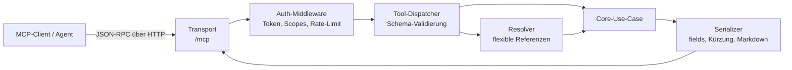
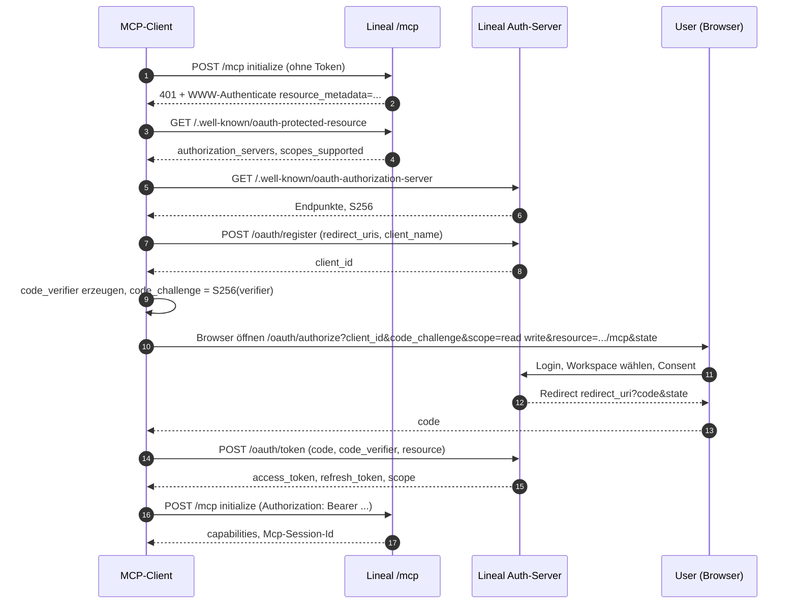
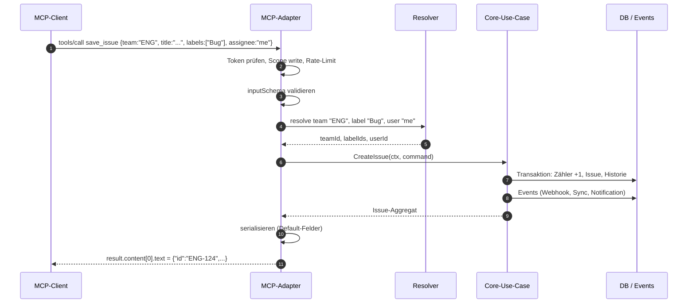
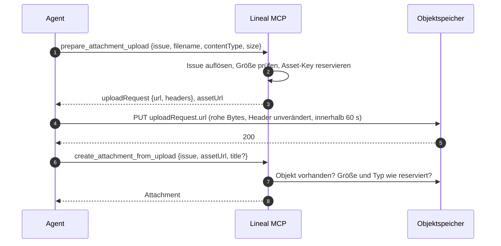

# 07 – MCP-Server

Dieses Kapitel spezifiziert den eigenen MCP-Server von Lineal vollständig: Protokoll, Authentifizierung, gemeinsame Bausteine aller Tools, den kompletten Tool-Katalog mit Eingabeschemas und normalisierten Antwortformen, die bewussten Abweichungen zum offiziellen Linear-MCP sowie einen Testkatalog.

Verbindliche Grundlage sind die [Konventionen](00-konventionen.md) (Referenzauflösung, Enums, Formate, Paginierung, Schreibsemantik, Fehlermodell). Die fachlichen Regeln hinter jedem Tool stehen in den Fachkapiteln; dieses Kapitel beschreibt nur, wie sie über MCP erreichbar sind.

**Kompatibilitätsregel (aus der [README](README.md#getroffene-entscheidungen)):**

| Aspekt | Regel |
|---|---|
| Tool-Namen | identisch zum offiziellen Linear-MCP |
| Eingabeschemas (`inputSchema`) | **byte-identisch** zu den hier abgedruckten Schemas (inklusive Parameter für Out-of-Scope-Funktionen, siehe [2.10](#210-akzeptierte-aber-wirkungslose-parameter)) |
| Tool-Beschreibungen | an das Original angelehnt; mechanische Regel: das Wort `Linear` wird durch `Lineal` ersetzt, sonst unverändert |
| Antwortformen | normalisiert (einheitliche Hülle, Paginierung, Status-Objekte, `null`-Regel); **additiv**: Lineal darf Felder ergänzen, entfernt oder benennt aber nie einen Schlüssel um, den Linear liefert (Ausnahmen: Abschnitt 4 Nr. 1, 2, 4). Abweichungen siehe [Abschnitt 4](#4-abweichungen-zur-linear-mcp-antwort) |
| Fehler | immer das JSON-Fehlermodell aus [00 §7](00-konventionen.md#7-fehlermodell), nie Klartext |

Damit funktionieren Agenten-Prompts und Tool-Aufrufe, die für Linear geschrieben wurden, unverändert gegen Lineal.

---

## 1. Architektur

### 1.1 Einordnung: dünner Adapter

Der MCP-Server ist ein **dünner Protokoll-Adapter** über dem Domain-Core (siehe [10-architektur-umsetzung.md](10-architektur-umsetzung.md)). Er enthält **keine eigene Geschäftslogik**. Seine Aufgaben sind ausschließlich:

1. MCP-Protokoll sprechen (JSON-RPC 2.0, Transport, Session).
2. Token prüfen und den **Aufrufkontext** (`workspaceId`, `userId`, `scopes`, `requestId`) bilden.
3. Eingabe gegen das `inputSchema` validieren.
4. **Referenzen auflösen** (über den gemeinsamen Resolver des Core, siehe [2.1](#21-referenzauflösung)).
5. Genau **einen** Core-Use-Case aufrufen (bzw. bei Lese-Tools eine Query).
6. Ergebnis in die normalisierte Antwortform serialisieren (Feldauswahl, Kürzung, Markdown-Export).
7. Fehler des Core in das Fehlermodell übersetzen.



Berechtigungen, Validierungsregeln, Zähler-Vergabe, Events, Benachrichtigungen und Webhooks entstehen ausschließlich im Core. Ein über MCP angelegtes Issue ist in jeder Hinsicht identisch mit einem über die API oder die Web-App angelegten (gleiche Events, gleiche Historie, `actor` = aufrufender User; bei App-Tokens zusätzlich `onBehalfOf`, siehe [09-api-events.md](09-api-events.md)).

### 1.2 Protokoll

| Aspekt | Festlegung |
|---|---|
| Nachrichtenformat | JSON-RPC 2.0 (`jsonrpc: "2.0"`, `id`, `method`, `params`) |
| Protokollversion | aktuelle MCP-Spezifikation (Aushandlung über `initialize.protocolVersion`; der Server antwortet mit der höchsten gemeinsamen Version) |
| Haupttransport | **Streamable HTTP** unter `POST /mcp` (Antwort als `application/json` oder als SSE-Stream, je nach `Accept`-Header); `GET /mcp` öffnet optional einen Server→Client-SSE-Stream; `DELETE /mcp` beendet die Session |
| Session | Header `Mcp-Session-Id`, vom Server bei `initialize` vergeben; zustandslos implementierbar (Session-ID nur für Logging/Korrelation) |
| Legacy-Transport (optional) | HTTP+SSE: `GET /sse` (Event-Stream) + `POST /messages?sessionId=…` für ältere Clients |
| Lokaler Transport | **stdio**: dieselbe Server-Implementierung als CLI-Prozess (`lineal-mcp --token $LINEAL_API_KEY --url https://lineal.example`), der Tool-Aufrufe über die öffentliche API oder direkt gegen den Core ausführt |

#### `initialize`

Anfrage des Clients:

```json
{
  "jsonrpc": "2.0",
  "id": 1,
  "method": "initialize",
  "params": {
    "protocolVersion": "2025-06-18",
    "capabilities": {},
    "clientInfo": { "name": "example-agent", "version": "1.0.0" }
  }
}
```

Antwort des Servers:

```json
{
  "jsonrpc": "2.0",
  "id": 1,
  "result": {
    "protocolVersion": "2025-06-18",
    "capabilities": {
      "tools": { "listChanged": false }
    },
    "serverInfo": { "name": "lineal", "version": "1.0.0" },
    "instructions": "When passing string values to tools, send the content directly without escape sequences. For example, use real newlines in markdown content rather than literal backslash-n (\\n) characters."
  }
}
```

- `tools` ist die einzige **Pflicht**-Capability.
- Optional: `resources` (z. B. `lineal://issue/ENG-123` liefert dieselbe JSON-Form wie `get_issue`) und `prompts` (vorgefertigte Prompts wie „Triage meines Teams“). Beide sind nicht Teil des Kompatibilitätsumfangs und dürfen fehlen.
- Das Feld `instructions` übernimmt sinngemäß den Hinweis des Originals zu unescaptem Markdown.

#### `tools/list`

Liefert alle Tools des Katalogs ([Abschnitt 3](#3-tool-katalog)) mit `name`, `description`, `inputSchema`. Keine Paginierung nötig (die Liste ist klein); falls der Client einen `cursor` schickt, wird er ignoriert. **Gefiltert nach Scopes:** Ein Token nur mit `read` bekommt die schreibenden Tools nicht gelistet (Aufruf trotzdem → `forbidden`). Out-of-Scope-Tools ([Abschnitt 5](#5-out-of-scope-tools)) werden nie gelistet.

Optional werden MCP-Tool-Annotations geliefert: `readOnlyHint: true` für `list_*`/`get_*`/`extract_images`/`search_documentation`, `destructiveHint: true` für `delete_*`, `retire_*`, `unshare_issue`, `idempotentHint: true` für `mark_notification`, `retire_*`, `restore_*`.

#### `tools/call`

```json
{
  "jsonrpc": "2.0",
  "id": 7,
  "method": "tools/call",
  "params": {
    "name": "get_issue",
    "arguments": { "id": "ENG-123" }
  }
}
```

**Erfolg:** genau ein Content-Element vom Typ `text`, dessen `text` ein **JSON-String** der normalisierten Antwort ist (kompakt, UTF-8, keine Escape-Spielereien in Markdown-Feldern außer den von JSON verlangten).

```json
{
  "jsonrpc": "2.0",
  "id": 7,
  "result": {
    "content": [
      { "type": "text", "text": "{\"id\":\"ENG-123\",\"uuid\":\"9f1c…\",\"title\":\"Login schlägt fehl\", …}" }
    ],
    "isError": false
  }
}
```

Optional darf zusätzlich `structuredContent` mit demselben Objekt geliefert werden (für Clients, die es auswerten); `content[0].text` bleibt maßgeblich. Ausnahmen mit anderem Content-Typ: `extract_images` und `get_attachment` (`format: "content"`) liefern `type: "image"` (base64 + `mimeType`) bzw. Text-Inhalt, siehe dort.

**Fehler:** Fachliche und Validierungsfehler eines Tools werden **nicht** als JSON-RPC-Fehler, sondern als Tool-Ergebnis mit `isError: true` geliefert, damit das LLM sie lesen und korrigieren kann:

```json
{
  "jsonrpc": "2.0",
  "id": 7,
  "result": {
    "content": [
      { "type": "text", "text": "{\"error\":\"not_found\",\"message\":\"Could not find referenced Issue.\",\"status\":404,\"requestId\":\"req_01J…\",\"details\":{\"reference\":\"ENG-999999\"}}" }
    ],
    "isError": true
  }
}
```

JSON-RPC-Fehler (`error`-Objekt statt `result`) gibt es nur für Protokollprobleme: `-32700` Parse error, `-32600` Invalid Request, `-32601` Method not found (auch unbekannter Tool-Name), `-32602` Invalid params (Argumente kein Objekt). Fehlende Authentifizierung wird bereits auf HTTP-Ebene mit `401` beantwortet (siehe 1.3).

**Message-Texte für LLMs:** Die `message` soll handlungsleitend sein. Beispiele (verbindlich als Muster):

| Situation | `error` | `message` |
|---|---|---|
| Issue nicht gefunden | `not_found` | `Could not find referenced Issue.` |
| Projekt-Kennung an Issue-Tool | `invalid_request` | `"P-ENG-7" is a project identifier, not an issue ID. Use get_project instead` |
| Template unbekannt | `not_found` | `Could not find template "Bug report". Call list_templates to see what is available` |
| Kommentar ohne Parent | `invalid_request` | `Provide exactly one of issueId, projectId, initiativeId, documentId, milestoneId, or statusUpdateId` |
| Name mehrdeutig | `ambiguous_reference` | `"Web" matches 2 teams. Pass a key or ID.` (Kandidaten in `details.candidates`) |

### 1.3 Authentifizierung und Autorisierung

Lineal implementiert die **MCP-Authorization-Spezifikation** (OAuth 2.1). Der MCP-Server ist eine *Protected Resource*, der Authorization Server ist der von Lineal (gemeinsam mit der öffentlichen API, siehe [09-api-events.md](09-api-events.md)).

| Endpunkt | Zweck |
|---|---|
| `GET /.well-known/oauth-protected-resource` | Metadaten der Ressource (RFC 9728): `resource: "https://lineal.example/mcp"`, `authorization_servers: ["https://lineal.example"]`, `scopes_supported: ["read","write"]`, `bearer_methods_supported: ["header"]` |
| `GET /.well-known/oauth-authorization-server` | AS-Metadaten (RFC 8414): `authorization_endpoint`, `token_endpoint`, `registration_endpoint`, `revocation_endpoint`, `code_challenge_methods_supported: ["S256"]`, `grant_types_supported: ["authorization_code","refresh_token"]` |
| `POST /oauth/register` | **Dynamic Client Registration** (RFC 7591): öffentliche Clients ohne Secret, `token_endpoint_auth_method: "none"`, Redirect-URIs nur per Allowlist: `https`, `http://localhost`/`127.0.0.1`/`[::1]` und private Schemata nach RFC 8252 §7.1 (Reverse-DNS wie `com.example.app:` oder bekannte Client-Schemata `cursor`, `vscode`, `vscode-insiders`, `windsurf`, `zed`, `claude`, `claude-desktop`); `mailto:`, `intent:`, `view-source:` u. a. werden abgelehnt |
| `GET /oauth/authorize` | Login + Consent-Seite (Workspace-Auswahl, Scope-Anzeige) |
| `POST /oauth/token` | Code gegen Tokens tauschen (PKCE-Verifier Pflicht), Refresh |
| `POST /oauth/revoke` | Token widerrufen |

Regeln:

- **PKCE mit `S256` ist Pflicht**, `plain` wird abgelehnt.
- Der Parameter `resource` (RFC 8707) ist optional; wenn angegeben, muss er (bei `/oauth/authorize` und `/oauth/token`) genau auf `https://lineal.example/mcp` zeigen, sonst `invalid_target`. Der Server hat nur diese eine Ressource; ausgegebene Tokens gelten für sie.
- Access-Token-Lebensdauer 1 h, Refresh-Token 30 Tage ab Ausstellung bzw. letzter Rotation.
- **Refresh-Rotation (RFC 9700 §4.14):** Jedes Refresh-Token ist einmalig. Wird ein bereits eingelöstes Token erneut vorgelegt (auch bei parallelen Anfragen: genau eine gewinnt), gilt das als Diebstahlverdacht: die gesamte Token-Familie (alle Access- und Refresh-Tokens des Grants) wird widerrufen, die Webhooks der Anwendung werden deaktiviert, ein Audit-Eintrag `oauth_app.refresh_reuse_revoked` und das Event `OAuthAuthorizationRevoked` entstehen. Es gibt bewusst keine Gnadenfrist (die Antwort kann nicht idempotent wiederholt werden, weil nur Hashes gespeichert sind); ein Client, der die Antwort verliert, muss neu autorisieren.
- `/oauth/revoke` widerruft mit Access- oder Refresh-Token die ganze Familie (RFC 7009).
- Ohne oder mit ungültigem Token antwortet `/mcp` mit HTTP `401` und `WWW-Authenticate: Bearer resource_metadata="https://lineal.example/.well-known/oauth-protected-resource"`. Damit startet ein MCP-Client den Flow selbstständig.
- **Alternative: persönlicher API-Key** als `Authorization: Bearer lin_api_…` (bzw. `lineal_api_…`). Er trägt die Scopes, mit denen er angelegt wurde, und wirkt als der User, der ihn erzeugt hat. Für stdio-Betrieb ist das der Normalfall.

**Scopes:**

| Scope | Erlaubt |
|---|---|
| `read` | alle `list_*`, `get_*`, `extract_images`, `search_documentation` |
| `write` | zusätzlich alle `save_*`, `delete_*`, `retire_*`, `restore_*`, `mark_notification`, `share_issue`, `unshare_issue`, `prepare_attachment_upload`, `create_attachment_from_upload` (impliziert `read`) |
| `admin` | nur für Owner/Admin: Workspace-Einstellungen (Rollen, Teams, Webhooks, API-Keys anderer). Wird bei anderen Rollen beim Consent still entfernt; unbekannte Scopes werden mit `invalid_scope` abgelehnt. Die Consent-Seite warnt vor `admin`. Im Token steht immer `read` zusätzlich. |

**User-Kontext:** Jedes Token ist an genau **einen User in genau einem Workspace** gebunden. Daraus folgt: `"me"` in jedem User-Parameter = dieser User; Sichtbarkeit (private Teams, Gäste nur in ihren Teams) wird vom Core für diesen User geprüft ([02-teams-rechte.md](02-teams-rechte.md)); `get_workspace` liefert den Workspace des Tokens. Ein Agent kann nie mehr sehen oder ändern als der User in der Web-App.





### 1.4 Rate-Limits

Rate-Limits werden **pro Token** (bzw. pro User bei OAuth) gemeinsam mit der öffentlichen API gezählt; die Zahlen legt [09-api-events.md](09-api-events.md) fest. MCP-spezifisch gilt:

- Jeder `tools/call` zählt als **eine Anfrage**, unabhängig davon, wie viele Core-Queries intern laufen. Zusätzlich gilt ein **Komplexitätsbudget**: `limit` und `include*`-Flags erhöhen die Kosten (Kosten ≈ 1 + `limit`/50 + Anzahl gesetzter `include*`).
- Bei Überschreitung: Tool-Ergebnis mit `isError: true`, Fehler `rate_limited` (status 429), `details.retryAfterSeconds`; auf HTTP-Ebene zusätzlich `Retry-After`-Header und `X-RateLimit-Limit`, `X-RateLimit-Remaining`, `X-RateLimit-Reset`.
- `prepare_attachment_upload`: zusätzlich max. 10 parallele, nicht abgeschlossene Uploads pro User.

---

## 2. Gemeinsame Bausteine

Diese Bausteine werden einmal im Adapter implementiert und von allen Tools benutzt.

### 2.1 Referenzauflösung

Alle String-Parameter, die ein Objekt referenzieren, laufen durch den **zentralen Resolver** des Core mit der Reihenfolge aus [00 §2](00-konventionen.md#2-identifikatoren): UUID → Kennung (inkl. `previousIdentifiers`) → Slug/`slugId` → Team-Key → exakter Name (case-insensitiv) → für User E-Mail und `"me"` → für Status der Kategoriename.

Zusätzliche MCP-Regeln:

| Regel | Verhalten |
|---|---|
| Typfremde Kennung | `P-ENG-7` an ein Issue-Feld → `invalid_request` mit Hinweis auf `get_project`; `ENG-123` an ein Projekt-Feld → analog mit Hinweis auf `get_issue` |
| URL als Referenz | Wo das Schema „URL“ erwähnt (z. B. `customView`), wird die Lineal-URL geparst und die enthaltene ID/Slug verwendet |
| Mehrdeutiger Name | `ambiguous_reference` (409) mit `details.candidates: [{id, name, key?}]` (max. 10) |
| Unauflösbar | `not_found` (404) mit `details.reference` und `details.type` – **auch bei optionalen Filtern** (fail loud, [00 §7](00-konventionen.md#7-fehlermodell)) |
| Status-Referenz ohne Team-Kontext | Bei `list_issues` ohne `team`: Kategoriename (`started`) filtert über `statusType` in allen Teams; ein Statusname filtert alle Status dieses Namens in allen sichtbaren Teams |
| Label in Gruppe | Label-Referenzen akzeptieren zusätzlich `Gruppe/Label` (z. B. `Type/Bug`) zur Disambiguierung gleichnamiger Labels in verschiedenen Gruppen; der einfache Name genügt, solange er eindeutig ist |
| Literal `"null"` | Nur bei `list_issues.assignee`: JSON `null` **und** der String `"null"` bedeuten „ohne Assignee“ |
| Cycle-Referenz | Name, Nummer (`"12"`) oder UUID; Nummern sind teamlokal, daher nur mit Team-Kontext eindeutig (sonst `ambiguous_reference`) |
| Sichtbarkeit | Objekte, die der User nicht sehen darf, gelten als nicht existent (`not_found`, nie `forbidden`) |

### 2.2 Paginierung

Alle paginierten Listen antworten nach [00 §5](00-konventionen.md#5-listen-und-paginierung):

```json
{ "issues": [ { "id": "ENG-124" } ], "hasNextPage": true, "cursor": "eyJrIjoiMjAyNi0xMC0xMFQwNzoxNTowMC4wMDBaIiwiaSI6IjlmMWMifQ" }
```

- `cursor` ist **opak** (base64url von `{"k": <Sortschlüssel>, "i": <uuid>}`), fehlt bei `hasNextPage: false`.
- Der Cursor ist an `orderBy` und die Filter gebunden; wird er mit anderen Filtern verwendet → `invalid_request` (`Cursor does not match the query`). Dafür enthält er zusätzlich einen kurzen Hash der Filterparameter.
- `limit`: Default 50, Maximum 250 (`list_projects`: 50). Werte über dem Maximum verletzen das Schema → `invalid_request`. Werte < 1 → `invalid_request`.
- Sortierung absteigend nach `orderBy` (Default `updatedAt`), Tiebreaker `id` absteigend – stabil auch bei gleichen Zeitstempeln.
- Lineal paginiert **auch** die Listen, die bei Linear nackte Arrays bzw. unpaginiert sind (`list_issue_statuses`, `list_cycles`, `list_milestones`, `list_templates`): die Hülle ist immer da; da diese Tools keinen `cursor`-Parameter im Schema haben, liefern sie **alle** Einträge und `hasNextPage: false`.

### 2.3 Feldauswahl `fields`

Bei `list_issues`, `get_issue`, `list_projects`, `list_initiatives`, `list_documents`:

1. Leeres oder fehlendes `fields` → **Default-Antwort** (pro Tool dokumentiert).
2. Nicht-leeres `fields` → genau diese Schlüssel plus immer `id`. Reihenfolge der Schlüssel: `id` zuerst, dann wie angefragt.
3. Angefragte Felder ohne Wert → `null` (Listen-Felder → `[]`).
4. Bei `get_issue` überschreibt nicht-leeres `fields` die `include*`-Flags (`relations` muss dann explizit angefragt werden).
5. Die Enum-Liste des Schemas ist abschließend; unbekannte Werte → `invalid_request` (Schema-Validierung).

**Normalisierung:** Auch in der Default-Antwort sind **alle Default-Schlüssel immer vorhanden**; leere Werte sind `null`, leere Listen `[]`. Weglassen von Schlüsseln (wie Linear es teils tut) gibt es in Lineal nicht.

### 2.4 Tri-State bei Updates

Für alle `save_*` mit `id` gilt [00 §6](00-konventionen.md#6-schreibsemantik):

| Eingabe | Wirkung |
|---|---|
| Schlüssel fehlt | unverändert |
| `null` (nur wo das Schema `null` erlaubt) | Wert entfernen/leeren |
| Wert | setzen |

Felder ohne `null` im Schema (z. B. `save_project.startDate`) können über MCP nicht geleert werden – das ist eine bewusst übernommene Einschränkung des Originalschemas. Ein leerer String `""` bei Datumsfeldern ist **kein** Leeren, sondern `invalid_request`.

### 2.5 Mengenfelder und Append-only

| Muster | Felder | Semantik |
|---|---|---|
| Ersetzen | `labels`, `setTeams`, `setInitiatives`, `setReleases` | ganze Menge ersetzen |
| Inkrementell | `addLabels`/`removeLabels`, `addTeams`/`removeTeams`, `addInitiatives`/`removeInitiatives` | hinzufügen/entfernen; doppelte Adds und Removes nicht vorhandener Elemente sind **No-ops** (kein Fehler) |
| Append-only | `blocks`, `blockedBy`, `relatedTo`, `links`, `parentInitiatives` | nur hinzufügen; bestehende Einträge bleiben; Duplikate werden ignoriert |
| Explizites Entfernen | `removeBlocks`, `removeBlockedBy`, `removeRelatedTo` | entfernt nur die genannten Relationen |

Ersetzen + inkrementell im selben Aufruf → `invalid_request`. `addLabels`/`removeLabels` zusammen mit einem Teamwechsel (`team` bei Update) → `invalid_request` (Labels müssen nach Teamwechsel neu gegen das Zielteam aufgelöst werden; siehe [03-issues-workflow.md](03-issues-workflow.md)). Ein Label und sein Gegenstück, die im selben Aufruf in `addLabels` und `removeLabels` stehen → `invalid_request`.

### 2.6 Patch-Operationen für Rich-Text

`save_issue`, `save_project`, `save_initiative` und `save_document` akzeptieren `patch` **statt** `description` bzw. `content`. Dies ist die verbindliche Spezifikation, auf die [00 §6](00-konventionen.md#6-schreibsemantik) verweist.

Vollständiges JSON Schema (identisch in allen vier Tools):

```json
{
  "description": "Partial edits applied to the current content, in order and atomically (one failing operation aborts the whole save). Every anchor string must match the current content exactly once. Only valid on update, in place of the full content/description field",
  "items": {
    "oneOf": [
      {
        "properties": {
          "new_string": {
            "description": "Replacement text. Empty string deletes the match",
            "type": "string"
          },
          "old_string": {
            "description": "Exact text to replace. Must match the current content exactly once",
            "minLength": 1,
            "type": "string"
          },
          "op": {
            "const": "replace",
            "type": "string"
          },
          "replace_all": {
            "description": "Replace every occurrence instead of requiring a unique match",
            "type": "boolean"
          }
        },
        "required": [
          "op",
          "old_string",
          "new_string"
        ],
        "type": "object"
      },
      {
        "properties": {
          "anchor": {
            "description": "Exact text to insert before. Must match the current content exactly once",
            "minLength": 1,
            "type": "string"
          },
          "op": {
            "const": "insert_before",
            "type": "string"
          },
          "text": {
            "description": "Text to insert directly before the anchor. Include separators (e.g. \"\\n\\n\")",
            "minLength": 1,
            "type": "string"
          }
        },
        "required": [
          "op",
          "anchor",
          "text"
        ],
        "type": "object"
      },
      {
        "properties": {
          "anchor": {
            "description": "Exact text to insert after. Must match the current content exactly once",
            "minLength": 1,
            "type": "string"
          },
          "op": {
            "const": "insert_after",
            "type": "string"
          },
          "text": {
            "description": "Text to insert directly after the anchor. Include separators (e.g. \"\\n\\n\")",
            "minLength": 1,
            "type": "string"
          }
        },
        "required": [
          "op",
          "anchor",
          "text"
        ],
        "type": "object"
      },
      {
        "properties": {
          "op": {
            "const": "prepend",
            "type": "string"
          },
          "text": {
            "description": "Text to insert at the very start of the content",
            "minLength": 1,
            "type": "string"
          }
        },
        "required": [
          "op",
          "text"
        ],
        "type": "object"
      },
      {
        "properties": {
          "op": {
            "const": "append",
            "type": "string"
          },
          "text": {
            "description": "Text to insert at the very end of the content",
            "minLength": 1,
            "type": "string"
          }
        },
        "required": [
          "op",
          "text"
        ],
        "type": "object"
      },
      {
        "properties": {
          "from": {
            "description": "Exact text where the range starts (inclusive). Must match exactly once",
            "minLength": 1,
            "type": "string"
          },
          "new_string": {
            "description": "Text replacing the range. Empty string deletes it",
            "type": "string"
          },
          "op": {
            "const": "replace_range",
            "type": "string"
          },
          "to": {
            "description": "Exact text where the range ends (exclusive, stays in place). Must match exactly once after `from`",
            "minLength": 1,
            "type": "string"
          }
        },
        "required": [
          "op",
          "from",
          "to",
          "new_string"
        ],
        "type": "object"
      }
    ]
  },
  "maxItems": 50,
  "minItems": 1,
  "type": "array"
}
```

**Regeln:**

- `patch` nur bei Update (mit `id`), sonst `invalid_request` (`patch is only valid when updating`).
- `patch` und `description`/`content` gleichzeitig → `invalid_request`.
- Alle Ops arbeiten auf dem **Markdown-Export** des aktuellen Inhalts (genau dem Text, den `get_*` liefert, ungekürzt).
- Ops werden **sequenziell** auf einen Arbeitspuffer angewendet; jeder Anker wird gegen den Puffer **im Zustand nach den vorherigen Ops** geprüft.
- Matching ist exakt, case-sensitiv, ohne Normalisierung von Whitespace; Zeilenenden werden vorab auf `\n` normalisiert.
- „Genau einmal“ zählt **überlappende** Vorkommen mit (Suche ab jeder Position, nicht nur ab Ende des letzten Treffers).
- Einzige Ausnahme von „genau einmal“: `replace` mit `replace_all: true` (dann ≥ 1 Treffer nötig, alle nicht überlappenden Vorkommen von links nach rechts werden ersetzt).
- `replace_range`: `from` muss genau einmal vorkommen; `to` muss **nach dem Ende von `from`** genau einmal vorkommen. Ersetzt wird `[start(from), start(to))` – `to` selbst bleibt stehen.
- Scheitert eine Op, wird **nichts** gespeichert. Fehler `conflict` (409) mit `details: { opIndex, op, anchor, matches }`.
- Bei Erfolg: **ein** Schreibvorgang, **ein** Historien-Eintrag, **ein** Event – wie ein normales Update der Beschreibung.
- Optimistische Nebenläufigkeit: Der Adapter liest Inhalt + `updatedAt` (bzw. Dokumentversion), wendet den Patch an und schreibt mit Versionsbedingung. Scheitert die Bedingung, wird der gesamte Patch bis zu 3-mal auf dem neuen Stand wiederholt; danach `conflict` mit `details.reason: "concurrent_modification"`.
- Ergebnistext leer ist erlaubt.

**Algorithmus (Pseudocode):**

```text
function applyPatch(entityRef, ops):
  if ops.length < 1 or ops.length > 50: fail invalid_request
  for attempt in 1..3:
    (text, version) = core.loadMarkdown(entityRef)          // ungekürzt, \r\n -> \n
    buf = text
    for i, op in enumerate(ops):
      switch op.op:
        case "replace":
          if op.replace_all:
            n = countNonOverlapping(buf, op.old_string)
            if n == 0: fail conflict(i, op, op.old_string, 0)
            buf = replaceAllNonOverlapping(buf, op.old_string, op.new_string)
          else:
            p = findUnique(buf, op.old_string, from=0) or fail conflict(i, ...)
            buf = buf[0:p] + op.new_string + buf[p+len(op.old_string):]
        case "insert_before":
          p = findUnique(buf, op.anchor, from=0) or fail conflict(i, ...)
          buf = buf[0:p] + op.text + buf[p:]
        case "insert_after":
          p = findUnique(buf, op.anchor, from=0) or fail conflict(i, ...)
          q = p + len(op.anchor)
          buf = buf[0:q] + op.text + buf[q:]
        case "prepend":
          buf = op.text + buf
        case "append":
          buf = buf + op.text
        case "replace_range":
          a = findUnique(buf, op.from, from=0) or fail conflict(i, ...)
          b = findUnique(buf, op.to, from=a + len(op.from)) or fail conflict(i, ...)
          buf = buf[0:a] + op.new_string + buf[b:]
    ok = core.saveMarkdown(entityRef, buf, expectedVersion=version)   // ein Use-Case-Aufruf
    if ok: return
  fail conflict(reason="concurrent_modification")

function findUnique(buf, needle, from):
  // zählt auch überlappende Treffer ab Position 'from'
  positions = [k for k in from..len(buf)-len(needle) if buf[k:k+len(needle)] == needle]
  if len(positions) != 1: return NONE (matches = len(positions))
  return positions[0]
```

Fehlerbeispiel:

```json
{
  "error": "conflict",
  "message": "Patch operation 2 (insert_after): anchor must match the current content exactly once, found 3 matches.",
  "status": 409,
  "requestId": "req_01J…",
  "details": { "opIndex": 2, "op": "insert_after", "anchor": "## Schritte", "matches": 3 }
}
```

### 2.7 Zeitfilter (`DateTimeOrDuration`)

Parameter `createdAt`, `updatedAt`, `triagedAt` bedeuten „**nach** diesem Zeitpunkt“ (strikt größer). Akzeptiert werden:

| Eingabe | Interpretation |
|---|---|
| `2026-10-01T00:00:00.000Z` (oder mit Offset) | Zeitpunkt, nach UTC normalisiert |
| `2026-10-01` | 00:00 UTC dieses Tages |
| `-P1D`, `-P2W`, `-PT12H`, `-P1M` | jetzt minus Dauer (ISO-8601-Dauer, negatives Vorzeichen) |
| `P1D` (ohne Minus) | ebenfalls als Vergangenheit interpretiert (toleranter Parser) |

Anderes → `invalid_request` mit `details.parameter`.

### 2.8 Markdown-Ein- und -Ausgabe

**Eingabe:** Alle Rich-Text-Parameter (`description`, `content`, `body`) sind Markdown (GFM). Der Adapter interpretiert keine Escape-Sequenzen: ein literales `\n` bleibt `\n` (Backslash + n). Konvertierung ins interne Format übernimmt der Core.

- Erwähnungen: `@displayName` → User-Mention (unbekannter Handle bleibt Text).
- `ENG-123` als Wort → Issue-Mention (Link), wenn das Issue existiert und sichtbar ist.
- Bilder ``; Lineal-Upload-URLs werden als Asset referenziert.

**Ausgabe:** Lineal liefert **Standard-GFM** ohne proprietäre Tags:

| Element | Ausgabe Lineal | (Linear) |
|---|---|---|
| Issue-Mention | `[ENG-123](https://lineal.example/acme/issue/ENG-123/login-schlagt-fehl)` | `<issue id=… href=…>ENG-123</issue>` |
| User-Mention | `@alice` | `@alice` |
| Bild | `` (signierte URL, 5 min gültig) | `<linear-image>{…}</linear-image>` |
| Link | `[Text](https://…)` | `[Text](<https://…>)` |
| Liste | `- ` | `* ` |

### 2.9 Kürzung langer Texte in Listen

In **Listen**-Antworten (`list_issues`, `list_projects`, `list_initiatives`, `list_documents`) werden `description` bzw. `content` auf **500 Zeichen** (Unicode-Codepoints) gekürzt, sofern länger. Regeln:

- Kürzung nie mitten in einem Surrogatpaar; wenn möglich am letzten Whitespace vor Position 500.
- Suffix exakt (ein Leerzeichen davor): ``… (truncated, use `get_issue` for full description)`` – bzw. `get_project`, `get_initiative`, `get_document` je nach Tool.
- `get_*` liefert immer den vollen Text. Kommentare (`list_comments`) und Status-Updates werden nicht gekürzt.

### 2.10 Akzeptierte, aber wirkungslose Parameter

Damit die Eingabeschemas identisch bleiben, enthalten sie Parameter für Funktionen außerhalb des Scopes. Diese werden **akzeptiert und ignoriert** (nie Fehler), außer wo angegeben:

| Parameter | Tools | Verhalten in Lineal |
|---|---|---|
| `release`, `addReleases`, `removeReleases`, `setReleases`, `includeReleases`, Feld `releases` | `list_issues`, `save_issue`, `get_issue` | Filter `release` → leere Liste (kein `not_found`, da es keine Releases gibt); Schreibparameter ignoriert; Feld `releases` = `[]` |
| `includeCustomerNeeds`, `customerNeedsCursor`, `customerNeedsLimit`, Feld `customerNeeds` | `get_issue`, `get_project` | Feld `customerNeeds` = `[]`, `customerNeedsPageInfo` = `{ "hasNextPage": false, "endCursor": null }` |
| `delegate` | `list_issues`, `save_issue` | Optionales Feld (siehe README): ist `delegate` im Datenmodell vorhanden, wird es wie ein User mit Rolle `app` aufgelöst; sonst ignoriert, Feld `delegate`/`delegateId` = `null` |
| Feld `triageIntel` | `list_issues`, `get_issue` | immer `null` |
| `isDiffHidden` | `save_status_update` | gespeichert, steuert `diffMarkdown`-Anzeige (deprecated) |

---

## 3. Tool-Katalog

### 3.0 Aufbau und gemeinsame Antwortobjekte

Jedes Tool ist gleich beschrieben: **Zweck**, **Description** (Text, den das LLM in `tools/list` sieht – Zitat), **Eingabeschema** (verbindlich, identisch zum Original), **Antwort** (normalisiert, erfundene Daten), **Fehlerfälle** (zusätzlich zu den allgemeinen: `unauthenticated`, `forbidden` bei fehlendem Scope, `rate_limited`, `invalid_request` bei Schemaverletzung, `internal`) und **Core-Mapping** (aufgerufener Use-Case, Fachkapitel).

Die vollständigen Entitätsfelder stehen im [Domänenmodell](01-domaenenmodell.md); die MCP-Antworten sind eine Projektion davon. Eingebettete Referenzen haben überall dieselbe Form (Ausnahme: Issues, siehe 3.2):

| Objekt | Form | Hinweis |
|---|---|---|
| `TeamRef` | `{ "id": "<uuid>", "key": "ENG", "name": "Engineering" }` | |
| `UserRef` | `{ "id": "<uuid>", "name": "Alice Example" }` | Projekt-Mitglieder zusätzlich `email` |
| `ProjectRef` | `{ "id": "<uuid>", "identifier": "P-ENG-7", "name": "Checkout v2" }` | `id` ist in eingebetteten Refs **immer die UUID** (wie Linear); `identifier` ist Lineal-Zusatz |
| `InitiativeRef` | `{ "id": "<uuid>", "identifier": "I-4", "name": "Q4 Platform" }` | wie oben |
| `StatusRef` | `{ "id": "<uuid>", "name": "In Progress", "type": "started" }` | einheitlich für Workflow-, Projekt- und Initiative-Status |
| `LabelRef` | `{ "id": "<uuid>", "name": "Frontend" }` | bei Projekten/Initiativen |
| `MilestoneRef` | `{ "id": "<uuid>", "name": "Beta" }` | |
| `Priority` | `{ "value": 2, "name": "High" }` | [00 §4](00-konventionen.md#4-feste-enums) |

Top-Level-`id` von Issue, Projekt und Initiative ist die **lesbare Kennung** (`ENG-123`, `P-ENG-7`, `I-4`), die UUID steht in `uuid`. Alle anderen Entitäten haben die UUID in `id`.

Gemeinsame Erstellungs-/Update-Antwort der `save_*`-Tools: das vollständige Objekt in derselben Form wie das zugehörige `get_*` (Default-Felder). `delete_*`, `retire_*`, `restore_*`, `share_*`: `{ "success": true, "id": "<uuid>" }` bzw. das aktualisierte Objekt (siehe Tool).

---

### 3.1 Workspace, Teams, Users

#### `get_workspace`

**Zweck:** Workspace des Tokens abfragen (Name, URL). Erster Aufruf vieler Agenten zur Orientierung.

> Retrieve the connected Lineal workspace

```json
{
  "properties": {},
  "type": "object"
}
```

**Antwort:**

```json
{ "id": "0b6f0c1e-2a1d-4c7e-9a51-7d1f3b2c4e10", "name": "Acme", "urlKey": "acme", "url": "https://lineal.example/acme" }
```

**Fehler:** keine fachlichen. **Core:** `GetCurrentWorkspace(ctx)` – [02-teams-rechte.md](02-teams-rechte.md).

#### `list_teams`

**Zweck:** Sichtbare Teams auflisten, inklusive Hierarchie (Sub-Teams).

> List teams in the user's Lineal workspace, including their parent IDs and hierarchy names

```json
{
  "$schema": "https://json-schema.org/draft/2020-12/schema",
  "additionalProperties": false,
  "properties": {
    "ancestorTeam": {
      "description": "All descendant teams of this team, at any depth, excluding itself (name, key, or ID)",
      "type": "string"
    },
    "createdAt": {
      "description": "Created after: ISO-8601 date/duration (e.g., -P1D)",
      "type": "string"
    },
    "cursor": {
      "description": "Next page cursor",
      "type": "string"
    },
    "includeArchived": {
      "default": false,
      "description": "Include archived items",
      "type": "boolean"
    },
    "limit": {
      "default": 50,
      "description": "Max results (default 50, max 250)",
      "maximum": 250,
      "type": "number"
    },
    "orderBy": {
      "default": "updatedAt",
      "description": "Sort: createdAt | updatedAt",
      "enum": [
        "createdAt",
        "updatedAt"
      ],
      "type": "string"
    },
    "parentTeam": {
      "description": "Only direct sub-teams of this team (name, key, or ID)",
      "type": "string"
    },
    "query": {
      "description": "Search query",
      "type": "string"
    },
    "updatedAt": {
      "description": "Updated after: ISO-8601 date/duration (e.g., -P1D)",
      "type": "string"
    }
  },
  "type": "object"
}
```

**Antwort:**

```json
{
  "teams": [
    { "id": "5d0a…-eng", "key": "ENG", "name": "Engineering", "displayName": "Engineering", "parentId": null, "icon": "Code", "color": "#5E6AD2", "visibility": "public", "createdAt": "2026-01-05T09:00:00.000Z", "updatedAt": "2026-10-09T12:00:00.000Z" },
    { "id": "7e21…-web", "key": "WEB", "name": "Web", "displayName": "Engineering › Web", "parentId": "5d0a…-eng", "icon": "Globe", "color": "#26B5CE", "visibility": "public", "createdAt": "2026-03-01T09:00:00.000Z", "updatedAt": "2026-10-08T10:00:00.000Z" }
  ],
  "hasNextPage": false
}
```

`displayName` ist der Hierarchiename (Vorfahren mit ` › ` verbunden). `query` sucht in `name` und `key` (Teilstring, case-insensitiv). `parentTeam` = nur direkte Kinder, `ancestorTeam` = alle Nachfahren beliebiger Tiefe ohne das Team selbst; beide kombinierbar mit `query`. Private Teams ohne Mitgliedschaft erscheinen nicht; `restricted`-Teams erscheinen für Mitglieder des Parent-Teams.

**Fehler:** `not_found` für unauflösbares `parentTeam`/`ancestorTeam`. **Core:** `ListTeams(ctx, filter)` – [02-teams-rechte.md](02-teams-rechte.md).

#### `get_team`

**Zweck:** Ein Team mit Details.

> Retrieve details of a specific Lineal team, including its parent ID and hierarchy name. Use list_teams with parentTeam or ancestorTeam to find its sub-teams

```json
{
  "$schema": "https://json-schema.org/draft/2020-12/schema",
  "additionalProperties": false,
  "properties": {
    "query": {
      "description": "Team UUID, key, or name",
      "type": "string"
    }
  },
  "required": [
    "query"
  ],
  "type": "object"
}
```

**Antwort:** wie Listeneintrag, additiv ergänzt um Konfiguration, die Agenten für korrekte Schreibaufrufe brauchen:

```json
{
  "id": "5d0a…-eng", "key": "ENG", "name": "Engineering", "displayName": "Engineering", "parentId": null,
  "icon": "Code", "color": "#5E6AD2", "visibility": "public", "timezone": "Europe/Berlin",
  "cyclesEnabled": true, "triageEnabled": true, "issueEstimationType": "fibonacci", "issueEstimationAllowZero": false,
  "createdAt": "2026-01-05T09:00:00.000Z", "updatedAt": "2026-10-09T12:00:00.000Z"
}
```

**Fehler:** `not_found`, `ambiguous_reference`. **Core:** `GetTeam` – [02-teams-rechte.md](02-teams-rechte.md).

#### `list_users`

**Zweck:** Aktive User des Workspaces (optional eines Teams) finden, z. B. um einen Assignee aufzulösen.

> Retrieve users in the Lineal workspace

```json
{
  "$schema": "https://json-schema.org/draft/2020-12/schema",
  "additionalProperties": false,
  "properties": {
    "cursor": {
      "description": "Next page cursor",
      "type": "string"
    },
    "limit": {
      "default": 50,
      "description": "Max results (default 50, max 250)",
      "maximum": 250,
      "type": "number"
    },
    "orderBy": {
      "default": "updatedAt",
      "description": "Sort: createdAt | updatedAt",
      "enum": [
        "createdAt",
        "updatedAt"
      ],
      "type": "string"
    },
    "query": {
      "description": "Filter by name or email",
      "type": "string"
    },
    "team": {
      "description": "Team name or ID",
      "type": "string"
    }
  },
  "type": "object"
}
```

**Antwort:**

```json
{
  "users": [
    { "id": "a11c…-alice", "name": "Alice Example", "displayName": "alice", "email": "alice@acme.example", "avatarUrl": null, "isAdmin": true, "isGuest": false, "isActive": true, "status": "Online", "createdAt": "2026-01-05T09:00:00.000Z", "updatedAt": "2026-10-09T08:00:00.000Z" },
    { "id": "b0b0…-bob", "name": "Bob Example", "displayName": "bob", "email": "bob@acme.example", "avatarUrl": "https://lineal.example/avatars/b0b0.png", "isAdmin": false, "isGuest": false, "isActive": true, "status": "Offline (last seen 2026-10-09T16:40:00.000Z)", "createdAt": "2026-01-06T09:00:00.000Z", "updatedAt": "2026-10-09T16:40:00.000Z" }
  ],
  "hasNextPage": true,
  "cursor": "eyJrIjoi…"
}
```

`name` fällt auf die E-Mail zurück, wenn kein Name gesetzt ist. `displayName` ist der Handle für `@`-Erwähnungen. `query` sucht in `name`, `displayName`, `email`. Deaktivierte User nur, wenn sie über `query` exakt per E-Mail gesucht werden. Gäste sehen nur User ihrer Teams.

**Fehler:** `not_found` für `team`. **Core:** `ListUsers` – [02-teams-rechte.md](02-teams-rechte.md).

#### `get_user`

**Zweck:** Einen User auflösen, insbesondere `"me"`.

> Retrieve details of a specific Lineal user

```json
{
  "$schema": "https://json-schema.org/draft/2020-12/schema",
  "additionalProperties": false,
  "properties": {
    "query": {
      "description": "User ID, name, email, or \"me\"",
      "type": "string"
    }
  },
  "required": [
    "query"
  ],
  "type": "object"
}
```

**Antwort:** Listeneintrag plus `teams: TeamRef[]` (Mitgliedschaften):

```json
{ "id": "a11c…-alice", "name": "Alice Example", "displayName": "alice", "email": "alice@acme.example", "avatarUrl": null, "isAdmin": true, "isGuest": false, "isActive": true, "status": "Online", "createdAt": "2026-01-05T09:00:00.000Z", "updatedAt": "2026-10-09T08:00:00.000Z",
  "teams": [ { "id": "5d0a…-eng", "key": "ENG", "name": "Engineering" }, { "id": "7e21…-web", "key": "WEB", "name": "Web" } ] }
```

**Fehler:** `not_found` (`Could not find user "nobody@acme.example"`), `ambiguous_reference` bei gleichnamigen Usern. **Core:** `GetUser` – [02-teams-rechte.md](02-teams-rechte.md).

---

### 3.2 Issues

Issues werden – abweichend von den anderen Entitäten – **flach** ausgegeben: Bezüge als **Name** plus separates `*Id`-Feld (`assignee: "Alice Example"`, `assigneeId: "<uuid>"`). **Entscheidung: beibehalten.** Begründung: Das ist die Form, an die bestehende Agenten-Prompts gewöhnt sind (Drop-in), sie ist für LLMs am leichtesten zu lesen und zu zitieren, spart Tokens bei großen Listen, und die `*Id`-Felder liefern trotzdem stabile Referenzen. Normalisiert wird nur: alle Default-Schlüssel sind **immer vorhanden** (`null` statt weglassen), `parentId` ist immer die Kennung (`ENG-100`), `projectId`/`teamId`/`cycleId`/`assigneeId`/`createdById` immer UUIDs.

Feldübersicht (gilt für `list_issues`, `get_issue`, `save_issue`):

| Feld | Typ | Default in Liste | Bedeutung |
|---|---|---|---|
| `id` | String | ja | Kennung `ENG-123` |
| `uuid` | UUID | ja | |
| `title` | String | ja | |
| `description` | Markdown? | ja (gekürzt) | |
| `priority` | Priority | ja | |
| `estimate` | Float? | nein | |
| `url` | String | ja | `https://lineal.example/acme/issue/ENG-123/<titel-slug>` |
| `gitBranchName` | String | ja | `<user-handle>/eng-123-<titel-slug>` (Format konfigurierbar, [03](03-issues-workflow.md)) |
| `createdAt`, `updatedAt`, `archivedAt`, `completedAt`, `startedAt`, `canceledAt` | DateTime? | ja | |
| `startedTriageAt`, `triagedAt` | DateTime? | nein | |
| `dueDate` | Date? | ja | |
| `slaStartedAt`, `slaMediumRiskAt`, `slaHighRiskAt`, `slaBreachesAt` | DateTime? | ja | |
| `slaType` | `all`/`onlyBusinessDays`/null | nein | |
| `status`, `statusType` | String | ja | Name und Kategorie des Workflow-Status |
| `labels` | String[] | ja | Label-Namen, einfacher Name wie bei Linear (auch für Labels in Gruppen: `Bug`, nicht `Type/Bug`) |
| `triageIntel` | null | nein | Out of Scope |
| `createdBy`, `createdById` | String, UUID | ja | |
| `assignee`, `assigneeId` | String?, UUID? | ja | |
| `delegate`, `delegateId` | String?, UUID? | nein | optional |
| `project`, `projectId` | String?, UUID? | ja | |
| `projectMilestone` | MilestoneRef? | nein | |
| `parentId` | String? | ja | Kennung des Eltern-Issues |
| `team`, `teamId` | String, UUID | ja | |
| `cycleId` | UUID? | ja | |
| `attachments`, `documents`, `stateHistory` | Array | nur `get_issue` | |
| `relations` | Objekt | nur `get_issue` mit `includeRelations` | |
| `customerNeeds`, `releases` | `[]` | nein | Out of Scope |

#### `list_issues`

**Zweck:** Issues filtern und durchsuchen – das wichtigste Lese-Tool.

> List issues in the user's Lineal workspace, including active Triage Intelligence suggestions for issues in triage. For issues assigned to me, use "me" as the assignee. For issues created by me, use "me" as the creator. Use "null" for no assignee.

```json
{
  "$schema": "https://json-schema.org/draft/2020-12/schema",
  "additionalProperties": false,
  "properties": {
    "assignee": {
      "description": "User ID, name, email, or \"me\"",
      "type": [
        "string",
        "null"
      ]
    },
    "createdAt": {
      "description": "Created after: ISO-8601 date/duration (e.g., -P1D)",
      "type": "string"
    },
    "creator": {
      "description": "User ID, name, email, or \"me\"",
      "type": "string"
    },
    "cursor": {
      "description": "Next page cursor",
      "type": "string"
    },
    "customView": {
      "description": "Saved view ID, URL, slug, or exact name. Use list_custom_views to discover views. Applies saved filters and scope; other filters narrow the results. Uses list ordering, not saved display settings",
      "minLength": 1,
      "type": "string"
    },
    "cycle": {
      "description": "Cycle name, number, or ID",
      "type": "string"
    },
    "delegate": {
      "description": "Agent name or ID. When the user asks to delegate to \"Linear\" or \"the Linear agent\", this refers to the \"Linear\" app user specifically",
      "type": "string"
    },
    "fields": {
      "description": "Fields to include in each result. Explicitly requested fields with no value return null. `id` is always included. Omit or pass an empty array for the default response.",
      "items": {
        "enum": [
          "id",
          "uuid",
          "title",
          "description",
          "projectMilestone",
          "priority",
          "estimate",
          "url",
          "gitBranchName",
          "createdAt",
          "updatedAt",
          "archivedAt",
          "completedAt",
          "startedAt",
          "canceledAt",
          "startedTriageAt",
          "triagedAt",
          "dueDate",
          "slaStartedAt",
          "slaMediumRiskAt",
          "slaHighRiskAt",
          "slaBreachesAt",
          "slaType",
          "status",
          "statusType",
          "labels",
          "triageIntel",
          "createdBy",
          "createdById",
          "assignee",
          "assigneeId",
          "delegate",
          "delegateId",
          "project",
          "projectId",
          "parentId",
          "team",
          "teamId",
          "cycleId"
        ],
        "type": "string"
      },
      "type": "array"
    },
    "includeArchived": {
      "default": false,
      "description": "Include archived items",
      "type": "boolean"
    },
    "includeSubTeams": {
      "default": false,
      "description": "Include results from the selected team and all descendants when team is set. Team ID filters already include descendants; this also expands name and key filters",
      "type": "boolean"
    },
    "label": {
      "description": "Label name or ID",
      "type": "string"
    },
    "limit": {
      "default": 50,
      "description": "Max results (default 50, max 250)",
      "maximum": 250,
      "type": "number"
    },
    "orderBy": {
      "default": "updatedAt",
      "description": "Sort: createdAt | updatedAt",
      "enum": [
        "createdAt",
        "updatedAt"
      ],
      "type": "string"
    },
    "parentId": {
      "description": "Parent issue ID or identifier (e.g., LIN-123)",
      "type": "string"
    },
    "priority": {
      "description": "0=None, 1=Urgent, 2=High, 3=Medium, 4=Low",
      "type": "number"
    },
    "project": {
      "description": "Project name, ID, identifier (e.g., P-ENG-123), or slug",
      "type": "string"
    },
    "query": {
      "description": "Search issue title or description. Cannot be combined with customView",
      "type": "string"
    },
    "release": {
      "description": "Release ID or slug",
      "type": "string"
    },
    "state": {
      "description": "State type, name, or ID",
      "type": "string"
    },
    "team": {
      "description": "Team name or ID",
      "type": "string"
    },
    "triagedAt": {
      "description": "Left triage after: ISO-8601 date/duration (e.g., -P1D). Issues still in triage have no triagedAt; list them with state \"triage\"",
      "type": "string"
    },
    "updatedAt": {
      "description": "Updated after: ISO-8601 date/duration (e.g., -P1D)",
      "type": "string"
    }
  },
  "type": "object"
}
```

**Filtersemantik** (alle Filter UND-verknüpft):

| Parameter | Semantik |
|---|---|
| `team` | Team-Referenz; mit `includeSubTeams: true` (oder wenn als UUID übergeben) inklusive aller Nachfahren |
| `assignee` | User-Referenz, `"me"`; `null`/`"null"` = ohne Assignee |
| `creator`, `delegate` | User-Referenz |
| `state` | Kategorie (`started`), Statusname oder Status-UUID |
| `label` | Label-Name oder ID; Gruppenname = Issues mit irgendeinem Label der Gruppe |
| `project`, `cycle`, `parentId` | flexible Referenz; `parentId` = direkte Kinder |
| `priority` | exakter Wert 0–4 |
| `query` | Volltextsuche in Titel und Beschreibung (Suchindex, [05-views-suche-inbox.md](05-views-suche-inbox.md)); nicht mit `customView` kombinierbar → `invalid_request`. Kennung als `query` (`ENG-123`) trifft dieses Issue |
| `customView` | wendet Filter und Scope der gespeicherten Ansicht an; weitere Parameter verengen; Sortierung bleibt `orderBy` |
| `createdAt`, `updatedAt`, `triagedAt` | „nach“, [2.7](#27-zeitfilter-datetimeorduration) |
| `includeArchived` | archivierte Issues einschließen (Papierkorb nie) |

**Antwort:**

```json
{
  "issues": [
    {
      "id": "ENG-124", "uuid": "3c9e2b1a-7d4f-4e8a-9b6c-1f2e3d4c5b6a",
      "title": "Login schlägt bei SSO-Usern fehl",
      "description": "Seit dem Release 2.3 bekommen SSO-User beim Login einen 500er.\n\n## Schritte\n1. …",
      "priority": { "value": 2, "name": "High" },
      "url": "https://lineal.example/acme/issue/ENG-124/login-schlagt-bei-sso-usern-fehl",
      "gitBranchName": "alice/eng-124-login-schlagt-bei-sso-usern-fehl",
      "createdAt": "2026-10-10T07:15:00.000Z", "updatedAt": "2026-10-10T07:20:00.000Z", "archivedAt": null,
      "completedAt": null, "startedAt": null, "canceledAt": null, "dueDate": "2026-10-17",
      "slaStartedAt": null, "slaMediumRiskAt": null, "slaHighRiskAt": null, "slaBreachesAt": null,
      "status": "Todo", "statusType": "unstarted", "labels": ["Bug", "Frontend"],
      "createdBy": "Alice Example", "createdById": "a11c…-alice",
      "assignee": "Alice Example", "assigneeId": "a11c…-alice",
      "project": "Checkout v2", "projectId": "e7f8…-proj",
      "parentId": null,
      "team": "Engineering", "teamId": "5d0a…-eng",
      "cycleId": "c1c1…-cyc"
    }
  ],
  "hasNextPage": false
}
```

**Fehler:** `not_found` für jede unauflösbare Filterreferenz (inkl. `team`, `state`, `label`, `customView`); `invalid_request` bei `query` + `customView`; `ambiguous_reference` (z. B. Label- oder Projektname mehrdeutig). Statusnamen ohne `team` sind nie mehrdeutig (filtern über alle sichtbaren Teams, [2.1](#21-referenzauflösung)); heißt ein Status wie eine Kategorie, hat die Kategorie Vorrang. **Core:** `SearchIssues(ctx, IssueFilter, page)` – Filtermodell in [05-views-suche-inbox.md](05-views-suche-inbox.md).

#### `get_issue`

**Zweck:** Ein Issue vollständig lesen (ungekürzte Beschreibung, Anhänge, Dokumente, Statusverlauf, Relationen).

> Retrieve detailed information about an issue by ID, including attachments, git branch name, and active Triage Intelligence suggestions when the issue is in triage. A nonempty fields selection overrides the include options; request optional fields directly in fields.

```json
{
  "$schema": "https://json-schema.org/draft/2020-12/schema",
  "additionalProperties": false,
  "properties": {
    "fields": {
      "description": "Fields to include in each result. Explicitly requested fields with no value return null. `id` is always included. Omit or pass an empty array for the default response.",
      "items": {
        "enum": [
          "id",
          "uuid",
          "title",
          "description",
          "projectMilestone",
          "priority",
          "estimate",
          "url",
          "gitBranchName",
          "createdAt",
          "updatedAt",
          "archivedAt",
          "completedAt",
          "startedAt",
          "canceledAt",
          "startedTriageAt",
          "triagedAt",
          "dueDate",
          "slaStartedAt",
          "slaMediumRiskAt",
          "slaHighRiskAt",
          "slaBreachesAt",
          "slaType",
          "status",
          "statusType",
          "labels",
          "triageIntel",
          "createdBy",
          "createdById",
          "assignee",
          "assigneeId",
          "delegate",
          "delegateId",
          "project",
          "projectId",
          "parentId",
          "team",
          "teamId",
          "cycleId",
          "attachments",
          "documents",
          "stateHistory",
          "relations",
          "customerNeeds",
          "releases"
        ],
        "type": "string"
      },
      "type": "array"
    },
    "id": {
      "description": "Issue ID or identifier (e.g., LIN-123). P-prefixed identifiers (e.g., P-ENG-123) are projects, not issues",
      "type": "string"
    },
    "includeCustomerNeeds": {
      "default": false,
      "description": "Include associated customer needs",
      "type": "boolean"
    },
    "includeRelations": {
      "default": false,
      "description": "Include blocking/related/duplicate relations",
      "type": "boolean"
    },
    "includeReleases": {
      "default": false,
      "description": "Include associated releases",
      "type": "boolean"
    }
  },
  "required": [
    "id"
  ],
  "type": "object"
}
```

**Antwort (Default, `includeRelations: true`):**

```json
{
  "id": "ENG-124", "uuid": "3c9e2b1a-7d4f-4e8a-9b6c-1f2e3d4c5b6a",
  "title": "Login schlägt bei SSO-Usern fehl",
  "description": "Seit dem Release 2.3 bekommen SSO-User beim Login einen 500er.\n\n## Schritte\n1. Mit SSO anmelden\n2. Fehlerseite erscheint\n\nVermutlich verwandt mit [ENG-98](https://lineal.example/acme/issue/ENG-98/token-refresh).",
  "priority": { "value": 2, "name": "High" },
  "url": "https://lineal.example/acme/issue/ENG-124/login-schlagt-bei-sso-usern-fehl",
  "gitBranchName": "alice/eng-124-login-schlagt-bei-sso-usern-fehl",
  "createdAt": "2026-10-10T07:15:00.000Z", "updatedAt": "2026-10-10T08:02:00.000Z", "archivedAt": null,
  "completedAt": null, "startedAt": "2026-10-10T08:02:00.000Z", "canceledAt": null, "dueDate": "2026-10-17",
  "slaStartedAt": null, "slaMediumRiskAt": null, "slaHighRiskAt": null, "slaBreachesAt": null,
  "status": "In Progress", "statusType": "started", "labels": ["Bug", "Frontend"],
  "attachments": [
    { "id": "f00d…-att", "title": "screenshot.png", "subtitle": null, "url": "https://uploads.lineal.example/acme/f00d…?sig=…", "contentType": "image/png", "createdAt": "2026-10-10T07:16:00.000Z" }
  ],
  "documents": [ { "id": "d0c1…-doc", "title": "Analyse SSO-Fehler", "url": "https://lineal.example/acme/document/analyse-sso-fehler-4a1b2c3d4e5f" } ],
  "stateHistory": [
    { "state": { "id": "s-todo", "name": "Todo", "type": "unstarted" }, "startedAt": "2026-10-10T07:15:00.000Z", "endedAt": "2026-10-10T08:02:00.000Z" },
    { "state": { "id": "s-prog", "name": "In Progress", "type": "started" }, "startedAt": "2026-10-10T08:02:00.000Z", "endedAt": null }
  ],
  "createdBy": "Alice Example", "createdById": "a11c…-alice",
  "assignee": "Alice Example", "assigneeId": "a11c…-alice",
  "project": "Checkout v2", "projectId": "e7f8…-proj",
  "parentId": null, "team": "Engineering", "teamId": "5d0a…-eng", "cycleId": "c1c1…-cyc",
  "relations": {
    "blocks": [ { "id": "ENG-130", "title": "SSO-Rollout für Kunden" } ],
    "blockedBy": [],
    "relatedTo": [ { "id": "ENG-98", "title": "Token-Refresh überarbeiten" } ],
    "duplicateOf": null
  }
}
```

Ohne `includeRelations` fehlt `relations` in der Default-Antwort (nicht angefragt ≠ leer). `relations` ist gerichtet aufgelöst; `similar`-Relationen werden nicht ausgegeben (KI-Funktion, Out of Scope).

**Fehler:** `not_found` (`Could not find referenced Issue.`); `invalid_request` für Projekt-Kennung (`… is a project identifier, not an issue ID. Use get_project instead`). **Core:** `GetIssue` + `GetIssueRelations` + `GetIssueStateHistory` – [03-issues-workflow.md](03-issues-workflow.md).

#### `save_issue`

**Zweck:** Issue anlegen oder ändern – inklusive Status, Zuweisung, Labels, Relationen, Links, Template.

> Create or update a Lineal issue. If `id` is provided, updates the existing issue; otherwise creates a new one. When creating, `team` is required, and `title` is required unless `template` is set. Note: use `assignee` (not `assigneeId`) to set the assignee — it accepts a user ID, name, email, or "me".

```json
{
  "$schema": "https://json-schema.org/draft/2020-12/schema",
  "additionalProperties": false,
  "properties": {
    "addLabels": {
      "description": "Label names or IDs as a JSON array of strings (e.g. [\"Bug\", \"Urgent\"]) to add. Append-only; existing labels are never removed. Cannot be combined with a team change",
      "items": {
        "type": "string"
      },
      "type": "array"
    },
    "addReleases": {
      "description": "Release IDs or slugs to add. Append-only; existing releases are never removed",
      "items": {
        "type": "string"
      },
      "type": "array"
    },
    "assignee": {
      "description": "User ID, name, email, or \"me\". Null to remove",
      "type": [
        "string",
        "null"
      ]
    },
    "blockedBy": {
      "description": "Issue IDs/identifiers blocking this. Append-only; existing relations are never removed",
      "items": {
        "type": "string"
      },
      "type": "array"
    },
    "blocks": {
      "description": "Issue IDs/identifiers this blocks. Append-only; existing relations are never removed",
      "items": {
        "type": "string"
      },
      "type": "array"
    },
    "cycle": {
      "description": "Cycle name, number, or ID. Null to remove",
      "type": [
        "string",
        "null"
      ]
    },
    "delegate": {
      "description": "Agent name or ID. When the user asks to delegate to \"Linear\" or \"the Linear agent\", this refers to the \"Linear\" app user specifically. Null to remove",
      "type": [
        "string",
        "null"
      ]
    },
    "description": {
      "description": "Content as Markdown. Do not escape the string — use literal newlines and special characters, not escape sequences. To mention a user, use @displayName (e.g., @johndoe)",
      "type": "string"
    },
    "dueDate": {
      "description": "Due date (ISO format). On update, pass null to remove the due date",
      "type": [
        "string",
        "null"
      ]
    },
    "duplicateOf": {
      "description": "Duplicate of issue ID/identifier. Null to remove",
      "type": [
        "string",
        "null"
      ]
    },
    "estimate": {
      "description": "Issue estimate value. On create, pass null or omit for no estimate. On update, pass null to clear the estimate; omitting leaves it unchanged. 0 is a real estimate only on teams that allow zero estimates.",
      "type": [
        "number",
        "null"
      ]
    },
    "id": {
      "description": "Only for updating an existing issue. Pass the issue ID or identifier (e.g., LIN-123). Do NOT pass this parameter when creating a new issue.",
      "type": "string"
    },
    "labels": {
      "description": "Label names or IDs as a JSON array of strings (e.g. [\"Bug\", \"Urgent\"]). Replaces the full label set; existing labels not included are removed. Omit to leave labels unchanged. Cannot be combined with addLabels/removeLabels; prefer those for incremental changes",
      "items": {
        "type": "string"
      },
      "type": "array"
    },
    "links": {
      "description": "Link attachments to add [{url, title}]. Append-only; existing links are never removed",
      "items": {
        "properties": {
          "title": {
            "minLength": 1,
            "type": "string"
          },
          "url": {
            "format": "uri",
            "type": "string"
          }
        },
        "required": [
          "url",
          "title"
        ],
        "type": "object"
      },
      "type": "array"
    },
    "milestone": {
      "description": "Milestone name or ID",
      "type": "string"
    },
    "parentId": {
      "description": "Parent issue ID or identifier (e.g., LIN-123). Null to remove",
      "type": [
        "string",
        "null"
      ]
    },
    "patch": {
      "description": "Partial edits applied to the current content, in order and atomically (one failing operation aborts the whole save). Every anchor string must match the current content exactly once. Only valid on update, in place of the full content/description field",
      "items": {
        "oneOf": [
          {
            "properties": {
              "new_string": {
                "description": "Replacement text. Empty string deletes the match",
                "type": "string"
              },
              "old_string": {
                "description": "Exact text to replace. Must match the current content exactly once",
                "minLength": 1,
                "type": "string"
              },
              "op": {
                "const": "replace",
                "type": "string"
              },
              "replace_all": {
                "description": "Replace every occurrence instead of requiring a unique match",
                "type": "boolean"
              }
            },
            "required": [
              "op",
              "old_string",
              "new_string"
            ],
            "type": "object"
          },
          {
            "properties": {
              "anchor": {
                "description": "Exact text to insert before. Must match the current content exactly once",
                "minLength": 1,
                "type": "string"
              },
              "op": {
                "const": "insert_before",
                "type": "string"
              },
              "text": {
                "description": "Text to insert directly before the anchor. Include separators (e.g. \"\\n\\n\")",
                "minLength": 1,
                "type": "string"
              }
            },
            "required": [
              "op",
              "anchor",
              "text"
            ],
            "type": "object"
          },
          {
            "properties": {
              "anchor": {
                "description": "Exact text to insert after. Must match the current content exactly once",
                "minLength": 1,
                "type": "string"
              },
              "op": {
                "const": "insert_after",
                "type": "string"
              },
              "text": {
                "description": "Text to insert directly after the anchor. Include separators (e.g. \"\\n\\n\")",
                "minLength": 1,
                "type": "string"
              }
            },
            "required": [
              "op",
              "anchor",
              "text"
            ],
            "type": "object"
          },
          {
            "properties": {
              "op": {
                "const": "prepend",
                "type": "string"
              },
              "text": {
                "description": "Text to insert at the very start of the content",
                "minLength": 1,
                "type": "string"
              }
            },
            "required": [
              "op",
              "text"
            ],
            "type": "object"
          },
          {
            "properties": {
              "op": {
                "const": "append",
                "type": "string"
              },
              "text": {
                "description": "Text to insert at the very end of the content",
                "minLength": 1,
                "type": "string"
              }
            },
            "required": [
              "op",
              "text"
            ],
            "type": "object"
          },
          {
            "properties": {
              "from": {
                "description": "Exact text where the range starts (inclusive). Must match exactly once",
                "minLength": 1,
                "type": "string"
              },
              "new_string": {
                "description": "Text replacing the range. Empty string deletes it",
                "type": "string"
              },
              "op": {
                "const": "replace_range",
                "type": "string"
              },
              "to": {
                "description": "Exact text where the range ends (exclusive, stays in place). Must match exactly once after `from`",
                "minLength": 1,
                "type": "string"
              }
            },
            "required": [
              "op",
              "from",
              "to",
              "new_string"
            ],
            "type": "object"
          }
        ]
      },
      "maxItems": 50,
      "minItems": 1,
      "type": "array"
    },
    "priority": {
      "description": "0=None, 1=Urgent, 2=High, 3=Medium, 4=Low",
      "type": "number"
    },
    "project": {
      "description": "Project name, ID, identifier (e.g., P-ENG-123), or slug. Null to remove",
      "type": [
        "string",
        "null"
      ]
    },
    "relatedTo": {
      "description": "Related issue IDs/identifiers. Append-only; existing relations are never removed",
      "items": {
        "type": "string"
      },
      "type": "array"
    },
    "removeBlockedBy": {
      "description": "Issue IDs/identifiers to remove as blockers of this issue",
      "items": {
        "type": "string"
      },
      "type": "array"
    },
    "removeBlocks": {
      "description": "Issue IDs/identifiers to stop blocking",
      "items": {
        "type": "string"
      },
      "type": "array"
    },
    "removeLabels": {
      "description": "Label names or IDs as a JSON array of strings (e.g. [\"Bug\", \"Urgent\"]) to remove. Only valid when updating an existing issue. Cannot be combined with a team change",
      "items": {
        "type": "string"
      },
      "type": "array"
    },
    "removeRelatedTo": {
      "description": "Related issue IDs/identifiers to remove",
      "items": {
        "type": "string"
      },
      "type": "array"
    },
    "removeReleases": {
      "description": "Release IDs or slugs to remove. Only valid when updating an existing issue",
      "items": {
        "type": "string"
      },
      "type": "array"
    },
    "setReleases": {
      "description": "Replace all releases on the issue with these. Cannot be combined with addReleases/removeReleases",
      "items": {
        "type": "string"
      },
      "type": "array"
    },
    "slaBreachesAt": {
      "anyOf": [
        {
          "format": "date-time",
          "pattern": "^(?:(?:\\d\\d[2468][048]|\\d\\d[13579][26]|\\d\\d0[48]|[02468][048]00|[13579][26]00)-02-29|\\d{4}-(?:(?:0[13578]|1[02])-(?:0[1-9]|[12]\\d|3[01])|(?:0[469]|11)-(?:0[1-9]|[12]\\d|30)|(?:02)-(?:0[1-9]|1\\d|2[0-8])))T(?:(?:[01]\\d|2[0-3]):[0-5]\\d:[0-5]\\d(?:\\.\\d+)?(?:Z|([+-](?:[01]\\d|2[0-3]):[0-5]\\d)))$",
          "type": "string"
        },
        {
          "type": "null"
        }
      ],
      "description": "ISO-8601 timestamp when the SLA will breach. On update, pass null to remove the SLA"
    },
    "slaType": {
      "anyOf": [
        {
          "enum": [
            "all",
            "onlyBusinessDays"
          ],
          "type": "string"
        },
        {
          "type": "null"
        }
      ],
      "description": "SLA day counting type: \"all\" or \"onlyBusinessDays\". Only use with slaBreachesAt; null means unset"
    },
    "state": {
      "description": "State type, name, or ID",
      "type": "string"
    },
    "team": {
      "description": "Team name or ID (required when creating)",
      "type": "string"
    },
    "template": {
      "description": "Template name or ID. Applied on create only. The template fills in the content, fields, and sub-issues server-side. A `description` replaces the template body rather than merging with it, but an empty `description` keeps the template body. Labels merge with the template's own",
      "type": "string"
    },
    "title": {
      "description": "Issue title (required when creating, unless template is set)",
      "type": "string"
    }
  },
  "type": "object"
}
```

**Verarbeitungsreihenfolge (Create):**

1. `team` auflösen (Pflicht, sonst `invalid_request`: `team is required when creating`).
2. `template` auflösen (falls gesetzt) und Vorbelegung laden; `title` Pflicht, außer Template liefert einen.
3. Alle Referenzen gegen **dieses Team** auflösen: `state` (Default: Team-Default-Status bzw. Triage, wenn Triage aktiv und Ersteller kein Mitglied ist – Regel in [03](03-issues-workflow.md)), `labels`/`addLabels` (Team- + Workspace-Labels), `cycle`, `milestone` (im gesetzten `project`), `parentId`, `assignee`, `project`.
4. Validierung: `estimate` passt zum Schätzungstyp des Teams (`0` nur bei `issueEstimationAllowZero`); `slaType` nur zusammen mit `slaBreachesAt`; Label-Gruppen mit `singleSelect` → höchstens ein Label pro Gruppe; `addLabels` ersetzt ein bereits gesetztes Label derselben Gruppe, zwei Labels einer Gruppe in `labels` → `invalid_request` ([03 §5.5](03-issues-workflow.md#55-anwendungsregeln)).
5. Ein Core-Aufruf `CreateIssue(command)`; danach im selben Use-Case Relationen (`blocks`, `blockedBy`, `relatedTo`, `duplicateOf`) und `links` (als Link-Anhänge).

**Update:** `id` auflösen; Teamwechsel über `team` (Use-Case `MoveIssueToTeam`, Kennung wechselt, alte in `previousIdentifiers`; Status wird über die Kategorie gemappt; mit `addLabels`/`removeLabels` → `invalid_request`). `duplicateOf` setzt den system-verwalteten `duplicate`-Status; `duplicateOf: null` entfernt die Relation und setzt das Issue in den Default-Status zurück.

**Antwort:** das gespeicherte Issue in der Form von `get_issue` (Default-Felder, mit `relations`, wenn Relationsparameter übergeben wurden). Zusätzlich bei Create mit Template: `subIssues: [{ "id": "ENG-125", "title": "…" }]`.

**Fehler:** `not_found` (jede Referenz); `ambiguous_reference`; `invalid_request` (fehlendes `team`/`title`, `labels` + `addLabels`, `patch` beim Create, `patch` + `description`, Label aus fremdem Team, zwei Labels einer `singleSelect`-Gruppe in `labels` (bei `addLabels` wird ersetzt), retired Label, Zyklus in Eltern-Kette, Issue blockiert sich selbst); `conflict` (Patch, [2.6](#26-patch-operationen-für-rich-text)); `limit_exceeded` (z. B. offene Issues pro Team). **Core:** `CreateIssue`, `UpdateIssue`, `MoveIssueToTeam`, `AddIssueRelation`, `RemoveIssueRelation`, `MarkAsDuplicate`, `ApplyTemplate` – [03-issues-workflow.md](03-issues-workflow.md), [06-dokumente-templates.md](06-dokumente-templates.md).

---

### 3.3 Workflow-Status

#### `list_issue_statuses`

**Zweck:** Die Workflow-Status eines Teams kennen, bevor ein Status gesetzt wird.

> List available issue statuses in a Lineal team

```json
{
  "$schema": "https://json-schema.org/draft/2020-12/schema",
  "additionalProperties": false,
  "properties": {
    "team": {
      "description": "Team name or ID",
      "type": "string"
    }
  },
  "required": [
    "team"
  ],
  "type": "object"
}
```

**Antwort** (Lineal: Hülle statt nacktem Array, sortiert nach Kategorie-Reihenfolge und `position`, additive Felder):

```json
{
  "statuses": [
    { "id": "s-tri", "name": "Triage", "type": "triage", "color": "#FC7840", "position": 0, "description": null, "isDefault": false },
    { "id": "s-bkl", "name": "Backlog", "type": "backlog", "color": "#BEC2C8", "position": 0, "description": null, "isDefault": true },
    { "id": "s-todo", "name": "Todo", "type": "unstarted", "color": "#E2E2E2", "position": 0, "description": null, "isDefault": false },
    { "id": "s-prog", "name": "In Progress", "type": "started", "color": "#F2C94C", "position": 0, "description": null, "isDefault": false },
    { "id": "s-rev", "name": "In Review", "type": "started", "color": "#0F783C", "position": 1, "description": "PR offen", "isDefault": false },
    { "id": "s-done", "name": "Done", "type": "completed", "color": "#5E6AD2", "position": 0, "description": null, "isDefault": false },
    { "id": "s-can", "name": "Canceled", "type": "canceled", "color": "#95A2B3", "position": 0, "description": null, "isDefault": false },
    { "id": "s-dup", "name": "Duplicate", "type": "duplicate", "color": "#95A2B3", "position": 0, "description": null, "isDefault": false }
  ],
  "hasNextPage": false
}
```

Sub-Teams, die den Workflow vom Parent erben, liefern die Status des Parents (mit dessen IDs). Der Triage-Status erscheint nur bei aktiver Triage.

**Fehler:** `not_found` für unbekanntes Team (Linear: `[]`). **Core:** `ListWorkflowStates(teamId)` – [03-issues-workflow.md](03-issues-workflow.md).

#### `get_issue_status`

**Zweck:** Einen Status per ID oder Name (im Team) lesen.

> Retrieve detailed information about an issue status in Lineal by name or ID

```json
{
  "$schema": "https://json-schema.org/draft/2020-12/schema",
  "additionalProperties": false,
  "properties": {
    "id": {
      "description": "Status ID",
      "type": "string"
    },
    "name": {
      "description": "Status name",
      "type": "string"
    },
    "team": {
      "description": "Team name or ID",
      "type": "string"
    }
  },
  "required": [
    "id",
    "name",
    "team"
  ],
  "type": "object"
}
```

Das Originalschema markiert alle drei Parameter als `required`. Lineal übernimmt das Schema unverändert, ist serverseitig aber tolerant: Ein **leerer String** gilt als „nicht angegeben“. Aufgelöst wird über `id`, falls nicht leer; sonst über `name` innerhalb `team`. Sind `id` und `name` beide leer → `invalid_request`. Passt die per `id` gefundene Status nicht zu `team` → `not_found`.

**Antwort:** ein Eintrag wie in `list_issue_statuses`, ergänzt um `team: TeamRef`:

```json
{ "id": "s-prog", "name": "In Progress", "type": "started", "color": "#F2C94C", "position": 0, "description": null, "isDefault": false,
  "team": { "id": "5d0a…-eng", "key": "ENG", "name": "Engineering" } }
```

**Fehler:** `not_found`, `invalid_request`. **Core:** `GetWorkflowState` – [03-issues-workflow.md](03-issues-workflow.md).

---

### 3.4 Labels (Issue, Projekt, Initiative)

Es gibt drei parallele Label-Familien mit je vier Tools: `list_*_labels`, `save_*_label`, `retire_*_label`, `restore_*_label`. Fachlich gelten für alle dieselben Regeln ([03-issues-workflow.md](03-issues-workflow.md), Labels; [04-planung.md](04-planung.md) für Projekt-/Initiative-Labels):

- Ein Label ist entweder **Workspace-Label** (`team = null`) oder **Team-Label**. Der Scope ist nach dem Anlegen unveränderlich.
- **Gruppen** (`isGroup: true`) können nicht direkt vergeben werden; Kinder hängen über `parent` an genau einer Gruppe (eine Ebene). Ein Label mit Kindern kann nicht zur Nicht-Gruppe werden.
- **Retire** ≠ Archivieren: ein retired Label (`retiredAt` gesetzt) bleibt auf bestehenden Objekten sichtbar, kann aber nicht neu vergeben werden. Retire/Restore einer Gruppe kaskadiert auf alle Kinder (Restore stellt auch separat retired Kinder wieder her). Beide Operationen sind idempotent.
- Namen sind innerhalb ihres Scopes eindeutig (case-insensitiv); ein Team-Label darf nicht so heißen wie ein Workspace-Label derselben Familie.

**Unterschiede der drei Familien:**

| Aspekt | Issue-Labels | Projekt-Labels | Initiative-Labels |
|---|---|---|---|
| Tools | `list_issue_labels`, `save_issue_label`, `retire_issue_label`, `restore_issue_label` | `list_project_labels`, `save_project_label`, `retire_project_label`, `restore_project_label` | `list_initiative_labels`, `save_initiative_label`, `retire_initiative_label`, `restore_initiative_label` |
| Scope | Workspace oder Team | Workspace oder Team | **nur Workspace** |
| `list_*.team` | Team-Labels **plus** Workspace-Labels; ohne `team`: **alle** sichtbaren (Workspace + Teams) | ohne `team`: **nur Workspace-Labels**; mit `team`: zusätzlich die des Teams | Parameter existiert nicht |
| `save_*.teamId` | ja | ja | **nicht vorhanden** |
| `save_*.groupType` | ja (`singleSelect` Default, `multiSelect`) | **nicht vorhanden** (Projekt-Gruppen sind immer `multiSelect`) | **nicht vorhanden** (immer `multiSelect`) |
| Anwendung in | `save_issue.labels/addLabels/removeLabels` | `save_project.labels` | `save_initiative.labels` |
| Sub-Team-Vererbung | Labels des Parent-Teams gelten auch in Sub-Teams | wie Issue-Labels | – |

`save_*_label.id` akzeptiert **ID oder Name**; bei Namen, die in mehreren Teams vorkommen, disambiguiert `teamId` (nur Issue-/Projekt-Labels), sonst `ambiguous_reference`.

**Gemeinsame Antwortform** (Listeneintrag und `save_*`-Antwort):

```json
{
  "id": "l-bug", "name": "Bug", "color": "#EB5757", "description": "Fehlverhalten im Produkt",
  "isGroup": false, "groupType": null,
  "parent": { "id": "l-type", "name": "Type" },
  "team": { "id": "5d0a…-eng", "key": "ENG", "name": "Engineering" },
  "retiredAt": null, "archivedAt": null,
  "createdAt": "2026-01-05T09:00:00.000Z", "updatedAt": "2026-09-01T09:00:00.000Z"
}
```

Gruppen haben `isGroup: true`, `groupType` gesetzt (bei Projekt-/Initiative-Labels immer `"multiSelect"`), `parent: null`. Workspace-Labels haben `team: null`. Listen: `{ "labels": [...], "hasNextPage": …, "cursor"? }`; Gruppen nur mit `includeGroups: true`; retired Labels sind enthalten (erkennbar an `retiredAt`), archivierte nur mit `includeArchived`. `name`-Filter: Teilstring, case-insensitiv.

`retire_*`/`restore_*` antworten mit dem aktualisierten Label plus `affectedChildren: ["<uuid>", …]` bei Gruppen.

**Fehler (alle Label-Tools):** `not_found` (Label, Team, Parent); `ambiguous_reference`; `invalid_request` (`name` fehlt beim Create; `parent` ist keine Gruppe; `parent` aus anderem Scope; Gruppe als Kind einer Gruppe; Farbe kein `#RRGGBB`; `isGroup: false` bei Gruppe mit Kindern; `teamId`-Änderung beim Update); `conflict` (Name im Scope bereits vergeben). **Core:** `ListLabels(kind, …)`, `CreateLabel`, `UpdateLabel`, `RetireLabel`, `RestoreLabel` mit `kind ∈ {issue, project, initiative}`.

#### `list_issue_labels`

> List available issue labels in a Lineal workspace or team. A retired label carries `retiredAt` and cannot be applied to new issues.

```json
{
  "$schema": "https://json-schema.org/draft/2020-12/schema",
  "additionalProperties": false,
  "properties": {
    "cursor": {
      "description": "Next page cursor",
      "type": "string"
    },
    "includeArchived": {
      "default": false,
      "description": "Include archived items",
      "type": "boolean"
    },
    "includeGroups": {
      "default": false,
      "description": "Include label groups in the results, marked with `isGroup`. A group cannot be applied directly; retiring or restoring one cascades to its child labels",
      "type": "boolean"
    },
    "limit": {
      "default": 50,
      "description": "Max results (default 50, max 250)",
      "maximum": 250,
      "type": "number"
    },
    "name": {
      "description": "Filter by name",
      "type": "string"
    },
    "orderBy": {
      "default": "updatedAt",
      "description": "Sort: createdAt | updatedAt",
      "enum": [
        "createdAt",
        "updatedAt"
      ],
      "type": "string"
    },
    "team": {
      "description": "Team name or ID",
      "type": "string"
    }
  },
  "type": "object"
}
```

#### `save_issue_label`

> Create or update a Lineal issue label. If `id` is provided, updates the existing label; otherwise creates a new one. When creating, `name` is required.

```json
{
  "$schema": "https://json-schema.org/draft/2020-12/schema",
  "additionalProperties": false,
  "properties": {
    "color": {
      "description": "Hex color code",
      "type": "string"
    },
    "description": {
      "description": "Label description. Null to clear it",
      "type": [
        "string",
        "null"
      ]
    },
    "groupType": {
      "description": "Selection mode for label groups. Defaults to singleSelect when creating; omit to keep it unchanged when updating",
      "enum": [
        "singleSelect",
        "multiSelect"
      ],
      "type": "string"
    },
    "id": {
      "description": "Label name or ID. If provided, updates the existing label",
      "type": "string"
    },
    "isGroup": {
      "description": "Whether the label is a group",
      "type": "boolean"
    },
    "name": {
      "description": "Label name (required when creating)",
      "type": "string"
    },
    "parent": {
      "description": "Parent label group name or ID. Null to remove from its group",
      "type": [
        "string",
        "null"
      ]
    },
    "teamId": {
      "description": "Team UUID (omit for workspace label). When updating, only disambiguates `id` by name; a label's team cannot be changed",
      "type": "string"
    }
  },
  "type": "object"
}
```

#### `retire_issue_label`

> Retire a Lineal issue label so it cannot be applied to new issues. The label stays visible on issues that already have it. Retiring a label group also retires its child labels. Undo with `restore_issue_label`.

```json
{
  "$schema": "https://json-schema.org/draft/2020-12/schema",
  "additionalProperties": false,
  "properties": {
    "id": {
      "description": "Label or label group ID",
      "type": "string"
    }
  },
  "required": [
    "id"
  ],
  "type": "object"
}
```

#### `restore_issue_label`

> Restore a retired Lineal issue label, making it available for use on issues again. Restoring a label group also restores every child label, including any that were retired separately.

```json
{
  "$schema": "https://json-schema.org/draft/2020-12/schema",
  "additionalProperties": false,
  "properties": {
    "id": {
      "description": "Label or label group ID",
      "type": "string"
    }
  },
  "required": [
    "id"
  ],
  "type": "object"
}
```

#### `list_project_labels`

> List available project labels in a Lineal workspace or team. Returns workspace labels by default; pass `team` to also include that team's labels. A team-scoped label carries a `team` field; different teams can hold same-named labels, so check it before acting on an ID. A retired label carries `retiredAt` and cannot be applied to new projects.

```json
{
  "$schema": "https://json-schema.org/draft/2020-12/schema",
  "additionalProperties": false,
  "properties": {
    "cursor": {
      "description": "Next page cursor",
      "type": "string"
    },
    "includeArchived": {
      "default": false,
      "description": "Include archived items",
      "type": "boolean"
    },
    "includeGroups": {
      "default": false,
      "description": "Include label groups in the results, marked with `isGroup`. A group cannot be applied directly; retiring or restoring one cascades to its child labels",
      "type": "boolean"
    },
    "limit": {
      "default": 50,
      "description": "Max results (default 50, max 250)",
      "maximum": 250,
      "type": "number"
    },
    "name": {
      "description": "Filter by name",
      "type": "string"
    },
    "orderBy": {
      "default": "updatedAt",
      "description": "Sort: createdAt | updatedAt",
      "enum": [
        "createdAt",
        "updatedAt"
      ],
      "type": "string"
    },
    "team": {
      "description": "Team name or ID",
      "type": "string"
    }
  },
  "type": "object"
}
```

#### `save_project_label`

> Create or update a Lineal project label. If `id` is provided, updates the existing label; otherwise creates a new one. When creating, `name` is required.

```json
{
  "$schema": "https://json-schema.org/draft/2020-12/schema",
  "additionalProperties": false,
  "properties": {
    "color": {
      "description": "Hex color code",
      "type": "string"
    },
    "description": {
      "description": "Label description. Null to clear it",
      "type": [
        "string",
        "null"
      ]
    },
    "id": {
      "description": "Label name or ID. If provided, updates the existing label",
      "type": "string"
    },
    "isGroup": {
      "description": "Whether the label is a group",
      "type": "boolean"
    },
    "name": {
      "description": "Label name (required when creating)",
      "type": "string"
    },
    "parent": {
      "description": "Parent label group name or ID. Null to remove from its group",
      "type": [
        "string",
        "null"
      ]
    },
    "teamId": {
      "description": "Team UUID (omit for workspace label). When updating, only disambiguates `id` by name; a label's team cannot be changed",
      "type": "string"
    }
  },
  "type": "object"
}
```

#### `retire_project_label`

> Retire a Lineal project label so it cannot be applied to new projects. The label stays visible on projects that already have it. Retiring a label group also retires its child labels. Undo with `restore_project_label`.

```json
{
  "$schema": "https://json-schema.org/draft/2020-12/schema",
  "additionalProperties": false,
  "properties": {
    "id": {
      "description": "Label or label group ID",
      "type": "string"
    }
  },
  "required": [
    "id"
  ],
  "type": "object"
}
```

#### `restore_project_label`

> Restore a retired Lineal project label, making it available for use on projects again. Restoring a label group also restores every child label, including any that were retired separately.

```json
{
  "$schema": "https://json-schema.org/draft/2020-12/schema",
  "additionalProperties": false,
  "properties": {
    "id": {
      "description": "Label or label group ID",
      "type": "string"
    }
  },
  "required": [
    "id"
  ],
  "type": "object"
}
```

#### `list_initiative_labels`

> List available initiative labels in the Lineal workspace. A retired label carries `retiredAt` and cannot be applied to new initiatives.

```json
{
  "$schema": "https://json-schema.org/draft/2020-12/schema",
  "additionalProperties": false,
  "properties": {
    "cursor": {
      "description": "Next page cursor",
      "type": "string"
    },
    "includeArchived": {
      "default": false,
      "description": "Include archived items",
      "type": "boolean"
    },
    "includeGroups": {
      "default": false,
      "description": "Include label groups in the results, marked with `isGroup`. A group cannot be applied directly; retiring or restoring one cascades to its child labels",
      "type": "boolean"
    },
    "limit": {
      "default": 50,
      "description": "Max results (default 50, max 250)",
      "maximum": 250,
      "type": "number"
    },
    "name": {
      "description": "Filter by name",
      "type": "string"
    },
    "orderBy": {
      "default": "updatedAt",
      "description": "Sort: createdAt | updatedAt",
      "enum": [
        "createdAt",
        "updatedAt"
      ],
      "type": "string"
    }
  },
  "type": "object"
}
```

#### `save_initiative_label`

> Create or update a Lineal initiative label. If `id` is provided, updates the existing label; otherwise creates a new one. When creating, `name` is required.

```json
{
  "$schema": "https://json-schema.org/draft/2020-12/schema",
  "additionalProperties": false,
  "properties": {
    "color": {
      "description": "Hex color code",
      "type": "string"
    },
    "description": {
      "description": "Label description. Null to clear it",
      "type": [
        "string",
        "null"
      ]
    },
    "id": {
      "description": "Label name or ID. If provided, updates the existing label",
      "type": "string"
    },
    "isGroup": {
      "description": "Whether the label is a group",
      "type": "boolean"
    },
    "name": {
      "description": "Label name (required when creating)",
      "type": "string"
    },
    "parent": {
      "description": "Parent label group name or ID. Null to remove from its group",
      "type": [
        "string",
        "null"
      ]
    }
  },
  "type": "object"
}
```

#### `retire_initiative_label`

> Retire a Lineal initiative label so it cannot be applied to new initiatives. The label stays visible on initiatives that already have it. Retiring a label group also retires its child labels. Undo with `restore_initiative_label`.

```json
{
  "$schema": "https://json-schema.org/draft/2020-12/schema",
  "additionalProperties": false,
  "properties": {
    "id": {
      "description": "Label or label group ID",
      "type": "string"
    }
  },
  "required": [
    "id"
  ],
  "type": "object"
}
```

#### `restore_initiative_label`

> Restore a retired Lineal initiative label, making it available for use on initiatives again. Restoring a label group also restores every child label, including any that were retired separately.

```json
{
  "$schema": "https://json-schema.org/draft/2020-12/schema",
  "additionalProperties": false,
  "properties": {
    "id": {
      "description": "Label or label group ID",
      "type": "string"
    }
  },
  "required": [
    "id"
  ],
  "type": "object"
}
```

---

### 3.5 Kommentare

Kommentare hängen an genau einem Parent: Issue, Projekt, Initiative, Dokument, Meilenstein oder Status-Update. Threads sind **zweistufig** (Wurzel + Antworten; Antworten auf Antworten werden an die Wurzel gehängt). Arten:

| Art | Entsteht bei | Merkmal |
|---|---|---|
| Diskussions-Thread | Kommentar an Issue/Projekt/Initiative | `quotedText: null` |
| Inline-Kommentar | in der Web-App an markiertem Beschreibungstext; über MCP nur lesbar/beantwortbar | `quotedText` = zitierter Ausschnitt |
| Beschreibungs-Kommentar | Kommentar an Dokument/Meilenstein | wie Inline, ggf. ohne Anker |
| Status-Update-Thread | Kommentar an Status-Update | **genau ein** Thread pro Update; weitere Kommentare werden Antworten |

#### `list_comments`

> List comments on a Lineal issue, project, initiative, document, project milestone, or project/initiative status update. Provide exactly one of `issueId`, `projectId`, `initiativeId`, `documentId`, `milestoneId`, or `statusUpdateId`. For issues, projects, and initiatives this returns both top-level discussion threads and inline description comments. Inline (anchored) comments carry a non-null `quotedText` set to the snippet of description text they reference. Returned comments include `author` and nullable `onBehalfOf`; when set, `onBehalfOf` identifies the user the agent author acted for. Files uploaded in comment bodies are returned in `attachments` with titles and download URLs, not issue attachment IDs. Signed upload URLs expire after five minutes; call list_comments again to refresh them. Download documents using these URLs and process them with your own file tools.

```json
{
  "$schema": "https://json-schema.org/draft/2020-12/schema",
  "additionalProperties": false,
  "properties": {
    "cursor": {
      "description": "Next page cursor",
      "type": "string"
    },
    "documentId": {
      "description": "Document ID or slug (provide exactly one parent)",
      "type": "string"
    },
    "initiativeId": {
      "description": "Initiative name, ID, identifier (e.g., I-123), or slug (provide exactly one parent)",
      "type": "string"
    },
    "issueId": {
      "description": "Issue ID or identifier (e.g., LIN-123). P-prefixed identifiers (e.g., P-ENG-123) are projects, not issues (provide exactly one parent)",
      "type": "string"
    },
    "limit": {
      "default": 50,
      "description": "Max results (default 50, max 250)",
      "maximum": 250,
      "type": "number"
    },
    "milestoneId": {
      "description": "Milestone UUID (provide exactly one parent). Resolve milestone names via `list_milestones` first.",
      "type": "string"
    },
    "orderBy": {
      "default": "updatedAt",
      "description": "Sort: createdAt | updatedAt",
      "enum": [
        "createdAt",
        "updatedAt"
      ],
      "type": "string"
    },
    "projectId": {
      "description": "Project name, ID, identifier (e.g., P-ENG-123), or slug (provide exactly one parent)",
      "type": "string"
    },
    "statusUpdateId": {
      "description": "Status update UUID (provide exactly one parent). Resolve status updates via `get_status_updates` first.",
      "type": "string"
    },
    "statusUpdateType": {
      "description": "Type of status update named by `statusUpdateId`, as returned by `get_status_updates`. Only valid together with `statusUpdateId`; omit to check both project and initiative status updates.",
      "enum": [
        "project",
        "initiative"
      ],
      "type": "string"
    }
  },
  "type": "object"
}
```

**Antwort:** flache Liste (Wurzeln und Antworten), Threads über `parentId`. Sortierung `orderBy` absteigend; Clients bauen Threads selbst.

```json
{
  "comments": [
    {
      "id": "cm-1", "body": "Kann ich reproduzieren, betrifft nur SAML. @bob schaust du dir den IdP-Teil an?",
      "parentId": null, "quotedText": null, "resolvedAt": null,
      "author": { "id": "a11c…-alice", "name": "Alice Example" }, "onBehalfOf": null,
      "attachments": [ { "title": "saml-trace.txt", "url": "https://uploads.lineal.example/acme/77aa…?sig=…", "contentType": "text/plain" } ],
      "reactions": [ { "emoji": "👍", "count": 1 } ],
      "url": "https://lineal.example/acme/issue/ENG-124/login-schlagt-bei-sso-usern-fehl#comment-cm-1",
      "createdAt": "2026-10-10T08:10:00.000Z", "updatedAt": "2026-10-10T08:10:00.000Z", "editedAt": null
    }
  ],
  "hasNextPage": false
}
```

`attachments` sind die im Body hochgeladenen Dateien (keine Issue-Anhänge); URLs signiert, 5 Minuten gültig. `onBehalfOf` ist gesetzt, wenn ein App-/Agent-User im Auftrag eines Menschen schreibt.

**Fehler:** `invalid_request` (`Provide exactly one of issueId, projectId, initiativeId, documentId, milestoneId, or statusUpdateId`; `statusUpdateType` ohne `statusUpdateId`); `not_found`. **Core:** `ListComments(parentRef)` – [03-issues-workflow.md](03-issues-workflow.md).

#### `save_comment`

> Create or update a comment on a Lineal issue, project, initiative, document, project milestone, or project/initiative status update. If `id` is provided, updates the existing comment; otherwise creates a new one. To start a new thread, pass `body` and exactly one of `issueId`, `projectId`, `initiativeId`, `documentId`, `milestoneId`, or `statusUpdateId` — comments on issues/projects/initiatives become top-level discussion threads; comments on documents/milestones become description comments. A status update holds a single thread, so a comment on an update that already has one is added to it as a reply. To reply to an existing thread, pass `parentId` and `body`; the reply inherits the parent's thread type, so no entity reference is needed. Parent reference fields are ignored when `id` or `parentId` is provided (`statusUpdateType` is rejected instead).

```json
{
  "$schema": "https://json-schema.org/draft/2020-12/schema",
  "additionalProperties": false,
  "properties": {
    "body": {
      "description": "Content as Markdown. Do not escape the string — use literal newlines and special characters, not escape sequences. To mention a user, use @displayName (e.g., @johndoe)",
      "type": "string"
    },
    "documentId": {
      "description": "Document ID or slug (provide exactly one parent)",
      "type": "string"
    },
    "id": {
      "description": "Comment ID. If provided, updates the existing comment",
      "type": "string"
    },
    "initiativeId": {
      "description": "Initiative name, ID, identifier (e.g., I-123), or slug (provide exactly one parent)",
      "type": "string"
    },
    "issueId": {
      "description": "Issue ID or identifier (e.g., LIN-123). P-prefixed identifiers (e.g., P-ENG-123) are projects, not issues (provide exactly one parent)",
      "type": "string"
    },
    "milestoneId": {
      "description": "Milestone UUID (provide exactly one parent). Resolve milestone names via `list_milestones` first.",
      "type": "string"
    },
    "parentId": {
      "description": "Parent comment ID (for replies, only when creating)",
      "type": "string"
    },
    "projectId": {
      "description": "Project name, ID, identifier (e.g., P-ENG-123), or slug (provide exactly one parent)",
      "type": "string"
    },
    "statusUpdateId": {
      "description": "Status update UUID (provide exactly one parent). Resolve status updates via `get_status_updates` first.",
      "type": "string"
    },
    "statusUpdateType": {
      "description": "Type of status update named by `statusUpdateId`, as returned by `get_status_updates`. Only valid together with `statusUpdateId`; omit to check both project and initiative status updates.",
      "enum": [
        "project",
        "initiative"
      ],
      "type": "string"
    }
  },
  "required": [
    "body"
  ],
  "type": "object"
}
```

**Regeln:** Create neuer Thread = `body` + genau ein Parent. Antwort = `body` + `parentId` (Parent-Felder werden ignoriert; `statusUpdateType` → `invalid_request`). Update = `id` + `body`; nur der Autor darf editieren (sonst `forbidden`), setzt `editedAt`. Erwähnungen erzeugen Benachrichtigungen; ein Kommentar abonniert den Autor auf das Issue ([05](05-views-suche-inbox.md)).

**Antwort:** der gespeicherte Kommentar (Form wie Listeneintrag).

**Fehler:** `invalid_request` (kein/mehrere Parents, leerer `body`, `parentId` + `id`); `not_found`; `forbidden` (fremden Kommentar editieren). **Core:** `CreateComment`, `ReplyToComment`, `UpdateComment` – [03-issues-workflow.md](03-issues-workflow.md).

#### `delete_comment`

> **Umsetzung:** Gilt die Löschregel aus [03 §6.3](03-issues-workflow.md): Platzhalter für Top-Level-Kommentare mit Antworten, Inline-Wurzel nicht löschbar (`invalid_request`, `reason = "inline_root"`).


> Delete a Lineal comment. Inline description comments (those with non-null `quotedText`) anchor a mark in the editor, so their root cannot be deleted — delete the replies individually or resolve the thread instead.

```json
{
  "$schema": "https://json-schema.org/draft/2020-12/schema",
  "additionalProperties": false,
  "properties": {
    "id": {
      "description": "Comment ID",
      "type": "string"
    }
  },
  "required": [
    "id"
  ],
  "type": "object"
}
```

**Antwort:** `{ "success": true, "id": "cm-1" }`. Löschen einer Thread-Wurzel mit Antworten löscht den ganzen Thread (Ausnahme: Inline-Wurzel, siehe Description).

**Fehler:** `not_found`; `forbidden` (nur Autor oder Admin); `invalid_request` (Wurzel eines Inline-Kommentars: `Inline comment roots cannot be deleted. Delete the replies or resolve the thread instead`). **Core:** `DeleteComment` – [03-issues-workflow.md](03-issues-workflow.md).

---

### 3.6 Anhänge

Datei-Upload läuft **außerhalb** von MCP direkt in den Objektspeicher (signierter PUT), damit keine Binärdaten durch das LLM-Kontextfenster fließen.



#### `prepare_attachment_upload`

> Prepare a direct Lineal file upload for an existing issue.
>
> Workflow:
> 1. Call this tool with issue, filename, contentType, and size.
> 2. Upload raw bytes with PUT to uploadRequest.url outside MCP.
> 3. All headers in uploadRequest.headers are part of the signed request, so send them verbatim.
> 4. After PUT succeeds, call create_attachment_from_upload with assetUrl to link it to the issue.
>
> Do not base64-encode or transform the file. Use curl --data-binary @path or fetch(url, { method: 'PUT', body: blob }).
> Omitting or modifying any signed header, including casing, will return HTTP 403.
> The signed URL must be used within 60 seconds or it will expire.
>
> Upload sequencing:
> Prepare, PUT, and finalize one file before calling this tool for another file.
> Do not batch multiple prepare_attachment_upload calls before starting the PUTs because earlier signed URLs can expire while later files are prepared.
>
> Example:
> curl -X PUT --data-binary @file.png \
>   -H "content-type: image/png" \
>   -H "x-goog-content-length-range: N,N" \
>   -H "cache-control: public, max-age=31536000" \
>   -H 'Content-Disposition: attachment; filename="file.png"' \
>   "<uploadRequest.url>"

```json
{
  "$schema": "https://json-schema.org/draft/2020-12/schema",
  "additionalProperties": false,
  "properties": {
    "contentType": {
      "description": "MIME type, e.g. image/png or application/pdf",
      "type": "string"
    },
    "filename": {
      "description": "Filename for the upload, e.g. screenshot.png",
      "type": "string"
    },
    "issue": {
      "description": "Issue ID or identifier (e.g., LIN-123). P-prefixed identifiers (e.g., P-ENG-123) are projects, not issues",
      "type": "string"
    },
    "size": {
      "description": "Exact file size in bytes. Must be smaller than 2 GB.",
      "exclusiveMinimum": 0,
      "maximum": 9007199254740991,
      "type": "integer"
    },
    "subtitle": {
      "description": "Suggested attachment subtitle for the finalize step",
      "type": "string"
    },
    "title": {
      "description": "Suggested attachment title for the finalize step",
      "type": "string"
    }
  },
  "required": [
    "issue",
    "filename",
    "contentType",
    "size"
  ],
  "type": "object"
}
```

**Antwort:**

```json
{
  "uploadRequest": {
    "url": "https://uploads.lineal.example/acme/3c9e…/f00d…?X-Signature=…&X-Expires=60",
    "method": "PUT",
    "headers": {
      "content-type": "image/png",
      "x-content-length-range": "48213,48213",
      "cache-control": "public, max-age=31536000",
      "content-disposition": "attachment; filename=\"screenshot.png\""
    }
  },
  "assetUrl": "https://uploads.lineal.example/acme/3c9e…/f00d…",
  "expiresAt": "2026-10-10T08:21:00.000Z",
  "suggested": { "title": "screenshot.png", "subtitle": null }
}
```

Alle Header sind Teil der Signatur; der Objektspeicher prüft exakte Größe und Content-Type. Reservierungen ohne Finalisierung werden nach 1 h verworfen.

**Fehler:** `not_found` (Issue); `invalid_request` (`size` ≥ 2 GB, leerer Dateiname, ungültiger MIME-Typ); `limit_exceeded` (Speicherkontingent, offene Uploads). **Core:** `ReserveUpload` – [03-issues-workflow.md](03-issues-workflow.md) (Anhänge), Objektspeicher in [10](10-architektur-umsetzung.md).

> **Umsetzung:** `size` ≥ 2 GiB liefert `limit_exceeded` (siehe [03 §7.2](03-issues-workflow.md)); alle anderen genannten Eingabefehler `invalid_request`.


#### `create_attachment_from_upload`

> Link an already-uploaded Lineal assetUrl to an existing issue as an attachment.
>
> Use this only after:
> 1. prepare_attachment_upload returned an assetUrl and uploadRequest.
> 2. The client successfully PUT raw file bytes to uploadRequest.url.
>
> This tool does not upload file content. It only creates the Lineal attachment row.
> If the direct upload failed or the signed URL expired, rerun prepare_attachment_upload and upload again.

```json
{
  "$schema": "https://json-schema.org/draft/2020-12/schema",
  "additionalProperties": false,
  "properties": {
    "assetUrl": {
      "description": "Linear upload assetUrl returned by prepare_attachment_upload",
      "format": "uri",
      "type": "string"
    },
    "issue": {
      "description": "Issue ID or identifier (e.g., LIN-123). P-prefixed identifiers (e.g., P-ENG-123) are projects, not issues",
      "type": "string"
    },
    "subtitle": {
      "description": "Optional attachment subtitle",
      "type": "string"
    },
    "title": {
      "description": "Attachment title. Defaults to filename or asset URL",
      "type": "string"
    }
  },
  "required": [
    "issue",
    "assetUrl"
  ],
  "type": "object"
}
```

**Antwort:**

```json
{ "id": "f00d…-att", "issue": "ENG-124", "title": "screenshot.png", "subtitle": null, "url": "https://uploads.lineal.example/acme/3c9e…/f00d…?sig=…", "contentType": "image/png", "size": 48213, "createdAt": "2026-10-10T08:20:30.000Z", "creator": { "id": "a11c…-alice", "name": "Alice Example" } }
```

**Fehler:** `not_found` (Issue; Asset existiert nicht im Speicher → `message: "Upload not found. Rerun prepare_attachment_upload and upload again"`); `invalid_request` (`assetUrl` gehört nicht zu diesem Workspace/Issue oder Größe weicht ab); `conflict` (Asset bereits finalisiert). **Core:** `CreateAttachmentFromUpload` – [03-issues-workflow.md](03-issues-workflow.md).

Das deprecated Tool `create_attachment` (base64-Upload durch den MCP-Server) wird **nicht** implementiert und nicht gelistet; Agenten nutzen den Zwei-Schritt-Weg.

#### `get_attachment`

> Retrieve an issue attachment by ID. Use format=url to get its title and download URL without fetching the file content. Lineal upload URLs are signed for five minutes; call again to refresh. External URLs are returned unchanged. Files embedded in comments have no issue attachment ID; use the URLs in list_comments attachments instead. Download and process documents with your own file tools.

```json
{
  "$schema": "https://json-schema.org/draft/2020-12/schema",
  "additionalProperties": false,
  "properties": {
    "format": {
      "description": "Response format. Defaults to content.",
      "enum": [
        "content",
        "url"
      ],
      "type": "string"
    },
    "id": {
      "description": "Attachment ID",
      "type": "string"
    }
  },
  "required": [
    "id"
  ],
  "type": "object"
}
```

**Antwort `format: "url"`:**

```json
{ "id": "f00d…-att", "title": "screenshot.png", "subtitle": null, "url": "https://uploads.lineal.example/acme/3c9e…/f00d…?sig=…", "contentType": "image/png", "size": 48213, "expiresAt": "2026-10-10T08:25:30.000Z", "issue": "ENG-124" }
```

**Antwort `format: "content"` (Default):** bei Bildern ein Content-Element `{ "type": "image", "data": "<base64>", "mimeType": "image/png" }` plus ein Text-Element mit den Metadaten wie oben; bei Textdateien (`text/*`, `application/json`) der Text-Inhalt (max. 1 MB, sonst Hinweis auf `format: "url"`); bei anderen Binärformaten nur die Metadaten mit Hinweis `"Binary content; download via url"`. Externe Link-Anhänge (z. B. PR-Links) liefern die URL unverändert und `contentType: null`.

**Fehler:** `not_found`. **Core:** `GetAttachment`, `SignAssetUrl`.

#### `delete_attachment`

> Delete an attachment by ID

```json
{
  "$schema": "https://json-schema.org/draft/2020-12/schema",
  "additionalProperties": false,
  "properties": {
    "id": {
      "description": "Attachment ID",
      "type": "string"
    }
  },
  "required": [
    "id"
  ],
  "type": "object"
}
```

**Antwort:** `{ "success": true, "id": "f00d…-att" }`. Das Asset wird nach Ablauf der Papierkorbfrist physisch gelöscht.

**Fehler:** `not_found`; `forbidden` (keine Schreibrechte im Team). **Core:** `DeleteAttachment` – [03-issues-workflow.md](03-issues-workflow.md).

#### `extract_images`

> Extract and fetch images from markdown content. Use this to view screenshots, diagrams, or other images embedded in Lineal issues, comments, or documents. Pass the markdown content (e.g., issue description) and receive the images as viewable data.

```json
{
  "$schema": "https://json-schema.org/draft/2020-12/schema",
  "additionalProperties": false,
  "properties": {
    "markdown": {
      "description": "Markdown content containing image references (e.g., issue description, comment body)",
      "type": "string"
    }
  },
  "required": [
    "markdown"
  ],
  "type": "object"
}
```

**Verhalten:** Findet alle Bildreferenzen (`` und HTML-``) im übergebenen Markdown. Nur **Lineal-Upload-URLs** des eigenen Workspaces werden geladen (Schutz vor SSRF); fremde URLs werden als Text-Hinweis zurückgegeben. Maximal 10 Bilder, je max. 5 MB; größere werden serverseitig auf max. 1568 px Kantenlänge skaliert.

**Antwort:** Content-Array mit je einem `{ "type": "image", "data": "<base64>", "mimeType": "image/png" }` pro Bild und einem abschließenden Text-Element:

```json
{ "images": [ { "url": "https://uploads.lineal.example/acme/…", "status": "ok" }, { "url": "https://example.org/x.png", "status": "skipped_external" } ] }
```

**Fehler:** keine fachlichen; enthält das Markdown kein Bild, lautet die Antwort `{ "images": [] }` mit `isError: false`. **Core:** `LoadAssets` (nur Lesezugriff auf Objektspeicher mit Rechteprüfung des referenzierten Objekts).

---

### 3.7 Projekte

Projekt-Antwortobjekt (Default von `list_projects` ohne `include*`; `get_project` identisch plus optionale Teile):

| Feld | Typ | Bemerkung |
|---|---|---|
| `id` | String | `P-ENG-7` |
| `uuid` | UUID | |
| `name`, `summary`, `description` | String / String? / Markdown? | `summary` ≤ 255 Zeichen; leer = `null` |
| `icon`, `color` | String? | |
| `url` | String | `https://lineal.example/acme/project/checkout-v2-1a2b3c4d5e6f` |
| `trashed` | Boolean | nur bei `fields` |
| `createdAt`, `updatedAt`, `startedAt`, `completedAt`, `canceledAt` | DateTime? | |
| `startDate`, `targetDate` | Date? | |
| `startDateResolution`, `targetDateResolution` | `month`/`quarter`/`halfYear`/`year`/null | `null` = exaktes Datum |
| `priority` | Priority | |
| `sortOrder` | Float | nur bei `fields` |
| `status` | StatusRef | Projektstatus (`type` ∈ `backlog`, `planned`, `started`, `paused`, `completed`, `canceled`) |
| `health` | `onTrack`/`atRisk`/`offTrack`/null | aus letztem Status-Update (Lineal-Zusatz) |
| `progress` | Float 0..100 | Anteil abgeschlossener Scope (Lineal-Zusatz) |
| `labels` | LabelRef[] | |
| `initiatives` | InitiativeRef[] | |
| `lead` | UserRef? | |
| `leadTeam` | TeamRef | bestimmt Kennungspräfix und Projektstatus-Auflösung |
| `teams` | TeamRef[] | |
| `members` | (UserRef + `email`)[] | nur mit `includeMembers` oder `fields` |
| `milestones` | Milestone[] | nur mit `includeMilestones` oder `fields`; Form wie `list_milestones` |

#### `list_projects`

> List projects in the user's Lineal workspace

```json
{
  "$schema": "https://json-schema.org/draft/2020-12/schema",
  "additionalProperties": false,
  "properties": {
    "createdAt": {
      "description": "Created after: ISO-8601 date/duration (e.g., -P1D)",
      "type": "string"
    },
    "cursor": {
      "description": "Next page cursor",
      "type": "string"
    },
    "customView": {
      "description": "Saved view ID, URL, slug, or exact name. Use list_custom_views to discover views. Applies saved filters and scope; other filters narrow the results. Uses list ordering, not saved display settings",
      "minLength": 1,
      "type": "string"
    },
    "fields": {
      "description": "Fields to include in each result. Explicitly requested fields with no value return null. `id` is always included. Omit or pass an empty array for the default response.",
      "items": {
        "enum": [
          "id",
          "uuid",
          "name",
          "summary",
          "description",
          "url",
          "trashed",
          "createdAt",
          "updatedAt",
          "startedAt",
          "completedAt",
          "canceledAt",
          "startDate",
          "startDateResolution",
          "targetDate",
          "targetDateResolution",
          "priority",
          "sortOrder",
          "labels",
          "initiatives",
          "lead",
          "leadTeam",
          "status",
          "teams",
          "members",
          "milestones"
        ],
        "type": "string"
      },
      "type": "array"
    },
    "includeArchived": {
      "default": false,
      "description": "Include archived items",
      "type": "boolean"
    },
    "includeMembers": {
      "default": false,
      "description": "Include project members",
      "type": "boolean"
    },
    "includeMilestones": {
      "default": false,
      "description": "Include milestones",
      "type": "boolean"
    },
    "includeSubTeams": {
      "default": false,
      "description": "Include results from the selected team and all descendants when team is set. Team ID filters already include descendants; this also expands name and key filters",
      "type": "boolean"
    },
    "initiative": {
      "description": "Initiative name, ID, identifier (e.g., I-123), or slug",
      "type": "string"
    },
    "label": {
      "description": "Label name or ID",
      "type": "string"
    },
    "limit": {
      "default": 50,
      "description": "Max results (default 50, max 50)",
      "maximum": 50,
      "type": "number"
    },
    "member": {
      "description": "User ID, name, email, or \"me\"",
      "type": "string"
    },
    "orderBy": {
      "default": "updatedAt",
      "description": "Sort: createdAt | updatedAt",
      "enum": [
        "createdAt",
        "updatedAt"
      ],
      "type": "string"
    },
    "query": {
      "description": "Search project name",
      "type": "string"
    },
    "state": {
      "description": "State type, name, or ID",
      "type": "string"
    },
    "team": {
      "description": "Team name or ID",
      "type": "string"
    },
    "updatedAt": {
      "description": "Updated after: ISO-8601 date/duration (e.g., -P1D)",
      "type": "string"
    }
  },
  "type": "object"
}
```

Filter: `team` (Projekte, an denen das Team beteiligt ist; `includeSubTeams` erweitert), `member`, `initiative` (direkt zugeordnet), `label`, `state` (Projektstatus-Kategorie, -Name oder -ID), `query` (Name, Teilstring), `customView` (View vom Typ `Project`), Zeitfilter.

**Antwort:**

```json
{
  "projects": [
    {
      "id": "P-ENG-7", "uuid": "e7f8…-proj", "name": "Checkout v2", "summary": "Neuer Checkout mit Wallets",
      "description": "## Ziel\nCheckout-Abbrüche um 20 % senken.", "icon": "CreditCard", "color": "#F2994A",
      "url": "https://lineal.example/acme/project/checkout-v2-1a2b3c4d5e6f",
      "createdAt": "2026-08-01T09:00:00.000Z", "updatedAt": "2026-10-09T15:00:00.000Z",
      "startedAt": "2026-08-15T09:00:00.000Z", "completedAt": null, "canceledAt": null,
      "startDate": "2026-08-15", "startDateResolution": null, "targetDate": "2026-12-31", "targetDateResolution": "quarter",
      "priority": { "value": 2, "name": "High" },
      "status": { "id": "ps-started", "name": "In Progress", "type": "started" },
      "health": "atRisk", "progress": 42.5,
      "labels": [ { "id": "pl-rev", "name": "Revenue" } ],
      "initiatives": [ { "id": "1a1a…-ini", "identifier": "I-4", "name": "Q4 Platform" } ],
      "lead": { "id": "a11c…-alice", "name": "Alice Example" },
      "leadTeam": { "id": "5d0a…-eng", "key": "ENG", "name": "Engineering" },
      "teams": [ { "id": "5d0a…-eng", "key": "ENG", "name": "Engineering" }, { "id": "d35…-des", "key": "DES", "name": "Design" } ]
    }
  ],
  "hasNextPage": false
}
```

**Fehler:** `not_found` (jede Filterreferenz); `invalid_request` (`limit` > 50). **Core:** `SearchProjects` – [04-planung.md](04-planung.md).

#### `get_project`

> Retrieve details of a specific project in Lineal

```json
{
  "$schema": "https://json-schema.org/draft/2020-12/schema",
  "additionalProperties": false,
  "properties": {
    "customerNeedsCursor": {
      "description": "Next customer-needs page: pass customerNeedsPageInfo.endCursor with includeCustomerNeeds true",
      "type": "string"
    },
    "customerNeedsLimit": {
      "default": 10,
      "description": "Customer needs per page when includeCustomerNeeds is true (default 10, max 50)",
      "maximum": 50,
      "minimum": 1,
      "type": "integer"
    },
    "includeCustomerNeeds": {
      "default": false,
      "description": "Include one page of customer needs attached directly to the project",
      "type": "boolean"
    },
    "includeMembers": {
      "default": false,
      "description": "Include project members",
      "type": "boolean"
    },
    "includeMilestones": {
      "default": false,
      "description": "Include milestones",
      "type": "boolean"
    },
    "includeResources": {
      "default": false,
      "description": "Include resources (documents, links, attachments)",
      "type": "boolean"
    },
    "query": {
      "description": "Project name, ID, identifier (e.g., P-ENG-123), or slug",
      "type": "string"
    }
  },
  "required": [
    "query"
  ],
  "type": "object"
}
```

**Antwort:** Projektobjekt (volle Beschreibung) plus je nach Flags `members`, `milestones`, und bei `includeResources`:

```json
{
  "resources": {
    "documents": [ { "id": "d0c2…", "title": "Checkout-Spezifikation", "url": "https://lineal.example/acme/document/checkout-spezifikation-9f8e7d6c5b4a" } ],
    "links": [ { "id": "lk-1", "title": "Figma-Entwürfe", "url": "https://figma.example/file/abc" } ],
    "attachments": []
  },
  "resourceCount": 2
}
```

**Fehler:** `not_found` (`Could not find project "P-ENG-99"`); `invalid_request` bei Issue-Kennung. **Core:** `GetProject` – [04-planung.md](04-planung.md).

#### `save_project`

> Create or update a Lineal project. If `id` is provided, updates the existing project; otherwise creates a new one. When creating, `name` and at least one team (via `addTeams` or `setTeams`) are required. Pass `template` to create the project from a project template. To change parts of the description without resending all of it, pass `patch` instead of `description`. `state` resolves against the project statuses of the lead team, so pass `leadTeam` when creating a multi-team project whose teams use different statuses.

```json
{
  "$schema": "https://json-schema.org/draft/2020-12/schema",
  "additionalProperties": false,
  "properties": {
    "addInitiatives": {
      "description": "Initiatives to add. Initiative name, ID, identifier (e.g., I-123), or slug",
      "items": {
        "type": "string"
      },
      "type": "array"
    },
    "addTeams": {
      "description": "Team name or ID to add",
      "items": {
        "type": "string"
      },
      "type": "array"
    },
    "color": {
      "description": "Hex color",
      "type": "string"
    },
    "description": {
      "description": "Content as Markdown. Do not escape the string — use literal newlines and special characters, not escape sequences. To mention a user, use @displayName (e.g., @johndoe)",
      "type": "string"
    },
    "icon": {
      "description": "Icon name or emoji code (e.g. \"Rocket\" or \":eagle:\"), not a raw Unicode emoji",
      "type": "string"
    },
    "id": {
      "description": "Project name, ID, identifier (e.g., P-ENG-123), or slug. If provided, updates the existing project",
      "type": "string"
    },
    "labels": {
      "description": "Label names or IDs as a JSON array of strings (e.g. [\"Bug\", \"Urgent\"]). Replaces the full label set; existing labels not included are removed. Omit to leave labels unchanged",
      "items": {
        "type": "string"
      },
      "type": "array"
    },
    "lead": {
      "description": "User ID, name, email, or \"me\". Null to remove, except on create with a template that names a lead",
      "type": [
        "string",
        "null"
      ]
    },
    "leadTeam": {
      "description": "Team that leads the project. Team name or ID. Overrides the default lead team; added to the project's teams when not among them",
      "type": "string"
    },
    "links": {
      "description": "External resource links to add [{url, title}]. Append-only; existing links are never removed",
      "items": {
        "properties": {
          "title": {
            "minLength": 1,
            "type": "string"
          },
          "url": {
            "format": "uri",
            "type": "string"
          }
        },
        "required": [
          "url",
          "title"
        ],
        "type": "object"
      },
      "type": "array"
    },
    "name": {
      "description": "Project name (required when creating)",
      "type": "string"
    },
    "patch": {
      "description": "Partial edits applied to the current content, in order and atomically (one failing operation aborts the whole save). Every anchor string must match the current content exactly once. Only valid on update, in place of the full content/description field",
      "items": {
        "oneOf": [
          {
            "properties": {
              "new_string": {
                "description": "Replacement text. Empty string deletes the match",
                "type": "string"
              },
              "old_string": {
                "description": "Exact text to replace. Must match the current content exactly once",
                "minLength": 1,
                "type": "string"
              },
              "op": {
                "const": "replace",
                "type": "string"
              },
              "replace_all": {
                "description": "Replace every occurrence instead of requiring a unique match",
                "type": "boolean"
              }
            },
            "required": [
              "op",
              "old_string",
              "new_string"
            ],
            "type": "object"
          },
          {
            "properties": {
              "anchor": {
                "description": "Exact text to insert before. Must match the current content exactly once",
                "minLength": 1,
                "type": "string"
              },
              "op": {
                "const": "insert_before",
                "type": "string"
              },
              "text": {
                "description": "Text to insert directly before the anchor. Include separators (e.g. \"\\n\\n\")",
                "minLength": 1,
                "type": "string"
              }
            },
            "required": [
              "op",
              "anchor",
              "text"
            ],
            "type": "object"
          },
          {
            "properties": {
              "anchor": {
                "description": "Exact text to insert after. Must match the current content exactly once",
                "minLength": 1,
                "type": "string"
              },
              "op": {
                "const": "insert_after",
                "type": "string"
              },
              "text": {
                "description": "Text to insert directly after the anchor. Include separators (e.g. \"\\n\\n\")",
                "minLength": 1,
                "type": "string"
              }
            },
            "required": [
              "op",
              "anchor",
              "text"
            ],
            "type": "object"
          },
          {
            "properties": {
              "op": {
                "const": "prepend",
                "type": "string"
              },
              "text": {
                "description": "Text to insert at the very start of the content",
                "minLength": 1,
                "type": "string"
              }
            },
            "required": [
              "op",
              "text"
            ],
            "type": "object"
          },
          {
            "properties": {
              "op": {
                "const": "append",
                "type": "string"
              },
              "text": {
                "description": "Text to insert at the very end of the content",
                "minLength": 1,
                "type": "string"
              }
            },
            "required": [
              "op",
              "text"
            ],
            "type": "object"
          },
          {
            "properties": {
              "from": {
                "description": "Exact text where the range starts (inclusive). Must match exactly once",
                "minLength": 1,
                "type": "string"
              },
              "new_string": {
                "description": "Text replacing the range. Empty string deletes it",
                "type": "string"
              },
              "op": {
                "const": "replace_range",
                "type": "string"
              },
              "to": {
                "description": "Exact text where the range ends (exclusive, stays in place). Must match exactly once after `from`",
                "minLength": 1,
                "type": "string"
              }
            },
            "required": [
              "op",
              "from",
              "to",
              "new_string"
            ],
            "type": "object"
          }
        ]
      },
      "maxItems": 50,
      "minItems": 1,
      "type": "array"
    },
    "priority": {
      "description": "0=None, 1=Urgent, 2=High, 3=Medium, 4=Low",
      "maximum": 4,
      "minimum": 0,
      "type": "integer"
    },
    "removeInitiatives": {
      "description": "Initiatives to remove. Initiative name, ID, identifier (e.g., I-123), or slug",
      "items": {
        "type": "string"
      },
      "type": "array"
    },
    "removeTeams": {
      "description": "Team name or ID to remove",
      "items": {
        "type": "string"
      },
      "type": "array"
    },
    "setInitiatives": {
      "description": "Replace all initiatives with these. Initiative name, ID, identifier (e.g., I-123), or slug. Cannot combine with addInitiatives/removeInitiatives",
      "items": {
        "type": "string"
      },
      "type": "array"
    },
    "setTeams": {
      "description": "Replace all teams with these. Cannot combine with addTeams/removeTeams",
      "items": {
        "type": "string"
      },
      "type": "array"
    },
    "startDate": {
      "description": "Start date (ISO format). Pair with startDateResolution to indicate precision (e.g. month, quarter)",
      "type": "string"
    },
    "startDateResolution": {
      "description": "Start date resolution",
      "enum": [
        "halfYear",
        "month",
        "quarter",
        "year"
      ],
      "type": "string"
    },
    "state": {
      "description": "Project status name, type, or ID. Names resolve within the lead team's project statuses. If the lead team is unknown, standard labels resolve as status types; custom names require a status ID or leadTeam",
      "type": "string"
    },
    "summary": {
      "description": "Short summary (max 255 chars)",
      "type": "string"
    },
    "targetDate": {
      "description": "Target date (ISO format). Pair with targetDateResolution to indicate precision (e.g. month, quarter)",
      "type": "string"
    },
    "targetDateResolution": {
      "description": "Target date resolution",
      "enum": [
        "halfYear",
        "month",
        "quarter",
        "year"
      ],
      "type": "string"
    },
    "template": {
      "description": "Template name or ID. Applied on create only. The template fills in the content, fields, and sub-issues server-side. A `description` replaces the template body rather than merging with it, but an empty `description` keeps the template body. Labels merge with the template's own",
      "type": "string"
    }
  },
  "type": "object"
}
```

**Regeln:** Create braucht `name` und mindestens ein Team (`addTeams` oder `setTeams`); `leadTeam` Default = erstes Team, wird bei Bedarf zu `teams` hinzugefügt; der Lead-Team-Key bestimmt die Kennung `P-<KEY>-<n>` (Zähler pro Team, atomar wie Issue-Nummern). `state` wird gegen die Projektstatus des Lead-Teams aufgelöst (Name, Kategorie, ID). Ein Team zu entfernen, das noch Issues im Projekt hat → `invalid_request` mit Liste der betroffenen Issues (max. 10). `removeTeams` darf das Lead-Team nicht entfernen, solange `leadTeam` nicht gewechselt wird. `links` hängen externe Ressourcen an (append-only).

**Antwort:** Projektobjekt (wie `get_project` ohne `include*`).

**Fehler:** `invalid_request` (fehlender Name/Team, `setTeams` + `addTeams`, `setInitiatives` + `addInitiatives`, `summary` > 255, `patch` beim Create, `startDateResolution` ohne `startDate`); `not_found`; `ambiguous_reference` (`state`-Name bei unbekanntem Lead-Team); `conflict` (Patch). **Core:** `CreateProject`, `UpdateProject`, `SetProjectTeams`, `SetProjectInitiatives`, `AddProjectLink`, `ApplyTemplate` – [04-planung.md](04-planung.md).

---

### 3.8 Meilensteine

Meilenstein-Objekt: `{ id, name, description, targetDate, progress, sortOrder, status, project: ProjectRef, createdAt, updatedAt }`.

**Entscheidung `progress`:** In der MCP-Antwort ist `progress` überall eine **Zahl 0..100** (Float, auf eine Nachkommastelle gerundet), nie ein String wie `"100%"`. Begründung: lesbar für LLMs, identisch zur Form von Linears `list_milestones`. Der Domain-Core speichert 0..1; der Serializer multipliziert mit 100. Gleiches gilt für `progress` bei Projekten. `status` ist ein abgeleiteter Wert `unstarted` | `next` | `overdue` | `done` ([04-planung.md](04-planung.md)).

#### `list_milestones`

> List all milestones in a Lineal project

```json
{
  "$schema": "https://json-schema.org/draft/2020-12/schema",
  "additionalProperties": false,
  "properties": {
    "project": {
      "description": "Project name, ID, identifier (e.g., P-ENG-123), or slug",
      "type": "string"
    }
  },
  "required": [
    "project"
  ],
  "type": "object"
}
```

**Antwort:** sortiert nach `sortOrder` aufsteigend, Hülle mit Paginierungsfeldern (immer vollständig, `hasNextPage: false`):

```json
{
  "milestones": [
    { "id": "m-alpha", "name": "Alpha", "description": "Interner Test mit Staff-Accounts", "targetDate": "2026-10-31", "progress": 100, "sortOrder": 1.0, "status": "done", "project": { "id": "e7f8…-proj", "identifier": "P-ENG-7", "name": "Checkout v2" }, "createdAt": "2026-08-01T09:00:00.000Z", "updatedAt": "2026-10-01T09:00:00.000Z" },
    { "id": "m-beta", "name": "Beta", "description": null, "targetDate": null, "progress": 37.5, "sortOrder": 2.0, "status": "next", "project": { "id": "e7f8…-proj", "identifier": "P-ENG-7", "name": "Checkout v2" }, "createdAt": "2026-08-01T09:05:00.000Z", "updatedAt": "2026-10-09T09:00:00.000Z" }
  ],
  "hasNextPage": false
}
```

**Fehler:** `not_found` (Projekt). **Core:** `ListMilestones` – [04-planung.md](04-planung.md).

#### `get_milestone`

> Retrieve details of a specific milestone by ID or name

```json
{
  "$schema": "https://json-schema.org/draft/2020-12/schema",
  "additionalProperties": false,
  "properties": {
    "project": {
      "description": "Project name, ID, identifier (e.g., P-ENG-123), or slug",
      "type": "string"
    },
    "query": {
      "description": "Milestone name or ID",
      "type": "string"
    }
  },
  "required": [
    "project",
    "query"
  ],
  "type": "object"
}
```

**Antwort:** Meilenstein-Objekt plus `issueCount`, `completedIssueCount`.

**Fehler:** `not_found`; `ambiguous_reference` (Name doppelt im Projekt). **Core:** `GetMilestone` – [04-planung.md](04-planung.md).

#### `save_milestone`

> Create or update a milestone in a Lineal project. If `id` is provided, updates the existing milestone; otherwise creates a new one. When creating, `name` is required.

```json
{
  "$schema": "https://json-schema.org/draft/2020-12/schema",
  "additionalProperties": false,
  "properties": {
    "description": {
      "description": "Milestone description",
      "type": "string"
    },
    "id": {
      "description": "Milestone name or ID",
      "type": "string"
    },
    "name": {
      "description": "Milestone name (required when creating)",
      "type": "string"
    },
    "project": {
      "description": "Project name, ID, identifier (e.g., P-ENG-123), or slug",
      "type": "string"
    },
    "targetDate": {
      "description": "Target completion date (ISO format, null to remove)",
      "type": [
        "string",
        "null"
      ]
    }
  },
  "required": [
    "project"
  ],
  "type": "object"
}
```

**Regeln:** `project` ist immer Pflicht (auch beim Update; dient der Namensauflösung von `id`). Neue Meilensteine werden ans Ende gehängt (`sortOrder` = max + 1). `description` ist Markdown; leerer String leert.

**Antwort:** Meilenstein-Objekt. **Fehler:** `invalid_request` (`name` fehlt beim Create, Name im Projekt doppelt); `not_found`. **Core:** `CreateMilestone`, `UpdateMilestone` – [04-planung.md](04-planung.md).

---

### 3.9 Cycles

#### `list_cycles`

> Retrieve cycles for a specific Lineal team

```json
{
  "$schema": "https://json-schema.org/draft/2020-12/schema",
  "additionalProperties": false,
  "properties": {
    "teamId": {
      "description": "Team ID",
      "type": "string"
    },
    "type": {
      "description": "Filter: current, previous, next, or all",
      "enum": [
        "current",
        "previous",
        "next"
      ],
      "type": "string"
    }
  },
  "required": [
    "teamId"
  ],
  "type": "object"
}
```

**Abweichungen der Eingabe-Interpretation (Schema bleibt identisch):** `teamId` wird trotz des Namens als **flexible Team-Referenz** aufgelöst (Key, Name oder UUID). `type` fehlt = alle Cycles (vergangene, aktueller, zukünftige); `current` = der laufende (0 oder 1 Eintrag), `previous` = der zuletzt abgeschlossene, `next` = der nächste geplante.

**Antwort:** sortiert nach `number` aufsteigend:

```json
{
  "cycles": [
    {
      "id": "c1c1…-cyc", "number": 42, "name": null,
      "team": { "id": "5d0a…-eng", "key": "ENG", "name": "Engineering" },
      "startsAt": "2026-10-04T22:00:00.000Z", "endsAt": "2026-10-18T22:00:00.000Z", "completedAt": null,
      "isCurrent": true, "isPrevious": false, "isNext": false, "isPast": false, "isFuture": false,
      "progress": 38.0,
      "issueCountHistory": [14, 18, 21, 21, 22, 24],
      "completedIssueCountHistory": [0, 2, 5, 6, 8, 9],
      "scopeHistory": [30, 38, 43, 43, 45, 49],
      "completedScopeHistory": [0, 3, 9, 11, 15, 18]
    }
  ],
  "hasNextPage": false
}
```

Historien-Arrays enthalten einen Wert pro vergangenem Tag des Cycles (Snapshot um Mitternacht Team-Zeitzone); `scope` = Summe der Schätzungen (ohne Schätzungen = Anzahl). Bei Teams ohne aktivierte Cycles: `{ "cycles": [], "hasNextPage": false }`.

**Fehler:** `not_found` (Team; Linear: `Argument Validation Error` bei Nicht-UUID). **Core:** `ListCycles(teamId, kind)` – [04-planung.md](04-planung.md).

---

### 3.10 Initiativen

Initiative-Objekt: `id` (`I-4`), `uuid`, `name`, `summary`, `description`, `url`, `color`, `icon`, `status` (StatusRef), `priority`, `targetDate`, `targetDateResolution`, `health`, `createdAt`, `updatedAt`, `owner` (UserRef?), `creator` (UserRef), `leadTeam` (TeamRef?), `parentInitiatives` (InitiativeRef[]), `labels` (LabelRef[]), optional `projects` (ProjectRef + `status`), `subInitiatives` (InitiativeRef[]).

**Status-Normalisierung:** Initiativen haben einen festen Status-Enum (kein konfigurierbarer Status wie bei Projekten). Lineal liefert ihn trotzdem als `StatusRef`, damit Agenten Projekte und Initiativen gleich behandeln können. Das ist die **einzige bewusste Typänderung** gegenüber Linear (dort String):

| Eingabe `save_initiative.status` (unverändert String) | Ausgabe `status` |
|---|---|
| `Proposed` | `{ "id": "proposed", "name": "Proposed", "type": "backlog" }` |
| `Planned` | `{ "id": "planned", "name": "Planned", "type": "planned" }` |
| `Active` | `{ "id": "active", "name": "Active", "type": "started" }` |
| `Completed` | `{ "id": "completed", "name": "Completed", "type": "completed" }` |
| `Canceled` | `{ "id": "canceled", "name": "Canceled", "type": "canceled" }` |

Eingaben (`save_initiative.status`, `list_initiatives.status`) akzeptieren den Namen (case-insensitiv), die `id` oder den `type`.

#### `list_initiatives`

> List initiatives in the user's Lineal workspace

```json
{
  "$schema": "https://json-schema.org/draft/2020-12/schema",
  "additionalProperties": false,
  "properties": {
    "createdAt": {
      "description": "Created after: ISO-8601 date/duration (e.g., -P1D)",
      "type": "string"
    },
    "cursor": {
      "description": "Next page cursor",
      "type": "string"
    },
    "customView": {
      "description": "Saved view ID, URL, slug, or exact name. Use list_custom_views to discover views. Applies saved filters and scope; other filters narrow the results. Uses list ordering, not saved display settings",
      "minLength": 1,
      "type": "string"
    },
    "fields": {
      "description": "Fields to include in each result. Explicitly requested fields with no value return null. `id` is always included. Omit or pass an empty array for the default response.",
      "items": {
        "enum": [
          "id",
          "uuid",
          "name",
          "summary",
          "description",
          "url",
          "status",
          "priority",
          "targetDate",
          "health",
          "createdAt",
          "updatedAt",
          "owner",
          "creator",
          "leadTeam",
          "parentInitiatives",
          "labels",
          "projects",
          "subInitiatives"
        ],
        "type": "string"
      },
      "type": "array"
    },
    "includeArchived": {
      "default": false,
      "description": "Include archived items",
      "type": "boolean"
    },
    "includeProjects": {
      "default": false,
      "description": "Include projects",
      "type": "boolean"
    },
    "includeSubInitiatives": {
      "default": false,
      "description": "Include sub-initiatives",
      "type": "boolean"
    },
    "label": {
      "description": "Label name or ID",
      "type": "string"
    },
    "leadTeam": {
      "description": "Lead team name, key, or ID",
      "type": "string"
    },
    "limit": {
      "default": 50,
      "description": "Max results (default 50, max 250)",
      "maximum": 250,
      "type": "number"
    },
    "orderBy": {
      "default": "updatedAt",
      "description": "Sort: createdAt | updatedAt",
      "enum": [
        "createdAt",
        "updatedAt"
      ],
      "type": "string"
    },
    "owner": {
      "description": "User ID, name, email, or \"me\"",
      "type": "string"
    },
    "parentInitiative": {
      "description": "Parent initiative. Initiative name, ID, identifier (e.g., I-123), or slug",
      "type": "string"
    },
    "query": {
      "description": "Search initiative name",
      "type": "string"
    },
    "status": {
      "description": "Status of the initiative",
      "type": "string"
    },
    "updatedAt": {
      "description": "Updated after: ISO-8601 date/duration (e.g., -P1D)",
      "type": "string"
    }
  },
  "type": "object"
}
```

Filter: `owner`, `leadTeam`, `label`, `status`, `parentInitiative` (direkte Kinder), `query` (Name), `customView` (Typ `Initiative`), Zeitfilter.

**Antwort:**

```json
{
  "initiatives": [
    {
      "id": "I-4", "uuid": "1a1a…-ini", "name": "Q4 Platform", "summary": "Plattform-Stabilität und Payment",
      "description": "Wir bündeln alle Plattform-Vorhaben für Q4.", "url": "https://lineal.example/acme/initiative/q4-platform-7c6b5a4d3e2f",
      "color": "#4CB782", "icon": "Rocket",
      "status": { "id": "active", "name": "Active", "type": "started" },
      "priority": { "value": 1, "name": "Urgent" }, "targetDate": "2026-12-31", "targetDateResolution": "quarter", "health": "onTrack",
      "createdAt": "2026-09-01T09:00:00.000Z", "updatedAt": "2026-10-08T09:00:00.000Z",
      "owner": { "id": "c4r0…-carol", "name": "Carol Example" }, "creator": { "id": "a11c…-alice", "name": "Alice Example" },
      "leadTeam": { "id": "5d0a…-eng", "key": "ENG", "name": "Engineering" },
      "parentInitiatives": [], "labels": [ { "id": "il-okr", "name": "OKR" } ]
    }
  ],
  "hasNextPage": false
}
```

**Fehler:** `not_found` (Filterreferenzen, unbekannter `status`). **Core:** `SearchInitiatives` – [04-planung.md](04-planung.md).

#### `get_initiative`

> Retrieve detailed information about a specific initiative in Lineal

```json
{
  "$schema": "https://json-schema.org/draft/2020-12/schema",
  "additionalProperties": false,
  "properties": {
    "includeProjects": {
      "default": false,
      "description": "Include projects",
      "type": "boolean"
    },
    "includeSubInitiatives": {
      "default": false,
      "description": "Include sub-initiatives",
      "type": "boolean"
    },
    "query": {
      "description": "Initiative name, ID, identifier (e.g., I-123), or slug",
      "type": "string"
    }
  },
  "required": [
    "query"
  ],
  "type": "object"
}
```

**Antwort:** Initiative-Objekt (volle Beschreibung), mit `includeProjects`:

```json
{ "projects": [ { "id": "e7f8…-proj", "identifier": "P-ENG-7", "name": "Checkout v2", "status": { "id": "ps-started", "name": "In Progress", "type": "started" } } ],
  "subInitiatives": [ { "id": "2b2b…-ini", "identifier": "I-5", "name": "Wallet-Support" } ] }
```

**Fehler:** `not_found`. **Core:** `GetInitiative` – [04-planung.md](04-planung.md).

#### `save_initiative`

> Create or update a Lineal initiative. If `id` is provided, updates the existing initiative; otherwise creates a new one. When creating, `name` is required. To change parts of the description without resending all of it, pass `patch` instead of `description`.

```json
{
  "$schema": "https://json-schema.org/draft/2020-12/schema",
  "additionalProperties": false,
  "properties": {
    "color": {
      "description": "Hex color",
      "type": "string"
    },
    "description": {
      "description": "Content as Markdown. Do not escape the string — use literal newlines and special characters, not escape sequences. To mention a user, use @displayName (e.g., @johndoe)",
      "type": "string"
    },
    "icon": {
      "description": "Icon name or emoji code (e.g. \"Rocket\" or \":eagle:\"), not a raw Unicode emoji",
      "type": "string"
    },
    "id": {
      "description": "Initiative name, ID, identifier (e.g., I-123), or slug. If provided, updates the existing initiative",
      "type": "string"
    },
    "labels": {
      "description": "Label names or IDs as a JSON array of strings (e.g. [\"Bug\", \"Urgent\"]). Replaces the full label set; existing labels not included are removed. Omit to leave labels unchanged",
      "items": {
        "type": "string"
      },
      "type": "array"
    },
    "leadTeam": {
      "description": "Lead team name, key, or ID. Null to remove the lead team",
      "type": [
        "string",
        "null"
      ]
    },
    "name": {
      "description": "Initiative name (required when creating)",
      "type": "string"
    },
    "owner": {
      "description": "User ID, name, email, or \"me\". Null to remove",
      "type": [
        "string",
        "null"
      ]
    },
    "parentInitiatives": {
      "description": "Parent initiatives to add. Initiative name, ID, identifier (e.g., I-123), or slug. Appended to existing parents",
      "items": {
        "type": "string"
      },
      "type": "array"
    },
    "patch": {
      "description": "Partial edits applied to the current content, in order and atomically (one failing operation aborts the whole save). Every anchor string must match the current content exactly once. Only valid on update, in place of the full content/description field",
      "items": {
        "oneOf": [
          {
            "properties": {
              "new_string": {
                "description": "Replacement text. Empty string deletes the match",
                "type": "string"
              },
              "old_string": {
                "description": "Exact text to replace. Must match the current content exactly once",
                "minLength": 1,
                "type": "string"
              },
              "op": {
                "const": "replace",
                "type": "string"
              },
              "replace_all": {
                "description": "Replace every occurrence instead of requiring a unique match",
                "type": "boolean"
              }
            },
            "required": [
              "op",
              "old_string",
              "new_string"
            ],
            "type": "object"
          },
          {
            "properties": {
              "anchor": {
                "description": "Exact text to insert before. Must match the current content exactly once",
                "minLength": 1,
                "type": "string"
              },
              "op": {
                "const": "insert_before",
                "type": "string"
              },
              "text": {
                "description": "Text to insert directly before the anchor. Include separators (e.g. \"\\n\\n\")",
                "minLength": 1,
                "type": "string"
              }
            },
            "required": [
              "op",
              "anchor",
              "text"
            ],
            "type": "object"
          },
          {
            "properties": {
              "anchor": {
                "description": "Exact text to insert after. Must match the current content exactly once",
                "minLength": 1,
                "type": "string"
              },
              "op": {
                "const": "insert_after",
                "type": "string"
              },
              "text": {
                "description": "Text to insert directly after the anchor. Include separators (e.g. \"\\n\\n\")",
                "minLength": 1,
                "type": "string"
              }
            },
            "required": [
              "op",
              "anchor",
              "text"
            ],
            "type": "object"
          },
          {
            "properties": {
              "op": {
                "const": "prepend",
                "type": "string"
              },
              "text": {
                "description": "Text to insert at the very start of the content",
                "minLength": 1,
                "type": "string"
              }
            },
            "required": [
              "op",
              "text"
            ],
            "type": "object"
          },
          {
            "properties": {
              "op": {
                "const": "append",
                "type": "string"
              },
              "text": {
                "description": "Text to insert at the very end of the content",
                "minLength": 1,
                "type": "string"
              }
            },
            "required": [
              "op",
              "text"
            ],
            "type": "object"
          },
          {
            "properties": {
              "from": {
                "description": "Exact text where the range starts (inclusive). Must match exactly once",
                "minLength": 1,
                "type": "string"
              },
              "new_string": {
                "description": "Text replacing the range. Empty string deletes it",
                "type": "string"
              },
              "op": {
                "const": "replace_range",
                "type": "string"
              },
              "to": {
                "description": "Exact text where the range ends (exclusive, stays in place). Must match exactly once after `from`",
                "minLength": 1,
                "type": "string"
              }
            },
            "required": [
              "op",
              "from",
              "to",
              "new_string"
            ],
            "type": "object"
          }
        ]
      },
      "maxItems": 50,
      "minItems": 1,
      "type": "array"
    },
    "priority": {
      "description": "0=None, 1=Urgent, 2=High, 3=Medium, 4=Low",
      "maximum": 4,
      "minimum": 0,
      "type": "integer"
    },
    "status": {
      "description": "Initiative status (Proposed, Planned, Active, Completed, Canceled)",
      "type": "string"
    },
    "summary": {
      "description": "Short summary (max 255 chars)",
      "type": "string"
    },
    "targetDate": {
      "description": "Target date (ISO format)",
      "type": "string"
    }
  },
  "type": "object"
}
```

**Regeln:** `parentInitiatives` ist append-only (DAG, mehrere Eltern erlaubt, [README](README.md#getroffene-entscheidungen)); ein Zyklus → `invalid_request` (`Adding I-4 as parent of I-5 would create a cycle`). Entfernen von Eltern ist über MCP nicht möglich (Schema-Einschränkung; Web-App/API). `status` siehe Tabelle oben; Übergang zu `Completed` setzt `completedAt`.

**Antwort:** Initiative-Objekt. **Fehler:** `invalid_request` (Name fehlt, Zyklus, unbekannter Status, `summary` > 255, `patch` beim Create); `not_found`; `conflict` (Patch). **Core:** `CreateInitiative`, `UpdateInitiative`, `AddInitiativeParent` – [04-planung.md](04-planung.md).

---

### 3.11 Status-Updates

Status-Update-Objekt: `{ id, type, body, health, url, createdAt, updatedAt, editedAt, archivedAt, diffMarkdown, isDiffHidden, user: UserRef, project: ProjectRef | null, initiative: InitiativeRef | null }`. Genau eines von `project`/`initiative` ist gesetzt (beide Schlüssel immer vorhanden). `diffMarkdown` wird vom Core beim Anlegen erzeugt (Änderungen seit dem letzten Update: Status, Zieldatum, Meilenstein-Fortschritt; [04-planung.md](04-planung.md)).

#### `get_status_updates`

> List or get project/initiative status updates. Pass `id` to get a specific update, or filter to list.

```json
{
  "$schema": "https://json-schema.org/draft/2020-12/schema",
  "additionalProperties": false,
  "properties": {
    "createdAt": {
      "description": "Created after: ISO-8601 date/duration (e.g., -P1D)",
      "type": "string"
    },
    "cursor": {
      "description": "Next page cursor",
      "type": "string"
    },
    "id": {
      "description": "Status update ID - if provided, returns this specific update",
      "type": "string"
    },
    "includeArchived": {
      "default": false,
      "description": "Include archived items",
      "type": "boolean"
    },
    "initiative": {
      "description": "Initiative name, ID, identifier (e.g., I-123), or slug",
      "type": "string"
    },
    "limit": {
      "default": 50,
      "description": "Max results (default 50, max 250)",
      "maximum": 250,
      "type": "number"
    },
    "orderBy": {
      "default": "updatedAt",
      "description": "Sort: createdAt | updatedAt",
      "enum": [
        "createdAt",
        "updatedAt"
      ],
      "type": "string"
    },
    "project": {
      "description": "Project name, ID, identifier (e.g., P-ENG-123), or slug",
      "type": "string"
    },
    "type": {
      "description": "Type of status update",
      "enum": [
        "project",
        "initiative"
      ],
      "type": "string"
    },
    "updatedAt": {
      "description": "Updated after: ISO-8601 date/duration (e.g., -P1D)",
      "type": "string"
    },
    "user": {
      "description": "User ID, name, email, or \"me\"",
      "type": "string"
    }
  },
  "required": [
    "type"
  ],
  "type": "object"
}
```

**Antwort (Liste):**

```json
{
  "statusUpdates": [
    {
      "id": "su-1", "type": "project",
      "body": "Wallet-Integration hängt am Vertrag mit dem PSP. Zieltermin wackelt.",
      "health": "atRisk",
      "url": "https://lineal.example/acme/project/checkout-v2-1a2b3c4d5e6f/updates#su-1",
      "createdAt": "2026-10-09T15:00:00.000Z", "updatedAt": "2026-10-09T15:00:00.000Z", "editedAt": null, "archivedAt": null,
      "diffMarkdown": "**Status**: In Progress\n**Target date**: Dec 31st\n\n*Progress since Oct 2*:\n— **Alpha**: 80% → 100%",
      "isDiffHidden": false,
      "user": { "id": "a11c…-alice", "name": "Alice Example" },
      "project": { "id": "e7f8…-proj", "identifier": "P-ENG-7", "name": "Checkout v2" },
      "initiative": null
    }
  ],
  "hasNextPage": false
}
```

Mit `id`: das einzelne Objekt ohne Hülle. `project` bei `type: "initiative"` (oder umgekehrt) → `invalid_request`.

**Fehler:** `not_found`; `invalid_request`. **Core:** `ListStatusUpdates`, `GetStatusUpdate` – [04-planung.md](04-planung.md).

#### `save_status_update`

> Create or update a project/initiative status update. Omit `id` to create, provide `id` to update.

```json
{
  "$schema": "https://json-schema.org/draft/2020-12/schema",
  "additionalProperties": false,
  "properties": {
    "body": {
      "description": "Content as Markdown. Do not escape the string — use literal newlines and special characters, not escape sequences. To mention a user, use @displayName (e.g., @johndoe)",
      "type": "string"
    },
    "health": {
      "description": "onTrack | atRisk | offTrack",
      "enum": [
        "onTrack",
        "atRisk",
        "offTrack"
      ],
      "type": "string"
    },
    "id": {
      "description": "Status update ID - if provided, updates this existing update",
      "type": "string"
    },
    "initiative": {
      "description": "Initiative name, ID, identifier (e.g., I-123), or slug",
      "type": "string"
    },
    "isDiffHidden": {
      "description": "Deprecated. Hide diff with previous update (create only)",
      "type": "boolean"
    },
    "project": {
      "description": "Project name, ID, identifier (e.g., P-ENG-123), or slug",
      "type": "string"
    },
    "type": {
      "description": "Type of status update",
      "enum": [
        "project",
        "initiative"
      ],
      "type": "string"
    }
  },
  "required": [
    "type"
  ],
  "type": "object"
}
```

**Regeln:** Create braucht `type`, genau das passende Parent (`project` bei `type: "project"`, `initiative` bei `"initiative"`) und `body`. `health` Default = Health des vorherigen Updates, sonst `onTrack`. Das neueste Update bestimmt `health` des Parents. Update (`id`): nur Autor; setzt `editedAt`; `isDiffHidden` beim Update → ignoriert. Benachrichtigt Abonnenten des Projekts/der Initiative ([05](05-views-suche-inbox.md)).

**Antwort:** Status-Update-Objekt. **Fehler:** `invalid_request` (Parent fehlt/falscher Typ, `body` leer beim Create); `not_found`; `forbidden` (fremdes Update editieren). **Core:** `PostStatusUpdate`, `EditStatusUpdate` – [04-planung.md](04-planung.md).

#### `delete_status_update`

> Delete (archive) a project or initiative status update.

```json
{
  "$schema": "https://json-schema.org/draft/2020-12/schema",
  "additionalProperties": false,
  "properties": {
    "id": {
      "description": "Status update ID",
      "type": "string"
    },
    "type": {
      "description": "Type of status update",
      "enum": [
        "project",
        "initiative"
      ],
      "type": "string"
    }
  },
  "required": [
    "type",
    "id"
  ],
  "type": "object"
}
```

**Antwort:** `{ "success": true, "id": "su-1", "archivedAt": "2026-10-10T09:00:00.000Z" }`. Löschen = **Archivieren**; `health` des Parents fällt auf das nächstjüngere nicht archivierte Update zurück.

**Fehler:** `not_found` (auch bei falschem `type`); `forbidden`. **Core:** `ArchiveStatusUpdate` – [04-planung.md](04-planung.md).

---

### 3.12 Views

#### `list_custom_views`

> Find saved issue, project, and initiative views accessible to the user, including personal, workspace, and team views. Excludes archived views and views scoped to a project or initiative. Returns view metadata, not the records matching its filters.

```json
{
  "$schema": "https://json-schema.org/draft/2020-12/schema",
  "additionalProperties": false,
  "properties": {
    "cursor": {
      "description": "Next page cursor",
      "type": "string"
    },
    "limit": {
      "default": 50,
      "description": "Max results (default 50, max 250)",
      "maximum": 250,
      "type": "number"
    },
    "orderBy": {
      "default": "updatedAt",
      "description": "Sort: createdAt | updatedAt",
      "enum": [
        "createdAt",
        "updatedAt"
      ],
      "type": "string"
    },
    "query": {
      "description": "Search custom view names",
      "type": "string"
    },
    "shared": {
      "description": "True for shared views, false for personal views",
      "type": "boolean"
    },
    "team": {
      "description": "Team name or ID",
      "type": "string"
    },
    "type": {
      "description": "Entity type displayed by the view",
      "enum": [
        "Issue",
        "Project",
        "Initiative"
      ],
      "type": "string"
    }
  },
  "type": "object"
}
```

**Antwort:** nur Metadaten; die Filterdefinition wird nicht ausgegeben (Anwendung über `customView`-Parameter von `list_issues`, `list_projects`, `list_initiatives`):

```json
{
  "customViews": [
    { "id": "v-bugs", "name": "Offene Bugs ENG", "description": "Alle offenen Bugs im Engineering-Team", "modelName": "Issue", "shared": true,
      "team": { "id": "5d0a…-eng", "key": "ENG", "name": "Engineering" }, "owner": { "id": "a11c…-alice", "name": "Alice Example" },
      "url": "https://lineal.example/acme/view/offene-bugs-eng-5e4d3c2b1a09", "createdAt": "2026-06-01T09:00:00.000Z", "updatedAt": "2026-10-01T09:00:00.000Z" }
  ],
  "hasNextPage": false
}
```

`shared: false` liefert nur die persönlichen Views des Users. Workspace-Views haben `team: null`. Views, die an ein Projekt oder eine Initiative gebunden sind, sowie archivierte Views fehlen.

**Fehler:** `not_found` (`team`). **Core:** `ListCustomViews` – [05-views-suche-inbox.md](05-views-suche-inbox.md).

---

### 3.13 Inbox

#### `get_notifications`

> Get a page of notifications from the authenticated user's Lineal inbox.

```json
{
  "$schema": "https://json-schema.org/draft/2020-12/schema",
  "additionalProperties": false,
  "properties": {
    "cursor": {
      "description": "Next page cursor",
      "type": "string"
    },
    "limit": {
      "default": 50,
      "description": "Max results (default 50, max 250)",
      "maximum": 250,
      "type": "number"
    },
    "unreadOnly": {
      "default": false,
      "description": "Only return unread notifications",
      "type": "boolean"
    }
  },
  "type": "object"
}
```

**Antwort:** Benachrichtigungen des Token-Users, neueste zuerst; gesnoozte Benachrichtigungen erscheinen erst nach Ablauf von `snoozedUntilAt`; archivierte nie.

```json
{
  "notifications": [
    {
      "id": "n-1", "type": "issueAssignedToYou", "category": "assignments",
      "title": "Login schlägt bei SSO-Usern fehl",
      "subtitle": "Alice Example assigned ENG-124 to you",
      "url": "https://lineal.example/acme/issue/ENG-124/login-schlagt-bei-sso-usern-fehl",
      "issue": { "id": "ENG-124", "uuid": "3c9e2b1a-7d4f-4e8a-9b6c-1f2e3d4c5b6a", "title": "Login schlägt bei SSO-Usern fehl" },
      "project": null, "initiative": null, "document": null,
      "actor": { "id": "a11c…-alice", "name": "Alice Example" },
      "isPriority": false,
      "createdAt": "2026-10-10T07:15:05.000Z", "updatedAt": "2026-10-10T07:15:05.000Z",
      "readAt": null, "archivedAt": null, "snoozedUntilAt": null
    }
  ],
  "hasNextPage": true,
  "cursor": "eyJrIjoi…"
}
```

`type` und `category` folgen dem Katalog in [05-views-suche-inbox.md](05-views-suche-inbox.md). `title`/`subtitle` sind serverseitig gerendert (Englisch). Bezugsobjekte als Refs (Lineal-Zusatz).

**Fehler:** keine fachlichen. **Core:** `ListNotifications(userId, unreadOnly)` – [05-views-suche-inbox.md](05-views-suche-inbox.md).

#### `mark_notification`

> Mark a Lineal inbox notification as read or unread, or snooze or unsnooze it.

```json
{
  "$schema": "https://json-schema.org/draft/2020-12/schema",
  "additionalProperties": false,
  "properties": {
    "id": {
      "description": "Notification ID",
      "type": "string"
    },
    "read": {
      "description": "Whether the notification should be marked as read",
      "type": "boolean"
    },
    "snoozedUntilAt": {
      "anyOf": [
        {
          "format": "date-time",
          "pattern": "^(?:(?:\\d\\d[2468][048]|\\d\\d[13579][26]|\\d\\d0[48]|[02468][048]00|[13579][26]00)-02-29|\\d{4}-(?:(?:0[13578]|1[02])-(?:0[1-9]|[12]\\d|3[01])|(?:0[469]|11)-(?:0[1-9]|[12]\\d|30)|(?:02)-(?:0[1-9]|1\\d|2[0-8])))T(?:(?:[01]\\d|2[0-3]):[0-5]\\d:[0-5]\\d(?:\\.\\d+)?(?:Z))$",
          "type": "string"
        },
        {
          "type": "null"
        }
      ],
      "description": "ISO-8601 time to snooze until, or null to unsnooze"
    }
  },
  "required": [
    "id"
  ],
  "type": "object"
}
```

**Regeln:** `read: true` setzt `readAt` = jetzt (bereits gelesen → unverändert), `read: false` setzt `readAt: null`. `snoozedUntilAt` muss in der Zukunft liegen (sonst `invalid_request`); `null` beendet das Snoozen. Mindestens einer der beiden Parameter ist nötig. Nur eigene Benachrichtigungen (fremde → `not_found`).

**Antwort:** die aktualisierte Benachrichtigung. **Core:** `MarkNotificationRead`, `SnoozeNotification` – [05-views-suche-inbox.md](05-views-suche-inbox.md).

---

### 3.14 Triage

> **Umsetzung:** „Person on triage now“ ist der gespeicherte `currentUserId` (Job `triage_rotation`, höchstens 60 s Verzögerung nach Schichtwechsel); die kommenden Schichten kommen aus `TimeScheduleEntry` ab jetzt, begrenzt durch `limit`.


#### `get_triage_responsibility`

> Retrieve who is responsible for a team's triage: the person on triage now, what happens when an issue enters triage, and the upcoming shifts of the team's triage rotation. Pass `user` to get only that person's shifts, for example to find when their next triage duty starts, even when it is weeks away.

```json
{
  "$schema": "https://json-schema.org/draft/2020-12/schema",
  "additionalProperties": false,
  "properties": {
    "limit": {
      "default": 10,
      "description": "Max upcoming shifts to return (default 10, max 50)",
      "maximum": 50,
      "minimum": 1,
      "type": "integer"
    },
    "team": {
      "description": "Team name or ID",
      "type": "string"
    },
    "user": {
      "description": "Only return shifts of this user: User ID, name, email, or \"me\"",
      "type": "string"
    }
  },
  "required": [
    "team"
  ],
  "type": "object"
}
```

**Antwort** (alle Schlüssel immer vorhanden; bei deaktivierter Triage `triageEnabled: false` und die übrigen `null`/`[]`):

```json
{
  "team": { "id": "5d0a…-eng", "key": "ENG", "name": "Engineering" },
  "triageEnabled": true,
  "action": "assign",
  "currentUser": { "id": "b0b0…-bob", "name": "Bob Example" },
  "rotation": { "id": "rot-1", "name": "ENG Triage", "shiftLength": "P1W", "handoffAt": "Monday 09:00 Europe/Berlin" },
  "upcomingShifts": [
    { "user": { "id": "b0b0…-bob", "name": "Bob Example" }, "startsAt": "2026-10-05T07:00:00.000Z", "endsAt": "2026-10-12T07:00:00.000Z" },
    { "user": { "id": "c4r0…-carol", "name": "Carol Example" }, "startsAt": "2026-10-12T07:00:00.000Z", "endsAt": "2026-10-19T07:00:00.000Z" }
  ]
}
```

`action` ∈ `notify` (Verantwortliche werden benachrichtigt) | `assign` (neue Triage-Issues werden ihnen zugewiesen) | `null`. Mit `user` werden nur dessen Schichten geliefert (auch weit in der Zukunft, bis `limit`).

**Fehler:** `not_found` (Team, User). **Core:** `GetTriageResponsibility` – [03-issues-workflow.md](03-issues-workflow.md) (Triage).

---

### 3.15 Dokumente

Dokument-Objekt: `{ id, slugId, title, content, icon, color, url, createdAt, updatedAt, archivedAt, creator: UserRef, updatedBy: UserRef, project: ProjectRef?, initiative: InitiativeRef?, team: TeamRef?, issue: {id, title}?, cycle: {id, number, team}? }` – genau eines der Parent-Felder ist gesetzt.

#### `list_documents`

> List documents in the user's Lineal workspace

```json
{
  "$schema": "https://json-schema.org/draft/2020-12/schema",
  "additionalProperties": false,
  "properties": {
    "createdAt": {
      "description": "Created after: ISO-8601 date/duration (e.g., -P1D)",
      "type": "string"
    },
    "creatorId": {
      "description": "Filter by creator ID",
      "type": "string"
    },
    "cursor": {
      "description": "Next page cursor",
      "type": "string"
    },
    "fields": {
      "description": "Fields to include in each result. Explicitly requested fields with no value return null. `id` is always included. Omit or pass an empty array for the default response.",
      "items": {
        "enum": [
          "id",
          "title",
          "content",
          "url",
          "createdAt",
          "updatedAt",
          "archivedAt",
          "creator",
          "updatedBy",
          "project",
          "initiative",
          "team",
          "issue"
        ],
        "type": "string"
      },
      "type": "array"
    },
    "includeArchived": {
      "default": false,
      "description": "Include archived items",
      "type": "boolean"
    },
    "initiativeId": {
      "description": "Filter by initiative ID, identifier (e.g., 'I-123'), or slug",
      "type": "string"
    },
    "limit": {
      "default": 50,
      "description": "Max results (default 50, max 250)",
      "maximum": 250,
      "type": "number"
    },
    "orderBy": {
      "default": "updatedAt",
      "description": "Sort: createdAt | updatedAt",
      "enum": [
        "createdAt",
        "updatedAt"
      ],
      "type": "string"
    },
    "projectId": {
      "description": "Filter by project ID, identifier (e.g., 'P-ENG-123'), or slug",
      "type": "string"
    },
    "query": {
      "description": "Search query",
      "type": "string"
    },
    "teamId": {
      "description": "Filter by team ID",
      "type": "string"
    },
    "updatedAt": {
      "description": "Updated after: ISO-8601 date/duration (e.g., -P1D)",
      "type": "string"
    }
  },
  "type": "object"
}
```

**Antwort:**

```json
{
  "documents": [
    {
      "id": "d0c2…", "slugId": "9f8e7d6c5b4a", "title": "Checkout-Spezifikation",
      "content": "## Kontext\nDer bestehende Checkout … (truncated, use `get_document` for full description)",
      "icon": ":memo:", "color": null,
      "url": "https://lineal.example/acme/document/checkout-spezifikation-9f8e7d6c5b4a",
      "createdAt": "2026-08-02T09:00:00.000Z", "updatedAt": "2026-10-07T11:00:00.000Z", "archivedAt": null,
      "creator": { "id": "a11c…-alice", "name": "Alice Example" }, "updatedBy": { "id": "b0b0…-bob", "name": "Bob Example" },
      "project": { "id": "e7f8…-proj", "identifier": "P-ENG-7", "name": "Checkout v2" },
      "initiative": null, "team": null, "issue": null, "cycle": null
    }
  ],
  "hasNextPage": false
}
```

`query` durchsucht Titel und Inhalt. `teamId`, `projectId`, `initiativeId` werden trotz Namen flexibel aufgelöst. Es werden alle für den User sichtbaren Dokumente geliefert (inkl. Issue- und Cycle-Dokumente).

**Fehler:** `not_found` (Filterreferenzen). **Core:** `SearchDocuments` – [06-dokumente-templates.md](06-dokumente-templates.md).

#### `get_document`

> Retrieve a Lineal document by ID or slug

```json
{
  "$schema": "https://json-schema.org/draft/2020-12/schema",
  "additionalProperties": false,
  "properties": {
    "id": {
      "description": "Document ID or slug",
      "type": "string"
    }
  },
  "required": [
    "id"
  ],
  "type": "object"
}
```

**Antwort:** Dokument-Objekt mit vollem `content`. **Fehler:** `not_found`. **Core:** `GetDocument` – [06-dokumente-templates.md](06-dokumente-templates.md).

#### `save_document`

> Create or update a Lineal document. If `id` is provided, edits the existing document; otherwise creates a new one. When creating, `title` is required and exactly one parent (`project`, `issue`, `initiative`, `cycle`, or `team`) must be specified. On update, passing a parent reparents the document. To change parts of the content without resending all of it, pass `patch` instead of `content`.

```json
{
  "$schema": "https://json-schema.org/draft/2020-12/schema",
  "additionalProperties": false,
  "properties": {
    "color": {
      "description": "Hex color",
      "type": "string"
    },
    "content": {
      "description": "Content as Markdown. Do not escape the string — use literal newlines and special characters, not escape sequences. To mention a user, use @displayName (e.g., @johndoe)",
      "type": "string"
    },
    "cycle": {
      "description": "Cycle name, number, or ID. When passing a name or number, also pass `team` to disambiguate.",
      "type": "string"
    },
    "icon": {
      "description": "Icon name or emoji code (e.g. \"Rocket\" or \":eagle:\"), not a raw Unicode emoji",
      "type": "string"
    },
    "id": {
      "description": "Document ID or slug to update. Omit to create a new document.",
      "type": "string"
    },
    "initiative": {
      "description": "Initiative name, ID, identifier (e.g., I-123), or slug",
      "type": "string"
    },
    "issue": {
      "description": "Issue ID or identifier (e.g., LIN-123). P-prefixed identifiers (e.g., P-ENG-123) are projects, not issues",
      "type": "string"
    },
    "patch": {
      "description": "Partial edits applied to the current content, in order and atomically (one failing operation aborts the whole save). Every anchor string must match the current content exactly once. Only valid on update, in place of the full content/description field",
      "items": {
        "oneOf": [
          {
            "properties": {
              "new_string": {
                "description": "Replacement text. Empty string deletes the match",
                "type": "string"
              },
              "old_string": {
                "description": "Exact text to replace. Must match the current content exactly once",
                "minLength": 1,
                "type": "string"
              },
              "op": {
                "const": "replace",
                "type": "string"
              },
              "replace_all": {
                "description": "Replace every occurrence instead of requiring a unique match",
                "type": "boolean"
              }
            },
            "required": [
              "op",
              "old_string",
              "new_string"
            ],
            "type": "object"
          },
          {
            "properties": {
              "anchor": {
                "description": "Exact text to insert before. Must match the current content exactly once",
                "minLength": 1,
                "type": "string"
              },
              "op": {
                "const": "insert_before",
                "type": "string"
              },
              "text": {
                "description": "Text to insert directly before the anchor. Include separators (e.g. \"\\n\\n\")",
                "minLength": 1,
                "type": "string"
              }
            },
            "required": [
              "op",
              "anchor",
              "text"
            ],
            "type": "object"
          },
          {
            "properties": {
              "anchor": {
                "description": "Exact text to insert after. Must match the current content exactly once",
                "minLength": 1,
                "type": "string"
              },
              "op": {
                "const": "insert_after",
                "type": "string"
              },
              "text": {
                "description": "Text to insert directly after the anchor. Include separators (e.g. \"\\n\\n\")",
                "minLength": 1,
                "type": "string"
              }
            },
            "required": [
              "op",
              "anchor",
              "text"
            ],
            "type": "object"
          },
          {
            "properties": {
              "op": {
                "const": "prepend",
                "type": "string"
              },
              "text": {
                "description": "Text to insert at the very start of the content",
                "minLength": 1,
                "type": "string"
              }
            },
            "required": [
              "op",
              "text"
            ],
            "type": "object"
          },
          {
            "properties": {
              "op": {
                "const": "append",
                "type": "string"
              },
              "text": {
                "description": "Text to insert at the very end of the content",
                "minLength": 1,
                "type": "string"
              }
            },
            "required": [
              "op",
              "text"
            ],
            "type": "object"
          },
          {
            "properties": {
              "from": {
                "description": "Exact text where the range starts (inclusive). Must match exactly once",
                "minLength": 1,
                "type": "string"
              },
              "new_string": {
                "description": "Text replacing the range. Empty string deletes it",
                "type": "string"
              },
              "op": {
                "const": "replace_range",
                "type": "string"
              },
              "to": {
                "description": "Exact text where the range ends (exclusive, stays in place). Must match exactly once after `from`",
                "minLength": 1,
                "type": "string"
              }
            },
            "required": [
              "op",
              "from",
              "to",
              "new_string"
            ],
            "type": "object"
          }
        ]
      },
      "maxItems": 50,
      "minItems": 1,
      "type": "array"
    },
    "project": {
      "description": "Project name, ID, identifier (e.g., P-ENG-123), or slug",
      "type": "string"
    },
    "team": {
      "description": "Team name or ID. Attaches the document to the team, unless `cycle` is also passed, in which case it disambiguates the cycle.",
      "type": "string"
    },
    "title": {
      "description": "Document title (required when creating)",
      "type": "string"
    }
  },
  "type": "object"
}
```

**Regeln:** Create: `title` + **genau ein** Parent (`project` | `issue` | `initiative` | `cycle` | `team`); `cycle` per Name/Nummer braucht `team` zur Disambiguierung (dann ist `team` **kein** Parent). Update mit Parent-Feld = Umhängen (Reparent), wieder genau eines. `content` und `patch` schließen sich aus. Inhalt wird versioniert ([06](06-dokumente-templates.md)).

**Antwort:** Dokument-Objekt. **Fehler:** `invalid_request` (kein oder mehrere Parents: `Provide exactly one of project, issue, initiative, cycle, or team`; `title` fehlt); `not_found`; `conflict` (Patch). **Core:** `CreateDocument`, `UpdateDocument`, `MoveDocument` – [06-dokumente-templates.md](06-dokumente-templates.md).

---

### 3.16 Templates

#### `list_templates`

> List the Lineal issue, project, and document templates available to the authenticated user. Use this to find the template a team expects, then call get_template for its content.

```json
{
  "$schema": "https://json-schema.org/draft/2020-12/schema",
  "additionalProperties": false,
  "properties": {
    "team": {
      "description": "Team name or ID. Returns that team's templates plus workspace-level ones",
      "type": "string"
    },
    "type": {
      "description": "Filter by template type. Omit to return every type",
      "enum": [
        "issue",
        "project",
        "document"
      ],
      "type": "string"
    }
  },
  "type": "object"
}
```

**Antwort:** Team-Templates (bei gesetztem `team`, inkl. vom Parent geerbter) plus Workspace-Templates:

```json
{
  "templates": [
    { "id": "tpl-bug", "name": "Bug Report", "type": "issue", "description": "Standard-Bugmeldung mit Repro-Schritten", "team": { "id": "5d0a…-eng", "key": "ENG", "name": "Engineering" }, "isForm": false, "updatedAt": "2026-09-01T09:00:00.000Z" },
    { "id": "tpl-prd", "name": "PRD", "type": "document", "description": null, "team": null, "isForm": false, "updatedAt": "2026-07-01T09:00:00.000Z" }
  ],
  "hasNextPage": false
}
```

**Fehler:** `not_found` (`team`). **Core:** `ListTemplates` – [06-dokumente-templates.md](06-dokumente-templates.md).

#### `get_template`

> Retrieve a Lineal template by ID or name: the content it pre-fills, the ids it applies, its sub-issues, and its form fields. Pass the template to save_issue or save_project to apply it. References come back as ids, so read a name with the matching tool when you need one. A form template collects its answers through a form, so applying one here creates an issue with the form unanswered.

```json
{
  "$schema": "https://json-schema.org/draft/2020-12/schema",
  "additionalProperties": false,
  "properties": {
    "id": {
      "description": "Template ID or name",
      "type": "string"
    }
  },
  "required": [
    "id"
  ],
  "type": "object"
}
```

**Antwort:** Referenzen nur als IDs (wie im Original beschrieben):

```json
{
  "id": "tpl-bug", "name": "Bug Report", "type": "issue", "description": "Standard-Bugmeldung mit Repro-Schritten",
  "team": { "id": "5d0a…-eng", "key": "ENG", "name": "Engineering" },
  "content": {
    "title": "[Bug] ",
    "description": "## Schritte\n1. \n\n## Erwartet\n\n## Tatsächlich\n",
    "stateId": "s-tri", "priority": 2, "labelIds": ["l-bug"], "assigneeId": null, "projectId": null, "estimate": null
  },
  "subIssues": [ { "title": "Regressionstest ergänzen", "labelIds": [], "assigneeId": null } ],
  "formFields": [],
  "isForm": false
}
```

**Fehler:** `not_found` (`Could not find template "Bug report". Call list_templates to see what is available`); `ambiguous_reference` (Name in Team und Workspace). **Core:** `GetTemplate` – [06-dokumente-templates.md](06-dokumente-templates.md).

---

### 3.17 Sharing

Issue-Sharing gewährt einem Workspace-User (typisch Gast oder Nicht-Mitglied eines privaten Teams) Zugriff auf **ein einzelnes Issue** ([02-teams-rechte.md](02-teams-rechte.md)).

#### `share_issue`

> Share an issue with a workspace user who cannot otherwise access it. Use this tool only when the user explicitly asks to share the issue.

```json
{
  "$schema": "https://json-schema.org/draft/2020-12/schema",
  "additionalProperties": false,
  "properties": {
    "issue": {
      "description": "Issue ID or identifier (e.g., LIN-123). P-prefixed identifiers (e.g., P-ENG-123) are projects, not issues",
      "type": "string"
    },
    "user": {
      "description": "User ID, name, email, or \"me\" Must be an email address or UUID.",
      "type": "string"
    }
  },
  "required": [
    "issue",
    "user"
  ],
  "type": "object"
}
```

Die Parameterbeschreibung von `user` ist im Original widersprüchlich („User ID, name, email, or "me"“ vs. „Must be an email address or UUID“). **Lineal:** akzeptiert nur **E-Mail oder UUID** (strenge Variante, vermeidet versehentliches Teilen mit einem gleichnamigen User); Name oder `"me"` → `invalid_request` mit Hinweis.

**Antwort:** `{ "issue": "ENG-124", "user": { "id": "c4r0…-carol", "name": "Carol Example" }, "shared": true, "sharedAt": "2026-10-10T09:00:00.000Z" }`. Bereits geteilt → gleiche Antwort (idempotent). User hat ohnehin Zugriff → `shared: false`, `message: "User already has access"` (kein Fehler).

**Fehler:** `not_found` (Issue, User); `forbidden` (nur Team-Mitglieder mit Schreibrecht dürfen teilen); `invalid_request`. **Core:** `ShareIssue` – [02-teams-rechte.md](02-teams-rechte.md).

#### `unshare_issue`

> Remove a workspace user's shared access to an issue. Use this tool only when the user explicitly asks to stop sharing the issue.

```json
{
  "$schema": "https://json-schema.org/draft/2020-12/schema",
  "additionalProperties": false,
  "properties": {
    "issue": {
      "description": "Issue ID or identifier (e.g., LIN-123). P-prefixed identifiers (e.g., P-ENG-123) are projects, not issues",
      "type": "string"
    },
    "user": {
      "description": "User ID, name, email, or \"me\" Must be an email address or UUID.",
      "type": "string"
    }
  },
  "required": [
    "issue",
    "user"
  ],
  "type": "object"
}
```

**Antwort:** `{ "issue": "ENG-124", "user": { … }, "shared": false }` (idempotent). **Fehler:** wie `share_issue`. **Core:** `UnshareIssue` – [02-teams-rechte.md](02-teams-rechte.md).

---

### 3.18 Hilfe

#### `search_documentation`

> Search Lineal's documentation to learn about features and usage

```json
{
  "$schema": "https://json-schema.org/draft/2020-12/schema",
  "additionalProperties": false,
  "properties": {
    "page": {
      "default": 0,
      "description": "Page number",
      "type": "number"
    },
    "query": {
      "description": "Search query",
      "type": "string"
    }
  },
  "required": [
    "query"
  ],
  "type": "object"
}
```

**Verhalten:** Volltextsuche über die Lineal-Hilfeseiten (statischer Index, mit dem Release ausgeliefert). Seitengröße 5, `page` 0-basiert.

**Antwort:** `{ "results": [ { "title": "Triage", "url": "https://lineal.example/docs/triage", "excerpt": "Triage ist ein Eingangsbereich …" } ], "page": 0, "hasNextPage": false }`.

**Fehler:** keine fachlichen. **Core:** kein Domain-Use-Case (statischer Suchindex im Adapter – einzige Ausnahme von „nur Core-Aufrufe“).

---

## 4. Abweichungen zur Linear-MCP-Antwort

Eingaben sind identisch; die folgende Tabelle listet alle bewussten Unterschiede der **Ausgabe** und des **Fehlerverhaltens**. Clients, die mit Linear funktionieren, funktionieren mit Lineal, sofern sie nicht auf die linke Spalte angewiesen sind.

| # | Thema | Linear-MCP (beobachtet) | Lineal | Begründung |
|---|---|---|---|---|
| 1 | `list_issue_statuses` | nacktes Array `[{id,type,name}]`, Reihenfolge unbestimmt | `{ "statuses": [...], "hasNextPage": false }`, sortiert nach Kategorie + `position`, Felder `color`, `position`, `description`, `isDefault` ergänzt | einheitliche Hülle; Agent sieht Workflow-Reihenfolge |
| 2 | `list_cycles` | nacktes Array, kein Team, kein Name | `{ "cycles": [...], "hasNextPage": false }`, `team`, `name`, `isPrevious`, `isNext`, `progress` ergänzt | einheitliche Hülle |
| 3 | `list_milestones`, `list_templates` | Hülle ohne `hasNextPage` | Hülle mit `hasNextPage: false` | einheitliche Hülle |
| 4 | Projekt- vs. Initiative-Status | Projekt: Objekt `{id,name,type}`; Initiative: String `"Active"` | beide `StatusRef {id,name,type}`; Mapping in [3.10](#310-initiativen) | ein Code-Pfad für Agenten; einzige Typänderung |
| 5 | Meilenstein-`progress` | `get_project`: String `"100%"`; `list_milestones`: Zahl `100` | überall Zahl 0..100 | eindeutiger Typ |
| 6 | `list_cycles.teamId` | nur UUID, sonst `Argument Validation Error` | flexible Team-Referenz (Key, Name, UUID) | Konsistenz mit allen anderen Team-Parametern |
| 7 | `list_cycles.type` | Description nennt `all`, Enum enthält es nicht | Schema unverändert; fehlender `type` = alle | Schema-Kompatibilität |
| 8 | Unbekannter Filterwert | stille Leerliste (`[]` bzw. `{"issues":[],"hasNextPage":false}`) | `not_found` mit `details.reference` | fail loud ([00 §7](00-konventionen.md#7-fehlermodell)); verhindert falsche „keine Treffer“-Aussagen des Agenten |
| 9 | Nicht gefundenes Issue | `invalid_request`, status 400 | `not_found`, status 404 | Fehlermodell |
| 10 | Tool-eigene Fehler | Klartext `Error: Could not find team "X"` | immer JSON-Fehlerobjekt, `isError: true` | maschinenlesbar; `message` behält den Wortlaut |
| 11 | Fehlende vs. `null`-Felder | Default-Antworten lassen leere Felder weg; `fields`-Antworten liefern `null` | Schlüssel immer vorhanden, leer = `null`, Listen = `[]` | stabile Form, einfache Clients |
| 12 | Leere Texte | `""` in Listen, `null` in `get_*` (z. B. `summary`, `description`) | immer `null` | Konsistenz |
| 13 | Cursor | meist UUID des letzten Elements, bei Notifications base64-JSON | immer opak (base64url), an Filter gebunden | Implementierungsfreiheit, Schutz vor Missbrauch |
| 14 | Eingebettete Refs von Projekt/Initiative | `{id: <uuid>, name}` | `{id: <uuid>, identifier, name}` | Kennung direkt nutzbar, `id` bleibt UUID (kompatibel) |
| 15 | Issue-Bezüge | flach (Name + `*Id`), teilweise weggelassen | **flach beibehalten**, `*Id` immer vorhanden | LLM-freundlich, Drop-in (siehe [3.2](#32-issues)) |
| 16 | Markdown-Ausgabe | proprietäre Tags `<issue …>`, `<linear-image>`, Links in `<…>` | Standard-GFM (Links, ``) | jedes Markdown-Tool versteht es |
| 17 | `get_team` | identisch zum Listeneintrag | additiv `timezone`, `cyclesEnabled`, `triageEnabled`, `issueEstimationType`, `issueEstimationAllowZero` | Agent kann Schätzungen/Cycles korrekt setzen |
| 18 | `get_triage_responsibility` bei deaktivierter Triage | Felder fehlen | alle Schlüssel vorhanden, `null`/`[]` | Regel 11 |
| 19 | Projekt-Objekt | kein `health`/`progress` | additiv `health`, `progress` | häufige Agentenfrage „Wie steht Projekt X?“ |
| 20 | `share_issue.user` | Description widersprüchlich | nur E-Mail oder UUID | Sicherheit |
| 21 | `create_attachment` (deprecated) | vorhanden | nicht implementiert, nicht gelistet | Binärdaten gehören nicht in den LLM-Kontext |
| 22 | Release-/Customer-Need-Parameter | wirksam | akzeptiert, wirkungslos ([2.10](#210-akzeptierte-aber-wirkungslose-parameter)) | Scope |

**Additivitätsprinzip:** Außer Nr. 4 (Typänderung) und Nr. 1/2 (Hülle statt Array) entfernt oder benennt Lineal keinen Schlüssel, den Linear liefert. Neue Felder dürfen in künftigen Versionen ergänzt werden; Clients müssen unbekannte Felder ignorieren.

---

## 5. Out-of-Scope-Tools

Die Tools für **Code-Review/Diffs** (`list_diffs`, `get_diff`, `get_diff_threads`, `save_diff_comment`, `delete_diff_comment`, `resolve_diff_thread`, `submit_diff_review`, `merge_diff`, `update_diff`), **Releases** (`list_release_pipelines`, `list_releases`, `get_release`, `save_release`, `list_release_notes`, `get_release_note`, `save_release_note`), **Agent Skills** (`list_agent_skills`, `get_agent_skill`) und **Customer Needs** sind nicht implementiert; `tools/list` liefert sie nicht, ein Aufruf ergibt den JSON-RPC-Fehler `-32601` (`Unknown tool`).

---

## 6. Testkatalog

### 6.1 Schema-Snapshot-Test

Das Fixture [`mcp-tools.snapshot.json`](mcp-tools.snapshot.json) (liegt neben dieser Doku) enthält für jedes Tool aus [Abschnitt 3](#3-tool-katalog) `name`, `description` (nach der Regel `Linear` → `Lineal`) und `inputSchema` exakt wie in diesem Dokument abgedruckt.

| Test | Erwartung |
|---|---|
| `tools/list` mit `read`+`write`-Token | Menge der Namen = Snapshot (55 Tools); kein Out-of-Scope-Tool, kein `create_attachment` |
| `inputSchema` je Tool | **strukturell identisch** zum Snapshot (JSON-Vergleich nach Key-Sortierung; Reihenfolge der `enum`-Werte zählt) |
| `description` je Tool | identisch zum Snapshot |
| `tools/list` mit `read`-Token | nur Lese-Tools |
| Snapshot vs. Original | Ein optionaler CI-Job vergleicht den Snapshot mit den Schemas des offiziellen Linear-MCP; Abweichungen in Namen/Schemas sind ein Release-Blocker oder werden bewusst in Abschnitt 4 dokumentiert |

### 6.2 Contract-Tests pro Tool

Für **jedes** Tool mindestens:

1. **Happy Path** mit erfundenen Seed-Daten (Workspace `acme`, Teams `ENG`, `WEB`, `DES`, User Alice/Bob/Carol) – Antwort validiert gegen ein **Antwort-JSON-Schema**, das aus den Beispielen dieses Kapitels abgeleitet wird (alle Schlüssel Pflicht, `additionalProperties: true`).
2. **Jeder** im Abschnitt „Fehler“ genannte Fall – prüft `isError: true`, `error`, `status`, `details`.
3. **Referenzauflösung**: dieselbe Referenz als UUID, Kennung, Key, Name (anderer Schreibweise), E-Mail, `"me"` – gleiches Ergebnis.
4. **Sichtbarkeit**: Objekt in privatem Team, auf das Bob keinen Zugriff hat → `not_found` (nicht `forbidden`).
5. **Scope**: Schreib-Tool mit `read`-Token → `forbidden`.

Zusätzliche Querschnittstests:

| Bereich | Testfälle |
|---|---|
| Paginierung | 120 Issues, `limit: 50` → 3 Seiten, keine Dubletten, keine Lücken; Cursor mit geänderten Filtern → `invalid_request`; `hasNextPage: false` ohne `cursor`-Schlüssel |
| `fields` | nur `id` + angefragte Felder; leere angefragte Felder `null`; unbekanntes Feld → `invalid_request` |
| Tri-State | `assignee` weggelassen/`null`/Wert bei Update |
| Append-only | `blocks: ["ENG-2"]` zweimal → genau eine Relation; `removeBlocks` entfernt nur diese |
| Mengen | `labels` + `addLabels` → `invalid_request`; `addLabels` mit bereits vorhandenem Label → No-op |
| Patch | jede Op einzeln; Anker 0×/2× → `conflict` mit `opIndex`; Op 2 von 3 scheitert → Text unverändert; `replace_range` mit `to` vor `from`; überlappende Treffer (`"aa"` in `"aaa"` = 2); 50 Ops ok, 51 → `invalid_request`; paralleles Update → Retry, danach `conflict` |
| Zeitfilter | `-P1D`, `2026-10-01`, voller Zeitstempel, Unsinn → `invalid_request` |
| Kürzung | Beschreibung mit 501 Zeichen → 500 + Suffix; `get_issue` ungekürzt; Emoji an Position 500 nicht zerschnitten |
| Markdown | `ENG-1` im Input wird Link; `\n` literal bleibt; Ausgabe ohne proprietäre Tags |
| Fehlerform | jede Fehlerantwort parsebar als JSON mit `error`, `message`, `status`, `requestId` |
| Wirkungslose Parameter | `release: "x"` → leere Liste; `addReleases` → kein Fehler; `includeCustomerNeeds` → `customerNeeds: []` |
| Äquivalenz zu API | jedes `save_*` erzeugt dieselben Events/Historien-Einträge wie die entsprechende API-Mutation ([09](09-api-events.md)) |

### 6.3 Agenten-Szenarien (End-to-End)

Diese Szenarien werden mit einem echten LLM-Client gegen eine Testinstanz gefahren; geprüft wird der Endzustand der Daten, nicht die genaue Tool-Folge. Sie entsprechen den UI-Abläufen in [08-userflows.md](08-userflows.md) – derselbe Endzustand muss über Web-App und MCP erreichbar sein.

| # | Prompt an den Agenten (als Alice) | Erwartete Tool-Folge (typisch) | Prüfung |
|---|---|---|---|
| 1 | „Erstelle einen Bug in ENG mit Label Bug und weise ihn mir zu: Login schlägt bei SSO fehl.“ | `save_issue {team:"ENG", title, labels:["Bug"], assignee:"me"}` | neues Issue `ENG-n`, Label Bug, Assignee Alice, Status = Team-Default |
| 2 | „Setz ENG-124 auf In Progress und Priorität hoch.“ | `save_issue {id:"ENG-124", state:"In Progress", priority:2}` | Status `started`, `startedAt` gesetzt, Historie 1 Eintrag |
| 3 | „Füge im Projekt Checkout v2 einen Meilenstein Beta zum 30.11. hinzu.“ | `save_milestone {project:"Checkout v2", name:"Beta", targetDate:"2026-11-30"}` | Meilenstein am Ende der Reihenfolge |
| 4 | „Ergänze in ENG-124 unter ‚Schritte‘ einen dritten Schritt.“ | `get_issue` → `save_issue {id, patch:[{op:"insert_after", anchor:"2. Fehlerseite erscheint", text:"\n3. …"}]}` | nur dieser Teil geändert |
| 5 | „Welche meiner Issues sind diese Woche fällig?“ | `list_issues {assignee:"me", state:…}` + clientseitiger Filter auf `dueDate`, ggf. mehrere Seiten | Antwort enthält genau die passenden Issues |
| 6 | „Poste ein Status-Update für Checkout v2: at risk, PSP-Vertrag fehlt.“ | `save_status_update {type:"project", project:"Checkout v2", health:"atRisk", body}` | Projekt-`health` = `atRisk`, Abonnenten benachrichtigt |
| 7 | „Snooze die Benachrichtigung zu ENG-124 bis Montag 9 Uhr.“ | `get_notifications` → `mark_notification {id, snoozedUntilAt:"2026-10-12T07:00:00Z"}` | nicht mehr in `get_notifications` bis dahin |
| 8 | „Teile ENG-124 mit carol@acme.example.“ | `share_issue {issue:"ENG-124", user:"carol@acme.example"}` | Carol (ohne Teamzugang) sieht ENG-124 |
| 9 | „Lege einen Bug im Team XYZ an.“ (Team existiert nicht) | `save_issue` → `not_found` → `list_teams` → Rückfrage | kein Issue angelegt, Agent fragt nach |
| 10 | „Hänge screenshot.png an ENG-124.“ | `prepare_attachment_upload` → PUT → `create_attachment_from_upload` | Anhang sichtbar in `get_issue.attachments` |
| 11 | „Wer ist diese Woche Triage-Verantwortlicher in ENG und was liegt in Triage?“ | `get_triage_responsibility {team:"ENG"}` + `list_issues {team:"ENG", state:"triage"}` | korrekte Person und Liste |
| 12 | „Markiere ENG-130 als Duplikat von ENG-124.“ | `save_issue {id:"ENG-130", duplicateOf:"ENG-124"}` | ENG-130 im `duplicate`-Status, Relation vorhanden |
