# 08 – User Flows, UI-Struktur und Tastaturkürzel

Dieses Kapitel beschreibt, **wie** Menschen (und KI-Agenten) mit Lineal arbeiten: die Informationsarchitektur der Web-App, die einzelnen Screens, das Tastaturkonzept und 17 durchgängige User Flows mit Diagrammen. Es ist das Bindeglied zwischen den Fachkapiteln und einer konkreten Oberfläche. Fachregeln werden hier **nicht** wiederholt, sondern verlinkt: Teams, Sub-Teams, Sichtbarkeit und Teamwechsel stehen in [02](02-teams-rechte.md), Issues, Workflow und Triage in [03](03-issues-workflow.md), Cycles, Projekte und Initiativen in [04](04-planung.md), Filter, Views, Suche und Inbox in [05](05-views-suche-inbox.md), Dokumente und Templates in [06](06-dokumente-templates.md), MCP-Tools in [07](07-mcp-server.md), API, Events und Sync in [09](09-api-events.md).

Grundlage sind eine read-only-Beobachtung der Linear-Web-Oberfläche (Navigation, URL-Muster, Dialoge, Command-Menü, Shortcut-Liste) und die öffentliche Linear-Dokumentation. Welche Flows live beobachtet und welche aus der Dokumentation abgeleitet sind, steht in [Abschnitt 6](#6-offene-punkte-und-annahmen). Alle Beispieldaten sind erfunden und folgen [00](00-konventionen.md): Workspace `acme`, Teams `ENG` (Engineering), `WEB` (Web, Sub-Team von `ENG`), `DES` (Design, privat), Personen Alice (Owner), Bob (Member) und Carol (Gast, nur in `WEB`), siehe die Beispieltabelle in [02](02-teams-rechte.md).

UI-Begriffe (Buttons, Menüeinträge, Tabs) stehen **englisch wie im Original**, damit Nutzer von Linear sich sofort zurechtfinden. Funktionen, die laut [README](README.md#scope) außerhalb des Scopes liegen (Reviews, KI-Agent-Chat, Loops, Pulse, Customer Requests, Releases, Asks, Slack, KI-Filter und KI-Vorschläge, Coding-Tool-Integration, Pull-Request-Automationen, Dashboards), sind in der Informationsarchitektur weggelassen und in der Shortcut-Tabelle als „außerhalb“ markiert.

## Inhalt

1. [UI-Informationsarchitektur](#1-ui-informationsarchitektur)
2. [Screen-Spezifikationen](#2-screen-spezifikationen)
3. [Tastaturkürzel](#3-tastaturkürzel)
4. [User Flows F1–F17](#4-user-flows)
5. [Übersicht: Navigationspfade aller Flows](#5-übersicht-navigationspfade-aller-flows)
6. [Offene Punkte und Annahmen](#6-offene-punkte-und-annahmen)

---

## 1. UI-Informationsarchitektur

### 1.1 Grundlayout

Die Web-App ist eine Single-Page-Application mit drei Zonen:

| Zone | Inhalt | Ein-/Ausblenden |
|---|---|---|
| **Linke Sidebar** | Workspace-Menü, globale Aktionen, persönliche Bereiche, Workspace-Bereich, Favoriten, eigene Teams | `[` |
| **Hauptbereich** | Header (Breadcrumb, Favoriten-Stern, „…“-Menü, Tabs, Filter, Display options) und Inhalt (Liste, Board, Detailseite) | – |
| **Rechte Detail-Sidebar** | Properties eines Issues/Projekts/Cycles bzw. „Details“ einer View | `]` |

Darüber liegen **Overlays**: Command-Menü (`Ctrl K`), Create-Issue-Modal (`C`), Picker-Popover (Status, Assignee …), Peek-Vorschau (`Space`), Toasts (mit Link und Undo). Die Settings haben eine **eigene** linke Navigation mit „Back to app“, die die App-Sidebar ersetzt.

### 1.2 Sidebar-Struktur

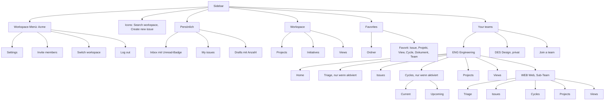

Regeln für die Sidebar:

- **Your teams** zeigt nur Teams, in denen der User Mitglied ist, sortiert nach `TeamMembership.sortOrder` (per Drag & Drop änderbar, siehe [02 §4.1](02-teams-rechte.md#41-datenmodell)). Sub-Teams erscheinen **eingerückt unter ihrem Parent**; ist der User nur im Sub-Team Mitglied (nur bei Gästen möglich, z. B. Carol in `WEB`), erscheint das Sub-Team als Wurzelknoten.
- Jeder Team-Knoten hat ein **Team menu** („…“): Team settings, Copy link, Favorite, Leave team…, Create sub-team… (nur wenn berechtigt).
- **Triage** erscheint nur bei `triageEnabled`, mit Zähler der nicht gesnoozten Triage-Issues. **Cycles** mit den Unterpunkten **Current** und **Upcoming** erscheinen nur bei `cyclesEnabled` (siehe [04 §1.10](04-planung.md#110-cycle-ansichten-current-previous-next)).
- **Join a team** öffnet die Liste aller Teams mit `canJoin = true` ([02 §4.2](02-teams-rechte.md#42-beitreten-hinzufügen-verlassen-entfernen)).
- Für Gäste entfallen **Workspace → Initiatives** und **Workspace → Views** (Workspace-Funktionen, siehe [02 §4.4](02-teams-rechte.md#44-gäste-und-private-teams)); **Projects** zeigt nur Projekte ihrer Teams.
- Sichtbarkeit und Reihenfolge der Einträge sind pro User anpassbar (Preferences → App sidebar → Customize).
- Ein Klick auf eine Inbox-Badge-Zahl oder einen Favoriten navigiert; Hover über einen Favoriten zeigt „Remove favorite“.

### 1.3 URL-Schema

Alle Pfade sind relativ zur Basis-URL (z. B. `https://lineal.example`), `{ws}` ist der `urlKey` des Workspace (`acme`). Muster und Slug-Regeln der Entitäten sind in [01 §6.2](01-domaenenmodell.md#62-urls) verbindlich festgelegt; diese Tabelle ergänzt die **Screen-Routen**. Der Slug-Anteil ist kosmetisch: aufgelöst wird über Kennung bzw. `slugId`, ein veralteter Slug führt per Redirect zur aktuellen URL. Zeilen mit **(F)** sind Festlegungen Lineal ohne beobachtetes Vorbild.

| Screen | Route | Beispiel | Bemerkung |
|---|---|---|---|
| Workspace anlegen | `/create-workspace` | `/create-workspace` | **(F)** außerhalb des `{ws}`-Präfixes |
| Einladung annehmen | `/invite/{token}` | `/invite/7f3c…` | **(F)** |
| Login | `/login` | | OAuth-Consent siehe [07 §1.3](07-mcp-server.md#13-authentifizierung-und-autorisierung) |
| Inbox | `/{ws}/inbox` | `/acme/inbox` | |
| Inbox mit geöffneter Notification | `/{ws}/inbox/{notificationId}` | `/acme/inbox/5b0e…` | **(F)**; Öffnen markiert als gelesen |
| My Issues | `/{ws}/my-issues/{tab}` | `/acme/my-issues/assigned` | `tab` ∈ `assigned`, `created`, `subscribed`, `activity` |
| Drafts | `/{ws}/drafts` | | |
| Suche | `/{ws}/search?q={term}` | `/acme/search?q=login` | Typ-Tab per `&type=…` (`issues`, `projects`, `initiatives`, `documents`) |
| Team-Home | `/{ws}/team/{KEY}/overview` | `/acme/team/ENG/overview` | `/{ws}/team/{KEY}` leitet hierher um |
| Team-Issues | `/{ws}/team/{KEY}/{view}` | `/acme/team/ENG/all` | `view` ∈ `active`, `backlog`, `all`; Filter als `?filter=<base64(JSON)>` |
| Triage | `/{ws}/team/{KEY}/triage` | `/acme/team/WEB/triage` | ohne Triage: Redirect auf `/all` |
| Cycles-Liste | `/{ws}/team/{KEY}/cycles` | `/acme/team/ENG/cycles` | |
| Cycle-Detail | `/{ws}/team/{KEY}/cycle/{ref}` | `/acme/team/ENG/cycle/42` | `ref` ∈ `active` (Current), `upcoming` (nächster Cycle), Cycle-Nummer |
| Team-Projekte | `/{ws}/team/{KEY}/projects/all` | | |
| Team-Views | `/{ws}/team/{KEY}/views/issues` | | |
| Team-View anlegen | `/{ws}/team/{KEY}/view/new` | | Inline-View-Builder |
| Team-Archiv | `/{ws}/team/{KEY}/archive` | | **(F)**; Shortcut `G X` |
| Issue-Detail | `/{ws}/issue/{KEY-n}/{slug}` | `/acme/issue/ENG-123/login-schlaegt-fehl` | `/{ws}/issue/{KEY-n}` ergänzt den Slug; alte Kennungen (`previousIdentifiers`) leiten um |
| Kommentar | Issue-URL + `#comment-{id8}` | | |
| Projekte (Workspace) | `/{ws}/projects/all` | | Projekt-Views `/{ws}/projects/view/{slug}-{slugId}` |
| Projektseite | `/{ws}/project/{slug}-{slugId}/{tab}` | `/acme/project/checkout-relaunch-8c41e0a9b2d3/overview` | `tab` ∈ `overview`, `issues`, `updates`, `milestones` |
| Project Update | Projekt-URL `/updates#{update.slugId}` | | [01 §6.2](01-domaenenmodell.md#62-urls) |
| Initiativen | `/{ws}/initiatives/{tab}` | `/acme/initiatives/active` | `tab` ∈ `active`, `planned`, `all` |
| Initiative | `/{ws}/initiative/{slug}-{slugId}/{tab}` | | `tab` ∈ `overview`, `projects`, `updates` |
| Views (Workspace) | `/{ws}/views/{type}` | `/acme/views/issues` | `type` ∈ `issues`, `projects` |
| View anlegen | `/{ws}/views/issues/new` | | |
| Custom View | `/{ws}/view/{slug}-{slugId}` | `/acme/view/offene-bugs-web-77aa00bb11cc` | kanonisch für **alle** Views; `/{ws}/team/{KEY}/view/{slug}-{slugId}` ist Alias (Redirect), siehe Abschnitt 6 |
| Dokument | `/{ws}/document/{slug}-{slugId}` | | [06 §1.6](06-dokumente-templates.md#16-url-schema) |
| User-Profil | `/{ws}/profiles/{displayName}` | `/acme/profiles/carol` | |
| Workspace-Settings | `/{ws}/settings/{section}` | `/acme/settings/workspace` | Sektionen siehe 2.12 |
| Neues Team | `/{ws}/settings/new-team` | | **(F)** |
| Team-Settings | `/{ws}/settings/teams/{KEY}/{section}` | `/acme/settings/teams/ENG/cycles` | Sektionen siehe 2.11 |
| Account-Settings | `/{ws}/settings/account/{section}` | `/acme/settings/account/notifications` | |
| Papierkorb | `/{ws}/trash/{type}` | `/acme/trash/issues` | **(F)**; „Recently deleted“; `type` ∈ `issues`, `projects`, `initiatives`, `documents` |

Zusätzlich gilt für alle Listen-Routen: Filter-, Gruppierungs- und Sortierzustand ungespeicherter Änderungen liegen im Query-Parameter `filter` (base64-kodiertes Filter-JSON nach [05](05-views-suche-inbox.md)); der zuletzt gesetzte Filter einer Standard-View wird pro User gemerkt und beim erneuten Öffnen ohne Parameter wieder angewendet, bis er mit „Clear“ entfernt wird.

### 1.4 Gemeinsame UI-Muster

| Muster | Beschreibung | Implementierungshinweis |
|---|---|---|
| **Picker** | Popover mit Suchfeld (Platzhalter beschreibt die Aktion, z. B. „Change status…“), Liste aus Icon + Label + optional Zähler/Shortcut, aktueller Wert mit Häkchen, Untermenüs mit ▶, Ziffern `1`–`9` wählen die n-te Option, `Esc` schließt eine Ebene | **eine** generische Komponente für alle Felder; Datenquelle = lokaler Sync-Store |
| **Inline-Edit** | Titel, Beschreibung, Projektname, Meilensteinname, Labelname werden direkt bearbeitet; kein Speichern-Button | Auto-Save (Debounce ca. 500 ms) als optimistische Mutation ([09 §5.4](09-api-events.md#54-optimistische-mutationen)) |
| **Toast mit Undo** | Nach Mutationen wie Teamwechsel, Löschen, Bulk-Änderung: Toast mit Link (`Ctrl Alt O`) und Undo (`Ctrl Z`) | Undo = inverse Mutation aus `updatedFrom` des Events |
| **Relative Zeiten** | „17d ago“, „20h“; Tooltip mit absolutem Datum; Zeitstempel sind Deep-Links (`#comment-…`, `#update-…`) | Zeitzone des Users |
| **Empty State** | Illustration, Erklärtext, Primär-Button | |
| **Rechte-Hinweis** | Gesperrte Controls zeigen Tooltip „Only workspace owners and admins can …“ | Button sichtbar, aber deaktiviert, wenn die Aktion grundsätzlich existiert |
| **Ungültige Route** | z. B. Triage deaktiviert, View gelöscht → stiller Redirect auf die Standard-View; nicht sichtbare Objekte → „not found“-Seite (keine Existenzbestätigung, [00 §7](00-konventionen.md#7-fehlermodell)) | |

---

## 2. Screen-Spezifikationen

Jede Spezifikation nennt Zweck, Bereiche, Aktionen und die benötigten Daten bzw. Schreibaufrufe. Lesedaten kommen in der Web-App aus dem **lokalen Sync-Store** (Bootstrap + Delta-Stream, [09 §5](09-api-events.md#5-echtzeit-sync-für-die-web-app)); die Spalte „Daten/API“ nennt die äquivalenten API-Queries bzw. Mutationen ([09 §1](09-api-events.md#1-öffentliche-api)) und, wo vorhanden, das MCP-Tool ([07](07-mcp-server.md)).

### 2.1 Issue-Liste und Board (Team-Issues, My Issues, Views, Projekt-Issues, Cycle-Issues)

**Zweck:** Issues einer Menge (Team, View, Projekt, Cycle, „mir zugewiesen“) finden, sortieren, gruppieren und massenhaft bearbeiten.

| Bereich | Inhalt |
|---|---|
| Header | Breadcrumb (`Engineering › Issues`), Stern **Add to favorites**, Glocke (Abo auf neue Issues der Ansicht), Tab-Pills **Active**, **Backlog**, **All issues** + angeheftete Team-Views + **Add new view**; rechts **Add filter** (`F`), **Display options** (`⇧ V`), **Open details** (`]`) |
| Filterleiste | Chips `[Feld] [Operator] [Wert] [x]`, „+“ (weiterer Filter), **Clear**, **Save** („Create new view…“); Operatoren und Filtermodell siehe [05](05-views-suche-inbox.md) |
| List-Layout | Gruppen-Header (Icon, Name, Anzahl, „+“ legt Issue mit vorbelegtem Gruppenwert an); Zeile: Priority-Icon, ID, Status-Icon, Titel, Relation-Badges („blocked by 1“), Label-Chips, Projekt-Chip, Cycle-Chip, Assignee-Avatar, Datum |
| Board-Layout | Spalten = Grouping (Default Status), optional Swimlanes = Sub-grouping; Spaltenkopf mit Anzahl („2 / 7“ bei Filter), „…“ und „+“; leere Spalten unter „Hidden columns“; Karte: ID, Status-Icon, Titel, Assignee, Property-Chips, „Created …“ |
| Fußzeile | „n issues hidden by filters [Clear Filters]“ bzw. „hidden by display options [Show options]“ |
| Details-Panel | Zusammenfassung der Ansicht (Anzahl, Verteilung nach Status/Assignee/Label) |

**Display options:** Layout List | Board; Grouping/Columns (Status, Assignee, Project, Priority, Cycle, Label, Parent issue, Team, Milestone, No grouping); Rows (Sub-grouping); Ordering (Manual, Title, Status, Priority, Assignee, Estimate, Updated, Created, Due date, Link count, Time in status) + Direction; „Order completed by recency“; Completed issues (All, Past day, Past week, Past month, Current cycle, None); Show sub-issues; Show empty columns/rows; Display properties (ID, Status, Assignee, Priority, Project, Due date, Milestone, Cycle, Labels, Links, Time in status, Created, Updated); **Reset** (auf Team-Default) und **Set default for everyone** (speichert Team-Default). Display options werden **pro User und View** gespeichert (`ViewPreferences`, [01 §5.2](01-domaenenmodell.md#52-viewpreferences)).

**Aktionen:** Fokus bewegen (`J`/`K`, Pfeile), Peek (`Space`), öffnen (`Enter`), selektieren (`X`, `⇧ Click`, `Ctrl A`), Property-Shortcuts auf Fokus bzw. Selektion (`S`, `A`, `P`, `L`, `⇧ E` …), Drag & Drop zwischen Spalten (ändert Gruppenwert) und innerhalb einer Spalte (ändert `sortOrder`, nur bei Ordering „Manual“), Bulk-Aktionen über Command-Menü.

**Sonderregeln:** Triage-Issues sind in allen Listen ausgeblendet, außer der Filter schließt Status-Typ „Triage“ explizit ein ([03 §10.1](03-issues-workflow.md#101-aktivierung)). My Issues gruppiert per Default nach **Focus** und sortiert fest nach Wichtigkeit; Board ist dort deaktiviert.

| Daten/API | MCP |
|---|---|
| `issues(filter, first, after, orderBy)`; Gruppenzähler lokal; Mutation `issueUpdate` (Drag & Drop mit `sortOrder`), `issueBatchUpdate` (Bulk) | `list_issues`, `save_issue` |

### 2.2 Issue-Detail

**Zweck:** Ein Issue vollständig lesen und bearbeiten, diskutieren und verknüpfen.

| Bereich | Inhalt (von oben nach unten) |
|---|---|
| Kopfzeile | Breadcrumb (Team bzw. Projekt › `ENG-123`), Stern, „…“ **Issue options**; rechts Copy issue URL, Copy issue ID, Copy branch name |
| Parent-Chip | nur bei Sub-Issues: `ENG-120 Checkout überarbeiten` mit Fortschritt „2/3“ |
| Titel | Inline editierbar (`⇧ R` fokussiert) |
| Beschreibung | Rich-Text-Editor (Markdown-Autoformat, `/`-Befehle, `@`-Mentions, Issue-Mentions als Chips, Drag & Drop-Anhänge); darunter **Add reaction**, **Attach images, files, or videos** |
| Sub-issues | Ohne Kinder Button **Add sub-issues**; mit Kindern einklappbarer Abschnitt mit Fortschrittskreis „x/y“ ([03 §3.5](03-issues-workflow.md#35-fortschritt-am-parent)), eigene Display options, **Create new sub-issue** (+); Zeile: Status-Icon, ID, Titel, Labels, Assignee |
| Resources | Link-Anhänge und Dateien (+ **Add resource to issue**), Dokumente zum Issue |
| Activity | Überschrift mit **Subscribe/Unsubscribe** und **Change subscribers** (Avatar-Stapel); chronologischer Feed aus History-Einträgen (einzeilig, z. B. „Bob moved from Todo to In Progress · 2h ago“) und Kommentar-Karten (Avatar, Name, Quelle „via API“/„via MCP“, Zeit-Link, Reaktionen, „…“, Thread-Antwortfeld „Leave a reply…“); aufeinanderfolgende Events werden zu „Show n events…“ zusammengefaltet ([03 §8.2](03-issues-workflow.md#82-zusammenfassen-coalescing)) |
| Kommentar-Editor | „Leave a comment…“, Attach, **Submit comment** (`Ctrl Enter`; per Preference alternativ `Enter`) |

**Property-Sidebar (rechts), Felder in dieser Reihenfolge:**

| Nr | Feld | Anzeige / Bedienung | Shortcut |
|---|---|---|---|
| 1 | Status | Icon (kodiert die Kategorie) + Name; Picker mit Ziffern 1–9 | `S` |
| 2 | Team | Team-Name + Link zur Team-Übersicht; Auswahl löst Teamwechsel aus (F7) | `Ctrl ⇧ M` |
| 3 | Priority | Icon + Name (No priority, Urgent, High, Medium, Low) | `P` |
| 4 | Assignee | Avatar + Name, „Go to user“; Picker mit Sonderwert „Assign to me“ | `A`, `I` |
| 5 | Cycle | „Cycle 42“ bzw. „Add to cycle“ + Link „Open cycle“; nur bei `cyclesEnabled` | `⇧ C` |
| 6 | Estimate | nur bei `issueEstimationType != notUsed`; Werte der Team-Skala | `⇧ E` |
| 7 | Due date | nur wenn gesetzt (sonst über „…“-Menü bzw. Shortcut); SLA-Badge daneben, falls vorhanden | `⇧ D` |
| 8 | Labels | farbige Chips + „+“; Gruppen als „Gruppe/Label“ | `L` |
| 9 | Project | Projekt-Button bzw. „Add to project“, darunter eingerückt **Milestone** („Set milestone“) | `⇧ P`, `⇧ M` |
| 10 | Related | Gruppen **Blocked by**, **Blocking**, **Related**, **Duplicate of**/**Duplicates**; Zeile mit Status-Icon + Titel, Hover „Remove relation“ | `M B`, `M X`, `M R`, `M M` |

**„…“ Issue options:** Team ▶ (Move to team…), Due date ▶, Add link…, Add document…, Create related ▶ (Issue…, Sub-issue…, Parent issue…, Blocked issue…, Blocking issue…), Mark as ▶ (Parent of…, Sub-issue of…, Related to…, Blocked by…, Blocking…, Duplicate of…), Remove ▶ (bestehende Relationen), Copy ▶ (ID, URL, Title, Title as link, Issue as Markdown, Everything as Markdown, Git branch name), Convert to ▶ (Project…, Template…, Recurring issue…), Make a copy…, Favorite, Remind me ▶ (An hour from now, In 3 hours, This evening, Tomorrow, Next week, A month from now, Next cycle, Custom…), Subscribe, Show description history, Delete.

| Daten/API | MCP |
|---|---|
| `issue(id)` inkl. `children`, `relations`, `inverseRelations`, `history`, `comments`, `attachments`; Mutationen `issueUpdate`, `issueRelationCreate/Delete`, `commentCreate`, `reactionCreate`, `attachmentLinkURL`, `fileUpload` | `get_issue`, `save_issue`, `list_comments`, `save_comment`, `prepare_attachment_upload`, `create_attachment_from_upload` |

### 2.3 Create-Issue-Modal

**Zweck:** Ein Issue mit minimaler Reibung anlegen; Einstieg über `C`, Stift-Icon in der Sidebar, „+“ in Spalten-/Gruppenköpfen, Command-Menü „Create new issue…“, `V` (Vollbild), `Alt C` (aus Template).

| Bereich | Inhalt |
|---|---|
| Kopf | Team-Chip **Set team** (`ENG`) › „New issue“; Template-Chip (wenn Templates verfügbar oder ein Default-Template vorausgewählt ist); rechts **Expand** (Vollbild) und **Close** |
| Titel | Platzhalter „Issue title“, Autofokus, Pflicht (ohne Template) |
| Beschreibung | Platzhalter „Add description…“, Rich-Text wie im Detail |
| Property-Chips | **Status** (Default nach [03 §1.5](03-issues-workflow.md#15-default-state-für-neue-issues), in der Triage-Ansicht „Triage“), **Priority**, **Assignee**, **Estimate** (nur wenn aktiviert), **Project** + **Milestone**, **Labels**, **Cycle** („Add to cycle…“ mit Current/Upcoming-Markierung), **…** (Set due date, Make recurring…, Add link…, Add sub-issue) |
| Fuß | **Attach images, files, or videos**, Toggle **Create more**, Button **Create issue** (`Ctrl Enter`) |

**Kontext-Vorbelegung:** „+“ einer Board-Spalte → Gruppenwert der Spalte (Status, Assignee, Priority …); Projektseite → Projekt; Cycle-Seite → Cycle; Team-Views → Team; Filter der aktuellen View → passende Werte (Festlegung Lineal: nur Gleichheitsfilter mit genau einem Wert werden übernommen).

**Drafts:** Wird das Modal mit Inhalt (Titel oder Beschreibung) geschlossen, entsteht ein **Draft** (Sidebar „Drafts“, Zähler +1); ohne Inhalt entsteht nichts. Drafts sind privat, werden lokal und serverseitig pro User gespeichert und beim Öffnen wieder ins Modal geladen. **Festlegung Lineal:** Drafts sind eine eigene, rein persönliche Entität ohne Kennung und ohne Team-Zähler; erst „Create issue“ vergibt die Nummer.

**Create more:** Ist der Toggle aktiv, bleibt das Modal nach dem Anlegen offen; Titel und Beschreibung werden geleert, Team, Template und Properties bleiben erhalten. `Ctrl ⇧ Enter` legt einmalig an und öffnet ein neues Modal mit denselben Werten.

| Daten/API | MCP |
|---|---|
| Templates des Teams (`templates`), Status, Labels, Cycles, Projekte des Teams aus dem Sync-Store; Mutation `issueCreate` (mit `templateId` bzw. `useDefaultTemplate`); Draft-Speicherung als Entität `Draft` ([01 §3.12](01-domaenenmodell.md#312-draft)) | `save_issue` ohne `id` (Template nur explizit über `template`) |

### 2.4 Command-Menü

**Zweck:** Jede Aktion und jedes Navigationsziel per Tastatur erreichen (`Ctrl K`).

| Bereich | Inhalt |
|---|---|
| Kontext-Chip | Ziel der Aktionen über dem Suchfeld, z. B. „ENG-123 · Login schlägt fehl“ oder „3 issues selected“ |
| Suchfeld | „Type a command or search…“; Fuzzy-Suche über Befehlsnamen **und** Werte verschachtelter Befehle („Move to a different team › Design“) |
| Ergebnisliste | gruppierte Einträge (Icon, Label, Shortcut-Hinweis rechts); unten „Quick results for …“ (Volltexttreffer: Issues, Projekte, Dokumente) |

**Kontextabhängige Gruppen:**

| Kontext | Zusätzliche Gruppen (oben) |
|---|---|
| Issue fokussiert/geöffnet oder Selektion | Assign to… (`A`), Assign to me (`I`), Change status… (`S`), Change priority… (`P`), Change or add labels… (`L`), Change estimate… (`⇧ E`), Add to project… (`⇧ P`), Move to cycle… (`⇧ C`), Move to a different team… (`Ctrl ⇧ M`), Set due date… (`⇧ D`), Set parent… (`Ctrl ⇧ P`), Create sub-issue (`Ctrl ⇧ O`), Mark issue as… (blocked, blocking, related, duplicate), Remove related…, Subscribe (`⇧ S`), Change subscribers… (`Ctrl ⇧ S`), Favorite (`Alt F`), Remind me… (`⇧ H`), Add link… (`Ctrl Alt L`), Create new document for issue…, Rename (`⇧ R`), Copy …, Make a copy…, Create project from issue…, Convert into template…, Description history, Delete (`Ctrl Delete`) |
| Triage-Issue | zusätzlich Accept (`1`), Decline (`2`), Mark as duplicate (`3`), Snooze (`H`) |
| Projekt | Change project status… (`P S`), lead (`P A`), members (`P M`), teams (`P T`), initiatives (`P N`), labels (`P L`), Set start/target date, Write new project update (`Ctrl ⇧ U`) |
| Liste/View | Add filter… (`F`), Display options… (`⇧ V`), Toggle layout (`Ctrl B`), Save as view… (`Alt V`), Export issues as CSV…, Select all (`Ctrl A`) |
| Inbox | Mark as read/unread (`U`), Mark all as read (`Alt U`), Snooze (`H`), Delete notification (`Backspace`), Delete all read (`⇧ Backspace`), Unsubscribe |
| immer | **Create**: new issue (`C`), issue in fullscreen (`V`), issue from template (`Alt C`), new project (`N P`), new initiative (`N I`), new document in…, new view, new label, new template, new favorites folder, Create a team…; **Navigation**: alle `G …`- und `O …`-Ziele aus Abschnitt 3; **Settings**: Change interface theme…, Invite to workspace…, Go to settings (`G S`); **Help**: Keyboard shortcuts (`Ctrl /`), Documentation; **Account**: Switch workspace (`O W`), Log out (`Alt ⇧ Q`) |

Befehle mit „…“ wechseln **im selben Overlay** in eine Auswahlliste (Breadcrumb-artig); `Backspace` im leeren Suchfeld oder `Esc` geht eine Ebene zurück. Ausgeführte Befehle erscheinen beim nächsten Öffnen oben unter „Recent“ (Festlegung Lineal).

**Implementierung:** Das Command-Menü ist **die zentrale Aktions-Registry**. Jede Aktion wird einmal registriert mit `id`, `label`, `group`, `shortcut?`, `contexts[]` (z. B. `issue`, `issueSelection`, `triageIssue`, `project`, `list`, `inbox`, `global`), `isEnabled(ctx)` (Rechte, Feature-Flags wie `cyclesEnabled`) und `run(ctx)` bzw. `subMenu(ctx)`. Shortcuts, Kontextmenüs („…“, Rechtsklick) und Command-Menü lesen aus derselben Registry, damit keine Aktion nur mit der Maus erreichbar ist.

| Daten/API | MCP |
|---|---|
| lokal (Registry + Sync-Store); „Quick results“ über `searchIssues`, `searchProjects`, `searchDocuments` | – |

### 2.5 Triage-Ansicht

**Zweck:** Eingehende Issues eines Teams prüfen und einsortieren ([03 §10](03-issues-workflow.md#10-triage)). Nur bei `triageEnabled`; Route `/{ws}/team/{KEY}/triage`, Shortcut `G T`.

| Bereich | Inhalt |
|---|---|
| Header | `Web › Triage`, Zähler, Filter/Display options (inkl. „Show snoozed“), Info zur Triage-Verantwortung („On triage: Bob“) |
| Liste | Triage-Issues des Teams, Default-Sortierung nach `startedTriageAt` aufsteigend (älteste zuerst); Zeile mit Ersteller bzw. Quelle („via email“), Titel, SLA-Badge |
| Detail | Split-View: rechts das gewählte Issue (wie 2.2) mit **Triage-Leiste** über dem Titel: **Accept** (`1`), **Decline** (`2`), **Mark as duplicate** (`3`), **Snooze** (`H`), **Move to team** (`Ctrl ⇧ M`) |
| Accept-/Decline-Popover | optionales Kommentarfeld, bei Accept zusätzlich Status-Picker (`backlog`/`unstarted`/`started`, Default `defaultIssueState`) und – bei `requirePriorityToLeaveTriage` – Pflicht-Priority-Picker |

| Daten/API | MCP |
|---|---|
| `issues(filter: { team: WEB, state: { type: { eq: triage } } })`; Accept/Decline/Duplicate/Snooze als `issueUpdate` (`stateId`, `snoozedUntilAt`) bzw. `issueRelationCreate(type: duplicate)` + `commentCreate` | `list_issues` mit `state: "triage"`, `save_issue` (`state`, `duplicateOf`), `save_comment`, `get_triage_responsibility` |

### 2.6 Cycles-Ansicht

**Liste** (`/team/{KEY}/cycles`): vertikale Timeline mit einer Zeile pro Cycle (Icon, „Cycle 42“ bzw. Name, Badge **Current**/**Upcoming**/**Planned**/**Completed**, Datumsbereich, Kapazitätsindikator „72% of capacity“, „scope“). Der aktuelle Cycle ist aufgeklappt und zeigt das **Burn-up-Chart** (Scope, Started, Completed, Ideallinie) mit Legende ([04 §1.9](04-planung.md#19-fortschritt-und-scope-historie)).

**Detail** (`/team/{KEY}/cycle/{ref}`): Breadcrumb `Engineering › Cycles › Cycle 42 ˅` (Switcher „Open cycle…“), Stern, „…“ **Cycle options** (Edit cycle name and description…, Change cycle dates, Subscribe to cycle notifications, Favorite, Copy link, Export issues as CSV…). Links die Issue-Liste des Cycles (Default gruppiert nach Status); rechts die Cycle-Sidebar: Badge + Datumsbereich (Enddatum änderbar), **Add document or link…**, **Progress** (Scope/Started/Completed mit Zahlen und %, Burn-up), Tabs **Assignees**, **Labels**, **Priority**, **Projects** mit Fortschrittsbalken; Klick auf einen Eintrag filtert die Liste.

| Daten/API | MCP |
|---|---|
| `cycles(filter: { team })`, `cycle(id)` inkl. Snapshot-Arrays; Mutationen `cycleUpdate`, `issueUpdate(cycleId)`, `issueBatchUpdate` | `list_cycles`, `save_issue` (`cycle`) |

### 2.7 Projektseite

**Zweck:** Ein Projekt planen, verfolgen und berichten ([04 §2](04-planung.md#2-projekte)).

| Bereich | Inhalt |
|---|---|
| Header | Icon + Name, Stern, „…“ **Project actions** (Copy ▶, Favorite, Subscribe, Remind me, Change update schedule…, Show description history, Convert to template…, Archive, Delete); rechts Copy page URL, Glocke (Projekt-Benachrichtigungen) |
| Tabs | **Overview**, **Issues**, **Updates**, **Milestones** + projektbezogene Views; Toggle „Project details“ (rechte Sidebar). Bei mehreren Teams hat der Issues-Tab Unter-Tabs „All“ und je Team ([04 §2.2](04-planung.md#22-teams-lead-team-lead-und-mitglieder)) |
| Overview | Icon, **Project name**, **Project summary**; Property-Zeile (Status, Priority, Lead, Members, Start → Target, Teams); **Resources** (Dokumente und Links, „+ Add document or link…“); Karte **Latest update** (Health-Badge, Autor, Text, automatischer Diff, Kommentare) mit Button **Update**; **Description** (Projekt-Brief); Abschnitt **Milestones** mit Karten |
| Issues | Issue-Liste (2.1), Default gruppiert nach **Milestone**; zusätzliche Grouping-Optionen Milestone und Team; List options **Nested sub-issues** (Show all / Show matching / Hide) |
| Updates | Composer mit Umschalter **Comment** / **Update**, Health-Picker („On track“, „At risk“, „Off track“), Textfeld, vorbereiteter Diff-Block ([04 §5.3](04-planung.md#53-diff-zum-vorherigen-update)), **Post update**; darunter Feed aus Updates und Projekt-Aktivität |
| Milestones | Liste aller Meilensteine (Name, Zieldatum, Fortschritt „38% of 13“, Beschreibung), **Add milestone**, Zeilenmenü (Open milestone issues, Edit…, Set target date…, Move milestone to ▶, Convert to project, Delete…) |
| Rechte Sidebar | **Properties** (Status, Priority, Lead, Members, Dates, Teams, Initiatives, Labels, Dependencies „Blocked by…/Blocking…“), **Milestones** (kompakt), **Progress** (nach Assignee, Labels, Teams umschaltbar) |

| Daten/API | MCP |
|---|---|
| `project(id)` inkl. `teams`, `projectMilestones`, `projectUpdates`, `issues`; Mutationen `projectUpdate`, `projectMilestoneCreate/Update/Delete`, `projectUpdateCreate`, `documentCreate` | `get_project`, `save_project`, `list_milestones`, `save_milestone`, `get_status_updates`, `save_status_update`, `save_document` |

### 2.8 Initiativen

**Liste** (`/initiatives/active|planned|all`): Tabelle mit **Name** (Icon, Summary grau), **Priority**, **Owner**, **Target**, **Projects** („2 / 5“ abgeschlossen), **Health**; Sub-Initiativen eingerückt unter ihren Eltern (bei mehreren Eltern mehrfach angezeigt, Festlegung Lineal). Button **New initiative** (`N I`).

**Detail** (`/initiative/{slug}-{slugId}/overview|projects|updates`): Header mit **Initiative actions**, Copy page URL, Glocke, **Add project**; Overview mit Name, Summary, Properties (Status Proposed/Planned/Active/Completed/Canceled, Priority, Owner, Target date, Parent initiatives), Resources, Update-Composer mit Health, Description, eingebettete **Projects**-Liste (gruppiert nach Projektstatus, Umschalter „Include sub-initiatives“, [04 §4.4](04-planung.md#44-projekte-zuordnen)) und **Sub-initiatives**-Liste mit „+ Add sub-initiative“.

Gäste sehen diesen Bereich nicht ([02 §4.4](02-teams-rechte.md#44-gäste-und-private-teams)).

| Daten/API | MCP |
|---|---|
| `initiatives`, `initiative(id)`; Mutationen `initiativeCreate/Update`, `initiativeToProjectCreate` | `list_initiatives`, `get_initiative`, `save_initiative`, `save_project` (`addInitiatives`) |

### 2.9 Inbox

**Zweck:** Persönliche Benachrichtigungen abarbeiten ([05](05-views-suche-inbox.md)).

| Bereich | Inhalt |
|---|---|
| Header | „Inbox“, „…“ **Notification actions** (Mark all as read, Delete all, Delete all read, Delete all completed, Go to settings); Toggle **Show unreads only**, **Add filter**, **Display options** |
| Liste (links) | Eintrag: Akteur-Avatar mit Typ-Badge (Kommentar, Mention, Zuweisung, Statuswechsel …), blauer Punkt = ungelesen, `ENG-123 Titel` (fett wenn ungelesen), Ereignistext („Bob commented: …“), rechts aktueller Status, Priority-Icon (bei Urgent), relative Zeit |
| Detail (rechts) | Das Bezugsobjekt (Issue-Detail, Projekt-Update, Dokument) mit Scroll zum Anker (`#comment-…`); dort kann direkt geantwortet und bearbeitet werden. Leer: Zähler „n unread notifications“ |
| Kontextmenü | Mark as read/unread, Delete notification, **Snooze** ▶ (An hour from now, In 3 hours, This evening, Tomorrow, Next week, A month from now, Next cycle, Custom…), **Unsubscribe**, Favorite, Copy |
| Filter | Notification type (Assignments, Comments and replies, Mentions, Reactions, Reminders and deadlines, Status changes, Subscriptions, Updates, System), From, Team, Project, Initiative, Issue priority, Issue status type |
| Display options | Enable priority inbox; Group unreads by (No grouping / Focus); Ordering (Newest / Oldest / Priority); Show snoozed; Show unread first |

„Delete“ einer Notification bedeutet in Lineal **Archivieren** (`archivedAt`), nicht physisches Löschen ([00 §8](00-konventionen.md#8-audit-felder-alle-entitäten)).

| Daten/API | MCP |
|---|---|
| `notifications(filter, includeArchived)`; Mutationen `notificationUpdate` (`readAt`, `snoozedUntilAt`), `notificationArchive`, `notificationSnoozeAll` | `get_notifications`, `mark_notification` (nur read/unread und snooze) |

### 2.10 View-Builder

**Zweck:** Filter und Anzeigeoptionen als **Custom View** speichern ([05](05-views-suche-inbox.md), Entität `CustomView` in [01 §5.1](01-domaenenmodell.md#51-customview)).

| Bereich | Inhalt |
|---|---|
| Edit-Karte | **Choose icon**, Name (Platzhalter = Basis-View), **Description (optional)**, **Save to** (Personal, Workspace, oder ein Team), rechts **Cancel** und **Create view** |
| Typ-Umschalter | **Issues** / **Projects** (nur Workspace-Views; Team-Views sind immer Issue-Views) |
| Filterleiste + Display options | wie 2.1, inklusive Advanced filter (verschachtelte AND/OR-Gruppen) |
| Live-Vorschau | Ergebnisliste in Echtzeit unterhalb |

Einstiege: Filterleiste **Save** („Create new view…“), Tab **Add new view** (Team), Views-Seite **New view**, `Alt V`, Command-Menü „Create view…“. Gespeicherte Views erscheinen als Tab (Team-Views), in der Views-Liste und können favorisiert und abonniert werden („Setup … notifications“). Gäste können nur persönliche Views und Team-Views ihrer Teams anlegen.

| Daten/API | MCP |
|---|---|
| Mutationen `customViewCreate/Update/Delete`, `favoriteCreate`; Vorschau über `issues(filter)` | `list_custom_views` (nur lesend; Anlegen von Views ist über MCP nicht vorgesehen) |

### 2.11 Team-Settings

Route `/{ws}/settings/teams/{KEY}`; Übersichtsseite mit Kopf (Icon, Name, Sichtbarkeit „Accessible to all workspace members“ bzw. „Private“) und Zeilen „Titel – Beschreibung – aktueller Wert“. Regeln und Felder: [02 §2.5](02-teams-rechte.md#25-team-einstellungen-vollständig).

| Sektion (Route) | Optionen |
|---|---|
| General (`/general`) | Name, Icon, **Identifier** (Key, Änderung nach [02 §2.6](02-teams-rechte.md#26-team-key-ändern)), Description, **Estimates** (Not in use, Exponential, Fibonacci, Linear, T-Shirt; Zero/Extended), **Timezone**, Create issues by email, Enable detailed issue history |
| Members (`/members`) | Suche, Filter (All/Members/Applications), **Add a member**, Tabelle (Name, Email, Role, Owner-Flag), Zeilenmenü (Make owner, Remove from team / Leave team…) |
| Visibility & access (`/access`) | **Festlegung Lineal** (Sektion gebündelt): Visibility (`public`/`restricted`/`private`), All members can join, Join by default, Team-Rechte `memberManagement`, `teamManagement`, `labelManagement`, `templateManagement`, `issueSharing` ([02 §6.3](02-teams-rechte.md#63-konfigurierbare-rechte)) |
| Issue labels (`/issue-labels`) | **New group**, **New label**, Tabelle (Name, Description, Issues, Last applied, Created), Zeilenmenü (Edit, Move to workspace…, View labeled issues, Retire/Archive…, Delete) |
| Templates (`/templates`) | Gruppen **Issue templates**, **Project templates**, **Document templates** je mit **New template**; Default-Template für Mitglieder / Nicht-Mitglieder ([06 §2.8](06-dokumente-templates.md#28-default-templates-pro-team)) |
| Recurring issues (`/recurring-issues`) | optional ([03 §13](03-issues-workflow.md#13-wiederkehrende-issues-optional)) |
| Issue statuses (`/statuses`) | Gruppen je Kategorie (Triage, Backlog, Unstarted, Started, Completed, Canceled, Duplicate), **Create new workflow state** (+), Zeile mit Name, „· Default“, Beschreibung, „View issues“, Menü (Make default, Edit, Delete → Migrationsdialog nach [03 §1.4](03-issues-workflow.md#14-löschen-eines-status-mit-issues-migration)); Drag & Drop innerhalb der Kategorie |
| Workflow & automations (`/workflow`) | Auto-close parent issues, Auto-close sub-issues, Auto-close stale issues (Periode, Zielstatus), Auto-archive closed items after (1/3/6/9/12 Monate), Re-order issues when moved to a new status (First/Last/No action) |
| Triage (`/triage`) | Enable triage for this team, Require explicit prioritization, **Triage responsibility** (Notify/Assign, Personen oder Schichtplan), Triage rules (optional) |
| Cycles (`/cycles`) | Enable cycles, Cycle duration (1–8 Wochen), Cooldown (keiner, 1–3 Wochen), Cycle start (Wochentag), Auto-create cycles (Anzahl vorausgeplanter Cycles), Cycle automation (Active issues & due date, Completed issues), Move unstarted issues to backlog when removed from cycle ([04 §1.2](04-planung.md#12-team-einstellungen)) |
| SLAs (`/sla`) | SLA-Regeln des Teams ([03 §11.2](03-issues-workflow.md#112-sla-regeln-team-konfiguration)) |
| Team hierarchy (`/hierarchy`) | **Parent team** (Picker, „No parent team“), Liste der Sub-Teams, Inherit workflow statuses / estimates / project statuses; öffnet den Nesting-Wizard (F2) |
| Webhooks (`/webhooks`) | Team-Webhooks ([09 §4](09-api-events.md#4-webhooks)) |
| Danger zone | Leave team…, Retire team…, Delete team… ([02 §2.7](02-teams-rechte.md#27-lebenszyklus-retire-restore-löschen)) |

### 2.12 Workspace- und Account-Settings

| Gruppe | Sektionen (Route unter `/{ws}/settings/`) |
|---|---|
| Personal | Preferences (`account/preferences`: Default home view, Display names, First day of the week, Send comments on Enter oder Ctrl Enter, Theme, App sidebar customize), Profile (`account/profile`), Notifications (`account/notifications`: Priority inbox, Kanäle Desktop/Mobile/Email mit Digest/Immediate und Typ-Checkboxen), Security & access (`account/security`: Sessions, persönliche API-Keys, autorisierte OAuth-Apps inkl. MCP-Clients) |
| Issues | Labels (`issue-labels`), Templates (`issue-templates`), SLAs (`sla`) |
| Projects | Labels (`project-labels`), Templates (`project-templates`), Statuses (`project-statuses`), Updates (`project-updates`: Default-Kadenz und Erinnerungen) |
| Features | Initiatives (`initiatives`: Update-Kadenz), Documents (`documents`: Dokument-Templates) |
| Administration | Workspace (`workspace`: Logo, Name, URL, Fiscal year start, Default home view, Danger zone „Delete workspace“), Teams (`teams`: alle Teams inkl. privater als Metadaten, **Create team**), Members (`members`: Liste, Rollen, **Invite**, Suspend), Security (`security`: Rollen-Schwellen wie `teamCreationRole`, `invitationsRole`, Gäste erlauben, Domains), API (`api`: Webhooks, OAuth-Applications), Limits (`limits`: konfigurierbare Workspace-Limits, [02 §1.3](02-teams-rechte.md#13-konfigurierbare-workspace-limits)), Import & export |
| Your teams | je Team `teams/{KEY}` (Sektionen siehe 2.11) |

Rechte: [02 §6.4](02-teams-rechte.md#64-berechtigungsmatrix). Members sehen die Administration-Sektionen nur lesend bzw. gar nicht; Gäste sehen nur Personal.

---

## 3. Tastaturkürzel

### 3.1 Prinzip „keyboard-first“

Lineal ist wie das Original **keyboard-first**: Jede Aktion, die mit der Maus erreichbar ist, ist auch per Tastatur erreichbar – entweder über ein direktes Kürzel oder mindestens über das Command-Menü (`Ctrl K`). Umgekehrt hat jedes Kürzel einen gleichnamigen Eintrag im Command-Menü, damit Kürzel entdeckbar bleiben (der Eintrag zeigt das Kürzel rechts an). Die Kürzel-Übersicht öffnet `Ctrl /` als Slide-over-Panel mit Suchfeld.

Notation: `Ctrl` steht für Cmd auf macOS; `⇧` = Shift; `G` `I` = **Sequenz** (erst `G`, dann innerhalb von ca. 1 s `I`); `Ctrl ⇧ M` = gleichzeitig. Spalte **Scope**: **Kern** = umzusetzen; **optional** = Erweiterung; **außerhalb** = Funktion außerhalb des Scopes ([README](README.md#scope)), nur der Vollständigkeit halber gelistet und in Lineal nicht belegt.

### 3.2 Vollständige Kürzel-Tabelle

| Kontext | Taste | Aktion | Scope |
|---|---|---|---|
| Allgemein | `Ctrl K` | Command-Menü öffnen | Kern |
| Allgemein | `Ctrl Enter` | Speichern bzw. Absenden (Modal, Kommentar) | Kern |
| Allgemein | `Enter` | Kommentar senden (wenn Preference „Send comments on Enter“) | Kern |
| Allgemein | `Esc` | Zurück / Ebene schließen; in Listen ohne Popover eine Ebene hoch | Kern |
| Allgemein | `/` | Suche öffnen | Kern |
| Allgemein | `?` | Hilfe-Menü öffnen | Kern |
| Allgemein | `Ctrl /` | Kürzel-Übersicht anzeigen | Kern |
| Allgemein | `O` `W` | Workspace wechseln | Kern |
| Allgemein | `Alt ⇧ Q` | Abmelden | Kern |
| Allgemein | `Ctrl Z` / `Ctrl ⇧ Z` | Undo / Redo der letzten Aktion | Kern |
| Allgemein | `Ctrl Alt O` | Link aus letztem Toast öffnen | Kern |
| Allgemein | `Ctrl Alt X` | Alle Toasts schließen | Kern |
| Allgemein | `Ctrl J` | KI-Fragemodus („Ask“) | außerhalb |
| Navigation | `[` | Linke Sidebar ein-/ausblenden | Kern |
| Navigation | `]` | Rechte Sidebar (Details) ein-/ausblenden | Kern |
| Navigation | `Ctrl ⇧ 1`–`9` | Zum n-ten Team der Sidebar | Kern |
| Navigation | `Ctrl ⇧ ↑` | Parent-Issue öffnen | Kern |
| Navigation | `Ctrl ⇧ ↓` | Sub-Issue öffnen | Kern |
| Navigation | `⇧ V` | Display options anzeigen | Kern |
| Navigation | `G` `I` | Go to Inbox | Kern |
| Navigation | `G` `M` | Go to My issues | Kern |
| Navigation | `G` `T` | Go to Triage (aktuelles Team) | Kern |
| Navigation | `G` `D` | Go to Drafts | Kern |
| Navigation | `G` `A` | Go to Active issues | Kern |
| Navigation | `G` `B` | Go to Backlog | Kern |
| Navigation | `G` `E` | Go to All issues | Kern |
| Navigation | `G` `X` | Go to Team-Archiv | Kern |
| Navigation | `G` `C` | Go to Cycles | Kern |
| Navigation | `G` `V` | Go to Current cycle | Kern |
| Navigation | `G` `W` | Go to Upcoming cycle | Kern |
| Navigation | `G` `P` | Go to Projects | Kern |
| Navigation | `G` `N` | Go to Initiatives | Kern |
| Navigation | `G` `U` | Go to Views | Kern |
| Navigation | `G` `S` | Go to Settings | Kern |
| Navigation | `G` `J` | Go to Agent | außerhalb |
| Navigation | `G` `R` | Go to Reviews | außerhalb |
| Navigation | `G` `L` | Go to Loops | außerhalb |
| Navigation | `G` `Q` | Go to Customers | außerhalb |
| Navigation | `G` `-` | Go to Dashboards | außerhalb |
| Navigation | `O` `I` | Open issue… (Schnellsuche) | Kern |
| Navigation | `O` `T` | Open team… | Kern |
| Navigation | `O` `P` | Open project… | Kern |
| Navigation | `O` `N` | Open initiative… | Kern |
| Navigation | `O` `C` | Open cycle… | Kern |
| Navigation | `O` `V` | Open view… | Kern |
| Navigation | `O` `F` | Open favorite… | Kern |
| Navigation | `O` `D` | Open document… | Kern |
| Navigation | `O` `U` | Open user… | Kern |
| Navigation | `O` `L` | Open issue label… | Kern |
| Navigation | `O` `S` | Open settings… | Kern |
| Navigation | `O` `Q` | Open customer… | außerhalb |
| Issues | `C` | Neues Issue | Kern |
| Issues | `Alt C` | Neues Issue aus Template | Kern |
| Issues | `V` | Neues Issue im Vollbild | Kern |
| Issues | `Ctrl ⇧ Enter` | Im Modal: anlegen und weiteres mit denselben Werten öffnen | Kern |
| Issues | `A` | Assignee setzen | Kern |
| Issues | `I` | Mir selbst zuweisen | Kern |
| Issues | `S` | Status ändern | Kern |
| Issues | `P` | Priority ändern | Kern |
| Issues | `L` | Labels ändern | Kern |
| Issues | `⇧ E` | Estimate ändern | Kern |
| Issues | `⇧ D` | Due date setzen | Kern |
| Issues | `Ctrl ⇧ D` | Due date entfernen | Kern |
| Issues | `⇧ R` | Umbenennen (Titel fokussieren) | Kern |
| Issues | `Ctrl ⇧ I` | Beschreibung fokussieren | Kern |
| Issues | `⇧ C` | Zu Cycle hinzufügen / verschieben | Kern |
| Issues | `⇧ P` | Zu Projekt hinzufügen | Kern |
| Issues | `⇧ M` | Projekt-Meilenstein setzen | Kern |
| Issues | `Ctrl ⇧ P` | Parent-Issue setzen | Kern |
| Issues | `Ctrl ⇧ O` | Sub-Issue anlegen (bzw. Selektion zu Sub-Issues machen) | Kern |
| Issues | `Ctrl ⇧ M` | In anderes Team verschieben (auch Bulk) | Kern |
| Issues | `M` `B` | Als „blocked by“ markieren | Kern |
| Issues | `M` `X` | Als „blocking“ markieren | Kern |
| Issues | `M` `R` | Related-Issue referenzieren | Kern |
| Issues | `M` `M` | Als Duplikat markieren | Kern |
| Issues | `Ctrl Alt L` | Beliebige URL als Link anhängen | Kern |
| Issues | `Ctrl ⇧ L` | Links-Abschnitt ein-/ausklappen | Kern |
| Issues | `⇧ S` | Issue abonnieren / Abo beenden | Kern |
| Issues | `Ctrl ⇧ S` | Abonnenten verwalten | Kern |
| Issues | `Alt F` | Als Favorit markieren | Kern |
| Issues | `⇧ H` | Erinnerung setzen („Remind me“) | Kern |
| Issues | `Ctrl Delete` | Issue löschen (Papierkorb) | Kern |
| Issues | `#` | Issue aus Archiv/Papierkorb wiederherstellen | Kern |
| Issues | `Ctrl .` | Issue-ID kopieren | Kern |
| Issues | `Ctrl ⇧ .` | Git-Branch-Namen kopieren | optional |
| Issues | `Ctrl ⇧ ,` | Issue-URL kopieren | Kern |
| Issues | `Ctrl ⇧ '` | Issue-Titel kopieren | Kern |
| Issues | `Ctrl Alt C` | Alles als Markdown kopieren | Kern |
| Issues | `Ctrl Alt ⇧ T` | Template auf Issue anwenden | optional (Lineal wendet Templates nur beim Anlegen an, [06 §2.5](06-dokumente-templates.md#25-anwendung-merge-regeln)) |
| Issues | `Ctrl Alt P` | Als Prompt kopieren | außerhalb |
| Issues | `W` `O` | „Work on issue“ in Coding-Tool | außerhalb |
| Triage | `1` | Accept | Kern |
| Triage | `2` | Decline | Kern |
| Triage | `3` | Mark as duplicate | Kern |
| Triage | `H` | Snooze | Kern |
| Projekte | `N` `P` | Neues Projekt | Kern |
| Projekte | `P` `S` | Projektstatus ändern | Kern |
| Projekte | `P` `P` | Projekt-Priority ändern | Kern |
| Projekte | `P` `N` | Initiativen ändern | Kern |
| Projekte | `P` `A` | Lead ändern | Kern |
| Projekte | `P` `M` | Mitglieder ändern | Kern |
| Projekte | `P` `T` | Teams ändern | Kern |
| Projekte | `P` `L` | Labels ändern | Kern |
| Projekte | `Ctrl Alt S` | Startdatum setzen | Kern |
| Projekte | `Ctrl Alt D` | Zieldatum setzen | Kern |
| Projekte | `Alt F` | Als Favorit markieren | Kern |
| Projekte | `⇧ H` | Erinnerung setzen | Kern |
| Projekte | `Ctrl U` | Updates & Aktivität öffnen | Kern |
| Projekte | `Ctrl ⇧ U` | Neues Project Update schreiben | Kern |
| Projekte | `Ctrl .` / `Ctrl ⇧ ,` / `Ctrl ⇧ '` | ID / URL / Titel kopieren | Kern |
| Initiativen | `N` `I` | Neue Initiative | Kern |
| Initiativen | `N` `O` | Owner ändern | Kern |
| Initiativen | `Ctrl Alt D` | Zieldatum setzen | Kern |
| Initiativen | `Alt F` | Als Favorit markieren | Kern |
| Initiativen | `⇧ H` | Erinnerung setzen | Kern |
| Initiativen | `Ctrl U` | Updates & Aktivität öffnen | Kern |
| Initiativen | `Ctrl ⇧ U` | Neues Initiative Update schreiben | Kern |
| Initiativen | `Ctrl .` / `Ctrl ⇧ ,` / `Ctrl ⇧ '` | ID / URL / Titel kopieren | Kern |
| Liste/Board | `J` / `↓`, `K` / `↑` | Fokus runter / hoch | Kern |
| Liste/Board | `→` / `←` | Fokus rechts / links (Board) | Kern |
| Liste/Board | `Space` | Peek (Vorschau; antippen = umschalten, halten = temporär) | Kern |
| Liste/Board | `Enter` | Fokussiertes Element öffnen | Kern |
| Liste/Board | `X` | Element selektieren | Kern |
| Liste/Board | `⇧ X`, `⇧ ↑/↓`, `⇧ Click` | Bereich selektieren | Kern |
| Liste/Board | `Ctrl Alt A` | Alle in der Gruppe selektieren | Kern |
| Liste/Board | `Ctrl A` | Alle selektieren | Kern |
| Liste/Board | `Esc` | Selektion aufheben | Kern |
| Liste/Board | `Ctrl B` | Layout List ↔ Board umschalten | Kern |
| Liste/Board | `Ctrl ⇧ C` | Seiten-URL kopieren | Kern |
| Liste/Board | `Ctrl F` | In der View suchen | Kern |
| Liste/Board | `Alt V` | Aktuelle Ansicht als View speichern | Kern |
| Liste/Board | `Alt ⇧ ↑` / `Alt ↑` / `Alt ↓` / `Alt ⇧ ↓` | Manuell: an den Anfang / eins hoch / eins runter / ans Ende der Gruppe | Kern |
| Liste/Board | `Ctrl ←` / `Ctrl →` | In linke / rechte Spalte verschieben (ändert Gruppenwert) | Kern |
| Liste/Board | `T` / `Alt T` | Gruppe bzw. Swimlane / alle ein-/ausklappen | Kern |
| Timeline | `⇧ {` | Projektliste der Timeline umschalten | optional |
| Timeline | `X`, `→`, `←`, `Esc` | Projekt/Meilenstein wählen, nächstes, vorheriges, abwählen | optional |
| Timeline | Drag / `Ctrl` Drag / `⇧` Drag | Projekt verschieben (mit / ohne Abhängigkeiten und Meilensteine; Abhängigkeiten bzw. Folgemeilensteine mitschieben) | optional |
| Timeline | `Ctrl Scroll`, `-`, `=`, `Y`, `Q`, `M`, `W` | Zoom; auf Jahr, Quartal, Monat, Woche | optional |
| Kommentare | `Ctrl M` | Issue kommentieren (Editor fokussieren) | Kern |
| Kommentare | `R` | Auf fokussierten Kommentar antworten | Kern |
| Inbox | `J` / `K` | Nächste / vorherige Notification | Kern |
| Inbox | `U` | Gelesen / ungelesen umschalten | Kern |
| Inbox | `Alt U` | Alle als gelesen markieren | Kern |
| Inbox | `H` | Notification snoozen | Kern |
| Inbox | `Delete` / `Backspace` | Notification löschen (archivieren) | Kern |
| Inbox | `⇧ Backspace` | Alle gelesenen löschen | Kern |
| Filter | `F` | Filter hinzufügen | Kern |
| Filter | `⇧ F` | Letzten Filter entfernen | Kern |
| Filter | `Alt ⇧ F` | Alle Filter entfernen | Kern |
| Picker | `1`–`9` | n-te Option wählen | Kern |
| Editor | `Ctrl B` / `Ctrl I` / `Ctrl U` | Fett / Kursiv / Unterstrichen | Kern |
| Editor | `Ctrl ⇧ X` | Durchgestrichen | Kern |
| Editor | `Ctrl E` | Inline-Code | Kern |
| Editor | `Ctrl K` | Link | Kern |
| Editor | `Ctrl ⇧ U` | Bild/Datei anhängen | Kern |
| Editor | `Alt ⇧ .` | Zitat | Kern |
| Editor | `Ctrl Alt 0` | Normaler Text | Kern |
| Editor | `Ctrl Alt 1`–`4` | Überschrift 1–4 | Kern |
| Editor | `Ctrl ⇧ 6` | Aufklappbarer Abschnitt | Kern |
| Editor | `Ctrl ⇧ 7` | Checkliste | Kern |
| Editor | `Ctrl Enter` / `Ctrl ⇧ Enter` | Checklisten-Punkt / verschachtelten Punkt abhaken | Kern |
| Editor | `Ctrl ⇧ 8` / `Ctrl ⇧ 9` | Aufzählung / Nummerierung | Kern |
| Editor | `Ctrl ⇧ \` | Code-Block | Kern |
| Editor | `Enter` / `⇧ Enter` | Neue Zeile im Dokument / im Kommentar | Kern |
| Editor | `Alt ↑` / `Alt ↓` | Auswahl nach oben / unten verschieben | Kern |
| Editor | `/` | Slash-Befehle (Code, Tabelle, Collapsible, Datum, Datei, Mermaid) | Kern |
| Editor | `@` | Erwähnung (User, Issue, Projekt, Dokument) | Kern |
| Markdown-Autoformat | `# `, `## `, `### `, `#### ` | Überschrift 1–4 | Kern |
| Markdown-Autoformat | `- `, `1. `, `[]`, `> ` | Aufzählung, Nummerierung, Checkliste, Zitat | Kern |
| Markdown-Autoformat | ```` ``` ````, `\|--`, `*** `, `>>> ` | Code-Block, Tabelle, Trennlinie, aufklappbarer Abschnitt | Kern |
| Markdown-Autoformat | `_x_`, `**x**`, `~x~`, `` `x` `` | Kursiv, fett, durchgestrichen, Inline-Code | Kern |

### 3.3 Implementierungshinweis: Shortcut-Registry

Die Kürzel werden nicht verstreut in Komponenten registriert, sondern in **einer Registry**, die mit der Aktions-Registry des Command-Menüs (2.4) identisch ist.

| Baustein | Regel |
|---|---|
| Kontext-Stack | Aktive Kontexte bilden einen Stack, innerster zuerst: `textInput` › `picker` › `modal` › `commandMenu` › `triageIssue` › `issue`/`issueSelection` › `list`/`board` › `inbox` › `project` › `global`. Ein Tastendruck wird vom innersten Kontext an aufwärts gesucht; der erste Treffer gewinnt. |
| Texteingabe hat Vorrang | Ist der Fokus in einem Textfeld oder Editor, sind **nur** Kürzel mit Modifier (`Ctrl`, `Alt`) aktiv, und auch diese zuerst im Editor-Kontext. Dadurch lösen sich die Kollisionen `Ctrl B` (Layout vs. fett), `Ctrl K` (Command-Menü vs. Link), `Ctrl U` (Updates vs. unterstrichen), `Ctrl ⇧ U` (Update schreiben vs. Datei anhängen) und `Ctrl Enter` (Absenden vs. Checkliste abhaken; im Kommentar-Editor gilt Absenden, im Dokument-Editor Abhaken). Einzeltasten wie `I`, `S`, `C` werden in Textfeldern nie abgefangen. |
| Sequenzen | `G`, `O`, `M`, `N`, `P` (Projekt), `W` sind **Präfixtasten**. Nach einem Präfix wartet die Registry bis zu 1 000 ms auf die zweite Taste und zeigt währenddessen einen dezenten Hinweis („G…“). Läuft die Zeit ab oder passt die zweite Taste nicht, wird die Sequenz verworfen (die Präfixtaste löst keine eigene Aktion aus). `P` ist im Projekt-Kontext Präfix, im Issue-Kontext Einzeltaste (Priority) – entschieden über den Kontext-Stack. |
| Gleiche Taste, anderer Kontext | `H` = Snooze (Inbox, Triage) vs. `⇧ H` = Remind me (Issue, Projekt); `1`–`9` = Picker-Option vs. Triage-Aktion (Picker liegt im Stack innen); `Esc` schließt die innerste Ebene. |
| Ziel der Aktion | Selektion vor Fokus vor geöffnetem Objekt: Gibt es eine Selektion (`X`), wirkt die Aktion als Bulk auf alle selektierten Issues, sonst auf das fokussierte, sonst auf das geöffnete. |
| Plattform | `Ctrl` wird auf macOS als Cmd interpretiert; Anzeige der Kürzel plattformgerecht (⌘, ⌥, ⇧). Tastaturlayouts: Kürzel werden über die erzeugte Taste (`key`), Ziffern und Sonderzeichen zusätzlich über die physische Taste (`code`) abgeglichen. |
| Entdeckbarkeit | Jeder Registry-Eintrag mit Kürzel erscheint im Command-Menü und in `Ctrl /`; Tooltips von Buttons zeigen das Kürzel. |
| Anpassbarkeit | Nicht im Kern (das Original erlaubt keine Neubelegung). |

---

## 4. User Flows

### 4.0 Aufbau und Ausgangslage

Jeder Flow hat dieselbe Gliederung: **Ziel**, **Akteur/Rolle**, **Vorbedingungen**, **Schritte**, Diagramm(e), **Ergebnis/Nachbedingungen**, **Fehler- und Sonderfälle**, **API/MCP**. Die Flowcharts zeigen die Bedienentscheidungen; wo das System nicht-trivial reagiert, zeigt ein Sequenzdiagramm den Weg UI → API → Domain-Core. Die Web-App schreibt immer über die öffentliche API (GraphQL-Mutationen, [09 §1.6](09-api-events.md#16-kern-sdl-mutations-und-payload-muster)) mit optimistischer Anwendung im lokalen Store ([09 §5.4](09-api-events.md#54-optimistische-mutationen)); Agenten schreiben über den MCP-Server ([07](07-mcp-server.md)). Beide landen in denselben Core-Use-Cases ([10 §1.4](10-architektur-umsetzung.md#14-command-pipeline-einer-schreiboperation)).

Die Flows bauen aufeinander auf. Nach F1, F2 und F16 ist der Beispiel-Workspace im Zustand aus [02](02-teams-rechte.md) (Kopf-Tabelle):

| Objekt | Zustand nach den Setup-Flows | entsteht in |
|---|---|---|
| Workspace `acme` | Name „Acme“, Ersteller Alice | F1 |
| Team `ENG` „Engineering“ | `public`, Root, Alice Owner, Bob Mitglied, Cycles 2 Wochen | F1, F9 |
| Team `WEB` „Web“ | `public`, Sub-Team von `ENG`, Bob Mitglied und Owner (Ersteller), Carol (Gast) Mitglied, Alice **kein** Mitglied (als Workspace-Owner nur effektive Ownerin für Verwaltung), Triage aktiv | F2, F6, F16 |
| Team `DES` „Design“ | `private`, Root, Bob Owner | F16 |
| Alice | Ersteller des Workspace, Rolle `owner` ([02 §1.1](02-teams-rechte.md#11-workspace-anlegen), Beispieltabelle in 02) | F1 |
| Bob | Rolle `user` | F1 |
| Carol | Rolle `guest`, nur in `WEB` | F16 |

### Übersicht

| Flow | Titel | Akteur | Hauptscreens |
|---|---|---|---|
| [F1](#f1-workspace-anlegen-erstes-team-mitglieder-einladen) | Workspace anlegen, erstes Team, Mitglieder einladen | Alice | Onboarding, Workspace-Settings |
| [F2](#f2-weiteres-team-anlegen-und-als-sub-team-einhängen) | Weiteres Team anlegen und als Sub-Team einhängen | Bob, Alice | Team-Settings, Nesting-Wizard |
| [F3](#f3-issue-anlegen) | Issue anlegen (Template, Create more, Nummer) | Bob | Create-Issue-Modal |
| [F4](#f4-issue-per-tastatur-bearbeiten) | Issue per Tastatur bearbeiten | Bob | Liste, Issue-Detail, Picker |
| [F5](#f5-issue-durch-den-workflow-bewegen) | Issue durch den Workflow bewegen, Board, Parent-Auto-Close | Bob | Board, Issue-Detail |
| [F6](#f6-triage-eingehendes-issue-bearbeiten) | Triage: Accept, Decline, Duplicate, Snooze, Move | Carol, Bob | Triage-Ansicht |
| [F7](#f7-issue-in-anderes-team-verschieben) | Issue in anderes Team verschieben | Bob | Issue-Detail, Liste |
| [F8](#f8-sub-issues-anlegen-und-blocks-setzen) | Sub-Issues anlegen, „blocks“ setzen | Bob | Issue-Detail |
| [F9](#f9-cycle-planen-und-cycle-ende-mit-rollover) | Cycle planen, Cycle-Ende mit Rollover | Alice | Cycles, Liste |
| [F10](#f10-projekt-mit-zwei-teams-meilensteine-status-update) | Projekt mit zwei Teams, Meilensteine, Status-Update | Alice | Projektseite |
| [F11](#f11-initiative-anlegen-projekte-zuordnen-sub-initiative) | Initiative, Projekte, Sub-Initiative | Alice | Initiativen |
| [F12](#f12-filter-setzen-und-als-custom-view-speichern) | Filter setzen, Custom View, Favorit | Bob | Liste, View-Builder |
| [F13](#f13-inbox-abarbeiten) | Inbox abarbeiten | Bob | Inbox |
| [F14](#f14-suche-und-command-menü-navigation) | Suche und Command-Menü-Navigation | Bob | Suche, Command-Menü |
| [F15](#f15-dokument-an-projekt-anlegen-und-inline-kommentieren) | Dokument an Projekt, Inline-Kommentar | Alice, Bob | Dokument |
| [F16](#f16-privates-team-anlegen-und-gast-einladen) | Privates Team, Gast einladen | Bob, Alice, Carol | Team-Settings, Members |
| [F17](#f17-ki-agent-über-mcp) | KI-Agent über MCP | Agent im Namen von Bob | – (MCP) |

---

### F1 Workspace anlegen, erstes Team, Mitglieder einladen

**Ziel:** Ein neuer Workspace ist arbeitsfähig: ein Team mit sinnvollem Namen und Key, ein zweiter Mensch ist eingeladen und Mitglied.

**Akteur/Rolle:** Alice, angemeldeter User ohne Workspace (wird `owner`); später Bob als Eingeladener.

**Vorbedingungen:** Alice hat ein Login (E-Mail verifiziert). Der gewünschte `urlKey` ist frei.

**Schritte:**

1. Alice öffnet `/create-workspace` (nach dem ersten Login automatisch oder über Workspace-Menü → „Create or join a workspace…“).
2. Sie gibt den Namen „Acme“ ein; das Feld **Workspace URL** wird live zu `acme` vorbelegt und auf Verfügbarkeit geprüft (Regeln für `urlKey` in [02 §1.1](02-teams-rechte.md#11-workspace-anlegen)).
3. **Create workspace**: Der Core legt in einer Transaktion Workspace, Alice (`owner`), Projektstatus, Workspace-Labels `Bug`/`Feature`/`Improvement` und das Default-Team „Acme“ mit Key `ACM` an.
4. Onboarding-Schritt **Your first team**: Name und Identifier sind mit „Acme“/`ACM` vorbelegt. Alice ändert auf „Engineering“/`ENG` (Teamumbenennung und Key-Änderung nach [02 §2.6](02-teams-rechte.md#26-team-key-ändern); `ACM` bleibt als historischer Key reserviert). Optional: Cycles und Estimates aktivieren (Links in die Team-Settings).
5. Onboarding-Schritt **Invite your team**: Alice gibt `bob@acme.example` ein, wählt die Rolle **Member** und im Chip **Teams** das Team `ENG`, dann **Send invites**.
6. Onboarding endet auf `/acme/team/ENG/all` (Empty State „Create your first issue“ mit Button und Hinweis auf `C`).
7. Bob erhält eine E-Mail mit Link `/invite/{token}`, meldet sich an bzw. registriert sich und bestätigt **Join Acme**. Er wird `User` mit Rolle `user`, Mitglied in `ENG` (Team aus der Einladung) und in allen Teams mit `joinByDefault`.
8. Alice sieht in Settings → Members Bob als „Active“; vorher als „Invited“ mit Aktionen **Resend** und **Revoke**.

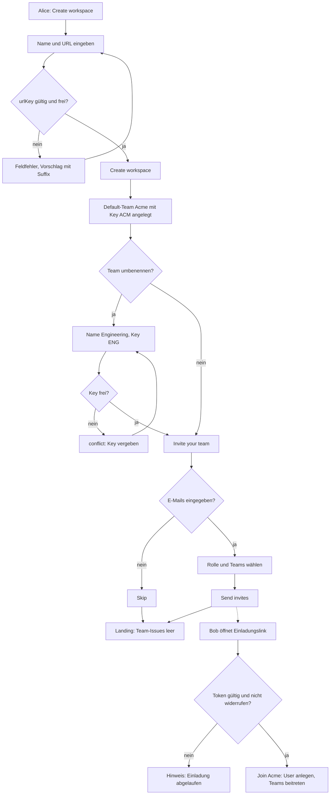

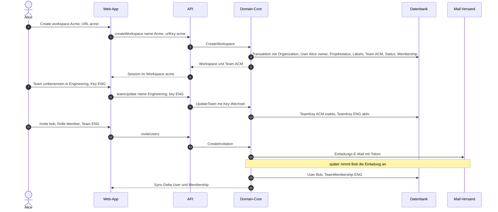

**Ergebnis/Nachbedingungen:** Workspace `acme`; Team `ENG` mit Default-Workflow (Backlog, Todo, In Progress, Done, Canceled, Duplicate; [02 §2.3](02-teams-rechte.md#23-team-anlegen)), `lastIssueNumber = 0`; Alice Owner des Workspace und des Teams; Bob Member und Mitglied in `ENG`. Events `Organization.create`, `Team.create`, `Team.update`, `TeamMembership.create`, `User.create`.

**Fehler- und Sonderfälle:**

| Fall | Verhalten |
|---|---|
| `urlKey` vergeben oder ungültig | Inline-Fehler am Feld, Vorschlag `acme-2`; kein Workspace angelegt |
| Key `ENG` bereits (auch historisch) vergeben | `conflict`, Feldfehler am Identifier |
| E-Mail ist bereits Mitglied | Hinweis „already a member“, keine Einladung |
| Einladender hat Rolle unter `invitationsRole` | Invite-Schritt bzw. Button deaktiviert mit Rechte-Hinweis ([02 §6.4](02-teams-rechte.md#64-berechtigungsmatrix)) |
| Einladung als Gast | nur wenn `guestsEnabled`; Gast muss mindestens einem Team zugeordnet werden (siehe F16) |
| Einladung widerrufen/abgelaufen | Link zeigt Hinweis; kein User |

**API/MCP:** Workspace-Anlage, Einladung und Annahme: `createWorkspace`, `inviteUsers` (`invitationResend`/`invitationRevoke`), `acceptInvitation` ([09 §1.6](09-api-events.md#16-kern-sdl-mutations-und-payload-muster); `createWorkspace` und `acceptInvitation` mit Konto-Session ohne Workspace-Kontext); Entität `Invitation` in [01 §2.11](01-domaenenmodell.md#211-invitation); kein MCP-Tool. Team-Umbenennung `teamUpdate`. Lesend für Agenten: `get_workspace`, `list_teams`, `list_users`.

---

### F2 Weiteres Team anlegen und als Sub-Team einhängen

**Ziel:** Team `WEB` „Web“ entsteht mit der Konfiguration von `ENG` und wird anschließend Sub-Team von `ENG`.

**Akteur/Rolle:** Bob legt das Team an (Member; `teamCreationRole` erlaubt Members, [02 §6.4](02-teams-rechte.md#64-berechtigungsmatrix)); Alice hängt es ein (`owner`; Nesting erfordert `admin` oder `owner`). Alice wird dabei nicht Mitglied von `WEB`.

**Vorbedingungen:** F1 abgeschlossen; Workspace-Limits `maxTeams`, `subTeamsEnabled`, `maxTeamDepth` erlauben es ([02 §1.3](02-teams-rechte.md#13-konfigurierbare-workspace-limits)).

**Schritte (Teil A – Team anlegen):**

1. Bob: Command-Menü „Create a team…“ oder Settings → Teams → **Create team** → `/acme/settings/new-team`.
2. Formular: **Team name** „Web“, **Identifier** (live aus dem Namen generiert: `WEB`, editierbar), Icon, **Visibility** (`public`), **Parent team** (leer lassen – die Variante „direkt mit Parent anlegen“ ist ebenfalls zulässig und überspringt Teil B), **Copy settings from** → `ENG`.
3. **Create team**: Der Core legt das Team an und kopiert Konfiguration (Workflow-Status, Team-Labels, Templates, Cycle-/Triage-/Estimate-/Automations-Einstellungen), aber keine Inhalte ([02 §2.4](02-teams-rechte.md#24-copy-settings-from-team-und-default-labels)). Bob wird Mitglied und Owner.
4. Weiterleitung auf `/acme/team/WEB/all`; das Team erscheint unter „Your teams“.

**Schritte (Teil B – Nesting-Wizard):**

5. Alice (Workspace-Owner, damit effektive Ownerin von `WEB` für Verwaltungsaktionen, ohne Mitglied zu sein): Settings → Teams → `WEB` → **Team hierarchy** → **Parent team** → Picker „Set parent team…“ → `ENG`.
6. Der Client ruft die Vorschau `previewTeamNesting(WEB, ENG)` auf und zeigt den Wizard mit einem Schritt je Konfliktart ([02 §3.3](02-teams-rechte.md#33-nesting-wizard-konfliktauflösung)):

   | Wizard-Schritt | Inhalt | Option |
   |---|---|---|
   | Members | Mitglieder von `WEB`, die nicht in `ENG` sind | Checkbox „Add missing members to Engineering“ (`addMissingMembersToParent`, Default an) |
   | Visibility | nur wenn `WEB` offener wäre als `ENG` | Checkbox „Downgrade visibility“ (`downgradeVisibility`) |
   | Workflow | Tabelle Status von `WEB` → Status von `ENG`, automatisch gemappt, je Zeile Picker | Toggle „Inherit workflow statuses“ (`inheritWorkflowStatuses`), `stateMapping` |
   | Labels | Label-Duplikate (`Frontend` in beiden) → zusammenführen | `labelMapping` je Zeile |
   | Cycles | nur wenn `ENG` Cycles nutzt: Hinweis, dass der laufende Cycle von `WEB` geschlossen und der Zeitplan von `ENG` übernommen wird | – |
   | Estimates | ungültig werdende Schätzungen (Anzahl) | Toggle „Inherit estimates“ (`inheritIssueEstimation`) |
   | Summary | Zusammenfassung aller Änderungen und betroffener Issue-Zahlen | **Confirm** |

7. **Confirm** startet `nestTeam` als Hintergrundjob; während der Migration zeigt `WEB` ein Banner „Team is being migrated…“, Schreibversuche erhalten `conflict` (`team_migration_in_progress`).
8. Nach Abschluss: Toast „Web is now a sub-team of Engineering“; in der Sidebar erscheint `WEB` eingerückt unter `ENG`.
9. Ergebnis für die Mitgliedschaften: Bob ist Mitglied und Owner von `WEB` und bereits Mitglied von `ENG` (der Members-Schritt des Wizards ist leer); Alice bleibt nur in `ENG` und sieht `WEB` als öffentliches Team. Damit ist der Zustand der Beispieltabelle aus [02](02-teams-rechte.md) erreicht.

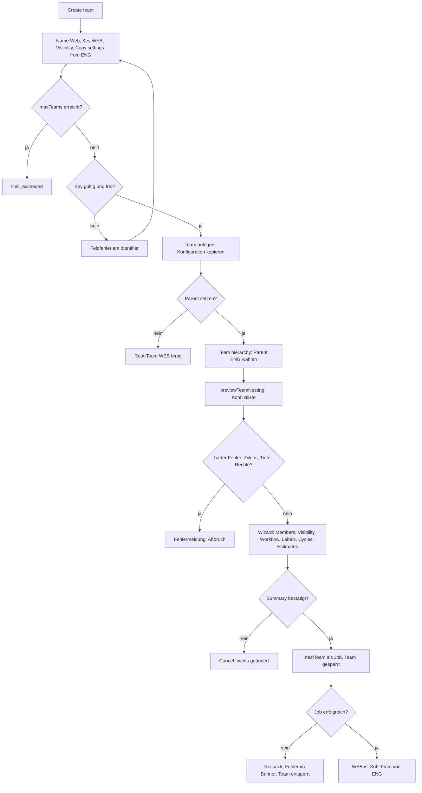

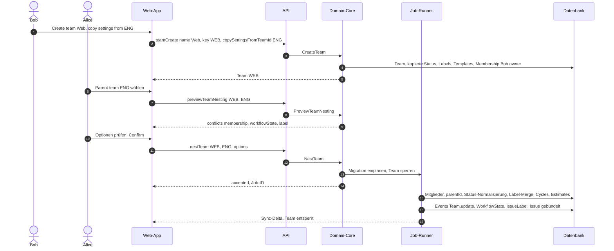

Das fachliche Ablaufdiagramm mit allen Prüfungen steht in [02 §3.4](02-teams-rechte.md#34-flowchart-team-unter-parent-hängen).

**Ergebnis/Nachbedingungen:** `WEB.parentId = ENG`; `WEB` erbt Status (mit `inheritedFrom`), ggf. Schätzskala und Cycle-Zeitplan von `ENG`; doppelte Labels sind zusammengeführt; alle Nicht-Gast-Mitglieder von `WEB` sind auch in `ENG`. Labels und Templates von `ENG` sind in `WEB` verfügbar ([02 §3.2](02-teams-rechte.md#32-vererbungsmatrix)).

**Fehler- und Sonderfälle:**

| Fall | Verhalten |
|---|---|
| Aufrufer ist Member, nicht Admin | „Parent team“ deaktiviert mit Rechte-Hinweis (`forbidden`) |
| `ENG` ist Nachfahre von `WEB` | `invalid_request` (Zyklus), im Picker ausgegraut |
| Tiefe über `maxTeamDepth` | `limit_exceeded`, im Picker ausgegraut |
| `WEB` öffentlich, `ENG` privat, Downgrade nicht bestätigt | `conflict: visibility`; Wizard bleibt im Schritt Visibility |
| Mitglieder fehlen, Option abgewählt | `conflict: membership` |
| Label-Gruppe überschreitet `maxLabelsPerGroup` nach Merge | bereits in der Vorschau als Blocker gemeldet |
| Entfernen des Parents („No parent team“) | Un-Nesting nach [02 §3.5](02-teams-rechte.md#35-un-nesting), eigener kurzer Bestätigungsdialog |

**API/MCP:** `teamCreate` (mit `copySettingsFromTeamId`, optional `parentId`), Query `previewTeamNesting` und Mutation `nestTeam` (fachlich [02 §3.3](02-teams-rechte.md#33-nesting-wizard-konfliktauflösung), SDL in [09 §1.4/§1.6](09-api-events.md#14-kern-sdl-query-root)). MCP: kein schreibendes Team-Tool; lesend `list_teams`, `get_team` (inkl. `parent`).

---

### F3 Issue anlegen

**Ziel:** Bob legt drei Bugs in `ENG` hintereinander an, den ersten mit dem Template „Bug report“.

**Akteur/Rolle:** Bob, Mitglied von `ENG`.

**Vorbedingungen:** Team `ENG` existiert; Template „Bug report“ (Typ `issue`, Labels `Bug`, Priority High, Beschreibung mit Abschnitten „Steps to reproduce / Expected / Actual“) ist in `ENG` verfügbar; `lastIssueNumber = 122`.

**Schritte:**

1. Bob drückt `C` in der Team-Liste von `ENG` (alternativ `Alt C` für „from template“, Stift in der Sidebar, „+“ im Spaltenkopf).
2. Modal öffnet; Team-Chip `ENG` aus dem Kontext. Ist für Mitglieder ein Default-Template gesetzt, ist es **vorausgewählt** (abwählbar, [06 §2.8](06-dokumente-templates.md#28-default-templates-pro-team)); sonst wählt Bob über den Template-Chip „Bug report“. Titel, Beschreibung und Chips werden mit den Template-Werten vorbelegt.
3. Bob tippt den Titel „Login schlägt bei SSO fehl“, ergänzt die Beschreibung (die Template-Abschnitte bleiben, weil er sie nur ergänzt) und setzt per Chip den Assignee auf sich.
4. Er aktiviert **Create more** und drückt `Ctrl Enter`.
5. Der Core vergibt atomar die Nummer 123 und legt `ENG-123` an. Toast „ENG-123 created“ mit Link. Das Modal bleibt offen, Titel und Beschreibung sind leer, Team, Template und Properties bleiben.
6. Bob legt zwei weitere Issues an (`ENG-124`, `ENG-125`), entfernt vor dem letzten den Template-Chip (dann gelten nur noch seine Eingaben).
7. Beim vierten Mal tippt er einen Titel, überlegt es sich anders und schließt mit `Esc`: Es entsteht ein **Draft** (Sidebar „Drafts 1“).

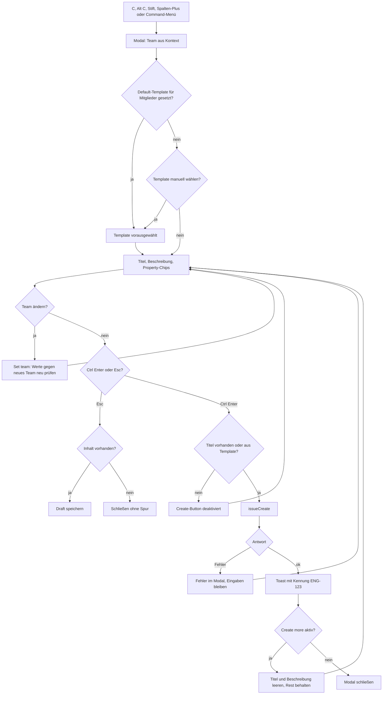

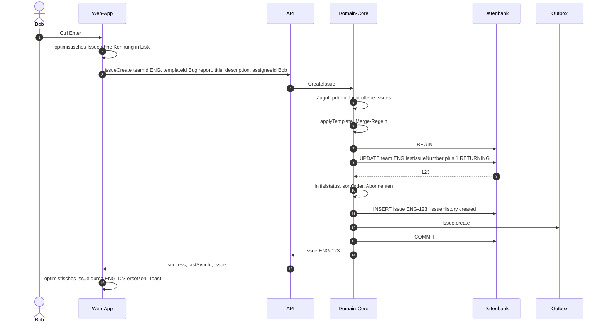

**Ergebnis/Nachbedingungen:** `ENG-123`, `ENG-124`, `ENG-125` existieren; Status = `defaultIssueState` (Backlog) bzw. Template-Status; Labels = Vereinigung aus Template und Eingabe ([06 §2.5](06-dokumente-templates.md#25-anwendung-merge-regeln)); Bob ist Creator, Assignee und Abonnent; `lastAppliedTemplate` gesetzt. Nummern sind lückenlos ([00 §2](00-konventionen.md#2-identifikatoren)). Änderungen durch Bob in den ersten 3 Minuten zählen zur Erstellung ([03 §2.1](03-issues-workflow.md#21-create)).

**Fehler- und Sonderfälle:**

| Fall | Verhalten |
|---|---|
| Titel leer, kein Template-Titel | Create-Button deaktiviert; über API `invalid_request` |
| Template-Wert im Team ungültig (z. B. Estimate 5 bei T-Shirt) | `invalid_request` mit Feldangabe; Modal zeigt Fehler am Template-Chip |
| Team gewechselt, Labels/Cycle/Projekt passen nicht zum neuen Team | Chips mit ungültigen Werten werden geleert und kurz hervorgehoben (Client prüft gegen Sync-Store) |
| Bob ist kein Mitglied des Zielteams und das Team hat Triage | Issue landet in Triage ([03 §10.2](03-issues-workflow.md#102-wann-landet-ein-issue-in-triage)); Toast „Sent to triage“ |
| Team retired | Team nicht im Picker; über API `invalid_request` |
| Offline / Netzwerkfehler | Mutation bleibt in der Warteschlange; Toast „Will sync when online“; erst die Server-Antwort liefert die Kennung |
| Limit 60 000 offene Issues | `limit_exceeded` |

**API/MCP:** `issueCreate`; MCP `save_issue` ohne `id` mit `team`, `title`, optional `template` (Default-Templates werden über MCP nie automatisch angewendet). Lesend: `list_templates`, `get_template`.

---

### F4 Issue per Tastatur bearbeiten

**Ziel:** Bob triagiert seine neuen Issues ohne Maus: Status, Assignee, Priority, Labels, Estimate, Due date, Cycle.

**Akteur/Rolle:** Bob, Mitglied von `ENG`.

**Vorbedingungen:** `ENG-123` bis `ENG-125` existieren; `ENG` nutzt Fibonacci-Schätzung und Cycles.

**Schritte:**

1. `G` `E` öffnet „All issues“ von `ENG`; mit `J`/`K` fokussiert Bob `ENG-124`.
2. `S` öffnet den Status-Picker („Change status…“) mit den Status des Teams in Workflow-Reihenfolge und Ziffern; `2` wählt „Todo“.
3. `A` öffnet den Assignee-Picker; Bob tippt „ali“ und bestätigt mit `Enter` → Alice. (`I` hätte ihn selbst zugewiesen.)
4. `P` → `2` setzt High.
5. `L` öffnet den Label-Picker (Mehrfachauswahl mit `X`/`Space` je Zeile, `Enter` übernimmt); Bob ergänzt `Improvement`. Wählt er in einer `singleSelect`-Gruppe ein zweites Label, ersetzt es das erste ([03 §5.5](03-issues-workflow.md#55-anwendungsregeln)).
6. `⇧ E` → `3` setzt Estimate 3; `⇧ D` öffnet den Datumspicker, „Fri“ bzw. „in 3 days“ wird geparst.
7. `⇧ C` → „Cycle 43 · Upcoming“. Da das Issue in `unstarted` ist, bleibt der Status; aus `backlog` wäre es auf den ersten `unstarted`-Status gewechselt ([04 §1.6](04-planung.md#16-regeln-zwischen-issue-und-cycle)).
8. Bob selektiert `ENG-123` und `ENG-125` mit `X` und drückt `P` → `1`: Bulk-Update beider Issues auf Urgent.
9. Jede Änderung ist sofort sichtbar (optimistisch); `Ctrl Z` macht die letzte rückgängig.

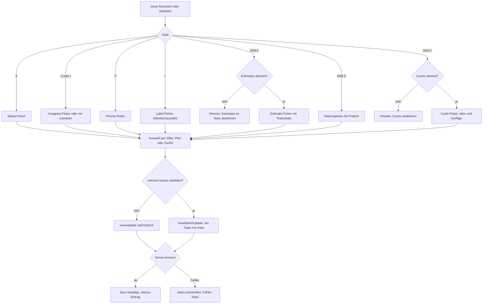

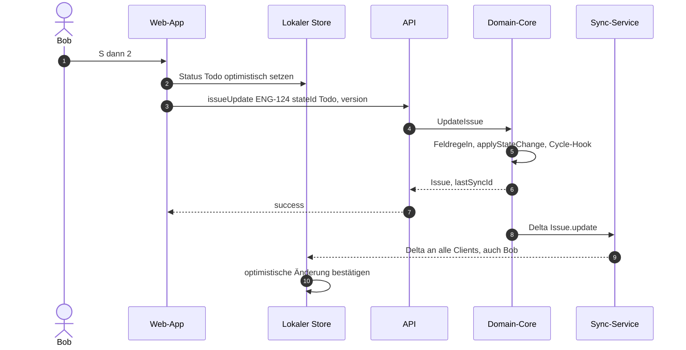

**Ergebnis/Nachbedingungen:** Felder gesetzt; je Änderung ein History-Eintrag (aufeinanderfolgende Änderungen werden im Feed zusammengefaltet); Notifications an Alice (`issueAssignedToYou`) und Abonnenten (Statuswechsel) gemäß [05](05-views-suche-inbox.md).

**Fehler- und Sonderfälle:**

| Fall | Verhalten |
|---|---|
| Versionskonflikt | Feldweises Zusammenführen (last-writer-wins pro Feld, [03 §2.2](03-issues-workflow.md#22-update)); nur bei Beschreibung `conflict` |
| Assignee ohne Zugriff (privates Team) | nicht im Picker; über API `invalid_request` |
| Ungültiger Estimate-Wert | nicht im Picker; über API `invalid_request` |
| Abgeschlossener Cycle | nicht im Picker (Ausnahme: zuletzt abgeschlossener für erledigte Issues) |
| Status `duplicate` | im Picker nicht wählbar; nur über `M M` |
| Fokus in Textfeld | Einzeltasten-Kürzel inaktiv (3.3) |

**API/MCP:** `issueUpdate`, `issueBatchUpdate`; MCP `save_issue` mit `id` und `state`, `assignee`, `priority`, `labels`/`addLabels`/`removeLabels`, `estimate`, `dueDate`, `cycle`.

---

### F5 Issue durch den Workflow bewegen

**Ziel:** `ENG-118` (Sub-Issue von `ENG-115`) wandert über das Board von Backlog bis Done; danach schließt sich der Parent automatisch.

**Akteur/Rolle:** Bob.

**Vorbedingungen:** `ENG-115` „Warenkorb vereinfachen“ hat drei Children: `ENG-116` (Done), `ENG-117` (Canceled), `ENG-118` (Backlog). In `ENG` ist **Auto-close parent issues** aktiviert (Default ist aus, [03 §3.4](03-issues-workflow.md#34-parent-child-automationen)). Board-Ansicht gruppiert nach Status, Ordering „Manual“.

**Schritte:**

1. `Ctrl B` schaltet die Team-Liste auf Board; Spalten Backlog, Todo, In Progress, Done (Canceled/Duplicate unter „Hidden columns“).
2. Bob zieht `ENG-118` von **Backlog** nach **Todo** und legt es zwischen zwei Karten ab. Der Client sendet Status **und** die berechnete `sortOrder` (Mittelwert der Nachbarn) in einem Update; der explizite Wert hat Vorrang vor `setIssueSortOrderOnStateChange` ([03 §12](03-issues-workflow.md#12-manuelle-sortierung)).
3. Tastatur-Alternative: `Ctrl →` verschiebt die fokussierte Karte eine Spalte nach rechts.
4. Bob zieht die Karte nach **In Progress**: `startedAt` wird gesetzt ([03 §1.6](03-issues-workflow.md#16-kategorie-übergänge-und-zeitstempel)); ist `cycleIssueAutoAssignStarted` aktiv und hat das Issue keinen Cycle, landet es im aktiven Cycle ([04 §1.6](04-planung.md#16-regeln-zwischen-issue-und-cycle)).
5. Bob zieht die Karte nach **Done**: `completedAt` wird gesetzt.
6. Automation: Alle Children von `ENG-115` sind geschlossen, mindestens eines (`ENG-116`, `ENG-118`) ist `completed` → `ENG-115` wechselt auf den ersten `completed`-Status seines Teams (Akteur System, `source = parentAutomation`). Bobs Board zeigt `ENG-115` per Sync-Delta ebenfalls in Done.
7. Wiederöffnen: Zieht Bob `ENG-118` zurück nach In Progress, bleibt `ENG-115` geschlossen (keine Rück-Automation); `completedAt` von `ENG-118` wird geleert.

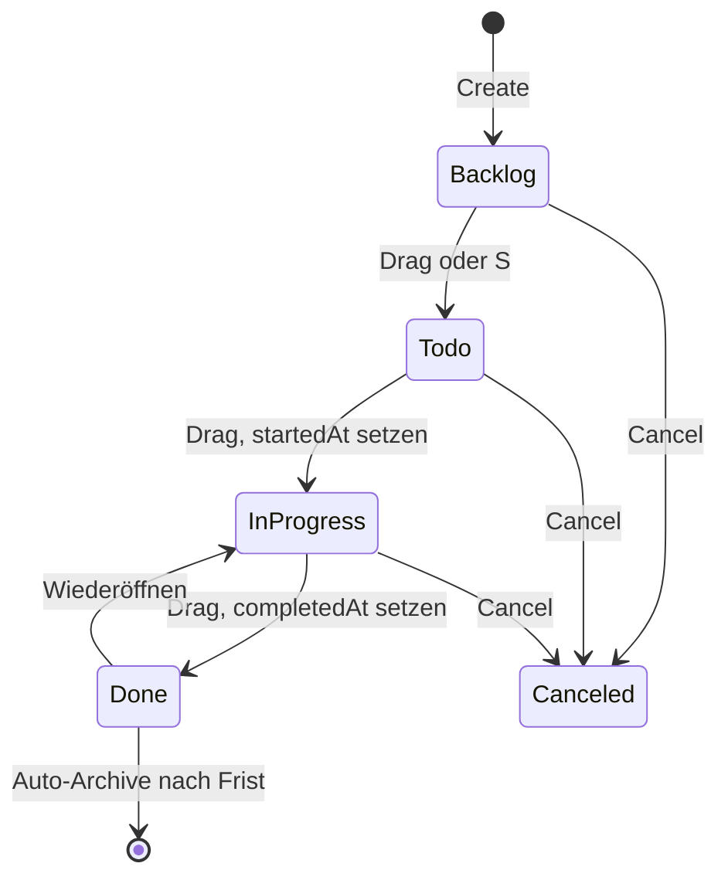

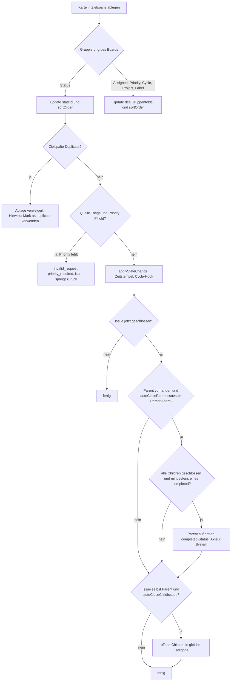

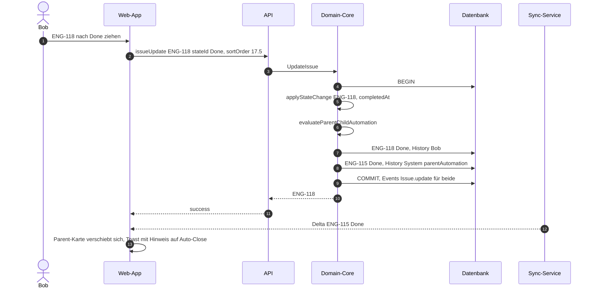

**Ergebnis/Nachbedingungen:** `ENG-118` Done mit `startedAt`/`completedAt`; `ENG-115` Done durch Automation (History zeigt „Auto-closed because all sub-issues were completed“); `sortOrder` von `ENG-118` gilt für alle User und Views. Notifications: Statuswechsel an Abonnenten beider Issues.

**Fehler- und Sonderfälle:**

| Fall | Verhalten |
|---|---|
| Alle Children `canceled`/`duplicate` | Parent bleibt offen ([03 §3.4](03-issues-workflow.md#34-parent-child-automationen)) |
| Ordering nicht „Manual“ | Ablage innerhalb der Spalte ändert nur die Gruppe, nicht die Reihenfolge; Hinweis „Sorted by priority“ |
| Board nach Cycle gruppiert, Zielspalte abgeschlossener Cycle | Ablage verweigert ([04 §1.6](04-planung.md#16-regeln-zwischen-issue-und-cycle)) |
| Gleichzeitige Verschiebung durch Alice | Last-writer-wins auf `stateId`; Board springt per Delta auf den Serverstand |
| Abstand zweier `sortOrder` unter `1e-6` | Hintergrund-Neunummerierung ([03 §12](03-issues-workflow.md#12-manuelle-sortierung)) |

**API/MCP:** `issueUpdate` (`stateId`, `sortOrder`); MCP `save_issue` mit `state` (Name, UUID oder Kategoriename, z. B. `"started"`). Über MCP gibt es keine `sortOrder`; es gilt die Team-Einstellung.

---

### F6 Triage: eingehendes Issue bearbeiten

**Ziel:** Ein von einer Nicht-Mitglied-Person angelegtes Issue wird im Team `WEB` geprüft und mit einer der Triage-Aktionen einsortiert.

**Akteure/Rollen:** Alice als Absenderin (Mitglied von `ENG`, **nicht** von `WEB`, siehe F2) bzw. eine Integration oder der E-Mail-Intake; Bob als Triagierender (Mitglied und Owner von `WEB`).

**Vorbedingungen:** `WEB` hat **Enable triage for this team** aktiviert (Status „Triage“ existiert, [03 §10.1](03-issues-workflow.md#101-aktivierung)); optional **Require explicit prioritization** und Triage-Verantwortung (Bob, Aktion `notify`).

**Schritte:**

1. Alice legt über `C` mit Team `WEB` das Issue „Button auf Startseite verrutscht“ an. Da sie kein Mitglied ist und weder Status noch Template-Status gesetzt sind, landet es als `WEB-57` in **Triage** ([03 §10.2](03-issues-workflow.md#102-wann-landet-ein-issue-in-triage)); Toast „WEB-57 sent to Web triage“.
2. Bob erhält die Notification „Issue added to triage“ (Verantwortung `notify`), die Sidebar zeigt „Triage 1“.
3. Bob öffnet die Triage-Ansicht (`G` `T` im Team `WEB`) und wählt `WEB-57`; rechts erscheint das Issue mit der Triage-Leiste.
4. Bob wählt **eine** der Aktionen:
   - **Accept** (`1`): Popover mit optionalem Kommentar und Status (Default `defaultIssueState`, wählbar `backlog`/`unstarted`/`started`). Ist Priority Pflicht und noch „No priority“, zeigt das Popover zuerst den Priority-Picker. Bestätigen → Status Backlog, `triagedAt` gesetzt.
   - **Decline** (`2`): Popover mit optionalem Begründungskommentar → erster `canceled`-Status, `triagedAt` gesetzt.
   - **Mark as duplicate** (`3` bzw. `M` `M`): Issue-Suche „Duplicate of…“ → Bob wählt `WEB-41` → Duplicate-Status, Relation `duplicate`, Anhänge wandern zu `WEB-41`, Abonnenten von `WEB-57` werden auch Abonnenten von `WEB-41` ([03 §4.3](03-issues-workflow.md#43-als-duplikat-markieren)).
   - **Snooze** (`H`): Zeitpicker (Tomorrow, Next week, Custom…) → das Issue verschwindet **für alle** aus der Triage-Liste bis zum Zeitpunkt oder bis zu neuer Aktivität durch jemand anderen.
   - **Move to team** (`Ctrl ⇧ M`): Teamwechsel nach F7; im Zielteam wird die Triage-Regel erneut ausgewertet (Bob ist Mitglied von `DES` → Status-Mapping statt Triage).
   - **Rückfrage**: Kommentar schreiben, Issue bleibt in Triage.
5. Die Liste rückt zum nächsten Triage-Issue vor (Fokus bleibt in der Liste, Festlegung Lineal).

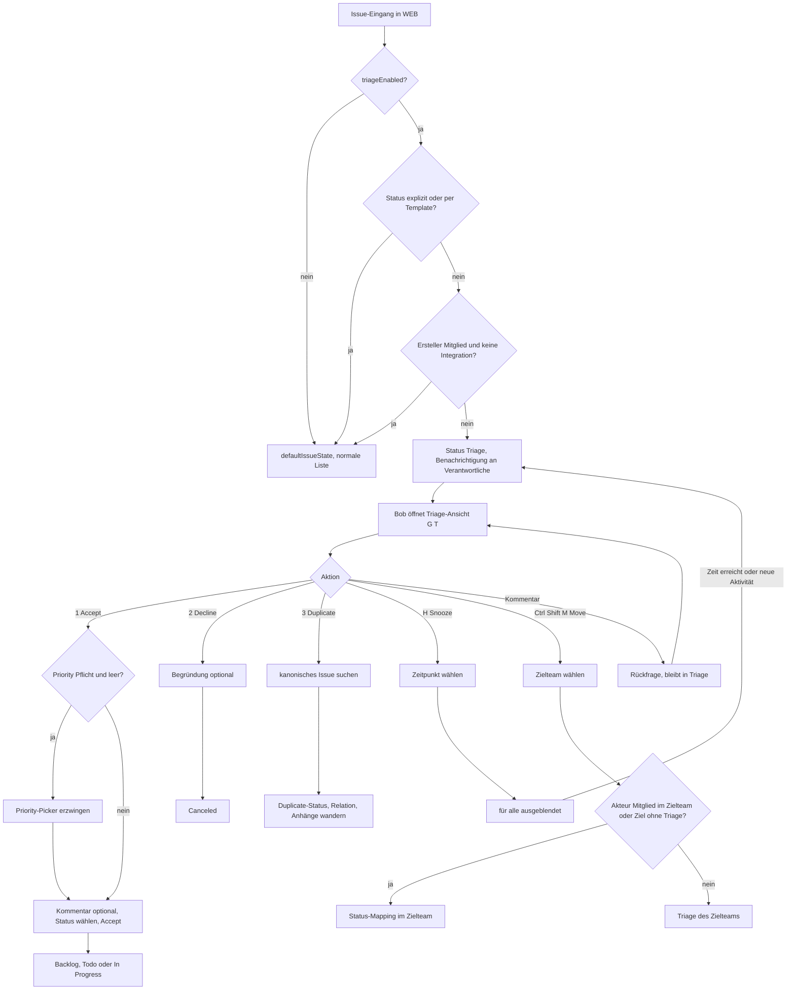

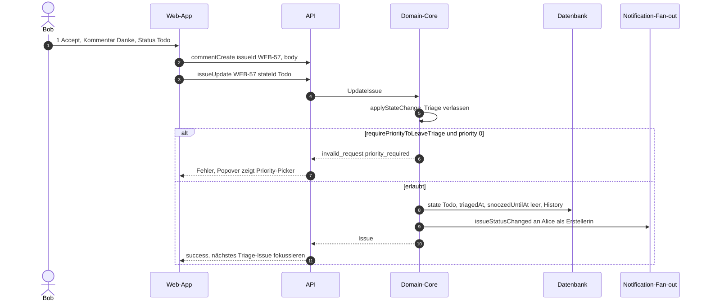

Der Lebenszyklus eines Triage-Issues als Zustandsdiagramm steht in [03 §10.3](03-issues-workflow.md#103-aktionen), der Eingangsablauf inkl. Triage-Verantwortung in [03 §10.4](03-issues-workflow.md#104-ablauf-bei-eingang).

**Ergebnis/Nachbedingungen:** Das Issue hat Triage verlassen (`triagedAt` gesetzt) oder ist gesnoozt; die Erstellerin erhält eine Statusänderungs-Notification; ein optionaler Kommentar steht im Activity-Feed; bei Duplicate zeigt `WEB-57` ein Banner mit Link auf `WEB-41`.

**Fehler- und Sonderfälle:**

| Fall | Verhalten |
|---|---|
| Accept ohne Priority bei Pflicht | `invalid_request` (`priority_required`), UI verhindert es vorab |
| Duplikat-Ziel ist selbst Duplikat | Kette wird auf das kanonische Ende aufgelöst ([03 §4.3](03-issues-workflow.md#43-als-duplikat-markieren)) |
| Duplikat-Ziel = dasselbe Issue | im Picker ausgeschlossen; API `invalid_request` |
| Snooze-Zeitpunkt in der Vergangenheit | Picker bietet nur künftige Zeitpunkte; API `invalid_request` |
| Triage wird im Team deaktiviert, während Issues darin liegen | Migrationsdialog: Ziel-Status wählen ([03 §10.1](03-issues-workflow.md#101-aktivierung)) |
| Triage-Issues in Views | standardmäßig ausgeblendet, nur über Filter Status-Typ „Triage“ sichtbar |
| Gast legt Issue in seinem Team an | Gast ist Mitglied → keine Triage |

**API/MCP:** `issueUpdate` (`stateId`, `priority`, `snoozedUntilAt`, `teamId`), `commentCreate`, `issueRelationCreate(type: duplicate)`; MCP `list_issues` (Filter `state: "triage"`, `team: "WEB"`), `save_issue` (`state`, `priority`, `duplicateOf`, `team`), `save_comment`, `get_triage_responsibility`. Ein MCP-Parameter für Snooze von Issues existiert nicht (siehe Abschnitt 6).

---

### F7 Issue in anderes Team verschieben

**Ziel:** Bob verschiebt `WEB-12` nach `DES`, prüft die Auswirkungen und kann den Schritt rückgängig machen; zusätzlich Bulk-Move mehrerer Issues.

**Akteur/Rolle:** Bob, Mitglied in `WEB` und `DES` (Zugriff auf Quelle und Ziel).

**Vorbedingungen:** `WEB-12` steht in „In Review“ (`started`), hat das Team-Label „Frontend“ von `WEB`, gehört zu einem Projekt nur mit `ENG` und hat Carol (Gast, nicht in `DES`) als Abonnentin – das Beispiel aus [02 §7.3](02-teams-rechte.md#73-sequenzdiagramm).

**Schritte:**

1. Auf `WEB-12` (Detail oder fokussiert in der Liste): `Ctrl ⇧ M`, alternativ „…“ → **Team** ▶, Command-Menü „Move to a different team…“ oder Klick auf das Team-Feld der Property-Sidebar.
2. Picker „Move to team…“ zeigt alle Teams mit Zugriff (aktuelles Team mit Häkchen); Bob wählt `DES`.
3. Der Client berechnet eine **Vorschau** mit den Regeln aus [02 §7.2](02-teams-rechte.md#72-algorithmus) auf Basis der synchronisierten Team-Daten. Nur wenn etwas **verloren geht** (Label, Projekt, Meilenstein, Cycle, Estimate, Assignee, Abonnenten), erscheint der Bestätigungsdialog **Move issue to Design**:

   | Zeile | Anzeige im Beispiel |
   |---|---|
   | New identifier | `WEB-12` → `DES-41` (vorläufig: „DES-…“, die Nummer vergibt der Server) |
   | Status | In Review → In Progress (gleiche Kategorie `started`) |
   | Labels | „Frontend“ wird entfernt (nicht in Design verfügbar) |
   | Project | Projekt wird entfernt (Design ist nicht beteiligt) – Link „Add Design to project instead“ |
   | Cycle | wird entfernt |
   | Subscribers | 1 subscriber without access will be removed |
   | Sub-issues | Checkbox „Also move 2 sub-issues“ (`moveSubIssues`, Default aus) |

   Buttons **Cancel** und **Move issue**. Ohne Verluste wird direkt verschoben.
4. **Move issue**: Server führt den Teamwechsel aus; Toast „Moved to DES-41“ mit **Undo**. Die Browser-URL wechselt auf `/acme/issue/DES-41/…`; `/acme/issue/WEB-12` leitet ab jetzt dorthin um.
5. **Undo** (`Ctrl Z` oder Toast): erneuter Teamwechsel nach `WEB`; dank Alias erhält das Issue wieder `WEB-12`; entfernte Labels und Abonnenten stellt der Client aus `updatedFrom` wieder her, soweit gültig.
6. **Bulk-Move:** In der Liste selektiert Bob mehrere Issues (`X`, `⇧ Click`, `Ctrl A`), drückt `Ctrl ⇧ M` und wählt `DES`. Die Vorschau fasst zusammen („5 issues: 3 labels removed, 2 issues leave project …“). Der Move ist atomar (alle oder keins), maximal 250 Issues, Nummern werden als Block reserviert ([02 §7.4](02-teams-rechte.md#74-bulk-move)).

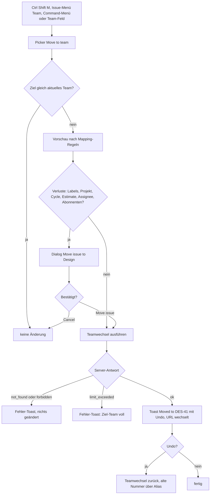

Das Sequenzdiagramm UI → API → Core → DB für den Teamwechsel steht in [02 §7.3](02-teams-rechte.md#73-sequenzdiagramm); die UI-Seite ergänzt nur die Vorschau und den Redirect:

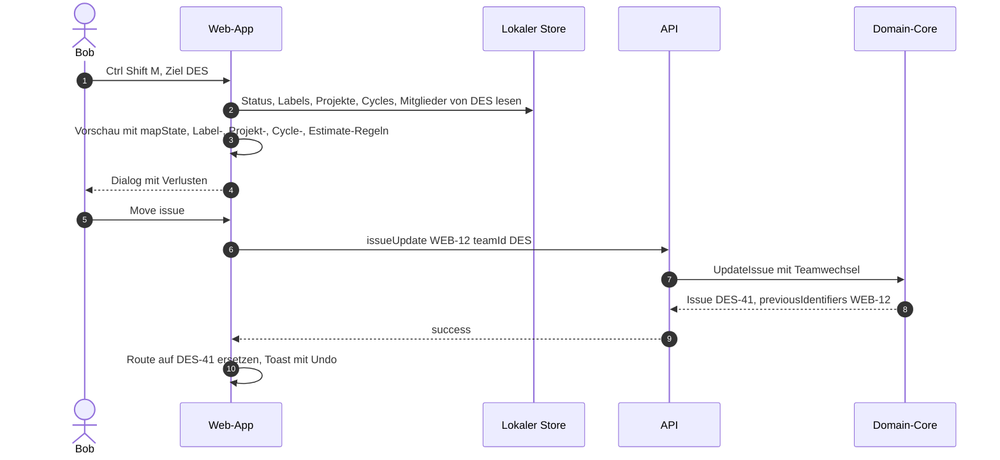

**Ergebnis/Nachbedingungen:** wie in [02 §7.3](02-teams-rechte.md#73-sequenzdiagramm): Kennung `DES-41`, `previousIdentifiers = ["WEB-12"]`, Status „In Progress“, Label „Frontend“, Projekt und Cycle entfernt, Carol verliert ihr Abonnement; genau ein History-Eintrag mit allen Änderungen. Inline-Referenzen „WEB-12“ in anderen Texten bleiben stehen und lösen über den Alias auf.

**Fehler- und Sonderfälle:**

| Fall | Verhalten |
|---|---|
| Ziel ohne Zugriff (privat, nicht Mitglied) | Team erscheint nicht im Picker; API `not_found` |
| Ziel retired | nicht im Picker; API `invalid_request` |
| Bob ist im Ziel kein Mitglied und Ziel hat Triage | offene Issues landen in Triage des Ziels (Vorschau zeigt „Will be sent to triage“) |
| Gleichzeitig `addLabels` im selben Aufruf (API/MCP) | `invalid_request` ([02 §7.1](02-teams-rechte.md#71-eingabe-und-validierung)) |
| Explizit gesetztes Projekt ohne Zielteam | `invalid_request` |
| Bulk mit einem unzugänglichen Issue | ganzer Aufruf `not_found`, nichts verschoben |
| Parallel geändertes Issue | `conflict`, Client lädt neu und zeigt die Vorschau erneut |

**API/MCP:** `issueUpdate` mit `teamId` (Option `moveSubIssues`), `issueBatchUpdate` für Bulk; MCP `save_issue` mit `id` und `team` (ohne `addLabels`/`removeLabels`; `labels` ersetzend ist erlaubt).

---

### F8 Sub-Issues anlegen und „blocks“ setzen

**Ziel:** Bob zerlegt `ENG-120` in Sub-Issues (eines davon in `DES`) und legt fest, dass das Design-Issue die Umsetzung blockiert.

**Akteur/Rolle:** Bob.

**Vorbedingungen:** `ENG-120` „Checkout überarbeiten“ (Priority High, Projekt „Checkout Relaunch“ mit `ENG` und `DES`, Assignee Bob, Cycle 42).

**Schritte:**

1. In `ENG-120` klickt Bob **Add sub-issues** bzw. drückt `Ctrl ⇧ O`. Ein Inline-Erfassungsfeld erscheint im Abschnitt „Sub-issues“ (mehrere Titel nacheinander mit `Enter`; Festlegung Lineal) – alternativ öffnet `Ctrl ⇧ O` das Create-Modal mit vorbelegtem Parent.
2. Bob legt „Zahlungsformular umbauen“ an → `ENG-132`. Vererbung nach [03 §3.2](03-issues-workflow.md#32-vererbung-beim-erstellen-eines-sub-issues): Team `ENG`, Priority High, Projekt, Assignee (Bob ist Assignee des Parents), Cycle nur bei `unstarted`/`started`; **keine** Labels.
3. Über das Create-Modal (Parent vorbelegt) legt er „Neues Formular-Layout entwerfen“ mit Team `DES` an → `DES-42` (Parent und Child dürfen in verschiedenen Teams liegen; das Projekt wird übernommen, weil `DES` beteiligt ist; der Cycle nicht, weil anderes Team).
4. In `DES-42` drückt er `M` `X` („Mark as blocking…“), sucht `ENG-132` und bestätigt. Es entsteht **eine** Relation `DES-42 blocks ENG-132`; `ENG-132` zeigt unter **Blocked by** `DES-42` und in Listen das rote Badge „blocked by 1“.
5. Bestehendes Issue als Sub-Issue: In `ENG-125` drückt Bob `Ctrl ⇧ P` („Set parent…“) und wählt `ENG-120`.
6. Der Parent zeigt den Fortschritt „0/3“ (`ENG-132`, `DES-42`, `ENG-125` sind offen; nur direkte Children, ohne Canceled/Duplicate, [03 §3.5](03-issues-workflow.md#35-fortschritt-am-parent)).
7. Wird `DES-42` später abgeschlossen, erhalten die Abonnenten von `ENG-132` `issueUnblocked`; die Relation bleibt gespeichert und wird unter „Related“ angezeigt.

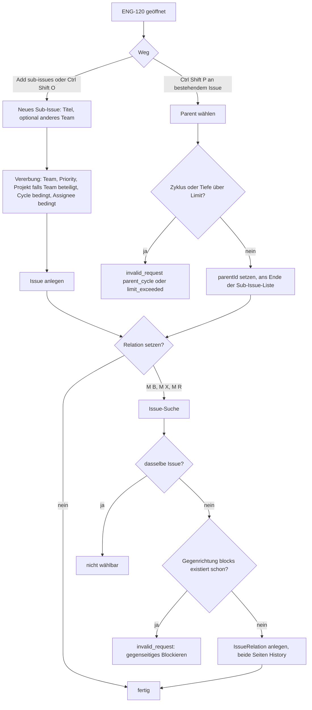

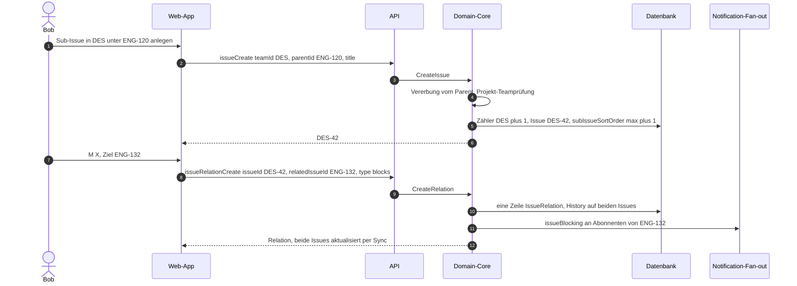

**Ergebnis/Nachbedingungen:** `ENG-120` hat die Children `ENG-132`, `DES-42` und `ENG-125`; Relation `blocks` als eine Zeile, aus beiden Richtungen sichtbar ([03 §4.1](03-issues-workflow.md#41-typen-und-sichten)); History auf beiden Issues.

**Fehler- und Sonderfälle:**

| Fall | Verhalten |
|---|---|
| Parent würde eigener Nachfahre | `invalid_request` (`parent_cycle`) |
| Tiefe über 10 Ebenen | `limit_exceeded` |
| Child-Team nicht am Projekt beteiligt | Projekt wird nicht vererbt (kein Fehler) |
| Child in privatem Team, Betrachter ohne Zugriff | im Parent nur als Zähler sichtbar |
| Relation doppelt angelegt | idempotent, kein Fehler, keine History |
| Relation entfernen | Hover „Remove relation“ bzw. „…“ → Remove ▶; über MCP nur `removeBlocks`/`removeBlockedBy` |

**API/MCP:** `issueCreate` (`parentId`), `issueUpdate` (`parentId`), `issueRelationCreate/Delete`; MCP `save_issue` mit `parentId`, `blocks`/`blockedBy`/`relatedTo` (append-only) und `removeBlocks`/`removeBlockedBy`/`removeRelatedTo`.

---

### F9 Cycle planen und Cycle-Ende mit Rollover

**Ziel:** Alice plant den nächsten Cycle von `ENG` mit Issues aus dem Backlog; am Cycle-Ende werden unfertige Issues automatisch übernommen.

**Akteur/Rolle:** Alice (Mitglied von `ENG`; zum Aktivieren der Cycles Team-Recht `teamManagement`); am Cycle-Ende das System (Job).

**Vorbedingungen:** In `ENG` sind Cycles aktiviert (Settings → Cycles: Dauer 2 Wochen, Start Montag, kein Cooldown, 2 vorausgeplante Cycles, [04 §1.2](04-planung.md#12-team-einstellungen)). Aktiv ist Cycle 42, kommend Cycle 43 und 44. `WEB` erbt den Zeitplan von `ENG` (abgeleitete Cycles, [04 §1.7](04-planung.md#17-vererbung-an-sub-teams)).

**Schritte (Planung):**

1. `G` `W` öffnet den Upcoming Cycle 43 (`/acme/team/ENG/cycle/upcoming`); die Sidebar zeigt Datumsbereich, Scope 0 und die **Kapazitätsschätzung** aus den letzten drei Cycles ([04 §1.9](04-planung.md#19-fortschritt-und-scope-historie)).
2. `G` `B` öffnet den Backlog. Alice selektiert fünf Issues (`X`, `⇧ ↓`) und drückt `⇧ C` → „Cycle 43 · Upcoming“. Alternativ: Board nach **Cycle** gruppieren und Karten in die Spalte „Cycle 43“ ziehen, oder im Cycle-Detail „+“ einer Statusgruppe.
3. Backlog-Issues wechseln dabei automatisch auf den ersten `unstarted`-Status (Todo) ([04 §1.6](04-planung.md#16-regeln-zwischen-issue-und-cycle)); der Toast weist darauf hin („5 issues moved to Cycle 43 and Todo“).
4. Zurück in Cycle 43 prüft Alice Scope vs. Kapazität („82% of capacity“) und die Verteilung pro Assignee (Tab **Assignees**). Ein überlastetes Issue verschiebt sie mit `⇧ C` → Cycle 44.
5. Optional: „…“ → **Edit cycle name and description…** („Checkout-Sprint“).

**Schritte (Cycle-Ende, automatisch):**

6. Zum `endsAt` von Cycle 42 schließt der Job den Cycle (Snapshot, `completedAt`, Liste `uncompletedIssuesUponClose`).
7. Zum `startsAt` von Cycle 43 (ohne Cooldown derselbe Zeitpunkt) übernimmt der Job unfertige Issues: `unstarted`/`started` → Cycle 43; `backlog`/`triage` → ohne Cycle; geschlossene bleiben in Cycle 42. History-Einträge mit Akteur System, **keine** Benachrichtigungen ([04 §1.5](04-planung.md#15-job-cycle-wechsel)).
8. Die Cycle-Liste zeigt Cycle 42 als Completed mit eingefrorenem Burn-up, Cycle 43 als Current; ein neuer Cycle 45 wird vorausgeplant.

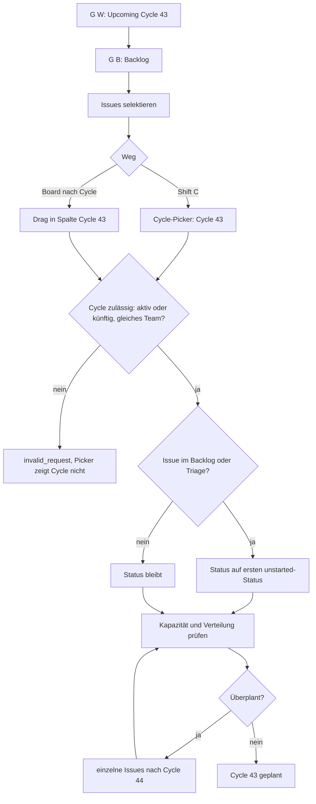

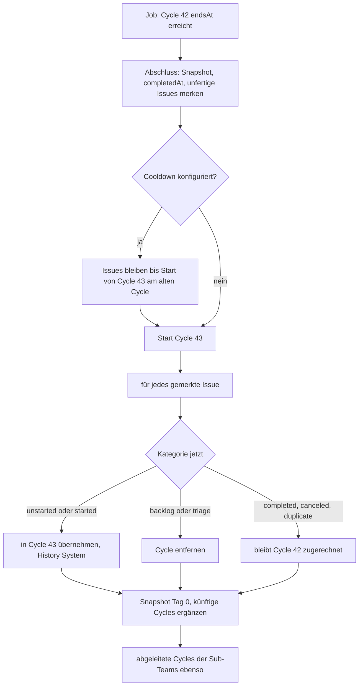

Das Sequenzdiagramm des Jobs steht in [04 §1.5](04-planung.md#15-job-cycle-wechsel). Für die Planung über die UI:

```mermaid
sequenceDiagram
  autonumber
  actor A as Alice
  participant UI as Web-App
  participant API as API
  participant CORE as Domain-Core
  participant DB as Datenbank
  A->>UI: 5 Issues selektiert, Shift C, Cycle 43
  UI->>API: issueBatchUpdate ids, cycleId Cycle 43
  API->>CORE: BatchUpdateIssues
  loop je Issue
    CORE->>CORE: Team-Bindung und Cycle-Zulässigkeit prüfen
    CORE->>CORE: backlog nach erstem unstarted-Status
    CORE->>DB: cycleId, addedToCycleAt, ggf. stateId, History
  end
  CORE->>DB: Scope-Historie von Cycle 43 aktualisieren
  CORE-->>API: aktualisierte Issues
  API-->>UI: success, Toast mit Undo
```

**Ergebnis/Nachbedingungen:** Cycle 43 enthält die geplanten Issues mit `addedToCycleAt` vor Start („planned“); nach dem Wechsel sind unfertige Issues aus Cycle 42 in Cycle 43, Cycle 42 ist abgeschlossen und unveränderlich.

**Fehler- und Sonderfälle:**

| Fall | Verhalten |
|---|---|
| Issue aus anderem Team in der Selektion | ganzer Bulk-Aufruf `invalid_request` (Team-Bindung), UI blendet den Cycle-Befehl bei gemischten Teams aus, außer bei gemeinsamem geerbtem Zeitplan (dann wird je Team der abgeleitete Cycle gewählt, Festlegung Lineal) |
| Abgeschlossener Cycle als Ziel | nur der zuletzt abgeschlossene und nur für erledigte Issues |
| Issue im Cooldown nach Backlog verschoben | wird nicht übernommen ([04 §1.5](04-planung.md#15-job-cycle-wechsel)) |
| Sub-Team `WEB` | Zeitplan nicht änderbar (`invalid_request`, „schedule inherited from Engineering“) |
| Cycles deaktivieren | aktiver Cycle wird sofort geschlossen, künftige gelöscht ([04 §1.2](04-planung.md#12-team-einstellungen)); Bestätigungsdialog nennt die Zahl betroffener Issues |
| Cycle vorzeitig beenden („Start next cycle today“) | wie Abschluss, mit `closeTime = now` |

**API/MCP:** `issueUpdate`/`issueBatchUpdate` (`cycleId`), `cycleUpdate` (Name, Daten), `teamUpdate` (Cycle-Einstellungen); MCP `list_cycles` (`type: current|next|previous`), `save_issue` mit `cycle` (Name, Nummer oder ID).

---

### F10 Projekt mit zwei Teams, Meilensteine, Status-Update

**Ziel:** Ein Projekt „Checkout Relaunch“ für `ENG` (Lead-Team) und `DES` entsteht mit zwei Meilensteinen; Issues werden zugeordnet; der Lead berichtet den Status.

**Akteur/Rolle:** Bob (Mitglied von `ENG` und `DES` – nötig, weil `DES` privat ist und Projektanlage Zugriff auf **alle** gewählten Teams verlangt, [02 §6.4](02-teams-rechte.md#64-berechtigungsmatrix)); Alice als Projektmitglied und Leserin.

**Vorbedingungen:** Teams `ENG` und `DES` existieren (F1, F16); Initiative `I-4` optional (F11).

**Schritte:**

1. `N` `P` (oder Projects → **New project**). Modal **Create project**: Chip **Teams** → `ENG`, `DES` (erstes gewähltes Team wird Lead-Team, änderbar), Icon, **Project name** „Checkout Relaunch“, **Summary**.
2. Property-Chips: **Status** Planned, **Priority** High, **Lead** Bob, **Members** Alice, **Start** 2026-11-02, **Target** „Q1 2027“ (Datum mit Auflösung `quarter`, [04 §2.5](04-planung.md#25-start--und-zieldatum-mit-auflösung)), **Initiatives** `I-4`, **Labels**. Ist für das Lead-Team ein Default-Projekt-Template gesetzt, ist es vorausgewählt.
3. Abschnitt **Milestones** → **Add**: „Design abgeschlossen“ (Ziel 2026-11-30) und „Beta“ (Ziel 2027-01-31).
4. **Create project** → Projektseite `/acme/project/checkout-relaunch-8c41e0a9b2d3/overview`, Kennung `P-ENG-7`.
5. Issues zuordnen: In der `ENG`-Liste selektiert Bob Issues, `⇧ P` → „Checkout Relaunch“, dann `⇧ M` → „Beta“. In `DES` ebenso mit „Design abgeschlossen“. Im Issues-Tab erscheinen sie gruppiert nach Meilenstein, mit Unter-Tabs „All“, „Engineering“, „Design“.
6. Ein `WEB`-Issue soll ins Projekt: Da `WEB` nicht **direkt** beteiligt ist (Sub-Team zählt nicht, [04 §2.10](04-planung.md#210-regel-issue--projekt)), zeigt der Client den Dialog „Web is not part of this project. Add Web to project?“ → **Add team and continue** (`addTeams` + Zuordnung).
7. Status-Update: Tab **Updates** (oder `Ctrl ⇧ U`) → Umschalter **Update**, Health **On track**, Text, der Diff-Block ist vorbereitet (Status, Zieldatum, Meilenstein-Fortschritt) → **Post update**. Das erste Update darf nur der Lead posten ([04 §5.2](04-planung.md#52-anlegen-bearbeiten-löschen)).
8. Projekt-Abonnenten (Lead automatisch, weitere per Glocke) erhalten eine Notification; die Projektliste zeigt Health „On track“.
9. Alice öffnet das Projekt: Sie sieht die Projekt-Hülle, Meilensteine und Updates, aber nur `ENG`-Issues; `DES` erscheint für sie nicht in der Team-Liste ([02 §5.3](02-teams-rechte.md#53-multi-team-projekte-mit-privaten-teams-projekt-hülle)). Fortschrittszahlen werden über alle Issues berechnet.

```mermaid
flowchart TD
  S["N P: Create project"] --> T["Teams wählen: ENG, DES"]
  T --> TA{"Zugriff auf alle gewählten Teams?"}
  TA -->|nein| TE["Team nicht wählbar bzw. not_found"]
  TA -->|ja| PR["Name, Summary, Status, Lead, Members, Daten, Initiative"]
  PR --> MS["Meilensteine hinzufügen"]
  MS --> CR["Create project: P-ENG-7"]
  CR --> IS["Issues zuordnen: Shift P, Shift M"]
  IS --> TI{"Issue-Team direkt im Projekt?"}
  TI -->|nein| AD{"Team hinzufügen?"}
  AD -->|ja| ADD["addTeams, dann zuordnen"]
  AD -->|nein| SKIP["Issue bleibt ohne Projekt"]
  TI -->|ja| ML{"Meilenstein gehört zum Projekt?"}
  ADD --> ML
  ML -->|nein| MLE["invalid_request"]
  ML -->|ja| OK["Issue zugeordnet"]
  OK --> UP["Updates: Health und Text"]
  UP --> FL{"Erstes Update und Autor nicht Lead?"}
  FL -->|ja| FLE["Button deaktiviert: nur Lead"]
  FL -->|nein| PO["Post update: Health am Projekt, Notifications"]
```

Das Sequenzdiagramm für das Anlegen mit zwei Teams steht in [04 §6.2](04-planung.md#62-sequenz-projekt-mit-zwei-teams-anlegen) (dort ebenfalls mit Bob als Akteur). Für das Status-Update:

```mermaid
sequenceDiagram
  autonumber
  actor B as Bob
  participant UI as Web-App
  participant API as API
  participant CORE as Domain-Core
  participant DB as Datenbank
  participant NO as Notification-Fan-out
  B->>UI: Updates-Tab, Health On track, Text, Post update
  UI->>API: projectUpdateCreate projectId P-ENG-7, health onTrack, body
  API->>CORE: CreateProjectUpdate
  CORE->>CORE: Rechteprüfung, erstes Update nur durch Lead
  CORE->>CORE: Diff zum vorherigen Update berechnen
  CORE->>DB: ProjectUpdate, project.lastUpdate, health, healthUpdatedAt
  CORE->>NO: projectUpdateCreated an Projekt-Abonnenten
  CORE-->>API: Update mit Diff
  API-->>UI: Karte Latest update, Health-Badge
```

**Ergebnis/Nachbedingungen:** Projekt `P-ENG-7` mit Teams `ENG` (Lead), `DES` (und ggf. `WEB`), Meilensteinen, zugeordneten Issues (`addedToProjectAt`), erstem Update mit Health `onTrack`; Initiative `I-4` enthält das Projekt.

**Fehler- und Sonderfälle:**

| Fall | Verhalten |
|---|---|
| Lead-Team aus den Teams entfernen | `invalid_request`, solange kein anderes Lead-Team gesetzt ist |
| Team entfernen | Issues dieses Teams verlieren Projekt und Meilenstein (Bestätigungsdialog mit Anzahl, [04 §2.2](04-planung.md#22-teams-lead-team-lead-und-mitglieder)) |
| Gast als Mitglied | nur wenn er Zugriff auf mindestens ein Projekt-Team hat |
| Meilenstein löschen | Issues bleiben im Projekt, verlieren Meilenstein ([04 §3.3](04-planung.md#33-löschen-eines-meilensteins)) |
| Projekt archiviert/im Papierkorb | Zuordnung neuer Issues `invalid_request` |
| Update-Erinnerung | Lead erhält nach Kadenz eine Erinnerung ([04 §5.4](04-planung.md#54-erinnerungen-und-kadenz)) |

**API/MCP:** `projectCreate/Update`, `projectMilestoneCreate`, `issueUpdate` (`projectId`, `projectMilestoneId`), `projectUpdateCreate`; MCP `save_project` (`addTeams`, `leadTeam`, `lead`, `state`, `addInitiatives`), `save_milestone`, `save_issue` (`project`, `milestone`), `save_status_update` (`type: project`, `health`), `get_status_updates`.

---

### F11 Initiative anlegen, Projekte zuordnen, Sub-Initiative

**Ziel:** Alice bündelt Projekte in der Initiative „Zahlungserlebnis 2027“ und legt darunter eine Sub-Initiative an.

**Akteur/Rolle:** Alice (Workspace-Mitglied; Gäste haben keinen Zugriff auf Initiativen).

**Vorbedingungen:** Projekt `P-ENG-7` existiert (F10) oder wird später zugeordnet.

**Schritte:**

1. `G` `N` → Initiativen-Liste; **New initiative** (`N` `I`). Formular: Icon, **Name** „Zahlungserlebnis 2027“, Summary, **Status** Planned, **Owner** Alice, **Target date** „2027“ (Auflösung `year`), Priority.
2. **Create initiative** → `/acme/initiative/zahlungserlebnis-2027-1b2c3d4e5f60/overview`, Kennung `I-4`.
3. **Add project** (Header) → Picker → `P-ENG-7`. Alternativ auf der Projektseite `P` `N` → Initiative wählen.
4. Sub-Initiative: Im Abschnitt **Sub-initiatives** → **Add sub-initiative** → **Create new** „Checkout-Qualität“ (`I-5`) oder ein bestehendes Initiative wählen. Der Core prüft Zyklenfreiheit und Tiefe (DAG, max. 5 Ebenen, [04 §4.3](04-planung.md#43-hierarchie-als-gerichteter-azyklischer-graph)).
5. `I-5` kann zusätzlich einer zweiten Eltern-Initiative zugeordnet werden (Properties → **Parent initiatives** → „+“); mehrere Eltern sind erlaubt.
6. Die Projects-Liste von `I-4` zeigt per Default auch Projekte der Sub-Initiativen (Umschalter „Include sub-initiatives“, [04 §4.4](04-planung.md#44-projekte-zuordnen)).
7. Statuswechsel nach **Active** setzt `startedAt`; Initiative-Updates mit Health wie bei Projekten (F10, Schritt 7) über Tab **Updates**.

```mermaid
flowchart TD
  S["N I: New initiative"] --> F["Name, Status, Owner, Target"]
  F --> G{"Akteur Gast?"}
  G -->|ja| GE["forbidden, Bereich nicht sichtbar"]
  G -->|nein| C["Create initiative I-4"]
  C --> P["Add project: P-ENG-7"]
  P --> SI["Add sub-initiative"]
  SI --> N{"neu oder bestehend?"}
  N -->|neu| NI["I-5 anlegen und verknüpfen"]
  N -->|bestehend| EX["Initiative wählen"]
  EX --> CY{"Zyklus?"}
  CY -->|ja| CYE["invalid_request cycle"]
  CY -->|nein| DP{"Tiefe über maxInitiativeDepth?"}
  NI --> DP
  DP -->|ja| DPE["invalid_request max_depth"]
  DP -->|nein| OK["InitiativeRelation angelegt"]
  OK --> MP{"weitere Eltern?"}
  MP -->|ja| EX
  MP -->|nein| FIN["Hierarchie fertig, Projektmenge rekursiv"]
```

```mermaid
sequenceDiagram
  autonumber
  actor A as Alice
  participant UI as Web-App
  participant API as API
  participant CORE as Domain-Core
  participant DB as Datenbank
  A->>UI: Add sub-initiative Checkout-Qualität
  UI->>API: initiativeCreate name, parentInitiativeIds I-4
  API->>CORE: CreateInitiative mit Eltern
  CORE->>DB: BEGIN, I-4 sperren
  CORE->>CORE: addParent prüft Selbstreferenz, Erreichbarkeit, Tiefe
  CORE->>DB: Initiative I-5, InitiativeRelation I-4 zu I-5
  CORE->>DB: COMMIT, Events Initiative.create
  CORE-->>UI: I-5
```

**Ergebnis/Nachbedingungen:** `I-4` mit Projekt `P-ENG-7` und Sub-Initiative `I-5`; Health der Initiative aus eigenem Update bzw. aggregiert ([04 §4.5](04-planung.md#45-health-aggregation)); Projekte privater Teams bleiben für Nicht-Mitglieder unsichtbar und zählen nicht.

**Fehler- und Sonderfälle:**

| Fall | Verhalten |
|---|---|
| Zyklus (I-4 unter I-5) | `invalid_request` (`cycle`), im Picker ausgegraut |
| Tiefe > 5 | `invalid_request` (`max_depth`) |
| Eltern entfernen | eigene Operation (Zeilenmenü „Remove from parent“); MCP-Feld `parentInitiatives` ist append-only |
| Statuswechsel der Initiative | ändert die Projektstatus **nicht** |
| Initiative mit privatem Lead-Team | nur für Mitglieder dieses Teams sichtbar ([04 §4.6](04-planung.md#46-sichtbarkeit)) |

**API/MCP:** `initiativeCreate/Update`, `initiativeToProjectCreate`; MCP `save_initiative` (`parentInitiatives`, Status, Owner), `save_project` (`addInitiatives`), `list_initiatives`, `get_initiative`, `save_status_update` (`type: initiative`).

---

### F12 Filter setzen und als Custom View speichern

**Ziel:** Bob speichert „offene Bugs in Web, hohe Priorität, mir oder niemandem zugewiesen“ als Team-View, favorisiert und abonniert sie.

**Akteur/Rolle:** Bob.

**Vorbedingungen:** Team `WEB` mit Issues; Label `Bug` (Workspace-Label).

**Schritte:**

1. `G` `E` in `WEB` → All issues. `F` öffnet „Add filter…“; Bob tippt „lab“, wählt **Labels** → `Bug` (Operator `include`).
2. „+“ → **Priority** → Urgent und High (Mehrfachauswahl, Operator `is any of`).
3. „+“ → **Assignee** → „No assignee“ und „Current user“ (dynamischer Wert, wird pro Betrachter ausgewertet; [05](05-views-suche-inbox.md)).
4. „+“ → **Status type** → nicht `completed`, nicht `canceled` (oder Display option „Completed issues: None“).
5. Die URL enthält den Filter als `?filter=…` (teilbar, aber ungespeichert); Fußzeile „n issues hidden by filters“.
6. `⇧ V` → Display options: Board, Grouping Status, Rows Assignee, Ordering Priority.
7. **Save** in der Filterleiste (oder `Alt V`) → View-Builder mit übernommenen Filtern: Name „Offene Bugs Web“, Icon, **Save to** → Team `WEB` (Alternativen: Personal, Workspace) → **Create view**.
8. Die View erscheint als Tab in `WEB` und unter Views; URL `/acme/view/offene-bugs-web-77aa00bb11cc`.
9. Stern bzw. `Alt F` → Favorit; in der Sidebar unter Favorites erscheint „Offene Bugs Web · Web“. Glocke → „Notify me about new issues in this view“.

```mermaid
flowchart TD
  L["Issue-Liste"] --> F["F: Filterfeld wählen"]
  F --> V["Werte wählen, Operator ergibt sich aus Anzahl"]
  V --> M{"weiterer Filter?"}
  M -->|ja| F
  M -->|nein| D["Shift V: Display options"]
  D --> SV{"speichern?"}
  SV -->|nein| URL["Zustand nur in URL und als letzter Filter gemerkt"]
  SV -->|"Save oder Alt V"| VB["View-Builder: Name, Icon, Save to"]
  VB --> SC{"Save to"}
  SC -->|Personal| P1["nur für Bob"]
  SC -->|"Team WEB"| P2["für alle mit Zugriff auf WEB"]
  SC -->|Workspace| P3{"Gast?"}
  P3 -->|ja| P3E["nicht angeboten"]
  P3 -->|nein| P3O["für alle Nicht-Gäste"]
  P1 --> CR["Create view"]
  P2 --> CR
  P3O --> CR
  CR --> FV{"Favorit?"}
  FV -->|ja| FA["favoriteCreate, Sidebar"]
  FV -->|nein| FIN["View-Tab und Views-Liste"]
  FA --> FIN
```

```mermaid
sequenceDiagram
  autonumber
  actor B as Bob
  participant UI as Web-App
  participant API as API
  participant CORE as Domain-Core
  participant DB as Datenbank
  B->>UI: Create view Offene Bugs Web, Save to WEB
  UI->>UI: Filter normalisieren, Referenzen als UUID
  UI->>API: customViewCreate name, teamId WEB, filterData, viewPreferences
  API->>CORE: CreateCustomView
  CORE->>CORE: Filter validieren, Recht für Scope prüfen
  CORE->>DB: CustomView, slugId
  CORE-->>UI: View mit URL
  B->>UI: Alt F
  UI->>API: favoriteCreate type customView, customViewId
  API->>CORE: CreateFavorite
  CORE->>DB: Favorite am Ende der Favoriten
  CORE-->>UI: Sidebar aktualisiert
```

**Ergebnis/Nachbedingungen:** `CustomView` mit Team-Scope `WEB`, Filter-JSON und geteilten Default-Anzeigeoptionen; persönliche Anzeigeänderungen anderer User überschreiben die View nicht (nur „Set default for everyone“ tut das). Favorit in Bobs Sidebar.

**Fehler- und Sonderfälle:**

| Fall | Verhalten |
|---|---|
| Name leer | Platzhalter (Basis-View-Name) wird übernommen |
| Filter auf später gelöschtes Label | Bedingung bleibt gespeichert, Chip zeigt „Deleted label“; Auswertung nach [05](05-views-suche-inbox.md) |
| Betrachter ohne Zugriff auf `WEB` (privat gemacht) | View liefert keine Issues dieses Teams, kein Fehler ([02 §4.5](02-teams-rechte.md#45-effekte-beim-privat-machen-eines-teams)) |
| Unbekannter Filterwert per API | `not_found` (fail loud, [00 §7](00-konventionen.md#7-fehlermodell)) |
| Cancel im View-Builder | nichts gespeichert, Rückkehr zur Basis-View |

**API/MCP:** `customViewCreate/Update/Delete`, `favoriteCreate`; MCP nur lesend `list_custom_views`; die Filter einer View kann ein Agent mit `list_issues` nachbilden.

---

### F13 Inbox abarbeiten

**Ziel:** Bob arbeitet seine ungelesenen Benachrichtigungen ab: lesen und antworten, snoozen, löschen (archivieren), Abo beenden.

**Akteur/Rolle:** Bob.

**Vorbedingungen:** Bob hat ungelesene Notifications (z. B. Mention in `ENG-123`, Statuswechsel in `ENG-115`, Kommentar in `DES-42`, Project Update von `P-ENG-7`).

**Schritte:**

1. `G` `I` → Inbox; Badge „4“. Optional **Show unreads only**, Filter „Notification type: Mentions“ oder Display option „Ordering: Priority“.
2. `J`/`K` bewegt den Fokus; `Enter` bzw. Klick öffnet rechts das Bezugsobjekt, scrollt zum Anker (`#comment-…`) und markiert die Notification als **gelesen** (`readAt`). Bob antwortet direkt im rechten Pane (`R` auf dem Kommentar).
3. `U` markiert eine Notification wieder als ungelesen („später nochmal ansehen“).
4. `H` → Snooze-Picker → „Tomorrow“: Die Notification verschwindet aus der Liste und taucht morgen um 08:00 Uhr (Festlegung Lineal: lokale Zeit des Users) bzw. bei neuer Aktivität am Objekt wieder auf; mit „Show snoozed“ bleibt sie sichtbar.
5. `Backspace` löscht (archiviert) die Notification zum erledigten `ENG-115`.
6. Rechtsklick auf die Notification zu `DES-42` → **Unsubscribe**: Bob wird als Abonnent des Issues entfernt; künftige Ereignisse erzeugen keine Notifications mehr (außer bei direkter Erwähnung oder Zuweisung).
7. Abschluss: `Alt U` (alle gelesen) und `⇧ Backspace` (alle gelesenen löschen).

```mermaid
flowchart TD
  I["G I: Inbox"] --> F{"filtern?"}
  F -->|ja| FL["Filter, Show unreads only, Ordering"]
  F -->|nein| N
  FL --> N["J oder K: Notification fokussieren"]
  N --> A{"Aktion"}
  A -->|"Enter"| O["Objekt rechts öffnen, als gelesen markieren"]
  O --> RP{"antworten oder bearbeiten?"}
  RP -->|ja| RE["Kommentar oder Änderung im rechten Pane"]
  RP -->|nein| N
  RE --> N
  A -->|U| U["gelesen oder ungelesen umschalten"]
  A -->|H| H["Snooze-Zeitpunkt wählen"]
  H --> HB["ausgeblendet bis Zeitpunkt oder neue Aktivität"]
  A -->|Backspace| D["archivieren"]
  A -->|"Rechtsklick Unsubscribe"| US["Abo am Objekt entfernen"]
  U --> N
  HB --> N
  D --> N
  US --> N
  N --> E{"Liste leer?"}
  E -->|ja| Z["Empty State: You are all caught up"]
```

```mermaid
sequenceDiagram
  autonumber
  actor B as Bob
  participant UI as Web-App
  participant API as API
  participant CORE as Domain-Core
  participant DB as Datenbank
  B->>UI: Enter auf Mention in ENG-123
  UI->>API: notificationUpdate id, readAt now
  API->>CORE: MarkNotificationRead
  CORE->>DB: readAt setzen
  B->>UI: H, Tomorrow
  UI->>API: notificationUpdate id, snoozedUntilAt morgen 08 Uhr
  API->>CORE: SnoozeNotification
  CORE->>DB: snoozedUntilAt
  B->>UI: Backspace
  UI->>API: notificationArchive id
  API->>CORE: ArchiveNotification
  CORE->>DB: archivedAt
  B->>UI: Unsubscribe auf DES-42
  UI->>API: Abo von DES-42 für Bob entfernen
  API->>CORE: Unsubscribe
  CORE->>DB: IssueSubscription löschen
  CORE-->>UI: Sync-Delta, Badge aktualisiert
```

**Ergebnis/Nachbedingungen:** Gelesene Notifications haben `readAt`; gesnoozte `snoozedUntilAt`; gelöschte `archivedAt` (wiederherstellbar über Filter „Archived“, Festlegung Lineal); Bob ist kein Abonnent von `DES-42` mehr. Das Unread-Badge ist synchron auf allen Geräten.

**Fehler- und Sonderfälle:**

| Fall | Verhalten |
|---|---|
| Bezugsobjekt inzwischen unsichtbar (Team privat gemacht) | Notification wird ausgefiltert, nicht gelöscht ([02 §4.5](02-teams-rechte.md#45-effekte-beim-privat-machen-eines-teams)) |
| Bezugsobjekt gelöscht | Detail zeigt „This issue was deleted“ mit Restore-Hinweis |
| Mehr als 2 000 nicht archivierte Notifications | älteste werden automatisch archiviert ([README](README.md#getroffene-entscheidungen)) |
| Snooze-Zeitpunkt in der Vergangenheit | API `invalid_request` |
| Fremde Notification | `not_found` |

**API/MCP:** `notifications`, `notificationUpdate` (`readAt`, `snoozedUntilAt`), `notificationArchive`, `notificationSnoozeAll`; Abo beenden über eine Abo-Mutation (in [09](09-api-events.md) nicht aufgeführt, siehe Abschnitt 6). MCP: `get_notifications`, `mark_notification` (nur `read` und `snoozedUntilAt`; Archivieren und Unsubscribe nicht über MCP).

---

### F14 Suche und Command-Menü-Navigation

**Ziel:** Bob findet Inhalte über die Volltextsuche und navigiert bzw. handelt ausschließlich über Command-Menü und Sequenzen.

**Akteur/Rolle:** Bob (Vergleich: Alice ohne Zugriff auf `DES`).

**Vorbedingungen:** Suchindex aktuell ([10 §5](10-architektur-umsetzung.md#5-suche)).

**Schritte (Suche):**

1. `/` öffnet `/acme/search`; Eingabefeld „Search issues, projects, and documents…“.
2. Bob tippt „sso login“ und drückt `Enter`: Die URL wird `?q=sso%20login`; Tabs **All**, **Issues**, **Projects**, mehr ▾ (**Initiatives**, **Documents**); Filter Team, Status type, Assignee/Lead, Creator, Created/Updated date. Treffer zeigen Typ, Icon, Titel mit hervorgehobenen Begriffen, Team, relative Aktualisierungszeit; archivierte Treffer sind enthalten und markiert.
3. Kennungssuche: Eingabe `ENG-123` springt direkt (exakter Treffer oben, `Enter` öffnet). Eingabe der alten Kennung `WEB-12` findet `DES-41` (über `previousIdentifiers`).
4. Alice sucht dasselbe: Treffer aus `DES` fehlen vollständig (keine Zähler, keine Titel; [10 §5.3](10-architektur-umsetzung.md#53-berechtigungsfilter)).

**Schritte (Command-Menü):**

5. `Ctrl K`, Eingabe „mov des“ → verschachtelter Treffer „Move to a different team › Design“ für das fokussierte Issue; `Enter` führt F7 aus.
6. `Ctrl K`, „open proj“ → **Open project…** wechselt im Overlay zur Projektauswahl; „checkout“ → `Enter` öffnet die Projektseite. Direkt per Sequenz: `O` `P`.
7. Ohne Menü: `G` `M` (My issues), `G` `V` (Current cycle), `O` `I` + „ENG-12“ (Issue-Schnellsuche), `Ctrl ⇧ 2` (zweites Team der Sidebar).
8. `Ctrl K`, Eingabe „ENG-125“ → unter „Quick results“ das Issue; `Enter` öffnet es.

```mermaid
flowchart TD
  K{"Einstieg"} -->|"/"| S["Suchseite"]
  K -->|"Ctrl K"| C["Command-Menü"]
  K -->|"G oder O Sequenz"| Q["direkte Navigation"]
  S --> T["Begriff, Enter"]
  T --> ID{"Begriff ist Kennung?"}
  ID -->|"ja, aktuell oder previousIdentifiers"| IO["Issue direkt oben, Enter öffnet"]
  ID -->|nein| R["Volltext, Ranking, Berechtigungsfilter"]
  R --> TB["Tabs und Filter verfeinern"]
  TB --> O["Treffer öffnen"]
  C --> CC{"Kontext"}
  CC -->|"Issue oder Selektion"| CA["Issue-Aktionen oben"]
  CC -->|"Liste, Projekt, Inbox"| CB["kontextbezogene Gruppen"]
  CA --> FZ["Fuzzy-Suche über Befehle und verschachtelte Werte"]
  CB --> FZ
  FZ --> SUBM{"Befehl mit Untermenü?"}
  SUBM -->|ja| SL["Auswahlliste im selben Overlay"]
  SUBM -->|nein| RUN["Aktion ausführen"]
  SL --> RUN
  FZ --> QR["Quick results: Volltexttreffer"]
  QR --> O
  Q --> O
```

```mermaid
sequenceDiagram
  autonumber
  actor B as Bob
  participant UI as Web-App
  participant API as API
  participant CORE as Domain-Core
  participant IDX as Suchindex
  B->>UI: sso login, Enter
  UI->>API: searchIssues term, includeArchived true, first 25
  UI->>API: searchProjects term
  UI->>API: searchDocuments term
  API->>CORE: Search mit User-Kontext Bob
  CORE->>CORE: sichtbare Team-IDs von Bob ermitteln
  CORE->>IDX: Abfrage mit Team-Filter, Kennungs-Match zuerst
  IDX-->>CORE: Treffer mit Score und Highlights
  CORE-->>API: Treffer, Paginierung
  API-->>UI: Ergebnislisten je Typ
  UI-->>B: Tabs All, Issues, Projects, mehr
```

**Ergebnis/Nachbedingungen:** Keine Datenänderung (außer bei ausgeführten Befehlen); zuletzt genutzte Befehle und Suchbegriffe erscheinen als „Recent“ (lokal pro User, Festlegung Lineal).

**Fehler- und Sonderfälle:**

| Fall | Verhalten |
|---|---|
| Kein Treffer | Empty State „No results“ mit Hinweis auf Filter und Archiv |
| Kennung eines unsichtbaren Issues | wie kein Treffer (keine Existenzbestätigung) |
| Befehl im Kontext nicht erlaubt (Rechte, Feature aus) | nicht gelistet bzw. ausgegraut mit Begründung |
| Sequenz-Timeout | Präfix verworfen (3.3) |

**API/MCP:** `searchIssues`, `searchProjects`, `searchDocuments`; MCP `list_issues`/`list_projects`/`list_documents` mit `query`, `get_issue` mit Kennung (auch alte Kennung).

---

### F15 Dokument an Projekt anlegen und inline kommentieren

**Ziel:** Alice legt am Projekt `P-ENG-7` ein Dokument „API-Richtlinien Checkout“ an; Bob kommentiert eine Textstelle inline; Alice antwortet und löst den Thread.

**Akteur/Rolle:** Alice (Zugriff auf `ENG`, damit auf das Projekt), Bob.

**Vorbedingungen:** Projekt `P-ENG-7` (F10).

**Schritte:**

1. Projektseite → **Resources** → „+“ → **New document** (alternativ Command-Menü „Create new document in…“ → Projekt wählen, oder `O` `D` im Projekt). Ist ein Dokument-Template verfügbar, bietet der Dialog „Blank document“ oder Templates an.
2. Der Editor öffnet unter `/acme/document/api-richtlinien-checkout-0a1b2c3d4e5f`; das Elternobjekt ist **genau** das Projekt ([06 §1.4](06-dokumente-templates.md#14-elternobjekt-genau-eines)). Titel und Inhalt werden automatisch gespeichert; gleichzeitiges Bearbeiten ist möglich ([06 §1.9](06-dokumente-templates.md#19-versionierung-historie-und-gleichzeitiges-bearbeiten)).
3. Bob öffnet das Dokument (über Resources oder die Notification, falls er das Projekt abonniert hat), markiert den Satz „Idempotenz-Schlüssel ist Pflicht“ und klickt in der Auswahl-Leiste **Comment** (bzw. `Ctrl M` mit Auswahl, Festlegung Lineal).
4. Er schreibt „Gilt das auch für Rückerstattungen?“ und sendet mit `Ctrl Enter`. Der Kommentar wird mit `quotedText` an die Stelle gebunden; die Stelle ist im Text hervorgehoben, der Thread erscheint am Rand.
5. Alice erhält eine Notification (Autorin des Dokuments), antwortet im Thread und klickt **Resolve**. Der Thread wird ausgeblendet (einblendbar über „Show resolved“).
6. Löscht später jemand den markierten Satz vollständig, bleibt der Thread als `detached` mit durchgestrichenem Zitat erhalten ([06 §1.8](06-dokumente-templates.md#18-inline-kommentare)).

```mermaid
flowchart TD
  S["Projekt: Resources plus"] --> T{"Template verfügbar?"}
  T -->|ja| TS["Template oder Blank wählen"]
  T -->|nein| NB["Blank document"]
  TS --> ED["Editor, Auto-Save, Eltern = Projekt"]
  NB --> ED
  ED --> SEL["Bob markiert Textstelle"]
  SEL --> CM["Comment: Text schreiben, Ctrl Enter"]
  CM --> QT{"Zitat im aktuellen Text vorhanden?"}
  QT -->|nein| QE["invalid_request, Auswahl veraltet"]
  QT -->|"ja, mehrfach"| Q1["erstes Vorkommen verankern"]
  QT -->|"ja, einmal"| Q2["verankern"]
  Q1 --> TH["Inline-Thread, Notification an Autorin"]
  Q2 --> TH
  TH --> RP["Antwort"]
  RP --> RS{"Resolve?"}
  RS -->|ja| RD["Thread ausgeblendet, resolvedAt"]
  RS -->|nein| OP["Thread offen"]
  OP --> DEL{"Ankertext später gelöscht?"}
  DEL -->|ja| DT["anchorState detached, Thread bleibt"]
  DEL -->|nein| OP2["attached"]
```

```mermaid
sequenceDiagram
  autonumber
  actor A as Alice
  actor B as Bob
  participant UI as Web-App
  participant API as API
  participant CORE as Domain-Core
  participant DB as Datenbank
  participant NO as Notification-Fan-out
  A->>UI: New document im Projekt P-ENG-7
  UI->>API: documentCreate projectId P-ENG-7, title
  API->>CORE: CreateDocument
  CORE->>DB: Document, DocumentContent, slugId
  CORE-->>UI: Dokument-URL
  A->>UI: Inhalt schreiben
  UI->>API: documentUpdate content inkrementell
  B->>UI: Textstelle markieren, Kommentar senden
  UI->>API: commentCreate documentContentId, quotedText, Anker, body
  API->>CORE: CreateComment
  CORE->>CORE: Sichtbarkeit über Projekt-Teams, Anker prüfen
  CORE->>DB: Comment mit quotedText
  CORE->>NO: Kommentar-Notification an Autorin Alice
  A->>UI: Antwort und Resolve
  UI->>API: commentCreate parentId, body
  UI->>API: commentUpdate resolvedAt
```

**Ergebnis/Nachbedingungen:** Dokument mit Eltern Projekt `P-ENG-7`, sichtbar für alle mit Zugriff auf mindestens ein Projekt-Team ([06 §1.7](06-dokumente-templates.md#17-sichtbarkeit-erbt-vom-elternobjekt)); aufgelöster Inline-Thread mit zwei Kommentaren.

**Fehler- und Sonderfälle:**

| Fall | Verhalten |
|---|---|
| Wurzelkommentar eines Inline-Threads löschen | nicht erlaubt (nur bearbeiten oder auflösen); Antworten löschbar |
| Dokument an zwei Eltern hängen | nicht möglich; Reparent verschiebt ([06 §1.5](06-dokumente-templates.md#15-reparent-verschieben)) |
| Leser ohne Zugriff auf alle Projekt-Teams | sieht das Dokument trotzdem, wenn er ein Projekt-Team sieht |
| Gleichzeitiges Bearbeiten derselben Stelle | Merge nach [06 §1.9](06-dokumente-templates.md#19-versionierung-historie-und-gleichzeitiges-bearbeiten) |
| Dokument gelöscht | Papierkorb, 30 Tage wiederherstellbar |

**API/MCP:** `documentCreate/Update`, `commentCreate/Update`; MCP `save_document` (genau ein Elternfeld, hier `project`), `get_document`, `list_documents`, `list_comments` mit `documentId` (Inline-Kommentare an `quotedText != null` erkennbar), `save_comment` mit `parentId` (Antworten). Neue Inline-Kommentare mit Anker entstehen nur in der Web-App ([07 §3.5](07-mcp-server.md#35-kommentare)).

---

### F16 Privates Team anlegen und Gast einladen

**Ziel:** Bob legt das private Team `DES` an; Alice lädt Carol als Gast ein, die nur `WEB` sieht. Danach ist klar, wer was sieht.

**Akteure/Rollen:** Bob (Member; `teamCreationRole` erlaubt Members), Alice (Workspace-Owner, lädt ein), Carol (Gast).

**Vorbedingungen:** Workspace-Limits `privateTeamsEnabled` und `guestsEnabled` an ([02 §1.3](02-teams-rechte.md#13-konfigurierbare-workspace-limits)); `WEB` existiert (F2).

**Schritte (privates Team):**

1. Bob: Command-Menü „Create a team…“ → Formular wie F2 mit **Visibility** → **Private** (Hinweis „Only members can see this team and its issues. Members must be added by a team owner.“), Name „Design“, Key `DES`.
2. **Create team**: Bob wird Mitglied und Owner. In seiner Sidebar erscheint `DES` mit Schloss-Icon.
3. Alice (Owner, kein Mitglied) sieht `DES` unter Settings → Teams als Metadaten („Design · Private · 1 member“), kann Einstellungen und Mitglieder verwalten, aber keine Issues lesen. Ein Aufruf von `/acme/team/DES/all` zeigt „not found“. Tritt sie selbst bei, verlangt die UI eine Bestätigung („You are joining a private team…“, API `confirmPrivateJoin = true`, [02 §4.4](02-teams-rechte.md#44-gäste-und-private-teams)).

**Schritte (Gast):**

4. Alice: Settings → Members → **Invite** → E-Mail `carol@agentur.example`, Rolle **Guest**, Pflichtfeld **Teams** → `WEB`. (Gäste dürfen nur effektive Team-Owner hinzufügen; Alice ist als Workspace-Owner effektive Ownerin.)
5. Carol nimmt die Einladung an (wie F1, Schritt 7). Ihre Sidebar zeigt nur Inbox, My issues, Drafts, Projects und das Team `WEB` als Wurzelknoten (sie ist nicht in `ENG`); kein Workspace → Initiatives/Views, kein Join a team.
6. Carol legt in `WEB` ein Issue an (kein Triage-Eingang, da Mitglied), kommentiert, sieht Projekte nur als Hülle mit `WEB`-Issues.
7. Bob versucht in `DES-42`, Carol zuzuweisen oder zu erwähnen: Carol erscheint nicht im Picker; ein getipptes „@carol“ bleibt Text ohne Benachrichtigung.

```mermaid
flowchart TD
  C["Create team, Visibility Private"] --> L{"privateTeamsEnabled und Rolle ausreichend?"}
  L -->|nein| LE["Option deaktiviert, Rechte-Hinweis"]
  L -->|ja| PR{"Parent gewählt?"}
  PR -->|ja| PV{"Sub-Team offener als Parent?"}
  PV -->|ja| PVE["invalid_request: Sichtbarkeitsregel"]
  PV -->|nein| CR
  PR -->|nein| CR["Team DES anlegen, Bob Owner"]
  CR --> INV["Alice: Invite, Rolle Guest"]
  INV --> GT{"mindestens ein Team gewählt?"}
  GT -->|nein| GTE["Pflichtfeld Teams"]
  GT -->|ja| OW{"Einladender effektiver Owner aller gewählten Teams?"}
  OW -->|nein| OWE["forbidden"]
  OW -->|ja| SND["Einladung senden"]
  SND --> ACC["Carol nimmt an"]
  ACC --> VIS["Sichtbarkeit nach Rolle und Mitgliedschaft"]
```

```mermaid
sequenceDiagram
  autonumber
  actor B as Bob
  actor A as Alice
  actor C as Carol
  participant UI as Web-App
  participant API as API
  participant CORE as Domain-Core
  participant DB as Datenbank
  B->>UI: Create team Design, Private
  UI->>API: teamCreate name Design, key DES, visibility private
  API->>CORE: CreateTeam
  CORE->>CORE: Limit privateTeamsEnabled, teamCreationRole
  CORE->>DB: Team DES, Membership Bob owner
  A->>UI: Invite carol, Guest, Team WEB
  UI->>API: inviteUsers role guest, teamIds WEB
  API->>CORE: CreateInvitation
  CORE->>CORE: guestsEnabled, Alice effektiver Owner von WEB
  C->>UI: Einladung annehmen
  UI->>API: acceptInvitation token
  API->>CORE: AcceptInvitation
  CORE->>DB: User Carol guest, Membership WEB ohne Vorfahren
  CORE-->>UI: Bootstrap nur mit Sync-Gruppen von WEB
```

**Sichtbarkeit nach F16** (Regeln: [02 §5](02-teams-rechte.md#5-sichtbarkeit), [02 §6.4](02-teams-rechte.md#64-berechtigungsmatrix)):

| Objekt | Alice (Owner, in `ENG`) | Bob (Member, in `ENG`, `WEB`, `DES`) | Carol (Gast, in `WEB`) |
|---|---|---|---|
| `ENG` und Issues | sieht und bearbeitet | sieht und bearbeitet | **sieht nicht** |
| `WEB` und Issues | sieht (öffentlich), kann beitreten | sieht und bearbeitet | sieht und bearbeitet |
| `DES` | nur Metadaten in Settings, keine Issues | sieht und bearbeitet | sieht nicht |
| Projekt `P-ENG-7` (`ENG`, `DES`, `WEB`) | Hülle, `ENG`- und `WEB`-Issues; `DES` nicht in Team-Liste | alles | Hülle, nur `WEB`-Issues |
| Initiativen, Workspace-Views | ja | ja | nein |
| Dokument am Projekt | ja | ja | ja (sieht ein Projekt-Team) |
| Suche | ohne `DES` | alles | nur `WEB` und Hüllen |

**Ergebnis/Nachbedingungen:** Zustand der Beispieltabelle aus [02](02-teams-rechte.md) ist hergestellt.

**Fehler- und Sonderfälle:**

| Fall | Verhalten |
|---|---|
| Bestehendes Team privat machen | Effekte nach [02 §4.5](02-teams-rechte.md#45-effekte-beim-privat-machen-eines-teams): Nicht-Mitglieder verlieren Zuweisungen und Abos; Bestätigungsdialog mit Anzahl betroffener Issues |
| Gast soll Owner werden | `invalid_request` |
| Gast versucht selbst beizutreten | nicht möglich (keine „Join a team“-Liste) |
| Admin tritt privatem Team bei | Warnung, `confirmPrivateJoin` |
| Sub-Team unter privatem Parent | Default `restricted` ([02 §5.2](02-teams-rechte.md#52-regel-sub-team-nicht-offener-als-parent)) |
| Letztes Team eines Gastes entfernt | Gast sieht nur noch persönliche Bereiche (Festlegung Lineal: kein automatisches Suspendieren) |

**API/MCP:** `teamCreate` (`visibility`), `teamMembershipCreate/Delete`, Einladungs-Endpunkte (siehe F1); MCP lesend `list_teams` (liefert nur sichtbare Teams), `list_users`.

---

### F17 KI-Agent über MCP

**Ziel:** Ein KI-Agent verbindet sich im Namen von Bob mit Lineal, liest Bobs Issues, legt einen gefundenen Bug an, kommentiert und setzt einen Status – alles mit Bobs Rechten.

**Akteur/Rolle:** MCP-Client (z. B. ein Coding-Agent in Bobs Entwicklungsumgebung) mit Token von Bob (`user`).

**Vorbedingungen:** Bob hat Lineal als MCP-Server `https://lineal.example/mcp` im Client eingetragen; noch kein Token.

**Schritte:**

1. Der Client ruft `initialize` ohne Token auf → `401` mit `WWW-Authenticate … resource_metadata=…`.
2. Discovery und Dynamic Client Registration, dann öffnet der Client den Browser für `/oauth/authorize` (PKCE `S256`, `resource=https://lineal.example/mcp`, Scopes `read write`). Bob meldet sich an, wählt Workspace `acme` und bestätigt die **Consent**-Seite („Allow agent to read and write on your behalf in Acme“). Details: [07 §1.3](07-mcp-server.md#13-authentifizierung-und-autorisierung).
3. Mit dem Token: `initialize`, `tools/list`.
4. Agent: `list_issues` mit `assignee: "me"`, `team: "ENG"`, `state: "started"` → Bobs laufende Issues, darunter `ENG-132`.
5. Agent: `get_issue` `ENG-132` → Beschreibung, Relationen (`blockedBy DES-42`), Kommentare.
6. Agent: `save_issue` ohne `id`: `team: "WEB"`, `title: "Fehlermeldung bei leerem Warenkorb fehlt"`, `description` (Markdown), `labels: ["Bug"]`, `priority: 2`, `relatedTo: ["ENG-132"]` → `WEB-58` (Bob ist Mitglied von `WEB`, daher keine Triage).
7. Agent: `save_comment` mit `issueId: "ENG-132"`, `body: "Beim Testen gefunden: WEB-58"` → Kommentar erscheint in der Web-App mit Quelle „via MCP“; die Erwähnung legt zusätzlich eine `related`-Relation an, sofern noch keine besteht.
8. Agent: `save_issue` mit `id: "WEB-58"`, `state: "started"`, `assignee: "me"` → erster `started`-Status von `WEB` (Kategoriename als Referenz, [00 §2](00-konventionen.md#2-identifikatoren)).
9. Bob sieht alle Änderungen live in der Web-App (Sync), mit sich selbst als Akteur und dem Hinweis „via MCP“. In Settings → Account → Security & access kann er die Autorisierung widerrufen.

```mermaid
flowchart TD
  S["Client verbindet zu /mcp"] --> T{"gültiges Token?"}
  T -->|nein| O["OAuth: Discovery, Registrierung, Browser-Consent, Token"]
  O --> CO{"Bob stimmt zu?"}
  CO -->|nein| X["Abbruch, kein Zugriff"]
  CO -->|ja| T
  T -->|ja| I["initialize, tools/list"]
  I --> R["list_issues, get_issue"]
  R --> W{"Schreiben nötig?"}
  W -->|nein| FIN["Antwort an Nutzer"]
  W -->|ja| SC{"Scope write?"}
  SC -->|nein| SE["forbidden: Scope fehlt"]
  SC -->|ja| WR["save_issue, save_comment"]
  WR --> RS{"Ergebnis"}
  RS -->|"ambiguous_reference"| AM["Kandidaten zeigen, präziser referenzieren"]
  AM --> WR
  RS -->|"not_found"| NF["Objekt existiert nicht oder ist für Bob unsichtbar"]
  RS -->|"rate_limited"| RL["Retry-After abwarten"]
  RL --> WR
  RS -->|ok| FIN
```

```mermaid
sequenceDiagram
  autonumber
  participant AG as KI-Agent
  participant MCP as Lineal MCP-Server
  participant AS as Lineal Auth-Server
  actor B as Bob im Browser
  participant CORE as Domain-Core
  participant DB as Datenbank
  AG->>MCP: initialize ohne Token
  MCP-->>AG: 401, WWW-Authenticate resource_metadata
  AG->>AS: Discovery, Dynamic Client Registration
  AG->>B: Browser öffnen, authorize mit PKCE S256 und resource
  B->>AS: Login, Workspace acme, Consent read write
  AS-->>AG: code über redirect_uri
  AG->>AS: token mit code_verifier
  AS-->>AG: access_token 1 h, refresh_token
  AG->>MCP: initialize, tools/list mit Bearer
  AG->>MCP: tools/call list_issues assignee me, team ENG, state started
  MCP->>CORE: ListIssues mit User-Kontext Bob
  CORE->>DB: Abfrage mit Sichtbarkeitsfilter
  CORE-->>MCP: issues, hasNextPage
  MCP-->>AG: Ergebnis
  AG->>MCP: tools/call save_issue team WEB, title, labels Bug, priority 2
  MCP->>MCP: Scope write, Schema, Referenzen auflösen
  MCP->>CORE: CreateIssue
  CORE->>DB: Zähler WEB plus 1, Issue WEB-58, History mit Quelle MCP
  CORE-->>MCP: WEB-58
  MCP-->>AG: Issue WEB-58
  AG->>MCP: tools/call save_comment issueId ENG-132, body
  MCP->>CORE: CreateComment
  CORE-->>MCP: Kommentar
  AG->>MCP: tools/call save_issue id WEB-58, state started
  MCP->>CORE: UpdateIssue
  CORE-->>MCP: WEB-58 In Progress
  MCP-->>AG: Ergebnis
```

**Ergebnis/Nachbedingungen:** `WEB-58` existiert (Creator Bob, Quelle MCP), ist `started` und Bob zugewiesen; Kommentar an `ENG-132`; Relation `related` zwischen `ENG-132` und `WEB-58`. Alle Events, Webhooks und Notifications entstehen genauso wie bei Aktionen in der Web-App (ein Kern, dünne Adapter, [README](README.md#systemkontext)).

**Fehler- und Sonderfälle:**

| Fall | Verhalten |
|---|---|
| Access-Token abgelaufen | `401`; Client nutzt Refresh-Token (rotierend, 30 Tage) |
| Token nur `read` | schreibende Tools `forbidden` |
| Agent referenziert „Design“-Issue, Token gehört Alice | `not_found` (privates Team, keine Existenzbestätigung) |
| Name mehrdeutig (zwei User „Bob“) | `ambiguous_reference` mit Kandidaten ([00 §2](00-konventionen.md#2-identifikatoren)) |
| `labels` und `addLabels` zugleich | `invalid_request` |
| Default-Template des Teams | wird über MCP nie automatisch angewendet ([06 §2.8](06-dokumente-templates.md#28-default-templates-pro-team)) |
| Rate-Limit | `rate_limited` mit `Retry-After` ([07 §1.4](07-mcp-server.md#14-rate-limits)) |
| Autorisierung widerrufen | nächster Aufruf `401` |

**API/MCP:** OAuth-Endpunkte aus [07 §1.3](07-mcp-server.md#13-authentifizierung-und-autorisierung); Tools `list_issues`, `get_issue`, `save_issue`, `save_comment` (optional `list_teams`, `list_issue_statuses`, `list_issue_labels` zur Auflösung). Die Agenten-Szenarien als Testfälle stehen in [07 §6.3](07-mcp-server.md#63-agenten-szenarien-end-to-end).

---

## 5. Übersicht: Navigationspfade aller Flows

Das Diagramm zeigt die Screens als Knoten und die Übergänge, die die Flows benutzen (Kantenbeschriftung = Flow und Auslöser). Overlays (Command-Menü, Modals, Picker) sind von fast überall erreichbar und deshalb nur einmal angebunden.

```mermaid
flowchart LR
  CW["Workspace anlegen"] -->|"F1"| TL["Team-Issues Liste oder Board"]
  CW -->|"F1 Invite"| WSS["Workspace-Settings Members"]
  WSS -->|"F16 Invite Gast"| WSS
  WSS -->|"F2 Create team"| TS["Team-Settings"]
  TS -->|"F2 Team hierarchy"| NW["Nesting-Wizard"]
  NW -->|"F2 Confirm"| TL
  TS -->|"F9 Cycles aktivieren"| CY["Cycles"]
  TS -->|"F6 Triage aktivieren"| TR["Triage-Ansicht"]
  TS -->|"F16 privat"| TL

  TL -->|"F3 C"| CI["Create-Issue-Modal"]
  CI -->|"F3 Create"| TL
  CI -->|"F3 Esc mit Inhalt"| DR["Drafts"]
  TL -->|"F4 Enter"| ID["Issue-Detail"]
  TL -->|"F4 S A P L"| PK["Picker"]
  ID -->|"F4 S A P L"| PK
  TL -->|"F5 Ctrl B, Drag"| TL
  TL -->|"F12 F, Save"| VB["View-Builder"]
  VB -->|"F12 Create view"| CV["Custom View"]
  CV -->|"F12 Alt F"| FAV["Favorites"]

  TR -->|"F6 1 2 3 H"| TR
  TR -->|"F6 Move"| MV["Move-Dialog"]
  ID -->|"F7 Ctrl Shift M"| MV
  MV -->|"F7 Move issue"| ID
  ID -->|"F8 Ctrl Shift O"| CI
  ID -->|"F8 M X"| PK

  CY -->|"F9 G W"| CD["Cycle-Detail"]
  TL -->|"F9 Shift C"| PK

  PL["Projektliste"] -->|"F10 N P"| CP["Create-Project-Modal"]
  CP -->|"F10 Create"| PP["Projektseite"]
  PP -->|"F10 Updates"| PP
  PP -->|"F15 Resources plus"| DOC["Dokument"]
  IL["Initiativen"] -->|"F11 N I"| IN["Initiative"]
  IN -->|"F11 Add project"| PP

  INB["Inbox"] -->|"F13 Enter"| ID
  INB -->|"F13 Enter"| PP
  INB -->|"F13 Enter"| DOC

  CM["Command-Menü"] -->|"F14 Navigation"| TL
  CM -->|"F14 Open project"| PP
  CM -->|"F14 Aktion"| MV
  SR["Suche"] -->|"F14 Treffer"| ID
  SR -->|"F14 Treffer"| PP
  SR -->|"F14 Treffer"| DOC

  AGT["KI-Agent über MCP"] -.->|"F17 save_issue"| ID
```

---

## 6. Offene Punkte und Annahmen

### 6.1 Herkunft der Flows

Die Live-Beobachtung war **read-only**: Dialoge wurden geöffnet und mit `Esc` geschlossen, mutierende Schritte nicht ausgeführt. In dem beobachteten Workspace war **Triage in allen Teams deaktiviert** (die Triage-Route leitete auf „All issues“ um).

| Flow | Herkunft | Was live beobachtet wurde | Was aus Doku/Fachkapiteln abgeleitet ist |
|---|---|---|---|
| F1 | abgeleitet | Workspace-Menü, Settings-Navigation, Members-Seite | Workspace-Anlage, Onboarding-Schritte, Einladungsablauf ([02 §1.1](02-teams-rechte.md#11-workspace-anlegen)) |
| F2 | teilweise | Team-Settings-Übersicht, Sektion „Team hierarchy“ (Parent team) | Create-Team-Formular, Wizard-Schritte ([02 §3.3](02-teams-rechte.md#33-nesting-wizard-konfliktauflösung)) |
| F3 | beobachtet | Create-Issue-Modal, Chips, Kontext-Vorbelegung, Drafts-Verhalten beim Schließen, Toggle „Create more“ | Verhalten nach Submit mit „Create more“ (nicht ausgeführt), Template-Chip (keine Templates im Live-Team) |
| F4 | beobachtet | Status- und Priority-Picker mit Ziffern, Command-Menü-Einträge mit Kürzeln | Bulk-Verhalten, Konfliktauflösung |
| F5 | teilweise | Board-Layout, Display options, Workflow-Automationen in den Settings | Drag & Drop-Semantik, Parent-Auto-Close ([03 §3.4](03-issues-workflow.md#34-parent-child-automationen), [03 §12](03-issues-workflow.md#12-manuelle-sortierung)) |
| F6 | **abgeleitet** | nur die Triage-Settings und das Kürzel `G` `T` | gesamter Ablauf aus der Linear-Doku und [03 §10](03-issues-workflow.md#10-triage) |
| F7 | teilweise | Einstieg (`Ctrl ⇧ M`, „…“ → Team, Command-Menü „Move to a different team…“) und Team-Picker | Bestätigungsdialog und Ergebnis ([02 §7](02-teams-rechte.md#7-issue-zwischen-teams-verschieben)); das Original zeigt keinen Vorschau-Dialog, sondern einen Toast |
| F8 | teilweise | Sub-Issue-Abschnitt, Relationen in der Sidebar, Menü „Mark as“ | Vererbung und Relation-Regeln ([03 §3](03-issues-workflow.md#3-sub-issues), [03 §4](03-issues-workflow.md#4-relationen)) |
| F9 | teilweise | Cycle-Liste, Cycle-Detail, Cycle-Settings, Cycle-Picker | Rollover am Cycle-Ende ([04 §1.5](04-planung.md#15-job-cycle-wechsel)) |
| F10 | beobachtet | Create-Project-Modal, Projektseite mit Tabs, Update-Composer mit Health | Regel „Team direkt beteiligt“, Projekt-Hülle bei privaten Teams |
| F11 | teilweise | Initiativen-Liste und -Detail | Sub-Initiativen (nicht beobachtet; [04 §4.3](04-planung.md#43-hierarchie-als-gerichteter-azyklischer-graph)) |
| F12 | beobachtet | Filtermenü, Operatoren, Filter in der URL, Inline-View-Builder, „Save to“ | Verhalten bei gelöschten Referenzen |
| F13 | beobachtet | Inbox-Liste, Kontextmenü, Filter, Display options, Kürzel | Öffnen eines Items (bewusst nicht ausgelöst, weil es als gelesen markiert), Detail-URL |
| F14 | beobachtet | Suchseite, Command-Menü inkl. verschachtelter Treffer | Berechtigungsfilter, Kennungssuche über alte Kennungen |
| F15 | abgeleitet | Resources-Bereich am Projekt | Dokument-Editor, Inline-Kommentare ([06 §1.8](06-dokumente-templates.md#18-inline-kommentare)) |
| F16 | abgeleitet | Members-Seite, Rechte-Hinweise | Private Teams, Gäste, Sichtbarkeit ([02 §4.4](02-teams-rechte.md#44-gäste-und-private-teams), [02 §5](02-teams-rechte.md#5-sichtbarkeit)) |
| F17 | abgeleitet | – (Tool-Verhalten des Original-MCP-Servers stammt aus [07](07-mcp-server.md)) | OAuth- und Tool-Ablauf |

### 6.2 Annahmen und Festlegungen dieses Kapitels

| Nr | Thema | Festlegung / Annahme | Begründung |
|---|---|---|---|
| U1 | Routen ohne Vorbild | `/create-workspace`, `/invite/{token}`, `/{ws}/inbox/{notificationId}`, `/{ws}/settings/new-team`, `/{ws}/team/{KEY}/archive`, `/{ws}/trash/…`, Team-Settings-Sektionen `/access`, `/hierarchy`, `/webhooks` | Nicht beobachtet bzw. im Original anders gebündelt; für Deep-Links nötig |
| U2 | Kanonische View-URL | `/{ws}/view/{slug}-{slugId}` für alle Views (wie [01 §6.2](01-domaenenmodell.md#62-urls)); das im Original beobachtete Team-Präfix `/team/{KEY}/view/…` ist Alias mit Redirect | Eine URL pro Objekt; Team-Views bleiben über den Alias kompatibel |
| U3 | Projekt-Tabs | Overview, Issues, Updates, Milestones; im Original heißt der Update-Tab „Activity“, und Meilensteine stehen in Overview und Sidebar | Vorgabe des Auftraggebers; [01 §6.2](01-domaenenmodell.md#62-urls) verankert Updates unter `/updates` |
| U4 | Vorschau beim Teamwechsel (F7) | Der Client berechnet die Vorschau lokal aus Sync-Daten mit denselben reinen Funktionen wie der Core (`mapState`, Label-, Projekt-, Cycle-, Estimate-Regeln aus [02 §7.2](02-teams-rechte.md#72-algorithmus)); der Dialog erscheint nur bei Verlusten. Alternative: serverseitiger Use-Case `previewIssueMove` analog `previewTeamNesting` | 02 definiert keine Server-Vorschau; die Mapping-Funktionen sollten als geteilte, sprachneutral spezifizierte Bibliothek implementiert werden, damit Vorschau und Ergebnis nicht auseinanderlaufen |
| U5 | „Create more“ | Modal bleibt offen, Titel/Beschreibung geleert, Team/Template/Properties bleiben | Nicht ausgeführt; entspricht Linear-Doku (`Ctrl ⇧ Enter`) |
| U6 | Drafts | Eigene persönliche Entität ohne Kennung; erst „Create issue“ vergibt die Nummer | **Erledigt:** Entität `Draft` in [01 §3.12](01-domaenenmodell.md#312-draft) |
| U7 | Einladungen und Workspace-Anlage | Operationen `createWorkspace`, `inviteUsers`, `invitationResend`/`invitationRevoke`, `acceptInvitation` (Konto-Session für Anlage und Annahme); keine MCP-Tools | **Erledigt:** in [09 §1.6](09-api-events.md#16-kern-sdl-mutations-und-payload-muster) ergänzt, Entität `Invitation` in [01 §2.11](01-domaenenmodell.md#211-invitation) (E-Mail, Rolle, Teams, Token, Ablauf, Status) |
| U8 | Nesting-API | `previewTeamNesting`/`nestTeam` als API-Operationen | In [02 §3.3](02-teams-rechte.md#33-nesting-wizard-konfliktauflösung) definiert; **erledigt:** in [09](09-api-events.md) §1.4/§1.6 aufgeführt |
| U9 | Abo beenden | `issueSubscribe`/`issueUnsubscribe` für Issues, `notificationSubscriptionUpdate` für Objekt-Abos (Projekt, View) | Inbox-„Unsubscribe“ und `⇧ S` brauchen sie; **erledigt:** in [09](09-api-events.md) §1.6 |
| U10 | Snooze von Triage-Issues über MCP | Kein MCP-Parameter (Eingabeschemas sind identisch zum Original); nur über API `issueUpdate(snoozedUntilAt)` | README-Entscheidung „Tool-Schemas identisch“ |
| U11 | Snooze-Zeitpunkte | „Tomorrow“ = 08:00, „This evening“ = 18:00, „Next week“ = Montag 08:00 in der Zeitzone des Users | Nicht dokumentiert |
| U12 | Akteur in F10 | Bob, weil Alice laut Beispieltabelle nicht Mitglied des privaten Teams `DES` ist und Projektanlage Zugriff auf alle gewählten Teams verlangt | Konsistenz mit [02 §6.4](02-teams-rechte.md#64-berechtigungsmatrix); **erledigt:** [04 §6.2](04-planung.md#62-sequenz-projekt-mit-zwei-teams-anlegen) verwendet ebenfalls Bob |
| U13 | Rolle von Alice | Ersteller erhält `owner` ([02 §1.1](02-teams-rechte.md#11-workspace-anlegen)) | **Erledigt:** Beispieltabelle in 02 nennt jetzt ebenfalls `owner` |
| U14 | Alice und `WEB` | Bob legt `WEB` an (wird als Ersteller Mitglied und Owner), Alice hängt es nur als Workspace-Owner ein und wird nie Mitglied; so gilt die Beispieltabelle (Alice nur in `ENG`) und F6 zeigt einen Nicht-Mitglied-Eingang | Team-Ersteller werden automatisch Mitglied ([02 §2.3](02-teams-rechte.md#23-team-anlegen)); Nesting ist eine Verwaltungsaktion ohne Mitgliedschaft ([02 §6.4](02-teams-rechte.md#64-berechtigungsmatrix)) |
| U15 | Kontext-Vorbelegung aus Filtern | Nur Gleichheitsfilter mit genau einem Wert werden ins Create-Modal übernommen | Original übernimmt „Filterwerte der aktuellen View“, Details unklar |
| U16 | Inline-Kommentar per Tastatur | `Ctrl M` mit Textauswahl startet einen Inline-Kommentar | Nicht beobachtet; ohne Auswahl bleibt `Ctrl M` „Comment on issue“ |
| U17 | Sub-Issues im Inline-Erfassungsfeld | Mehrere Titel nacheinander mit `Enter` | Original-Verhalten nicht beobachtet |
| U18 | Bulk-Cycle über Teams | Bei gemeinsamem geerbtem Zeitplan wählt der Core je Team den abgeleiteten Cycle | Komfortregel; [04](04-planung.md) verlangt sonst Team-Bindung |
| U19 | Außerhalb des Scopes | KI-Funktionen der Original-UI (Quick suggestions, AI filter, Ask, Agent-Chat, Write with Agent, Create with Agent), Loops, Reviews, Customers, Releases, Pulse, Slack-Kanal am Projekt, Copy as prompt, Coding-Tools, PR-Automationen | [README](README.md#scope); nur in der Shortcut-Tabelle als „außerhalb“ gelistet |
| U20 | Screenshots | Werden nicht eingebunden, da sie reale Daten enthalten; die Screen-Beschreibungen in Abschnitt 2 ersetzen sie | Datenschutz |
