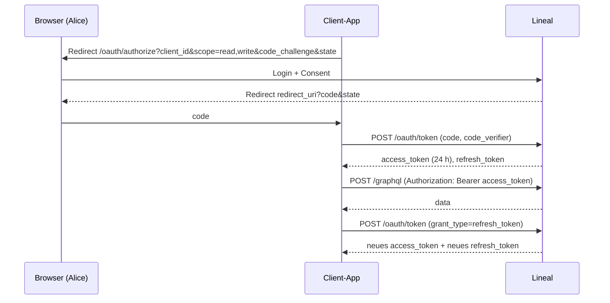
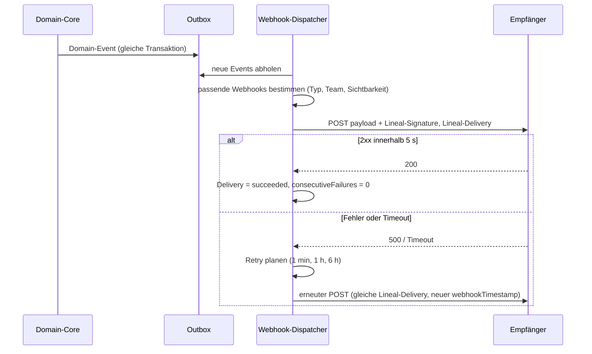
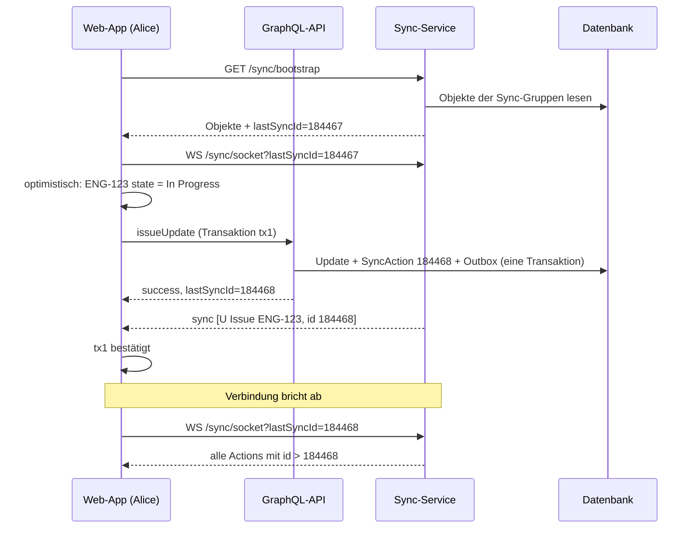
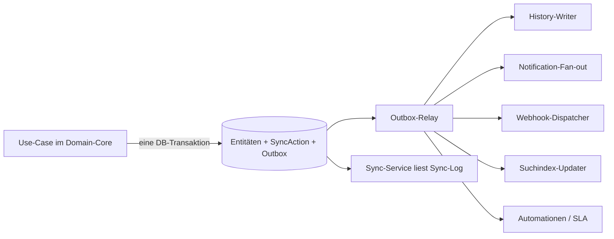

# 09 – API, Events, Sync

Dieses Kapitel beschreibt alle **maschinellen Schnittstellen** von Lineal außer dem MCP-Server: die öffentliche API (GraphQL, alternativ REST), Authentifizierung, Rate-Limits, Webhooks, den Echtzeit-Sync der Web-App und das zentrale **Domain-Event-Modell**, aus dem Sync, Webhooks, Benachrichtigungen, Suchindex und Historie gespeist werden.

Voraussetzung: [00-konventionen.md](00-konventionen.md) (IDs, Formate, Paginierung, Fehlermodell). Fachregeln stehen in [01](01-domaenenmodell.md)–[06](06-dokumente-templates.md); dieses Kapitel definiert nur deren **Transport**. Der MCP-Server ([07](07-mcp-server.md)) ruft dieselben Use-Cases des Domain-Core auf wie die API. Komponenten, Jobs und Persistenz: [10-architektur-umsetzung.md](10-architektur-umsetzung.md).

---

## 1. Öffentliche API

### 1.1 Grundsatzentscheidung

| Aspekt | Entscheidung |
|---|---|
| Stil | **GraphQL** (wie Linear). Ein Endpunkt `POST /graphql`, `Content-Type: application/json`, Body `{ "query", "variables", "operationName" }`. |
| Gleiche API für alle | Die eigene Web-App nutzt dieselbe API (plus Sync-Kanal, Abschnitt 5). Es gibt keine „privaten“ Mutations mit eigener Geschäftslogik. |
| Introspection | Für authentifizierte Clients aktiv; Schema wird zusätzlich als SDL-Datei unter `GET /graphql/schema.graphql` ausgeliefert. |
| Alternative | Teams, die kein GraphQL wollen, implementieren das REST-Mapping aus 1.8. Beide Varianten sind gleichwertige Adapter über denselben Use-Cases. |
| Versionierung | Additiv (neue Felder/Argumente). Entfernen nur über `@deprecated(reason: …)` mit mindestens 6 Monaten Vorlauf. |

### 1.2 Fehler in GraphQL

GraphQL kennt eigentlich nur „HTTP 200 + `errors`“. `extensions.code` entspricht dem Feld `error` aus 00 §7. Lineal bildet das Fehlermodell aus [00 §7](00-konventionen.md#7-fehlermodell) so ab:

| Fall | HTTP-Status | Body |
|---|---|---|
| Fehlender/ungültiger Token | 401 | `errors[0].extensions.code = "unauthenticated"` |
| Rate-Limit / Komplexität pro Stunde überschritten | 429 + `Retry-After` | `code = "rate_limited"` |
| Einzelquery > maximale Komplexität | 400 | `code = "invalid_request"`, `details.complexity` |
| Syntax-/Validierungsfehler der Query | 400 | `code = "invalid_request"` |
| Fachlicher Fehler in einem Feld/einer Mutation (`not_found`, `forbidden`, `conflict`, …) | 200 | `data.<feld> = null` + Eintrag in `errors` |

```json
{
  "data": { "issueUpdate": null },
  "errors": [{
    "message": "Could not find referenced Issue.",
    "path": ["issueUpdate"],
    "extensions": {
      "code": "not_found",
      "status": 404,
      "requestId": "req_01HZX3…",
      "details": { "reference": "ENG-999999" }
    }
  }]
}
```

**Bewusste Abweichung:** Linear antwortet bei Rate-Limits mit HTTP 400 und `extensions.code = "RATELIMITED"`. Lineal folgt [00](00-konventionen.md) mit 429.

### 1.3 Paginierung (Relay) und Bezug zur Konvention

GraphQL-Listen sind **Relay-Connections**:

```graphql
type PageInfo {
  hasNextPage: Boolean!
  hasPreviousPage: Boolean!
  startCursor: String
  endCursor: String
}

type IssueConnection {
  nodes: [Issue!]!
  edges: [IssueEdge!]!     # { node, cursor } – optional, nodes reicht
  pageInfo: PageInfo!
}

enum PaginationOrderBy { createdAt updatedAt }
```

Standardargumente jeder Connection: `first: Int`, `after: String`, `last: Int`, `before: String`, `includeArchived: Boolean = false`, `orderBy: PaginationOrderBy = updatedAt`, plus entitätsspezifisch `filter`.

Die Konvention aus [00 §5](00-konventionen.md#5-listen-und-paginierung) (`{issues, hasNextPage, cursor}`) gilt für REST und MCP. Beide Formen sind 1:1 umrechenbar:

| GraphQL (Relay) | REST/MCP (00 §5) |
|---|---|
| `nodes` | Plural-Schlüssel (`issues`, `teams` …) |
| `pageInfo.hasNextPage` | `hasNextPage` |
| `pageInfo.endCursor` | `cursor` (fehlt bei `hasNextPage=false`) |
| `first` (Default 50, Max 250; Projekte Max 50) | `limit` (gleiche Grenzen) |
| `after` | `cursor` (Request-Parameter) |
| `orderBy` Default `updatedAt` absteigend | identisch |
| kein `totalCount` | kein `totalCount` |

**Abweichung von Linear:** Linears Default-`orderBy` ist `createdAt`. Lineal nutzt `updatedAt` (00 ist verbindlich). Cursor sind opak (base64 von `{sortKey, id}`); ein Cursor ist nur mit derselben `orderBy`/`filter`-Kombination gültig, sonst `invalid_request`.

### 1.4 Kern-SDL: Query-Root

Auszug, Typen der Entitäten siehe [01-domaenenmodell.md](01-domaenenmodell.md). Alle `id`-Argumente akzeptieren die **flexible Referenz** aus [00 §2](00-konventionen.md#2-identifikatoren) (UUID, `ENG-123`, `P-ENG-7`, `I-4`, `slugId`).

```graphql
scalar DateTime
scalar TimelessDate
scalar DateTimeOrDuration
scalar JSON
scalar UUID

type Query {
  "Der aufrufende User (bei actor=app: der App-User)."
  viewer: User!
  organization: Organization!

  teams(filter: TeamFilter, first: Int, after: String, last: Int, before: String,
        includeArchived: Boolean, orderBy: PaginationOrderBy): TeamConnection!
  team(id: String!): Team!

  "completedIssues: Darstellungsprädikat für geschlossene Issues (05 §2.6), ohne Angabe = all."
  issues(filter: IssueFilter, first: Int, after: String, last: Int, before: String,
         includeArchived: Boolean, orderBy: PaginationOrderBy,
         sort: [IssueSortInput!], completedIssues: CompletedIssuesFilter): IssueConnection!
  issue(id: String!): Issue!

  "Volltextsuche (siehe 05). issueSearch ist ein Legacy-Alias mit query: String."
  searchIssues(term: String!, filter: IssueFilter, teamId: String,
               includeComments: Boolean = false, includeArchived: Boolean,
               first: Int, after: String, orderBy: PaginationOrderBy): IssueSearchConnection!
  searchProjects(term: String!, first: Int, after: String): ProjectSearchConnection!
  searchDocuments(term: String!, first: Int, after: String): DocumentSearchConnection!

  workflowStates(filter: WorkflowStateFilter, first: Int, after: String,
                 includeArchived: Boolean): WorkflowStateConnection!
  issueLabels(filter: IssueLabelFilter, first: Int, after: String,
              includeArchived: Boolean): IssueLabelConnection!
  users(filter: UserFilter, first: Int, after: String, includeDisabled: Boolean): UserConnection!
  user(id: String!): User!

  projects(filter: ProjectFilter, first: Int, after: String, includeArchived: Boolean,
           orderBy: PaginationOrderBy): ProjectConnection!
  project(id: String!): Project!
  projectMilestones(filter: ProjectMilestoneFilter, first: Int, after: String): ProjectMilestoneConnection!
  projectUpdates(filter: ProjectUpdateFilter, first: Int, after: String): ProjectUpdateConnection!

  cycles(filter: CycleFilter, first: Int, after: String, includeArchived: Boolean): CycleConnection!
  cycle(id: String!): Cycle!

  initiatives(filter: InitiativeFilter, first: Int, after: String, includeArchived: Boolean): InitiativeConnection!
  initiative(id: String!): Initiative!

  customViews(filter: CustomViewFilter, first: Int, after: String): CustomViewConnection!
  customView(id: String!): CustomView!
  favorites(first: Int, after: String): FavoriteConnection!

  "Nur Benachrichtigungen des Viewers."
  notifications(filter: NotificationFilter, first: Int, after: String,
                includeArchived: Boolean): NotificationConnection!

  documents(filter: DocumentFilter, first: Int, after: String, includeArchived: Boolean): DocumentConnection!
  document(id: String!): Document!

  templates: [Template!]!
  template(id: String!): Template!

  webhooks(first: Int, after: String): WebhookConnection!

  "Vorschau des Nesting-Wizards (02 §3.3): Konfliktliste, ändert nichts."
  previewTeamNesting(teamId: String!, parentId: String!): TeamNestingPreview!
}

enum CompletedIssuesFilter { all pastDay pastWeek pastMonth currentCycle none }

"Knoten der *SearchConnection: Entität plus Trefferausschnitte (05 §5.4)."
type IssueSearchResult { issue: Issue!  highlights: [SearchHighlight!]! }
type SearchHighlight {
  field: String!           # z. B. title, description, comment
  snippet: String!         # Ausschnitt; Fundstellen mit <mark>…</mark> markiert
}
```

`ProjectSearchConnection` und `DocumentSearchConnection` liefern analog `ProjectSearchResult`/`DocumentSearchResult` mit `highlights`. Der Parameter `completedIssues` gilt ebenso für verschachtelte Issue-Connections (`Team.issues`, `Project.issues`, `Cycle.issues`).

Verschachtelte Connections an Entitäten folgen demselben Muster, z. B. `Team.issues(filter, first, after)`, `Issue.children`, `Issue.comments`, `Issue.history`, `Project.issues`, `Cycle.issues`, `Initiative.projects`.

### 1.5 Filtermodell (Kurzfassung)

Jede Liste hat ein `<Entity>Filter`-Input. Felder werden mit **Comparators** geprüft (`eq`, `neq`, `in`, `nin`, `lt`, `lte`, `gt`, `gte`, `contains…`, `startsWith…`, `null`), Relationen mit verschachtelten Filtern; To-Many-Relationen mit `some`/`every`/`length`; Logik über `and`/`or`; Felder auf derselben Ebene sind UND-verknüpft. Datumsfelder akzeptieren relative Dauern (`-P2W`).

```json
{ "team": { "key": { "eq": "ENG" } },
  "state": { "type": { "in": ["unstarted", "started"] } },
  "assignee": { "isMe": { "eq": true } },
  "labels": { "some": { "name": { "eqIgnoreCase": "bug" } } } }
```

Vollständige Feld- und Comparator-Liste, Sortierung und Anzeigeoptionen: [05-views-suche-inbox.md](05-views-suche-inbox.md). Dieselbe JSON-Struktur wird in `CustomView.filterData` gespeichert.

**Sicherheitsregel:** Jeder Filter wird serverseitig um den **Sichtbarkeitsfilter** des Aufrufers ergänzt (sichtbare Team-IDs, siehe [02](02-teams-rechte.md)). Ein Filter auf ein nicht sichtbares privates Team liefert `not_found`, nicht eine leere Liste.

### 1.6 Kern-SDL: Mutations und Payload-Muster

Jede Mutation liefert ein Payload mit **`success`**, **`lastSyncId`** und der betroffenen Entität. `lastSyncId: Float!` ist die globale Sync-Sequenznummer **nach** der Transaktion (Abschnitt 5); der Client kann damit warten, bis sein Sync-Stream diesen Stand erreicht hat. Der API-Name bleibt `Float` (Linear-Kompatibilität); intern wird ein 64-Bit-Integer gespeichert (Werte < 2^53 bleiben in `Float` exakt).

```graphql
type IssuePayload        { success: Boolean!  lastSyncId: Float!  issue: Issue }
type IssueBatchPayload   { success: Boolean!  lastSyncId: Float!  issues: [Issue!]! }
type IssueArchivePayload { success: Boolean!  lastSyncId: Float!  entity: Issue }
type DeletePayload       { success: Boolean!  lastSyncId: Float!  entityId: String! }
type UploadPayload       { success: Boolean!  lastSyncId: Float!  uploadFile: UploadFile }
type UploadFile {
  uploadUrl: String!            # vorsignierte PUT-URL des Objektspeichers
  headers: [UploadFileHeader!]! # beim PUT exakt mitsenden
  assetUrl: String!             # dauerhafte URL, in Markdown/Attachment verwenden
  filename: String!  contentType: String!  size: Int!  metaData: JSON
}
type UploadFileHeader { key: String!  value: String! }
```

Muster für alle anderen Entitäten: `<Entity>Payload { success, lastSyncId, <entity> }`, `<Entity>ArchivePayload { success, lastSyncId, entity }`, `DeletePayload { success, lastSyncId, entityId }`.

```graphql
type Mutation {
  # Issues (Regeln: 03)
  issueCreate(input: IssueCreateInput!): IssuePayload!
  issueUpdate(id: String!, input: IssueUpdateInput!): IssuePayload!
  issueBatchUpdate(ids: [UUID!]!, input: IssueUpdateInput!): IssueBatchPayload!   # max. 50 IDs, atomar
  issueArchive(id: String!, trash: Boolean): IssueArchivePayload!
  issueUnarchive(id: String!): IssueArchivePayload!
  issueDelete(id: String!, permanentlyDelete: Boolean): IssueArchivePayload!       # Default: Papierkorb 30 Tage
  issueRelationCreate(input: IssueRelationCreateInput!): IssueRelationPayload!
  issueRelationDelete(id: String!): DeletePayload!

  # Kommentare, Reaktionen, Anhänge, Uploads
  commentCreate(input: CommentCreateInput!): CommentPayload!
  commentUpdate(id: String!, input: CommentUpdateInput!): CommentPayload!
  commentDelete(id: String!): DeletePayload!
  reactionCreate(input: ReactionCreateInput!): ReactionPayload!
  reactionDelete(id: String!): DeletePayload!
  attachmentCreate(input: AttachmentCreateInput!): AttachmentPayload!
  attachmentLinkURL(issueId: String!, url: String!, title: String): AttachmentPayload!
  fileUpload(filename: String!, contentType: String!, size: Int!,
             makePublic: Boolean, metaData: JSON): UploadPayload!

  # Labels, Workflow
  issueLabelCreate(input: IssueLabelCreateInput!): IssueLabelPayload!
  issueLabelUpdate(id: String!, input: IssueLabelUpdateInput!): IssueLabelPayload!
  issueLabelRetire(id: String!): IssueLabelPayload!
  issueLabelRestore(id: String!): IssueLabelPayload!
  workflowStateCreate(input: WorkflowStateCreateInput!): WorkflowStatePayload!
  workflowStateUpdate(id: String!, input: WorkflowStateUpdateInput!): WorkflowStatePayload!
  workflowStateArchive(id: String!): WorkflowStateArchivePayload!

  # Teams (Regeln: 02)
  teamCreate(input: TeamCreateInput!): TeamPayload!
  teamUpdate(id: String!, input: TeamUpdateInput!): TeamPayload!
  teamDelete(id: String!): DeletePayload!
  teamMembershipCreate(input: TeamMembershipCreateInput!): TeamMembershipPayload!
  teamMembershipDelete(id: String!): DeletePayload!
  nestTeam(teamId: String!, parentId: String, options: NestTeamOptions): TeamNestingJobPayload!   # Hintergrundjob, 02 §3.3; parentId null = Un-Nesting

  # Workspace und Einladungen (Regeln: 02 §1.1, 01 §2.11, Abläufe: 08 F1/F16)
  createWorkspace(input: WorkspaceCreateInput!): WorkspaceCreatePayload!   # Konto-Session ohne Workspace-Kontext
  inviteUsers(input: InviteUsersInput!): InvitationBatchPayload!           # emails, role, teamIds; Recht W:invitationsRole
  invitationResend(id: String!): InvitationPayload!
  invitationRevoke(id: String!): InvitationPayload!
  acceptInvitation(token: String!): AcceptInvitationPayload!              # Konto-Session ohne Workspace-Kontext; ungültiges Token → not_found

  # Planung (Regeln: 04)
  cycleCreate(input: CycleCreateInput!): CyclePayload!
  cycleUpdate(id: String!, input: CycleUpdateInput!): CyclePayload!
  projectCreate(input: ProjectCreateInput!): ProjectPayload!
  projectUpdate(id: String!, input: ProjectUpdateInput!): ProjectPayload!
  projectArchive(id: String!, trash: Boolean): ProjectArchivePayload!
  projectDelete(id: String!): ProjectArchivePayload!
  projectMilestoneCreate(input: ProjectMilestoneCreateInput!): ProjectMilestonePayload!
  projectMilestoneUpdate(id: String!, input: ProjectMilestoneUpdateInput!): ProjectMilestonePayload!
  projectMilestoneDelete(id: String!): DeletePayload!
  projectUpdateCreate(input: ProjectUpdateCreateInput!): ProjectUpdatePayload!
  initiativeCreate(input: InitiativeCreateInput!): InitiativePayload!
  initiativeUpdate(id: String!, input: InitiativeUpdateInput!): InitiativePayload!
  initiativeToProjectCreate(input: InitiativeToProjectCreateInput!): InitiativeToProjectPayload!

  # Views, Favoriten, Inbox (Regeln: 05)
  customViewCreate(input: CustomViewCreateInput!): CustomViewPayload!
  customViewUpdate(id: String!, input: CustomViewUpdateInput!): CustomViewPayload!
  customViewDelete(id: String!): DeletePayload!
  favoriteCreate(input: FavoriteCreateInput!): FavoritePayload!
  notificationUpdate(id: String!, input: NotificationUpdateInput!): NotificationPayload!   # readAt, snoozedUntilAt
  notificationArchive(id: String!): NotificationArchivePayload!
  notificationSnoozeAll(input: NotificationEntityInput!, snoozedUntilAt: DateTime!): NotificationBatchActionPayload!
  notificationArchiveAll(filter: NotificationFilter): NotificationBatchActionPayload!   # z. B. nur gelesene, nur mit geschlossenem Issue (05 §6.8)
  issueSubscribe(id: String!, userId: String): IssuePayload!     # ohne userId = Viewer; reason manual bzw. addedByOther
  issueUnsubscribe(id: String!, userId: String): IssuePayload!   # setzt IssueSubscription.active = false

  # Dokumente, Templates (Regeln: 06)
  documentCreate(input: DocumentCreateInput!): DocumentPayload!
  documentUpdate(id: String!, input: DocumentUpdateInput!): DocumentPayload!
  templateCreate(input: TemplateCreateInput!): TemplatePayload!
  templateUpdate(id: String!, input: TemplateUpdateInput!): TemplatePayload!

  # Webhooks (Abschnitt 4)
  webhookCreate(input: WebhookCreateInput!): WebhookPayload!
  webhookUpdate(id: String!, input: WebhookUpdateInput!): WebhookPayload!
  webhookDelete(id: String!): DeletePayload!
  webhookRotateSecret(id: String!): WebhookRotateSecretPayload!
}
```

**Snooze einzelner Benachrichtigungen:** Linear hat keine Mutation `notificationSnooze`; Snoozen geschieht über `notificationUpdate(id, input: { snoozedUntilAt })`, Bulk über `notificationSnoozeAll`. Lineal übernimmt das.

Weitere Mutations nach demselben Muster (`…Create/Update/Delete|Archive/Unarchive`) sind zulässig und in [01](01-domaenenmodell.md) bei den Entitäten aufgeführt (z. B. `issueBatchCreate`, `projectLabel*`, `initiativeUpdateCreate`, `notificationMarkReadAll`, `notificationSubscriptionUpdate`).

**Beispiel-Inputs** (Auszug, vollständige Felder in [03](03-issues-workflow.md)):

```graphql
input IssueCreateInput {
  id: UUID                 # optional, client-generiert (für optimistische Updates, Abschnitt 5)
  teamId: String!
  title: String            # Pflicht außer bei templateId
  description: String      # Markdown
  stateId: String  assigneeId: String  priority: Int  estimate: Int
  labelIds: [String!]  parentId: String  projectId: String
  projectMilestoneId: String  cycleId: String  dueDate: TimelessDate
  subscriberIds: [String!]  templateId: String  sortOrder: Float
}

input IssueUpdateInput {   # Tri-State: weglassen = unverändert, null = leeren
  title: String  description: String  stateId: String  assigneeId: String
  priority: Int  estimate: Int  teamId: String  parentId: String
  labelIds: [String!]         # ersetzt
  addedLabelIds: [String!]    # inkrementell; nicht mit labelIds kombinierbar
  removedLabelIds: [String!]
  projectId: String  projectMilestoneId: String  cycleId: String
  dueDate: TimelessDate  sortOrder: Float  trashed: Boolean
}
```

Regeln aus [00 §6](00-konventionen.md#6-schreibsemantik) gelten unverändert (Tri-State, `labelIds` + `addedLabelIds` gleichzeitig → `invalid_request`).

**Beispiel-Request/-Antwort:**

```http
POST /graphql HTTP/1.1
Host: api.lineal.example
Authorization: lin_api_7f3c…
Content-Type: application/json

{"query":"mutation($in: IssueCreateInput!){ issueCreate(input:$in){ success lastSyncId issue{ id identifier title } } }",
 "variables":{"in":{"teamId":"ENG","title":"Login-Button ohne Fokus-Ring","priority":2}}}
```

```json
{ "data": { "issueCreate": {
    "success": true,
    "lastSyncId": 184467,
    "issue": { "id": "8b0e…", "identifier": "ENG-123", "title": "Login-Button ohne Fokus-Ring" } } } }
```

### 1.7 Datei-Upload

Uploads laufen **nicht** über die API, sondern direkt in den Objektspeicher:

1. `fileUpload(filename, contentType, size)` → `uploadFile { uploadUrl, headers, assetUrl }`. Server prüft Größe (Default 50 MB, konfigurierbar) und Content-Type.
2. Client sendet `PUT uploadUrl` mit dem Dateiinhalt und exakt den gelieferten `headers`. URL läuft nach 60 s ab.
3. Client referenziert `assetUrl` in Markdown (``) oder ruft `attachmentCreate({ issueId, url: assetUrl, title })` auf.

`assetUrl` ist nicht öffentlich (außer `makePublic=true`); Abruf erfordert eine gültige Session oder einen API-Token mit Leserecht auf das Elternobjekt.

### 1.8 Alternative: REST-Mapping

Für Teams ohne GraphQL. Pfade unter `/api/v1`, JSON-Bodies entsprechen den GraphQL-Inputs, Antworten der Payload-Form (`{ success, lastSyncId, issue }`), Listen der 00-Form. `{id}` akzeptiert flexible Referenzen.

| Methode + Pfad | GraphQL-Entsprechung |
|---|---|
| `GET /me` | `viewer` |
| `GET /organization` | `organization` |
| `GET /teams`, `GET /teams/{id}` | `teams`, `team` |
| `POST /teams`, `PATCH /teams/{id}`, `DELETE /teams/{id}` | `teamCreate`, `teamUpdate`, `teamDelete` |
| `POST /teams/{id}/members`, `DELETE /team-memberships/{id}` | `teamMembershipCreate`, `teamMembershipDelete` |
| `GET /teams/{id}/states`, `POST /teams/{id}/states`, `PATCH /states/{id}`, `POST /states/{id}/archive` | `workflowStates`, `workflowStateCreate/Update/Archive` |
| `GET /issues?filter=<json>&limit&cursor&orderBy&includeArchived` | `issues` |
| `POST /issues/query` (Body `{filter, limit, cursor}`) | `issues` (für lange Filter) |
| `GET /issues/search?term=…` | `searchIssues` |
| `GET /issues/{id}` | `issue` |
| `POST /issues`, `PATCH /issues/{id}` | `issueCreate`, `issueUpdate` |
| `PATCH /issues` (Body `{ids, input}`) | `issueBatchUpdate` |
| `POST /issues/{id}/archive`, `POST /issues/{id}/unarchive` | `issueArchive`, `issueUnarchive` |
| `DELETE /issues/{id}?permanently=false` | `issueDelete` |
| `POST /issue-relations`, `DELETE /issue-relations/{id}` | `issueRelationCreate/Delete` |
| `POST /comments`, `PATCH /comments/{id}`, `DELETE /comments/{id}` | `commentCreate/Update/Delete` |
| `POST /reactions`, `DELETE /reactions/{id}` | `reactionCreate/Delete` |
| `POST /attachments`, `POST /attachments/link` | `attachmentCreate`, `attachmentLinkURL` |
| `POST /uploads` | `fileUpload` |
| `GET/POST /labels`, `PATCH /labels/{id}`, `POST /labels/{id}/retire` | `issueLabels`, `issueLabelCreate/Update/Retire` |
| `GET/POST /cycles`, `PATCH /cycles/{id}` | `cycles`, `cycleCreate/Update` |
| `GET/POST /projects`, `PATCH /projects/{id}`, `POST /projects/{id}/archive`, `DELETE /projects/{id}` | `projects`, `projectCreate/Update/Archive/Delete` |
| `POST /projects/{id}/milestones`, `PATCH/DELETE /milestones/{id}` | `projectMilestone*` |
| `POST /projects/{id}/updates` | `projectUpdateCreate` |
| `GET/POST /initiatives`, `PATCH /initiatives/{id}`, `POST /initiatives/{id}/projects` | `initiatives`, `initiativeCreate/Update`, `initiativeToProjectCreate` |
| `GET/POST /views`, `PATCH/DELETE /views/{id}` | `customViews`, `customView*` |
| `POST /favorites` | `favoriteCreate` |
| `GET /notifications`, `PATCH /notifications/{id}`, `POST /notifications/{id}/archive` | `notifications`, `notificationUpdate`, `notificationArchive` |
| `GET/POST /documents`, `PATCH /documents/{id}` | `documents`, `documentCreate/Update` |
| `GET/POST /templates`, `PATCH /templates/{id}` | `templates`, `templateCreate/Update` |
| `GET/POST /webhooks`, `PATCH/DELETE /webhooks/{id}`, `POST /webhooks/{id}/rotate-secret` | `webhook*` |

Fehler im REST-Mapping: exakt das JSON aus [00 §7](00-konventionen.md#7-fehlermodell) mit dem dortigen HTTP-Status. Expand von Relationen über `?include=state,assignee,labels` (sonst nur IDs).

---

## 2. Authentifizierung

### 2.1 Übersicht

| Verfahren | Header | Für | Akteur |
|---|---|---|---|
| Personal API Key | `Authorization: <key>` (**ohne** `Bearer`) | Skripte, persönliche Integrationen | der User, dem der Key gehört |
| OAuth 2.0 Access Token | `Authorization: Bearer <token>` | Drittanbieter-Apps, MCP-Clients | User (`actor=user`) oder App-User (`actor=app`) |
| Session-Cookie | `Cookie: lineal_session=…` + CSRF-Header | eigene Web-App | eingeloggter User |

Der Server erkennt den Typ am Präfix: `lin_api_…` (API Key), `lin_oauth_…` (Access Token), `lin_refresh_…` (Refresh Token). Präfixe erleichtern zusätzlich Secret-Scanning in Repositories.

### 2.2 Personal API Keys

| Feld | Typ | Bedeutung |
|---|---|---|
| `id` | UUID | |
| `label` | String | Anzeigename („CI acme“) |
| `userId` | UUID | Eigentümer |
| `keyPrefix` | String | erste 12 Zeichen, zur Anzeige („lin_api_7f3c…“) |
| `keyHash` | String | SHA-256 des vollständigen Keys (hex) |
| `scopes` | [String] | `read` immer; optional `write`, `issues:create`, `comments:create`, `admin` |
| `teamIds` | [UUID]? | null = alle Teams des Users; sonst Einschränkung auf diese Teams |
| `lastUsedAt` | DateTime? | asynchron aktualisiert (max. 1× pro Minute) |
| `expiresAt` | DateTime? | optional |
| `revokedAt` | DateTime? | gesetzt = widerrufen |

Regeln:
- Der Klartext-Key wird **genau einmal** bei Erstellung angezeigt. Gespeichert wird nur `keyHash` (SHA-256 genügt, da Keys ≥ 256 Bit Zufall haben; kein langsamer Passwort-Hash nötig).
- Lookup: `hash(key)` → Index auf `keyHash`; Vergleich in konstanter Zeit.
- Effektive Rechte = Schnittmenge aus **Rolle/Teamzugehörigkeit des Users** ([02](02-teams-rechte.md)) und **Scopes/teamIds des Keys**. Ein Key kann nie mehr als der User.
- Admins können per Workspace-Einstellung `allowMemberApiKeys: Boolean` verbieten, dass Nicht-Admins Keys anlegen.
- Widerruf: der Eigentümer in seinen Einstellungen, Admins für beliebige Keys des Workspace (`apiKeyRevoke(id)` bzw. `DELETE /api-keys/{id}`); setzt `revokedAt`, wirkt sofort.
- Wird der User deaktiviert oder verliert er die Rolle, gelten seine Keys sofort nur noch im neuen Rahmen bzw. gar nicht.

### 2.3 OAuth 2.0

**Endpunkte**

| Endpunkt | Methode | Parameter |
|---|---|---|
| `/oauth/authorize` | GET (Browser) | `client_id`, `redirect_uri`, `response_type=code`, `scope` (kommagetrennt), `state`, `prompt=consent`?, `actor=user\|app`?, `code_challenge`, `code_challenge_method=S256\|plain` |
| `/oauth/token` | POST (form-urlencoded) | `grant_type=authorization_code`: `code`, `redirect_uri`, `client_id`, `client_secret` **oder** `code_verifier` (PKCE) |
| `/oauth/token` | POST | `grant_type=refresh_token`: `refresh_token`, `client_id`, `client_secret` (bei PKCE-Clients optional) |
| `/oauth/token` | POST | `grant_type=client_credentials`: `scope`, Client-Auth per HTTP Basic (nur wenn für die App aktiviert) |
| `/oauth/revoke` | POST | `token`, `token_type_hint=access_token\|refresh_token`? → 200 / 400 (bereits widerrufen) / 401 |

**Token-Antwort**

```json
{ "access_token": "lin_oauth_…", "token_type": "Bearer", "expires_in": 86399,
  "scope": "read write", "refresh_token": "lin_refresh_…" }
```

**Scopes**

| Scope | Erlaubt |
|---|---|
| `read` | Lesen (immer enthalten) |
| `write` | Alle Schreiboperationen im Rahmen der User-Rechte |
| `issues:create` | Nur `issueCreate` (+ `fileUpload`, `attachmentCreate` am neuen Issue) |
| `comments:create` | Nur `commentCreate` |
| `admin` | Admin-Operationen (Webhooks, Team-Einstellungen); nur wenn der autorisierende User Admin ist |

**Actor**

| `actor` | Wirkung |
|---|---|
| `user` (Default) | Aktionen erscheinen als der autorisierende User. |
| `app` | Bei Installation wird ein **App-User** angelegt (`UserRoleType.app`, nicht lizenzzählend); Aktionen erscheinen als App. Zugriff: alle öffentlichen Teams plus Teams, in die die App explizit aufgenommen wurde. |

**Laufzeiten und Rotation**

| Token | Laufzeit | Regel |
|---|---|---|
| Authorization Code | 10 min | einmal verwendbar; zweite Verwendung widerruft alle daraus entstandenen Tokens |
| Access Token | 24 h | |
| Refresh Token | unbegrenzt bis Widerruf | **Rotation**: jeder Refresh liefert ein neues Paar; das alte Refresh-Token bleibt **30 min** (Grace Period) gültig, damit verlorene Antworten wiederholt werden können. Danach Wiederverwendung → gesamte Token-Familie widerrufen. |
| Client-Credentials-Token | 30 Tage | `actor=app`, kein Refresh-Token |

**Speicherung:** `OAuthToken { id, applicationId, userId, actor, scopes, accessTokenHash, refreshTokenHash, familyId, expiresAt, revokedAt, rotatedAt }`. Wie bei API-Keys nur SHA-256-Hashes. `OAuthApplication.clientSecret` ebenfalls nur als Hash; Rotation des Client-Secrets widerruft alle Client-Credentials-Tokens.

**Widerruf** wirkt sofort: Auth-Cache (falls vorhanden) wird über das Event `OAuthAuthorizationRevoked` invalidiert; Webhooks der App erhalten ein Ereignis dieses Typs (Abschnitt 4.2).



---

## 3. Rate-Limits und Komplexität

### 3.1 Limits

Geprüfte Referenzwerte von Linear (Stand 2026-10-10, `linear.app/developers/rate-limiting`). Hinweis: Für API-Keys sind es **2 500** Requests/h, nicht 5 000; 5 000 gilt für OAuth.

| Identität | Requests / Stunde | Komplexitätspunkte / Stunde | Bucket-Schlüssel |
|---|---|---|---|
| API Key | 2 500 | 3 000 000 | User-ID |
| OAuth (user oder app) | 5 000 | 2 000 000 | User-ID bzw. App-User-ID |
| Unauthentifiziert | 600 | 100 000 | Client-IP |
| **Einzelquery** | – | max. **10 000** Punkte | – (immer abgelehnt) |

Lineal übernimmt diese Werte als **Defaults** und macht sie als Workspace-Limits konfigurierbar (konsistent mit der Entscheidung „Pläne/Limits“ in [README](README.md)). Zusätzlich gibt es **Endpunkt-Limits** für teure Operationen (Default: `searchIssues` 300/h, `fileUpload` 600/h, `issueBatchUpdate` 600/h pro User). Die Web-App über Session-Cookie und der Sync-Kanal unterliegen einem eigenen, großzügigeren Limit (Default 10× OAuth).

### 3.2 Komplexitätsberechnung

Statisch vor der Ausführung, aus dem Query-AST:

| Element | Punkte |
|---|---|
| Skalares Feld | 0,1 |
| Objekt | 1 |
| Connection | Kinderpunkte × `first`/`last` (Default 50) |
| Summe | aufrunden auf ganze Zahl |

```text
function cost(selectionSet, multiplier = 1):
  total = 0
  for field in selectionSet:
    if field.isScalar: total += 0.1
    else if field.name in ["nodes", "edges", "node"]:   # transparent
      total += cost(field.selectionSet)
    else if field.isConnection:
      n = field.args.first ?? field.args.last ?? 50
      total += 1 + n * cost(field.selectionSet)        # nodes/edges zählen innerhalb
    else:                                              # Objekt
      total += 1 + cost(field.selectionSet)
  return total

complexity = ceil(cost(operation.selectionSet))
if complexity > 10000: reject invalid_request (details.complexity)
```

Beispiel: `issues(first: 50) { nodes { id title assignee { name } } }` = 1 + 50 × (0,1 + 0,1 + 1 + 0,1) = 66.

Mutations kosten Komplexität ihres Rückgabe-Selection-Sets; zusätzlich zählt jeder Request 1 im Request-Bucket.

### 3.3 Algorithmus (Token-Bucket)

Linear nennt das Verfahren „Leaky Bucket“ mit konstanter Nachfüllrate `LIMIT / PERIOD`; das ist hier gleichwertig zu einem Token-Bucket mit Kapazität `LIMIT` und kontinuierlicher Nachfüllung. Pro Identität gibt es zwei Buckets (Requests, Komplexität).

```text
record Bucket { tokens: Float, updatedAt: Time }

function take(key, capacity, periodSeconds, cost):
  # atomar ausführen (z. B. Skript im In-Memory-Store oder SELECT … FOR UPDATE)
  b = store.get(key) ?? Bucket(capacity, now())
  rate = capacity / periodSeconds
  b.tokens = min(capacity, b.tokens + (now() - b.updatedAt) * rate)
  b.updatedAt = now()
  if b.tokens < cost:
    retryAfter = ceil((cost - b.tokens) / rate)
    store.put(key, b)
    return Denied(remaining = floor(b.tokens), retryAfter)
  b.tokens -= cost
  store.put(key, b)
  return Allowed(remaining = floor(b.tokens),
                 resetAt = now() + (capacity - b.tokens) / rate)

# pro Request:
r = take("req:"  + identity, reqLimit, 3600, 1)
c = take("cplx:" + identity, cplxLimit, 3600, complexity)
if r.denied or c.denied: respond 429 rate_limited, Retry-After = max(retryAfter)
```

Hinweis: Wird der Komplexitäts-Bucket abgelehnt, nachdem der Request-Bucket bereits belastet wurde, wird der Request-Token nicht zurückerstattet (vereinfachte, konservative Variante).

### 3.4 Antwort-Header

| Header | Inhalt |
|---|---|
| `X-RateLimit-Requests-Limit` | Kapazität Request-Bucket |
| `X-RateLimit-Requests-Remaining` | verbleibend |
| `X-RateLimit-Requests-Reset` | Unix-Zeit (ms), zu der der Bucket wieder voll ist |
| `X-Complexity` | Komplexität dieses Requests |
| `X-RateLimit-Complexity-Limit` / `-Remaining` / `-Reset` | analog für Komplexität |
| `X-RateLimit-Endpoint-Name` / `X-RateLimit-Endpoint-Requests-Limit` / `-Remaining` / `-Reset` | nur bei Endpunkt-Limits |
| `Retry-After` | Sekunden, nur bei 429 |

Empfehlung an Integratoren (in der Developer-Doku zu nennen): nicht pollen, sondern Webhooks nutzen; nur benötigte Felder abfragen; kleine `first`-Werte.

---

## 4. Webhooks

### 4.1 Konfiguration

| Feld | Typ | Bedeutung |
|---|---|---|
| `id` | UUID | `webhookId` im Payload |
| `label` | String? | Anzeigename |
| `url` | String | HTTPS-Ziel (Pflicht `https://`, keine privaten/Loopback-IPs – SSRF-Schutz, Prüfung bei Anlage **und** bei jeder Zustellung nach DNS-Auflösung) |
| `enabled` | Boolean | aktiv |
| `teamId` | UUID? | gesetzt = nur exakt dieses Team, keine Sub-Teams (siehe Offene Punkte) |
| `allPublicTeams` | Boolean | `true` = alle **öffentlichen** Teams; genau eines von `teamId`/`allPublicTeams` ist gesetzt |
| `resourceTypes` | [String] | abonnierte Ressourcentypen (siehe 4.2) |
| `secret` | String | Signing-Secret (32 Byte zufällig, hex). Wird verschlüsselt gespeichert (nicht gehasht – der Server braucht den Klartext zum Signieren). Rotation via `webhookRotateSecret`. |
| `creatorId` | UUID | |
| `oauthApplicationId` | UUID? | Webhook gehört zu einer OAuth-App (wird mit Widerruf der App deaktiviert) |
| `consecutiveFailures` | Int | für Deaktivierung |
| `disabledReason` | String? | z. B. `delivery_failures` |

Rechte: Anlegen/Ändern nur Workspace-Admins oder OAuth-Apps mit Scope `admin`. Ein team-gebundener Webhook auf ein **privates** Team erfordert, dass der Ersteller Mitglied dieses Teams ist ([02](02-teams-rechte.md)). `allPublicTeams=true` liefert **niemals** Events aus `private`- oder `restricted`-Teams, auch nicht, wenn ein Event teamübergreifend ist (z. B. Projekt mit einem öffentlichen und einem privaten Team → Event ja, aber Felder/Issues aus dem privaten Team werden aus `data` entfernt).

### 4.2 Ressourcentypen und Aktionen

| `type` | Aktionen | Team-Zuordnung für Filterung |
|---|---|---|
| `Issue` | `create`, `update`, `remove` | `Issue.teamId` |
| `Comment` | `create`, `update`, `remove` | Team des Elternobjekts (Issue) bzw. Teams des Projekts |
| `IssueLabel` | `create`, `update`, `remove` | `teamId` oder Workspace-Label (an alle) |
| `Reaction` | `create`, `remove` | wie Elternobjekt |
| `Attachment` | `create`, `update`, `remove` | Team des Issues |
| `Project` | `create`, `update`, `remove` | Teams des Projekts (mind. eines passend) |
| `ProjectUpdate` | `create`, `update`, `remove` | wie Project |
| `Cycle` | `create`, `update`, `remove` | `Cycle.teamId` |
| `Document` | `create`, `update`, `remove` | Team des Elternobjekts |
| `Initiative` | `create`, `update`, `remove` | workspace-weit (nur bei `allPublicTeams`) |
| `InitiativeUpdate` | `create`, `update`, `remove` | workspace-weit |
| `User` | `create`, `update` | workspace-weit |
| `IssueSLA` | `set`, `highRisk`, `breached` | Team des Issues; Payload enthält zusätzlich `issueData` |
| `OAuthAuthorization` | `revoked` | nur an Webhooks der betroffenen OAuth-App; Payload mit `oauthClientId` |

**Semantik von `remove` (Annahme, Linear dokumentiert sie nicht):** Archivieren und In-den-Papierkorb-Legen sind `update` (mit `archivedAt` bzw. `trashed` in `data` und `updatedFrom`). `remove` wird nur bei **endgültigem** Löschen gesendet (inkl. Löschen durch den 30-Tage-Job); `data` enthält den letzten bekannten Zustand.

### 4.3 Payload-Schema

```json
{
  "$schema": "https://json-schema.org/draft/2020-12/schema",
  "title": "LinealWebhookPayload",
  "type": "object",
  "required": ["action", "type", "createdAt", "data", "url", "organizationId", "webhookTimestamp", "webhookId"],
  "properties": {
    "action": { "enum": ["create", "update", "remove", "set", "highRisk", "breached", "revoked"] },
    "type": { "type": "string", "examples": ["Issue", "Comment"] },
    "actor": {
      "type": ["object", "null"],
      "properties": {
        "id": { "type": "string", "format": "uuid" },
        "type": { "enum": ["user", "oauthClient", "integration", "system"] },
        "name": { "type": "string" },
        "email": { "type": "string" },
        "url": { "type": "string" }
      }
    },
    "createdAt": { "type": "string", "format": "date-time", "description": "Zeitpunkt der Änderung" },
    "data": { "type": "object", "description": "Serialisierte Entität wie im GraphQL-Schema, Relationen als <feld>Id plus eingebettete Kurzobjekte (team, state, assignee, labels)" },
    "updatedFrom": { "type": "object", "description": "Nur bei update: alte Werte genau der geänderten Felder; vorher nicht gesetzte Felder mit null" },
    "url": { "type": "string", "description": "App-URL der Entität" },
    "organizationId": { "type": "string", "format": "uuid" },
    "webhookTimestamp": { "type": "integer", "description": "Unix-Zeit in ms beim Senden (bei Retries neu gesetzt)" },
    "webhookId": { "type": "string", "format": "uuid" }
  }
}
```

Beispiel (Statuswechsel von ENG-123 durch Alice):

```json
{
  "action": "update",
  "type": "Issue",
  "actor": { "id": "5d1a…", "type": "user", "name": "Alice", "email": "alice@acme.example", "url": "https://lineal.example/acme/profiles/alice" },
  "createdAt": "2026-10-10T07:15:00.000Z",
  "data": {
    "id": "8b0e…", "identifier": "ENG-123", "number": 123, "title": "Login-Button ohne Fokus-Ring",
    "priority": { "value": 2, "name": "High" },
    "teamId": "c41f…", "team": { "id": "c41f…", "key": "ENG", "name": "Engineering" },
    "stateId": "e9a2…", "state": { "id": "e9a2…", "name": "In Progress", "type": "started" },
    "assigneeId": "5d1a…", "labelIds": ["0aa7…"],
    "startedAt": "2026-10-10T07:15:00.000Z", "updatedAt": "2026-10-10T07:15:00.000Z"
  },
  "updatedFrom": { "stateId": "77b3…", "startedAt": null, "updatedAt": "2026-10-09T16:02:11.000Z" },
  "url": "https://lineal.example/acme/issue/ENG-123/login-button-ohne-fokus-ring",
  "organizationId": "1f2e…",
  "webhookTimestamp": 1791616500412,
  "webhookId": "a3c9…"
}
```

### 4.4 HTTP-Zustellung und Signatur

```http
POST /hooks/lineal HTTP/1.1
Content-Type: application/json; charset=utf-8
User-Agent: Lineal-Webhook
Lineal-Delivery: 2b7d6c0e-…        # UUID pro Event×Webhook, bei Retries identisch
Lineal-Event: Issue
Lineal-Timestamp: 1791616500412
Lineal-Signature: 9f86d081884c7d659a2feaa0c55ad015a3bf4f1b2b0b822cd15d6c15b0f00a08
```

- **Signatur:** `hex(HMAC-SHA256(secret, rawBody))`. Der Empfänger muss über den **rohen** Body rechnen, nicht über neu serialisiertes JSON, und in konstanter Zeit vergleichen.
- **Replay-Schutz:** Empfänger verwirft Nachrichten, deren `webhookTimestamp` mehr als **±60 s** von der eigenen Uhr abweicht. Da `webhookTimestamp` Teil des signierten Bodys ist, ist er fälschungssicher.
- **Secret-Rotation:** Nach `webhookRotateSecret` wird 24 h lang zusätzlich ein Header `Lineal-Signature-Previous` mit dem alten Secret mitgeschickt (Lineal-Erweiterung).

Empfänger-Pseudocode:

```text
function verify(request, secret):
  raw = request.rawBody
  expected = hex(hmacSha256(secret, raw))
  if not constantTimeEquals(expected, request.header("Lineal-Signature")): return 401
  payload = parseJson(raw)
  if abs(nowMillis() - payload.webhookTimestamp) > 60000: return 401
  if seenDeliveries.contains(request.header("Lineal-Delivery")): return 200   # idempotent
  enqueue(payload); seenDeliveries.add(...)
  return 200
```

### 4.5 Retries, Deaktivierung, Reihenfolge

| Regel | Wert |
|---|---|
| Erfolg | HTTP **200** (Lineal akzeptiert jedes 2xx) innerhalb von **5 s** |
| Fehlschlag | Timeout, Verbindungsfehler, Nicht-2xx; Redirects werden nicht verfolgt |
| Retries | max. 3: nach **1 min**, **1 h**, **6 h** (jeweils ± 10 % Jitter) |
| Deaktivierung | Nach erschöpften Retries wird `consecutiveFailures` erhöht. Bei **≥ 5 aufgegebenen Zustellungen in Folge** und keinem Erfolg in den letzten 24 h: `enabled=false`, `disabledReason="delivery_failures"`, E-Mail/Inbox-Benachrichtigung an den Ersteller und Admins. Reaktivierung nur manuell. |
| Reset | Jede erfolgreiche Zustellung setzt `consecutiveFailures=0`. |
| Reihenfolge | **Nicht garantiert.** Pro Webhook werden Zustellungen parallel und Retries zeitversetzt verschickt. Empfänger sortieren nach `data.updatedAt` bzw. `createdAt` und ignorieren ältere Stände. |
| Idempotenz | `Lineal-Delivery` ist pro (Event, Webhook) eindeutig und bei Retries gleich → Deduplizierung beim Empfänger. |
| Aufbewahrung | Zustellprotokoll (`WebhookDelivery { id, webhookId, eventId, attempt, status, responseCode, durationMs, nextAttemptAt }`) 30 Tage; Admin-UI zeigt die letzten 100 und erlaubt „Erneut senden“. |



Dispatcher-Pseudocode:

```text
on DomainEvent ev:
  resource = webhookResourceType(ev)            # z. B. IssueUpdated -> ("Issue", "update")
  if resource is null: return
  for hook in webhooks where enabled and resource.type in hook.resourceTypes
                         and hook.organizationId == ev.organizationId:
    teams = teamsOf(ev.entity)                   # leer = workspace-weit
    if hook.teamId != null:
      if hook.teamId not in teams: continue
    else:                                        # allPublicTeams
      publicTeams = [t for t in teams if t.visibility == public]
      if teams not empty and publicTeams empty: continue
    data = serialize(ev.entity, visibleTeams = hook.teamId ? [hook.teamId] : publicTeamIds())
    insert WebhookDelivery(id = uuid(), hook, ev, attempt = 0, nextAttemptAt = now())
```

---

## 5. Echtzeit-Sync für die Web-App

Die Web-App arbeitet wie Linear **local-first**: Sie hält die für den User sichtbaren Daten in einem lokalen Objektgraphen (z. B. IndexedDB), liest ausschließlich lokal und erhält Änderungen als Delta-Stream. Das Prinzip ist sprachneutral und benötigt serverseitig nur drei Bausteine: eine **monotone Sequenz**, ein **Sync-Log** und einen **WebSocket-Kanal**.

### 5.1 Begriffe

| Begriff | Definition |
|---|---|
| `lastSyncId` | Globale, streng monoton steigende Sequenz pro Workspace (64-Bit-Integer, im API-Typ `Float`). Jede schreibende Transaktion erhält genau eine neue `lastSyncId`. |
| SyncAction | Ein Eintrag im Sync-Log: `{ id: lastSyncId, action, modelName, modelId, data, syncGroups, transactionId }` |
| `action` | `I` insert, `U` update, `A` archive, `V` unarchive, `D` delete (endgültig), `C` covering (Sichtbarkeit gewonnen, Objekt wird nachgeliefert), `G` sync-group change |
| Sync-Gruppe | Berechtigungsschlüssel eines Objekts: `team:<teamId>`, `org:<orgId>` (workspace-weit), `user:<userId>` (persönlich, z. B. Notifications, Favoriten, private Views) |
| Bootstrap | Initiales Vollladen aller Objekte der Sync-Gruppen des Users |
| Transaktion | Eine lokale Änderung (eine oder mehrere Mutations) mit client-generierter `transactionId` |

SyncAction als JSON Schema:

```json
{
  "type": "object",
  "required": ["id", "action", "modelName", "modelId"],
  "properties": {
    "id": { "type": "integer", "description": "lastSyncId" },
    "action": { "enum": ["I", "U", "A", "V", "D", "C", "G"] },
    "modelName": { "type": "string", "examples": ["Issue", "Comment", "WorkflowState"] },
    "modelId": { "type": "string", "format": "uuid" },
    "data": { "type": "object", "description": "I/U/V/C: vollständiger Objektzustand; A: { archivedAt }; D: leer" },
    "syncGroups": { "type": "array", "items": { "type": "string" } },
    "transactionId": { "type": ["string", "null"], "description": "Bestätigt optimistische Transaktion des Clients" }
  }
}
```

Hinweis: Lineal schickt bei `U` den **vollständigen** Zustand (nicht nur Diffs). Das macht Clients einfacher und Konflikte unkritisch; Bandbreite ist bei typischen Issue-Größen vernachlässigbar. Ausnahme: Rich-Text (5.5).

### 5.2 Bootstrap

```http
GET /sync/bootstrap?type=full&modelNames=Team,User,WorkflowState,IssueLabel,Issue,Cycle,Project,…
Authorization: <Session/Token>
```

Antwort (zeilenweises JSON, gestreamt; jede Zeile ein Objekt mit `__class`):

```text
{"__class":"Team","id":"c41f…","key":"ENG","name":"Engineering",…}
{"__class":"Issue","id":"8b0e…","identifier":"ENG-123",…}
…
_metadata_={"lastSyncId":184467,"subscribedSyncGroups":["org:1f2e…","team:c41f…","team:d07b…","user:5d1a…"],"databaseVersion":42}
```

- Geliefert werden nur Objekte, deren `syncGroups` mit den Gruppen des Users überlappen (sichtbare Teams nach [02](02-teams-rechte.md), plus `org:` und `user:`).
- Archivierte Objekte und große Felder (Kommentare alter Issues, `description`, Dokumentinhalte) werden **lazy** nachgeladen (`type=partial`, per Modell und ID-Liste) – Bootstrap enthält nur „hot“ Daten (offene Issues, Issues der letzten 90 Tage, alle Stammdaten).
- `databaseVersion` ändert sich bei inkompatiblen Schemaänderungen → Client verwirft lokalen Cache und bootstrapt neu.

### 5.3 Delta-Stream

```text
WS /sync/socket?lastSyncId=184467
  Server → Client: {"type":"sync","actions":[SyncAction, …]}   # gebündelt, aufsteigend nach id
  Server → Client: {"type":"syncGroups","added":["team:…"],"removed":["team:…"]}
  Client → Server: {"type":"ping"}  /  Server → Client: {"type":"pong","lastSyncId":184470}
```

Server-Regeln:
1. Nach Verbindungsaufbau liefert der Server alle SyncActions mit `id > lastSyncId` aus dem Sync-Log (gefiltert nach Gruppen), danach live.
2. Jede Action wird nur an Verbindungen geschickt, deren Gruppenmenge sich mit `syncGroups` überschneidet.
3. Aufbewahrung des Sync-Logs: Default 14 Tage. Ist `lastSyncId` älter als der älteste Log-Eintrag, antwortet der Server mit `{"type":"resetRequired"}` → Client bootstrapt neu.
4. Pro Workspace ein geordneter Strom (Fan-out-Knoten abonnieren z. B. einen Pub/Sub-Kanal `sync:<orgId>`); Lücken in `id` (durch Gruppenfilter) sind normal, Clients prüfen nur Monotonie.

### 5.4 Optimistische Mutationen

```text
client.update(model, changes):
  tx = Transaction(id = uuid(), model, changes, previous = snapshot(model, keys(changes)))
  localStore.apply(model, changes)            # UI sofort aktualisiert
  queue.push(tx); persistQueue()              # überlebt Reload / Offline

worker loop:
  batch = queue.takeUpTo(50)                  # mehrere Transaktionen in einem GraphQL-Request
  response = POST /graphql (mutations, header X-Transaction-Ids)
  for tx, result in zip(batch, response):
    if result.success:
      tx.awaitSyncId = result.lastSyncId      # bestätigt, wenn Stream diese id erreicht
    else if result.error in [forbidden, not_found, invalid_request, conflict, limit_exceeded]:
      localStore.apply(tx.model, tx.previous) # Rollback
      ui.toast(result.message)
      dropDependentTransactions(tx)           # z. B. Kommentar auf zurückgerolltes Issue
    else:                                     # Netzwerk/5xx/429
      queue.retryLater(tx, backoff)

on SyncAction a:
  localStore.applyServerState(a)              # Serverzustand gewinnt
  for tx in queue.pending where tx.model.id == a.modelId:
    localStore.reapply(tx.changes)            # noch nicht bestätigte lokale Änderungen oben drauf
  confirm transactions with awaitSyncId <= a.id
```

- **Client-generierte IDs:** Creates senden `input.id` (UUID v4); dadurch können Folgetransaktionen (Kommentar auf neues Issue) vor der Bestätigung gebaut werden. Lesbare Kennungen (`ENG-123`) vergibt nur der Server; bis zur Bestätigung zeigt die UI einen Platzhalter.
- **Undo** ist eine neue Transaktion mit den `previous`-Werten, kein Rollback.

### 5.5 Konfliktstrategie

| Datenart | Strategie |
|---|---|
| Skalare Felder (`title`, `priority`, `stateId`, `assigneeId`, `dueDate` …) | **Last-Writer-Wins pro Feld**: Updates senden nur geänderte Felder; der Server wendet sie in Commit-Reihenfolge an. Zwei Nutzer, die verschiedene Felder ändern, überschreiben sich nie. |
| Mengen (`labelIds`, `subscriberIds`) | Clients senden inkrementell (`addedLabelIds`/`removedLabelIds`), damit gleichzeitige Ergänzungen nicht verloren gehen. Volles Ersetzen nur bei expliziter Nutzerabsicht. Label-Gruppen `singleSelect` werden serverseitig erzwungen. |
| Sortierwerte (`sortOrder`) | LWW; kollidierende Werte sind harmlos (Tiebreak über `id`). |
| Rich-Text (`description`, `Document.content`) | **Separat**: kollaborative Bearbeitung über einen eigenen Kanal mit operationsbasiertem Verfahren (CRDT, z. B. Yjs-kompatibel, oder OT). Persistiert wird der Dokumentzustand; ins Sync-Log geht nur eine gedrosselte `U`-Action (max. 1× pro 5 s) mit dem Markdown-Snapshot. Über API/MCP gesendete Patches ([00 §6](00-konventionen.md#6-schreibsemantik)) werden serverseitig als Operation in dasselbe Dokument eingespielt. |
| Optimistic-Concurrency (optional) | API-Clients dürfen `ifUpdatedAt: DateTime` mitsenden; weicht `updatedAt` ab → `conflict`. Die Web-App nutzt das nicht. |
| Löschen vs. Ändern | Löschen gewinnt; Update auf gelöschtes Objekt → `not_found`, Client rollt zurück. |

### 5.6 Berechtigungen und Sync-Gruppen

| Modell | `syncGroups` |
|---|---|
| Issue, Comment, Attachment, Reaction, IssueRelation, IssueHistory | `team:<Issue.teamId>`; zusätzlich `user:<id>` für Nutzer mit `issueShare` |
| WorkflowState, Cycle, team-Label, Template (team) | `team:<teamId>` |
| Project, ProjectMilestone, ProjectUpdate | `team:<t>` für jedes beteiligte Team; ohne Team `org:` |
| Initiative, InitiativeUpdate, Workspace-Label, User, Team (Metadaten öffentlicher Teams) | `org:<orgId>` |
| Team (privat) | `team:<teamId>` |
| Notification, Favorite, private CustomView, NotificationSubscription | `user:<userId>` |
| Document | Gruppen des Elternobjekts |

**Ändern sich die Gruppen eines Users** (Team-Beitritt/-Austritt, Rollenwechsel, Team wird privat):
- Beitritt: Server sendet `syncGroups.added`; Client lädt per Teil-Bootstrap (`/sync/bootstrap?type=partial&syncGroups=team:…`) und spielt danach den Stream weiter.
- Austritt: Server sendet `syncGroups.removed`; Client löscht lokal alle Objekte, die nur noch in entfernten Gruppen liegen.
- **Ändern sich die Gruppen eines Objekts** (Issue wechselt von `ENG` in privates Team `SEC`): Server schreibt `G`-Action; Clients ohne die neue Gruppe erhalten sie als `D` (lokal entfernen), Clients mit der neuen, aber ohne die alte Gruppe als `C` mit vollem Objekt.

### 5.7 Ablauf



---

## 6. Domain-Events und Outbox

### 6.1 Prinzip

Jede schreibende Use-Case-Ausführung im Domain-Core erzeugt **Domain-Events**. Sie sind die **einzige Quelle** für alle Folgeeffekte; kein Adapter (API, MCP, Job) löst Notifications, Webhooks oder Indexierung selbst aus.



Regeln:
- Entitätsänderung, Sync-Log-Eintrag (`lastSyncId`) und Outbox-Einträge werden in **derselben Transaktion** geschrieben – wie die atomare Vergabe von `Issue.number` ([00 §2](00-konventionen.md#2-identifikatoren)). Kein Event ohne Commit, kein Commit ohne Event.
- Die Sync-Action ist direkt aus dem Sync-Log lesbar (niedrige Latenz); alle anderen Konsumenten lesen die Outbox asynchron (**at-least-once**) und müssen idempotent sein (Schlüssel `eventId`).
- Folge-Änderungen durch Konsumenten (z. B. Automation setzt Parent-Issue auf `completed`) laufen wieder als normaler Use-Case mit eigenem Event; `causationId` verweist auf das auslösende Event. Schleifenschutz: max. Kettentiefe 5.

### 6.2 Event-Format

```json
{
  "eventId": "01HZX4…",
  "type": "IssueUpdated",
  "organizationId": "1f2e…",
  "occurredAt": "2026-10-10T07:15:00.000Z",
  "lastSyncId": 184468,
  "actor": { "type": "user", "id": "5d1a…" },
  "source": "api",
  "entity": { "modelName": "Issue", "id": "8b0e…", "teamIds": ["c41f…"] },
  "changes": { "stateId": { "from": "77b3…", "to": "e9a2…" } },
  "snapshot": { "…": "vollständiger Zustand nach der Änderung" },
  "causationId": null,
  "correlationId": "req_01HZX3…"
}
```

`source` ∈ `web`, `api`, `mcp`, `job`, `automation`, `import`. `changes` liefert direkt `updatedFrom` für Webhooks und die Feld-Diffs für History.

### 6.3 Outbox-Pseudocode

```text
function executeUseCase(command):
  db.transaction:
    entity, changes = domain.apply(command)          # Regeln, Berechtigungen
    syncId = db.nextval("sync_seq_" + orgId)          # oder Zeile org.lastSyncId FOR UPDATE
    db.insert(SyncLog(id = syncId, action, modelName, modelId, data = entity, syncGroups(entity)))
    for ev in domain.eventsFor(command, entity, changes):
      ev.lastSyncId = syncId
      db.insert(Outbox(id = ev.eventId, type = ev.type, payload = ev, createdAt = now(), processedBy = {}))
  notify("outbox")                                     # optional: Wake-up, sonst Polling 200 ms
  return Payload(success = true, lastSyncId = syncId, entity)

relay loop (pro Konsument k):
  rows = db.select Outbox where k not in processedBy order by createdAt limit 500 for update skip locked
  for row in rows:
    try:
      consumer[k].handle(row.payload)                 # idempotent per eventId
      mark row processed for k
    except transient: leave for retry (Backoff)
    except permanent: move to deadLetter(k, row), alert
  delete Outbox rows processed by all consumers and older than 7 days
```

Alternative bei Sequenz-Engpässen: `lastSyncId` über eine einzige zentrale Sequenz statt pro Workspace; Monotonie pro Workspace bleibt erhalten.

### 6.4 Besonderheiten der Konsumenten

| Konsument | Besonderheit |
|---|---|
| History | **Creation-Window:** Änderungen innerhalb von 3 min nach Anlage durch den Ersteller erzeugen keine eigenen History-Einträge (werden in den Create-Eintrag gefaltet). Gilt **nur** für History, nicht für Sync, Webhooks oder Suchindex. Details: [03](03-issues-workflow.md). |
| Notification | Fan-out nach Abo-Regeln ([05](05-views-suche-inbox.md)); Akteur erhält keine Benachrichtigung über eigene Aktionen; Bündelung mehrerer Events zum selben Issue innerhalb von 1 min. |
| Webhook | Abschnitt 4; Events mit `source=import` werden standardmäßig nicht gesendet (Workspace-Option). |
| Search | Re-Index des Snapshots; bei Team-Wechsel/Sichtbarkeitsänderung auch Berechtigungsfelder im Index aktualisieren. |
| Sync | Liest Sync-Log direkt (nicht Outbox), siehe 5.3. |

---

## 7. Ereigniskatalog

Legende: H = History-Eintrag, N = Notification-Fan-out, W = Webhook (`type`/`action`), S = Suchindex, Y = Sync-Action.

| Domain-Event | Auslöser (Mutation/Job) | H | N | W | S | Y |
|---|---|---|---|---|---|---|
| `IssueCreated` | `issueCreate`, `issueBatchCreate`, Template, Formular, Import | ✔ | ✔ (Zuweisung, Triage-Team, Abos) | Issue/create | ✔ | I |
| `IssueUpdated` | `issueUpdate`, `issueBatchUpdate` (ein Event pro Issue) | ✔ (Feld-Diffs) | ✔ (Status, Zuweisung, Priorität je nach Abo) | Issue/update | ✔ | U |
| `IssueStateChanged` | Teil von `IssueUpdated` bei `stateId`-Änderung; Auto-Close-Job | ✔ | ✔ | Issue/update | ✔ | U |
| `IssueAssigned` | Teil von `IssueUpdated` bei `assigneeId` | ✔ | ✔ (neuer Assignee) | Issue/update | ✔ | U |
| `IssueTeamChanged` | `issueUpdate(teamId)` | ✔ (alte/neue Kennung) | ✔ | Issue/update | ✔ | G + U |
| `IssueArchived` / `IssueUnarchived` | `issueArchive`, `issueUnarchive`, Auto-Archive-Job | ✔ | – | Issue/update | ✔ | A / V |
| `IssueTrashed` / `IssueRestored` | `issueDelete`, `issueArchive(trash: true)`, Wiederherstellen | ✔ | – | Issue/update | ✔ | A / V |
| `IssueDeleted` | Purge-Job nach 30 Tagen, `issueDelete(permanentlyDelete: true)` | – | – | Issue/remove | ✔ | D |
| `IssueRelationCreated` / `…Deleted` | `issueRelationCreate/Delete` | ✔ (beide Issues) | ✔ (bei `blocks`) | Issue/update | – | I / D |
| `IssueSlaChanged` | SLA-Job (`set`, `highRisk`, `breached`) | ✔ | ✔ | IssueSLA/set·highRisk·breached | – | U |
| `CommentCreated` | `commentCreate` | – | ✔ (Abonnenten, @-Erwähnungen) | Comment/create | ✔ | I |
| `CommentUpdated` / `CommentDeleted` | `commentUpdate`, `commentDelete` | – | ✔ (neue Erwähnungen) | Comment/update · remove | ✔ | U / D |
| `ReactionCreated` / `ReactionDeleted` | `reactionCreate/Delete` | – | ✔ (Autor, optional) | Reaction/create · remove | – | I / D |
| `AttachmentCreated` / `…Deleted` | `attachmentCreate`, `attachmentLinkURL` | ✔ | – | Attachment/create · remove | ✔ | I / D |
| `IssueLabelCreated` / `…Updated` / `…Retired` | `issueLabelCreate/Update/Retire` | – | – | IssueLabel/create · update | – | I / U |
| `WorkflowStateCreated` / `…Updated` / `…Archived` | `workflowState*` | – | – | – | – | I / U / A |
| `TeamCreated` / `TeamUpdated` | `teamCreate/Update` | – | – | – | ✔ | I / U |
| `TeamDeleted` / `TeamPurged` | `teamDelete` (Papierkorb 30 Tage), Purge-Job | – | ✔ (Admins) | – | ✔ | A / D |
| `TeamMembershipCreated` / `…Deleted` | `teamMembershipCreate/Delete` | – | ✔ (hinzugefügter User) | – | – | I / D + Gruppenwechsel |
| `CycleCreated` / `CycleUpdated` | `cycleCreate/Update`, Cycle-Job (Auto-Anlage) | – | – | Cycle/create · update | – | I / U |
| `CycleStarted` / `CycleCompleted` | Cycle-Job (Start, Abschluss, Übertrag offener Issues) | ✔ (übertragene Issues) | ✔ (Teammitglieder, optional) | Cycle/update | – | U |
| `ProjectCreated` / `ProjectUpdated` | `projectCreate/Update` | ✔ (Projekt-History) | ✔ (Lead, Mitglieder) | Project/create · update | ✔ | I / U |
| `ProjectArchived` / `ProjectDeleted` | `projectArchive`, `projectDelete`, Purge-Job | ✔ | ✔ | Project/update · remove | ✔ | A / D |
| `ProjectMilestoneCreated` / `…Updated` / `…Deleted` | `projectMilestone*` | ✔ | – | Project/update | – | I / U / D |
| `ProjectUpdatePosted` | `projectUpdateCreate` | – | ✔ (Projekt-Abonnenten) | ProjectUpdate/create | ✔ | I |
| `ProjectUpdateReminderDue` | Reminder-Job | – | ✔ (Lead) | – | – | – |
| `InitiativeCreated` / `InitiativeUpdated` | `initiativeCreate/Update` | ✔ | ✔ (Owner) | Initiative/create · update | ✔ | I / U |
| `InitiativeArchived` / `InitiativeDeleted` | Archivieren/Löschen (Papierkorb 30 Tage), Purge-Job | ✔ | ✔ (Owner) | Initiative/update · remove | ✔ | A / D |
| `InitiativeProjectLinked` | `initiativeToProjectCreate` | ✔ | – | Initiative/update | – | I |
| `InitiativeUpdatePosted` | `initiativeUpdateCreate` | – | ✔ | InitiativeUpdate/create | ✔ | I |
| `DocumentCreated` / `DocumentUpdated` | `documentCreate/Update`, Rich-Text-Snapshot | – | ✔ (@-Erwähnungen) | Document/create · update | ✔ | I / U |
| `DocumentArchived` / `DocumentDeleted` | Löschen (Papierkorb 30 Tage), Purge-Job | – | – | Document/update · remove | ✔ | A / D |
| `TemplateCreated` / `TemplateUpdated` | `templateCreate/Update` | – | – | – | – | I / U |
| `CustomViewCreated` / `…Updated` / `…Deleted` | `customView*` | – | – | – | – | I / U / D |
| `FavoriteCreated` | `favoriteCreate` | – | – | – | – | I |
| `NotificationCreated` | Notification-Fan-out (Konsument erzeugt eigenes Event) | – | – | – | – | I (`user:`) |
| `NotificationUpdated` / `…Archived` | `notificationUpdate` (gelesen, Snooze), `notificationArchive`, Limit-Job (2 000) | – | – | – | – | U / A |
| `UserCreated` / `UserUpdated` | Einladung angenommen, Profil, Rollenwechsel | – | – | User/create · update | ✔ | I / U |
| `WebhookDisabled` | Dispatcher nach Fehlschlägen | – | ✔ (Ersteller, Admins) | – | – | U |
| `OAuthAuthorizationRevoked` | `/oauth/revoke`, App-Deinstallation | – | – | OAuthAuthorization/revoked | – | – |

---

## 8. Offene Punkte / Annahmen

| Thema | Annahme / offene Frage |
|---|---|
| Doppelte Listenform | GraphQL nutzt Relay (`nodes`, `pageInfo`), REST/MCP die Form aus [00 §5](00-konventionen.md#5-listen-und-paginierung). Bewusst, da GraphQL-Clients Relay erwarten; die Umrechnung ist in 1.3 festgelegt. |
| Default-Sortierung | Lineal `updatedAt` (00), Linear `createdAt`. Clients, die Linear-Verhalten erwarten, müssen `orderBy: createdAt` explizit setzen. |
| Rate-Limit-Status | Lineal 429 statt Linears 400/`RATELIMITED`. Werte wurden gegen Linear-Doku geprüft (API Key 2 500/h, OAuth 5 000/h); Endpunkt-Limits und Web-App-Limit sind Lineal-Annahmen. |
| `remove`-Semantik bei Webhooks | Linear dokumentiert sie nicht. Annahme: Archiv/Papierkorb = `update`, nur endgültiges Löschen = `remove`. |
| Webhook-Deaktivierungsschwelle | Linear nennt keine Zahl („may disable“). Annahme: ≥ 5 aufgegebene Zustellungen in Folge und kein Erfolg in 24 h. |
| Webhook auf Sub-Teams | Annahme: team-gebundener Webhook erfasst nur exakt dieses Team, keine Sub-Teams. Alternative wäre Option `includeSubTeams`. |
| `actor.type`-Werte im Payload | `user`, `oauthClient`, `integration`, `system` sind Lineal-Festlegung (Linear: „User, OAuth client, or Integration“). |
| Sync-Protokoll | Linears interne Sync-Engine ist nicht öffentlich dokumentiert; Action-Kürzel, Bootstrap-Format und Sync-Log-Retention (14 Tage) sind Lineal-Entwurf nach dem bekannten Prinzip. |
| Rich-Text-Kollaboration | CRDT vs. OT bleibt Implementationsentscheidung ([10](10-architektur-umsetzung.md)); verbindlich ist nur: Markdown nach außen, Patches aus API/MCP als Operation auf denselben Zustand. |
| `lastSyncId`-Typ | API `Float` (Linear-Kompatibilität), Speicherung 64-Bit-Integer; Werte > 2^53 sind praktisch ausgeschlossen. |
| Secret-Speicherung | Tokens gehasht (SHA-256), Webhook-Secrets verschlüsselt (müssen zum Signieren im Klartext verfügbar sein). Schlüsselverwaltung: [10](10-architektur-umsetzung.md). |
| `Lineal-Signature-Previous` | Lineal-Erweiterung für unterbrechungsfreie Secret-Rotation; nicht in Linear vorhanden. |
| Upload-Größenlimit | 50 MB Default ist Annahme (konfigurierbar). |
| Ergänzte Operationen | `completedIssues`, `highlights`, `previewTeamNesting`/`nestTeam`, `notificationArchiveAll`, `issueSubscribe`/`issueUnsubscribe`, `createWorkspace`, `inviteUsers`, `invitationResend`/`invitationRevoke`, `acceptInvitation` sind Lineal-Ergänzungen für die Abläufe in [02](02-teams-rechte.md), [05](05-views-suche-inbox.md), [08](08-userflows.md). `createWorkspace` und `acceptInvitation` laufen mit einer Konto-Session ohne Workspace-Kontext; MCP-Tools gibt es dafür nicht. |
| Out of Scope | Agent-Sessions, Customer/CustomerNeed, Releases als Webhook-Typen sind ausgelassen (siehe Scope in [README](README.md)); die Enum-Werte können reserviert werden. |
