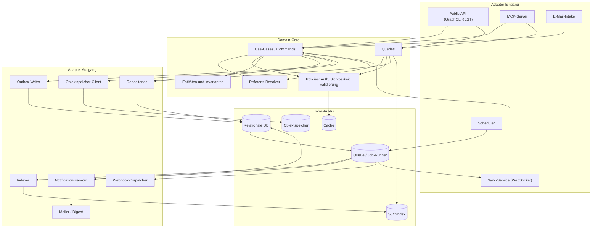
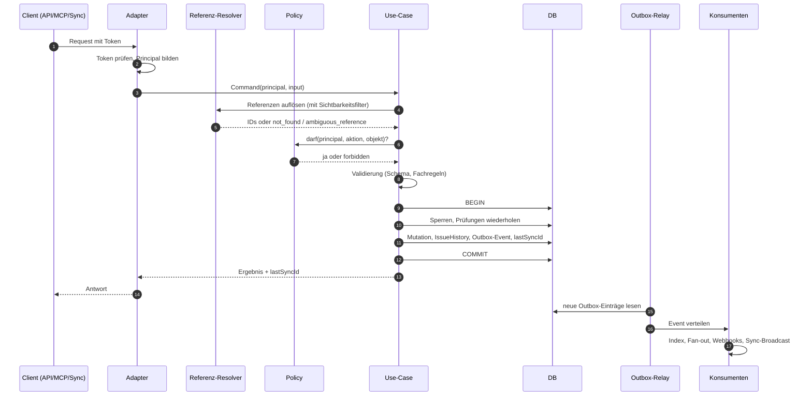
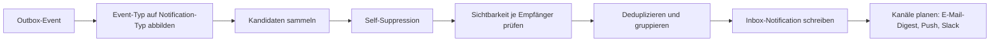

# 10 – Architektur & Umsetzungsplan

Dieses Kapitel beschreibt, **wie** Lineal technisch gebaut wird: Komponenten und Schichten, der Weg einer Schreiboperation durch das System, Mandantentrennung, Hintergrundjobs, Benachrichtigungs-Fan-out, Suche, nicht-funktionale Anforderungen, ein Phasenplan mit Abnahmekriterien, die Teststrategie und eine Definition of Done.

Fachregeln stehen hier **nicht**. Sie stehen in den Fachkapiteln, auf die jeweils verwiesen wird: [01](01-domaenenmodell.md) Domänenmodell, [02](02-teams-rechte.md) Teams und Rechte, [03](03-issues-workflow.md) Issues und Workflow, [04](04-planung.md) Planung, [05](05-views-suche-inbox.md) Views, Suche und Inbox, [06](06-dokumente-templates.md) Dokumente und Templates, [07](07-mcp-server.md) MCP-Server, [08](08-userflows.md) User Flows, [09](09-api-events.md) API, Events und Sync. Formate, IDs, Enums und Fehlercodes regelt [00](00-konventionen.md).

Technologien werden nur als **Beispiele** genannt, und zwar immer aus mehreren Ökosystemen. Keine davon ist vorgeschrieben.

---

## 1. Komponenten und Schichten

### 1.1 Überblick

Lineal folgt einer Schichtenarchitektur nach dem Muster „Ports & Adapters“ (hexagonal). Der **Domain-Core** ist die einzige Stelle, an der Geschäftsregeln leben (siehe [README](README.md#systemkontext)). Alle Eingänge (API, MCP, Sync, Jobs) rufen dieselben Use-Cases auf.

| Schicht | Bausteine | Verantwortung | Darf abhängen von |
|---|---|---|---|
| **Domain-Core** | Entitäten, Wertobjekte, Use-Cases (Commands und Queries), Policies (Berechtigung, Sichtbarkeit, Validierung), Domain-Events | Geschäftsregeln, Invarianten, Berechtigungsentscheidungen | nur auf Ports (abstrakte Schnittstellen), nie auf konkrete Infrastruktur |
| **Adapter (Eingang)** | Public API (GraphQL oder REST), MCP-Server (Streamable HTTP), Sync-Service (WebSocket), Webhook-Empfänger für E-Mail-Intake, Job-Trigger | Protokoll übersetzen, Auth-Token prüfen, Eingaben in Commands abbilden, Fehler im Format aus [00](00-konventionen.md#7-fehlermodell) ausgeben | Domain-Core |
| **Adapter (Ausgang)** | Repositories, Suchindex-Client, Objektspeicher-Client, Queue-Producer, Mailer, Webhook-Dispatcher | Ports des Cores implementieren | Infrastruktur |
| **Infrastruktur** | relationale DB, Suchindex, Objektspeicher, Queue/Job-Runner, Cache | Persistenz, Transport, Zeitsteuerung | – |

**Leitregel:** Ein Adapter enthält keine Fachlogik. Prüft z. B. der MCP-Server, ob ein Label in einer `singleSelect`-Gruppe kollidiert, ist das ein Architekturfehler. Diese Prüfung gehört in den Use-Case `UpdateIssue`.

### 1.2 Komponentendiagramm



### 1.3 Infrastruktur-Bausteine

| Baustein | Aufgabe | Pflichteigenschaften | Beispiele (nicht bindend) |
|---|---|---|---|
| Relationale DB | Primärspeicher aller Entitäten, Zähler, Outbox, History | ACID-Transaktionen, Zeilensperren oder `UPDATE … RETURNING`, Fremdschlüssel, Check-Constraints, Unique-Indizes | PostgreSQL, MySQL/MariaDB, SQL Server |
| Suchindex | Volltextsuche über Issues, Projekte, Dokumente | Tokenizer mit Stemming, Stopwords, Phrasensuche, Filter auf Schlüsselfelder, Score-Boosting | PostgreSQL FTS (`tsvector`), OpenSearch/Elasticsearch, Meilisearch, Typesense |
| Objektspeicher | Dateianhänge, Avatare, Exporte | vorsignierte Upload-/Download-URLs, Lebenszyklusregeln | S3-kompatibel (z. B. MinIO), Azure Blob, GCS, lokales Dateisystem im Dev-Betrieb |
| Queue / Job-Runner | asynchrone Konsumenten, zeitgesteuerte Jobs, Retries mit Backoff | mindestens-einmal-Zustellung, Verzögerung, Dead-Letter | DB-basierte Queue (Tabelle mit `SKIP LOCKED`), RabbitMQ, Redis Streams, NATS, SQS; Scheduler z. B. Cron, Quartz, Sidekiq, Celery beat, Temporal |
| Cache | Mitgliedschaften, Sichtbarkeitsmengen, Team-Konfiguration, Rate-Limit-Zähler | TTL, gezielte Invalidierung über Events | Redis, Valkey, Memcached, prozesslokaler Cache |

Für ein MVP genügt **eine relationale DB**, die zugleich Queue (Outbox-Tabelle) und Suchindex (eingebaute Volltextsuche) ist. Externe Suchindizes und Message-Broker sind Skalierungsoptionen, keine Voraussetzung.

### 1.4 Command-Pipeline einer Schreiboperation

Jede Schreiboperation durchläuft dieselbe Pipeline, egal ob sie über API, MCP, Sync oder einen Job hereinkommt. Jobs laufen mit einem System-Akteur (`actor = null`, `botActor` gesetzt) statt mit einem User.

| Schritt | Inhalt | Fehler |
|---|---|---|
| 1. Authentifizierung | Token prüfen (API-Key, OAuth, Session), daraus `Principal { userId, organizationId, role, scopes }` bilden | `unauthenticated` |
| 2. Referenzauflösung | Flexible Referenzen nach [00 §2](00-konventionen.md#2-identifikatoren) in IDs übersetzen. **Der Resolver arbeitet bereits mit dem Sichtbarkeitsfilter (§2.3)**: Objekte in Teams, die der Principal nicht sehen darf, existieren für ihn nicht. | `not_found`, `ambiguous_reference` |
| 3. Berechtigung | Policy prüft, ob die Aktion auf dem sichtbaren Objekt erlaubt ist (Rolle, Team-Owner-Einstellungen, Gast-Einschränkungen, siehe [02](02-teams-rechte.md)) | `forbidden` (nur bei sichtbaren Objekten) |
| 4. Validierung | Schema, Tri-State, Mengenfelder-Exklusivität, fachliche Regeln, die nicht von Nebenläufigkeit abhängen | `invalid_request`, `limit_exceeded` |
| 5. Transaktion | Zeilensperren holen, nebenläufigkeitskritische Prüfungen **wiederholen**, Mutation schreiben, History-Eintrag, Outbox-Event, `lastSyncId` vergeben | `conflict`, `limit_exceeded` |
| 6. Commit | Transaktion abschließen; erst jetzt sind Event und Daten sichtbar | `internal` |
| 7. Asynchrone Konsumenten | Outbox-Relay verteilt Event an Indexer, Notification-Fan-out, Webhook-Dispatcher, Sync-Broadcast, Automationen | Fehler hier erreichen den Aufrufer nie; Retries |

**Warum Schritt 2 vor 3 und trotzdem `not_found` bei privaten Teams?** [00 §7](00-konventionen.md#7-fehlermodell) verlangt, dass Objekte privater Teams für Nicht-Mitglieder `not_found` liefern und nicht `forbidden`. Das ist nur konsistent möglich, wenn der Resolver dieselbe Sichtbarkeitskomponente nutzt wie alle Queries. `forbidden` entsteht ausschließlich bei Objekten, die der Principal sehen, aber nicht ändern darf (z. B. Gast versucht Team-Settings zu ändern, Member ändert fremden Kommentar).

**Nebenläufigkeitskritische Prüfungen gehören in die Transaktion.** Dazu zählen mindestens:

| Prüfung | Mechanismus | Verweis |
|---|---|---|
| Vergabe von `Issue.number` | atomares Inkrement am Team-Datensatz | [00 §2](00-konventionen.md#2-identifikatoren) |
| 60 000 nicht archivierte Issues pro Team | Zähler am Team, in derselben Sperre wie die Nummernvergabe geprüft | [03](03-issues-workflow.md) |
| Eindeutigkeit von `Attachment.url` pro Issue | Unique-Index `(issueId, url)` | [03](03-issues-workflow.md) |
| Patch-Anker kommen genau einmal vor | Prüfung gegen den **gesperrten** aktuellen Text | [07](07-mcp-server.md) |
| `singleSelect`-Label-Gruppen | Prüfung gegen die gesperrte Label-Menge des Issues | [03](03-issues-workflow.md) |
| Zyklenfreiheit Initiative-Hierarchie, Sub-Issue-Kette | Graphprüfung innerhalb der Transaktion | [04](04-planung.md), [03](03-issues-workflow.md) |
| Optimistische Versionsprüfung (optional) | `updatedAt` oder Versionszähler im Request, Abweichung → `conflict` | [09](09-api-events.md) |

### 1.5 Sequenzdiagramm



### 1.6 Pseudocode

```text
function executeCommand(token, commandName, input):
    principal = authenticate(token)                       # unauthenticated
    useCase   = registry.lookup(commandName)

    refs = resolver.resolveAll(principal, useCase.references(input))
          # nutzt visibleTeamIds(principal); unsichtbar => not_found

    policy.require(principal, useCase.action, refs)       # forbidden
    useCase.validate(principal, input, refs)              # invalid_request, limit_exceeded

    result = db.transaction(isolation = READ_COMMITTED_OR_HIGHER):
        locked = useCase.lockAggregates(refs)             # z. B. SELECT … FOR UPDATE
        useCase.recheckInvariants(locked, input)          # conflict, limit_exceeded
        changes = useCase.apply(locked, input)            # Entitäten ändern
        history.append(changes, actor = principal)        # IssueHistory u. a.
        syncId  = sequence.next(principal.organizationId) # monoton pro Workspace
        outbox.insert(Event {
            id:             newUuid(),
            organizationId: principal.organizationId,
            lastSyncId:     syncId,
            type:           useCase.eventType,            # z. B. "Issue"
            action:         "create" | "update" | "remove",
            entityId:       changes.entityId,
            data:           serialize(changes.after),
            updatedFrom:    changes.before (nur geänderte Felder),
            actorId:        principal.userId,
            createdAt:      now()
        })
        return { entity: changes.after, lastSyncId: syncId }

    return result                                         # Commit ist erfolgt
```

### 1.7 Outbox, `lastSyncId` und Konsumenten

- **`lastSyncId`** ist eine monoton steigende Zahl **pro Workspace** (`organizationId`). Sie wird in derselben Transaktion vergeben wie der Outbox-Eintrag. Jede Mutationsantwort enthält sie. Der Sync-Service liefert Deltas geordnet nach `lastSyncId` ab dem letzten bekannten Wert des Clients. Das Delta-Protokoll selbst beschreibt [09](09-api-events.md).
- Umsetzungsoptionen für die Sequenz: Zählerzeile pro Workspace mit atomarem Inkrement (serialisiert Schreibzugriffe eines Workspaces auf diese Zeile) oder eine globale DB-Sequenz, die pro Workspace monoton, aber lückenhaft ist. Lücken sind erlaubt; Clients dürfen nur Monotonie voraussetzen.
- **Outbox-Relay**: liest Einträge in `lastSyncId`-Reihenfolge, publiziert sie in die Queue und markiert sie als verteilt. Ausfallsicher, weil Daten und Event atomar geschrieben werden (kein „Dual Write“).
- **Alle Konsumenten sind idempotent bezüglich `Event.id`.** Zustellung ist mindestens einmal. Jeder Konsument führt eine Tabelle oder einen Schlüssel „verarbeitet“ (`consumer, eventId`) oder ist von Natur aus idempotent (Index-Upsert mit Versionsvergleich).
- Konsumenten: Indexer (§5), Notification-Fan-out (§4), Webhook-Dispatcher ([09](09-api-events.md)), Sync-Broadcast, reaktive Automationen (z. B. Parent/Sub-Status-Automation, Cycle-Auto-Add, SLA-Neuberechnung bei Änderungen; Regeln in [03](03-issues-workflow.md) und [04](04-planung.md)). Reaktive Automationen erzeugen selbst wieder Commands und durchlaufen die Pipeline mit System-Akteur.
- Aufbewahrung der Outbox: mindestens so lange, wie Sync-Clients offline sein dürfen (Annahme: 30 Tage). Ältere Clients erhalten ein Voll-Resync.

---

## 2. Multi-Tenancy

### 2.1 Grundsatz

Lineal ist mandantenfähig auf Ebene des Workspaces (`Organization`). Ein Account darf Mitglied in mehreren Workspaces sein; jede Anfrage gilt aber genau einem Workspace (siehe [02](02-teams-rechte.md)).

| Regel | Umsetzung |
|---|---|
| `organizationId` an jeder Tabelle | Jede fachliche Tabelle hat `organizationId` (nicht nullable), auch Join-Tabellen, History, Outbox, Notifications. Auch wenn sie über Fremdschlüssel herleitbar wäre: Sie wird redundant gespeichert, damit jeder Filter ohne Join möglich ist. |
| Zusammengesetzte Indizes | Primärzugriffe beginnen mit `organizationId` (z. B. `(organizationId, teamId, number)` unique). |
| Fremdschlüssel innerhalb des Mandanten | Referenzen dürfen nur auf Objekte desselben Workspaces zeigen. Durchsetzung über zusammengesetzte Fremdschlüssel `(organizationId, id)` oder eine Prüfung im Repository. |
| Kein Mandanten-Parameter von außen | `organizationId` stammt **ausschließlich** aus dem Principal, nie aus dem Request-Body. |
| Eindeutigkeit pro Mandant | Team-Key, Initiative-Zähler, Slugs sind pro Workspace eindeutig, nicht global. |

### 2.2 Row-Level-Filter

Jede Query läuft über eine **Repository-Basis**, die automatisch `WHERE organizationId = :principalOrg` anhängt. Direkte Datenbankzugriffe am Repository vorbei sind verboten (per Code-Review und Architekturtest prüfbar).

Als zusätzliche Verteidigungslinie kann die Datenbank selbst Zeilen filtern (z. B. Row-Level-Security in PostgreSQL mit einer Session-Variable, Views mit Mandantenfilter in anderen Systemen). Das ist optional, siehe Offene Punkte.

### 2.3 Team-Sichtbarkeitsfilter als zentrale Komponente

Innerhalb eines Workspaces bestimmt die Team-Sichtbarkeit, was ein Principal sieht. Die Regeln stehen in [02](02-teams-rechte.md); hier geht es nur darum, **wo** sie angewendet werden.

```text
function visibleTeamIds(principal) -> Set<UUID>:
    cached per (principal.userId, membershipVersion)
    if principal.role == guest:
        return teams where principal is member              # nur explizite Mitgliedschaft
    result = all teams with visibility == public
           ∪ teams where principal is member
           ∪ restricted sub-teams whose parent principal can see as member
    return result
```

| Verwendung | Wie |
|---|---|
| Referenz-Resolver | Kandidaten werden vor der Auflösung auf `teamId ∈ visibleTeamIds` eingeschränkt → unsichtbar = `not_found`. |
| Listen-Queries (API, MCP, Views) | Prädikat `teamId IN (:visibleTeamIds)` wird vom Query-Builder immer hinzugefügt. |
| Suchindex | Jedes Indexdokument trägt `organizationId` und `teamIds`; der Filter wird **zur Abfragezeit** gesetzt, nicht nachträglich (§5). |
| Projekte, Initiativen, Dokumente | Abgeleitete Sichtbarkeit (Projekt sichtbar, wenn mindestens ein beteiligtes Team sichtbar ist; Gäste sehen keine Initiativen usw.), siehe [02](02-teams-rechte.md) und [04](04-planung.md). Dafür gibt es analoge Funktionen `visibleProjectIds`, die auf `visibleTeamIds` aufbauen. |
| Notification-Fan-out | Empfänger werden gegen ihre eigene Sichtbarkeit geprüft (§4). |
| Webhooks | Workspace-Webhooks erhalten nur Events öffentlicher Teams; Team-Webhooks nur das eigene Team ([09](09-api-events.md)). |
| Sync-Broadcast | Deltas werden pro Verbindung gefiltert. |

**Cache-Invalidierung:** Jede Änderung an Mitgliedschaft, Team-Sichtbarkeit, Team-Hierarchie oder Rolle erhöht eine `membershipVersion` pro Workspace (oder pro User). Gecachte Sichtbarkeitsmengen werden damit ungültig. Lieber kurz zu konservativ als zu offen: bei Unsicherheit neu berechnen.

---

## 3. Hintergrundjobs

Alle zeitgesteuerten Jobs folgen demselben Muster:

1. Der **Scheduler** erzeugt in festen Abständen pro Workspace (oder pro Team) eine Job-Nachricht mit Schlüssel `(jobTyp, scopeId, fälligkeitsfenster)`.
2. Der **Job-Runner** verarbeitet sie in Batches (z. B. 500 Datensätze), jeweils als eigenständige Commands mit System-Akteur durch die Pipeline aus §1.4. Dadurch entstehen History, Outbox-Events, Notifications und Webhooks automatisch.
3. **Idempotenz** wird über den Zielzustand erreicht („nur wenn noch nicht X“) und/oder über eindeutige Schlüssel. Ein doppelter Lauf darf nie doppelte Wirkung haben.
4. Jobs arbeiten zeitzonenbewusst: Team-bezogene Zeitpunkte gelten in `Team.timezone` ([00 §3](00-konventionen.md#3-datums--und-zahlenformate)).

| Job | Zeitplan | Logik-Kurzfassung | Idempotenz | Verweis |
|---|---|---|---|---|
| **Cycle-Wechsel** | stündlich je Team; wirksam zur Cycle-Grenze (Mitternacht Team-Zeitzone, als UTC gespeichert) | Aktiven Cycle abschließen (`completedAt`), Snapshot einfrieren, unfertige Issues in `uncompletedIssuesUponClose` festhalten und in den nächsten Cycle verschieben (Rollover; Ausnahme: im Cooldown nach Backlog/Triage/Canceled/Completed verschobene Issues). Sub-Teams mit geerbtem Schedule folgen dem Parent-Cycle über `Cycle.inheritedFrom`. | Nur Cycles mit `endsAt <= now` und `completedAt = null`; Rollover setzt `cycleId` nur, wenn das Issue noch im alten Cycle ist | [04](04-planung.md) |
| **Cycle-Vorabanlage** | täglich je Team und nach jeder Änderung des Schedules | So viele künftige Cycles anlegen, dass `upcomingCycleCount` (max. 15) erfüllt ist; Nummern fortlaufend pro Team | Unique `(teamId, number)` und `(teamId, startsAt)`; vorhandene werden übersprungen | [04](04-planung.md) |
| **Auto-Close** | täglich je Team mit `autoClosePeriod != null` | Offene Issues ohne Aktualisierung seit `autoClosePeriod` Monaten in `autoCloseStateId` setzen, `autoClosedAt` setzen, History und Subscriber-Notification. Ausnahmen: aktiver Cycle, unfertiges Projekt; Aufschub bei künftigem `dueDate`, aktivem SLA, nicht schließbaren Sub-Issues | Nur Issues, die noch offen und weiterhin inaktiv sind | [03](03-issues-workflow.md) |
| **Auto-Archive** | täglich je Team | Geschlossene Issues, die die ganze Periode geschlossen und inaktiv waren, archivieren (`archivedAt`, `autoArchivedAt`), sofern Parent, Sub-Issues und Projekt die Bedingungen erfüllen; Ersteller benachrichtigen. Ebenso abgeschlossene Cycles und Projekte | Nur `archivedAt = null`; Bedingungen bei jedem Lauf neu geprüft | [03](03-issues-workflow.md), [04](04-planung.md) |
| **Papierkorb-Purge** | täglich | Objekte mit `trashed = true` und Löschzeitpunkt älter als 30 Tage endgültig löschen (Issues, Projekte, Initiativen, Dokumente, Teams); abhängige Daten kaskadierend; Anhänge im Objektspeicher löschen; Suchindex-Einträge entfernen | Löschen eines nicht mehr existierenden Datensatzes ist ein No-op | [00 §8](00-konventionen.md#8-audit-felder-alle-entitäten), [03](03-issues-workflow.md) |
| **SLA-Risiko-Updates** | alle 5 Minuten | Issues mit aktivem SLA, deren Risikostufe gekippt ist (`slaMediumRiskAt`, `slaHighRiskAt`, `slaBreachesAt` überschritten), neu bewerten; Notification 24 h vor Breach (`issueSlaHighRisk`) und beim Breach (`issueSlaBreached`); Webhook „Issue SLA“ (`highRisk`, `breached`) | Pro Issue und Schwelle ein Merker „bereits gemeldet“ (z. B. `slaHighRiskNotifiedAt`); Unique-Schlüssel `(issueId, slaStartedAt, schwelle)` | [03](03-issues-workflow.md), [09](09-api-events.md) |
| **Triage-Rotation-Schichtwechsel** | minütlich bzw. zu den Schichtgrenzen des Zeitplans | Für `TriageResponsibility` mit Zeitplan den aktuell verantwortlichen User bestimmen und speichern; folgende Triage-Eingänge werden an ihn zugewiesen (`assign`) oder gemeldet (`notify`) | Speichert nur, wenn sich der berechnete Verantwortliche geändert hat | [03](03-issues-workflow.md) |
| **Snooze-Wiedervorlage Notifications** | minütlich | Notifications mit `snoozedUntilAt <= now` und `unsnoozedAt = null` wieder einblenden (`unsnoozedAt = now`), Inbox-Sync-Event. Analog Triage-Issues mit abgelaufenem `snoozedUntilAt` | Bedingung `unsnoozedAt = null` | [05](05-views-suche-inbox.md) |
| **Reminder („Remind me“)** | minütlich | Fällige Erinnerungen auf Issue/Projekt/Initiative/Dokument als Inbox-Notification (`issueReminder` usw.) erzeugen | Unique `(reminderId)` an der erzeugten Notification | [05](05-views-suche-inbox.md) |
| **Projekt-Update-Erinnerungen** | stündlich, ausgewertet gegen Workspace-/Projekt-Plan (Tag, Uhrzeit) | Nur an den **Lead**, nur Projekte in Statuskategorie `started`, nicht wenn in den letzten 24 h ein Update gepostet wurde; Nachfass-Erinnerungen 1 und 2 Arbeitstage später; Staleness-Kennzeichen „Update missing“ berechnen | Unique `(projectId, reminderSlot, stufe)` | [04](04-planung.md) |
| **Initiative-Update-Erinnerungen** | stündlich | Nur an den **Owner**, nur Initiativen im Status `Active` | Unique `(initiativeId, reminderSlot, stufe)` | [04](04-planung.md) |
| **Fälligkeits-Erinnerungen (`issueDue`)** | stündlich; wirksam täglich 09:00 in der Zeitzone des Users | Für Assignees mit `dueDateReminders = true`: offene Issues mit `dueDate = morgen` bzw. `dueDate < heute` als Notification `issueDue` melden (einmal je Issue und Fälligkeitsdatum) | Unique `(issueId, dueDate, stufe)` an der erzeugten Notification | [05](05-views-suche-inbox.md) §6.10 |
| **Notification-Digest E-Mail** | alle 5 Minuten | Für jeden User Notifications sammeln, deren Kanal E-Mail aktiv ist und deren Verzögerung (abhängig von Dringlichkeit) abgelaufen ist; **nur noch ungelesene** versenden; mehrere Notifications pro Issue in einem Block | Pro Notification `emailedAt`; nur `emailedAt = null AND readAt = null` | §4, [05](05-views-suche-inbox.md) |
| **Notification-Cap 2 000** | stündlich und nach Fan-out-Batches | Pro User: übersteigt die Zahl nicht archivierter Notifications 2 000, die ältesten über dem Limit **archivieren** (nicht löschen) | Archivieren bereits archivierter ist ein No-op | [05](05-views-suche-inbox.md), [README](README.md#getroffene-entscheidungen) |
| **Recurring Issues** | stündlich je Team; wirksam um Mitternacht nach Ablauf des `dueDate` in Team-Zeitzone | Nächste Instanz aus dem Recurring-Template erzeugen (`recurringIssueTemplate`), neues `dueDate` aus der Wiederholungsregel | Unique `(templateId, occurrenceDate)` | [03](03-issues-workflow.md), [06](06-dokumente-templates.md) |
| **Webhook-Retries** | ereignisgesteuert mit Verzögerung | Fehlgeschlagene Zustellung (Timeout 5 s oder kein 2xx) nach 1 min, 1 h, 6 h wiederholen; danach Webhook ggf. deaktivieren und Admin benachrichtigen | Header `Linear-Delivery` bzw. Lineal-Äquivalent bleibt pro Zustellung gleich; Empfänger dedupliziert | [09](09-api-events.md) |
| **Suchindex-Reindex** | kontinuierlich (Event-getrieben) plus nächtlicher Abgleich; voll auf Anforderung | Inkrementell: Upsert pro Event. Abgleich: Datensätze mit `updatedAt > indexedAt` nachziehen. Voll: neuen Index aufbauen, dann atomar umschalten (Alias) | Upsert mit Versionsvergleich (`lastSyncId` oder `updatedAt`), ältere Versionen werden verworfen | §5 |
| **Scope-History-Snapshots** | Cycles **täglich** (Tagesgrenze Team-Zeitzone), Projekte **wöchentlich** | Werte für `scopeHistory`, `completedScopeHistory`, `inProgressScopeHistory`, `issueCountHistory`, `completedIssueCountHistory` anhängen; abgeschlossene Cycles werden eingefroren | Unique `(cycleId oder projectId, snapshotDate)`; Überschreiben desselben Tages statt Anhängen | [04](04-planung.md) |
| **Workspace-Löschung** | stündlich | Geplante Löschungen nach 48 h Wartezeit vollständig ausführen (DB, Index, Objektspeicher, Backups gemäß §6.4) | Status-Maschine `scheduled → running → done` | [02](02-teams-rechte.md) |
| **Draft-Bereinigung** | täglich | Drafts, die seit 6 Monaten nicht geändert wurden, löschen | Löschen ist idempotent | [01](01-domaenenmodell.md) §3.12 |

**Betriebsregeln für Jobs:**
- Jeder Job hat eine Laufzeit-Obergrenze und setzt bei Abbruch an der letzten Batch-Grenze fort (Cursor auf `id`).
- Pro `(jobTyp, scopeId)` läuft höchstens eine Instanz (Lease/Advisory-Lock).
- Fehlgeschlagene Batches landen nach N Versuchen in einer Dead-Letter-Queue mit Alarm (§6.6).
- Ein manueller Trigger pro Job (Admin-Endpunkt) erleichtert Tests und Betrieb.

---

## 4. Notification-Fan-out

Fachliche Regeln (Kategorien, Typen, Einstellungen, Inbox-Verhalten) stehen in [05](05-views-suche-inbox.md). Hier steht die technische Berechnung.

### 4.1 Abo-Modell

| Quelle | Speicherung | Entsteht durch |
|---|---|---|
| Issue-Subscriber | `IssueSubscription (organizationId, issueId, userId, threadCommentId = null, active, reason)` ([01](01-domaenenmodell.md) §3.10) | Auto-Subscribe beim Erstellen, Zuweisen, @mention in Description oder Kommentar, eigener Kommentar; manuell |
| Thread-Subscriber | `IssueSubscription` mit `threadCommentId` = Thread-Wurzel | @mention in einem Thread-Kommentar abonniert nur den Thread |
| Dokument-Subscriber | `DocumentSubscription` ([01](01-domaenenmodell.md) §5.8) | Ersteller automatisch, Erwähnte, manuell |
| Team-, Projekt-, Initiative-, Cycle-, Label-, User-, View-Abos | `NotificationSubscription` mit genau einem Ziel und `notificationSubscriptionTypes: [String]` | explizites Abonnieren (Projekt-Mitglieder müssen sich selbst eintragen) |
| Mentions | werden beim Speichern von Rich-Text extrahiert (`@displayName`) | – |
| Rollenbasierte Empfänger | Assignee (z. B. `issuePriorityUrgent`), Projekt-Lead, Initiative-Owner, Triage-Verantwortliche | – |
| Kanal-Einstellungen | `NotificationChannelPreference (userId, category, channel, enabled)` | User-Settings |

### 4.2 Ablauf



```text
function fanOut(event):
    if processed(consumer = "notifications", event.id): return
    types = notificationTypesFor(event)                 # z. B. issueNewComment, issueStatusChanged
    for type in types:
        candidates = {}
        candidates += issueSubscribers(event.issueId)       if type is issue-scoped
        candidates += threadSubscribers(event.threadId)     if type is thread-scoped
        candidates += mentionedUsers(event.newMentions)     # nur neu hinzugekommene Mentions
        candidates += roleRecipients(type, event)           # Assignee, Lead, Owner, Triage
        candidates += subscriptionRecipients(type, event)   # Team-/Projekt-/View-Abos usw.

        candidates -= { event.actorId }                     # Self-Suppression
        candidates  = filter(candidates, u => canSee(u, event.entity))
        candidates  = filter(candidates, u => !u.suspended)

        for user in candidates:
            upsertGroupedNotification(user, type, event)    # siehe 4.3
    markProcessed("notifications", event.id)
```

### 4.3 Regeln

| Regel | Umsetzung |
|---|---|
| **Self-Suppression** | Der Akteur eines Events erhält nie eine Notification über seine eigene Aktion. Gilt auch für View-Abos. Bei System-Akteur (Jobs) entfällt die Unterdrückung. |
| **Ein Empfänger, ein Eintrag pro Event** | Ist ein User sowohl Subscriber als auch erwähnt, erhält er **eine** Notification mit dem spezifischsten Typ (Rangfolge: Mention vor Zuweisung vor Kommentar vor Statuswechsel). |
| **Sichtbarkeit** | Empfänger, die das Objekt nicht (mehr) sehen dürfen, werden verworfen, z. B. nach Teamwechsel eines Issues in ein privates Team. |
| **Gruppierung pro Issue** | Die Inbox zeigt pro User und Issue einen Eintrag. Technisch: Notification-Datensätze bleiben einzeln, haben aber einen Gruppenschlüssel `(userId, issueId)`; die Inbox-Query liefert pro Gruppe den neuesten Eintrag plus Anzahl. Eine neue Notification setzt die Gruppe auf ungelesen und hebt ein Snooze auf (Snooze-Ende „bis neue Aktivität“). |
| **Idempotenz** | Unique `(userId, eventId, type)` an der Notification. |
| **Cap** | Nach dem Schreiben kann der Cap-Job (§3) angestoßen werden. |

### 4.4 Kanäle

| Kanal | Verhalten | Phase |
|---|---|---|
| **Inbox** | Immer. Jede Notification landet in der Inbox, nicht abwählbar. Echtzeit über Sync. | P4 |
| **E-Mail-Digest** | Nur wenn die Kategorie für E-Mail aktiv ist. Versand verzögert (dringlichkeitsabhängig) durch den Digest-Job; **nur, wenn die Notification bis dahin ungelesen ist**. Mehrere Notifications pro Issue werden in einem Block zusammengefasst. | P4 |
| Desktop/Mobile-Push | Erweiterung: Echtzeit-Zustellung über einen Push-Dienst (z. B. Web Push, APNs, FCM). Gleiche Kategorie-Schalter. | nach P5 |
| Slack | Erweiterung, außerhalb des Scopes; Schnittstelle als Port vorsehen. | – |

---

## 5. Suche

Fachliches Suchverhalten (Syntax, Filter per @, Quick search, Find in view) beschreibt [05](05-views-suche-inbox.md). Hier steht die Index- und Abfragearchitektur.

### 5.1 Indexierte Dokumente und Felder

| Indextyp | Volltextfelder | Schlüssel-/Filterfelder | Gewichtung (Vorschlag) |
|---|---|---|---|
| Issue | `title`, `description` (Klartext aus Markdown), Kommentartexte (konkateniert oder als Unterdokumente) | `organizationId`, `teamId`, `identifier`, `previousIdentifiers`, `number`, `stateType`, `assigneeId`, `projectId`, `cycleId`, `labelIds`, `priority`, `archivedAt`, `trashed`, `updatedAt`, `createdAt` | title 4, identifier exakt 10, description 1, comments 0,5 |
| Project | `name`, `summary`, `description`/`content` | `organizationId`, `teamIds`, `slugId`, `statusType`, `leadId`, `archivedAt`, `trashed` | name 4, Rest 1 |
| Document | `title`, `content` | `organizationId`, Sichtbarkeitsträger (`teamIds` des Elternobjekts), `slugId`, `parentType`, `parentId`, `archivedAt`, `trashed` | title 4, content 1 |

Getrashte Objekte werden aus dem Index entfernt oder per Filter ausgeschlossen; archivierte bleiben indexiert und suchbar (Ranking-Abschlag).

### 5.2 Identifier-Suche

1. Vor der Volltextsuche wird der Suchbegriff gegen das Muster `KEY-n` (case-insensitiv) und die Kurzform `keyn` (z. B. `eng123`) geprüft.
2. Treffer werden **exakt** in `identifier` **und** `previousIdentifiers` gesucht, damit Issues nach Teamwechsel oder Key-Änderung auffindbar bleiben ([02](02-teams-rechte.md)).
3. Exakte Identifier-Treffer stehen immer an erster Stelle; die Volltextsuche läuft zusätzlich.
4. Dieselbe Normalisierung nutzt der Referenz-Resolver (§1.4), damit Suche und Auflösung konsistent sind.

### 5.3 Berechtigungsfilter

- Jede Suchanfrage enthält die Filter `organizationId = :org` und `teamIds ∩ visibleTeamIds(principal) ≠ ∅` (bzw. die abgeleiteten Projektsichtbarkeiten). Der Filter wird **in der Indexabfrage** gesetzt, nicht als Nachfilterung der Ergebnisliste. Nachfilterung würde Trefferzahlen und Paginierung verfälschen und Existenz durch Timing verraten.
- Ändert sich die Sichtbarkeit (Issue wechselt Team, Team wird privat), muss der Index über das Outbox-Event aktualisiert werden. Bis dahin gilt: Bei einem Treffer wird das Objekt beim Laden über das Repository ein zweites Mal sichtbarkeitsgeprüft (Defense-in-Depth); unsichtbare Treffer werden verworfen.

### 5.4 Ranking-Grundsätze

1. Exakter Identifier-Treffer (inkl. `previousIdentifiers`).
2. Phrasensuche bei Anführungszeichen (exakt, ohne Stemming und Stopword-Entfernung).
3. Textrelevanz (z. B. BM25 bzw. `ts_rank`) mit Feldgewichten aus §5.1. Stemming und englische Stopword-Liste außerhalb von Anführungszeichen.
4. Status-Boost in fester Reihenfolge: `unstarted`/`started` → `backlog` (und `triage`) → `completed` → `canceled` → archiviert.
5. Bei Gleichstand: `updatedAt` absteigend.
6. Alternativ sortierbar nach `updatedAt` oder `createdAt`.
7. Maximal **500 Treffer** insgesamt; Paginierung nach [00 §5](00-konventionen.md#5-listen-und-paginierung).

---

## 6. Nicht-funktionale Anforderungen

### 6.1 Latenz

| Messpunkt | Ziel | Bemerkung |
|---|---|---|
| Lokale optimistische UI-Änderung (Client mit Sync-Engine) | < 50 ms bis sichtbar | Client wendet die Änderung lokal an und gleicht mit der Server-Antwort ab ([09](09-api-events.md)) |
| API/MCP-Lesezugriff Einzelobjekt | p95 < 100 ms | ohne Netzwerklatenz des Clients |
| API/MCP-Schreibzugriff | p95 < 200 ms | bis Commit |
| Listen mit Filter (50 Einträge) | p95 < 300 ms | bei 60 000 offenen Issues im Team |
| Volltextsuche | p95 < 400 ms | |
| Sync-Propagation zu anderen Clients | p95 < 1 s nach Commit | |
| Inbox-Notification nach auslösendem Event | p95 < 5 s | |
| Webhook-Erstzustellung | p95 < 10 s | |

### 6.2 Skalierung

| Größe | Zielwert | Folgerung |
|---|---|---|
| Nicht archivierte Issues pro Team | 60 000 (hartes Limit, `limit_exceeded`) | Indizes auf `(organizationId, teamId, stateType, archivedAt)`, `(organizationId, teamId, updatedAt)`; Cursor-Paginierung, kein `totalCount` |
| Teams pro Workspace | ≥ 500 | Sichtbarkeitsmenge gecacht |
| User pro Workspace | ≥ 10 000 | Fan-out batchweise |
| Gleichzeitige Sync-Verbindungen | ≥ 10 000 pro Instanz-Cluster | Sync-Service horizontal skalierbar, zustandslos bis auf Verbindung; Broadcast über Pub/Sub |
| Archivierte Issues | unbegrenzt | werden on demand geladen, nicht im Client gehalten |

Alle Komponenten außer der Datenbank sind **zustandslos** und horizontal skalierbar. Die Datenbank skaliert zunächst vertikal plus Lese-Replikate; Partitionierung nach `organizationId` ist die vorgesehene spätere Option.

### 6.3 Backups und Wiederherstellung

- Kontinuierliche Sicherung (Point-in-Time-Recovery) mit RPO ≤ 5 min, RTO ≤ 4 h.
- Tägliche Vollsicherung, Aufbewahrung 35 Tage, verschlüsselt, in getrenntem Speicherort.
- Objektspeicher mit Versionierung oder Replikation.
- Suchindex wird **nicht** gesichert, sondern aus der DB neu aufgebaut (Reindex-Job).
- Wiederherstellungstest mindestens quartalsweise.

### 6.4 Audit-Log und Datenschutz

| Thema | Anforderung |
|---|---|
| Fach-History | `IssueHistory` und analoge Verläufe sind Teil des Domänenmodells ([03](03-issues-workflow.md)). |
| Audit-Log | Getrennt von der History: sicherheitsrelevante Ereignisse (Login, Token-Erzeugung, Rollenwechsel, Team-Sichtbarkeit, Mitgliedschaft, Webhook-Verwaltung, Exporte, Löschungen). Append-only, mit `organizationId`, `actorId`, IP, User-Agent, Zeitpunkt. Lesbar nur für Owner/Admin. Aufbewahrung konfigurierbar (Annahme: 1 Jahr). |
| Löschung eines Users | Account wird deaktiviert, personenbezogene Daten (Name, E-Mail, Avatar) werden durch einen Platzhalter ersetzt; fachliche Verweise (`creatorId`, History-`actor`) bleiben als pseudonymisierte Referenz erhalten. |
| Löschung eines Workspaces | Nach 48 h Wartezeit vollständige Entfernung aus DB, Index, Objektspeicher; aus Backups durch Ablauf der Aufbewahrungsfrist. |
| Datenminimierung in Logs | Keine Inhalte (Titel, Beschreibungen) in technischen Logs, nur IDs. |
| Export | Admins können Workspace-Daten exportieren (CSV/JSON). |
| Verschlüsselung | TLS für alle Verbindungen; Verschlüsselung ruhender Daten durch die Plattform; Webhook-Secrets und Tokens gehasht bzw. verschlüsselt gespeichert. |

### 6.5 Sicherheit (kurz)

Auth, OAuth-Scopes, API-Keys und Rate-Limits stehen in [09](09-api-events.md). Architekturseitig gilt: Der MCP-Server authentifiziert genauso wie die API und hat **keine** erweiterten Rechte.

### 6.6 Observability

| Signal | Inhalt |
|---|---|
| Strukturierte Logs | pro Request `requestId` (auch im Fehlerobjekt aus [00 §7](00-konventionen.md#7-fehlermodell)), `organizationId`, `principalId`, Command-Name, Dauer, Ergebnis |
| Metriken | Latenz-Histogramme je Command/Query, Fehlerraten je Fehlercode, Outbox-Rückstand (älteste unverteilte `lastSyncId`), Queue-Länge je Konsument, Job-Laufzeiten und -Fehler, Webhook-Erfolgsquote, Index-Verzögerung, Anzahl Sync-Verbindungen |
| Tracing | verteilte Traces über Adapter → Use-Case → DB → Outbox → Konsument (z. B. OpenTelemetry), Trace-ID am Outbox-Event mitgeführt |
| Alarme | Outbox-Rückstand > 60 s, Dead-Letter-Einträge, Job nicht gelaufen, Fehlerrate `internal` > 0,5 %, p95-Verletzung über 15 min |
| Health-Checks | Liveness und Readiness je Dienst, Readiness prüft DB und Queue |

---

## 7. Umsetzungsplan

### 7.1 Phasen

| Phase | Lieferumfang | Abnahmekriterien |
|---|---|---|
| **P1 – Fundament** | Workspace, Teams (ohne Hierarchie), Users, Rollen, Auth (Session + API-Key); Issues mit Zähler und Identifier; Workflow-States inkl. Default-Workflow und Duplicate-State; Priorität, Schätzung, Assignee, Fälligkeit; Labels inkl. Gruppen (`singleSelect`/`multiSelect`); Kommentare (inkl. Threads, Resolve); Command-Pipeline mit Outbox und `lastSyncId`; Mandanten- und Sichtbarkeitsfilter; Public API (Basis); MCP-Basistools für Teams, Users, Issues, Status, Labels, Kommentare ([07](07-mcp-server.md)) | Alle Fehlercodes aus [00 §7](00-konventionen.md#7-fehlermodell) über API und MCP reproduzierbar; Zähler-Test unter 50 parallelen Creates ohne Doppelnummer; Referenzauflösung nach allen 7 Regeln; Paginierung mit Cursor; Contract-Tests der MCP-Basistools grün; Testfälle T1, T4, T5, T8 grün |
| **P2 – Teams vertieft** | Sub-Teams und Vererbung (Workflow, Schätzung, Labels, Templates, Mitgliedschaft); private und restricted Teams; Gäste; Team-Key ändern; Teamwechsel von Issues mit `previousIdentifiers`; Relationen (`blocks`, `related`, `duplicate`, `similar`); Sub-Issues; Anhänge mit Objektspeicher; IssueHistory inkl. 3-Minuten-Erstellungsfenster; Papierkorb und Purge-Job | Sichtbarkeitsmatrix aus [02](02-teams-rechte.md) vollständig als Tests; Teamwechsel-Feldmapping nach [03](03-issues-workflow.md); alte Kennungen auflösbar; private Objekte liefern `not_found`; Purge nach 30 Tagen; Testfälle T2, T9 grün |
| **P3 – Planung I** | Triage inkl. Accept/Decline/Duplicate/Snooze und Triage-Verantwortung; Cycles mit Schedule, Vorabanlage, Wechsel, Rollover, Cooldown, Sub-Team-Vererbung, Snapshots; Projekte (Multi-Team, Lead-Team, Status, Projekt-Kennung), Meilensteine | Cycle-Jobs zeitzonenkorrekt (Tests mit verschiedenen `Team.timezone` und Sommerzeitwechsel); Rollover-Ausnahmen; Fortschrittsformel; Triage-Routing für Nicht-Mitglieder; Testfälle T3, T7 grün |
| **P4 – Planung II & Navigation** | Initiativen (DAG, Zyklusprüfung), Projekt- und Initiative-Updates mit Health und Erinnerungen; Filtermodell, Custom Views, Favoriten, My Issues; Volltextsuche; Inbox mit Fan-out, Gruppierung, Snooze, Cap, E-Mail-Digest | Filtermodell gegen Beispiele aus [05](05-views-suche-inbox.md); Suche findet Identifier inkl. `previousIdentifiers`, respektiert Sichtbarkeit; Self-Suppression; Cap 2 000; Testfall T10 grün |
| **P5 – Vollständig** | Dokumente (Elternobjekt, Versionen), Templates (Issue/Projekt/Dokument, Default-Templates, Recurring Issues); Webhooks mit Signatur und Retries; Sync-Engine (WebSocket-Deltas, Offline-Resync); Automationen Auto-Close, Auto-Archive, SLA inkl. Risiko-Job, Parent/Sub-Status-Automation; vollständiger MCP-Toolumfang | Alle Jobs aus §3 aktiv und idempotent (doppelter Lauf ohne Wirkung); Webhook-Signatur prüfbar; Sync-Client erhält lückenlos geordnete Deltas; NFR-Ziele aus §6 in Lasttest erfüllt; Testfall T6 grün; Definition of Done (§9) erfüllt |

### 7.2 Phasenfluss

```mermaid
flowchart LR
  subgraph P1["P1 Fundament"]
    P1A["Workspace, Teams, Users, Auth"]
    P1B["Issues, States, Labels, Kommentare"]
    P1C["Pipeline, Outbox, MCP-Basis"]
  end
  subgraph P2["P2 Teams vertieft"]
    P2A["Sub-Teams, private Teams, Gäste"]
    P2B["Teamwechsel, Relationen, Sub-Issues"]
    P2C["Anhänge, History, Papierkorb"]
  end
  subgraph P3["P3 Planung I"]
    P3A["Triage"]
    P3B["Cycles und Jobs"]
    P3C["Projekte, Meilensteine"]
  end
  subgraph P4["P4 Planung II"]
    P4A["Initiativen, Updates"]
    P4B["Views, Filter, Suche"]
    P4C["Inbox, Fan-out, Digest"]
  end
  subgraph P5["P5 Vollständig"]
    P5A["Dokumente, Templates"]
    P5B["Webhooks, Sync-Engine"]
    P5C["Auto-Close, Auto-Archive, SLA"]
  end
  P1 --> P2 --> P3 --> P4 --> P5
```



**Abhängigkeiten, die die Reihenfolge begründen:** Outbox und Sichtbarkeitsfilter (P1) sind Voraussetzung für alles Weitere. Teamwechsel (P2) muss vor Cycles und Projekten stehen, weil sein Feldmapping Cycle und Projekt berührt. Die Inbox (P4) braucht die Events aller vorherigen Phasen. Auto-Close/Archive (P5) hängen von Cycles, Projekten und SLA ab.

---

## 8. Teststrategie

### 8.1 Testebenen

| Ebene | Ziel | Werkzeugbeispiele |
|---|---|---|
| Domain-Spezifikationen | Fachregeln als ausführbare Given/When/Then-Szenarien gegen den Domain-Core (mit In-Memory- oder echter DB) | Cucumber/Gherkin (viele Sprachen), SpecFlow/Reqnroll, behave, pytest-bdd, Godog, oder einfache tabellengetriebene Unit-Tests |
| Nebenläufigkeitstests | Zähler, Sperren, Invarianten unter Parallelität | echte DB im Container (z. B. Testcontainers) |
| Contract-Tests API | Antwortformen, Paginierung, Fehlerobjekte, Tri-State-Semantik | JSON-Schema-Validierung der Antworten, Schema-Snapshot (GraphQL-SDL oder OpenAPI) mit Diff im CI |
| Contract-Tests MCP | Tool-Namen und Eingabeschemas identisch zum Referenzkatalog ([07](07-mcp-server.md)); Antworten gegen normierte Schemas | MCP-Client im Test, Snapshot des `tools/list`-Ergebnisses |
| Job-Tests | Jobs mit kontrollierbarer Uhr („Fake Clock“), Doppellauf ohne Doppelwirkung | Zeit als injizierter Port |
| E2E-Flows | Alle User Flows aus [08](08-userflows.md) als Browser- oder API-Szenarien | Playwright, Cypress, Selenium; oder API-getrieben |
| Last- und Skalierungstests | NFR aus §6 | k6, Gatling, Locust, JMeter |

**Grundsatz:** Zeit, ID-Generator und Zufall sind Ports und in Tests ersetzbar. Ohne kontrollierbare Uhr sind Cycle-, SLA- und Auto-Close-Regeln nicht verlässlich testbar.

### 8.2 Kernregeln als ausführbare Spezifikationen

Die folgenden zehn Szenarien sind **Pflicht** und bilden die Mindestabdeckung. Die vollständigen Fachregeln stehen in den verwiesenen Kapiteln; weitere Szenarien leiten sich dort ab.

**T1 – Zähler-Atomarität** ([00 §2](00-konventionen.md#2-identifikatoren))
```gherkin
Given Team "ENG" mit issueCount = 41
When 50 Clients gleichzeitig je ein Issue in "ENG" anlegen
Then haben die 50 neuen Issues die Nummern 42 bis 91, jede genau einmal
And  Team "ENG" hat issueCount = 91
And  keine Nummer fehlt und keine ist doppelt
```

**T2 – Teamwechsel** ([02](02-teams-rechte.md), [03](03-issues-workflow.md))
```gherkin
Given Issue "ENG-12" mit Team-Label "Frontend" (Team ENG), Cycle "Cycle 7" von ENG, Projekt "Website-Relaunch" nur mit Team ENG, Priorität High
And   Team "DES" mit issueCount = 4
When  Alice das Issue in Team "DES" verschiebt
Then  heißt das Issue "DES-5" und previousIdentifiers enthält "ENG-12"
And   die Referenz "ENG-12" löst auf "DES-5" auf
And   das Team-Label "Frontend" ist entfernt, die Priorität bleibt High
And   Cycle und Projekt sind entfernt
And   der Status ist auf den nächstliegenden Status im DES-Workflow abgebildet
And   es existiert ein History-Eintrag fromTeam=ENG, toTeam=DES
```

**T3 – Sub-Team-Cycle-Vererbung** ([02](02-teams-rechte.md), [04](04-planung.md))
```gherkin
Given Team "ENG" mit Cycle-Schedule 2 Wochen, Start Montag
And   Team "WEB" ohne eigenen Schedule
When  "WEB" als Sub-Team von "ENG" gesetzt wird
Then  hat "WEB" für jeden künftigen ENG-Cycle einen Cycle mit gleichen startsAt/endsAt
And   jeder dieser Cycles verweist mit inheritedFrom auf den ENG-Cycle
And   der Versuch, für "WEB" einen eigenen Schedule zu setzen, wird mit invalid_request abgelehnt
```

**T4 – Label-singleSelect** ([03](03-issues-workflow.md))
```gherkin
Given Label-Gruppe "Typ" mit groupType = singleSelect und Labels "Bug", "Feature"
And   Issue "ENG-20" hat Label "Bug"
When  Bob setzt addLabels = ["Feature"] auf "ENG-20"
Then  hat "ENG-20" das Label "Feature" und nicht mehr "Bug"
# gemäß 03 §5.5: addLabels ersetzt das vorhandene Label derselben singleSelect-Gruppe
When  Bob setzt labels = ["Bug", "Feature"] auf "ENG-20"
Then  Fehler invalid_request, weil zwei Labels derselben singleSelect-Gruppe angefragt sind
```

**T5 – Duplicate-State** ([03](03-issues-workflow.md), [README](README.md#getroffene-entscheidungen))
```gherkin
Given Issue "ENG-30" (Status "In Progress") und Issue "ENG-31"
When  Alice "ENG-30" als Duplikat von "ENG-31" markiert
Then  hat "ENG-30" den system-verwalteten Status der Kategorie duplicate von Team ENG
And   es existiert eine Relation vom Typ duplicate von "ENG-30" nach "ENG-31"
And   der Versuch, den Duplicate-Status umzubenennen oder zu löschen, liefert invalid_request (Systeminvariante, keine Rechtefrage)
```

**T6 – Auto-Close-Ausnahmen** ([03](03-issues-workflow.md))
```gherkin
Given Team "ENG" mit autoClosePeriod = 3 Monate
And   die Issues "ENG-40", "ENG-41", "ENG-42", "ENG-43" wurden seit 4 Monaten nicht aktualisiert und sind offen
And   "ENG-41" ist im aktiven Cycle, "ENG-42" hat dueDate in 10 Tagen, "ENG-43" gehört zu einem Projekt im Status started
When  der Auto-Close-Job läuft
Then  ist nur "ENG-40" im autoCloseState mit gesetztem autoClosedAt
And   alle Subscriber von "ENG-40" erhalten eine Notification (Akteur ist das System, daher keine Self-Suppression)
When  der Job ein zweites Mal läuft
Then  entstehen keine weiteren History-Einträge oder Notifications
```

**T7 – Cycle-Rollover** ([04](04-planung.md))
```gherkin
Given Team "ENG" mit aktivem "Cycle 7" (endet 2026-10-19 Mitternacht America/Los_Angeles) und einer Woche Cooldown
And   in Cycle 7: "ENG-50" started, "ENG-51" unstarted, "ENG-52" completed
And   während des Cooldowns wird "ENG-51" in einen Backlog-Status verschoben
When  der Cycle-Wechsel-Job nach Ende des Cooldowns läuft
Then  ist "ENG-50" in "Cycle 8"
And   "ENG-51" ist in keinem Cycle
And   "ENG-52" bleibt in "Cycle 7"
And   uncompletedIssuesUponClose von "Cycle 7" enthält "ENG-50" und "ENG-51"
```

**T8 – Patch-Anker-Eindeutigkeit** ([00 §6](00-konventionen.md#6-schreibsemantik), [07](07-mcp-server.md))
```gherkin
Given Issue "ENG-60" mit description "TODO: Login\nTODO: Logout"
When  ein Patch replace mit Anker "TODO:" gesendet wird
Then  Fehler conflict, die Beschreibung ist unverändert
When  ein Patch aus zwei Operationen gesendet wird, deren zweiter Anker nicht vorkommt
Then  Fehler conflict und auch die erste Operation ist nicht angewendet (atomar)
When  ein Patch replace mit Anker "TODO: Login" und Ersatz "DONE: Login" gesendet wird
Then  lautet die description "DONE: Login\nTODO: Logout"
```

**T9 – Private-Team-not_found** ([02](02-teams-rechte.md), §1.4, §2.3)
```gherkin
Given privates Team "SEC" mit Mitglied Carol und Issue "SEC-3"
And   Bob ist Member des Workspaces, aber nicht von "SEC"
When  Bob "SEC-3" per API oder MCP abruft
Then  Fehler not_found (nicht forbidden)
When  Bob nach "SEC-3" oder dem Titel von "SEC-3" sucht
Then  ist die Ergebnisliste leer
When  Bob ein Issue in Team "SEC" anlegen will
Then  Fehler not_found für die Team-Referenz
When  Carol "SEC-3" abruft
Then  erhält sie das Issue
```

**T10 – Initiative-Zyklusprüfung** ([04](04-planung.md), [README](README.md#getroffene-entscheidungen))
```gherkin
Given Initiativen "I-1" (Plattform), "I-2" (Mobile), "I-3" (Offline) mit I-1 → I-2 → I-3 (Eltern → Kind)
When  Alice "I-1" als Kind von "I-3" einträgt (parentInitiatives = ["I-3"])
Then  Fehler invalid_request mit details { reason: "cycle", cycle: ["I-1", "I-2", "I-3", "I-1"] }
And   die Hierarchie ist unverändert
When  Alice "I-3" zusätzlich unter "I-1" einträgt
Then  hat "I-3" die Eltern "I-2" und "I-1" (DAG ist erlaubt)
```

### 8.3 Contract-Tests für API und MCP

- **Schema-Snapshot**: Das veröffentlichte API-Schema (SDL oder OpenAPI) und die MCP-Tool-Liste werden im Repository versioniert. Jede Änderung erzeugt einen Diff, der bewusst freigegeben werden muss.
- **MCP-Kompatibilität**: Für jedes Tool in [07](07-mcp-server.md) gibt es mindestens einen Positiv- und einen Negativfall. Das Eingabeschema muss mit dem Referenzkatalog übereinstimmen (Drop-in-Fähigkeit). Abweichungen der Antwortform sind nur dort zulässig, wo 07 sie tabelliert.
- **Gleichheit API ↔ MCP**: Für zentrale Operationen (Issue anlegen, aktualisieren, Liste filtern) wird derselbe Fall über beide Adapter ausgeführt; Ergebnis im Domain-Zustand und Fehlercode müssen identisch sein.
- **Fehlerobjekt**: Jeder Fehlercode aus [00 §7](00-konventionen.md#7-fehlermodell) hat mindestens einen Testfall pro Adapter mit Prüfung von `error`, `status` und vorhandenem `requestId`.
- **Webhook-Verträge**: Payload-Form, Header und Signatur gemäß [09](09-api-events.md) gegen einen Test-Empfänger.

### 8.4 E2E-Flows

Jeder User Flow aus [08](08-userflows.md) wird als E2E-Szenario umgesetzt, mindestens: Workspace anlegen und Team einrichten, Issue anlegen und durch den Workflow bewegen, Triage-Eingang bearbeiten, Cycle planen und abschließen, Projekt mit mehreren Teams anlegen und Update posten, Issue in anderes Team verschieben, Suche und Custom View, Inbox abarbeiten, Agent-Szenario über MCP (Issue anlegen, kommentieren, Status ändern). Die Testdaten folgen den Beispielen aus [00](00-konventionen.md) (`acme`, `ENG`, `WEB`, `DES`, Alice, Bob, Carol).

---

## 9. Definition of Done für den Nachbau

**Architektur**
- [ ] Alle Geschäftsregeln liegen im Domain-Core; API, MCP und Sync enthalten keine Fachlogik (Architekturtest oder Review-Checkliste).
- [ ] Jede Schreiboperation läuft durch die Pipeline aus §1.4 und schreibt Mutation, History, Outbox-Event und `lastSyncId` in **einer** Transaktion.
- [ ] Alle Outbox-Konsumenten und Jobs sind nachweislich idempotent (Doppellauf-Test).
- [ ] `organizationId` an jeder fachlichen Tabelle; kein Zugriff am Repository vorbei.
- [ ] Sichtbarkeitsfilter wird in Resolver, Listen, Suche, Fan-out, Webhooks und Sync verwendet.

**Fachlich**
- [ ] Alle Regeln aus [01](01-domaenenmodell.md)–[06](06-dokumente-templates.md) sind als Spezifikationen abgedeckt; die zehn Kernszenarien aus §8.2 sind grün.
- [ ] Alle Limits und Fristen sind umgesetzt (60 000 Issues/Team, 250 Labels/Gruppe, 15 künftige Cycles, 30 Tage Papierkorb, 2 000 Notifications, 500 Suchtreffer, 48 h Workspace-Löschung); planabhängige Limits sind konfigurierbar.
- [ ] Alle Jobs aus §3 laufen zeitzonenkorrekt und sind überwacht.

**Schnittstellen**
- [ ] API-Antworten folgen [00](00-konventionen.md) (Paginierung, Fehlerobjekt, Prioritätsobjekt, Formate).
- [ ] MCP-Tool-Namen und Eingabeschemas sind identisch zum Katalog in [07](07-mcp-server.md); Contract-Tests grün.
- [ ] Webhooks mit Signatur, Timeout und Retries gemäß [09](09-api-events.md).
- [ ] Sync liefert geordnete Deltas ab einer `lastSyncId` und unterstützt Voll-Resync.

**Betrieb**
- [ ] NFR-Ziele aus §6.1 und §6.2 im Lasttest nachgewiesen (Team mit 60 000 offenen Issues).
- [ ] Backup und Wiederherstellung einmal erfolgreich geprobt.
- [ ] Audit-Log, strukturierte Logs, Metriken, Traces und Alarme aktiv.
- [ ] Löschung eines Users und eines Workspaces end-to-end nachgewiesen.

**Qualität**
- [ ] Alle E2E-Flows aus [08](08-userflows.md) grün.
- [ ] Keine echten Personendaten in Test- oder Beispieldaten.
- [ ] Betriebsdokumentation für Jobs (manuelle Trigger, Dead-Letter-Behandlung) vorhanden.

---

## 10. Offene Punkte und Annahmen

| Nr | Thema | Stand / Annahme |
|---|---|---|
| A1 | Auswahlwerte und Defaults für `autoClosePeriod` und `autoArchivePeriod` | In den Quellen **nicht belegt** (nur Einheit Monate). **Erledigt:** maßgeblich ist [03](03-issues-workflow.md) §9.2/§9.3 – `autoArchivePeriod` 1/3/6/9/12 Monate, Default 6; `autoClosePeriod` aus/1/3/6/9/12 Monate, Default aus (`null`); identisch in [01](01-domaenenmodell.md) §8 Nr. 2. |
| A2 | Triage-Rotation | Linear delegiert Rotation an externe Dienste. Lineal braucht ein internes Zeitplanmodell (`TimeSchedule` mit Schichten). Dessen Form ist hier nicht spezifiziert; Annahme: Liste von `{ userId, startsAt, endsAt }`, extern befüllbar über die API. |
| A3 | Verzögerung des E-Mail-Digests | Dringlichkeitsabhängige Verzögerung ist belegt, konkrete Werte nicht. **Erledigt:** Werte nach [05](05-views-suche-inbox.md) §6.9 – hoch sofort (nächster Joblauf), mittel 5 min, niedrig 30 min; Joblauf alle 5 Minuten. |
| A4 | Empfänger von Due-Date-Notifications | **Erledigt:** Assignee mit aktivierten Fälligkeitserinnerungen ([05](05-views-suche-inbox.md) §6.10); Job „Fälligkeits-Erinnerungen“ in §3. |
| A5 | Fehlercode bei Zyklus in der Initiative-Hierarchie | [00](00-konventionen.md) legt ihn nicht fest. **Erledigt:** `invalid_request` (400) mit `details.reason = "cycle"` (bzw. `"max_depth"`) und dem gefundenen Pfad in `details.cycle`, wie in [04](04-planung.md) §4.3; Sub-Issue-Zyklen analog mit `reason = "parent_cycle"` ([03](03-issues-workflow.md)). |
| A6 | Datenbankseitige Zeilensicherheit | Mandantenfilter ist Pflicht auf Anwendungsebene (§2.2). Ob zusätzlich DB-eigene Row-Level-Security eingesetzt wird, bleibt dem Umsetzungsteam überlassen (empfohlen bei geteilter Datenbank für viele Workspaces). |
| A7 | Granularität von `lastSyncId` | Annahme: pro Workspace monoton, Lücken erlaubt. Ob Sync-Clients zusätzlich nach Team partitioniert abonnieren, regelt [09](09-api-events.md). |
| A8 | Verhalten bei `singleSelect`-Konflikt über `addLabels` | **Erledigt:** Ersetzen innerhalb der Gruppe, `labels` mit zwei Labels einer Gruppe → `invalid_request` ([03](03-issues-workflow.md) §5.5, [01](01-domaenenmodell.md) §3.4, [07](07-mcp-server.md)); T4 entsprechend. |
| A9 | Aufbewahrung der Outbox und des Audit-Logs | Annahme 30 Tage bzw. 1 Jahr; konfigurierbar. |
| A10 | Konkrete NFR-Zahlen | Die Latenz- und Skalierungsziele in §6 sind Zielvorgaben dieses Nachbaus, keine gemessenen Werte des Originals. |
| A11 | Cycle-Startzeitpunkt | Die Linear-Doku nennt 00:01 Team-Zeit; verbindlich für Lineal ist Mitternacht Team-Zeitzone nach [00 §3](00-konventionen.md#3-datums--und-zahlenformate). |
| A12 | Recurring Issues | Wiederholungsregel (Intervall, Wochentage) ist in den Quellen nur angedeutet; Modell und Regeln legt [03](03-issues-workflow.md) bzw. [06](06-dokumente-templates.md) fest. |

## 11. Technologie-Stack (Entscheidung)

Entschieden ist **Option 1: TypeScript/React im Frontend, Rust im Backend**. Die Begründung: Die Domäne hat viele harte Invarianten (atomare Zähler pro Team, Statuskategorien, Vererbung bei Sub-Teams, Sichtbarkeit privater Teams). Diese lassen sich in Rust mit Enums, eigenen ID-Typen und vollständigen `match`-Ausdrücken schon beim Kompilieren absichern. Sync-Engine und viele WebSocket-Verbindungen profitieren außerdem von Rusts Performance ohne Garbage Collector. Das Frontend bleibt in TypeScript, weil nur dieses Ökosystem fertige, barrierefreie Bausteine für eine moderne, tastaturgesteuerte Oberfläche bietet.

Die konkrete Struktur von Repository, Crates und Modulen steht in [11-implementierungsarchitektur.md](11-implementierungsarchitektur.md), die Arbeitspakete in [12-arbeitspakete.md](12-arbeitspakete.md).

### 11.1 Backend (Rust)

| Zweck | Wahl | Begründung |
|---|---|---|
| Sprache | Rust stable (≥ 1.85, Edition 2024) | Speichersicherheit, Typsystem für Invarianten |
| Async-Runtime | `tokio` | Standard, von allen Bibliotheken unterstützt |
| HTTP | `axum` + `tower` / `tower-http` | modular, Middleware für Auth, Tracing, Limits, CORS |
| Datenbank | PostgreSQL ≥ 16 über `sqlx` | Transaktionen, `FOR UPDATE`, Volltextsuche (`tsvector`) |
| GraphQL | `async-graphql` | Code-first, Schema-Export als SDL für das Frontend |
| MCP | `rmcp` (offizielles Rust-SDK) | Streamable HTTP, Tool-Definitionen; Eingabeschemas aus `mcp-tools.snapshot.json` |
| Serialisierung | `serde`, `serde_json` | Standard |
| Validierung | eigene Value-Objects im Crate `lineal-domain` | Regeln an einer Stelle, keine Laufzeit-Annotationen |
| IDs / Zeit | `uuid` (v7 für neue Datensätze), `chrono` + `chrono-tz` | v7 ist zeitlich sortierbar; `chrono-tz` liefert die Zeitzonendatenbank für DST-sichere Cycle-Grenzen |
| Passwort / Hash | `argon2`; `sha2` + `hmac` für Token-Hashes und Webhook-Signaturen | etablierte Verfahren |
| OAuth 2.1 / PKCE | `oauth2` (Client-Seite), eigener Authorization-Server mit geprüften Bausteinen | MCP verlangt einen eigenen Authorization-Server |
| Fehler | `thiserror` im Domain-Code, Abbildung auf das Fehlermodell aus [00](00-konventionen.md#7-fehlermodell) im Adapter | klare Fehlertypen |
| Logging / Tracing | `tracing`, `tracing-subscriber`, OpenTelemetry-Export | strukturierte Logs, Request-IDs |
| Konfiguration | Umgebungsvariablen, eingelesen über `figment` oder `envy` | 12-Factor |
| Tests | `cargo test`, `#[sqlx::test]` (eigene Datenbank pro Test), `insta` für Snapshots | isoliert und parallel |

**Entscheidung zu `sqlx`:** In den ersten Phasen werden SQL-Abfragen **zur Laufzeit** gebaut (`sqlx::query_as::<_, T>(...)`, immer mit gebundenen Parametern, nie String-Verkettung). Abgesichert werden sie durch Integrationstests mit `#[sqlx::test]`, die für jeden Test eine eigene Datenbank aus den Migrationen anlegen. Die compile-time-geprüften Makros (`query!`) brauchen eine Datenbank beim Kompilieren oder vorab erzeugte `.sqlx/`-Daten. Bei vielen parallelen Arbeitspaketen würde das ständig Merge-Konflikte erzeugen. Die Umstellung auf `query!` mit `cargo sqlx prepare` in der CI ist deshalb ein eigenes Härtungs-Arbeitspaket in der letzten Welle.

### 11.2 Frontend (TypeScript)

| Zweck | Wahl | Begründung |
|---|---|---|
| Sprache / Build | TypeScript (strict) + Vite | Typsicherheit, schneller Dev-Server |
| UI | React 19 | größtes Ökosystem für komplexe Oberflächen |
| Styling | Tailwind CSS v4, CSS-Variablen für Themes (hell/dunkel) | moderne Optik, konsistentes Design-System |
| Bausteine | Radix UI über shadcn/ui (Code im Repo) | barrierefrei, frei anpassbar |
| Command-Menü | `cmdk` | Cmd+K wie im Original |
| Routing / Server-Daten | TanStack Router, TanStack Query | typsichere Routen; Query für Daten außerhalb des Sync-Stores |
| Lokaler Store / Sync | eigener Store (MobX) + IndexedDB, Delta-Stream über WebSocket | Local-first, optimistische Updates (siehe [09](09-api-events.md)) |
| API-Typen | GraphQL-SDL aus dem Backend → `graphql-codegen` | eine Quelle der Wahrheit für Typen |
| Editor | TipTap (ProseMirror) + Yjs | Markdown, Mentions, gemeinsames Bearbeiten |
| Drag & Drop | `dnd-kit` | Board, Sortierung |
| Animation | Motion | flüssige Übergänge |
| Tastatur | eigene Shortcut-Registry mit Kontexten (siehe [08](08-userflows.md)) | keyboard-first |
| Tests | Vitest, Testing Library, Playwright (E2E) | Unit bis End-to-End |
| Paketmanager | npm mit `package-lock.json` | auf der Zielmaschine vorhanden |

### 11.3 Infrastruktur und Betrieb

| Zweck | Wahl |
|---|---|
| Lokale Entwicklung | `docker compose` mit PostgreSQL (Port **5440**, um eine vorhandene lokale Instanz auf 5432 nicht zu stören) |
| Objektspeicher | S3-kompatibel (lokal MinIO), signierte URLs |
| Suche | PostgreSQL-Volltextsuche (`tsvector`, `pg_trgm` für Kennungen); später austauschbar über den Port `SearchIndex` |
| Jobs / Queue | Tabelle `job` in PostgreSQL mit `FOR UPDATE SKIP LOCKED`, eigener Worker-Prozess |
| Outbox | Tabelle `outbox_event`, Konsumenten idempotent (siehe [1.7](#17-outbox-lastsyncid-und-konsumenten)) |
| Auslieferung | ein Server-Binary (API, MCP, Sync) + ein Worker-Binary, Frontend als statische Dateien |
| CI | `scripts/check.sh`: `cargo fmt --check`, `cargo clippy -D warnings`, `cargo test`, `npm run typecheck`, `npm run lint`, `npm test` |
| Lieferkette | `cargo-deny` (Lizenzen, Advisories), `npm audit`, Renovate |

### 11.4 Sicherheitsvorgaben für die Umsetzung

1. Rechteprüfung ausschließlich im Application-Layer über `Policy` und den Sichtbarkeitsfilter (Abschnitt 2.3); Adapter rufen nie Repositories direkt auf.
2. Jede SQL-Abfrage enthält `organization_id` als gebundenen Parameter; Repositories bekommen einen `TenantCtx` und keine freien IDs.
3. Session-Cookies `HttpOnly; Secure; SameSite=Lax`, CSRF-Token für Formular-Endpunkte; API-Keys und OAuth-Tokens nur als SHA-256-Hash gespeichert.
4. Strenge Content-Security-Policy ohne Inline-Skripte; Markdown wird serverseitig mit Allowlist bereinigt.
5. Uploads nur über signierte URLs mit Größen- und Typprüfung.
6. Rate-Limits pro Token und IP (Token-Bucket, siehe [09](09-api-events.md)).
7. Secrets nur über Umgebung oder Vault, nie im Repository; `.env` ist in `.gitignore`.
