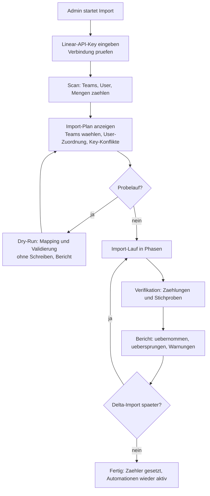
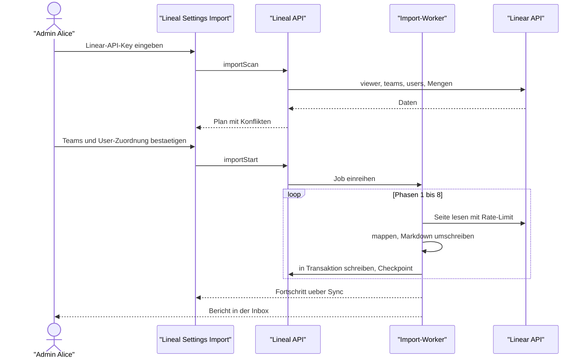

# 13 – Import aus Linear (Migration)

Lineal kann einen bestehenden Linear-Workspace vollständig übernehmen, damit Teams ohne Datenverlust umziehen können. Dieses Kapitel spezifiziert Quelle, Mapping, Ablauf, Sicherheit und Wiederholbarkeit des Imports.

## 1. Ziele und Grundsätze

1. **Verlustarm:** Alle Kernobjekte aus dem Scope (README) werden übernommen, inklusive Erstellzeitpunkten, Autoren, Kommentaren und Anhängen.
2. **Kennungen bleiben gleich:** `ENG-123` in Linear ist nach dem Import `ENG-123` in Lineal. Links in Beschreibungen und Kommentaren funktionieren weiter.
3. **Idempotent und fortsetzbar:** Ein abgebrochener Import läuft beim nächsten Start dort weiter, wo er aufgehört hat. Ein erneuter Lauf („Delta-Import“) übernimmt nur Änderungen seit dem letzten Lauf.
4. **Ruhig:** Während des Imports entstehen keine Benachrichtigungen, keine Webhooks, keine Automationen (Auto-Close, SLA, Triage-Regeln).
5. **Nur lesend auf Linear-Seite:** Der Import ruft ausschließlich lesende Linear-API-Operationen auf.
6. **Sicher:** Der Linear-API-Schlüssel wird nie im Klartext gespeichert und nie geloggt.

## 2. Quelle

| Quelle | Umfang | Einsatz |
|---|---|---|
| **Linear GraphQL API** (`https://api.linear.app/graphql`) mit Personal API Key oder OAuth-Token (Scope `read`) | vollständig: alle Entitäten, Beziehungen, Historie, Anhänge | **Standardweg** |
| Linear CSV-Export | nur Issues mit Basisfeldern | Notlösung ohne API-Zugang; wird als eigenes Format unterstützt, mit Warnung über fehlende Daten |

Der Import ist als **Adapter mit eigenem Port** gebaut (`ImportSource`), damit später weitere Quellen (Jira, GitHub Issues) dazukommen können.

```text
trait ImportSource {
  async fn workspace(&self) -> SourceWorkspace
  async fn page(&self, entity: SourceEntity, cursor: Option<Cursor>, updated_after: Option<DateTime>) -> SourcePage
  async fn download(&self, url: Url) -> Bytes
}
```

**Rate-Limits der Quelle:** Linear erlaubt mit API-Key etwa 2 500 Requests pro Stunde und begrenzt die Abfragekomplexität (siehe [09](09-api-events.md)). Der Importer liest die Header `X-RateLimit-Requests-Remaining` und `X-RateLimit-Complexity-Remaining`, drosselt vorausschauend und wartet bei `RATELIMITED` bis zum Reset. Seitengröße 50–100, Felder pro Abfrage minimal, verschachtelte Listen (Labels, Kommentare) in eigenen Abfragen.

## 3. Mapping

Jedes übernommene Objekt wird in der Tabelle `import_mapping` vermerkt:

| Feld | Typ | Bedeutung |
|---|---|---|
| `importRunId` | UUID | Lauf |
| `source` | Enum `linear`, `linearCsv` | Quelle |
| `sourceType` | String | z. B. `Issue`, `Team`, `Comment` |
| `sourceId` | String | ID in der Quelle |
| `targetId` | UUID | ID in Lineal |
| `sourceUpdatedAt` | DateTime | Stand beim Import (für Delta) |
| `checksum` | String | Hash der übernommenen Felder |

Unique: `(organizationId, source, sourceType, sourceId)`.

### 3.1 Entitäten

| Linear | Lineal | Besonderheiten |
|---|---|---|
| Organization | Workspace | Import läuft in einen **bestehenden** Lineal-Workspace; Name/URL-Key werden nicht überschrieben |
| User | User | Zuordnung per E-Mail (case-insensitiv). Unbekannte User → **Platzhalter-User** (`status = imported`, kein Login, keine Lizenz), die bei späterer Einladung mit derselben E-Mail automatisch verknüpft werden. Rollen: Linear-Admin → `admin`, Guest → `guest`, sonst `user`. |
| Team (inkl. `parent`) | Team | `key` identisch; Kollision mit bestehendem Lineal-Team → Abbruch vor dem Start mit Liste (oder Ziel-Key per Mapping-Datei). Sub-Team-Hierarchie, Sichtbarkeit, Zeitzone, Cycle-/Estimate-/Triage-Einstellungen, Auto-Close/Archive übernehmen. |
| TeamMembership | TeamMembership | inkl. `owner` |
| WorkflowState | WorkflowState | gleicher Name, `type`, Farbe, Position. Der Default-Workflow eines neu angelegten Teams wird **ersetzt**, nicht ergänzt. Duplicate-State wird zugeordnet, nicht doppelt angelegt. |
| IssueLabel (Workspace/Team, Gruppen) | Label | Gruppen mit `groupType`; retired Labels bleiben retired |
| Cycle | Cycle | Nummer, Zeitraum, abgeschlossene Cycles mit eingefrorenen Scope-Historien |
| Project, ProjectStatus, ProjectMilestone, ProjectUpdate, ProjectLabel | dto. | Lead-Team, Teams, Members, `P-KEY-n` aus Linear übernommen |
| Initiative (+ Sub-Initiativen), InitiativeUpdate | dto. | DAG-Kanten aus `parentInitiatives` |
| Issue | Issue | **`number` aus Linear übernommen** (siehe 3.2); Felder: Titel, Beschreibung, State, Priority, Estimate, Assignee, Creator, Labels, Cycle, Project, Milestone, Parent, Due Date, SLA-Felder, sortOrder, Zeitstempel (`createdAt`, `startedAt`, `completedAt`, `canceledAt`, `archivedAt`), `previousIdentifiers` |
| IssueRelation | IssueRelation | `blocks`, `related`, `duplicate`, `similar` |
| IssueHistory | IssueHistory | als Einträge mit `source = import`; nur Statuswechsel, Assignee, Priorität, Team, Projekt, Cycle (reicht für Cycle-/Projekt-Graphen) |
| Comment (Threads, Replies, Reaktionen, Inline-Kommentare) | Comment, Reaction | Autor, `createdAt`, `editedAt`; Inline-Anker über `quotedText` |
| Attachment, eingebettete Uploads | Attachment, Blob | Uploads aus `uploads.linear.app` herunterladen und im Lineal-Blob-Store ablegen; URLs in Markdown umschreiben. Externe Links bleiben Links. |
| Document | Document | Parent (Project/Initiative/Team/Issue/Cycle) |
| Template | Template | `templateData` übersetzt; nicht abbildbare Felder werden verworfen und protokolliert |
| CustomView, Favorite | CustomView, Favorite | Filter werden in das Lineal-Filtermodell übersetzt (gleiche Struktur, siehe [05](05-views-suche-inbox.md)); unbekannte Filterfelder → View wird mit Warnung ohne dieses Kriterium angelegt |
| IssueSubscription | IssueSubscription | ja |
| Notifications | – | **nicht** übernommen (flüchtig) |
| Webhooks, API-Keys, OAuth-Apps, Integrationen | – | nicht übernommen (Sicherheit; müssen neu eingerichtet werden) |

### 3.2 Issue-Nummern und Zähler

- Importierte Issues behalten ihre Linear-Nummer. Lücken (in Linear gelöschte Issues) bleiben Lücken. **Ausnahme zur Regel „lückenlos“** aus [00 §2](00-konventionen.md#2-identifikatoren): gilt nur für importierte Issues.
- Nach dem Import: `team.lastIssueNumber = max(number)` des Teams. Neue Issues zählen nahtlos weiter.
- Linear-`previousIdentifiers` (nach früheren Teamwechseln) werden als Aliase übernommen; alte Links bleiben auflösbar.
- Importiert man in ein Team, das in Lineal bereits Issues hat, ist das ein Konflikt (Nummernüberschneidung) → Import für dieses Team nur mit explizitem Ziel-Key eines neuen Teams.

### 3.3 Inhalte umschreiben

Linear-Markdown enthält eigene Elemente. Der Importer übersetzt:

| Linear | Lineal |
|---|---|
| `<issue id="…" href="…">ENG-12</issue>` | `ENG-12` (wird von Lineal verlinkt) |
| Links `https://linear.app/<ws>/issue/ENG-12/...` | `https://<lineal>/<ws>/issue/ENG-12` |
| Links auf Projekte/Dokumente/Views | Lineal-URLs über `import_mapping` |
| `@user`-Erwähnungen | `@displayName` des zugeordneten Lineal-Users |
| `<linear-image>{json}</linear-image>`, Upload-URLs | heruntergeladene Datei, Lineal-Blob-URL |
| unbekannte Tags | als Text erhalten, im Bericht gelistet |

Anschließend läuft die normale Markdown-Bereinigung (Allowlist, [10 §11.4](10-architektur-umsetzung.md#114-sicherheitsvorgaben-für-die-umsetzung)).

## 4. Ablauf



### 4.1 Phasen (Reihenfolge nach Abhängigkeiten)

| Phase | Inhalt |
|---|---|
| 1 | User, Teams (Eltern vor Kindern), Mitgliedschaften |
| 2 | Workflow-States, Labels (Gruppen vor Labels), Projektstatus, Templates |
| 3 | Cycles, Initiativen (Topologische Sortierung des DAG), Projekte, Meilensteine |
| 4 | Issues ohne Parent-Bezug (nach `number` aufsteigend pro Team), dann Parent-Bezüge und Relationen |
| 5 | Kommentare, Reaktionen, History, Abos |
| 6 | Anhänge und eingebettete Dateien (parallel, begrenzt auf 4 gleichzeitige Downloads) |
| 7 | Dokumente, Status-Updates, Custom Views, Favoriten |
| 8 | Abschluss: Zähler setzen, Suchindex füllen, Fortschritt/Scope neu berechnen, Automationen freigeben |

Jede Phase verarbeitet Seiten von 50–100 Objekten pro Transaktion und speichert den Cursor in `import_run.checkpoint`. Bei Neustart wird ab dem Checkpoint fortgesetzt; bereits gemappte Objekte werden über `import_mapping` erkannt (Upsert statt Doppel-Anlage).

### 4.2 Delta-Import

Läuft mit `updatedAfter = letzter erfolgreicher Laufbeginn`. Geänderte Objekte werden aktualisiert, wenn sich die `checksum` unterscheidet und das Objekt **in Lineal seit dem Import nicht geändert** wurde (`updatedAt <= importedAt`). Sonst Konflikt → Lineal-Stand bleibt, Eintrag im Bericht. In Linear gelöschte Objekte werden nicht automatisch gelöscht (nur gemeldet). Typischer Einsatz: Testimport → paralleler Betrieb → finaler Delta-Import am Umstellungstag.

### 4.3 Stille während des Imports

- Domain-Events des Imports tragen `origin = import`. Die Konsumenten `notifications` und `webhooks` überspringen sie; `search_index` und `sync` verarbeiten sie.
- Periodische Jobs (Auto-Close, Auto-Archive, SLA, Cycle-Wechsel) überspringen Teams mit laufendem Import (`team.importLockedUntil`).
- Importierte Issues landen **nicht** in Triage, egal wer sie erstellt hat; der State kommt aus Linear.

## 5. Datenmodell-Ergänzungen

| Entität | Felder |
|---|---|
| `ImportRun` | `id`, `organizationId`, `source`, `status` (`scanning`, `planned`, `running`, `paused`, `failed`, `completed`), `options` (JSON: Teams, User-Zuordnung, Key-Mapping, dryRun), `checkpoint` (JSON: Phase, Entität, Cursor), `stats` (JSON: Zähler pro Entität), `startedBy`, `startedAt`, `finishedAt`, `error` |
| `ImportMapping` | siehe Abschnitt 3 |
| `ImportIssue` (Bericht) | `importRunId`, `severity` (`info`, `warning`, `error`), `sourceType`, `sourceId`, `message` |
| `ImportCredential` | `importRunId`, `encryptedToken` (AES-GCM mit Server-Schlüssel), `expiresAt` – wird nach Abschluss gelöscht |
| `User.status` | zusätzlicher Wert `imported` (Platzhalter) |
| `Team.importLockedUntil` | DateTime? |
| `IssueHistory.source` | `user`, `system`, `import` |

## 6. Schnittstellen

**GraphQL (nur Admins):**

| Operation | Zweck |
|---|---|
| `importScan(input: { source, token })` → `ImportRun` mit Mengen und Konflikten | Verbindung prüfen, Plan vorbereiten |
| `importStart(input: { runId, teams, userMapping, keyMapping, dryRun })` | Lauf starten (asynchron als Job) **Umsetzung:** `importScan` legt den Lauf mit Status `scanning` an und kehrt sofort zurück; der Job `import_runner` (10 s) führt den Scan asynchron aus. Zusätzlicher Status `canceled` (Abbruch durch Admin, Migration 1800). Projekt- und Initiativnummern vergibt der Import über die Team-/Workspace-Zähler (`next_import_number`) statt die Linear-Nummern zu übernehmen; die Zuordnung steht in `import_mapping`. |
| `importPause(runId)`, `importResume(runId)`, `importCancel(runId)` | Steuerung |
| `importRun(id)`, `importRuns` | Status, Fortschritt, Bericht |

**CLI** (für große Workspaces, ohne Browser-Timeouts):

```bash
lineal import linear --org acme --token-env LINEAR_API_KEY --teams ENG,DES --dry-run
lineal import linear --org acme --token-env LINEAR_API_KEY --resume <runId>
lineal import linear-csv --org acme --file export.csv --team ENG
```

**MCP:** kein Tool – der Import ist eine Admin-Aktion und bewusst nicht für Agenten freigegeben.

## 7. User Flow



## 8. Sicherheit

- Token nur verschlüsselt (`ImportCredential`), nie in Logs, Fehlermeldungen oder Berichten; Löschung nach Abschluss oder nach 7 Tagen.
- Nur Workspace-Admins/Owner dürfen importieren.
- Private Linear-Teams werden nur importiert, wenn der Token sie sehen kann; ihre Sichtbarkeit wird übernommen (nie offener).
- Heruntergeladene Dateien: Größenlimit, Content-Type-Prüfung, kein Ausführen; gespeichert wie normale Uploads.
- Eingehende Inhalte gelten als nicht vertrauenswürdig: Markdown-Bereinigung, Längenlimits, Ablehnung ungültiger Enums mit Bericht statt Abbruch.

## 9. Abnahmekriterien

1. Ein Testworkspace (2 Teams, 1 Sub-Team, 1 privates Team, 200 Issues mit Sub-Issues, Relationen, Kommentaren, Anhängen, 3 Projekte, 2 Initiativen, 2 Cycles) wird vollständig übernommen; Zählungen pro Entität stimmen.
2. `ENG-123` aus Linear ist in Lineal unter `ENG-123` erreichbar; ein neues Issue erhält `max + 1`.
3. Abbruch nach Phase 4 und Wiederaufnahme ergibt keine Duplikate.
4. Während des Imports entsteht keine einzige Notification und kein Webhook-Aufruf.
5. Ein zweiter Lauf ohne Änderungen in Linear ändert nichts (alle Checksummen gleich).
6. Der Token erscheint in keiner Log-Zeile (Test durchsucht Logs).

Für automatisierte Tests gibt es eine **Fake-Quelle** (`ImportSource` aus JSON-Fixtures mit erfundenen Daten), damit Tests nie gegen das echte Linear laufen.

## 10. Umsetzungshinweise Teilimport (WP28)

### 10.1 Abgleich mit dem Linear-Schema

Alle Abfragen des Adapters werden im Test `crates/lineal-import/tests/linear_schema.rs` gegen das öffentliche Schema (`tests/data/linear-schema.graphql`, aus `github.com/linear/linear`, MIT-Lizenz, Lizenztext daneben) validiert: Feldnamen, Argumente, Typen, Verbindungsform, Filter. Dieselbe Prüfung schätzt die Komplexität (Feld 0,1 Punkte, Objekt 1 Punkt, Verbindung × `first`) und verlangt höchstens 5 000 Punkte je Abfrage (Linear lehnt ab 10 000 ab). Folgen: kleinere Seiten je Entität (`max_first`: Issues 25, Projekte 15, History 10, Abos 20, sonst 100) und niedrigere `first`-Werte in verschachtelten Verbindungen (History 30 je Issue). Gefundene Abweichungen: `Team.autoCloseState` gibt es nicht (nur `autoCloseStateId`), `Team.private` ist veraltet (Ersatz `visibility`: `public`/`private`/`restricted`, `restricted` wird vorsichtig als privat übernommen), `IssueLabel.groupType` wurde gelesen, aber nicht abgefragt. Neu abgefragt: `Issue.url/identifier/delegate`, Relationen mit `identifier url`. Ein Test der Antwortform gegen die echte API bleibt dem ersten echten Lauf vorbehalten.

### 10.2 Teilimport

`importScan` liefert je Team `projects: [{id, name, status, issueCount, teamIds}]` (ein Projekt über mehrere Teams erscheint bei jedem). `importStart` nimmt zusätzlich `projects: [linearProjectId]` und `targetTeams: {linearTeamKey: linealTeamId}`; die CLI `--projects "Name,ID"` und `--target-team KOL=KP`.

- **Projektfilter:** übernommen werden nur Issues der gewählten Projekte, deren Team importiert wird. **Sub-Issues anderer Projekte (oder ohne Projekt) bleiben draußen**; ein Sub-Issue, dessen Elternteil fehlt, verliert den Eltern-Bezug (Bericht). Projekte, Meilensteine, Status-Updates, Dokumente folgen über das Mapping; Cycles werden vollständig übernommen. Personen und (bei Zielteam) Labels werden erst beim ersten Bezug angelegt bzw. zugeordnet. Initiativen werden nicht über den Projektfilter gezogen (Verknüpfungen entfallen, wenn die Initiative nicht importiert wurde). Ohne Filter (alle Projekte angehakt) kommen auch Issues ohne Projekt mit.
- **Relationen nach außen:** ist nur ein Ende importiert, entsteht stattdessen ein Anhang `Linear: blocks KOL-33` mit Link in den Quell-Workspace (und eine Warnung im Bericht).
- **Abfragen** werden auf die gewählten Teams/Projekte eingeschränkt (`team.id in`, `project.id in`, Kommentare über `issue.team`); Anhänge, Relationen und Dokumente lassen sich nicht so einschränken und werden gelesen und über das Mapping gefiltert.

### 10.3 Ziel = bestehendes Lineal-Team

Das Linear-Team wird nur auf das Lineal-Team gemappt; dessen Einstellungen, Standard-/Triage-Status und Mitglieder bleiben unverändert. Status werden per (Typ, Name ohne Beachtung der Schreibweise) zugeordnet, fehlende angelegt (Name, Typ, Farbe, Position übernommen; `Duplicate` wird zum Typ `duplicate`). Labels: Team-Label → Label des Zielteams, sonst Workspace-Label gleichen Namens, sonst neu als Team-Label; Linear-**Workspace**-Labels → gleichnamiges Workspace-Label, sonst neu als Workspace-Label (zurückgezogene bleiben zurückgezogen). Issue-Nummern und Cycle-Nummern werden aus den Zählern des Zielteams neu vergeben; die Linear-Kennung bleibt als Alias in `issue_identifier_alias` auflösbar (nicht, wenn Linear-Key und Key des Zielteams übereinstimmen) und immer als Anhang `Linear: KOL-12` mit Link. Delta-Läufe ändern weder Nummern noch zugeordnete Status/Labels.

Rechte: Beim Start prüft `importStart` Sichtbarkeit (sonst `not_found`) sowie ViewTeam, CreateIssue und UpdateTeamSettings auf dem Zielteam; **bei jeder Ausführung** (Start, Fortsetzen, Delta, Probelauf) prüft `import_verify_targets` erneut: Team im Workspace, nicht stillgelegt/gelöscht, eigene Status, Starter (`options.startedBy`) aktiv, mit Import-Recht und obigen Rechten; sonst bricht der Lauf vor jedem Schreiben ab. Importierte Personen werden nur auf aktive Benutzer gematcht; Platzhalter sind nie Admin.

### 10.4 Dry-Run-Bericht

`stats.plan` enthält `teamsMapped`, `statesMapped/statesNew`, `labelsMapped/labelsNew`, `usersMatched/usersPlaceholder`, `aliasesCreated`, `relationsOutside`; dazu die Zähler je Entität und die Warnungen im Bericht. Die Web-Seite und `lineal import --dry-run` zeigen ihn an.

## 11. Umsetzungshinweise Import-Rest (WP34)

- **Custom Views:** Der Linear-Filter (`filterData`, `projectFilterData`, `initiativeFilterData`) wird in das Lineal-Filtermodell übersetzt: Quell-IDs (User, Team, Status, Label, Projekt, Cycle, Initiative, Meilenstein) werden auf Lineal-IDs umgeschrieben, unbekannte Referenzen mit Warnung weggelassen. Danach entfernt der Übersetzer Stelle für Stelle, was der Lineal-Filterparser ablehnt (JSON-Pointer aus dem Parser-Fehler), jeweils mit Warnung im Bericht (der Filter wird dadurch breiter), und normalisiert wie beim normalen Anlegen. Unterstützt sind Issue-, Projekt- und Initiative-Views; andere `modelName` (Customer, Cycle, Document) werden mit Hinweis übersprungen. Eine nicht geteilte View mit unbekanntem Eigentümer wird übersprungen, eine geteilte fällt auf den Starter zurück; Views eines nicht importierten Teams entfallen, im Teilimport auch Workspace-Views.
- **Favoriten:** Ordner zuerst, dann Issue, Projekt, Cycle, View, Dokument, Initiative, Label, Projektlabel, Team, User und vordefinierte Ansichten. Unbekannte Ziele/Typen werden mit Hinweis übersprungen; fehlt der Ordner, gilt „ohne Ordner“ mit Warnung (nur eine Ebene).
- **Issue-Reaktionen** werden wie Kommentar-Reaktionen importiert (unbekannte Nutzer entfallen, Dubletten verhindert der Unique-Index). **Kommentare an Projekt-Updates** (inkl. Antworten und Reaktionen) kommen im neuen Schritt `UpdateComments` nach `InitiativeUpdates`; Kommentare an Initiative-Updates bleiben mit Hinweis übersprungen.
- **Dry-Run:** zählt Downloads, ohne sie zu laden: `ImportSource::probe()` (Linear-Adapter per HEAD mit denselben URL-Prüfungen wie `fetch`, Fake über die Dateilänge). `stats.plan` enthält `downloadFiles`, `downloadBytes`, `downloadSizeUnknown` (kein `Content-Length`), `downloadRejected`; gezählt werden Anhänge und eingebettete Uploads in Issue-Beschreibungen und Kommentaren, je URL einmal.
- Alle Abfragen bleiben im Schema-Test (`linear_schema.rs`, ≤ 5 000 Punkte). Die Antwortformen des echten API sind weiterhin nicht geprüft.
