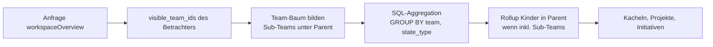

# 14 – Firmenweite Sicht (teamübergreifend)

Neben den Team-Seiten bietet Lineal eine **Workspace-Ebene**, auf der Führungskräfte und Teams den Stand der ganzen Firma sehen: alle Issues aller (sichtbaren) Teams, alle Projekte und Initiativen, Auslastung und Fortschritt pro Team. Es gibt keine eigenen Daten dafür. Die firmenweite Sicht ist eine Menge von **Abfragen und Ansichten über bestehende Entitäten**, immer gefiltert durch die Sichtbarkeit des Betrachters ([02](02-teams-rechte.md)).

## 1. Grundsätze

1. **Sichtbarkeit zuerst:** Jede firmenweite Abfrage wird mit `visible_team_ids(ctx)` geschnitten. Private Teams, in denen der Betrachter nicht Mitglied ist, tauchen weder als Zeile noch in Summen auf. Aggregate verraten nichts über unsichtbare Teams.
2. **Hierarchie-Rollups:** Sub-Teams werden ihrem Parent zugerechnet, wenn „inkl. Sub-Teams“ aktiv ist (Default an). Ein Parent zeigt dann eigene Zahlen + Summe der Kinder.
3. **Gleiche Bausteine wie überall:** Filtermodell, Anzeigeoptionen und Custom Views aus [05](05-views-suche-inbox.md); eine firmenweite Ansicht ist eine Custom View mit Scope `workspace` und ohne Team-Filter.
4. **Gäste** haben keinen Zugriff auf die Workspace-Ebene (wie im Original keine Workspace-Views und keine Initiativen).

## 2. Ansichten

| Ansicht | URL | Inhalt |
|---|---|---|
| **Workspace-Issues** | `/{ws}/issues` | Alle Issues aller sichtbaren Teams. Default-Gruppierung **nach Team** (Sub-Teams eingerückt), Sub-Gruppierung nach Status-Kategorie. Umschaltbar auf Gruppierung nach Assignee, Projekt, Priorität, Label, Cycle. Liste und Board. |
| **Übersicht (Dashboard)** | `/{ws}/overview` | Kacheln pro Team (siehe 3), Projekt-Health-Übersicht, Initiativen-Status, überfällige/SLA-gefährdete Issues |
| **Portfolio / Roadmap** | `/{ws}/projects` (Layout `timeline`) | Alle Projekte aller sichtbaren Teams auf einer Zeitachse, gruppiert nach Initiative oder Lead-Team; Health und Fortschritt am Balken |
| **Initiativen-Baum** | `/{ws}/initiatives` | DAG als eingerückte Liste mit Rollup von Health und Fortschritt |
| **Auslastung** | `/{ws}/workload` | Matrix Person × Team: offene Issues und Schätzungspunkte im aktuellen Cycle; Personen mit Arbeit in mehreren Teams sind sofort sichtbar |
| **Cycle-Übersicht** | `/{ws}/cycles` | Aktive Cycles aller Teams nebeneinander: Fortschritt, Scope-Änderung, Restlaufzeit |

Alle Ansichten lassen sich filtern (Team-Auswahl mehrfach, „inkl. Sub-Teams“, Projekt, Initiative, Label, Assignee, Zeitraum) und als Custom View speichern und favorisieren.

## 3. Kennzahlen pro Team (Dashboard-Kachel)

| Kennzahl | Definition |
|---|---|
| Offene Issues | Kategorie `triage`, `backlog`, `unstarted`, `started` |
| In Arbeit | Kategorie `started` |
| Triage-Eingang | Kategorie `triage`, dazu ältestes Alter |
| Erledigt (letzte 7/30 Tage) | `completedAt` im Zeitraum |
| Durchsatz | erledigte Issues bzw. Punkte pro Woche, letzte 6 Wochen |
| Cycle-Fortschritt | `progress` des aktiven Cycles ([04](04-planung.md)) |
| Überfällig | `dueDate < heute` und offen |
| SLA gefährdet / verletzt | `slaHighRiskAt <= now` bzw. `slaBreachesAt <= now` |
| Projekte nach Health | Anzahl `onTrack` / `atRisk` / `offTrack` / ohne Update |

Berechnung: zur Laufzeit per SQL-Aggregation (`GROUP BY team_id, state_type`) über die Issue-Tabelle mit Index `(organization_id, team_id, state_type)`. Ab ca. 100 000 Issues pro Workspace optional materialisierte Tagessnapshots (`team_metrics_daily`), gefüllt vom Snapshot-Job aus [10 §3](10-architektur-umsetzung.md).

## 4. Schnittstellen

**GraphQL:**

| Operation | Zweck |
|---|---|
| `issues(filter, …)` ohne Team-Filter | Workspace-Issues (existiert bereits, [09](09-api-events.md)); `filter.team` optional mit `includeSubTeams` |
| `workspaceOverview(input: { teamIds?, includeSubTeams = true, period })` → `{ teams: [TeamMetrics], projects: ProjectHealthSummary, initiatives: [InitiativeSummary], atRisk: [IssueRef] }` | Dashboard **Umsetzung:** `workspaceOverview` und `get_workspace_overview` verwenden den Default `includeSubTeams = true`; Team-Views ([05 §3](05-views-suche-inbox.md)) behalten `false`. |
| `workload(input: { teamIds?, cycle: current \| next })` → `[{ user, perTeam: [{ team, openIssues, points }] }]` | Auslastung |
| `activeCycles(teamIds?)` | Cycle-Übersicht |

**MCP:** Agenten nutzen die bestehenden Tools teamübergreifend (`list_issues` ohne `team`, `list_projects`, `list_initiatives`). Zusätzlich gibt es ein Lineal-eigenes Tool **`get_workspace_overview`** (Eingabe: `teams?: string[]`, `includeSubTeams?: boolean`, `period?: "7d" | "30d"`; Ausgabe: Kennzahlen aus Abschnitt 3). Es ist eine bewusste, dokumentierte Erweiterung über den Linear-MCP hinaus und erscheint in `tools/list` nach den 55 kompatiblen Tools. Der Snapshot-Test prüft die 55 kompatiblen Tools exakt; Erweiterungen stehen in einer eigenen Liste.

## 5. UI

- Sidebar, Workspace-Bereich: **Overview**, **Issues** (alle Teams), Projects, Initiatives, Views, **Workload**, **Cycles**.
- In der Workspace-Issue-Liste trägt jede Zeile den Team-Key (Kennung) und optional ein Team-Badge; Gruppenköpfe zeigen Team-Icon und Zahl.
- Tastatur: `g o` Overview, `g w` Workspace-Issues; Command-Menü „Go to company overview“.
- Wechsel Team ↔ Firma ohne Kontextverlust: Ein auf Team-Ebene gesetzter Filter kann per Klick „Für alle Teams anzeigen“ auf die Workspace-Liste übertragen werden (Team-Kriterium entfällt, Rest bleibt).

## 6. Abnahmekriterien

1. Bob (Mitglied in ENG, WEB, DES) sieht in `/acme/issues` Issues aller drei Teams; Alice (nicht in DES) sieht DES weder als Gruppe noch in Summen.
2. Mit „inkl. Sub-Teams“ enthält die ENG-Kachel die Zahlen von WEB; ohne nicht.
3. Gäste erhalten für `workspaceOverview` `forbidden`.
4. `get_workspace_overview` liefert dieselben Zahlen wie die GraphQL-Abfrage.
