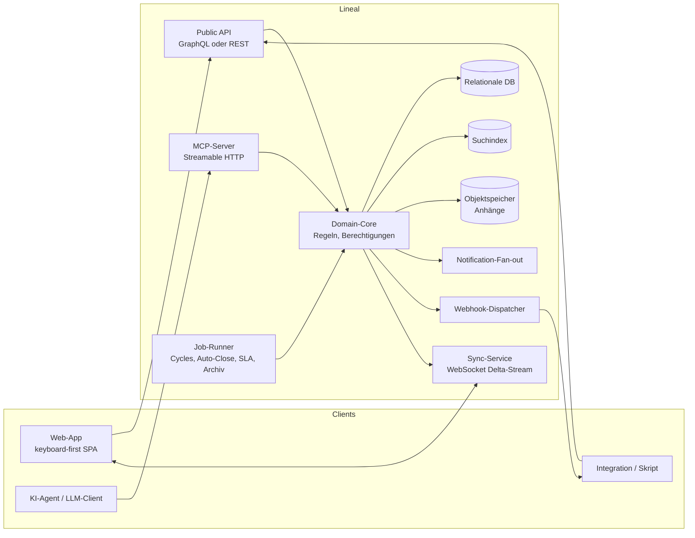

# Lineal – Implementationsdokumentation für einen Linear-Nachbau

Diese Dokumentation beschreibt einen funktionalen Nachbau der Kernfunktionen von [Linear](https://linear.app) mit **mehreren Teams** und einem **eigenen MCP-Server**. Sie ist so geschrieben, dass ein Team das System in einer beliebigen Programmiersprache und mit beliebigem Stack umsetzen kann: Datenmodelle, Regeln, Schnittstellen und Abläufe sind sprachneutral spezifiziert (Tabellen, JSON Schema, Mermaid-Diagramme, Pseudocode).

Grundlage (Stand 2026-10-10):
- öffentliche Linear-Dokumentation (`linear.app/docs`, Developer-Doku),
- das öffentliche GraphQL-Schema des Linear-SDK (`linear/linear`, `packages/sdk/src/schema.graphql`),
- die Tool-Schemas und beobachteten Antworten des offiziellen Linear-MCP-Servers,
- Beobachtungen der Linear-Web-Oberfläche (nur lesend).

## Lesereihenfolge

| Nr | Dokument | Inhalt |
|---|---|---|
| 00 | [Konventionen](00-konventionen.md) | IDs, Formate, Enums, Paginierung, Fehlermodell, Glossar – **zuerst lesen** |
| 01 | [Domänenmodell](01-domaenenmodell.md) | Alle Entitäten, Felder, Beziehungen, ER-Diagramme |
| 02 | [Workspace, Teams, Rechte](02-teams-rechte.md) | Multi-Team-Modell, Sub-Teams, Vererbung, Sichtbarkeit, Rollen, Teamwechsel von Issues |
| 03 | [Issues, Workflow, Triage](03-issues-workflow.md) | Status-Workflows, Issue-Felder, Relationen, Labels, Kommentare, Anhänge, Historie, Triage, SLA, Automationen |
| 04 | [Planung](04-planung.md) | Cycles, Projekte, Meilensteine, Initiativen, Statusberichte |
| 05 | [Views, Suche, Inbox](05-views-suche-inbox.md) | Filtermodell, Anzeigeoptionen, Custom Views, Suche, Benachrichtigungen |
| 06 | [Dokumente & Templates](06-dokumente-templates.md) | Dokumente, Issue-/Projekt-/Dokument-Templates |
| 07 | [MCP-Server](07-mcp-server.md) | Vollständige Tool-Spezifikation des eigenen MCP-Servers |
| 08 | [User Flows](08-userflows.md) | Bedienabläufe als Diagramme, UI-Struktur, Tastaturkürzel |
| 09 | [API, Events, Sync](09-api-events.md) | Öffentliche API, Webhooks, Echtzeit-Sync, Auth, Rate-Limits |
| 10 | [Architektur & Umsetzungsplan](10-architektur-umsetzung.md) | Komponenten, Hintergrundjobs, Persistenz, Phasenplan, Abnahmekriterien, **gewählter Stack** |
| 11 | [Implementierungsarchitektur](11-implementierungsarchitektur.md) | Rust-Crates, Ports, Repository-Layout, Frontend-Architektur, Dev-Setup |
| 12 | [Arbeitspakete](12-arbeitspakete.md) | Wellen, Abhängigkeiten, Datei-Eigentum, DoD je Paket |
| 13 | [Import aus Linear](13-import-linear.md) | Migration eines Linear-Workspaces: Mapping, Phasen, Delta-Import, Sicherheit |
| 14 | [Firmenweite Sicht](14-firmenweite-sicht.md) | Teamübergreifende Issues, Dashboard, Roadmap, Auslastung |
| 15 | [Umsetzungsstand](15-umsetzungsstand.md) | Was implementiert ist, bekannte Lücken, Betrieb (Env, Jobs, Ports), Sicherheitsmaßnahmen, Entscheidungen bei Widersprüchen |

Eine gerenderte Übersicht mit allen Diagrammen liegt in [index.html](index.html).

Weitere Artefakte:
- [`mcp-tools.snapshot.json`](mcp-tools.snapshot.json) – Name, Beschreibung und Eingabeschema aller 55 MCP-Tools; Fixture für den Schema-Snapshot-Test (siehe [07](07-mcp-server.md)).
- `assets/mermaid.min.js` – lokale Mermaid-Kopie, damit `index.html` offline rendert.
- `../tools/build_index.py` – erzeugt `index.html` neu aus den Markdown-Dateien (`python3 tools/build_index.py`, benötigt das Python-Paket `markdown`). Die Markdown-Dateien sind die maßgebliche Quelle.

## Scope

**Im Scope (Kernfunktionen):**
- Workspace, Teams, Sub-Teams, Mitgliedschaften, Rollen, private Teams, Gäste
- Issues inkl. Workflow-Status, Priorität, Schätzung, Labels (inkl. Gruppen), Sub-Issues, Relationen, Fälligkeit, SLA, Kommentare, Reaktionen, Anhänge, Aktivitätsverlauf, Abonnements
- Triage inkl. Triage-Verantwortung
- Cycles, Projekte (mehrere Teams), Projektstatus, Meilensteine, Initiativen (hierarchisch), Status-Updates mit Health
- Filter, Anzeigeoptionen, Custom Views, Favoriten, „My Issues“, Volltextsuche
- Inbox/Benachrichtigungen inkl. Snooze und Abo-Regeln
- Dokumente und Templates
- Öffentliche API, Webhooks, eigener MCP-Server
- Import/Migration aus Linear (API und CSV), firmenweite teamübergreifende Sicht

**Bewusst außerhalb des Scopes** (werden nur als Erweiterungspunkte erwähnt): Code-Review/Diffs, Releases und Release Notes, Agent Skills und Delegation an KI-Agenten (das Feld `delegate` wird als optionales Feld vorgesehen), Customer Requests/Customer Needs, Triage Intelligence (KI-Vorschläge), Git-/Slack-/Zendesk-Integrationen, Insights/Analytics, Asks, Pulse, Billing, SSO/SCIM.

## Systemkontext

Der **Domain-Core** ist die einzige Stelle, an der Geschäftsregeln leben. API, MCP-Server und Sync sind dünne Adapter darüber. Das ist die wichtigste Architekturentscheidung: Der MCP-Server darf keine eigene Logik duplizieren, sondern ruft dieselben Use-Cases auf wie die API.

## Getroffene Entscheidungen

Wo Quellen sich widersprechen oder schweigen, gilt Folgendes (Begründung jeweils kurz):

| Thema | Entscheidung | Begründung |
|---|---|---|
| Label-Gruppen | Es gibt `singleSelect` (Default) **und** `multiSelect`. | Aktuelles Schema/MCP kennen beide; ältere Doku nur Single-Select. |
| Duplikate | Markieren als Duplikat setzt das Issue in den system-verwalteten Status der Kategorie `duplicate` (pro Team genau einer, nicht umbenennbar). | Schema markiert den alten Canceled-Mechanismus als deprecated. |
| Initiative-Hierarchie | Eine Initiative darf **mehrere Eltern** haben (gerichteter azyklischer Graph, Join-Tabelle). Zyklen sind verboten. | MCP `parentInitiatives` ist ein Array „appended to existing parents“. |
| Eltern von Dokumenten | Genau **ein** Elternobjekt aus: Project, Issue, Initiative, Cycle, Team. | MCP `save_document` erzwingt dies. |
| Sichtbarkeit von Sub-Teams | Ein Sub-Team darf **nicht offener** sein als sein Parent. Unter einem privaten Parent: `restricted` (Default; Parent-Mitglieder sehen es und dürfen beitreten) oder `private`. | Enum `public/private/restricted`; Doku-Widerspruch, abgeleitete Regel. |
| Benachrichtigungs-Limit | Max. 2 000 nicht archivierte Benachrichtigungen pro User; ältere werden automatisch archiviert. | Doku-FAQ. |
| MCP-Kompatibilität | **Tool-Namen und Eingabeschemas identisch** zum offiziellen Linear-MCP (Drop-in für bestehende Agenten). **Antwortformen normalisiert** (einheitliche Paginierung, einheitliche Status-Objekte). Abweichungen sind in [07](07-mcp-server.md) tabelliert. | Agenten-Prompts bleiben übertragbar, Implementierung bleibt konsistent. |
| Fehler bei unbekannten Filtern | `not_found` statt leerer Liste. | Fail loud, siehe [00](00-konventionen.md#7-fehlermodell). |
| Team-Key ändern | Erlaubt; alle Issue-Kennungen des Teams wechseln auf den neuen Key, die alten Kennungen werden in `previousIdentifiers` aufgenommen und bleiben auflösbar. | Original-Verhalten undokumentiert; diese Variante bricht keine Links. |
| Team-Key-Format | `^[A-Z][A-Z0-9]{0,6}$`, **kein Bindestrich**, nicht `P`/`I`. Sub-Teams haben einen eigenen kurzen Key (`WEB`); die Hierarchie steht nur im `displayName` („Engineering › Web“). | Kennungen `KEY-123` bleiben eindeutig zerlegbar. |
| Fortschritt `progress` | Im Domänenmodell `Float 0..1`; in MCP-Antworten als Zahl `0..100` serialisiert. | Rechnen mit Anteilen, LLM-freundliche Ausgabe wie im Original-MCP. |
| Cycle-Flag | Im Domänenmodell `isActive`; in der MCP-Antwort wie im Original `isCurrent`. | MCP-Kompatibilität. |
| `list_cycles` ohne aktivierte Cycles | Leere Liste `{ "cycles": [], "hasNextPage": false }`, kein Fehler. | Team-Referenz ist gültig; „fail loud“ gilt nur für unauflösbare Referenzen. |
| Pläne/Limits | Planabhängige Limits (Anzahl Teams, Sub-Team-Tiefe 5, private Teams) werden als **konfigurierbare Workspace-Limits** implementiert, nicht hart codiert. | Billing ist außerhalb des Scopes. |
